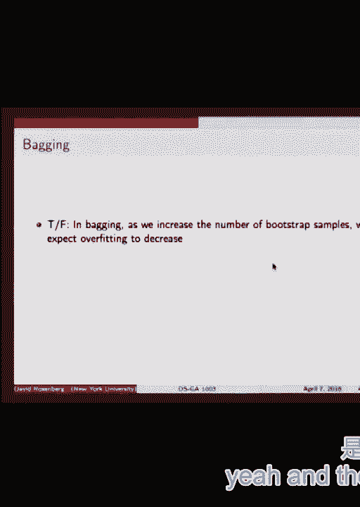
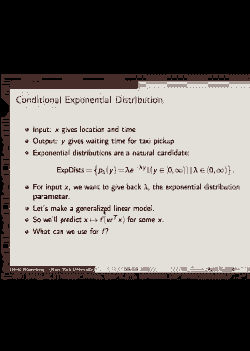

# 18：机器学习复习课：考试要点梳理 📚

在本节课中，我们将复习第一次考试后至今所学的核心内容，为即将到来的考试做准备。课程将涵盖核方法、决策树、集成学习（Bagging、Boosting）以及多类分类等关键主题。

## 核方法回顾 🔍

上一节我们介绍了核方法的基本思想。本节中我们来看看核技巧的具体含义和应用。

核技巧适用于那些目标函数可以完全表示为输入数据内积形式的机器学习算法。具体来说，当算法中的目标函数仅依赖于输入数据点 **x_i** 和 **x_j** 的内积 **x_i^T x_j**，而不单独出现 **x_i** 时，就可以应用核技巧。

核技巧的核心在于，我们可以将这个标准的内积替换为其他形式的内积。这通常通过两种方式实现：

以下是构造新核函数的两种主要方法：
1.  **定义新的特征映射**：引入一个特征映射函数 **φ(x)**，将原始输入空间映射到新的特征空间，然后在新空间中使用标准欧几里得内积，即 **K(x_i, x_j) = φ(x_i)^T φ(x_j)**。
2.  **直接定义核函数**：直接定义一个函数 **K(x_i, x_j)**，并证明它满足作为内积所需的条件（对称性、正定性）。

## 决策树特性 🌳

接下来，我们转向决策树模型。决策树有一些独特的性质，使其在特定场景下非常有用。

决策树模型不关心特征的具体数值，只关心特征值的相对排序。例如，对“温度”特征进行对数变换，不会改变决策树的划分结果，因为值的相对顺序保持不变。

决策树通过一系列规则将输入空间划分为不同的矩形区域，每个区域对应树的一个叶节点，并拥有自己的预测值。

一个有趣的技巧是将叶节点转换为特征。具体来说，可以为树的每个叶节点（即每个区域）定义一个指示函数。该函数在输入 **x** 落入对应区域时输出1，否则输出0。这样，我们就得到了一个非线性的特征映射。

将这些非线性特征（指示函数）作为新的输入，传递给线性模型（如Lasso回归），就可以利用所有数据训练出一个具有非线性决策边界的模型。这种方法结合了树模型捕捉非线性结构的能力和线性模型高效处理大数据集的优势。

## 集成学习：Bagging 🤝

现在，让我们探讨集成学习方法。首先介绍Bagging（自助聚合）。

Bagging的基本流程如下：从大小为N的数据集中，有放回地抽取一个大小为N的自助样本，在此样本上训练一个基学习器。重复此过程多次，得到多个模型。最终的预测是所有模型预测的平均值。

Bagging的主要思想是降低模型预测的方差，从而提升泛化性能。随着自助样本数量的增加，模型的平均预测会趋于稳定，通常不会导致过拟合加剧。

以下是Bagging的一个关键特性：
*   **方差减少**：对多个独立训练的模型取平均，可以减少预测的方差。
*   **偏差不变**：模型的平均预测的期望值（偏差）与单个模型的期望值相同，因此Bagging不改变偏差。

为了在训练过程中评估模型性能，可以使用“袋外”估计。在构建每个自助样本时，平均约有 **1/e ≈ 36.8%** 的原始数据未被选中，这些数据可以作为该基学习器的验证集，用于评估其性能。

## 集成学习：随机森林与Boosting 🌲➡️🌳

基于Bagging的思想，我们进一步学习随机森林和Boosting。

随机森林是Bagging的一个扩展，专门用于决策树。除了对数据行进行自助采样外，它在构建每棵树的每个节点时，还会从所有特征中随机选取一个子集（例如，特征总数的平方根）来寻找最佳划分点。这增加了树之间的多样性，进一步降低了方差。

Boosting是另一种强大的集成技术，它顺序地训练一系列弱学习器，每个新学习器都更关注前序学习器预测错误的样本。

以下是关于AdaBoost和梯度提升的要点：
*   **AdaBoost**：要求基学习器输出硬分类（如-1或+1）。它通过最小化指数损失函数来逐步组合弱学习器。指数损失对错分样本惩罚很重，因此对异常值敏感。
*   **梯度提升**：这是一种更通用的框架。它需要指定一个可微的损失函数和一个能够进行回归的基学习器（因为需要拟合当前模型的负梯度）。算法通过梯度下降的思想，在函数空间中进行优化，逐步添加新模型来减少损失。

## 多类分类模型 🎯

最后，我们复习多类分类问题。我们讨论了几种将二分类扩展到多类的方法。

在多类分类中，我们有一个类别敏感的损失函数 **L(a, y)**，其中 `a` 是预测的类别，`y` 是真实类别。损失矩阵通常在对角线（正确分类）上为0。

我们介绍了基于线性评分函数的方法。定义一个特征映射 **φ(x, y)**，它编码了输入 **x** 和类别标签 **y** 的兼容性。评分函数为 **s(x, y) = w^T φ(x, y)**，最终预测为得分最高的类别 **argmax_y s(x, y)**。

常用的多类损失函数包括：
1.  **多类Hinge损失**：用于支持向量机风格的多类分类。
2.  **多类逻辑损失（Softmax）**：对应于多项式逻辑回归，通过最大化似然（或最小化负对数似然）进行训练。

我们还回顾了条件概率模型的一般形式：通过线性变换 **w^T x** 得到一个分数，再通过一个链接函数 **f** 将其映射到合适的参数空间（例如，使用sigmoid函数得到概率，使用exp函数得到泊松分布的参数）。

## 总结 📝

本节课中我们一起复习了机器学习中多个核心主题。我们回顾了核技巧的本质及其两种实现方式，理解了决策树基于排序的特性以及将其叶节点作为特征使用的技巧。我们深入探讨了集成学习，明确了Bagging降低方差、不改变偏差的原理，以及随机森林通过特征采样增加多样性的机制。我们还对比了AdaBoost和更通用的梯度提升框架。最后，我们梳理了多类分类的建模思路和常用的损失函数。希望本次复习能帮助大家更好地准备考试。