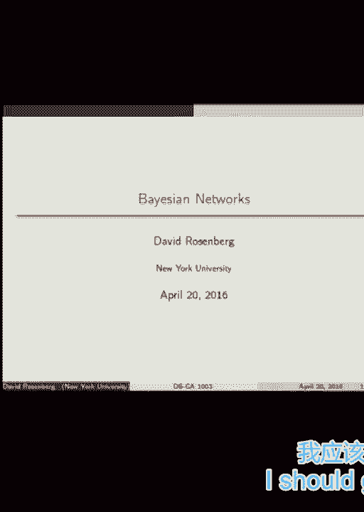
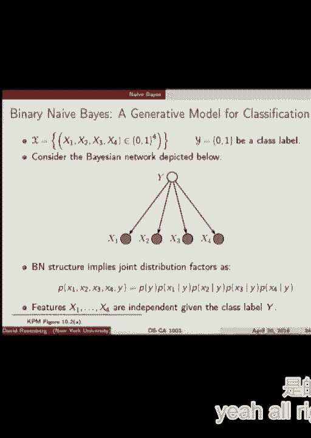
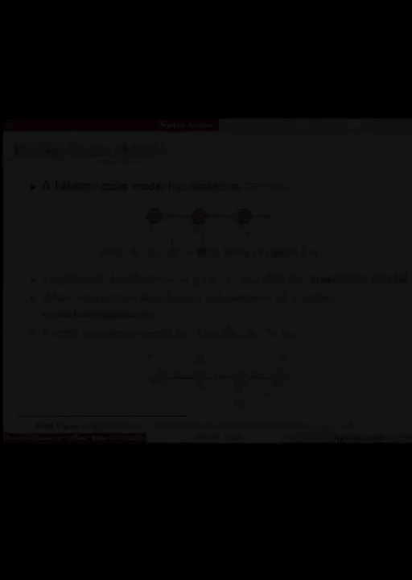
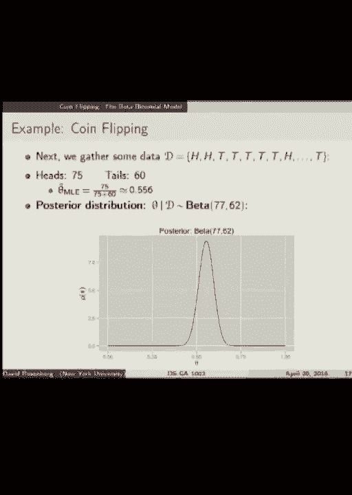
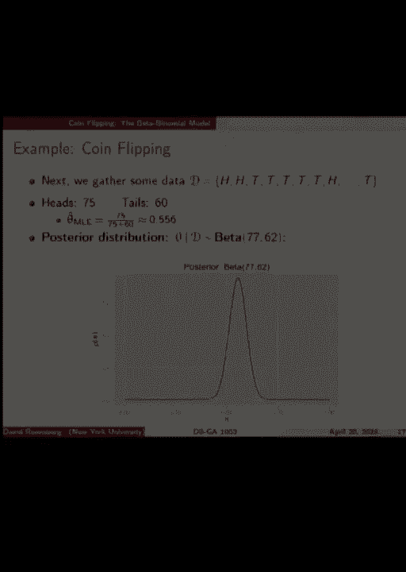

# 19：贝叶斯网络与贝叶斯方法入门 🧠

在本节课中，我们将学习机器学习中的两个核心概念：**贝叶斯网络**和**贝叶斯方法**。贝叶斯网络是一种描述概率分布的语言，而贝叶斯方法则提供了一种基于概率的推理框架。我们将从基础概念开始，逐步深入，确保初学者也能轻松理解。

---

## 概率推理概述 📊

概率推理的核心思想是使用随机变量来表示我们感兴趣的系统。例如，在机器学习中，特征和标签都可以被视为随机变量。为了完全理解这个系统，我们需要知道这些随机变量的**联合分布**。

一旦我们有了联合分布，就可以进行**推理**，即对系统提出查询。例如，给定某些变量的观测值，我们可以推断其他变量的最可能值或其分布。这个过程与**学习**（即找出概率分布本身）是相辅相成的。

一个典型的例子是医学诊断：我们有代表症状（如咳嗽、发烧）和疾病（如感冒、肺炎）的随机变量。通过观察某些症状，我们可以推断患者患某种疾病的概率。

---

## 联合分布与参数问题 🧮

我们如何表示离散随机变量的概率分布？一种直接的方法是列出所有可能的变量组合及其概率，形成一个巨大的概率表。

假设我们有 `d` 个二元随机变量。表示其无限制的**全联合分布**需要多少参数？答案是 `2^d - 1`。这是因为每个变量有两种状态，共有 `2^d` 种组合，而所有概率之和为1，因此可以省略一个参数。

当变量数量 `d` 很大时（例如成百上千），这种表示方法所需的参数数量会呈指数级增长，导致存储、计算和参数估计都变得不可行。因此，我们需要找到限制概率分布复杂性的方法。

---

## 独立性假设 🔗

限制概率分布集合的一个标准方法是做出**独立性假设**。最极端的情况是假设所有 `d` 个随机变量都**相互独立**。在这种情况下，联合概率等于各变量边缘概率的乘积。

对于 `d` 个二元随机变量，在相互独立的假设下，仅需要 `d` 个参数（每个变量一个概率值）即可表示整个分布。这与无限制联合分布所需的 `2^d - 1` 个参数形成了鲜明对比。

然而，完全独立通常是一个过强的假设。现实中，变量之间往往存在依赖关系。因此，我们需要一个介于完全依赖和完全独立之间的折中方案。

---

## 条件独立性 🤝

**条件独立性**是贝叶斯网络的核心思想。它描述的是：在给定某些其他变量的条件下，另一些变量变得独立。

考虑一个例子：有三个变量——`R`（下雨）、`W`（草湿）、`S`（路滑）。如果知道正在下雨（`R`），那么知道草是湿的（`W`）并不会提供关于路是否滑（`S`）的额外信息，因为 `R` 已经解释了 `W` 和 `S`。因此，在给定 `R` 的条件下，`W` 和 `S` 是条件独立的，记作 `W ⊥ S | R`。

形式化定义如下：给定随机变量 `R`，`W` 和 `S` 条件独立，当且仅当 `P(W, S | R) = P(W | R) * P(S | R)`。

利用条件独立性，我们可以用更少的参数来表示联合分布。在上面的例子中，无假设时需要7个参数，完全独立时需要3个参数，而引入条件独立性后只需要5个参数。这有效地控制了模型的复杂度。

---

## 贝叶斯网络：定义与表示 🕸️

**贝叶斯网络**是一种用于指定具有特定因子分解的联合概率分布的图模型。这种因子分解通常对应着条件独立性关系。

一个贝叶斯网络是一个**有向无环图**，其中：
*   每个节点代表一个随机变量。
*   每条有向边表示变量之间的直接依赖关系。
*   没有父节点的节点有其**边缘概率分布**。
*   有父节点的节点有其**条件概率分布**，条件是其所有父节点。

根据图结构，联合概率分布可以分解为每个节点在其父节点条件下的概率的乘积。对于一个有变量 `X1, X2, ..., Xn` 的网络，其联合分布为：
`P(X1, X2, ..., Xn) = ∏ P(Xi | Parents(Xi))`

---

## 贝叶斯网络中的结构模式 🔄

贝叶斯网络中的图结构编码了特定的条件独立性。以下是三种基本结构模式：

1.  **共同原因（Common Cause）**
    *   **结构**：`C → A`， `C → B` （一个父节点，两个子节点）
    *   **例子**：`C`=下雨，`A`=路滑，`B`=草湿。
    *   **独立性**：`A` 和 `B` 一般不独立，但在给定 `C` 时条件独立。

2.  **链式结构/间接影响（Chain）**
    *   **结构**：`A → C → B`
    *   **例子**：`A`=下雨，`C`=地湿，`B`=鞋脏。
    *   **独立性**：`A` 和 `B` 一般不独立，但在给定 `C` 时条件独立。

3.  **共同结果（Common Effect）**
    *   **结构**：`A → C`， `B → C` （两个父节点，一个子节点）
    *   **例子**：`A`=课程难度，`B`=知识水平，`C`=期末成绩。
    *   **独立性**：`A` 和 `B` 最初是独立的，但在**观察到** `C` 后，它们变得**不独立**（已知成绩后，课程难度能提供关于知识水平的新信息）。

---

## 朴素贝叶斯分类器 📨

**朴素贝叶斯**是贝叶斯网络在机器学习中的一个经典应用，常用于文本分类等问题。

其网络结构非常简单：一个父节点代表类别标签 `Y`，多个子节点代表特征 `X1, X2, ..., Xd`，所有特征都只依赖于类别标签。

这编码了一个关键假设：在给定类别标签 `Y` 的条件下，所有特征 `Xi` 都是**条件独立**的。虽然这个假设在现实中往往不成立（例如文本中的词语并非独立），但它极大地简化了模型，使得参数估计和计算变得非常高效。

对于二元特征和二元分类，模型需要 `1 + 2d` 个参数：1个用于 `P(Y)`，`2d` 个用于所有 `P(Xi | Y)`。

---

## 从贝叶斯网络到其他模型 🔄

贝叶斯网络的框架可以衍生出许多强大的模型：

*   **马尔可夫链**：可以视为一个线性链状的贝叶斯网络，描述了状态随时间的转移。
*   **隐马尔可夫模型**：包含未被观测的隐状态序列 `Z` 和与之相关的观测序列 `X`。`Z` 形成一个马尔可夫链，而每个观测 `X_t` 只依赖于当前隐状态 `Z_t`。
*   **卡尔曼滤波器**：是隐马尔可夫模型在连续变量下的特例，其中所有分布（状态转移和观测）都是高斯的，且是线性的。广泛应用于目标跟踪等领域。
*   **最大熵马尔可夫模型**：箭头方向与隐马尔可夫模型相反，直接对给定观测序列 `X` 的标签序列 `Y` 的条件分布 `P(Y | X)` 进行建模，常用于序列标注任务。

---

## 贝叶斯方法：从频率主义到贝叶斯推断 🔄

上一节我们介绍了如何用图模型表示概率关系。本节我们来看看另一种重要的概率思想——**贝叶斯方法**。它与经典的频率主义统计学有着根本的不同。

在**频率主义**统计中：
*   参数 `θ` 被视为一个固定但未知的常量。
*   我们从数据中计算一个**统计量**（数据的函数）作为 `θ` 的**点估计**（如样本均值估计总体均值）。
*   我们关注估计量的性质，如**一致性**（数据量无限时收敛到真值）和**效率**（收敛速度快慢）。

在**贝叶斯**统计中：
*   参数 `θ` 本身被视为一个**随机变量**，具有自己的概率分布。
*   我们在看到数据之前，对 `θ` 有一个**先验分布** `P(θ)`，它编码了我们的初始信念。
*   我们有一个描述数据 `D` 如何依赖于 `θ` 的**似然模型** `P(D | θ)`。
*   在看到数据 `D` 后，我们根据贝叶斯定理更新信念，得到**后验分布** `P(θ | D)`。

贝叶斯定理公式如下：
`P(θ | D) = [P(D | θ) * P(θ)] / P(D)`
其中 `P(D) = ∫ P(D | θ)P(θ) dθ` 是数据的边际似然（通常视为归一化常数）。

后验分布综合了先验知识和观测数据，代表了看到数据后对参数 `θ` 的理性信念状态。

---

## 抛硬币例子：共轭先验 🪙

让我们用一个抛硬币的例子来具体说明。参数 `θ` 是硬币正面朝上的概率，取值范围 `[0, 1]`。我们观察到 `n_h` 次正面和 `n_t` 次反面。

*   **似然**：`P(D | θ) ∝ θ^{n_h} * (1-θ)^{n_t}` （伯努利分布）
*   **先验**：我们选择 `θ` 上的 **Beta分布** 作为先验，因为它定义在 `[0,1]` 区间且形式灵活。
    Beta分布的概率密度函数为：`P(θ) ∝ θ^{α-1} * (1-θ)^{β-1}`
    其中 `α, β` 是超参数，可以理解为“先验的虚拟成功次数和失败次数”。
*   **后验**：将似然与先验相乘，得到后验分布：
    `P(θ | D) ∝ θ^{n_h} * (1-θ)^{n_t} * θ^{α-1} * (1-θ)^{β-1} = θ^{(α+n_h)-1} * (1-θ)^{(β+n_t)-1}`
    这正是另一个 Beta 分布，参数更新为 `(α+n_h, β+n_t)`。

当先验分布与后验分布属于同一分布族时，我们称该先验为**共轭先验**。共轭先验使得后验计算有解析解，非常方便。Beta分布是伯努利/二项似然的共轭先验。

随着数据量的增加，后验分布会越来越集中于 `θ` 的真实值附近（方差减小）。

---

## 贝叶斯点估计 🎯

得到后验分布 `P(θ | D)` 后，如果我们仍需一个具体的点估计值 `θ_hat`，该如何选择呢？这取决于我们如何定义“好”的估计。

常见的基于后验分布的点估计有：
1.  **后验均值**：`θ_hat = E[θ | D]`。在平方损失函数下，这是最优估计。
2.  **后验中位数**：在绝对损失函数下，这是最优估计。
3.  **最大后验估计**：`θ_hat = argmax_θ P(θ | D)`，即后验分布的**众数**。在“0-1”损失函数（只关心估计是否完全正确）下，这是最优估计。MAP估计也常被使用。

---

## 总结 📝

本节课我们一起学习了概率图模型和贝叶斯推断的核心思想。

*   我们首先了解了用联合分布表示系统以及进行概率推理的概念。
*   为了应对联合分布参数过多的问题，我们引入了**条件独立性**假设。
*   **贝叶斯网络**作为一种有向无环图，提供了一种直观表示变量间条件依赖关系的方式，其联合分布可分解为局部条件概率的乘积。我们分析了三种基本结构及其蕴含的独立性。
*   我们看到了贝叶斯网络在机器学习中的直接应用——**朴素贝叶斯分类器**，以及它如何衍生出隐马尔可夫模型等更复杂的模型。
*   随后，我们转向**贝叶斯方法**，理解了它与频率主义统计的区别，核心在于将参数视为随机变量并利用先验分布和贝叶斯定理得到后验分布。
*   通过**抛硬币**的例子，我们实践了共轭先验（Beta分布）如何使后验计算变得简单，并讨论了如何从后验分布中得到点估计（如后验均值、MAP估计）。

贝叶斯网络和贝叶斯方法为我们提供了强大的工具，用于在不确定性下进行建模、推理和决策。