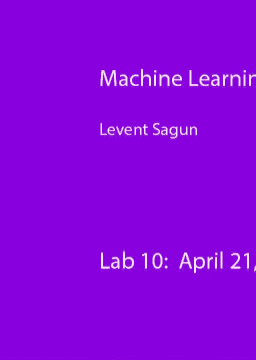
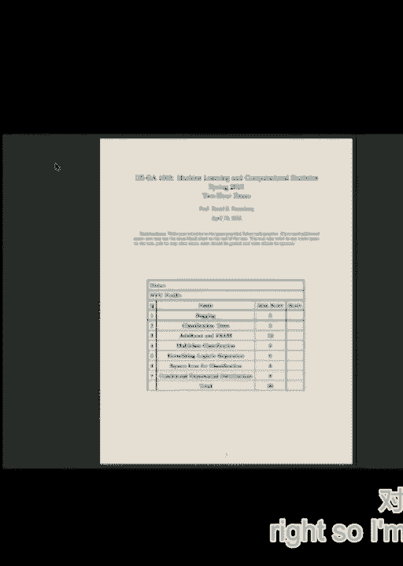
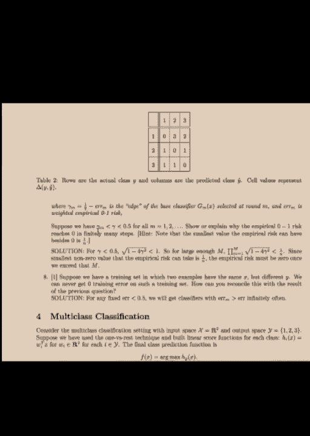
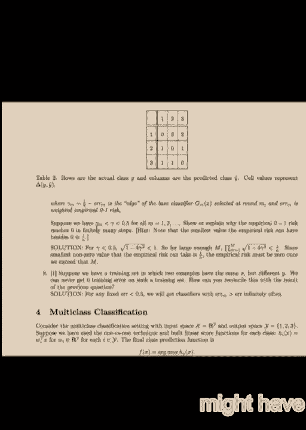
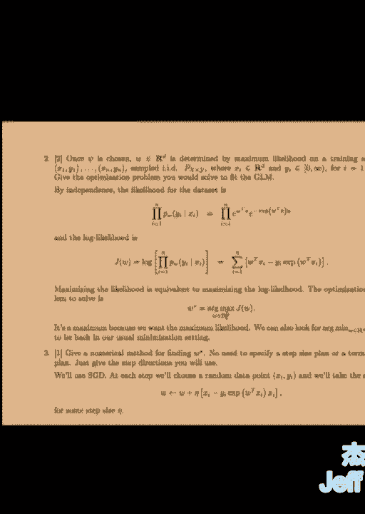

# 20：Lab_April_21 试题解析教程 📚

在本教程中，我们将对20 的 Lab_April_21 试题进行详细解析。我们将逐一讲解各个部分的核心概念、解题思路和关键步骤，确保初学者也能轻松理解。课程内容涵盖了机器学习中的基础概率、决策树、集成学习、损失函数优化等多个重要主题。

---

## 第一部分：基础概率与期望值 📊

上一节我们介绍了课程的整体结构，本节中我们来看看第一部分关于基础概率与期望值的题目。

这部分主要考察对期望值、偏差和方差等基本概念的理解。题目描述了一个从数据分布 D 中采样，并比较预测平均值与实际值的过程。

**核心概念**：
*   **期望的线性性质**：`E[aX + b] = aE[X] + b`
*   **方差的非线性性质**：`Var(aX) = a²Var(X)`
*   **样本均值的方差**：`Var(样本均值) = Var(单个样本) / 样本数量`

以下是解题的关键步骤：

1.  **期望值计算**：预测平均值 `Z-bar` 的期望值等于单个预测 `Z` 的期望值，因为期望算子是线性的。
2.  **偏差分析**：预测的期望值与真实值 `μ` 之间的差异即为偏差。由于 `μ` 是常数，`Z` 和 `Z-bar` 的偏差期望值相同。
3.  **方差分析**：利用方差性质 `Var(cX) = c²Var(X)` 以及独立同分布样本的方差可加性，推导出 `Z-bar` 的方差是 `Z` 的方差除以样本数量 `m`。
4.  **模型选择**：应选择方差较小的预测模型，因为方差越小，预测越稳定。
5.  **相关性影响**：如果预测之间存在正相关性，通常会增大整体方差，因此应优先选择相关性较小的模型。

---

## 第二部分：决策树与信息熵 🌳

在理解了基础统计量之后，我们进入决策树部分，这里考察信息熵的计算和信息增益的理解。

题目给出了一个包含四个样本的数据集，目标是根据特征（如“宠物距离”、“开放空间”）预测“地点是否合意”。关键是要区分**目标变量**（是否合意）和**用于分割的特征**。

**核心概念**：
*   **信息熵**：度量系统的不确定性。对于二元分类，公式为 `H(p) = -p*log₂(p) - (1-p)*log₂(1-p)`。
*   **信息增益**：父节点熵与子节点熵的加权平均之差。`IG = H(父节点) - Σ (w_i * H(子节点_i))`。

以下是解题思路：

1.  **计算父节点熵**：在未分割前，所有四个样本处于同一节点。根据目标列中“是”与“否”的比例计算熵。这里样本空间大小为2（是或否），而非样本数量4。
2.  **计算不同分割方式的信息增益**：分别尝试用“宠物距离”和“开放空间”两个特征对数据进行分割。对于每种分割：
    *   计算分割后各子节点的熵。
    *   根据子节点样本数计算权重 `w_i`。
    *   用父节点熵减去加权子节点熵，得到该特征的信息增益。
3.  **比较信息增益**：信息增益越大的特征，意味着用它分割能带来更多的“信息纯度”提升，是更好的分割选择。题目中，通过计算可以比较出哪个特征的信息增益最大、哪个最小，而第三个特征的信息增益应介于两者之间。

---

## 第三部分：AdaBoost 算法 ⚡

接下来我们分析集成学习中的 AdaBoost 算法相关问题。

这部分问题涉及 AdaBoost 的基础分类器、组合预测、指数损失函数以及算法收敛性。

**核心概念**：
*   **基础分类器 (Base Classifier)**：在每轮迭代中训练的弱分类器 `h_m(x)`。
*   **组合预测**：最终分类器是各轮弱分类器的加权投票 `H(x) = sign( Σ α_m * h_m(x) )`。
*   **指数损失**：AdaBoost 可以理解为在最小化指数损失函数 `L(y, f(x)) = exp(-y * f(x))`。

以下是题目要点解析：

1.  **基础分类器输出**：基础分类器 `h_m(x)` 的输出是离散的，例如 `+1` 或 `-1`（或 `0/1`），用于指示分类是否正确。
2.  **最终预测形式**：最终预测是基础分类器输出的线性组合 `Σ α_m * h_m(x)` 的符号。权重 `α_m` 根据该轮分类器的错误率计算。
3.  **损失函数与优化**：AdaBoost 的前向分步加性模型 (FSAM) 视角下，每一步是优化指数损失函数，通过选择弱分类器 `h` 和权重 `v` 来最小化经验风险。
4.  **假设空间差异**：两个看似相似的公式代表了不同的假设空间。一个是线性函数空间，另一个是其组合，后者空间更大，不能简单等同。
5.  **收敛性条件**：算法保证经验误差在有限轮数内达到零的关键条件是每一轮的加权错误率 `γ_m` 必须**严格大于零且小于 0.5**（即略好于随机猜测）。如果 `γ_m` 可以等于 0.5，则乘积项可能不收敛到零，算法无法保证有限步内达到零训练误差。
6.  **泛化问题**：在训练集上达到零错误率（即“记住”数据）后继续优化损失，可能找到损失更低的解，但这不一定能提升在测试集上的表现，可能发生过拟合。

---

## 第四部分：多类分类与次梯度 📉

现在我们将目光转向多类分类问题，这里涉及结构化预测和次梯度计算。

题目设定了一个三维分类问题，样本在 R² 中，标签在 {1, 2, 3} 中。

**核心概念**：
*   **结构化预测损失**：对于多类分类，一种损失函数形式为 `L(y, h(x)) = max_{y'≠y} [Δ(y', y) + h(x)[y']] - h(x)[y]`，其中 `Δ` 是代价矩阵，`h(x)[k]` 是对第 k 类的评分。
*   **次梯度 (Subgradient)**：对于不可微的最大值函数，可以使用次梯度进行优化。对于 `f(x) = max_i f_i(x)`，若 `f_k(x) = f(x)`，则 `f_k` 在 `x` 处的梯度是 `f` 在 `x` 处的一个次梯度。

以下是解题步骤：

1.  **计算预测与损失**：给定分类器 `h(x)` 对每个类的评分和代价矩阵 `Δ`，可以计算损失。首先找到使 `h(x)[y'] + Δ(y', y)` 最大的错误类别 `y'`，然后计算损失值。
2.  **计算经验风险**：对所有样本的损失求平均，得到经验风险 `J(h)`。
3.  **参数化与次梯度**：将分类器参数化为 `h(x)[k] = <v_k, φ(x)>`。为了求解，需要计算经验风险 `J(V)` 关于参数 `V` 的（次）梯度。利用提示，通过代入使 `max` 函数取到最大值的 `y'` 来“移除”最大值操作，从而得到可微的表达式并计算梯度。

---

## 第五部分：核化与表示定理 🔄

本节我们探讨如何利用核方法将线性模型扩展到非线性空间。

题目要求我们将一个带正则化的线性模型损失函数，通过表示定理转化为基于核函数的形式。

**核心概念**：
*   **表示定理 (Representer Theorem)**：对于由正则化项 `Ω(||f||)` 和经验损失项组成的优化问题，其解可以表示为训练样本的线性组合 `f*(x) = Σ α_i * K(x_i, x)`。
*   **核函数 (Kernel Function)**：`K(x, z) = <φ(x), φ(z)>`，能隐式计算高维特征空间的内积。

以下是推导过程：

1.  **写出原始损失函数**：模型为 `f(x) = <v, φ(x)>`，损失函数包含权重 `v` 的 L2 正则项和平方损失项。
2.  **应用表示定理**：由于正则化项是 `||v||²`（即 `||f||²` 的单调函数），满足表示定理条件。因此最优解 `v*` 可写为 `v* = Σ α_i * φ(x_i)`。
3.  **代入并核化**：
    *   将 `v*` 的表达式代入模型 `f(x) = <v, φ(x)>`，利用内积线性性质，得到 `f(x) = Σ α_i * K(x_i, x)`。
    *   将 `v*` 的表达式代入正则化项 `||v||²`，同样利用内积性质，得到 `Σ Σ α_i α_j K(x_i, x_j)`。
    *   将 `f(x)` 的核化形式代入经验损失项。
4.  **得到核化损失函数**：最终得到一个完全由系数 `α` 和核矩阵 `K` 表示的损失函数 `J(α)`，优化变量从高维的 `v` 变为系数 `α`。

---

## 第六部分：平方损失与条件期望 📈

最后，我们研究平方损失函数在分类问题中的性质及其与条件期望的关系。

题目展示了如何推导出最小化平方损失的最优预测，并揭示其与分类概率的联系。

**核心概念**：
*   **条件期望最小化平方损失**：对于平方损失 `L(y, ŷ) = (y - ŷ)²`，给定 `x` 时，使条件期望 `E[L | x]` 最小的预测 `ŷ*` 是条件期望 `E[y | x]`。
*   **边际 (Margin)**：对于二分类问题 (`y ∈ {-1, +1}`)，定义边际 `m = y * ŷ`。

以下是推导与分析：

1.  **最小化条件期望**：
    *   设 `P(y=1 | x) = p(x)`，则 `P(y=-1 | x) = 1-p(x)`。
    *   计算条件期望：`E[(y - ŷ)² | x] = p(x)*(1 - ŷ)² + (1-p(x))*(-1 - ŷ)²`。
    *   对 `ŷ` 求导并令导数为零，解得最优预测 `ŷ*(x) = 2p(x) - 1`。
    *   反之，可得 `p(x) = (ŷ*(x) + 1)/2`。
2.  **平方损失作为边际函数**：
    *   将平方损失 `(y - ŷ)²` 展开。利用 `y² = 1`，可以将其重写为 `1 - 2yŷ + ŷ²`。
    *   进一步配方，可以将其表示为关于边际 `m = yŷ` 的函数：`(1 - m)²`。这表明平方损失惩罚的是负边际（即分类错误或置信度低的情况）。
3.  **与指数族分布的联系**：题目另一部分将模型参数化为 `λ = wᵀx`，并假设数据服从参数为 `λ` 的指数族分布。通过写出数据的联合似然（或对数似然），并忽略与参数 `w` 无关的常数项，可以建立模型与最大似然估计的联系。随机梯度下降可用于优化对应的损失函数。

---

## 总结与回顾 🎯

在本节课中，我们一起深入解析了 Lab_April_21 的试题，涵盖了机器学习中的多个核心模块：

1.  **概率基础**：重温了期望、方差的性质，以及模型选择中偏差-方差的权衡。
2.  **决策树**：练习了信息熵和信息增益的计算，理解了特征选择的过程。
3.  **AdaBoost**：剖析了该集成算法的组件、损失函数视角以及算法收敛的关键条件。
4.  **多类分类**：学习了结构化预测损失函数及其次梯度计算方法。
5.  **核方法**：通过表示定理实践了将线性模型转化为核化形式的步骤。
6.  **损失函数**：推导了平方损失最优解与条件期望的关系，并了解了其与边际概念的联系。

希望这份详细的教程能帮助你巩固这些知识，并为理解更复杂的机器学习模型打下坚实的基础。