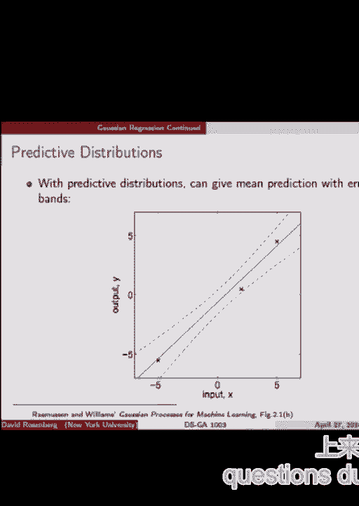
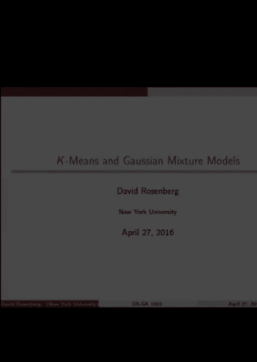
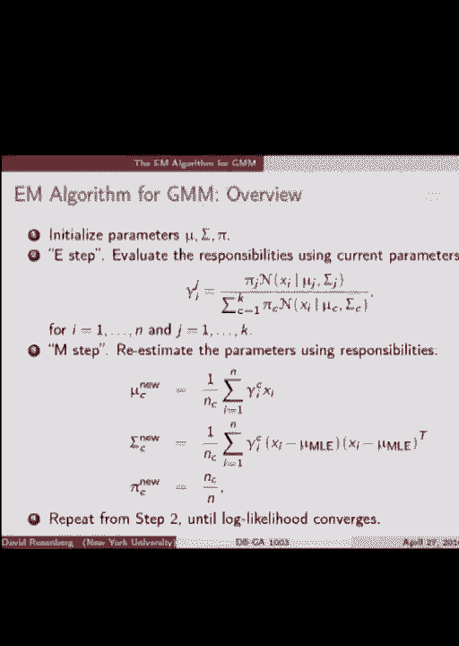
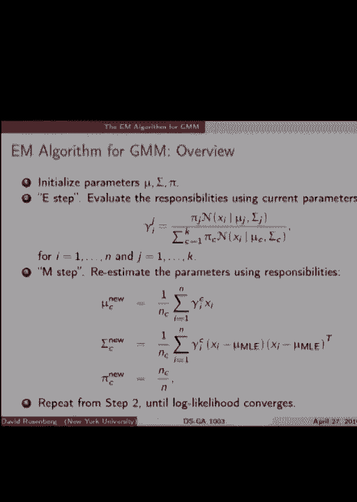
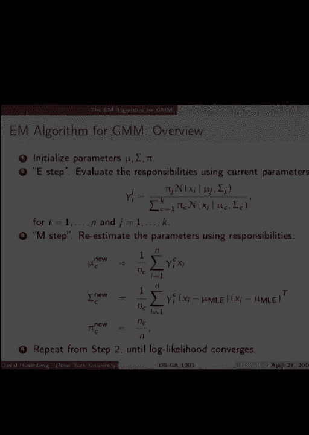

# 21：贝叶斯回归与聚类入门 🧠

在本节课中，我们将学习贝叶斯统计在回归问题中的应用，并初步探讨聚类算法，特别是K均值和高斯混合模型。我们将从贝叶斯线性回归开始，理解如何将先验信念与数据结合，然后转向无监督学习中的聚类概念。

---

## 贝叶斯统计回顾 📊

上一节我们提到了贝叶斯方法的核心思想。本节中，我们来详细回顾其基本框架。

在贝叶斯统计中，我们从两件事开始：
1.  **似然模型**：描述在给定未知参数 `θ` 时，观测到数据集 `D` 的概率，记为 `P(D|θ)`。
2.  **先验分布**：在查看任何数据之前，对参数 `θ` 的概率分布，记为 `P(θ)`。这代表了数据科学家最初的信念。

将两者结合，我们得到数据和参数的联合分布：`P(D, θ) = P(D|θ)P(θ)`。

我们的目标是计算在观测到数据 `D` 后，参数 `θ` 的**后验分布**，应用贝叶斯规则：
`P(θ|D) = P(D|θ)P(θ) / P(D)`
其中，分母 `P(D)` 是边际似然，作为一个归一化常数，确保后验分布积分为1。

后验分布 `P(θ|D)` 总结了我们从数据中获得的关于 `θ` 的所有信息。基于此，我们可以采取行动，例如：
*   计算后验期望值作为点估计。
*   构造一个区间，使得 `θ` 落在该区间内的后验概率为95%（贝叶斯置信区间）。

---

## 贝叶斯线性回归 📈

上一节我们回顾了贝叶斯推断的基础。本节中，我们来看看如何将其应用于线性回归这一预测问题。

我们回到预测设置，有输入空间 `X` 和输出空间 `Y`。条件概率模型（似然）描述了给定输入 `x` 和参数 `w` 时，输出 `y` 的分布。

### 高斯回归模型

我们假设给定输入 `x` 和权重参数 `w`，输出 `y` 服从高斯（正态）分布：
`y | x, w ~ N(w^T x, σ^2)`
其中，`σ^2` 是已知的噪声方差。这与经典线性回归的假设相同。

若有 `n` 个独立观测数据点 `{(x_i, y_i)}`，数据的似然函数为：
`P(y | X, w) = ∏_{i=1}^n N(y_i | w^T x_i, σ^2)`
最大化这个似然函数，就等价于最小化残差平方和，即得到最小二乘估计。

### 引入先验分布

贝叶斯方法的不同之处在于，我们将参数 `w` 也视为随机变量，并为其指定一个先验分布。为简化计算，我们常选择高斯先验：
`w ~ N(0, Σ_0)`
其中，均值 `0` 和协方差矩阵 `Σ_0` 是预先设定的超参数。

### 计算后验分布

根据贝叶斯规则，参数 `w` 的后验分布正比于似然与先验的乘积：
`P(w | X, y) ∝ P(y | X, w) P(w)`
由于似然和先验都是高斯的，后验分布 `P(w | X, y)` 也是一个高斯分布。我们可以推导出其均值和协方差矩阵的闭合形式。

后验均值 `μ_p` 的表达式非常眼熟。如果我们设先验协方差 `Σ_0 = (σ^2 / λ) I`，那么后验均值 `μ_p` 恰好是**岭回归**的解：
`μ_p = (X^T X + λ I)^{-1} X^T y`
这里，先验的精度（方差的倒数）直接对应了岭回归中的正则化强度 `λ`。先验方差越大（`λ` 越小），表示我们对 `w` 的初始信念越不确定，后验就越倾向于最大似然估计（最小二乘解）。

### 进行预测

在贝叶斯框架中，对于一个新的输入 `x_new`，我们预测其输出 `y_new` 的分布（预测分布），而不是一个单一值。这需要我们对所有可能的 `w` 按其后验概率进行积分：
`P(y_new | x_new, D) = ∫ P(y_new | x_new, w) P(w | D) dw`
对于高斯线性模型，这个预测分布也是一个高斯分布，其均值为后验均值给出的预测 `μ_p^T x_new`，方差则包含两部分：一部分来自参数 `w` 的后验不确定性，另一部分来自数据固有的噪声 `σ^2`。这使我们能够为预测提供“误差条”，量化预测的可信度。

---

## K均值聚类算法 🔵🔴

上一节我们探讨了有监督的贝叶斯回归。本节中，我们转向无监督学习，看看如何将数据点分组，即聚类。

K均值是最著名的聚类算法之一，其目标是将数据点划分到 `K` 个簇中，使得每个点到其所属簇中心的距离平方和最小。

以下是K均值算法的步骤：
1.  **初始化**：随机选择 `K` 个数据点作为初始簇中心。
2.  **分配步骤**：将每个数据点分配到距离其最近的簇中心所在的簇。
3.  **更新步骤**：重新计算每个簇中所有点的平均值，将该平均值设为新的簇中心。
4.  **迭代**：重复步骤2和步骤3，直到簇中心不再发生变化或达到最大迭代次数。

### 注意事项与挑战
*   **数据标准化**：如果特征尺度差异很大，应在聚类前进行标准化（如Z-score归一化），否则尺度大的特征将主导距离计算。
*   **局部最优**：K均值可能收敛到局部最优解，而非全局最优。通常需要多次随机初始化并选择结果最好的一个（根据距离平方和最小判断）。
*   **选择K值**：K值需要预先指定。增加K总会降低训练集上的距离平方和，因此不能直接用它选择K。常用方法包括肘部法则、轮廓系数或基于业务知识。
*   **评估聚类**：在没有真实标签的情况下，评估聚类质量是一个挑战。内部指标（如簇内紧密度、簇间分离度）和外部指标（如有真实标签时的调整兰德指数）可供参考。

---

## 高斯混合模型：概率视角的聚类 🎲

上一节我们介绍了K均值这种硬分配聚类算法。本节中，我们从概率生成模型的角度来理解聚类，即高斯混合模型。

高斯混合模型假设数据是由多个高斯分布混合生成的。生成每个数据点的过程如下：
1.  首先，根据混合权重 `π_1, ..., π_K`（满足 `Σ π_k = 1`）随机选择一个簇 `z`。
2.  然后，从被选中的簇 `z` 对应的高斯分布 `N(μ_z, Σ_z)` 中采样出一个数据点 `x`。

这里，簇标签 `z` 是未被观测到的**隐变量**。我们观测到的只有数据点 `x`。

### 推断与学习

*   **推断**：如果已知所有模型参数（`π_k`, `μ_k`, `Σ_k`），对于任意点 `x`，我们可以计算它属于每个簇 `k` 的后验概率，即**软分配**：
    `γ_{ik} = P(z_i = k | x_i)`
    这比K均值的硬分配提供了更多信息。
*   **学习**：我们的目标是从数据 `{x_i}` 中估计出所有参数。这可以通过最大化数据的对数似然函数来实现。然而，GMM的对数似然函数形式复杂（涉及对数的求和），直接求导最大化非常困难。

### EM算法

**期望最大化算法** 是求解GMM参数的一种经典迭代方法。它交替执行以下两步：
1.  **E步（期望步）**：基于当前参数估计，计算每个数据点 `x_i` 属于各簇的责任度 `γ_{ik}`。
2.  **M步（最大化步）**：基于当前的责任度 `γ_{ik}`，更新模型参数。每个簇 `k` 的新参数计算如下：
    *   混合权重：`π_k^{new} = (Σ_i γ_{ik}) / N`
    *   均值：`μ_k^{new} = (Σ_i γ_{ik} x_i) / (Σ_i γ_{ik})`
    *   协方差：`Σ_k^{new} = (Σ_i γ_{ik} (x_i - μ_k^{new})(x_i - μ_k^{new})^T) / (Σ_i γ_{ik})`
    M步的更新公式可以理解为用软分配权重 `γ_{ik}` 进行加权的经验估计。

EM算法保证每次迭代后，数据的对数似然值不会下降，最终会收敛到一个局部最优解。

### 问题与注意点
*   **参数非唯一性**：交换簇的标签（排列参数），似然值不变。
*   **奇异性**：理论上，如果将一个高斯分量坍缩到一个单独的数据点上，并让方差趋于零，似然值可以趋于无穷大。这在实践中通过正则化或贝叶斯方法避免。

---

## 总结 🎯

本节课我们一起学习了：
1.  **贝叶斯线性回归**：通过引入参数先验，将岭回归自然地纳入贝叶斯框架，并能提供预测的不确定性估计。
2.  **K均值聚类**：一种简单高效的硬分配聚类算法，但其结果受初始化和数据尺度影响，且需要预先指定簇数量。
3.  **高斯混合模型**：一种基于概率生成模型的软分配聚类方法。我们了解了其基本思想、推断方法，并引出了用于参数估计的EM算法，为下一节深入讲解EM算法打下基础。

从频率派的点估计到贝叶斯派的分布估计，从硬分配到软分配，我们看到了处理回归和聚类问题的不同哲学与工具。