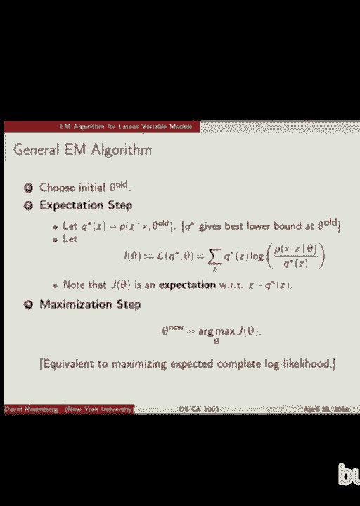

# 22：高斯混合模型与EM算法详解 🧮

在本节课中，我们将学习高斯混合模型（GMM）的生成过程、参数估计的挑战，以及如何使用期望最大化（EM）算法来解决这些挑战。我们将从模型的基本概念开始，逐步深入到EM算法的数学原理和迭代过程。

## 高斯混合模型概述

上一节我们介绍了聚类的基本概念，本节中我们来看看一种更灵活的模型——高斯混合模型。

高斯混合模型假设数据点是从多个高斯分布（或称“成分”）中生成的。每个成分都有一个与之关联的概率，我们用 **π** 表示。每个成分还有一个特定的高斯概率密度函数。

高斯混合模型的生成过程描述如下：
1.  首先，我们从分类分布中抽取一个变量 **z**，它代表聚类分配或成分分配。
2.  然后，根据分配到的成分 **z**，从对应的高斯分布中抽取数据点 **x**。

因此，观测数据点 **x** 的联合概率分布可以写为：
`p(x, z) = p(z) * p(x|z)`
其中，`p(z)` 是分类分布（概率为 π_z），`p(x|z)` 是高斯分布。

然而，我们通常只观测到 **x**，而 **z** 是隐变量。因此，我们需要的是 **x** 的边缘分布，通过对所有可能的 **z** 求和（即“边缘化”）得到：
`p(x) = Σ_z p(x, z)`

## 最大似然估计的挑战

为了估计高斯混合模型的参数（π, μ, Σ），我们通常使用最大似然法。对于独立同分布的 n 个数据点，其对数似然函数为：
`J(θ) = Σ_i log p(x_i) = Σ_i log [ Σ_z p(x_i, z) ]`

这里的挑战在于，对数函数内部有一个求和项。这导致了对数似然函数 **J(θ)** 难以直接最大化，因为求和对数阻碍了高斯分布中指数项与对数项的简化。

## EM算法的引入与动机

为了解决上述优化难题，我们引入期望最大化（EM）算法。EM算法通过引入隐变量 **z** 的分布 **Q(z)**，构建一个易于优化的“下界”函数。

以下是EM算法的核心思想步骤：
1.  **E步（期望步）**：在给定当前参数估计的条件下，计算隐变量 **z** 的后验分布 `Q(z) = p(z|x, θ_old)`。这相当于为每个数据点计算属于各个成分的“责任” γ_ic。
2.  **M步（最大化步）**：固定 **Q(z)**，通过最大化“完整数据”的对数似然期望来更新参数 θ_new。

对于高斯混合模型，这两个步骤有非常直观的解释：
*   **E步**：计算每个数据点 **x_i** 属于第 **c** 个高斯成分的概率 γ_ic。
*   **M步**：利用计算出的“责任”γ_ic 作为权重，更新每个高斯成分的参数。例如，均值 μ_c 的更新公式为所有数据点的加权平均，权重就是 γ_ic。

通过交替执行E步和M步，参数估计会逐步改进，对数似然值也会单调增加，直至算法收敛。

## EM算法的数学原理

上一节我们介绍了EM算法的直观流程，本节中我们来看看其背后的数学原理，理解它为何有效。

EM算法的关键在于构建对数边际似然的一个下界函数 **L(Q, θ)**。通过詹森不等式，我们可以证明对于任意分布 **Q(z)**，下式恒成立：
`log p(x|θ) ≥ L(Q, θ) = E_{z~Q}[log p(x, z|θ)] - E_{z~Q}[log Q(z)]`

我们的目标是最大化这个下界 **L(Q, θ)**。有趣的是，通过代数变换，我们可以发现边际似然与下界之间的差距正好是 **Q(z)** 与真实后验分布 `p(z|x, θ)` 之间的KL散度：
`log p(x|θ) = L(Q, θ) + KL[ Q(z) || p(z|x, θ) ]`

由于KL散度总是非负的，且当两个分布相等时为零，这为我们如何选择 **Q(z)** 提供了线索。

以下是EM算法迭代步骤的理论对应：

1.  **E步（固定 θ，优化 Q）**：为了在当前参数 θ_old 下最大化下界 **L(Q, θ_old)**，我们需要最小化KL散度项。最优解是令 **Q(z)** 等于当前的后验分布，即：
    `Q*(z) = p(z|x, θ_old)`
    此时，下界在 θ_old 处与对数边际似然“紧贴”（相等）。

2.  **M步（固定 Q，优化 θ）**：在固定 **Q*(z)** 后，我们通过最大化下界 **L(Q*, θ)** 来更新参数。这等价于最大化完整数据对数似然的期望：
    `θ_new = argmax_θ E_{z~Q*}[log p(x, z|θ)]`
    由于 **Q*** 已确定，这个期望通常比原始的对数边际似然更容易优化。

每一次迭代，E步构建一个在当前位置紧贴的新下界，M步则沿着这个下界向上爬升。由于每次迭代都保证了 `log p(x|θ_new) ≥ log p(x|θ_old)`，因此EM算法能保证对数似然单调不减地收敛到一个局部极值点。

## 总结

本节课中我们一起学习了高斯混合模型及其参数估计方法。
*   我们首先了解了GMM的生成式模型，它通过混合多个高斯分布来生成数据。
*   我们认识到直接最大化其对数似然函数存在困难。
*   接着，我们引入了EM算法，它通过交替执行**E步**（计算隐变量后验/责任）和**M步**（更新模型参数）来迭代优化。
*   最后，我们从变分下界的角度深入探讨了EM算法的数学原理，明白了它通过最大化一个紧贴的下界来间接最大化似然函数，并保证了收敛性。

EM算法是处理含有隐变量模型的一种强大而通用的框架，高斯混合模型是其最经典和直观的应用之一。