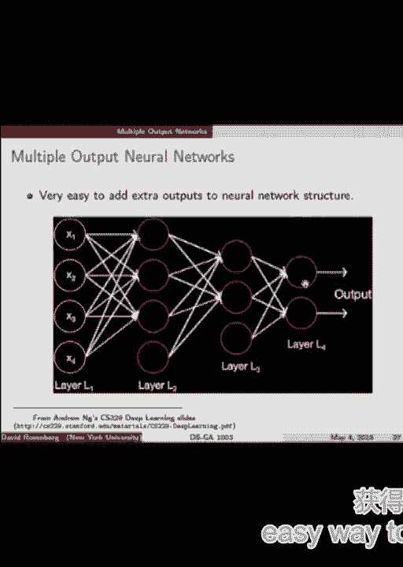
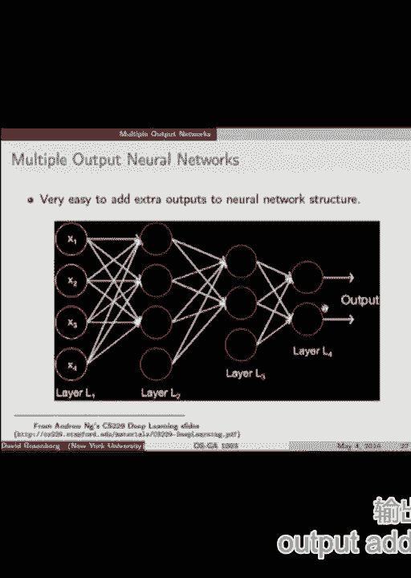
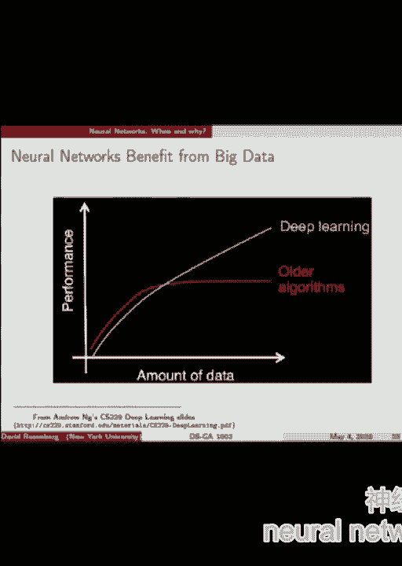

# 23：EM算法与神经网络入门 🧠

在本节课中，我们将深入学习EM算法，并初步了解神经网络的基本概念。我们将从EM算法的原理和收敛性开始，然后探讨其几种扩展变体。最后，我们将转向神经网络，介绍其基本结构、工作原理以及在现代机器学习中的应用。

---

## EM算法回顾与深入

上一节我们介绍了EM算法的基本思想，本节中我们来看看其数学细节和收敛性。

我们有一个包含潜在变量（Z）和观测变量（X）的概率模型。目标是找到参数θ，以最大化观测数据的边际似然 `p(X|θ)`。直接优化这个目标很困难，因此EM算法通过迭代优化一个下界 `L(q, θ)` 来间接求解。

下界 `L(q, θ)` 的定义如下：
`L(q, θ) = E_{q(Z)}[log p(X, Z|θ)] - E_{q(Z)}[log q(Z)]`

其中，`q(Z)` 是潜在变量Z上的一个概率分布。这个下界与真实对数边际似然之间的差距，恰好是 `q(Z)` 与真实后验分布 `p(Z|X, θ)` 之间的KL散度。

### EM算法的两个步骤

以下是EM算法的核心迭代步骤：

1.  **E步（期望步）**：固定当前参数 `θ_old`，寻找使下界 `L(q, θ_old)` 最大的分布 `q`。可以证明，最优的 `q*` 就是当前参数下的后验分布 `p(Z|X, θ_old)`。这一步通常涉及计算关于 `q*` 的期望。
2.  **M步（最大化步）**：固定分布 `q*`，寻找使下界 `L(q*, θ)` 最大的新参数 `θ_new`。这等价于最大化一个期望完全数据对数似然。

通过交替执行E步和M步，算法能保证每次迭代都使边际似然 `p(X|θ)` 单调不减，并最终收敛到一个驻点。

### EM算法的收敛性

关于EM算法的收敛性，有一个重要定理：在一定的正则性条件下，对于任意初始点 `θ_0`，由EM算法产生的序列 `{θ_n}` 会收敛到对数似然函数的一个驻点 `θ*`。这保证了算法不会在非驻点处无限徘徊。

---

## EM算法的扩展变体

上一节我们介绍了标准的EM算法，本节中我们来看看几种实用的扩展变体，以应对计算上的挑战。

### 广义EM算法

在标准M步中，我们要求完全最大化 `L(q*, θ)`。广义EM算法放松了这个要求，只要求找到一个能严格提升下界的新参数 `θ_new` 即可。例如，沿着梯度方向走一小步。

### 变分EM算法

有时，E步中计算最优后验分布 `p(Z|X, θ)` 非常困难。变分EM算法的思想是，限制 `q(Z)` 来自一个易于处理的分布族（例如，所有变量独立的“平均场”族），然后在这个族内寻找最接近真实后验的 `q` 来最大化下界。

### 用于MAP估计的EM算法

当我们在参数θ上有先验分布 `p(θ)`，并希望进行最大后验估计时，EM算法依然适用。此时，我们需要最大化的目标是后验概率 `p(θ|X)` 的对数。通过引入下界，M步的目标会多出一项关于先验 `log p(θ)` 的项。

---

## 神经网络入门 🧠

上一节我们讨论了基于概率模型的EM算法，本节中我们来看看一种截然不同的、基于函数近似的强大工具——神经网络。

### 神经网络的基本结构

神经网络，特别是前馈神经网络，可以看作一个复杂的非线性函数。其基本构件是神经元（或节点），它们分层组织。

以下是神经网络的一个简单示例结构：
*   **输入层**：接收原始特征。
*   **隐藏层**：对输入进行非线性变换。一个节点计算其所有输入的加权和，然后通过一个非线性**激活函数**（如Sigmoid或ReLU）。
*   **输出层**：将最后一个隐藏层的输出进行线性组合，产生最终的预测。

数学上，对于一个隐藏层节点 `h_j`，其输出为：
`h_j = σ( Σ_i (w_{ij} * x_i) )`
其中，`σ` 是激活函数，`w_{ij}` 是连接权重。

### 激活函数

激活函数是神经网络非线性的来源。常见的激活函数有：
*   **Sigmoid**：`σ(x) = 1 / (1 + e^{-x})`，将输入压缩到(0,1)区间。
*   **ReLU（整流线性单元）**：`f(x) = max(0, x)`，计算高效，能缓解梯度消失问题。

### 神经网络的训练

神经网络的参数（所有权重）通过最小化一个损失函数（如均方误差或交叉熵）来学习。最常用的优化算法是**随机梯度下降**及其变体（如小批量梯度下降）。

**反向传播**是一种高效计算损失函数相对于所有参数梯度的方法，它是梯度下降在神经网络中的具体实现。

### 神经网络的特性与应用

*   **表示能力**：即使只有一个隐藏层，只要节点足够多，神经网络就能以任意精度逼近任何连续函数。
*   **特征学习**：隐藏层可以看作网络自动学习到的数据特征。在深度网络中，底层可能学习到边缘等简单特征，而高层则学习到更复杂的结构（如物体部件）。
*   **应用领域**：在图像识别、语音处理、自然语言处理等领域，深度神经网络取得了最先进的性能。
*   **迁移学习**：可以将在一个大型数据集上预训练好的网络（如学习到的特征提取器）用于新的、数据量较小的任务，这是一种高效的策略。

---

## 总结

本节课中我们一起学习了EM算法的核心原理、收敛性及其几种扩展变体（广义EM、变分EM、用于MAP估计的EM）。随后，我们转向了神经网络，介绍了其基本结构（输入层、隐藏层、输出层）、激活函数的作用、以及通过反向传播进行训练的基本思想。最后，我们探讨了神经网络的强大表示能力和在现代机器学习中的关键应用。EM算法和神经网络分别代表了概率建模和函数近似两大机器学习范式中的重要工具。