#  002：线性模型 🧮

在本节课中，我们将要学习线性模型，这是机器学习和统计学中最基础、最核心的概念之一。我们将从线性回归入手，理解其数学原理、如何通过数据学习模型参数，以及如何利用模型进行预测。线性模型虽然简单，但它是理解更复杂模型（如神经网络）的基石。

## 数学基础 📐

上一节我们介绍了课程的整体框架，本节中我们来看看学习深度学习所需的数学基础。

学习本课程需要一些数学背景知识。掌握越多数学知识越好，但本课程将侧重于实践技能。尽管如此，实践技能依然非常重要。

如果你的线性代数知识生疏，强烈建议你复习一下。你可以搜索线性代数课程，例如吉尔伯特·斯特朗的线性代数讲座，或者可汗学院的优秀课程。复习这些内容非常重要。

以下是学习本课程所必需的数学背景知识：

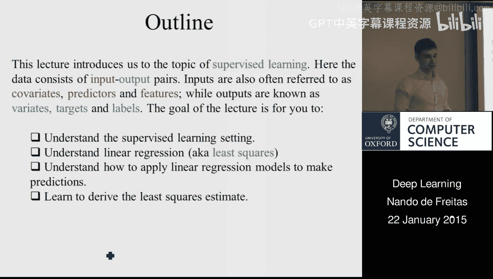

*   **向量与矩阵**：你必须知道什么是向量，什么是矩阵。这是非常基础的背景知识。如果你不具备这些知识，可以搜索维基百科或相关课程进行学习。
*   **基础统计学**：例如，下周我们将学习高斯分布和多变量高斯分布。一些基础的概率统计知识也是必不可少的。如果你需要复习，网上有很多优秀的本科入门级课程。
*   **微积分**：我们将使用一种称为**梯度下降**的关键学习方法，这是一种通过“下坡”进行优化的方法。你需要了解导数和梯度的概念。

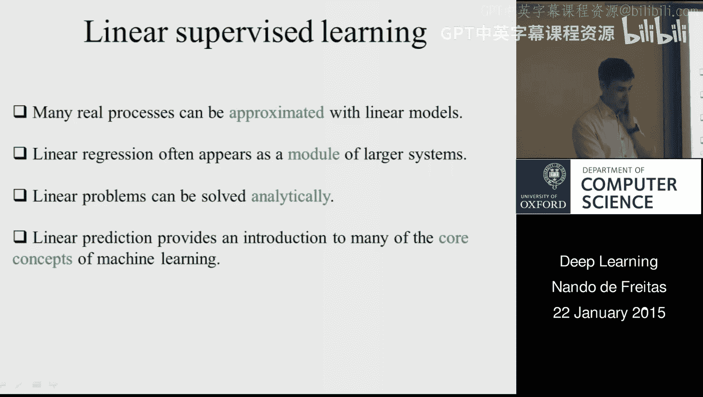

梯度下降的原理类似于滑雪或单板滑雪：寻找最陡的下降方向前进。在数学上，梯度是一个向量，指向函数增长最快的方向。因此，沿着负梯度方向（即最陡下降方向）前进，就能找到函数的最小值。

导数和梯度极其重要。如果我们能构建一个可微分的机器，我们就能让它从数据中学习。无论是图灵机、图形生成器还是语音生成器，只要使其可微分，它就能适应世界。

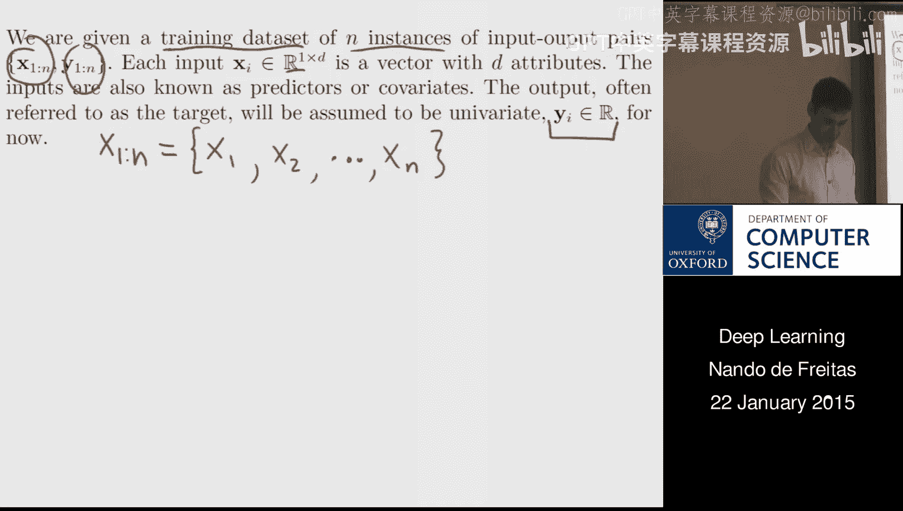

## 线性回归介绍 📈

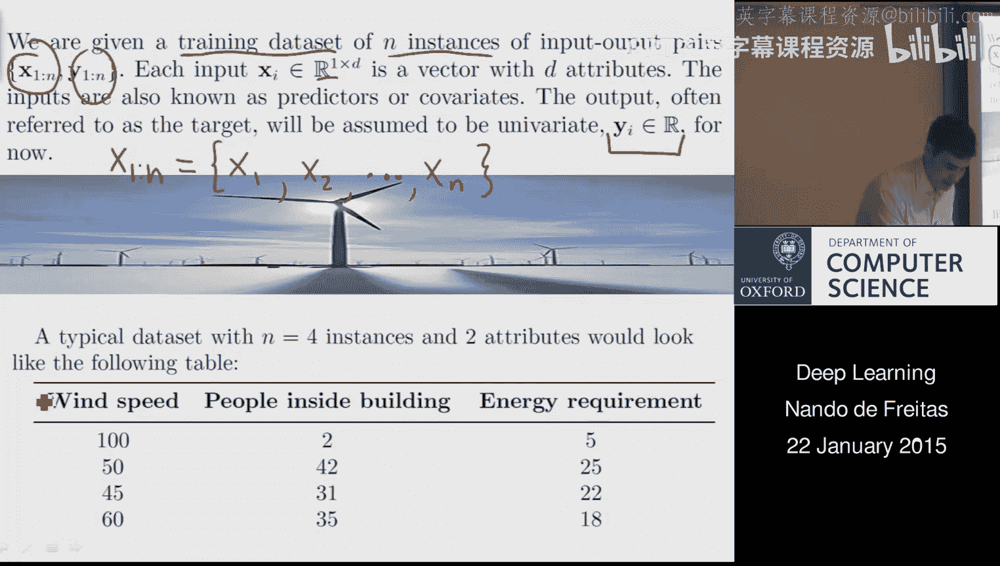

本节我们将回归一些基础的统计学知识，看看一种叫做**线性回归**的方法。

线性回归也被称为最小二乘法。它属于**监督学习**的范畴，即存在输入和输出，并且对于每个输入，都有一个已知的正确输出（例如，一张猫的图片，其输出标签应为“猫”）。

在学习新领域时，会接触到一些术语：
*   输入通常被称为**协变量**、**预测因子**或**特征**。
*   输出被称为**因变量**、**目标**或**标签**。

在线性监督学习中，我们假设输入和输出之间的关系是线性的。在一维情况下，这是一条直线；在高维情况下，这是一个平面或超平面。虽然线性关系看似简单，但局部线性化在工程中非常有用（例如飞机自动着陆系统）。此外，许多复杂模型都包含线性模块作为子模块。线性模型还能帮助我们理解统计学的基本概念，因为我们可以手动计算一切。

## 问题设定与示例 🏠

那么，线性回归是如何工作的呢？其设定如下：

我们有一个**训练数据集**，包含 `n` 个实例。每个实例是一个输入-输出对 `(x_i, y_i)`。输入 `x_i` 是一个 `D` 维向量（即包含 `D` 个特征），输出 `y_i` 是一个实数（为了简化，我们假设输出是单个实数）。

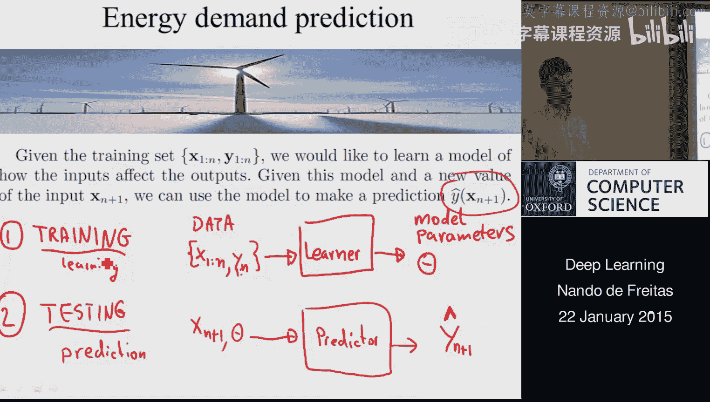

让我们看一个例子。假设我们有一个数据表，记录了室外风速和室内人数，以及维持房间舒适温度所需的能量。我们的目标是学习一个模型，能够根据新的风速和人数数据，自动预测恒温器的设定值。

在这个例子中，`D = 2`（两个输入：风速和人数），我们有四个数据实例（四行数据）。学习这个模型后，我们就可以构建有用的技术。

## 训练与预测流程 🔄

监督学习通常分为两个阶段，我们将称之为**训练**和**预测**。

在训练（或统计估计）阶段，我们将数据（包含 `n` 个 `x` 和 `y` 的表格）输入给**学习器**。学习器会学习一个带有**参数** `θ` 的模型。对于最简单的线性模型，参数就是直线的截距和斜率。

在预测阶段，我们将新的数据点 `x_new` 和学习到的参数 `θ` 输入给**预测器**。预测器会生成一个预测值 `ŷ`（“y hat”表示预测值）。

因此，训练阶段是根据数据估计参数，预测阶段是利用估计出的参数进行决策或预测。稍后我们会看到，学习也可以在线进行，即随着新数据的到来不断更新模型。

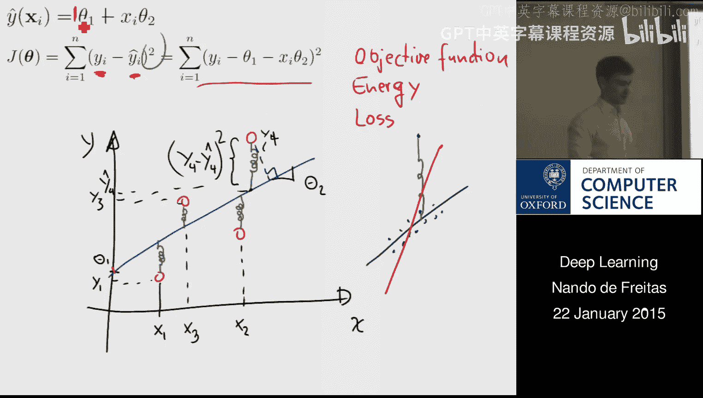

## 模型、目标与损失函数 ⚖️

让我们看第一个线性模型：一条直线。它有一个截距 `θ1` 和一个斜率 `θ2`。输入是一维变量 (`D=1`)。

在学习时，我们需要指定一个**目标函数**（也称为能量函数或损失函数）。它衡量模型表现的好坏。

在监督学习中，我们希望有一个函数能告诉我们学习效果如何。一个例子是：如果训练集中真实值 `y` 与预测值 `ŷ` 的差距很小，那么学习效果就好。高斯在300年前提出了使用平方差的方法，因其易于处理而变得非常流行。

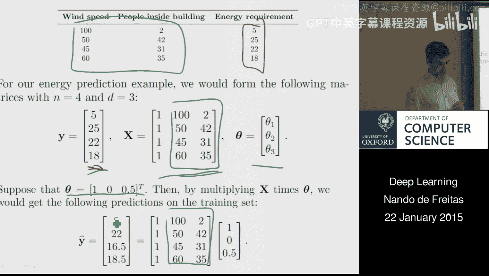

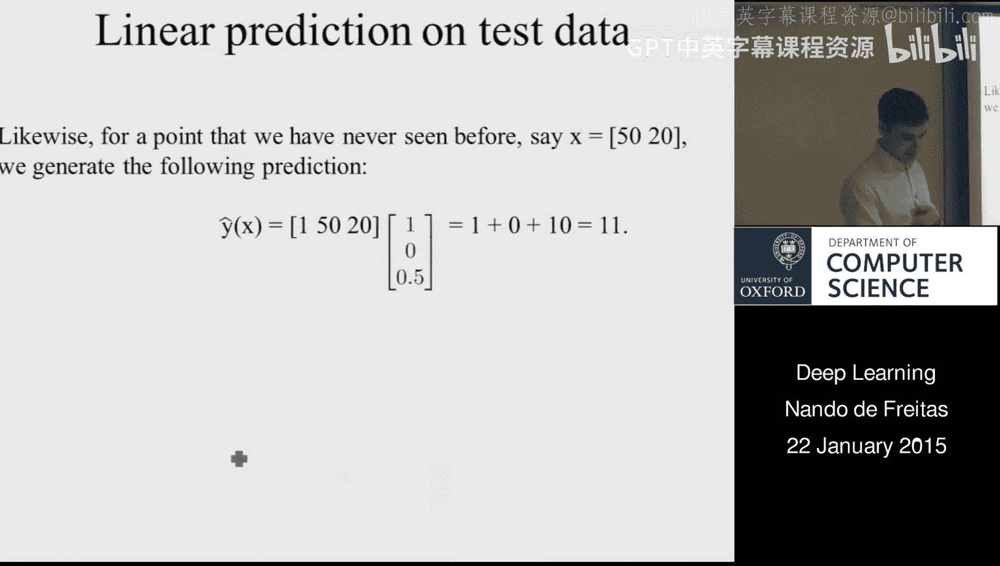

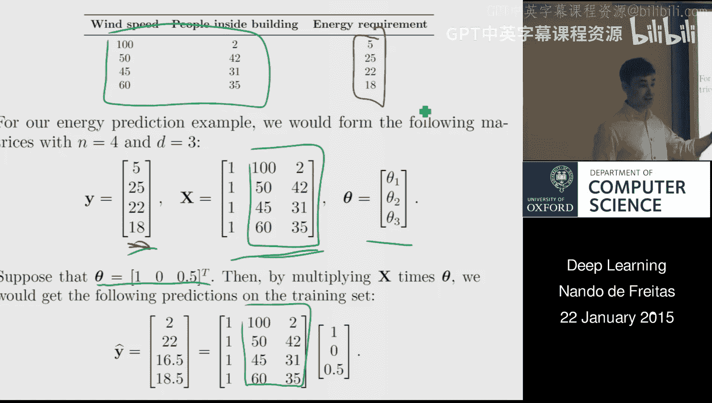

从图形上看，我们有一些数据点（红点），我们试图用一条直线去拟合它们。拟合的方法是：想象每个数据点通过一根弹簧连接到直线上，弹簧的势能与数据点到直线的垂直距离的平方成正比。我们的目标是找到使总势能（即所有弹簧势能之和）最小的直线配置。这就像扭动直线然后放手，它会收敛到能量最低点。

然而，这种方法存在风险。为什么我们测量垂直距离而不是点到直线的垂直距离？此外，当数据中存在**异常值**时（如下图中的一个远离群体的点），这根“弹簧”会被过度拉伸，导致拟合的直线严重偏离大多数数据点，仅仅因为这一个点。这源于我们对距离度量（平方差）的选择。在后续课程中，我们将学习其他度量方式。选择合适的度量是构建智能机器的核心问题之一。

将模型推广到高维，预测公式变为：
`ŷ_i = θ1 * x_i1 + θ2 * x_i2 + ... + θD * x_iD`
按照惯例，我们通常设置 `x_i1 = 1`，这样 `θ1` 就成为了偏置项（截距）。

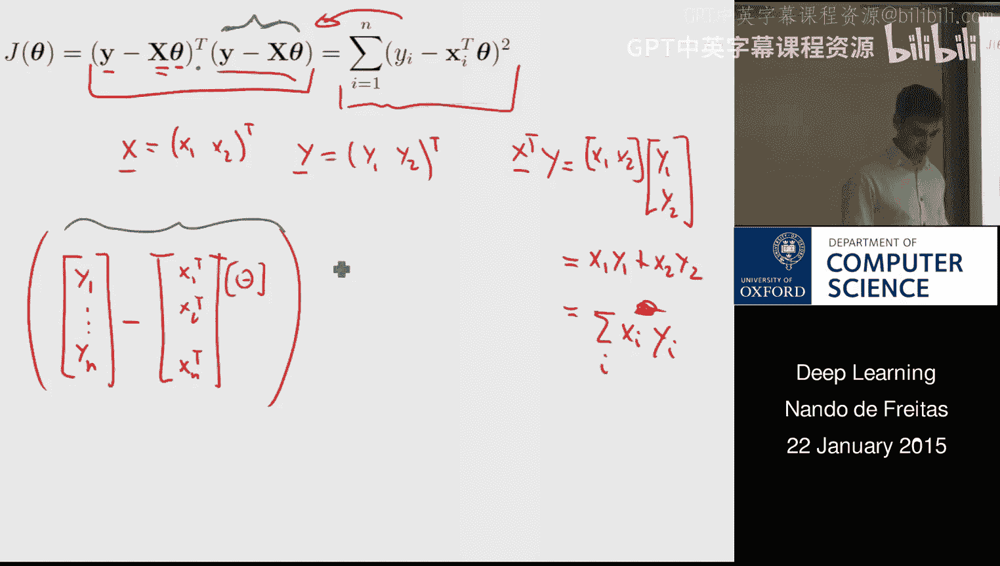

## 矩阵表示法 🧮

矩阵非常适合表示线性模型。我们可以将上述求和公式简洁地写成矩阵形式：
`ŷ = Xθ`
其中 `X` 是包含所有输入数据（每行是一个数据实例，第一列通常是1）的矩阵，`θ` 是参数向量。

回到恒温器的例子，我们的数据可以很容易地构造成矩阵 `X` 和向量 `y`。进行预测时，只需计算 `Xθ` 即可得到训练集上的预测值 `ŷ`。然后，通过比较 `ŷ` 和真实的 `y` 并计算平方差之和，就能评估模型表现。

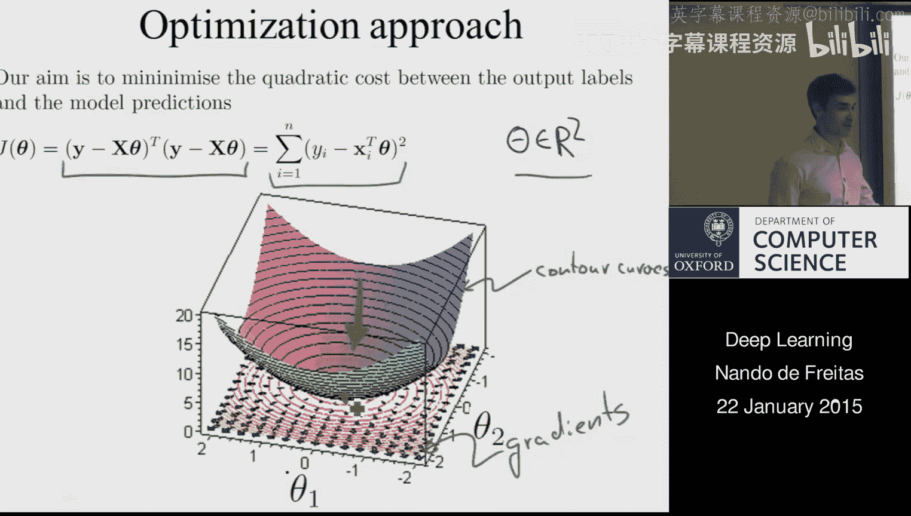

对于新的数据点 `x_new`，预测公式为 `ŷ_new = x_new^T θ`，这等同于在直线上求值。

同样，平方和损失函数也可以用矩阵形式紧凑地表示：
`J(θ) = (y - Xθ)^T (y - Xθ)`
这是一个关于 `θ` 的二次函数。如果 `θ` 是二维的，这个函数的形状像一个碗，其等高线是椭圆。**梯度**指向函数增长最快的方向。为了最小化损失，我们需要沿着负梯度方向（即最陡下降方向）移动。这就是“滑雪”比喻的数学体现。

## 求解参数：解析解与数值解 🎯

对于线性回归的平方损失，我们可以通过求导并令导数为零来直接找到最优参数 `θ`（即碗底）。这导出了所谓的**正规方程**：
`θ = (X^T X)^{-1} X^T y`
通过这个公式，我们可以直接计算最优参数。这是线性模型流行的原因之一——我们可以手动求解。

然而，这种方法有两个问题：
1.  它需要将**所有数据**加载到内存中并计算矩阵的逆。当数据量极大（例如矩阵是十亿乘十亿维）时，这种方法会失效。
2.  很多时候矩阵 `X^T X` 可能是秩亏的，导致不可逆。

因此，我们通常使用**梯度下降**等迭代优化方法，通过多次小步更新来逼近最优解，这种方法更适合大数据和在线学习场景。

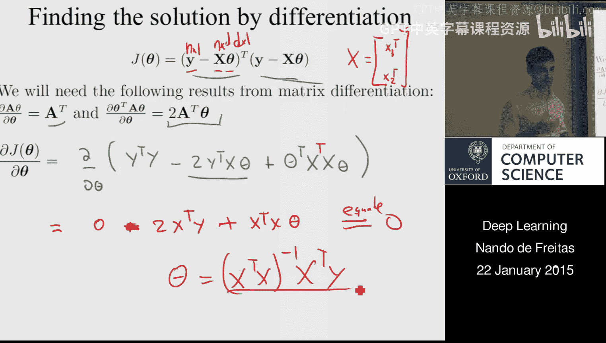

## 实践工具：Torch 7 ⚙️

在本课程中，我们将使用 **Torch 7** 库。这是一个广泛用于机器学习研究的库，许多前沿公司也在使用它。对于有神经科学或数学背景、正在学习编程的同学来说，这是一个易于上手的语言（尽管需要小心其某些特性）。

在 Torch 中构建一个线性回归模型非常简单。你可以将模型定义为一个**序列容器**，添加一个**线性模块**（它代表一个具有线性响应的神经元计算单元），并指定一个**损失函数**（如均方误差）。Torch 会自动处理偏置项（通过将输入的第一维设为1）。训练时，Torch 不会使用解析解，而是使用梯度下降等优化器来更新参数。

在接下来的课程中，我们将更多地使用这些模型，探讨统计问题（如交叉验证），并深入讲解优化方法（梯度、海森矩阵等）。现实中的学习问题往往不像一个完美的碗，而可能有多个局部最低点，我们的目标就是尝试找到好的解。

## 总结 ✨

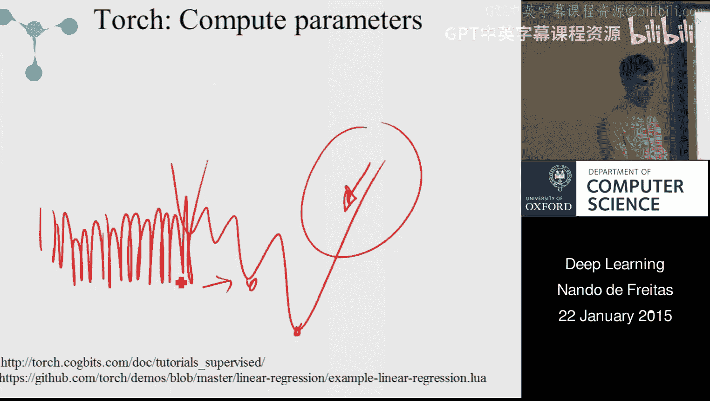

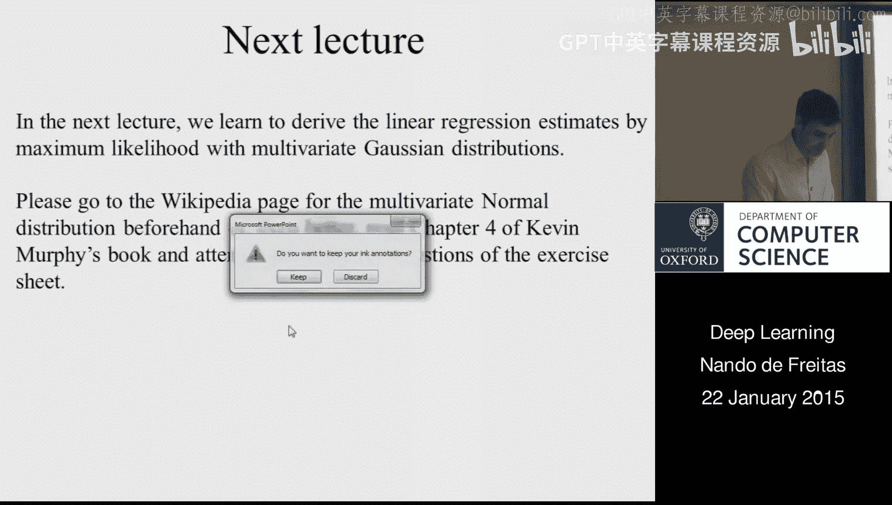

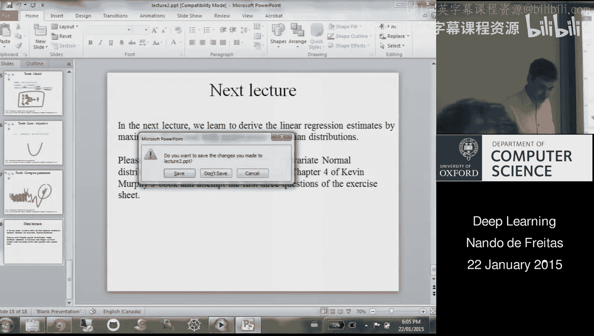

本节课我们一起学习了线性模型的核心内容。我们从线性回归入手，理解了其作为监督学习方法的设定，学习了如何用矩阵形式表示模型和损失函数。我们探讨了通过最小化平方损失（最小二乘法）来求解模型参数的两种途径：直接解析解（正规方程）和迭代数值解（梯度下降）。我们还认识了实践中将使用的 Torch 7 工具。线性模型是深度学习的基石，虽然简单，但其蕴含的目标函数、优化等思想将贯穿整个课程。