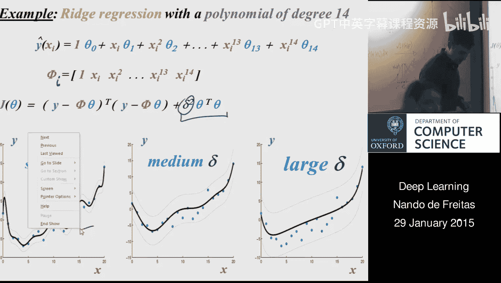

#  004：正则化、模型复杂度与数据复杂度（第一部分）

在本节课中，我们将探讨一个更深入的话题：当模型变得复杂时，如何避免过拟合。我们将从简单的线性回归问题出发，揭示最大似然估计的潜在缺陷，并引入“正则化”这一核心概念来修复它。我们还将讨论模型复杂度和数据量如何共同影响模型的预测能力。

---

## 从线性回归到正则化

上一节我们介绍了从损失函数和概率论两个视角来拟合一条直线。这两种方法本质上是等价的：最小化损失等同于最大化数据的似然概率。

现在，我们要讨论上一节课中提到的一个问题：当数据点几乎垂直分布时会发生什么？这个问题在我们处理任意非线性函数（而不仅仅是直线）时会变得更加有趣，因为我们将看到最大似然估计本身存在缺陷。

最大似然估计有时是“不适定”的，因为它可能导致灾难性的解（例如，拟合出垂直的线，使得似然概率趋于无穷大）。为了修复这个问题，我们引入了**正则化**的概念。正则化本身也可能是不适定的，但将它与最大似然估计结合，就能得到一个合理的答案。

---

## 多项式回归与基函数

接下来，我们将不再局限于直线，而是研究更复杂的模型：多项式回归。我们将拟合二次、三次甚至更高阶的多项式。

这里需要引入**基函数**的概念。在我们称为神经网络的人工模型中，一个神经元本质上就是一个基函数。当我们构建图像等复杂模型时，我们所做的是使用这些简单基函数的组合表示。

你可以把基函数想象成一块砖。如果你知道如何制造一块混凝土砖，并且有胶水把它们粘在一起，你就能建造一切——你可以建造伦敦城。一个更好的类比是乐高积木：你可以拉伸、改变它的高度或深度。如果你在一个基础模块上拥有所有这些自由度，你就可以开始构建各种复杂的结构。这就是我们用这些基函数构建神经网络的方式。

然而，这样做会带来麻烦：我们可以构建任意复杂的函数。这意味着我们可以为任何事情找到一个解释，但这个解释可能是错误的。因此，核心问题变成了：我们如何判断模型是正确的？我们构建了结构，它给出了答案，但我们如何测试这个答案是否正确？这就引出了**交叉验证**。

与此相关的是**泛化**的概念：如果模型在我目前遇到的数据上表现良好，那么它在明天将遇到的数据上会表现如何？例如，我测量了截至今天的所有股票价值，用今天学到的技术和 PyTorch 拟合了一个漂亮的多项式，然后用它来预测明天的股价。你如何知道你的预测是合理的？（**不建议你这样做**）。

---

## 垂直距离问题与正则化的引入

之前指出的一个问题在于，垂直距离在计算上是有问题的。计算最小二乘估计（等同于最大似然估计）时，我们需要求逆一个矩阵。

假设矩阵 **X** 是 `n x D` 维的，那么 **X^T X** 就是一个 `D x D` 的矩阵。对于真实数据，这个矩阵的特征值可能非常小甚至为零，导致求逆失败，代码崩溃。

解决这个问题的一种标准方法是使用**奇异值分解**，并截断到矩阵的秩，然后利用 SVD 来求逆。软件包有时会在幕后自动完成这个操作。

另一种人们想出的方法是：直接给矩阵的对角线加上一个小的正数。具体做法是，我们不是计算 `(X^T X)^{-1} X^T y`，而是计算 `(X^T X + \delta^2 I)^{-1} X^T y`，其中 **I** 是单位矩阵，\delta 是一个正数。

人们后来发现，如果我们仔细设置 \delta 的值，不仅能解决计算问题，还能得到统计上更优的结果。这在 70 年代曾是一个谜题。

---

## 正则化的损失函数视角

我们可以逆向推导，发现上述在矩阵对角线加项的操作，等价于在原来的损失函数上加了一个惩罚项。

新的损失函数变为：
`L(\theta) = \sum_{i=1}^n (y_i - \theta^T x_i)^2 + \delta^2 \sum_{j=1}^D \theta_j^2`

这个公式告诉我们：在拟合直线的同时，要让参数 \theta 的数值保持较小。如果 \theta 很大，你就会付出很大的代价。这避免了拟合出垂直的线（即斜率无穷大），因为那样会导致似然概率趋于无穷大，这不是好事。

通常，我们不会惩罚截距项（即 \theta_0），只惩罚与斜率相关的参数。在实践中，我们经常在拟合前对数据进行“中心化”处理（减去均值），这样处理后，所有参数都可以被平等对待。

---

## 正则化的几何解释

更有趣的是从几何角度理解正则化。我们可以将带正则化的损失最小化问题，重新表述为一个带约束的优化问题。

原始问题（拉格朗日形式）：
`最小化 \sum (y_i - \theta^T x_i)^2 + \delta^2 ||\theta||^2`

等价于约束优化问题（找到某个函数 T(\delta)）：
`最小化 \sum (y_i - \theta^T x_i)^2`
`约束条件：||\theta||^2 \leq T(\delta)`

在优化理论中，左边称为“拉格朗日形式”，右边称为“约束形式”。两者在数学上是等价的。

让我们考虑一个二维参数 \theta = [\theta_1, \theta_2] 的例子。我们可以画出等高线图。

*   **数据损失项**：`\sum (y_i - \theta^T x_i)^2` 的等高线是椭圆，其中心是最大似然估计解。
*   **正则化惩罚项**：`||\theta||^2 = \theta_1^2 + \theta_2^2` 的等高线是以原点为中心的圆。

当我们最小化总损失时，我们实际上是在寻找椭圆和圆的“接触点”。随着 \delta 的变化，我们会得到一系列不同的解：
*   当 \delta = 0 时，正则项消失，我们回到最大似然估计。
*   当 \delta → ∞ 时，为了最小化损失，必须让 \theta 趋近于零。

所有解将沿着一条曲线分布。那么，关键问题是：对于一个特定的数据集，**最优的 \delta 是多少**？我们将在本课程中提出方法来回答这个问题。

---

## 正则化的实用价值：特征选择

这种正则化方法（使用 `||\theta||^2`，也称为 **L2 正则** 或 **岭回归**）有一个很好的性质。观察解的变化路径，你会发现有些参数（例如 \theta_2）会比另一些参数（例如 \theta_1）更快地趋近于零。

这意味着，对于特定的 \delta 值，许多变量对应的参数会变得非常小。换句话说，你能够自动筛选掉与预测无关的输入变量 **x**，只保留相关的那些。这是一种寻找与特定预测结果相关的基因（或特征）的方法（注意：是相关性，而非因果性）。

---

## L1 正则化：LASSO

除了 L2 正则，还有一种更激进的正则化方法：**L1 正则**，也称为 **LASSO**。

其惩罚项是参数绝对值的和：
`惩罚项 = \lambda \sum_{j=1}^D |\theta_j|`

在二维情况下，惩罚项 `|\theta_1| + |\theta_2|` 的等高线是菱形。当数据损失的椭圆与这个菱形相交时，**交点有很大概率出现在菱形的角上**。在角上，某个参数（例如 \theta_2）会精确地等于零。

因此，L1 正则是一种更具侵略性的正则化器，因为它能真正地将某些变量的系数**置为零**，而不仅仅是缩小。这能帮助我们明确找出哪些变量是重要的。PyTorch 等工具也支持 L1 正则化。由于绝对值函数在零点不可导，其数学处理需要用到“次微分”的概念。

---

## 从直线到多项式

现在，让我们从直线过渡到更一般的函数：多项式。我们仍然做线性回归，只是做了一点变换。

我们仍然有数据 `(x, y)`。如果我们相信二次函数比直线拟合得更好，我们就对每个数据点 `x_i` 进行变换，创建一个新的特征向量：
`\phi(x_i) = [1, x_i, x_i^2]^T`

然后，我们的模型就变成了：
`y_i \approx \theta_0 * 1 + \theta_1 * x_i + \theta_2 * x_i^2`

这仍然是一个关于参数 `\theta` 的线性模型！我们可以像之前一样，构建矩阵 **\Phi**（其中每一行是 `\phi(x_i)^T`），然后使用完全相同的线性回归公式（或带正则化的版本）来求解 `\theta`。

如果真实模型没有二次项，我该使用哪种正则化来发现这一点呢？答案是 **L1 正则**。如果我使用 L1 正则，它会自动将 `\theta_2` 推向零，从而退化成拟合直线。

这给了我们一种设计模型的直觉：**我们可以先构建一个非常复杂的模型（例如高阶多项式），然后通过精心设计的正则化器来自动降低复杂度，使其与数据良好匹配。**

---

## 模型复杂度、数据复杂度与过拟合

真正的挑战在于选择多项式的阶数。首先要理解的是**数据量**对拟合效果的影响。

考虑以下三种情况：

1.  **模型匹配现实（最优情况）**：
    *   **现实世界**：数据由一个二次函数生成。
    *   **我的模型**：我恰好选择了二次多项式模型。
    *   **结果**：随着训练数据量 `n` 增加，模型在训练集和测试集上的误差都会收敛到不可避免的“噪声水平”。这是最理想的情况。

2.  **模型过于简单（欠拟合）**：
    *   **现实世界**：数据由一个二次函数生成。
    *   **我的模型**：我错误地只使用了线性模型。
    *   **结果**：无论有多少数据，我都无法很好地拟合。训练误差和测试误差都会很大，且不会随数据量增加而降至噪声水平以下。**如果模型是错误的，大数据也无济于事。**

3.  **模型过于复杂（过拟合）**：
    *   **现实世界**：数据由一个二次函数生成。
    *   **我的模型**：我使用了一个非常高阶（例如25阶）的多项式。
    *   **结果（数据量少时）**：模型可以完美穿过所有训练点，训练误差为零。但对于新的测试点，预测可能极其荒谬，测试误差巨大。这是危险的过拟合。
    *   **结果（数据量极大时）**：如果我有海量的训练数据（数万亿个点），即使模型很复杂，数据点也会“拉住”多项式，迫使它表现得像一个二次函数。随着数据量增加，误差最终也能收敛到噪声水平。

**这对深度学习的启示**：
在深度学习的早期（80、90年代），我们常常处于“欠拟合”区域：模型太简单，数据也不够。近年来，由于我们拥有了海量数据，以及计算机科学提供了处理、存储和计算这些数据的工具（如GPU），我们可以构建极其庞大的模型（数十亿参数）。这使得我们在图像、语音识别等领域取得了前所未有的突破。我们可能正在利用海量数据将复杂模型从过拟合区域“拉回”到良好拟合的区域。

---

## 控制复杂度的两种方法

我们有两种主要方法来控制模型复杂度：

1.  **调整数据量 `n`**：更多的数据可以约束复杂模型，防止过拟合。
2.  **调整正则化强度 `\delta`**：即使使用高阶多项式，通过增大 `\delta`，也可以抑制多项式的剧烈振荡，让许多高阶项的系数趋近于零。`\delta` 为我们提供了另一种控制复杂度的“旋钮”。

在下节课中，我们将介绍另一种拟合数据的方法——**核方法**，它将引入更多控制复杂度的参数。我们还将讨论**交叉验证**，这是一种在有监督标签时计算最优 `\delta` 的方法。解决了如何控制和拟合模型的问题后，剩下的主要工作就是通过优化算法来计算这些参数了。

---

## 总结

本节课我们一起学习了：
1.  **最大似然估计的缺陷**：可能导致不适定解（如垂直拟合）。
2.  **正则化的引入**：通过给损失函数添加惩罚项（如 L2 范数 `||\theta||^2`）来稳定解，并改善统计性质。
3.  **正则化的几何与等价形式**：可以理解为在参数空间施加约束。
4.  **L1 正则化 (LASSO)**：能产生稀疏解，自动进行特征选择。
5.  **基函数与多项式回归**：通过特征变换，将非线性拟合问题转化为线性回归问题。
6.  **模型复杂度与数据复杂度的权衡**：模型太简单会导致欠拟合，太复杂会导致过拟合；足够多的数据可以缓解复杂模型的过拟合问题。
7.  **控制复杂度的两种手段**：增加数据量 `n` 和调整正则化强度 `\delta`。

这些概念是理解现代机器学习，特别是深度学习如何平衡拟合能力与泛化能力的基础。