#  005：正则化、模型复杂度与数据复杂度（第二部分）

在本节课中，我们将继续探讨模型复杂度、正则化以及如何通过交叉验证来选择模型参数。我们将从回顾上一讲的内容开始，然后深入讲解贝叶斯视角下的正则化、核方法以及模型评估的核心技术。

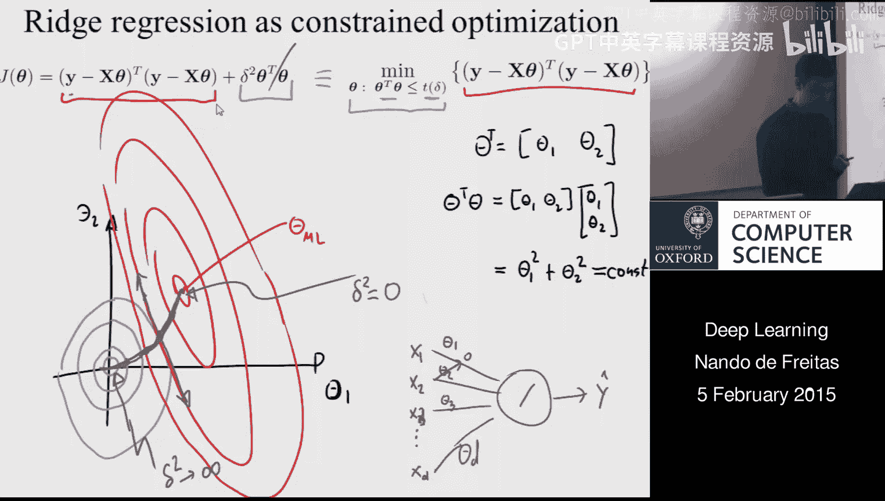

## 回顾：正则化与模型复杂度

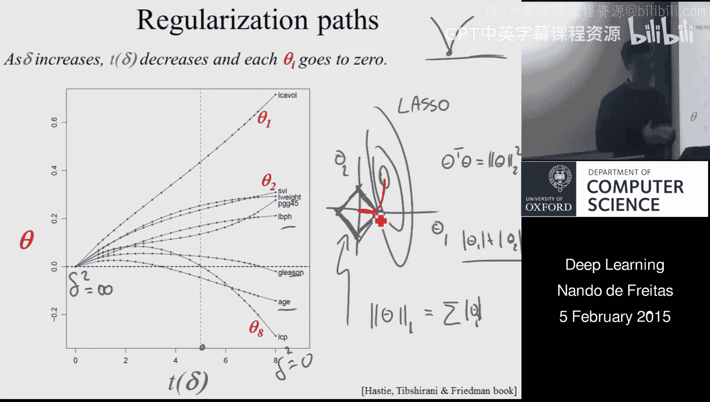

上一节我们介绍了正则化的概念。正则化器通过使优化问题更稳定或避免某些问题（如过拟合）来简化问题。一种常见的方法是在矩阵中添加一个对角项，使其条件更好，从而能够求逆并计算解。

从另一个角度看，通过改变正则化项 **θᵀθ** 的系数 **δ**，我们可以得到一系列解。当 **δ = 0** 时，得到最大似然估计。随着 **δ** 增大，解会趋向于使 **θ** 接近零。正则化项本身（惩罚大的 **θ**）或似然项本身（如最小二乘法）单独来看可能都不理想，但将它们平衡地结合在一起，就能形成一个有效工作的代价函数。

在神经网络领域，这种L2正则化被称为**权重衰减**，因为随着正则化增强，模型参数会“衰减”趋近于零。

我们也可以使用其他类型的正则化器，例如 **L1** 范数。L2正则化的等高线是圆，而L1正则化的等高线是菱形。这会导致解轨迹不同，在合适的范围内，某些参数（例如 **θ₂**）会变为零。因此，正则化也提供了一种进行特征选择的方法：如果某个特征的参数为零，就意味着我们不需要测量该特征。

## 贝叶斯视角：最大后验推断

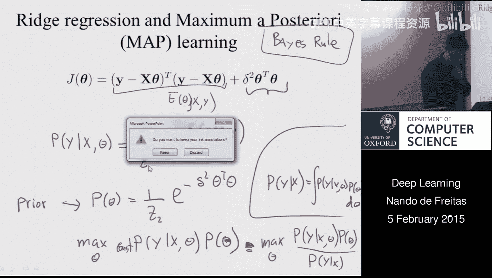

现在，我们为上周的内容增加一个重要的视角：**最大后验推断**。

我们之前的能量函数 **E(θ, x, y)** 取负指数后，可以得到一个关于输出 **y** 的似然分布（例如高斯分布）：
**P(y | x, θ) = (1/Z₁) * exp(-E(θ, x, y))**

同样，正则化项也可以被指数化，形成一个仅关于参数 **θ** 的先验分布（例如均值为零的高斯分布）：
**P(θ) = (1/Z₂) * exp(-δ² θᵀθ)**

当我们进行岭回归时，我们本质上是在最大化这两个分布的乘积：
**argmax_θ P(y | x, θ) * P(θ)**

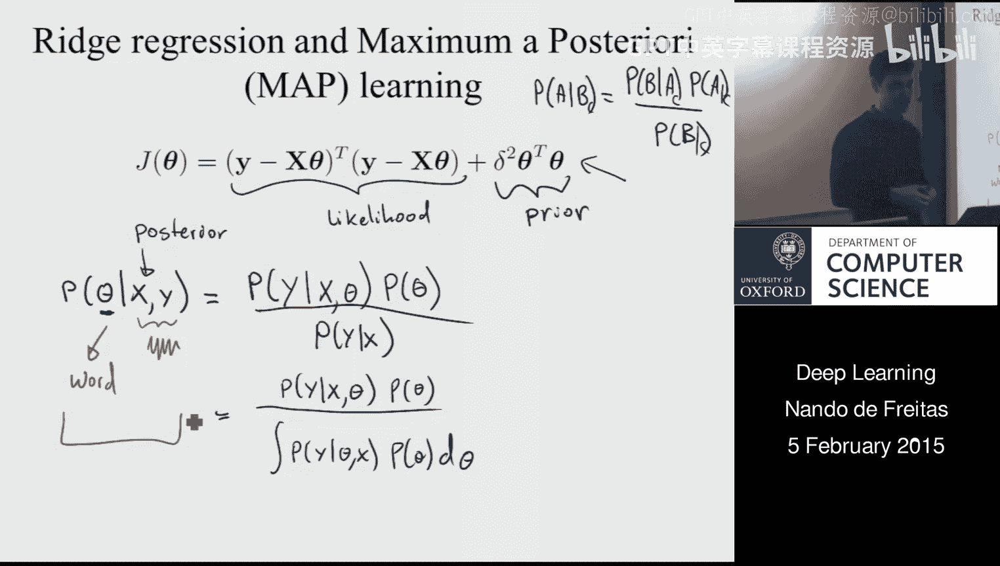

根据概率论中的**贝叶斯规则**，这等价于最大化后验概率 **P(θ | x, y)**。贝叶斯规则的形式是：
**P(A|B) = [P(B|A) * P(A)] / P(B)**

在我们的上下文中：
*   **P(θ)** 是**先验**，代表我们在看到数据前对参数的信念。
*   **P(y | x, θ)** 是**似然**，代表给定参数时数据出现的可能性。
*   **P(θ | x, y)** 是**后验**，代表在看到数据后对参数的更新信念。

因此，**正则化项可以理解为对模型参数施加的先验分布**。L2正则化对应高斯先验，L1正则化对应拉普拉斯先验。

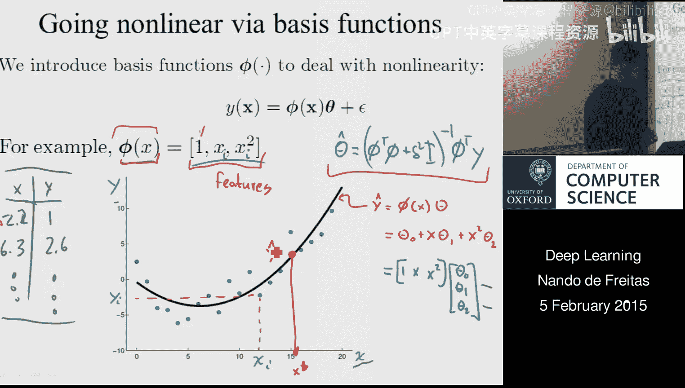

纯粹的贝叶斯方法会计算后验分布的积分（即归一化常数 **P(y|x)**），但这通常涉及高维积分，计算困难。本课程主要采用优化方法（寻找最大后验点）而非完全的贝叶斯积分，因为优化方法目前对于大规模数据更具可扩展性。不过，贝叶斯方法的优势在于它提供了完整的不确定性度量，而不仅仅是单个预测。

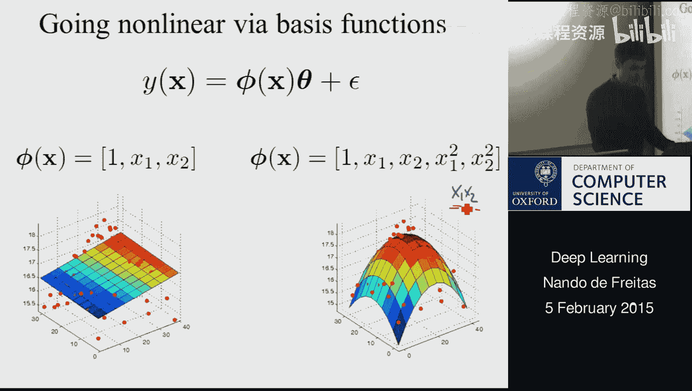

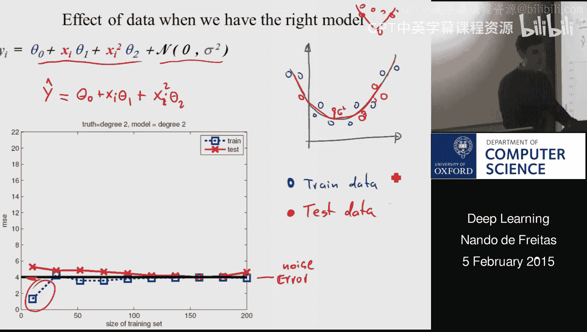

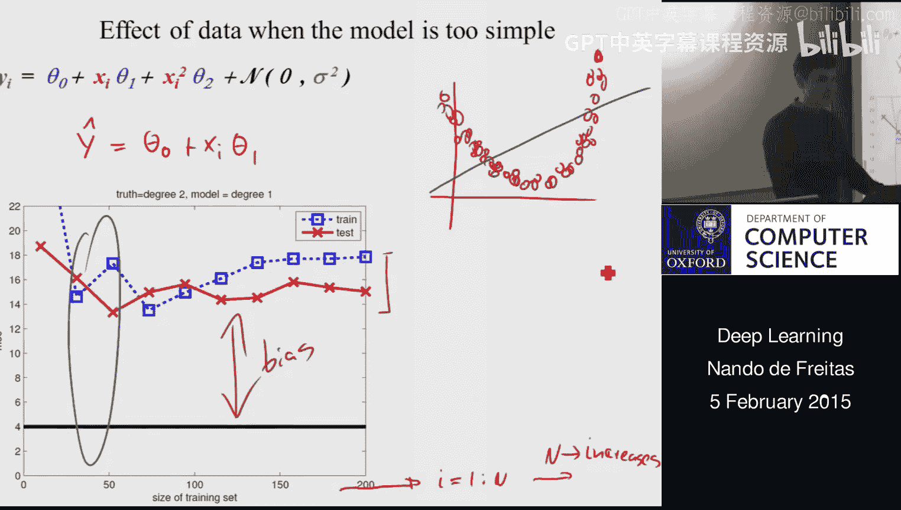

## 非线性模型与特征工程

在上一讲中，我们开始研究非线性模型。我们处理非线性的方法是**特征工程**：如果我们认为数据符合二次关系，我们就手动构造多项式特征（如常数项、一次项、二次项），然后让模型学习这些特征的系数。

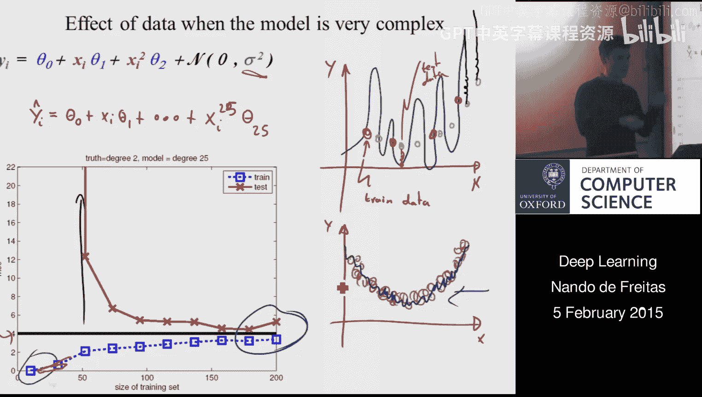

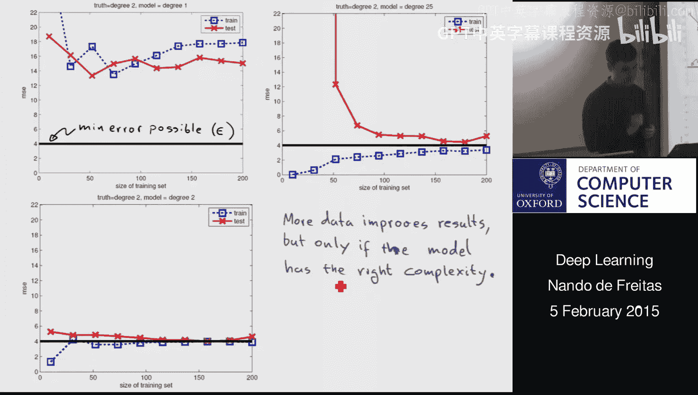

这种方法本质上仍然是线性的，只是将输入矩阵 **X** 替换为特征矩阵 **Φ**。然后我们就可以使用标准的岭回归公式来求解参数 **θ**，并进行预测。

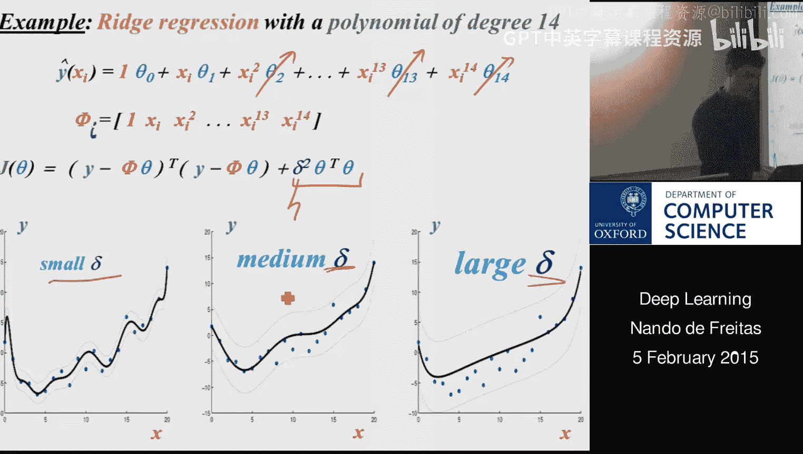

然而，多项式特征的主要问题是维度灾难：随着阶数增加，交叉项的数量会组合爆炸式增长。虽然理论上多项式可以逼近任何连续函数（Stone-Weierstrass定理），但计算资源无法支撑。因此，我们需要更智能的近似方法。

我们通过一个例子说明了模型复杂度与数据生成机制匹配的重要性：
*   如果模型过于简单（如用直线拟合抛物线），无论有多少数据，拟合效果都很差。
*   如果模型与数据生成机制匹配（如用二次多项式拟合抛物线），可以得到很好的拟合。
*   如果模型非常复杂（如用14次多项式拟合少量数据点），会导致**过拟合**：在训练集上误差很小甚至为零，但在未见过测试集上误差很大。

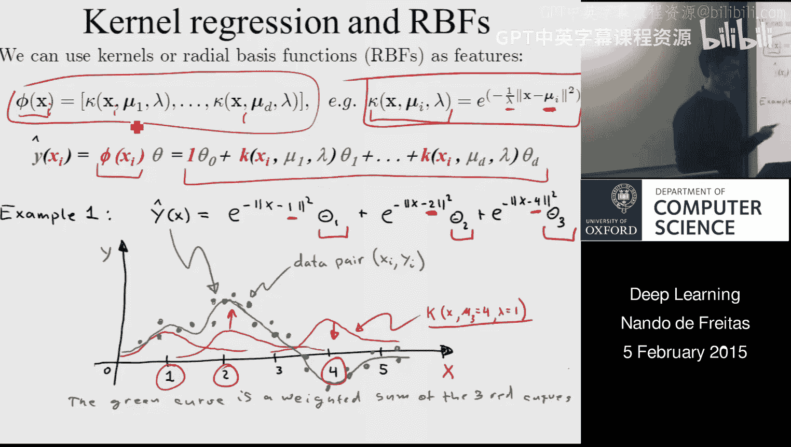

正则化是控制模型复杂度的另一种关键手段。通过调整正则化系数 **δ**，可以约束参数大小，防止过拟合。选择合适的 **δ** 至关重要。

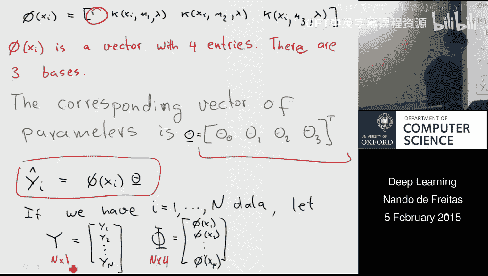

## 核方法：另一种非线性逼近技术

另一种在保持线性技术的同时处理非线性逼近的方法是**核方法**（或径向基函数网络）。

核是一个基函数，例如高斯“钟形”曲线，它具有位置 **μ** 和宽度 **λ**。我们可以将多个这样的核函数放置在不同的位置，每个核乘以一个参数 **θ**，然后求和来构建一个非线性函数（绿色曲线）。

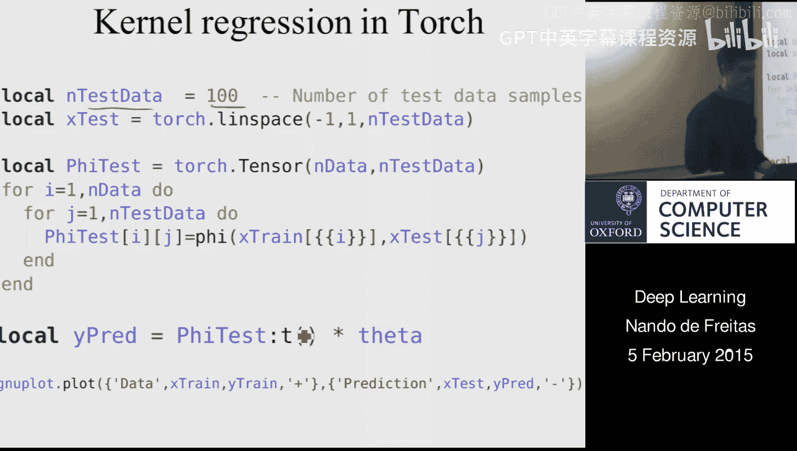

以下是构建和使用核方法进行回归的步骤：

1.  **特征构造**：对于每个数据点 **xᵢ**，我们计算它到所有核中心 **μⱼ** 的核函数值，形成一个特征向量 **φᵢ**。通常，一个启发式方法是将每个数据点本身作为一个核中心。
2.  **形成特征矩阵**：将所有数据点的特征向量堆叠起来，得到特征矩阵 **Φ**。
3.  **线性回归**：使用岭回归公式求解参数 **θ**：**θ = (ΦᵀΦ + δ²I)⁻¹ Φᵀy**
4.  **预测**：对于新输入 **x_new**，计算其特征向量 **φ_new**，预测值为 **ŷ = φ_newᵀ θ**

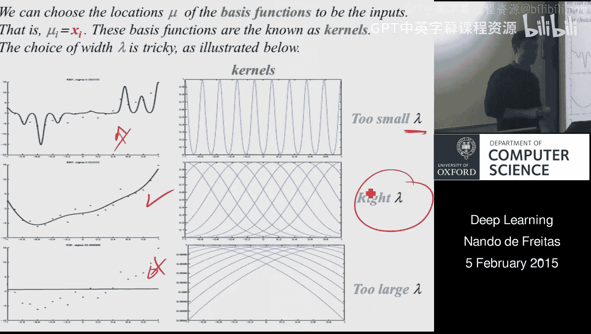

核宽度 **λ** 是一个关键超参数：
*   **λ 太小**：核函数很窄，导致拟合曲线剧烈波动，过拟合。
*   **λ 太大**：核函数很宽，导致拟合曲线过于平滑，欠拟合。
*   **λ 合适**：能在拟合数据和保持平滑之间取得良好平衡。

与多项式回归一样，核方法的核心仍然是特征工程。我们需要手动选择核函数类型、核中心位置、核宽度以及正则化系数。

## 模型选择：交叉验证

如何选择正则化系数 **δ**、核宽度 **λ** 等超参数？一个广泛使用的方法是**交叉验证**。

基本思想是：我们不能只用训练数据来评估模型性能（会导致过拟合乐观估计），也不能反复使用测试数据（会导致信息泄露）。我们需要一个独立的验证过程。

最简单的交叉验证流程如下：

1.  将数据分为训练集和测试集。
2.  对于超参数的每个候选值（例如 **δ** 的一系列取值）：
    *   在训练集上训练模型，得到参数 **θ**。
    *   在训练集和测试集上分别计算预测误差（如均方根误差）。
3.  根据某种准则选择“最佳”超参数。

如何定义“最佳”？这存在主观性：
*   **最小化最坏情况**：选择在测试集上表现最差的那个候选值中，误差最小的一个（最小化最大风险）。这比较保守，适用于安全关键型应用。
*   **最小化平均情况**：选择在训练集和测试集上平均误差最小的候选值。这更为常见。
*   也可以结合两者。

交叉验证的一个主要限制是**需要足够的数据**。如果数据量很少，训练集/测试集的划分可能无法代表数据的真实分布，导致选择不稳定。

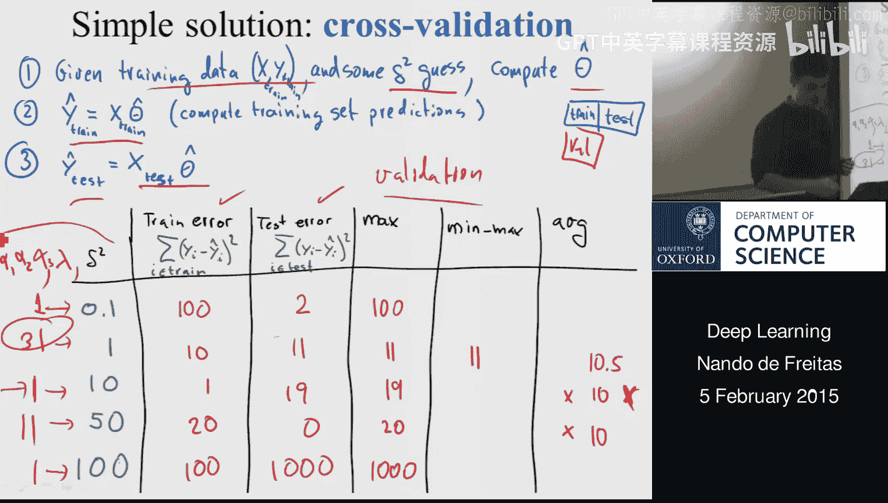

另一种更高效的交叉验证是 **K折交叉验证**：
1.  将数据随机分成K个大小相似的子集。
2.  依次将每个子集作为验证集，其余K-1个子集作为训练集，重复训练和验证K次。
3.  计算K次验证误差的平均值，作为该超参数配置的性能估计。
4.  为所有超参数候选值重复此过程，选择平均验证误差最小的配置。

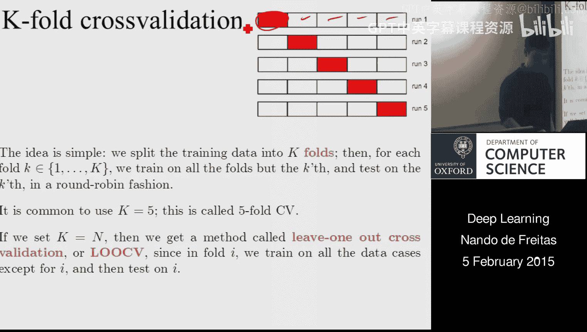

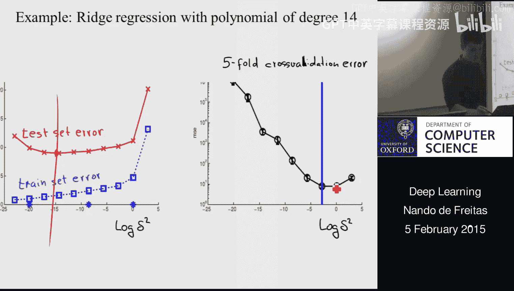

通常，我们会绘制训练误差和验证误差随超参数变化的曲线，寻找验证误差的“甜蜜点”。

然而，交叉验证也有其局限性：
1.  **组合爆炸**：当需要同时调整多个超参数时，需要评估的组合数量会呈指数级增长，计算成本高昂。
2.  **不适用于无监督学习**：在聚类等无监督任务中，没有真实的标签 **y** 来计算预测误差。例如，在K-means聚类中，如果将聚类中心数设置为样本数，训练误差可以为零，但这毫无意义。对于这类问题，需要其他评估方法（如轮廓系数、间隔统计量等），或依赖于构建一个可优化所有参数的代价函数。

## 总结

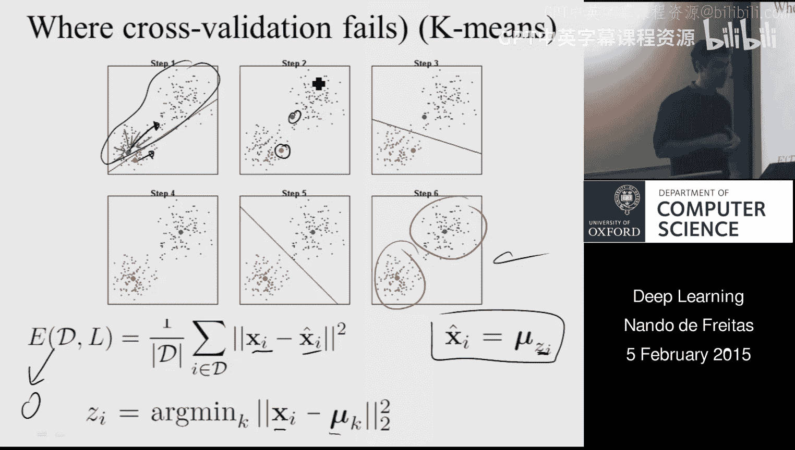

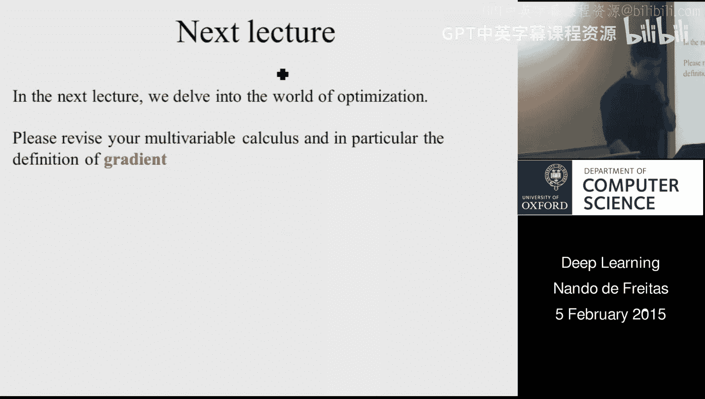

本节课我们一起深入学习了控制模型复杂度的核心工具。我们首先从贝叶斯的角度重新审视了正则化，将其理解为对模型参数引入先验分布。接着，我们探讨了通过特征工程（如多项式特征和核方法）来构建非线性模型，但其核心仍是线性计算。最后，我们介绍了**交叉验证**这一至关重要的模型选择技术，用于在缺乏理论指导时，依据数据客观地选择超参数（如正则化强度、核宽度）。同时，我们也指出了交叉验证对数据量的依赖以及在处理多参数或无监督学习时的挑战。这些概念为我们后续学习更复杂的、能够自动学习特征的模型（如神经网络）奠定了坚实的基础。