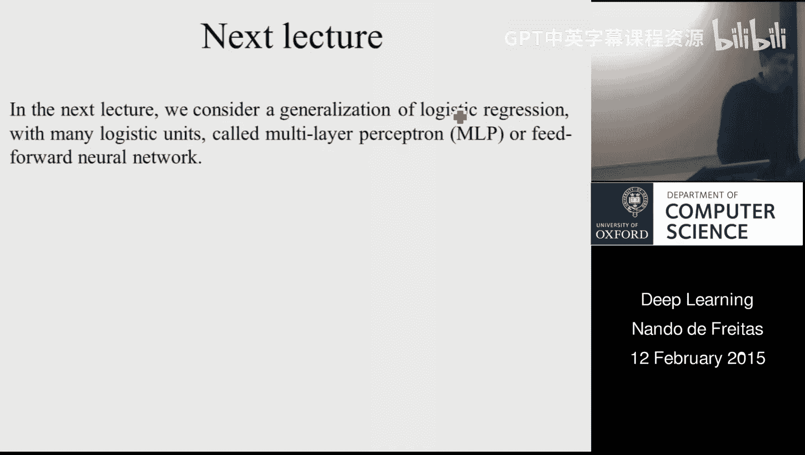

#  007：模块化反向传播、逻辑回归与Torch

在本节课中，我们将学习反向传播算法的核心思想。与大多数课程不同，我们将从一个简单的逻辑回归例子入手，并采用一种模块化的视角来理解它。这种方法将复杂的网络分解为独立的层，每层只需定义三个核心函数，从而使得构建和训练任意复杂的神经网络变得简单高效。

## 网络架构与符号定义

上一节我们介绍了逻辑回归的损失函数。本节中，我们来看看如何将其表示为一个由层组成的网络，并定义清晰的符号。

首先，回顾逻辑回归的架构。我们有输入数据 `Xi`，它经过一个线性层，产生两个输出：`Xi * θ1` 和 `Xi * θ2`。接着，这两个输出进入一个对数Softmax层，分别得到 `LSF1` 和 `LSF2`。最后，负对数似然损失函数根据数据的真实类别标签（0或1）对这两个结果进行加权求和，得到总成本 `C`。

为了通用化，我们引入分层符号。设第一层（输入层）的输出为 `Z1`（即 `Xi` 本身）。第二层（线性层）的输出为 `Z2`，它包含两个分量：`Z2_1 = Xi * θ1` 和 `Z2_2 = Xi * θ2`。第三层（对数Softmax层）的输出为 `Z3`，同样包含两个分量：`Z3_1 = log(exp(Z2_1) / (exp(Z2_1) + exp(Z2_2)))` 和 `Z3_2 = log(exp(Z2_2) / (exp(Z2_1) + exp(Z2_2)))`。第四层（成本层）的输出 `Z4` 就是总成本 `C`，计算公式为 `C = Σ_i [ indicator(class=0)_i * Z3_1_i + indicator(class=1)_i * Z3_2_i ]`。

通过这种分层定义，我们将复杂的嵌套函数计算分解为多个简单的步骤。

## 链式法则与计算冗余

如果我们想计算成本 `C` 对参数 `θ1` 的梯度，就需要应用链式法则。这涉及到 `C` 对 `Z3` 的导数、`Z3` 对 `Z2` 的导数，以及 `Z2` 对 `θ1` 的导数。由于 `Z3` 有两个分量，每个分量都依赖于 `Z2` 的两个分量，因此计算会展开为多个项的求和。

直接应用链式法则虽然可行，但效率低下，因为它会导致大量重复计算。例如，`C` 对 `Z2_1` 的贡献会通过 `Z3_1` 和 `Z3_2` 两条路径计算两次。我们的目标是设计一种算法，避免这种冗余，使每个导数项只计算一次。

## 模块化反向传播算法

为了实现高效计算，我们采用模块化的视角。我们将神经网络视为一系列层的堆叠。每一层 `L` 都执行一个前向函数，将输入 `Z_in` 映射为输出 `Z_out`。

关键思想是，每一层只需要关心三件事：
1.  **前向计算**：给定输入，计算输出。`Z_out = forward(Z_in)`
2.  **反向传播（关于输入）**：给定来自后一层的梯度 `δ_out`（即成本 `C` 对该层输出的导数），计算该梯度对当前层输入的导数 `δ_in`。
3.  **参数梯度（如果该层有参数）**：利用 `δ_out` 计算成本对该层参数的导数。

其中，`δ` 被定义为成本 `C` 对某一层某个神经元激活值的导数，即 `δ_j^L = ∂C / ∂Z_j^L`。

对于反向传播，核心公式是链式法则在单层上的应用：
`δ_in = Σ_j [ δ_out_j * (∂Z_out_j / ∂Z_in) ]`
如果该层有参数 `θ`，则其梯度为：
`∂C/∂θ = Σ_j [ δ_out_j * (∂Z_out_j / ∂θ) ]`

这个算法的美妙之处在于它的递归性。我们从最后一层（成本层）开始，其 `δ` 初始化为1（因为 `∂C/∂C = 1`）。然后，我们逐层向前传递 `δ` 信号。每一层只需要根据它自己的前向函数计算局部导数 `∂Z_out/∂Z_in` 和 `∂Z_out/∂θ`，然后利用传入的 `δ_out` 计算出 `δ_in` 和参数梯度。这样，通过一次前向传播（计算所有 `Z`）和一次反向传播（计算所有 `δ` 和梯度），我们就得到了整个网络所有参数的梯度，且没有冗余计算。

## 在Torch中的实现

这种模块化思想正是现代深度学习框架（如Torch、Caffe）的实现基础。在Torch中：

*   层（Layer）被实现为对象。
*   每个层都需要实现三个方法：`forward`、`backward`（计算输入的梯度）以及更新参数梯度的方法。
*   构建网络就是将这些层像积木一样连接起来。
*   训练时，先进行前向传播计算损失，然后进行反向传播计算梯度，最后使用随机梯度下降（SGD）等优化器更新参数：`θ = θ - α * gradient`。

以下是一个在Torch中构建逻辑回归模型的简化示例：

```lua
-- 定义模型序列
model = nn.Sequential()
model:add(nn.Linear(inputDim, outputDim)) -- 线性层
model:add(nn.LogSoftMax()) -- 对数Softmax层

-- 定义损失函数（准则）
criterion = nn.ClassNLLCriterion() -- 负对数似然损失

-- 训练步骤（简化）
for i = 1, numIterations do
    -- 前向传播：计算预测和损失
    local predictions = model:forward(inputs)
    local loss = criterion:forward(predictions, labels)

    -- 反向传播：计算梯度
    local gradOutputs = criterion:backward(predictions, labels)
    model:backward(inputs, gradOutputs)

    -- 更新参数（这里需要优化器，如SGD）
    -- optimizer:updateParameters(model.parameters, learningRate)
end
```

通过这种设计，研究人员可以轻松地定义新的层（只需实现上述三个方法），并将其融入现有框架，促进了算法的快速迭代和共享。

## 反向传播的应用：理解模型决策

反向传播不仅用于训练，还能帮助我们理解模型的决策过程。考虑一个训练好的图像分类网络，输入是一张图片，输出是各个类别的概率。

如果我们选取“猫”这个类别对应的输出神经元，并通过反向传播将梯度一直传递回输入图片，我们就能计算得到 `∂(输出_猫) / ∂(每个像素)`。

这个梯度的绝对值大小，标识了每个像素对“图片被分类为猫”这一结果的贡献程度。可视化这个梯度图，我们就能得到一张“显著性图”，它高亮了图片中模型认为最重要的、与“猫”相关的区域。这是一种简单而有效的模型解释技术。

## 总结




本节课中，我们一起学习了反向传播算法的模块化视角。我们从逻辑回归的例子出发，揭示了直接计算梯度的冗余性。进而，我们引入了层的概念，将反向传播分解为每个层独立完成的三个核心任务：前向计算、反向传播梯度（对输入）和计算参数梯度。这种模块化方法不仅是理解反向传播的清晰方式，也是现代深度学习框架（如Torch）的实现基石。它使得构建、训练和理解复杂的神经网络变得系统而高效。