#  008：Torch中的神经网络与模块化设计 🧠

在本节课中，我们将学习神经网络的基本概念，并了解如何使用模块化设计思想在Torch框架中构建和训练它们。我们将从简单的线性模型（如逻辑回归）出发，逐步过渡到更复杂的神经网络，并探讨如何通过控制模型复杂度来避免过拟合或欠拟合。

---

## 概述：从线性模型到神经网络

到目前为止，我们学习的模型都是线性模型，非常简单。除了在讨论逻辑回归时引入的模块化方法外，这些内容在统计学课程中也能学到。今天的计划是将这种模块化方法应用到神经网络中，这本质上就是深度学习的核心。深度学习不仅仅是神经网络，更是一个非常灵活的框架，用于构建分布式模型，以完成各种模式识别和预测任务。

然而，我将从“旧视角”开始，因为它仍然很有用。首先，我将带大家回顾上世纪90年代乃至大约八年前的神经网络。那时的神经网络非常简单，只比我们见过的逻辑回归模型多一个隐藏层。当时的观点是，只要有一个隐藏层，我们就能近似表示任何相对连续的复杂函数。因此，人们认为不需要更大的模型。有一段时间，像支持向量机（SVM）这样只有一层的模型变得非常流行，机器学习领域的注意力更多地集中在优化上，试图找出高效训练单隐藏层神经网络的凸优化方法。

近年来，由于计算机科学、物理学和工程学的巨大进步，特别是数据处理、存储和计算能力的提升，情况发生了改变。最重要的是数据量的爆炸式增长。在我攻读博士学位时（2000年），做计算机视觉研究的人电脑里只有几张图片。而现在，我们可以轻松存储和传输海量视频数据。没有大量数据，就无法训练机器真正“看见”世界。与大脑相比，过去的机器严重“欠拟合”。一些研究者，如约书亚·本吉奥、杰弗里·辛顿等人，始终坚信并持续研究神经网络。最终，他们成功了。如今，他们能够利用海量数据和参数来扩展这些模型。每隔几个月，神经网络就会在新的基准测试中刷新纪录。最近，在一个非常困难的物体识别任务（MNIST）上，神经网络的表现甚至超过了人类。

---

## 旧视角：从逻辑回归出发

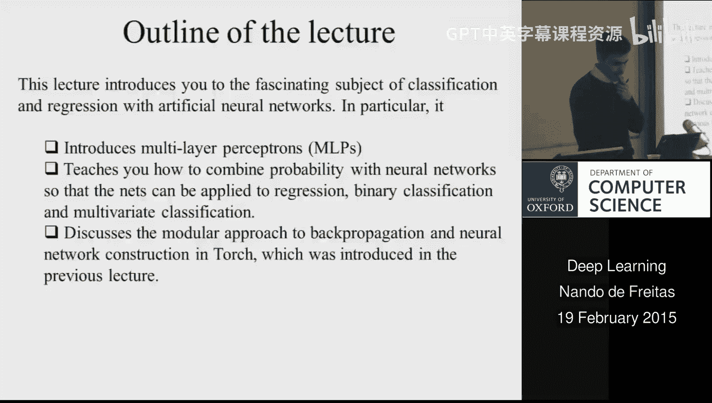

让我们从逻辑回归开始，这是我们前两讲已经熟悉的内容。

逻辑回归的思想是：给定数据（例如两个特征：身高和体重），目标是预测一个二元变量（例如，病人在五个月内是否可能复发）。我们使用参数乘以输入，得到一个线性输出，然后通过一个S型（sigmoid）函数将其压缩到0和1之间，从而将输出解释为属于类别1的概率。

在二维特征空间中，我们可以绘制每个数据点，用红色和绿色（或圆圈和叉号）表示类别1或类别0。最终，我们计算出一条分离这些点的直线（在高维中是超平面）。这条线由 `x * θ` 决定。

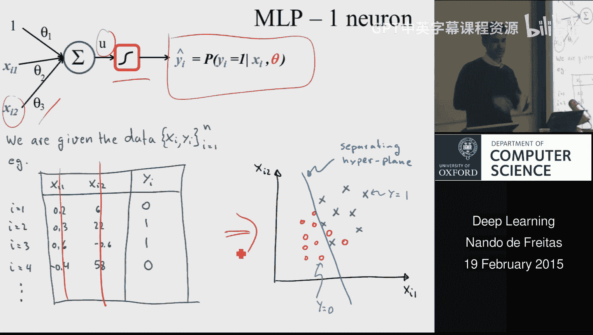

我们详细推导了这个过程的方程。你可以将其视为一个流程图：输入乘以权重，然后聚合（类似一个汇点），再通过网络传播。或者从数学角度思考：先求和，然后在和上求函数值，得到概率。

如果有大量数据，我们为单个数据点制定概率。由于数据点是独立同分布的，我们采用常用技巧：将各个概率相乘。取其负对数似然，就得到了交叉熵，它衡量了不确定性。我们使用它来优化学习参数 `θ`。

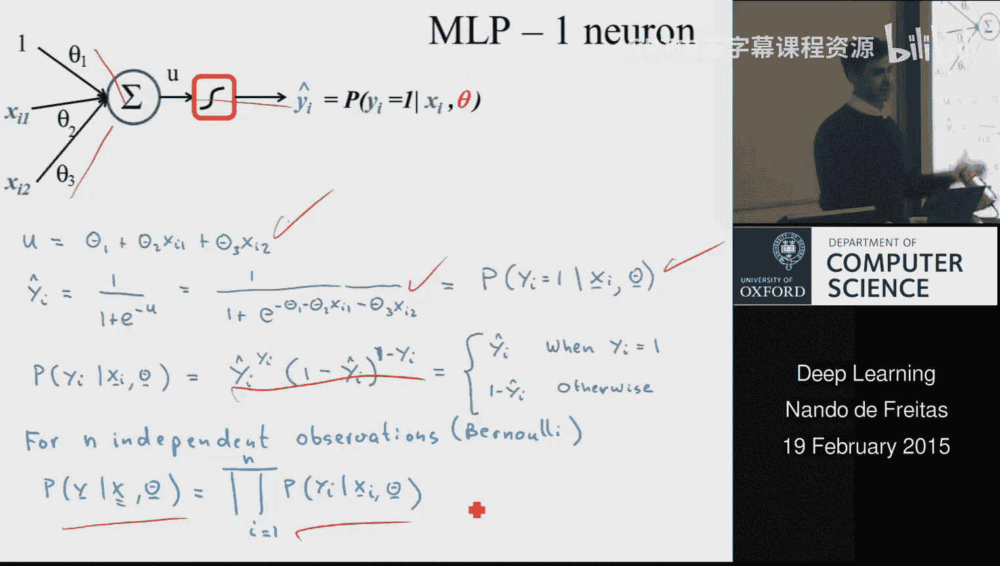

### 非线性世界与隐藏层

不幸的是，世界并非总是线性的。你经常会遇到像这里展示的数据点（绿点和红点），无法用一条直线很好地分离，总会产生显著误差。

我们可以构建更复杂的函数。一个简单的方法是添加一个额外的层，我称之为隐藏层。它位于输入层和输出概率层之间。本质上，我们在这里进行的是函数组合：将非常简单的基函数组合起来。现在的输出是输入的基函数的基函数。我将很快展示一些图表来说明如何组合这些基本函数。

当我们引入这些模型时，分离超平面不再是对齐的直线。它将是一个某种函数。我们的任务是控制这个函数的平滑程度。这类似于我们之前用多项式做回归时的情况。

### 控制模型复杂度

假设你有一个优化算法（例如SGD），并在Torch中实现了这个模型。SGD会给出参数的估计值。但你可能希望构建具有不同灵活性的模型（如图中的选项1、2或3）。你最初可能并不知道需要多少灵活性。

那么，如何创造这种灵活性？哪些因素控制着你最终得到的是分离曲面1、2还是3？

回顾多项式回归，是什么让多项式更灵活或更不灵活？多项式的次数是一个因素。在这里，增加什么相当于增加多项式的次数？答案是基函数的数量，也就是神经元的数量。如果我有更多的神经元，函数就会变得越来越复杂。

还可以做什么来改变预测的形状？在这个例子中，是偏置项吗？数据确实会改变结果，但让我们假设我们有一个数据集。我听到了另一个我正在寻找的答案：**正则化**。我们有一个权重衰减参数 `δ`。如果我们把它设置得非常大，参数就会被拉向0。所以，如果我在这里引入权重衰减，并把 `δ` 设置得极大，我所有的参数都会是0，就不会得到非常有趣的函数。

因此，到目前为止，我有两种控制复杂度的机制：
1.  神经元的数量（模型容量）。
2.  正则化强度。

优化对你来说不是挑战。Torch会为你完成，除非你真的想去发明新的优化技术。使用模块化方法构建网络非常容易。

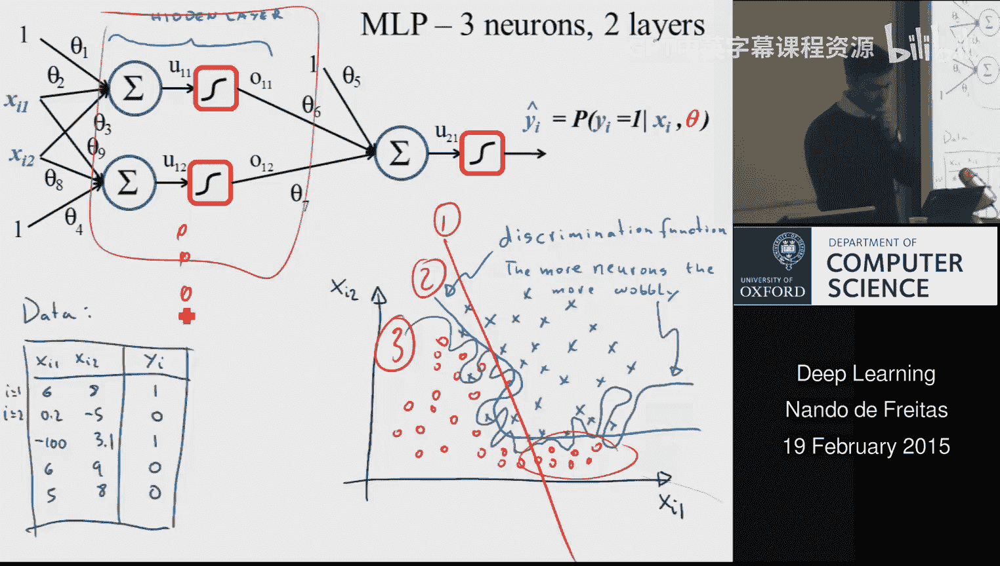

真正需要你具备的能力是**控制模型复杂度**。因为这才是真正的挑战：知道如何进行交叉验证，了解在尝试将模型拟合到数据时可能出现的各种欠拟合或过拟合情况。这是我希望你们开始认真思考的问题，因为这是最难优化的部分。其他事情更容易优化，机器可以完成。

模型设计也很棘手。复杂度与模型设计紧密相连。在我们看到所有数据之前，我们不知道过程有多复杂，因此也永远不知道需要把模型做得多复杂。学习是一个不适定问题，因为没有单一的最佳解决方案。数据会给你信息，但你真的必须基于上下文和你可能拥有的其他先验知识来引入设计。这就是复杂度控制。

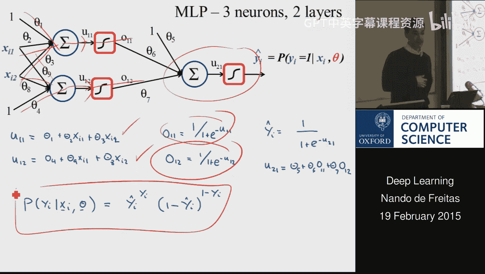

---

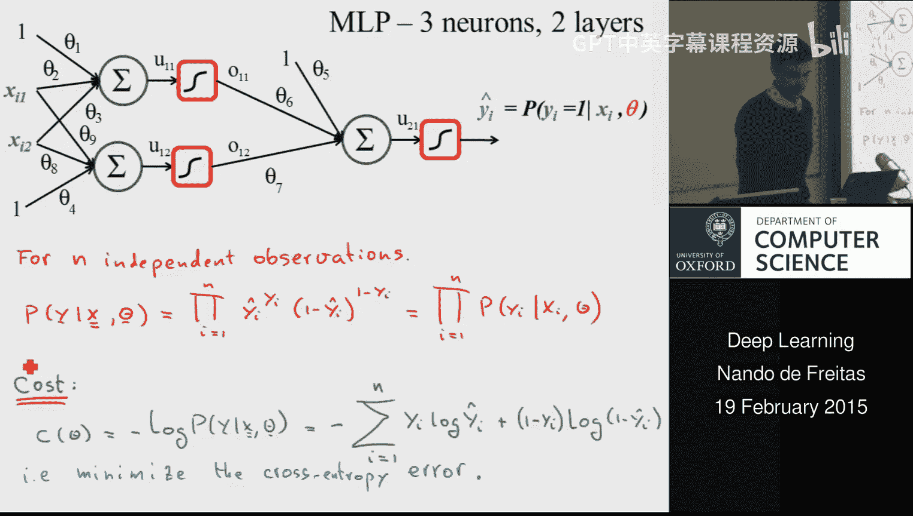

## 神经网络：模块化视角

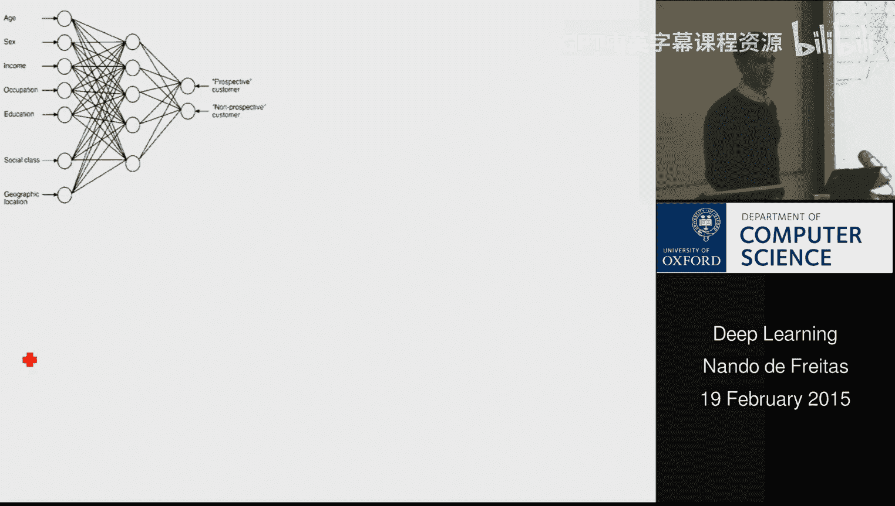

让我们回到神经网络。我们将做和之前完全一样的事情：将其视为一个流程，接收输入，乘以参数，产生输出。在这种情况下，流程有两个通道，对应两个方程。然后它们都通过S型函数，最后再通过一个输出S型函数。

概率计算和逻辑回归完全一样：不确定性在 `y` 中，`x` 是给定的。如果 `y` 是二元的，我们就在输出上放置一个伯努利分布。

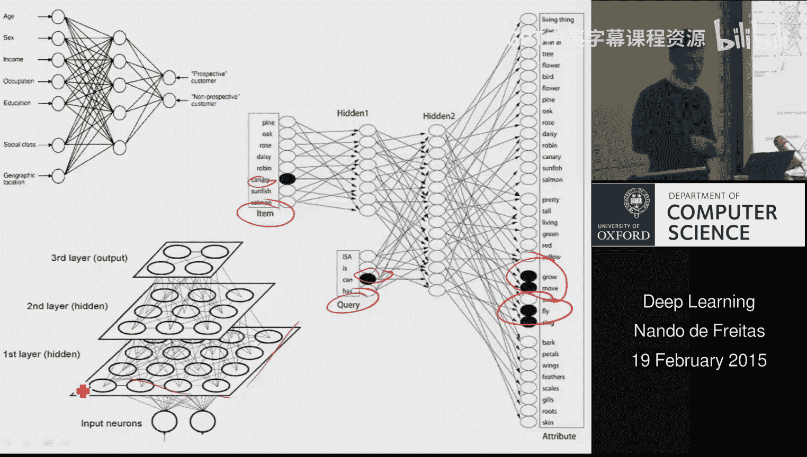

如果我们有多个数据，我们取乘积。为了得到成本函数，我们求导并得到交叉熵。这和逻辑回归完全一样。

### 构建更复杂的模型

我们可以开始构建更有趣的模型。例如，可以构建一个模型来预测一个人是否有资格获得贷款。这在银行处理大量交易、信用卡授权和欺诈检测时非常有用。如果没有自动欺诈检测，银行业务会慢得多。多亏了这类分类器，我们的生活已经便利了许多。

还有更多研究性问题，比如认知科学家可能想了解大脑中的记忆如何工作。例如，斯坦福大学的麦克莱兰教授研究项目（如“金丝雀”）和关系（如“可以”），试图快速理解如何从数据库中学习知识（例如，“金丝雀可以飞”）。

我们将在今天的第二讲中看到，有时以特定方式组织神经元是有益的，尤其是在处理视觉输入（图像）时。通常将神经元组织成空间布局（如图像），并且这种空间布局会随着层的变化而变化。

### 神经网络用于回归

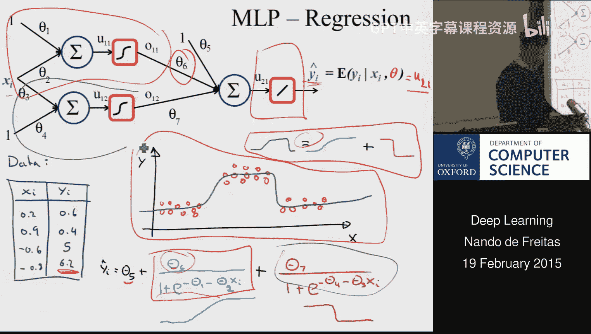

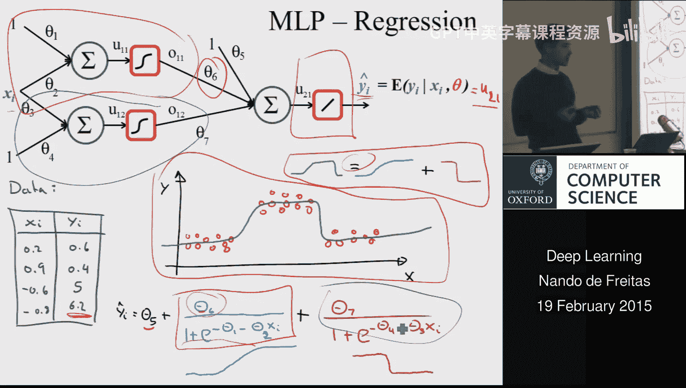

回到神经网络，你还可以做回归。与之前唯一的区别是，现在的输出是线性的（我强调了那里的线性映射）。所以输出 `y` 就是 `u`，是恒等映射。

对于回归，我们不想预测0和1。我们有一个数据集，其中包含实数（标量）。我们实际上是在拟合一个函数。这就像最小二乘法，但它是非线性的。我们仍然使用相同的损失函数等，但它允许我们做非线性的事情。

这个回归例子很容易分析。想象我们有一个网络，只有一个输入和一个输出。因为是一维的，我们可以像这里展示的那样绘制它。数据是红色的圆圈，我们试图拟合那条绿色的曲线。这是一条非线性曲线，所以我们超出了线性拟合的范围。

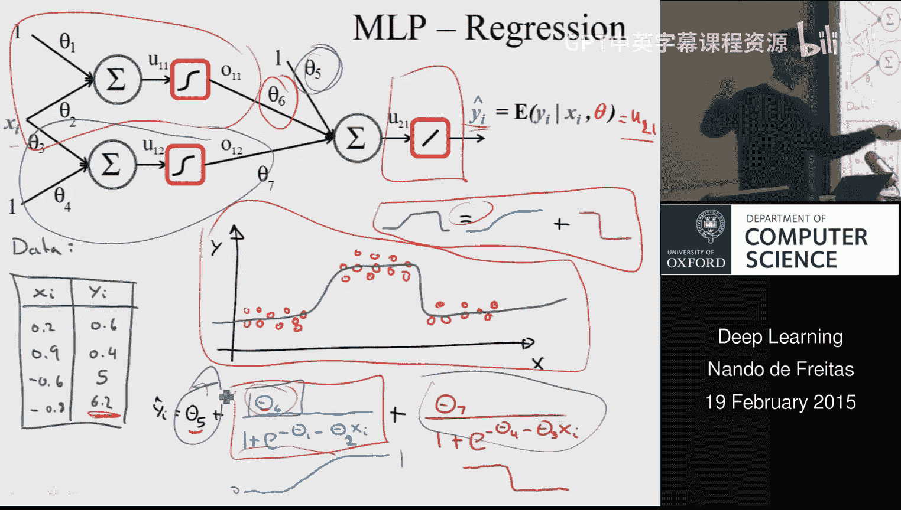

但从某种意义上说，这条凸起的曲线可以很容易地建模。如果我们有一个向上的函数和一个向下的函数，只要我们能把这些函数做成正确的形状并放在正确的位置，我们就能构建出这个凸起。我们可以得到这个等式。这本质上就是神经网络为我们所做的：它们是函数逼近工具。

这里的这个家伙给了我第一个神经元。它接收输入和一个偏置项，进行线性运算 `θ * X + θ * 1`，然后通过一个S型函数，再用 `θ6` 缩放。我们对这里的另一个项做同样的事情，它对应这个神经元。我们用 `θ7` 缩放它，这是一个神经元。然后每个神经元都有...为了上下移动这个函数，我们加上 `θ5`。

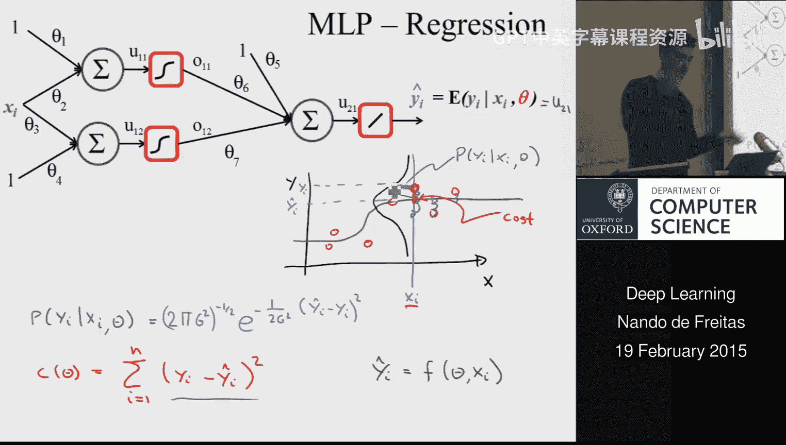

所以 `θ5` 可以上下移动函数。这些函数中的每一个都是一个在0和1之间的S型函数。但我可以用 `θ6` 缩放它，使其大于0或1。现在我有一个“砖块”，可以上下移动，也可以这样拉伸。我需要另外两个自由度：能够水平移动它，以及能够水平拉伸或压缩它。

只要我拥有所有这些自由度，如果我有了砖块，并且可以让它们更宽或更窄、更高或更矮，我就可以建造任何东西，就像你去建造一座建筑一样。整个学习的问题就是找到合适的砖块。你基本上被给定了“大教堂”（目标函数），你必须弄清楚在给定的约束下，如何调整所有这些砖块的大小来复制这座大教堂。这是思考我们在做什么的一个好方法。人类是智慧的“大教堂”，我们正在用这些模型复制他们。

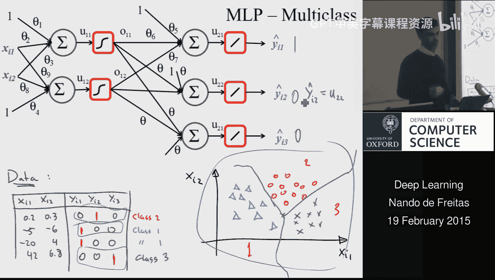

### 回归的误差度量

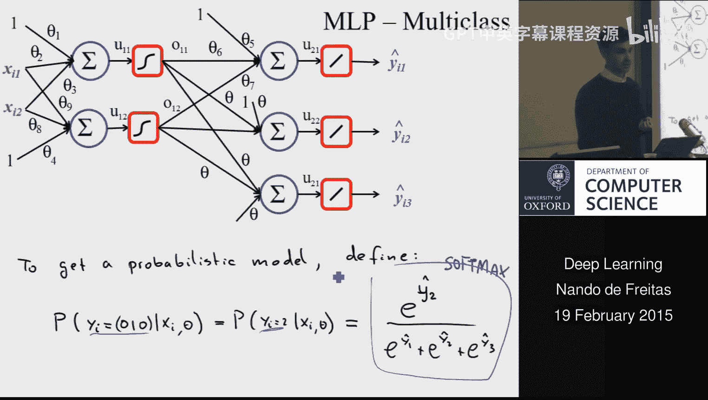

在误差方面，当我们做回归时，我们用平方损失来衡量误差，就像最小二乘法一样。然后，如果我们对损失取指数（并取负），我们得到一个概率。在这种情况下，我们得到一个高斯概率，所以每个点都是高斯的。这和之前的图是一样的，唯一的不同是我们用任意的非线性函数替换了直线 `y = θ^T x`。

就问题的理解而言，这就是为什么我在最小二乘法上花了这么多时间。一旦你理解了如何在成本和概率之间导航，理解了当你拟合时，你既可以用到直线的弹簧距离来衡量误差，也可以将它们建模为以直线为中心的高斯分布的高度，那么你就可以将这种图形化的理解推广到任意网络。它让你真正看到概率和能量最小化之间的相互作用。

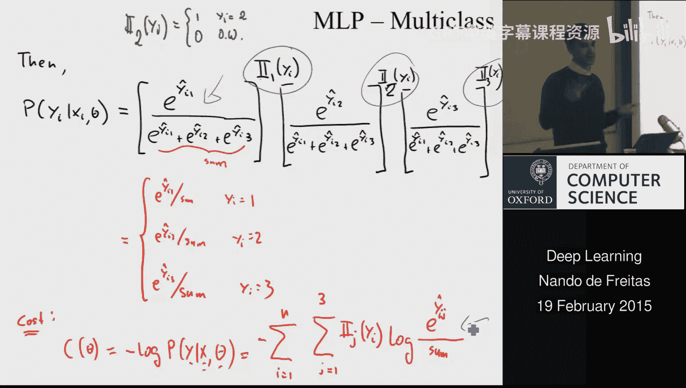

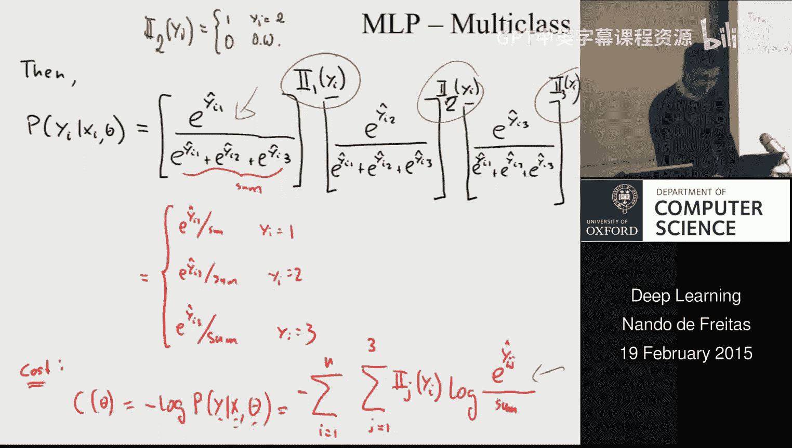

---

## 扩展到多分类与模块化设计

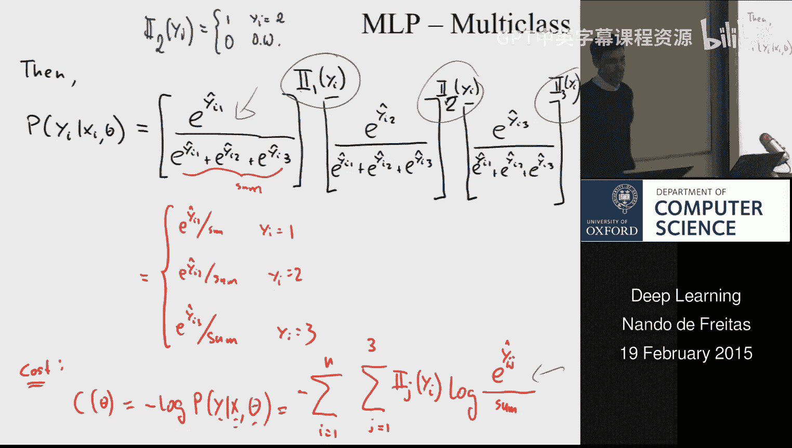

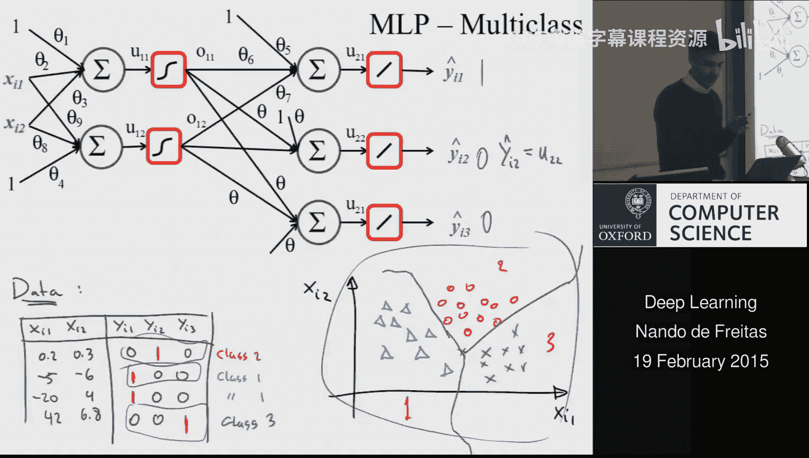

我们也可以转向其他类型的图。Torch的做法略有不同，所以我不打算在这上面花太多时间。但这是我们上节课做softmax时做过的事情。

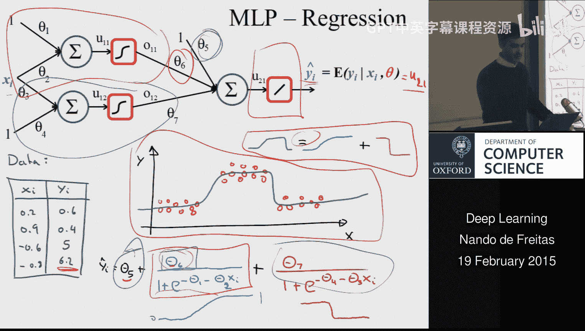

你可能遇到的另一种做神经网络的方式是，如果你有多个类别，比如这里有三个可能的类别。你可以进行一种编码，其中类别2变成向量 `[0, 1, 0]`，类别1是 `[0, 0, 1]`，类别3是 `[0, 0, 1]`。这样，当你提供标签时，你就提供编码 `[1, 0, 0]` 或 `[0, 0, 1]`。

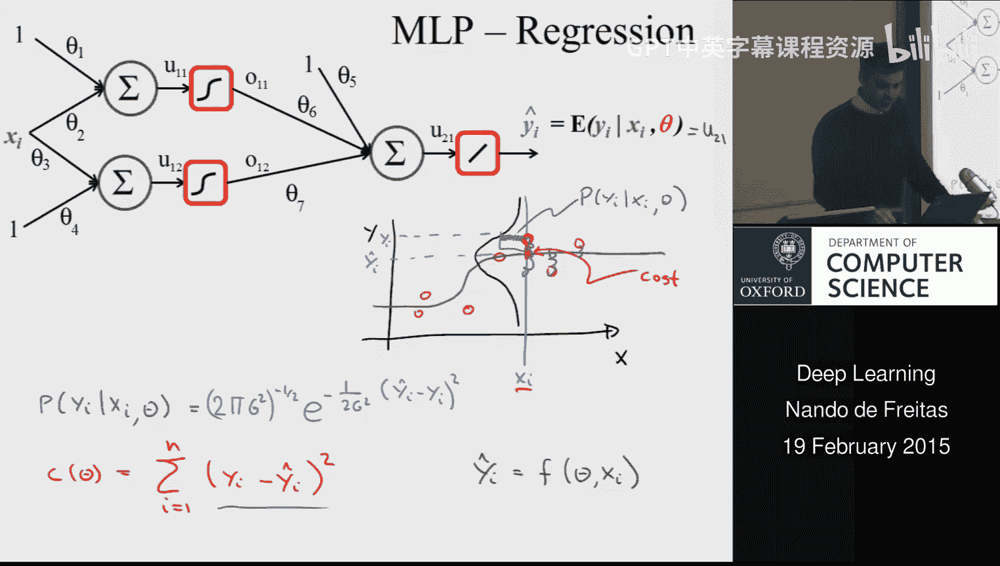

然后我们做上次做的事情：`y` 是 `[0, 1, 0]`（对应类别2）的概率就是softmax。这是我们在做逻辑回归时介绍的：我们取一个变量的指数，然后除以所有替代方案的指数和，因为它们是正的。由于进行了归一化，结果会在0和1之间。

如果你映射三种可能的情况，三个概率之和为1，所以我们有一个定义良好的概率模型。我们将其视为二元情况的推广，现在你有指示器来检查你是类别1、类别2还是类别3，根据你属于哪个类别，你使用相应的softmax。如果你求导并令其为零，就像我们上节课做的那样，你再次得到交叉熵损失。所以，扩展到更多类别在某种程度上与只做两个类别没有什么不同。

### 模块化设计的威力

在这种旧的神经网络视角下，你可以看到概率和能量函数（也称为损失函数、误差函数或准则，在Torch中有些人称之为标准）之间的相互作用。还有一种观点是我在这里展示的回归视图：只要有足够多的“砖块”（神经元），你就可以近似任何函数。

但是还有另一种增加复杂度来近似函数的方法，那就是拥有更多的层。每当人们试图用很少的数据和有限的计算能力这样做时，训练模型都非常困难。你会尝试各种优化器，但效果都不好。因此，我们不知何故陷入了只使用一个隐藏层的局部最优解。偶尔会有两层，但在推广这方面没有太多工作。

现在，我们的计算资源允许我们做更多层，事实上，这几乎是偶然发生的。人们尝试了越来越多的层，突然意识到我们得到了惊人的结果。在网络初始化等方面也有一些变化，我稍后会讲到。

深度学习领域的工作呈爆炸式增长，我认为部分原因是软件也变得非常好用，变得非常模块化。这使我们能够非常快速地构建新网络、训练它们、重用组件，并提出非常通用的学习方法。

正如我在上一节课中提到的，思考神经网络的方式应该是这种组合模型：就像我在这张图片中展示的那样，你有好几层。结构很简单，是顺序结构，只是一连串的层，但也可能是不同的结构。

这些层中的每一层都接收输入并产生输出。然后它从输出层获取误差，所以你从误差开始，然后它获取输出误差并将其传播回去。只要每一层都知道如何将误差向后传播、如何将信号向前传播，以及如何计算相对于其参数（如果它有参数）的导数，那么每一层就可以独立设计。

所以，当你设计一个层时，你只需要设计三个函数：前向传播消息、后向传播消息，以及相对于该层参数的导数（如果该层有参数的话；有些层没有参数）。只要你设计好了这些，那么剩下的问题就是如何组合这些层。

在这张图片中，我以两种方式组合它们。我已经告诉了你一种：顺序性，因为一层接一层。还有另一种我正在利用的结构。提示：整个东西是一个层。这是理解的关键：神经网络在公式上是递归的。一个层由许多层组成。因此，如果你构建了一个能够做一些有趣事情的有趣神经网络，你可以在另一个神经网络中重用整个神经网络，前提是你有一个良好的消息传播机制，我们知道如何通过反向传播来实现。我会再复习一遍，但这本质上就是我们上节课用逻辑回归所做的。

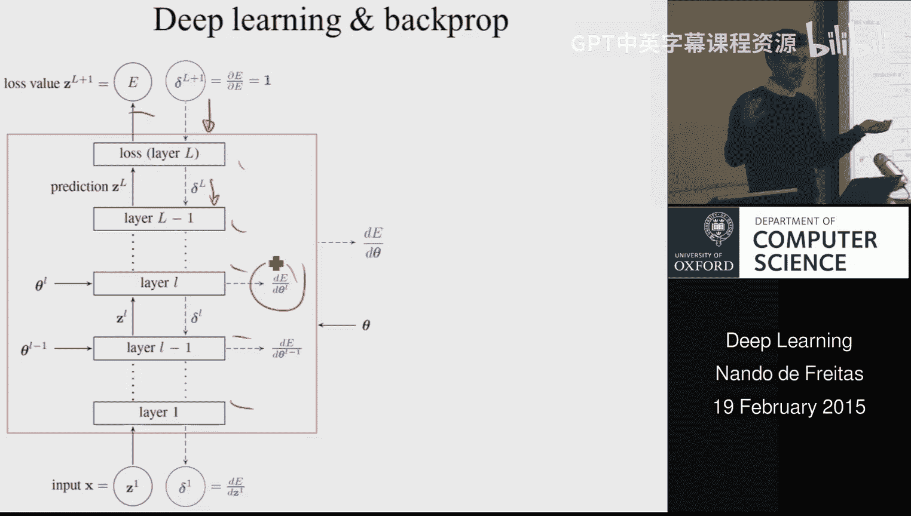

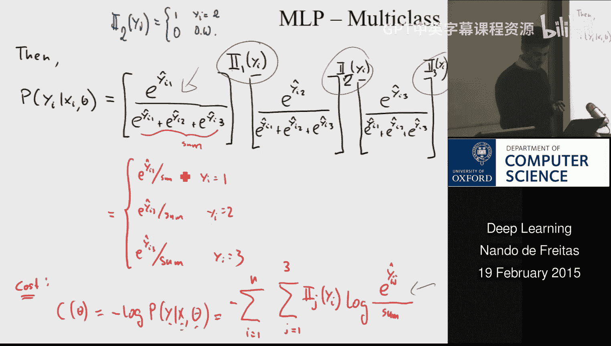

因此，只要你有办法协调消息如何传递，你就可以构建任意的网络。同样，你需要先进行前向传播，从输入到损失（如果你有多个损失，则到多个损失）。然后你必须通过计算导数来发送消息回去。一旦你有了所有的导数，你只需使用SGD或Adagrad或RMSProp或任何其他优化器进行梯度更新，你就得到了答案，你有了一个训练好的模型。

棘手的是确保我们有好的算法可以训练任意模型。随着模型变得非常大，我们开始遇到问题。当我谈到目前处理非常大的数据集以及像长短期记忆网络这样的时序神经网络所面临的挑战时，我会提到一些。LSTM是循环网络，因为今天的输出是明天的输入。事实上，如果你在时间上展开它，你会得到一个非常大的网络。因此，信息如何在网络中传播会出现一些问题：信息可能被破坏、消失，或者误差可能扩大、复合，导致一切发散和爆炸。

所以，在如何控制优化方面存在一些问题，但框架基本上已经设定好了。它极其通用。你可以直接使用Adagrad、SGD或同步SGD等非常简单的优化器，所以我们不需要担心要提出什么推理方法，因为已经有很好的技术了。

设计极其简单，因为你不需要设计整个网络，你只需要设计一个层。一旦你设计好了，或者你也可以设计网络，你可以直接使用人们设计的所有层和网络，并将它们组合起来。

### Torch中的实现

在Torch中，做法略有不同。为了保持清晰，我将使用两个消息（输入和参数），这也是Torch所做的。如果你把整个顺序网络看作Torch中的模型，那么Torch会构建一个顺序网络。例如，对于具有两个输入和三个类别的逻辑回归，你基本上可以说你将使用`nn`（神经网络）模块构建一个顺序模型。如果你想要任意形状，那么Torch也有一个叫做`nn.graph`的东西，允许你构建任意形状的图。

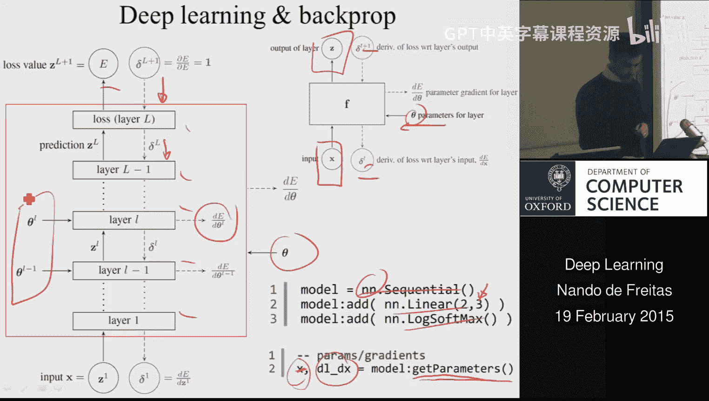

然后我们通过说“让我们放第一个线性层，接下来放一个softmax层”来构建网络。这真的很简单。你可以随心所欲地构建网络：只需再添加两个线性层和softmax层，一个线性层和一个softmax层。你可以用这种方式构建任意大的网络。

你可能在查看代码时注意到的一件事是这些全局参数。在代码中，参数是`X`，而`dL/dX`是相对于参数的梯度。基本上，在Torch中，你所有的参数都被放在这个向量中，有一个单一的存储空间存放你所有的参数，它们一个接一个地追加。这或多或少就是这里发生的情况：我有一个单一的参数向量，由所有这些追加的参数组成。所以你可以认为那个输入参数实际上被分解成了进入每一层的参数。这本质上是Torch的工作架构。

---

## 反向传播与层设计

让我们看看反向传播。在分层视图中，我们需要一个前向消息。如果我们有一个输入，我们通过评估前向消息将其发送到下一层。我们计算相对于输入的导数以获得后向消息，从而得到δ的递归。为了得到这个，我们只需要能够计算该层的输出相对于输入的导数。

重要的是要认识到，如果你有许多输入和许多输出，这里的这些量是矩阵。一个输出相对于所有输入的导数会给你一个向量，你移动到下一个输出相对于所有输入的导数将是另一个向量，所以这个被称为雅可比矩阵的量是每个输出相对于每个输入的导数矩阵。因此，它将是一个（输出数量）×（输入数量）的矩阵。

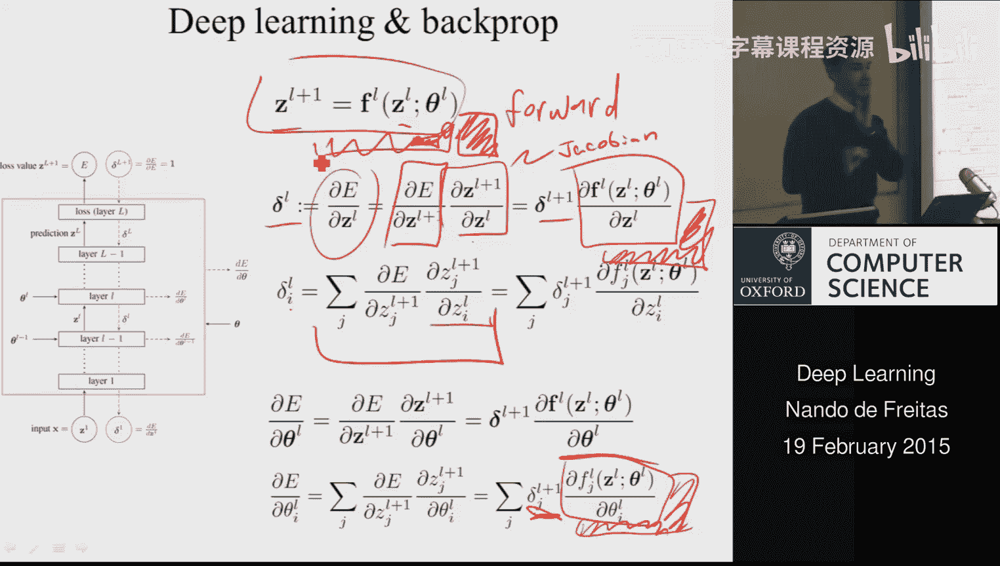

我特意在这里写成这样，所以这是一个矩阵乘以一个向量。损失的导数是一个向量，因为损失是一个标量，所以它是一个单一输出相对于多个输入的导数。所以我们有一个向量乘以一个矩阵。这就是为什么当我们以这种形式书写时，你可以看到你有一个标量乘以一个向量...（抱歉）乘以矩阵的IJ项，给出向量的DI分量。这很快就会变得非常重要。

我们需要计算的另一个消息是相对于参数的导数，这又是一个递归，它使用从顶部来的δ。所以你只需要计算单层相对于参数的导数。因此，每当你创建一个新层时，你只需要手动计算这两个导数。如果你知道如何做这两个导数，哦，你还知道如何编写该层的函数，那么你就完成了。因为然后你只需使用这些递归来得到一切。

### 计算效率：反向模式自动微分

有两种方法可以实现这一点。现在考虑一个有L层的神经网络。你从第1层开始，一直到第L层。为简单起见，我省略了在这里写θ，或者你可能希望将θ视为输入向量X的一部分，这无关紧要。

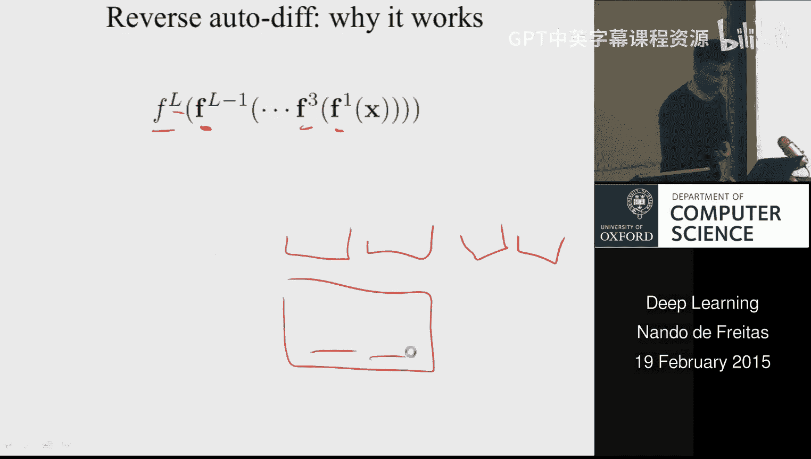

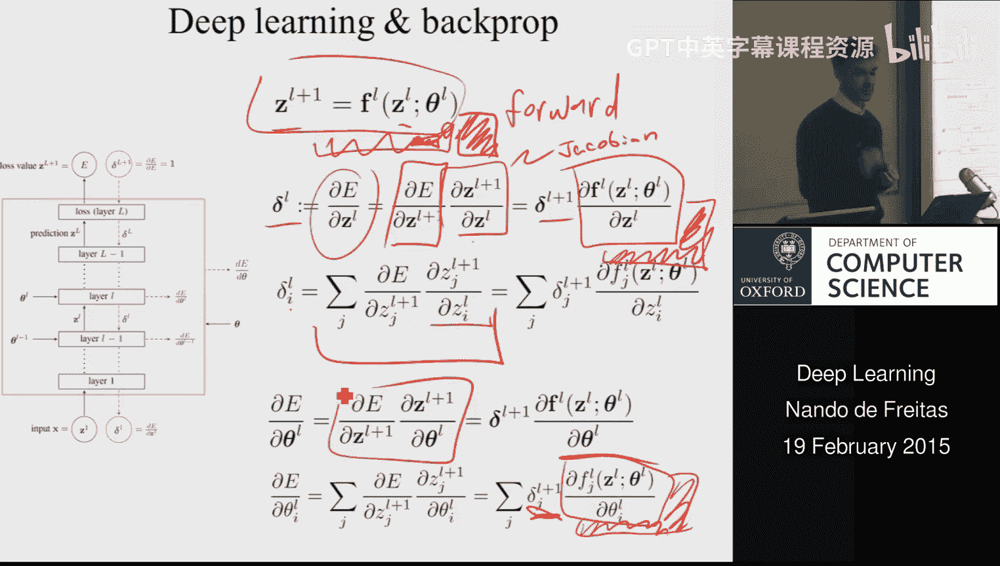

你采取哪种方法？主要问题是我们有一个通过组合构建的函数。所以你有`f(x)`，你有`x`，你计算`F1(x)`，然后将其用作`F2(x)`的输入，再将其用作`F3(x)`的输入，依此类推，直到你到达另一个`F`，它是一个标度。重要的是，这些都是粗体，因为它们都是向量。所以输入是多变量的，输出是多变量的：多输入，多输出，或向量输入，向量输出。有时输入是图像，但我们可以将图像视为矩阵，将其向量化，将矩阵分解为其列，取一行并附加到前一行，依此类推，从而创建一个向量。

那么，有两种方法来做这件事。一种方法是计算所有导数，并使用链式法则将它们相乘。我们在逻辑回归中这样做过，使用矩阵来评估它们，这样写计算更容易，但它隐藏了一个重要的事情，我很快就会让你思考。另一种方法是我可以先计算...我可以使用嵌套，所以我先计算这两个项的乘积，这相当于我们在这里所做的。我们一次只计算两项。

所以我计算我的两项，一旦我计算了那个，然后我继续取这个家伙，我可以计算下一个乘积，依此类推，我一直持续直到完成，然后我返回网络输出（损失）相对于输入的导数。现在，哪一个更有效率？为什么？它们之间的区别在于，这种表示法经常被使用，但它隐藏的正是这一点：这个家伙是一个矩阵，这个家伙是一个向量，这个是一个矩阵，这个是一个矩阵。所以把它看作向量、矩阵、向量、矩阵...这是一个向量，而这当然是一个矩阵。

一旦你有了这个，仍然为什么一个比另一个更有效率？考虑存储。在这里，我按顺序计算，我先计算这个，我不担心剩下的项。我有一个向量，然后一切都保持在一个向量上。如果你要按另一种方式计算，并且为所有这些及其计算机乘积分配内存，那么你将不得不为所有这些矩阵分配内存。记住，这些层可能有数百万个参数，这些是非常大的矩阵。目前，神经网络的大小受限于世界上的RAM数量。这就是阻止我们的原因：没有更多的RAM。

因此，如果我们有机会做减少存储的事情，我们就会这样做。这里，它取一个向量，乘以矩阵，然后你只需要保留那个向量，并将那个向量传递给下一层。然后你再次进行向量乘以矩阵，你只保留一个向量。所以你不需要构建所有这些矩阵操作。这是一种更有效的做法。这本质上就是科学计算中所谓的反向模式自动微分。

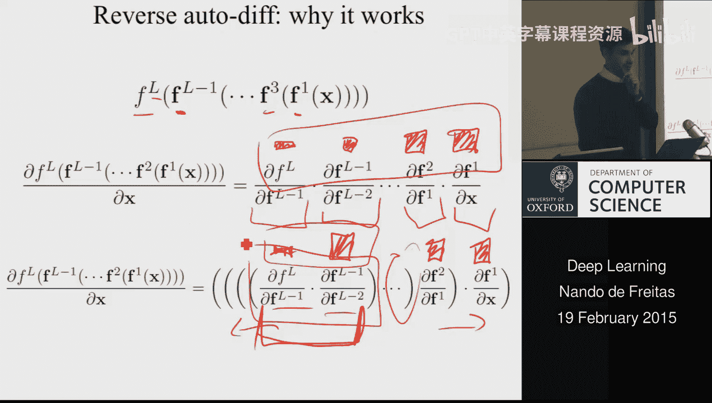

---

## 层设计实例

让我们看一些例子。如果你的神经网络本质上是一个线性模型，就像线性回归一样。你接收输入，你有几个神经元，你有几个输入。每个神经元乘以输入`x1_i, x2_i, x3_i`，一直到`x_D_i`。所以如果你有输入，`i`是样本，每个数据案例。然后你乘以参数`θ_1,1, θ_1,2`，这给你`Z1`，然后你在这里有`Z2`，依此类推。这是一个标准的线性层。如果你有许多最小二乘的线性回归，你只会有一个输出神经元，所以这将是最小二乘。然后如果你在做多输出最小二乘，你会有几个这样的层，你会有一个线性层。

当我们推导这些层时，顺便说一下，去看看Torch代码，在GitHub上查看`nn`模块。它实际上有很多层，很多不同种类的层，所以你可以实际查看这些层，并说服自己它们正在做完全相同的操作。它们保留了这三个消息。只要你拥有这三个消息，你就完成了。剩下的只是确保你有正确的语法。

所以我们有前向消息。这里我们只需要函数相对于输入的导数，在这种情况下，这有点微不足道：如果你对这个项关于`x`求导，你只得到乘以`x`的系数，即`θ_ij`。同样，如果你对`θ_ij`求导，你只得到`x`。注意，这里求和是对`j`，对输出单元求和，所以这从`j=1`到`j=2`，一直到`j`等于`K`（输出维度）。在这种情况下，只有当你这里有一个单元`J`，而这是单元`I`时，这个参数`θ_ij`只连接从一个输入神经元`I`到一个输出神经元`J`。所以当你对所有输出求和时，只有一个输出与`θ_ij`相关，这就是为什么这里对`j`的求和消失了，因为只有一个`θ_ij`。相对于那个`θ_ij`的导数就是`x`，这就是我们这里有的。所以，如果你会求导，构建神经网络就很简单了。

这是该层的图形模型。你有一个输入，你有一个输出。然后这给你后向消息，然后这些是我们在这里得到的家伙。

### ReLU层与Dropout

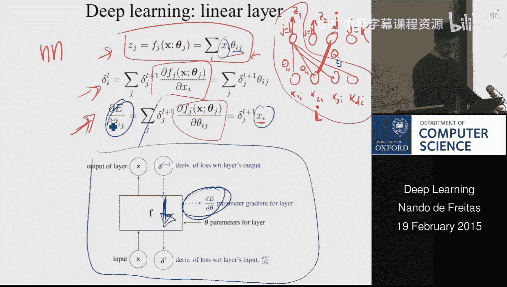

这是另一个层，只是为了介绍更多的层。ReLU层最早我知道的参考文献是福岛教授在70年代末提出的。然后没有人使用它，突然之间，现在它变得极其流行。一个ReLU单元基本是这样的：`z = max(0, x)`，所以当`x<0`时为0，然后有一个斜率。所以如果你想计算这个导数，这里的导数是1，这里的导数是0。没有人讨论在这里（`x=0`点）发生了什么。有一个称为次导数的导数推广，在这一点上次导数是一组潜在的...因为如果你要用一条线来铰接一个角，这条线有所有这些灵活性，所以导数实际上可以是该集合中的任何成员。在Torch中，人们只是忽略那个点，所以这里的导数是1，那里的导数是0。实际上我还没有检查代码以知道那是大于、小于还是等于。

它现在非常流行，现在大多数网络都使用ReLU。大多数最先进的网络都会使用这个。有一个与ReLU非常相似的东西叫做Maxout，由约书亚·本吉奥和他的同事提出，这也是一个非常好的单元。它所做的是取分段的一组线。还有许多其他类型的单元。

在线教程中，你会找到关于如何构建层的教程，教你如何构建一个Dropout层。Dropout是另一种控制复杂度的方法。如果有时间，我会在课程中回到它。我不知道我是否有时间。如果没有，我会尝试...哦，等等，你们下周有实践课，对了，Dropout。你们将学习使用Dropout。简而言之，其思想是：如果你有N个单元，你随机选择一半，然后你只更新其中一半的参数。你在SGD的每次迭代中这样做。最后，你所做的是将所有单元放在一起，所以你保留它们全部，你只是将输出乘以一半，以考虑到它们只有一半的时间被激活来进行归一化。

这实际上是一种非常好的控制复杂度的方法，原因是：当你添加基函数时，假设你想创建一个基函数，真实情况是这条红色曲线。你想用高斯基函数来近似这个函数，并假设你决定用两个高斯基函数来拟合这个函数。当你学习时，经常可能发生的情况是：你会在这里放一个高斯函数，然后在另一个地方放另一个高斯函数。当你添加两条绿色曲线时，你得到了红色曲线，你得到了正确答案，但你的复杂度完全错了。你并没有真正学会拟合这个，你浪费了资源，因为你添加了两个东西来得到红色，但当你试图进行预测时，这可能会给你带来麻烦，因为你的模型太复杂了。Dropout所做的就是基本上强制避免这种情况，因为在每次迭代中，它都会丢弃其中一个单元。

因此，另一个单元不能只是停留在那个阶段，它必须向下朝红线移动。所以一个基函数不能过多地依赖其他基函数，这是一个非常有用的技巧。

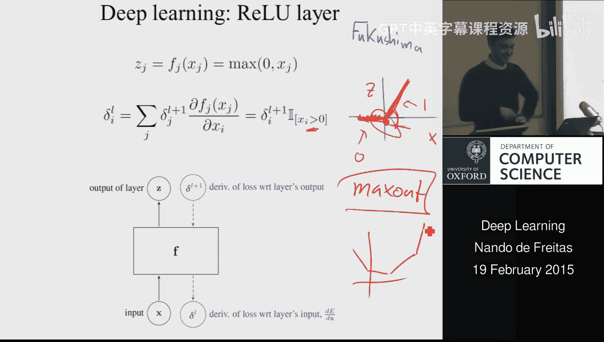

### 模块化设计的通用性

总的来说，我真正希望你们记住的是：这些模型极其灵活，你可以构建各种很酷的层来做各种事情。然后你可以将它们视为连接的单模块。也许这里有θ和θ。现在你可以把它们想象成连接到其他层，可能会给你不同的损失，等等。所以你可以构建重复的结构，这对于理解当前最先进的翻译神经网络至关重要。本质上，你构建了一个非常复杂的神经元模型，所以我们将变得更加现实，并开始提出更有趣的东西。事实上，一个真正的神经元更像是一个具有许多层的神经网络。因此，如果你实现一个具有许多层的完整神经网络，然后我们选择这个模型，那么我们就有了一个神经元，而这个神经元现在可以与其他神经元连接。这似乎是一个更好的模型，也试图接近我们在神经科学中看到的情况。

但即使不深入那里，在实践中，它只是一个非常灵活的框架来构建各种东西。因此，我期望的是理解这种通用性，并只是玩转这些代码，知道如何组合事物，我认为这将会有很多进展。

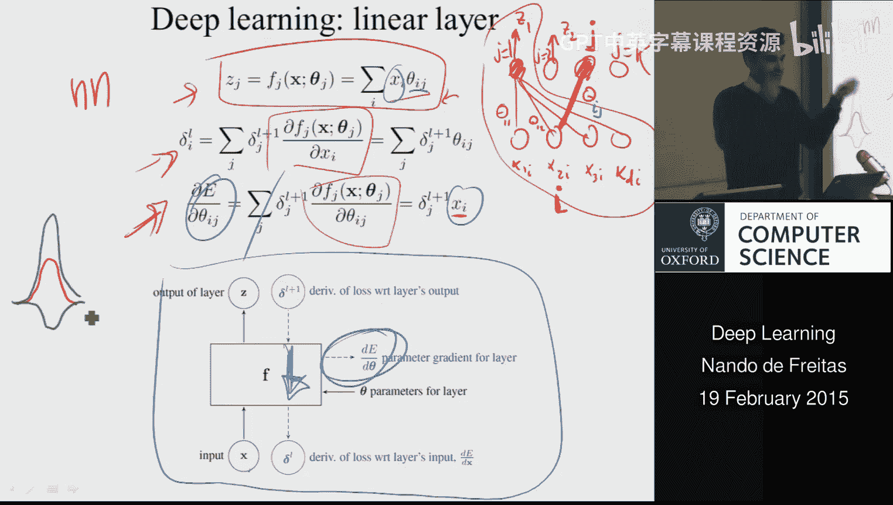

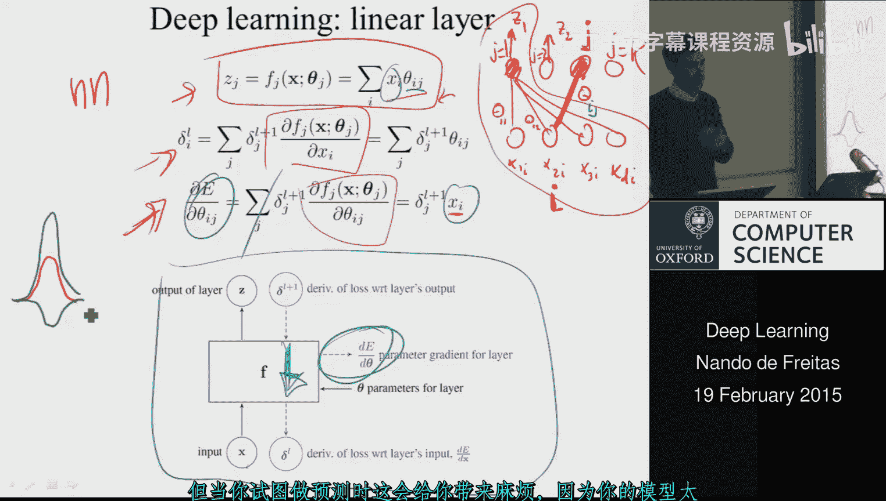

但也有一些局部最优解，很多人在研究。这些模型中有一些特定的实例极其有用，其中之一是卷积网络，这是五分钟后下一讲的主题。

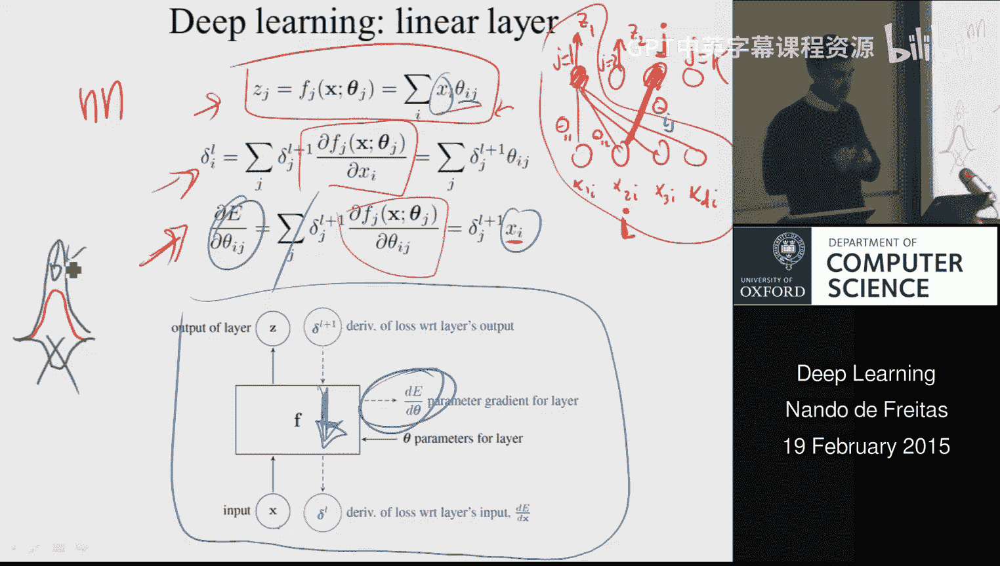

---

## 总结

本节课中，我们一起学习了神经网络的基础知识及其模块化设计。我们从简单的逻辑回归模型出发，探讨了如何通过添加隐藏层来构建非线性模型以解决更复杂的问题。我们重点讨论了控制模型复杂度的两种关键机制：调整神经元数量和使用正则化（如权重衰减和Dropout）。

我们深入了解了神经网络模块化设计的核心思想：每一层只需实现前向传播、后向传播和参数梯度计算三个函数，即可通过组合构建任意复杂的网络。这种设计使得在Torch等框架中构建和训练神经网络变得非常高效和灵活。

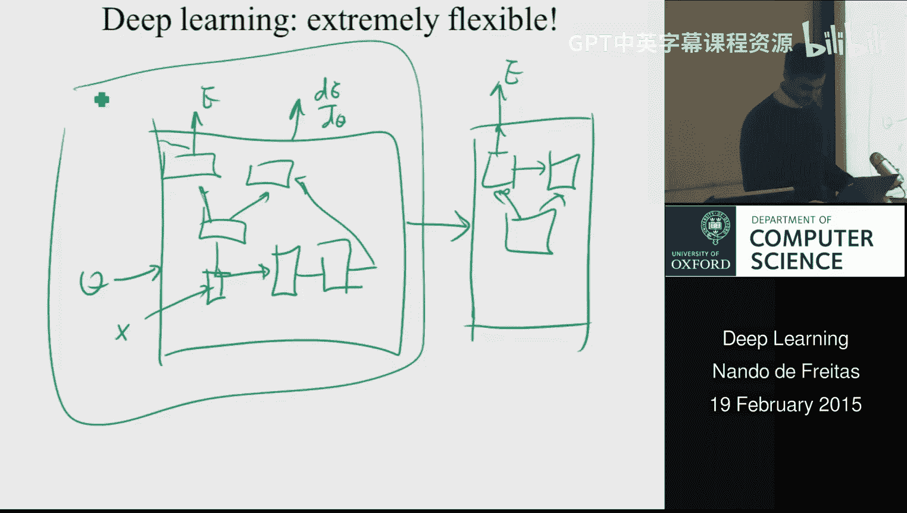

最后，我们简要介绍了反向传播的高效实现（反向模式自动微分）以及一些常见的层类型，如线性层、ReLU层和Dropout层。理解这些基本原理是掌握现代深度学习，并进一步学习卷积神经网络等高级架构的关键。