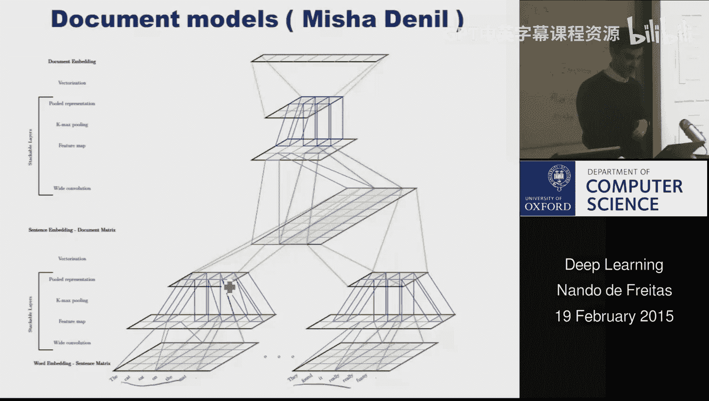
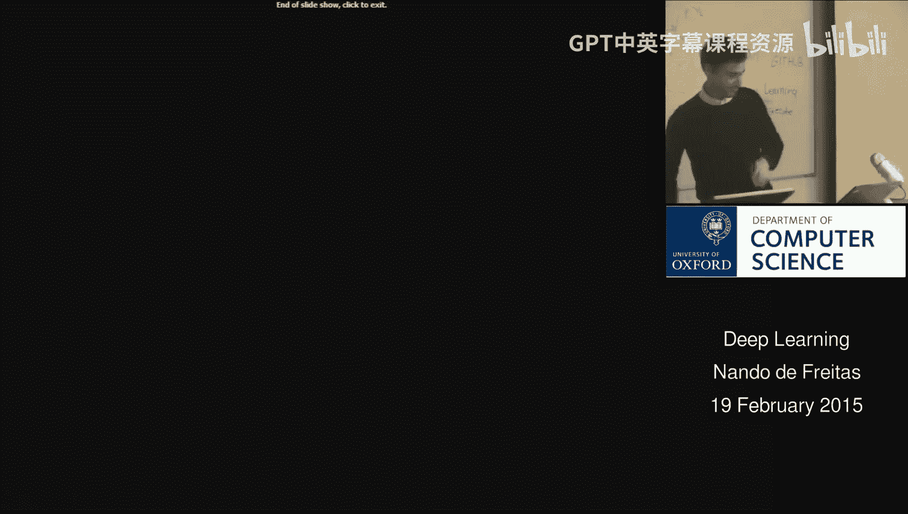

#  009：卷积神经网络

在本节课中，我们将要学习卷积神经网络（CNN）的核心概念、工作原理及其在图像和语言处理中的应用。我们将从卷积的基本操作开始，逐步深入到网络架构、参数共享、池化等关键部分，并探讨其在现实世界中的强大能力。

## 卷积神经网络概述

卷积神经网络是目前深度学习领域最流行的模型之一。它通过卷积和池化等操作，能够高效地处理图像等具有网格结构的数据，并在物体识别、图像分类等任务上取得了巨大成功。其核心优势在于**参数共享**和**平移不变性**，这使得模型参数大大减少，并能识别出现在图像不同位置的相同物体。

## 卷积的基本操作

上一节我们介绍了CNN的概览，本节中我们来看看其最核心的运算——卷积。

卷积操作可以理解为用一个小的**滤波器**（或称为**卷积核**）在输入数据（如图像）上滑动，并进行局部区域的加权求和。这个过程就像拿着一个模板在图像上寻找与之相似的模式。

### 一维卷积示例

为了理解其本质，我们先看一个简化的一维例子。假设我们有一个一维图像 **X** 和一个小滤波器 **W**：

*   **输入图像 X**: `[x1, x2, x3]`
*   **滤波器 W**: `[w1, w2]`

卷积（更准确地说，此处是**互相关**操作）的输出 **Z** 计算如下：

```
Z1 = w1 * x1 + w2 * x2
Z2 = w1 * x2 + w2 * x3
```

用公式可以概括为：
**Z[i] = Σ_{k=1}^{M_f} W[k] * X[i + k - 1]**
其中，`M_f` 是滤波器的大小。

### 卷积与互相关

在信号处理中，严格的卷积操作在计算前会先将滤波器翻转。因此：
**卷积 = 互相关 + 滤波器翻转**
在深度学习的许多上下文中，这两个术语常被混用，但了解其区别有助于阅读论文。

### 边界处理与步长

在实际操作中，我们需要处理滤波器滑动到图像边界的情况。常见的技巧是**零填充**，即在图像边界外围填充0，使得输出特征图与输入保持相同尺寸。

另一个重要参数是**步长**，即滤波器每次滑动的像素数。步长为1是最常见的选择。

以下是构建卷积层时需要考虑的关键参数：
*   **滤波器尺寸**：决定感受野的大小。
*   **滤波器数量**：决定输出特征图的通道数。
*   **步长**：决定下采样率。
*   **填充**：决定输出尺寸。

## 从卷积到特征图

当我们使用多个不同的滤波器对输入图像进行卷积操作时，每个滤波器都会生成一张**特征图**。这张图上的每个高亮区域，都表示输入图像中存在着与该滤波器模式相似的结构。

例如，一个检测垂直边缘的滤波器，会在图像中有垂直线条的地方产生高响应。初始层的滤波器通常学习到的是边缘、颜色等基础特征。

## 池化操作

在卷积层之后，通常会紧跟一个**池化层**（如最大池化）。池化层的作用是对特征图进行下采样，它在一个小区域内（例如2x2窗口）只保留一个值（如最大值）。

池化层带来两个主要好处：
1.  **降低维度**：减少后续层的计算量和参数数量。
2.  **引入平移不变性**：即使目标物体在图像中发生微小移动，池化后的特征仍能保持稳定。

## 经典的卷积网络架构

一个典型的卷积神经网络由多个“卷积-激活-池化”模块堆叠而成，最后连接一个或多个全连接层进行分类或回归。

例如，AlexNet的架构可以简化为：
`输入图像 -> [卷积 -> ReLU -> 池化] x N -> 全连接层 -> 输出`

随着网络层数加深，滤波器所“看到”的原始图像区域（感受野）会越来越大，从而能够捕捉从简单边缘到复杂物体部件乃至整个物体的高层次特征。

## 参数与计算考量

卷积网络的参数主要集中在最后的全连接层，但大部分计算量发生在卷积层。使用GPU进行并行计算是高效训练CNN的关键。

参数共享机制是CNN参数效率高的核心。同一个滤波器被用于整张图像，这与全连接网络每个连接都有独立参数形成鲜明对比。

## 卷积网络在自然语言处理中的应用

卷积神经网络不仅用于图像，也广泛应用于自然语言处理领域。

其处理流程通常如下：
1.  **词嵌入**：将离散的单词转换为连续的向量表示（例如通过`嵌入层`实现）。
2.  **构造句子矩阵**：将一个句子中的词向量堆叠成一个矩阵。
3.  **一维卷积**：使用滤波器在词向量序列上滑动，捕捉局部短语特征。
4.  **池化与分类**：对卷积结果进行池化（如动态K-Max池化），然后输入全连接层进行情感分类等任务。

这种方法可以用于情感分析、文本分类和提取式摘要等任务。

## 总结





本节课中我们一起学习了卷积神经网络的原理与应用。我们从最基础的卷积和互相关操作入手，理解了滤波器如何通过滑动生成特征图。接着，我们探讨了池化层的作用以及经典CNN的堆叠架构。我们还分析了CNN参数共享带来的效率优势及其在硬件上的计算考量。最后，我们看到了CNN如何通过词嵌入和一维卷积，成功地应用于自然语言处理领域。卷积神经网络以其强大的特征提取能力和相对高效的参数使用，成为处理图像、语音、文本等网格化数据的首选工具。