#  010：最大间隔学习、迁移学习与记忆网络 📚

在本节课中，我们将要学习深度学习中两个非常重要的主题：**最大间隔学习**和**迁移学习**。我们将从高层次视角来讲解，并假设你已经掌握了如何将卷积神经网络等模块作为工具来使用。通过理解这些概念，你将能够利用现有模型解决数据稀缺的新任务。

---

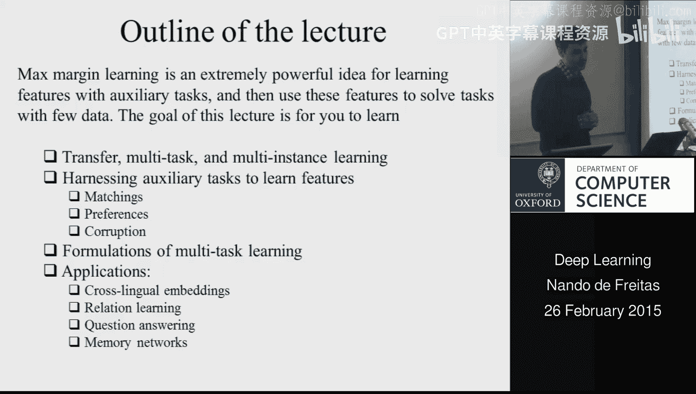

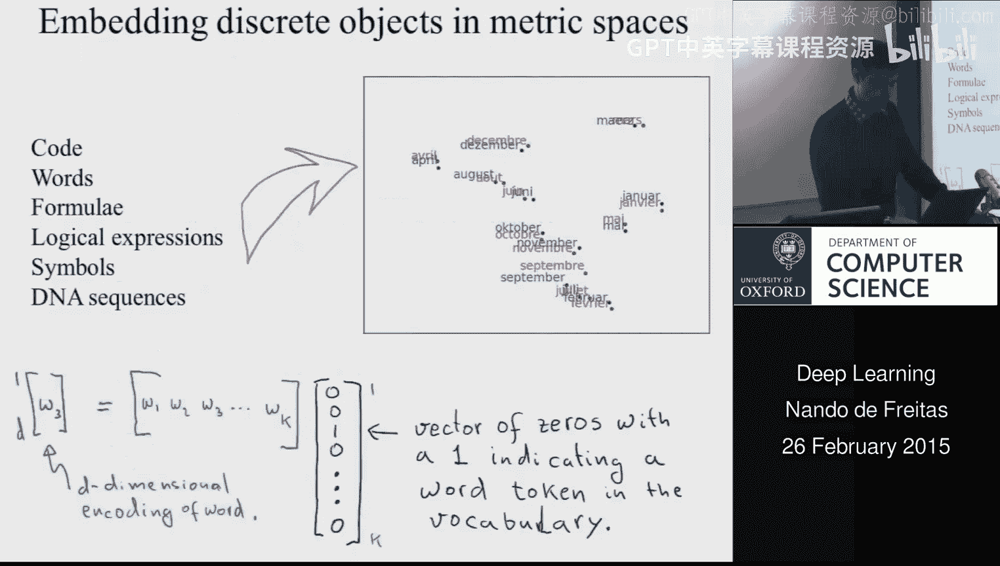

## 词嵌入：将词语映射到连续空间 🔤

上一节我们介绍了如何将卷积网络作为模块使用，本节中我们来看看如何为语言数据构建特征表示。首先，我们需要将离散的词语转换为连续的向量表示，这个过程称为**词嵌入**。

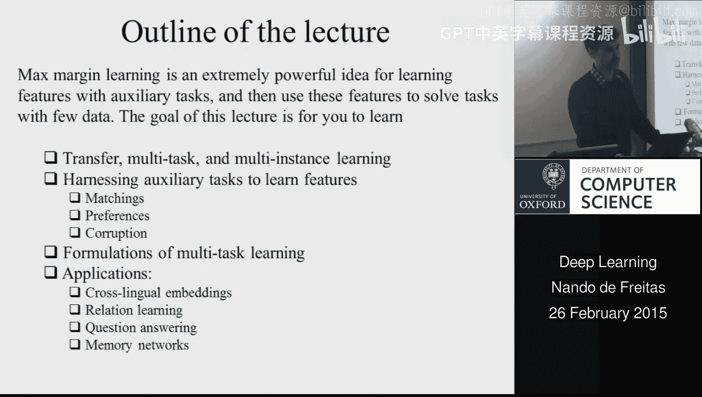

词语是分类对象（如“猫”、“狗”）。我们通过一个大小为 `K` 的词汇表来表示它们。每个词对应一个 **`K` 维的独热编码向量**：在该词对应的索引位置为1，其余位置为0。

**公式**：若词汇表大小为 `K`，词 `w` 的索引为 `i`，则其独热编码向量 `v` 为：
`v_j = 1 if j == i else 0`，其中 `j` 从 `0` 到 `K-1`。

为了将词语映射到一个有意义的度量空间（例如 `R^D`），我们通常将独热编码向量乘以一个 `D x K` 的权重矩阵 `W`。这相当于从矩阵中**查找**出对应的 `D` 维列向量。

**代码/公式**：词嵌入 `e_w = W * v`，其中 `W` 是一个 `D x K` 的矩阵，`v` 是 `K x 1` 的独热向量。在实践中，这通常实现为一个高效的查找表操作。

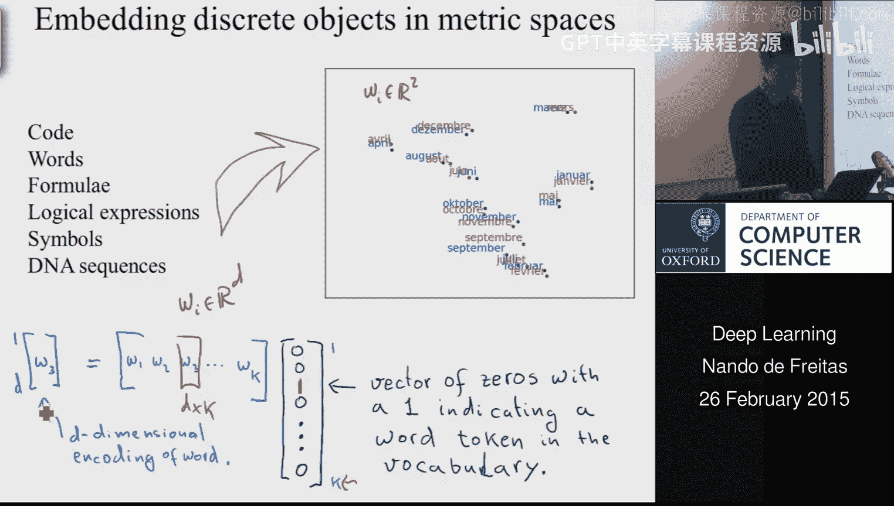

这个 `D` 维向量就是词的嵌入表示。理想情况下，语义相似的词在这个空间中的距离应该较近。通过学习矩阵 `W` 的参数，我们可以让模型自动发现这种有意义的表示。

---

## 从词到文档：卷积网络构建层次化表示 📄

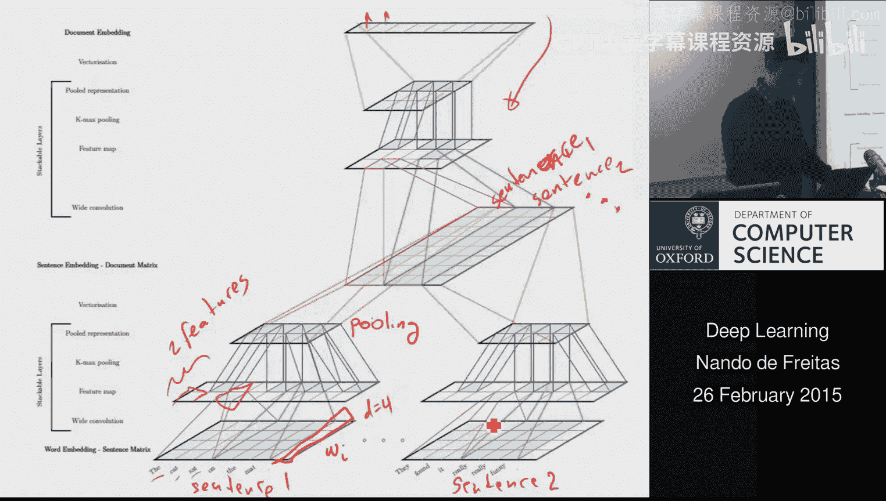

有了词嵌入之后，我们可以构建更高级别的表示。将一句话中的每个词嵌入向量排列起来，就形成了一个矩阵（列数为词数，行数为嵌入维度 `D`）。

我们可以对此矩阵应用**卷积神经网络**。卷积滤波器在词序列上滑动，生成特征图。随后进行**池化操作**（如最大池化），将变长的句子转换为固定长度的**句子嵌入**向量。

通过堆叠这样的结构，我们可以进一步将多个句子嵌入组合，并通过另一层卷积和池化，得到整个**文档的嵌入**表示。

**核心思想**：在训练一个文档级分类任务（如情感分析）时，通过反向传播，我们不仅学习了文档分类器，也同时学习了词、句、文档的嵌入表示。这些嵌入是宝贵的可迁移特征。

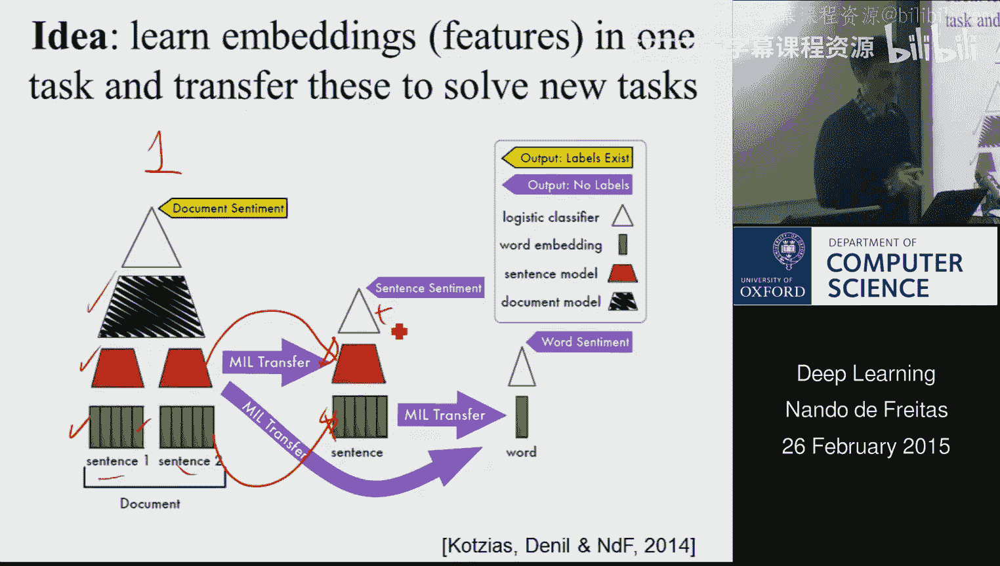

---

## 迁移学习与多示例学习：利用组级标签推断个体信息 🔄

上一节我们学习了如何获得层次化嵌入，本节中我们来看看如何利用这些嵌入解决数据稀缺的新任务。一个常见问题是：我们只有**组级别**的标签（如整个影评的星级），但需要预测**个体级别**的属性（如每个句子的情感倾向）。

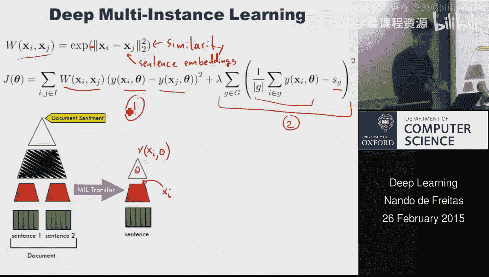

这就是**多示例学习**的一个场景。我们可以复用之前任务中学到的词和句嵌入（即神经网络的大部分层），但需要为新的个体级分类器设计目标函数。

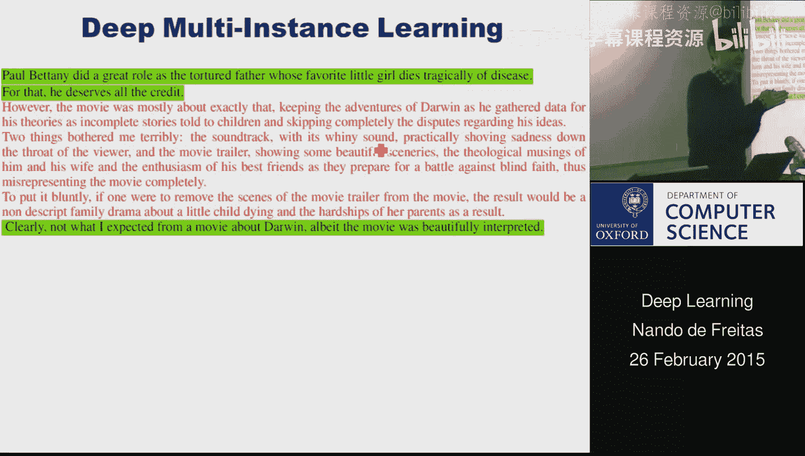

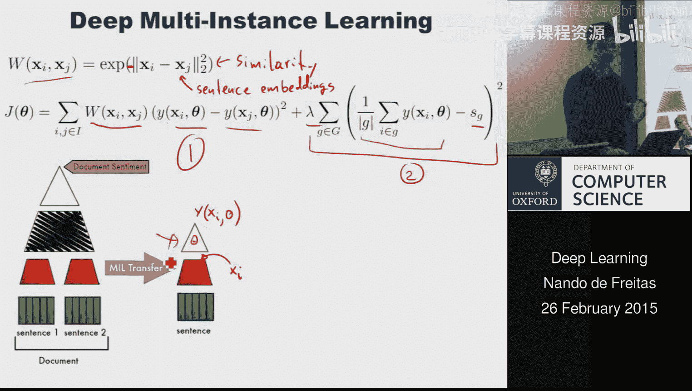

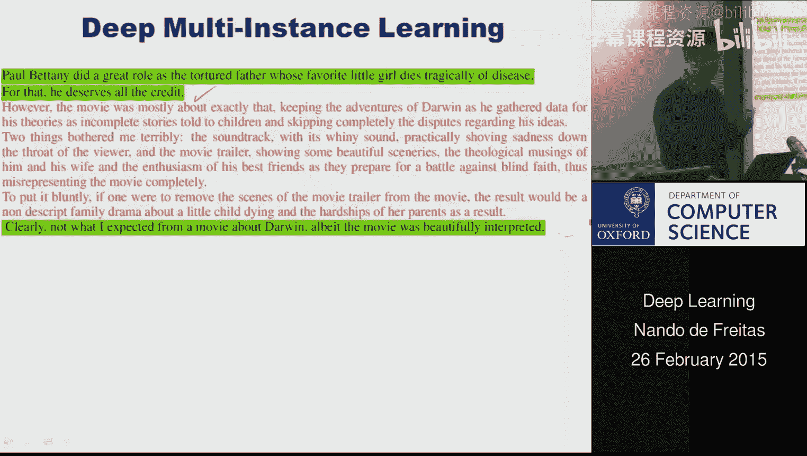

以下是构建目标函数的一种简单方法：

1.  **相似性约束**：构建一个相似性度量。如果两个句子嵌入 `x_i` 和 `x_j` 相似，则它们的预测标签 `y(x_i)` 和 `y(x_j)` 也应该相似。
    **公式**：`Cost_sim = Σ_{i,j} similarity(x_i, x_j) * (y(x_i) - y(x_j))^2`

2.  **组级约束**：所有个体预测的平均值应与组级标签一致。
    **公式**：`Cost_group = (avg(y(x_i)) - Y_group)^2`，其中 `Y_group` 是已知的组标签。

最终的损失函数是这两种约束的加权和，并结合了参数正则项。通过优化这个联合目标，我们可以利用组级监督信号来学习个体级的分类器。

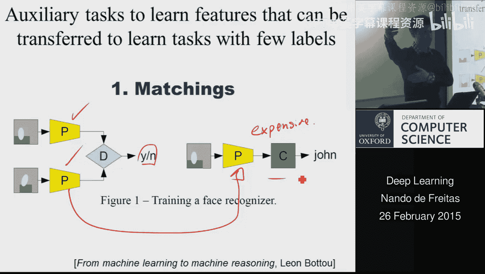

**迁移学习的核心**：在资源丰富的任务（如图像分类、文档情感分析）上预训练模型，获得高质量的通用特征嵌入。面对数据稀缺的新任务时，只需**冻结**这些预训练的特征提取层，**重新训练**最后的输出分类层即可。

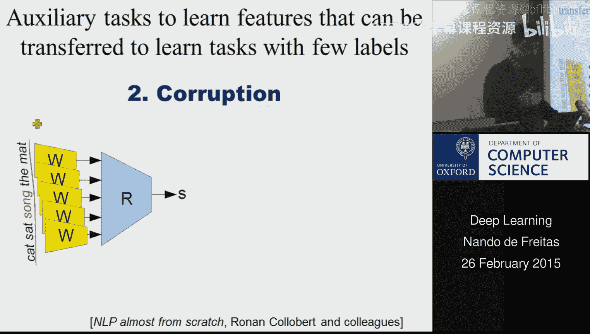

---

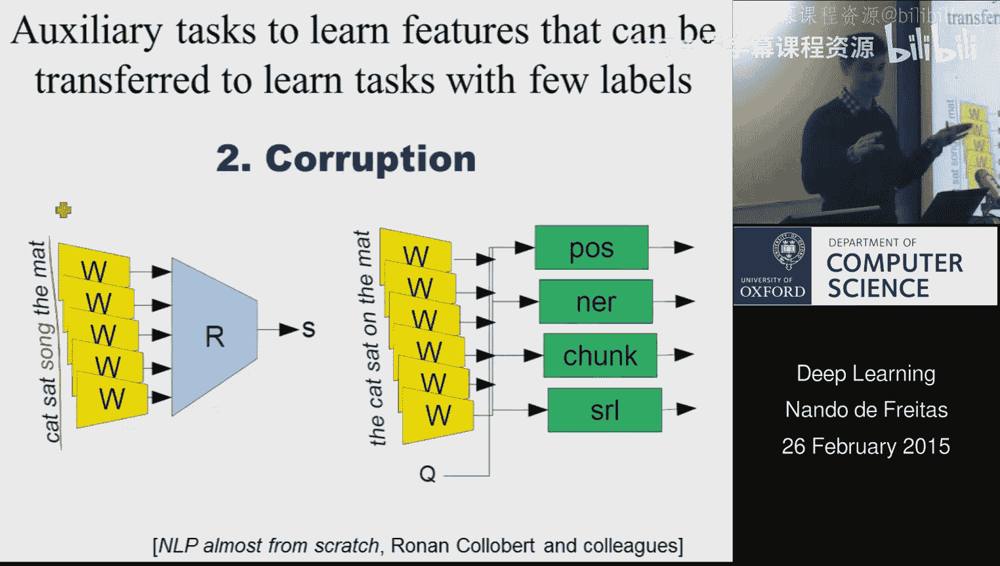

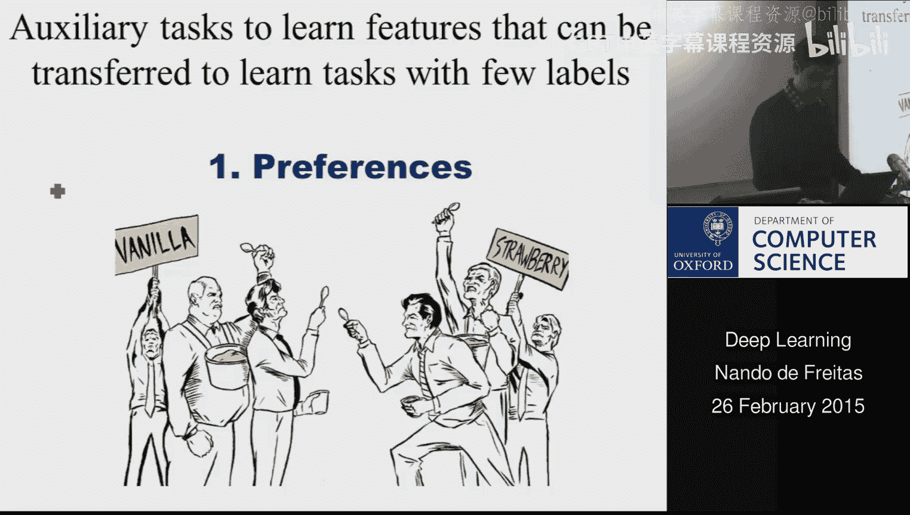

## 构建辅助任务：匹配、偏好与数据破坏 🛠️

当目标任务的标签很少时，我们可以设计一些**辅助任务**来学习特征表示，这些辅助任务通常拥有丰富的数据。以下是几种策略：

*   **匹配任务**：利用天然存在的配对数据。例如，在连续视频帧中，同一个人出现的图像块应具有相似的嵌入；而同一张照片中的两个人，其嵌入应不同。这构成了一个丰富的二分类数据源。

*   **跨语言任务**：利用翻译对。我们知道一个法语句子对应一个语义相同的英语句子。我们可以训练网络，使这两个句子的嵌入尽可能接近，而与随机其他句子的嵌入远离。这样，我们就可以将英语任务中学到的模型迁移到法语上。

*   **偏好/排序任务**：利用用户行为数据。例如，在搜索引擎中，用户点击了第二个结果而非第一个，这暗示了第二个结果与查询更相关。我们可以用这种偏好关系来训练模型。

*   **数据破坏任务**：主动制造“坏”数据。例如，取一个正确的句子，随机替换其中一个词，制造一个语法或语义不正确的句子。任务要求模型给正确句子打更高的分（或更低的能量）。

所有这些辅助任务都可以转化为一个共同的形式：**让“好”样本的得分高于“坏”样本**。

---

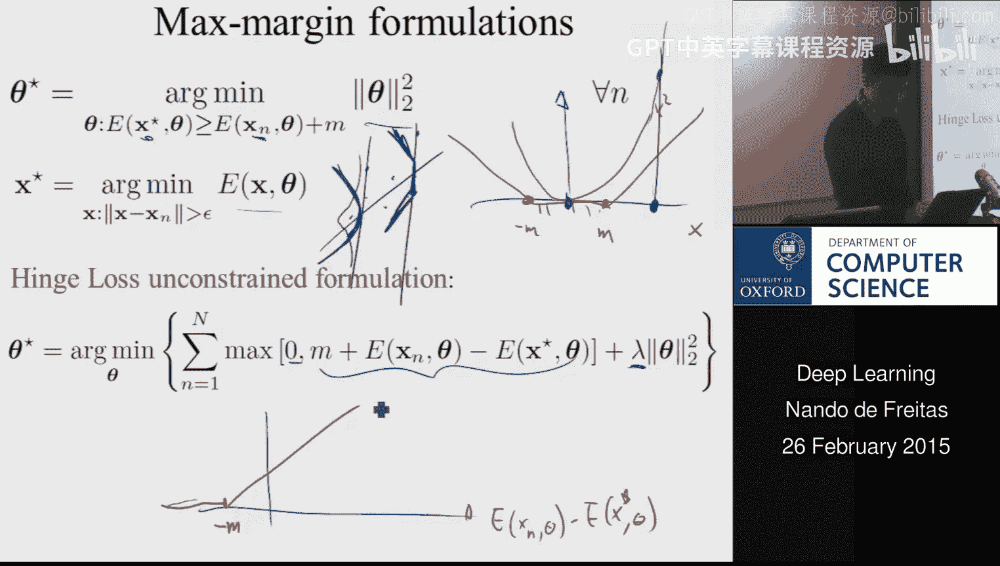

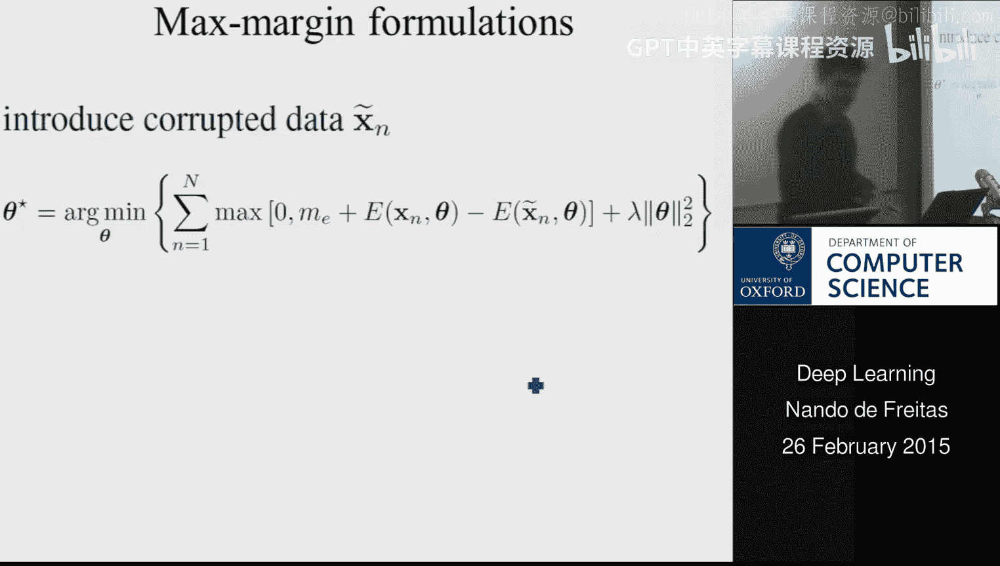

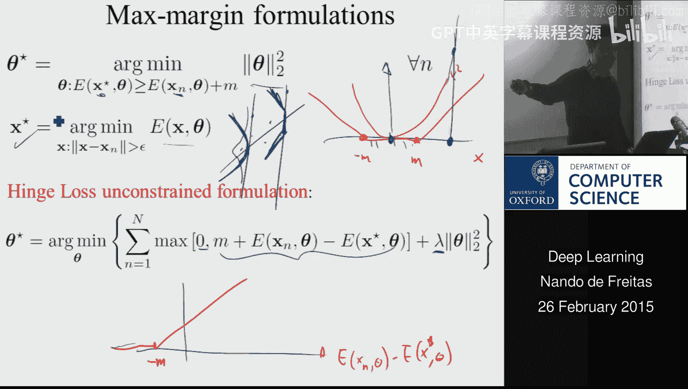

## 最大间隔学习：从概率模型到合页损失 📏

上一节我们介绍了各种辅助任务的形式，本节中我们来看看如何用统一的数学框架来表述和优化它们。最初，我们可能希望用概率模型来描述，即让真实数据 `x` 的概率 `P(x|θ)` 高于其他任何数据 `x'`。

**公式**：`P(x|θ) = exp(-E(x, θ)) / Z(θ)`，其中 `E` 是能量函数，`Z` 是归一化常数。

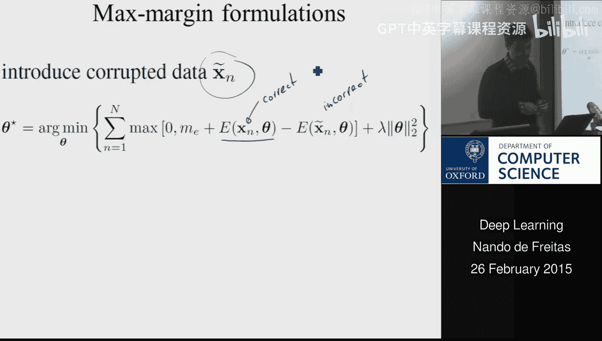

但计算 `Z(θ)` 通常非常困难。我们可以放松要求，不比较所有可能的 `x‘`，只比较那个最棘手的“对手”——即能量最低的非数据样本 `x*`。我们希望真实数据的能量比这个对手的能量至少低一个**间隔** `m`。

**公式**：`E(x, θ) <= E(x*, θ) - m`，其中 `x* = argmin_{x’} E(x‘, θ)`。

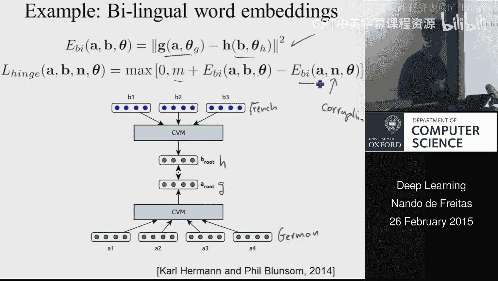

这仍然难以直接优化。在实践中，我们采用一种更可行的办法：**采样构造负样本**。对于每个真实数据 `x`，我们通过某种破坏方法生成一个对应的负样本 `\tilde{x}`。我们的目标变为：

**公式（合页损失）**：`L = max(0, m - (E(x, θ) - E(\tilde{x}, θ)))`

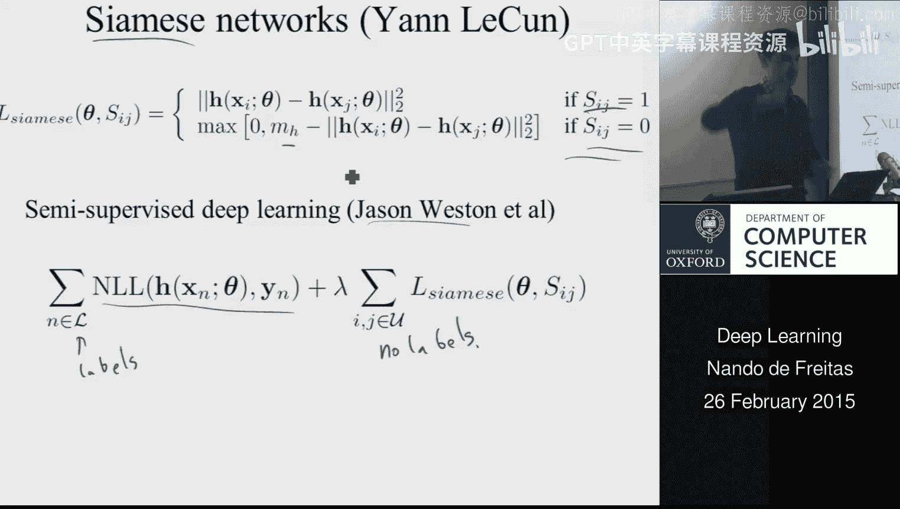

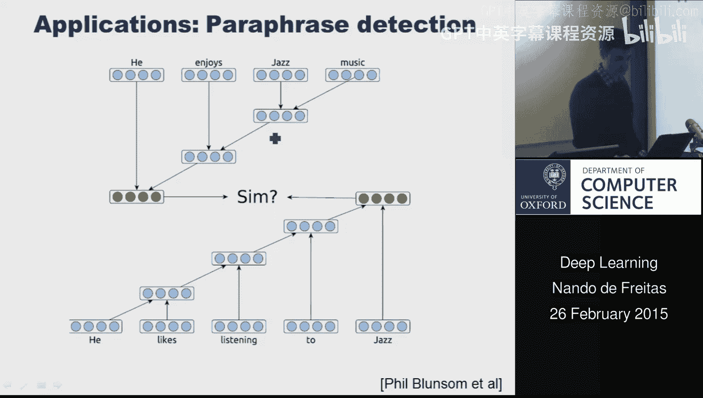

**代码/公式解释**：`E(x, θ)` 是正样本的得分（我们希望它高），`E(\tilde{x}, θ)` 是负样本的得分（我们希望它低）。当正负样本得分差大于间隔 `m` 时，损失为0；否则，损失线性增长。这个 `max(0, ...)` 函数就是**合页损失**。

在Torch等框架中，合页损失是一个现成的模块。你只需要提供正样本和负样本的得分，它就会计算损失和梯度。

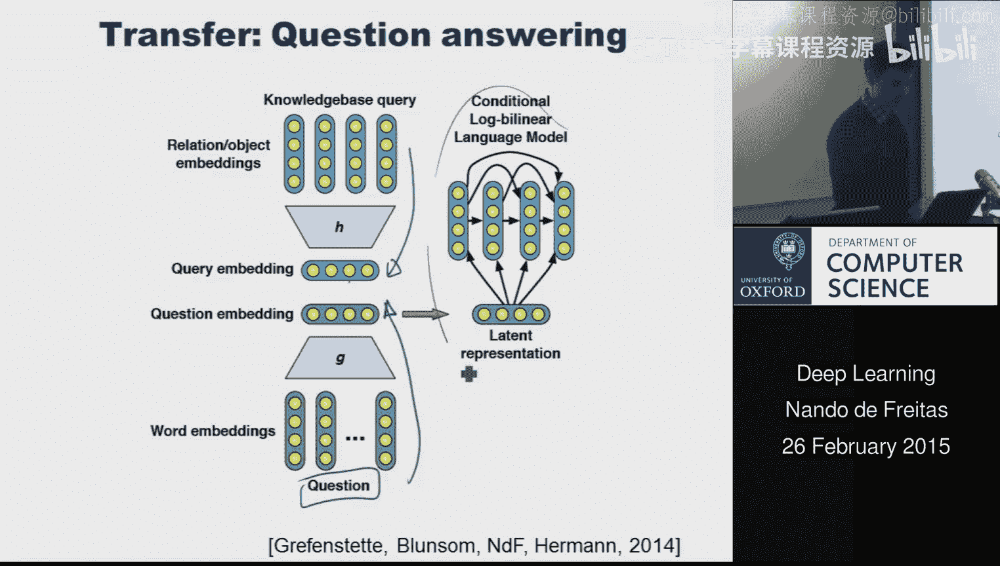

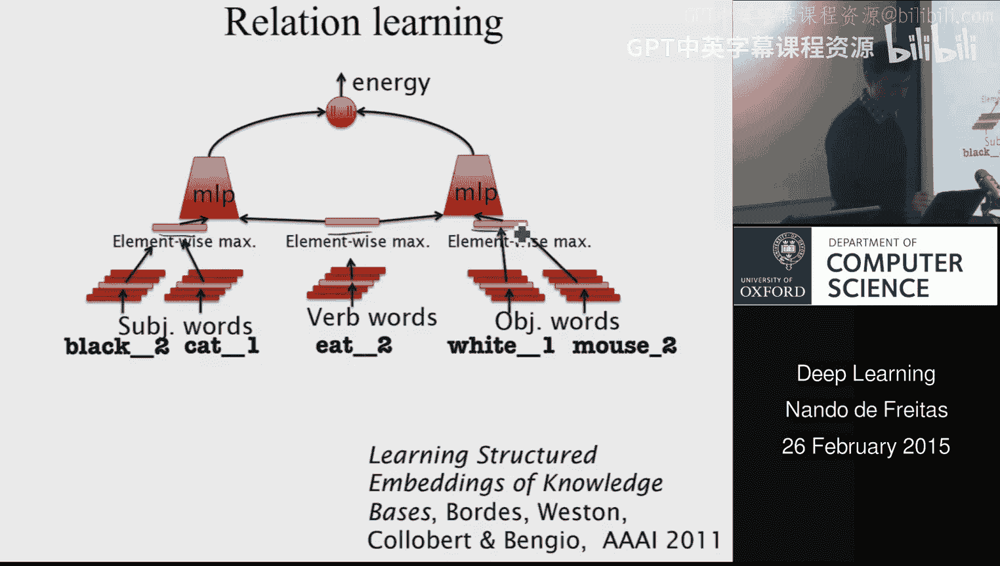

---

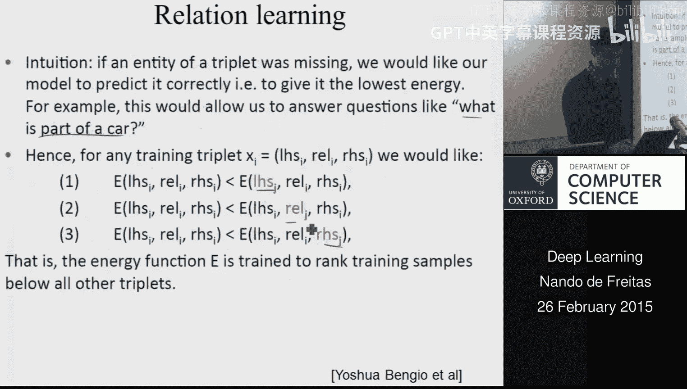

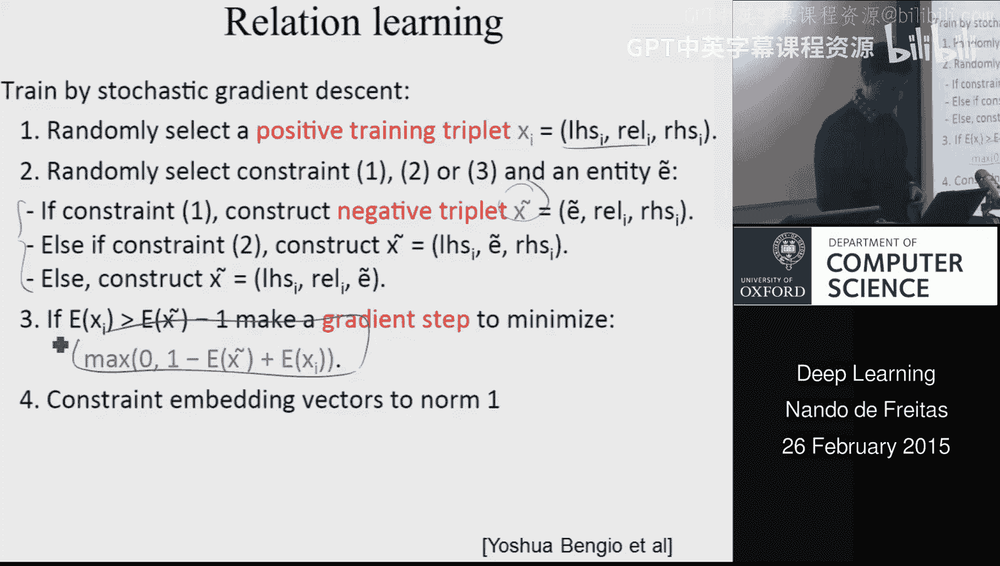

## 应用实例：关系学习与记忆网络 🧠

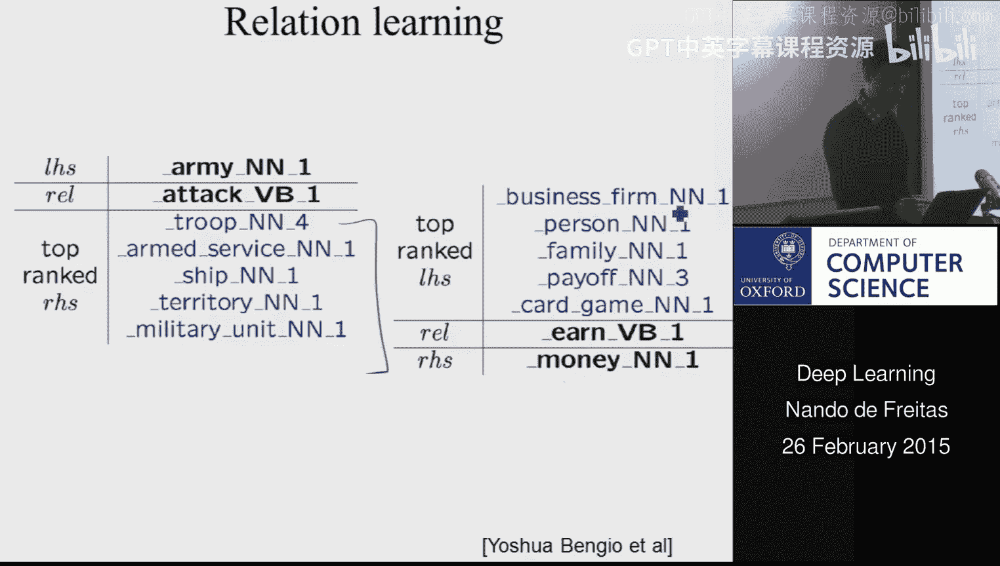

最大间隔学习框架可以应用于多种有趣的任务。

**关系学习**：学习形如（主体，关系，客体）的三元组。例如（Jamie，喜欢，冰淇淋）。训练时，通过破坏三元组的主体、关系或客体来生成负样本，并使用合页损失。训练好的模型可以回答“Jamie喜欢什么？”这样的问题。

**记忆网络**：这是当前的热门方向。网络拥有一个外部记忆库，用于存储输入的事实（如故事中的句子）。当收到一个问题时，网络通过**注意力机制**（一系列评分函数）在记忆库中寻找相关事实，然后基于这些事实合成答案。

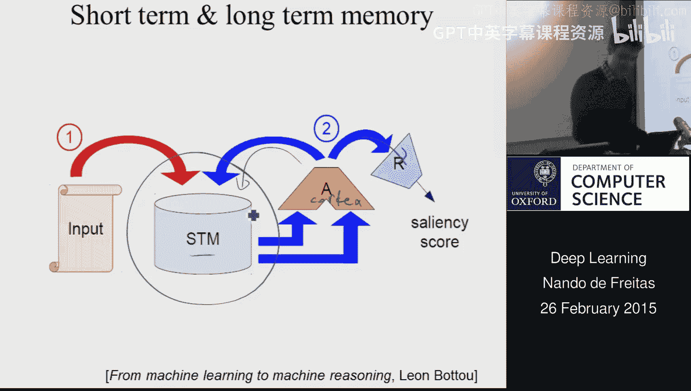

训练记忆网络同样使用最大间隔原则：对于给定的问题和正确答案，我们知道哪些记忆事实是相关的（正例），哪些是不相关的（负例）。我们训练网络给相关事实打更高的分。

**流程简述**：
1.  输入：故事文本，将其转化为记忆向量存入记忆库。
2.  输入：问题，将其转化为查询向量。
3.  在记忆库中，通过查询向量与每个记忆向量计算相关性分数。
4.  选取分数最高的记忆（或前k个）。
5.  结合查询和选取的记忆，生成最终的答案向量或文本。

整个过程的所有评分模块都可以通过合页损失进行端到端的训练。

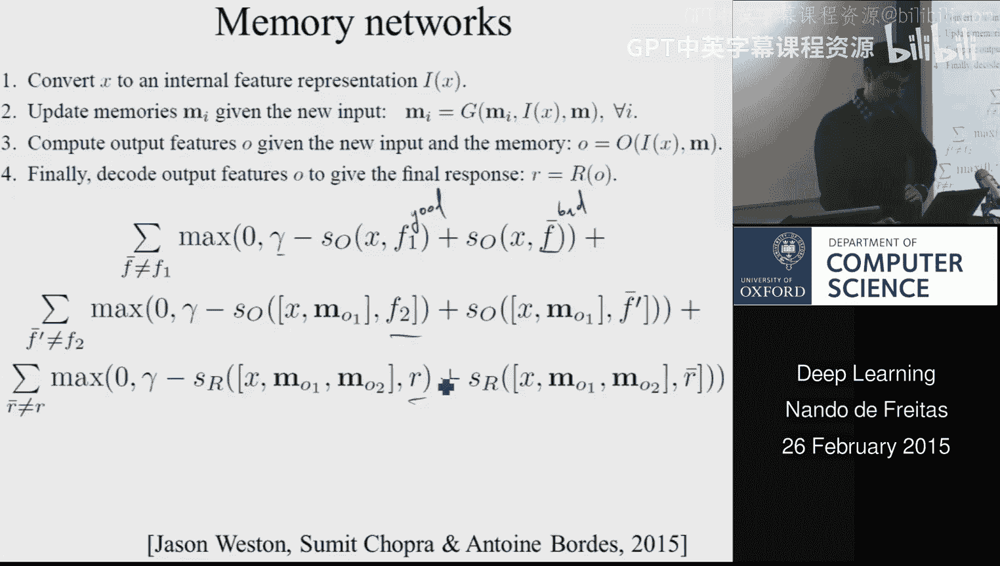

---

## 总结 🎯

本节课中我们一起学习了：
1.  **词嵌入**是将离散符号映射到连续向量空间的基础技术。
2.  **卷积神经网络**可以构建从词到文档的层次化特征表示。
3.  **迁移学习**的核心是复用预训练模型的特征提取能力，以解决数据稀缺的新任务。
4.  **多示例学习**是一种利用组级标签来学习个体级预测器的方法。
5.  可以通过**匹配、偏好、数据破坏**等策略构造丰富的辅助任务来学习特征。
6.  **最大间隔学习**（特别是**合页损失**）为这些辅助任务提供了一个强大而统一的优化框架。
7.  这个框架被成功应用于**关系学习**和先进的**记忆网络**中，使机器能够进行基于知识的问答。

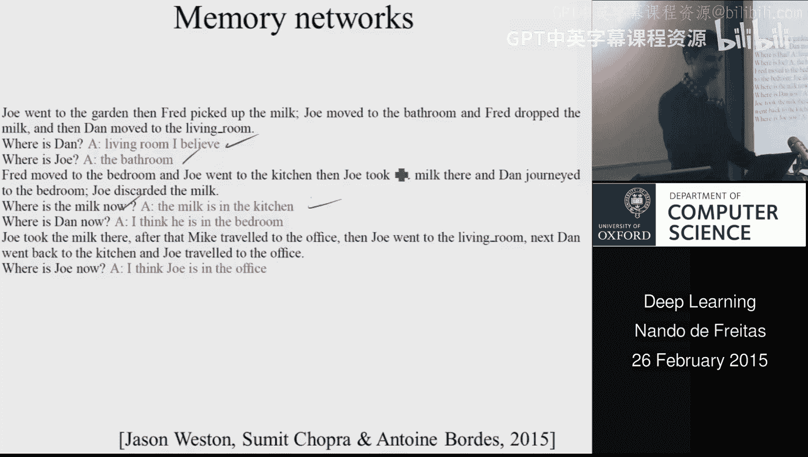

掌握最大间隔和迁移学习的原理，将使你能够更灵活地运用深度学习模型，突破数据限制，解决更多实际问题。