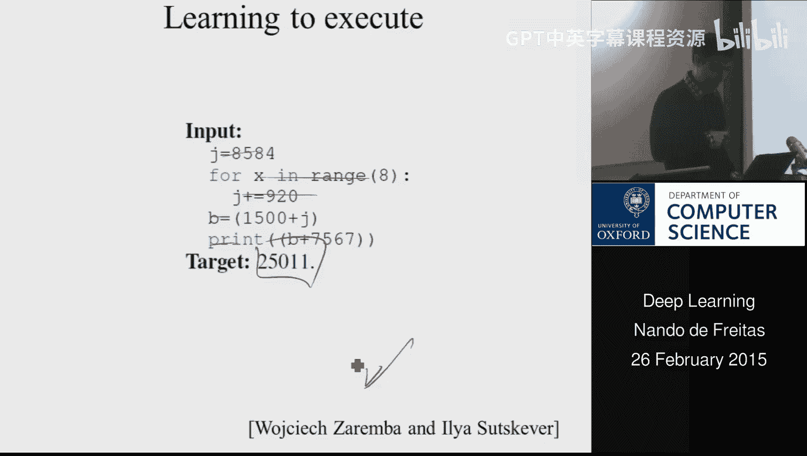
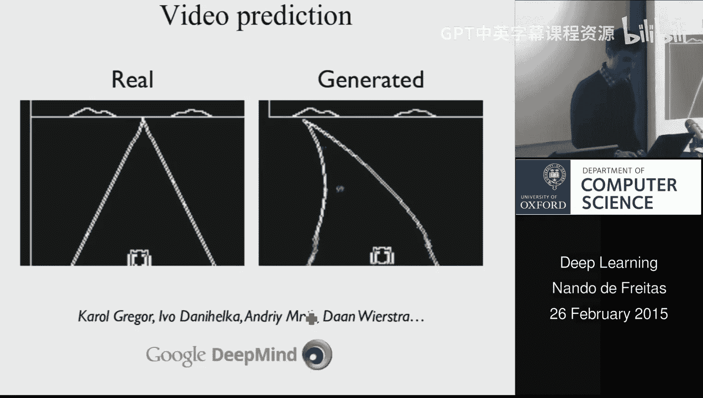
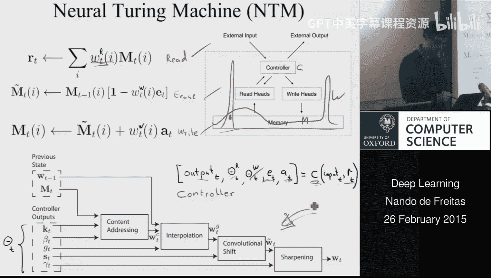
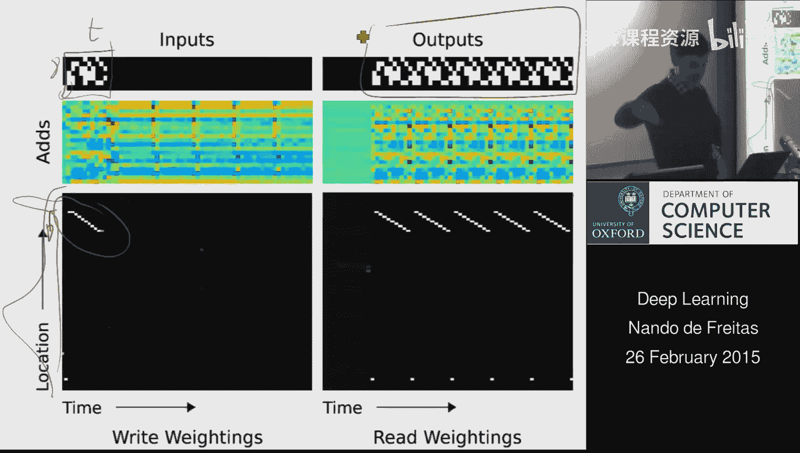
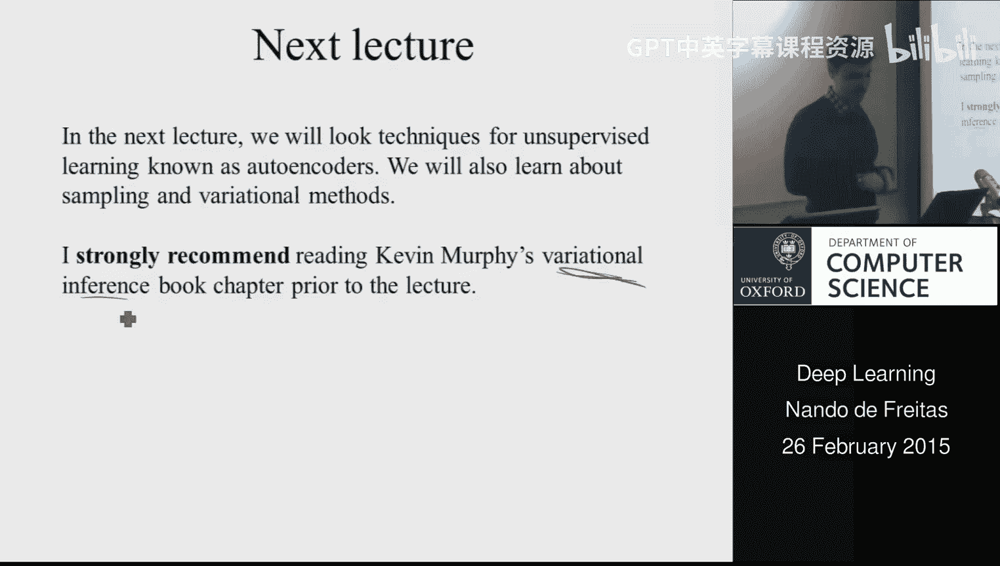

#  011：循环神经网络与LSTM 🧠

在本节课中，我们将要学习循环神经网络（RNN）及其强大的变体——长短期记忆网络（LSTM）。我们将探讨它们如何解决序列数据的建模问题，理解传统RNN的局限性，并学习LSTM如何通过巧妙的门控机制克服这些挑战。最后，我们将了解这些模型在翻译、图像描述生成等领域的广泛应用。

---

## 卷积网络的回顾与应用

在上一讲中，我们介绍了两种重要的网络：卷积网络和循环网络。卷积网络已经彻底改变了物体识别和语音识别的世界。即使你没有意识到，你每天都在使用卷积网络。它们是你生活的一部分，尤其是在社交媒体等方面。

卷积网络是非常成功的技术。特别是，如果我们遵循迁移学习的原则，即复用先前任务中学习到的嵌入表示，我们现在可以处理各种新问题。

一个简单的例子是：如果你有一个在ImageNet上训练好的卷积网络，你可以用它来识别训练集中不存在的物体。你只需拍摄一张物体的照片，将其输入网络，计算卷积层的输出特征向量并存储它。当你再次看到相同或相似的图像时，计算其输出特征向量并与存储的向量进行点积运算。点积结果越高，表示相似度越高。这样，你只需要一个数据样本就能实现识别，这被称为“单样本学习”。

因此，如果你已经训练好一个卷积网络，你无需重新训练它，只需操作其输出特征即可构建强大的日常物体识别器。实际上，很少有人会从头开始编码和训练卷积网络，你可以直接复用网络上已有的、经过训练的模型和嵌入表示。

---

## 循环神经网络的重要性

另一个非常重要且成功的模型是循环神经网络。循环神经网络在处理序列任务上表现出色，例如翻译。

翻译是一项极其重要的任务。想象一下，如果你想与两个外国开展业务。例如，你是一家服装制造公司，在伦敦设计时尚，从印度采购纺织品，在中国制造，然后运回伦敦。你的伦敦办公室可能只有三个人，需要协调这些说不同语言的外国伙伴。借助谷歌翻译，你可以发送一封邮件，对方收到的已经是翻译好的版本。这让你能够与说不同语言的人交流，仿佛语言障碍不存在一样。在你的有生之年，你将能够与说完全不同语言的人通电话而毫无察觉，这已经有一些演示了。

翻译不仅仅是语言之间的转换，它本质上是将一种类型的数据映射到另一种类型。你可以将图像翻译成图像描述，将歌曲翻译成歌词，或者将歌词翻译成歌曲。这是一个非常重要的观察，因为翻译过程本质上就是匹配不同类型的数据。我们在循环神经网络中将要做的很多事情都利用了这一原理。

在本讲中，我们将介绍循环神经网络，提及旧网络存在的问题及其原因，介绍由瑞士研究人员Ho Rita和Sid Hoover提出的一个技巧，这个技巧使得这些网络得以工作。然后，我们将探讨一系列应用，如语言模型、翻译、自动为图像生成描述、通过查看代码片段生成答案，以及一个非常酷的架构——神经图灵机。

---

## 循环神经网络的基本原理

从根本上说，循环神经网络是这样的：它是一个普通的神经网络，但某些神经元的输出会反馈到输入中。这就是一种循环，这对于实现图灵完备性至关重要。

让我们看一个非常简单的网络。假设我有一个输入 **x**，一个只有一个隐藏层的隐藏状态 **h**，以及一个输出层 **y**。所以 **x** 映射到 **h**，**h** 映射到 **y**，但 **h** 也映射到它自身。

绘制这个网络的一种方式是：**h** 层指向自身，然后 **x** 也指向 **y**。另一种方式是将其在时间上展开。**h** 总是依赖于它的过去，并且递归地依赖于无限远的过去。这使我们能够建模依赖于先前数据的数据，能够建模数据序列。

到目前为止，本课程中我们所做的一切都假设数据是独立同分布的。而现在，时间依赖性或空间依赖性变得非常重要，这正是我们要利用的。

对于认知来说，序列非常重要。例如，你可以按顺序说出字母表，但你能倒着说吗？我们存储的是序列，而不是孤立的符号。序列对于智能非常重要，预测序列也是如此。在你触摸某物之前，你几乎就在预测它的感觉、质地和温度。如果你预测与实际感觉不符，你就需要学习并进行修正。预测和序列预测对于构建智能机器以解决各种数据任务至关重要。

绘制这个网络的另一种方式是将其在时间上展开。展开的想法是，你得到的是网络的一个单一时间切片。重要的是，当我展开它时，参数是共享的。所以参数 **θ** 始终是同一个参数，我只是复制了它。从存储的角度来看，这很好，因为你没有创建更多的参数。

---

## 传统RNN的问题：梯度消失与爆炸

这些方法已经存在很长时间了，但它们过去无法正常工作。问题是，在反向传播时，梯度会变为零或爆炸（变成计算机中的非数字）。

这是一个巨大的挫折，因为这是一个图灵完备的、可训练的、极其强大的神经模型，但你却无法训练它。因为梯度计算出了问题。

为了解释这个问题，我们来看一个例子。我们有一个序列模型。如果你想计算损失函数关于参数 **θ** 的梯度，由于参数 **θ** 在所有时间步都出现，你需要对所有 **θ** 可能出现的时间步进行求和。

当你进行反向传播时，你需要从时间 **t** 的损失 **E_t** 传播到 **y_t**，再到 **h_t**，最终通过网络传播到更早的时间层 **k**。这个导数项本身是多个雅可比矩阵的乘积，因为你需要从步骤 **t** 到步骤 **k** 逐层求导。

对于一个简单模型，当你到达阶段 **h_{t-1}** 时，导数基本上就是 **θ^T** 乘以某个激活函数的导数 **φ‘**。如果我们假设激活函数的导数始终以某个常数（例如1/2）为上界，并且参数矩阵 **θ** 的谱范数（最大特征值）为 **λ_θ**。

那么，这个雅可比矩阵的范数将大致是常数乘以 **λ_θ^{t-k}**。如果 **λ_θ > 1**，它会指数爆炸；如果 **λ_θ < 1**，它会指数衰减到零。所以梯度要么爆炸，要么消失。

这意味着在时间 **k** 的输入信号 **h_k** 无法影响时间 **t** 的输出。来自过去的信息无法真正帮助你，你无法学习到长程的时序依赖。

例如，假设你想构建一个RNN，当它看到一串相同数量的A后跟着相同数量的B时，输出应为1（例如 AB, AABB）。如果序列非常长，比如一百万个A后跟着一百万个B，输出也应为1。这本质上需要网络学会计数。如果序列很长，你真的需要很大的内存来解决这个问题，而使用这种方法将无法工作。

---

## LSTM：长短期记忆网络

解决这个问题的流行方法是使用LSTM。LSTM被引入来解决梯度消失/爆炸问题。

让我们回到这个简单的循环网络，但为了使用LSTM的语言，我将改变符号。**h** 现在将是这个简单神经元的输出。输入将是 **g**。循环将发生在一个叫做 **c** 的东西中，**c** 代表记忆细胞。

我们试图构建一个有记忆的细胞。之前的图是：细胞带有参数 **θ**，你有 **g**，这里有一个参数 **θ_g**，然后有一个输出 **h_t**，在通过tanh非线性激活函数之后。tanh函数在+1和-1之间，如果你不希望输出为零，选择在-1和1之间的函数是很好的。

但这仍然是同一个神经网络，当你计算雅可比矩阵时，你仍然会多次乘以这个 **θ**，观察所有这些乘法的范数，它仍然会爆炸或变为零。所以我们仍然有问题。

一个解决方案是：在自循环连接上放置一个固定的权重1。但这也有问题，因为本质上，当你输入时，你只是在累加计数器，所以这只是一个不断增长的内存。这不是一个很好的内存，你需要能够决定何时将信息存入内存、何时从内存中读取，以及需要某种方式来擦除或重置内存，就像现代计算机一样。

于是我们得到了LSTM。在LSTM中，我们将使用门控，门控就是逐元素乘法。我们将创建介于0和1之间的信号（使用sigmoid单元），并输入先前的隐藏状态 **h** 和当前输入 **x**。

现在有两个量：隐藏层 **h** 和记忆细胞 **c**（它也有循环）。我们有先前的 **h** 和当前的 **x**，它们通过sigmoid函数得到一个介于0和1之间的值，这个值决定了输入是否进入细胞。它乘以输入，本质上就像一个平滑的开关（有时是0，有时是1）。当然，你并不知道何时该写入内存，何时不该。这个模型的巧妙之处在于，你也能从数据中学习这一点。

数据（相同的输入数据）会进入一个“输入门”、一个“遗忘门”（它将 **c** 乘以输入 **f_t**，如果 **f_t** 是0，则擦除内存），以及一个“输出门”（它也使用输入数据），然后你产生下一个细胞的输出。

所以，本质上，你仍然接收一个 **h_in**，产生一个 **h_out**，并提供一个信号 **x**。为了简单起见，我暂时没有包含 **y**，但 **y** 也可以输出。这个 **h** 实际上可以是最后一层的 **y**。

这就是LSTM单元的基本原理。最初，人们只是在这里放一个1，没有遗忘门，这样你就不会一直写入内存，只在这个门允许时才写入，然后在输出门允许时才读取。遗忘门允许你重置内存。这一切的美妙之处在于，有时你希望知道该使用哪个模型，但你不知道上下文。如果你不知道，你也应该学习它，你应该同时学习模型和上下文。这些乘法操作非常有用。

---

## LSTM的实现与应用

当你实现它时，这个图被翻译成这样的代码：你有 **x** 和先前的 **h**，它们让你得到输入门 **i**，然后你对其他门进行完全相同的操作。接着你进行逐点乘法（标量乘法），然后是三次乘法。这些是线性层，你知道如何在Torch中实现它们。你只需要知道如何将两个层相加以及如何将它们相乘。我们需要设计层来执行这两种操作，然后就可以实现了。

一个典型的LSTM模块接收 **x** 和先前的 **h**（称为 `prev_h`），然后输出下一个 **h** 和下一个 **c**。这是一个单元，它可以是多维的，因为所有的 **h**、**i** 都可以看作是 **R^n** 中的向量。**x** 可以是一个输入向量，**θ** 是一个 **n x n** 的矩阵，门是一个 **R^n** 中的向量。

如果你想创建一个网络，你只需要复制这些单元。如果你想让他们共享参数，你可以克隆网络。通过这样做，你可以构建这样的网络：输入一个英语单词序列，输出一个普通话单词序列，然后通过在这个LSTM上进行反向传播来学习所有参数，你就得到了一个翻译模型。

如果你添加更多层，你只需在这里添加更多层。每个单元都有自己的参数，这些参数在时间上被复制，但在层次结构中是不同的参数。随着层次的上升，你为这些过程获得了不同的时间尺度。通过拥有多条路径，信息在网络中传播的方式比只有一层时更多。

这些模型非常庞大，参数很多，训练需要很长时间。这使你能将一种语言翻译成另一种语言。你还可以从代码指令序列（这只是一个序列）生成输出，有些论文已经在这方面取得了一些成功。

你还可以预测视频，视频输入，视频输出。我的有些同事正忙于为游戏研究这个。

更近期的，Alex Graves等人在DeepMind实现了神经图灵机。它有一个控制器，类似于典型的图灵机架构，有读头、写头和某种内存。它接收数据输入序列和输出序列，并学习应该存储什么、检索什么以回答问题。如果你给它一个序列，输出是排序后的序列，它应该学习如何排序。你可以想到算法课上的任何算法，只要是图灵机可实现的，它都应该能做到。你只需要提供输入示例和输出示例，它就应该能找出执行该操作的程序。

神经图灵机与LSTM的主要区别在于，它不是只有一个记忆细胞，而是有一个完整的记忆矩阵。你可以访问这个内存来写入和检索事实，访问由权重函数决定。控制器可以以多种方式实现，它接收输入和一些读取内容，必须输出应该添加到内存中的内容、是否应该擦除，它控制着头和机器的输出。

另一个非常流行的模型是注意力机制模型，由Dmitri Barno等人在蒙特利尔提出。他们用这个模型进行翻译，输入句子 **x**，输出句子 **y**。他们决定使用门控瓶颈，这样就能知道一种语言中的一个词应该与另一种语言中的哪个词相关联。他不仅想生成翻译，还想能够说出西班牙语中的“Gato”在英语中对应的是“cat”。

这种方法基本上是参数化的神经网络，你有所有隐藏单元的输出，然后它们再次被标量 **α** 门控。门控的概念再次出现，这决定了哪个 **h** 与哪个 **s** 匹配。他还做了一件更重要的事，就是使用双向LSTM。

门控很有用，因为这样你就可以做这样的事情：取一张图像，运行一个已经训练好的卷积网络，得到特征以及特征出现的位置。卷积网络会告诉你，这里有一个翅膀特征，那里可能有一个水特征等等。然后，对齐就派上用场了，因为你基本上想说图像中的什么是翅膀，什么是水，什么是鸟？它会通过我们课程开始时提到的注意力机制来实现，即你并非看到一切，而只看到一点点。因此，它将学会通过使用门控来关注图像中的不同区域，然后生成一个单词，接着生成下一个单词，从而实际上生成一个句子。

---

## 总结与展望

本节课中，我们一起学习了循环神经网络的基本概念及其在处理序列数据时的核心挑战——梯度消失与爆炸。我们深入探讨了LSTM的结构，了解了其输入门、遗忘门和输出门如何协同工作，形成一个能够学习长期依赖关系的动态记忆系统。我们还看到了RNN和LSTM在机器翻译、图像描述生成、代码生成乃至神经图灵机等领域的强大应用。

在下一讲中，我们将聚焦于Alex Graves的工作，详细研究他如何生成文本，这些细节对于理解如何生成图像也至关重要。我们还将介绍变分方法，它允许我们生成诸如数字之类的精美图像。为了能从下节课中获得最大收益，我建议你阅读Kevin Murphy书中关于变分推断的介绍部分。即使你不完全理解其中的数学，我也希望你至少能看到其应用，理解其思想。我们将利用一种非常酷的学习观点，即当世界与你想象的不符时进行学习。

感谢学习。