#  012：使用RNN生成序列

在本节课中，我们将学习如何使用循环神经网络来生成序列数据，例如手写笔迹和语音。我们将探讨其背后的动机、核心架构以及实际应用。

## 概述

生成模型是深度学习中一个令人兴奋的领域。它不仅能帮助我们理解数据的结构，还能用于创造新的内容。本节课将重点介绍基于循环神经网络的序列生成方法，特别是长短期记忆网络的应用。

## 为什么需要生成模型？

生成模型有多种用途。首先，它们可以作为预训练方法，帮助监督模型学习更好的内部表示，从而提升泛化能力。其次，生成模型可以用于创建合成训练数据，尽管直接从真实世界获取数据通常更优。此外，一些实际任务，如语音合成，其核心要求就是生成逼真的音频。在强化学习中，序列生成模型能够模拟未来情境，帮助智能体在不实际执行动作的情况下进行“想象”。然而，最根本的动机在于，生成模型迫使系统去发现和理解数据中的关键结构。

## 序列生成的基本原理

从实践角度看，只要拥有一个预测模型，生成序列就相当直接。基本方法是持续预测序列的下一个元素，然后将上一次的预测结果当作真实输入，反馈给模型进行下一步预测。

在概率框架下，这对应于一个条件模型。整个序列 **X** 的概率由每个时间步的条件概率乘积给出：

**P(X) = ∏ P(x_t | x_1, ..., x_{t-1})**

这个过程可以理解为让计算机“做梦”：先想象一个情境，然后将其当作真实发生的事件反馈回去，再基于此预测接下来会发生什么。这种迭代过程能够生成丰富而有趣的内容。

## 核心网络架构

本教程展示的所有实验都基于同一种架构——深度循环神经网络。其基本结构相当简单：它是一个多层感知机，其隐藏层与自身在时间上相连，形成循环连接。深度循环网络则是将多个这样的隐藏层堆叠起来。

网络拓扑结构包含跳跃连接：输入数据不仅馈入最底层的隐藏层，也馈入所有隐藏层；同时，所有隐藏层都向前连接到最顶层的输出层。这样做的目的是避免梯度在深层网络中传播困难的问题，因为信号可以通过这些快捷路径传递。

这是一个预测模型，其任务始终是下一步预测。网络每次接收序列中的一个输入，然后预测下一个时间步的输入。这里的“预测”是指确定或参数化一个预测分布。输出层根据数据类型（如离散符号或连续值）采用不同的预测模型（如Softmax层或混合密度网络），但其参数始终来自网络的输出。

训练过程是标准的，使用对数损失函数。这等价于衡量网络压缩数据的能力，即计算给定模型下输入序列的负对数概率。一旦模型训练完成，生成过程就很简单：持续馈入一个输入，然后从输出分布 **P(x_t | x_1, ..., x_{t-1})** 中采样，并将采样结果作为下一个输入，而非真实的输入。

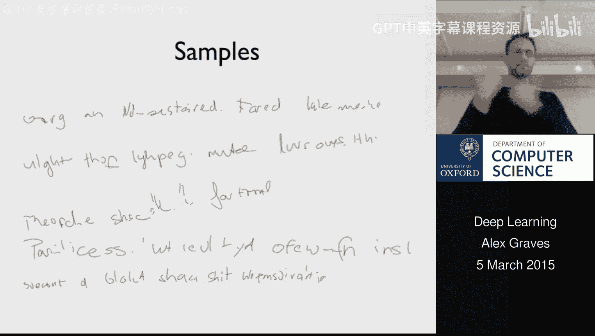

## 长短期记忆网络

标准的循环神经网络存在局限性，难以长期存储和访问信息。长短期记忆网络正是为解决此问题而设计，其核心思想是通过乘法门控单元，实现对信息的保护以及读、写、重置操作的选择性控制。

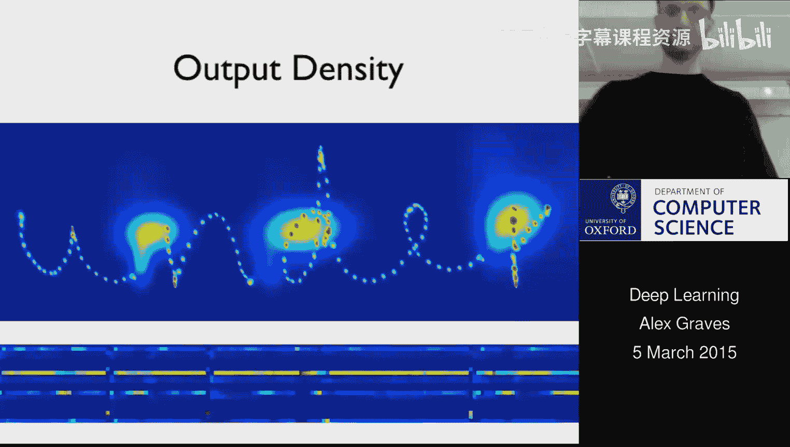

LSTM包含三个关键门：输入门、输出门和遗忘门。直观上，它们就像是可微分的读、写和重置操作：
*   **输入门**控制新信息能否进入记忆单元。
*   **输出门**控制记忆单元中的信息能否被读取。
*   **遗忘门**控制记忆单元中的信息是否被保留或清除。

这些门控机制使得LSTM能够更自主地决定何时存储和访问信息，从而真正实现长期依赖关系的建模。

## 记忆与预测的关系

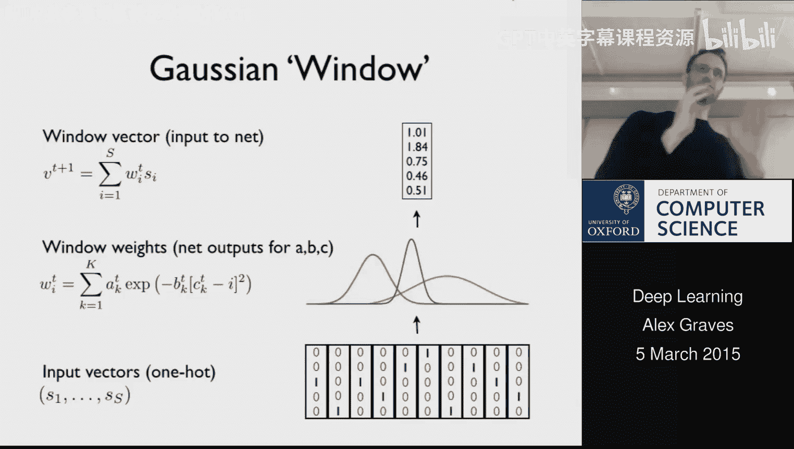

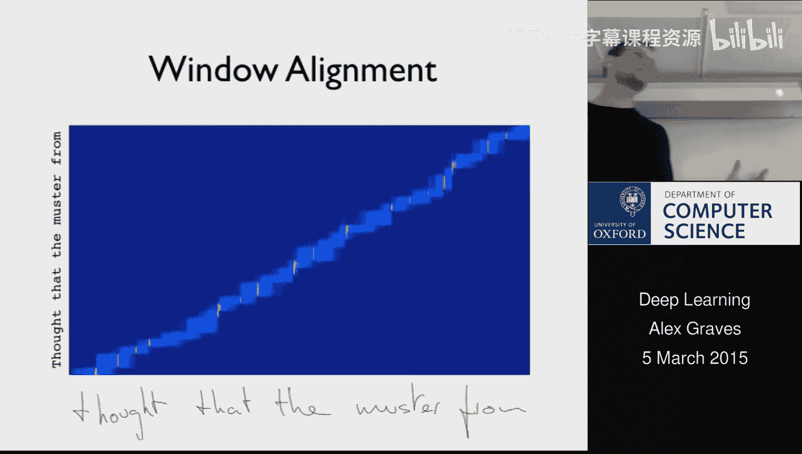

预测模型的好坏完全取决于其预测未来事件的能力。显然，为了预测未来，必须记住过去。拥有更长的记忆或LSTM提供的这种记忆类型具有多重优势。

例如，处理文本中的括号时，为了知道在何处闭合括号，模型必须长期保持“正处于括号内”的状态信息。更深刻的一点是，模型越能有效利用记忆进行预测，其对预测错误的鲁棒性就越强。在自回归生成过程中，模型可能会生成偏离训练数据分布的内容，从而导致后续生成完全失效。LSTM由于能利用不同时间尺度（从几步到数百步）的记忆进行预测，因此需要犯更严重的错误才会完全崩溃，从而显著降低了这种失效的可能性。

## 实验应用：手写生成

我们将该架构应用于在线手写生成任务。在线手写数据是笔尖的轨迹坐标序列，为二维连续数据。为了处理连续值，我们采用循环混合密度网络作为输出层。网络在每个时间步输出一组参数，用于定义一个混合高斯分布（例如20个高斯分量的混合），以此来预测下一个笔迹点的位置。

训练网络进行下一步预测后，它能够生成逼真的手写笔迹。生成结果不仅呈现出连贯的笔画、字母甚至单词，还能体现出不同书写者的风格一致性。这表明模型在低层次的坐标预测中，学习到了高层次的结构信息。

通过可视化预测的概率密度热图，可以观察到模型的行为。例如，在笔尖离开纸面（不记录坐标）时，预测分布会变得分散；而在书写平滑笔画时，预测则非常精确。混合模型使网络能为不同状态（如书写状态与提笔状态）优化不同的预测模式。

## 条件生成：文本控制手写

为了控制生成的内容，我们需要让下一步预测以文本序列为条件。挑战在于文本与笔迹之间没有预先定义的对齐关系（一个字符的书写时间步长可变）。我们希望网络能自行学习对齐，即一个可微分的注意力机制。

具体实现是，网络额外输出一个高斯混合模型，用以定义其在文本序列上的注意力分布。该分布与文本的one-hot向量表示进行卷积求和，得到一个加权和的文本向量，作为生成笔迹的条件输入。这种方法允许网络在生成每个笔迹点时，自主决定关注文本的哪个部分。

训练后，网络能生成与给定文本对齐的逼真手写体。人类观察者甚至难以区分生成样本与真实样本。此外，通过调整生成过程，例如缩小预测分布的方差以偏向于分布的模式（最可能序列），可以得到非常清晰、规整的笔迹，这类似于不同人书写风格的“主成分”。

我们还可以通过“预热”来控制风格：先输入一段真实笔迹（不生成），让网络内部捕获其风格，然后再开始条件生成，这样就能得到与预热笔迹风格相似的输出。不过，这通常要求预热笔迹来自训练集中已有的书写者。

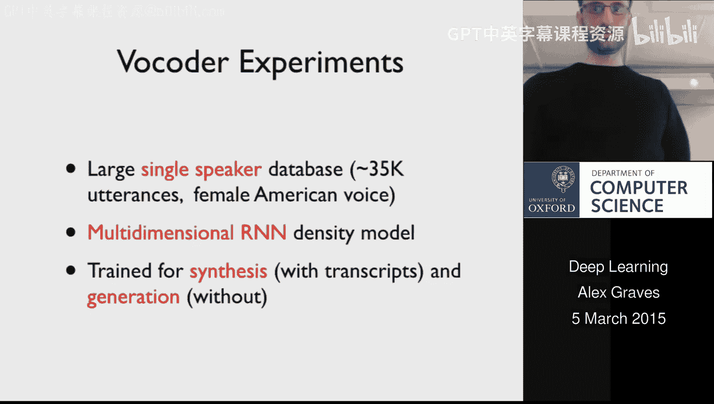

## 扩展应用：语音合成

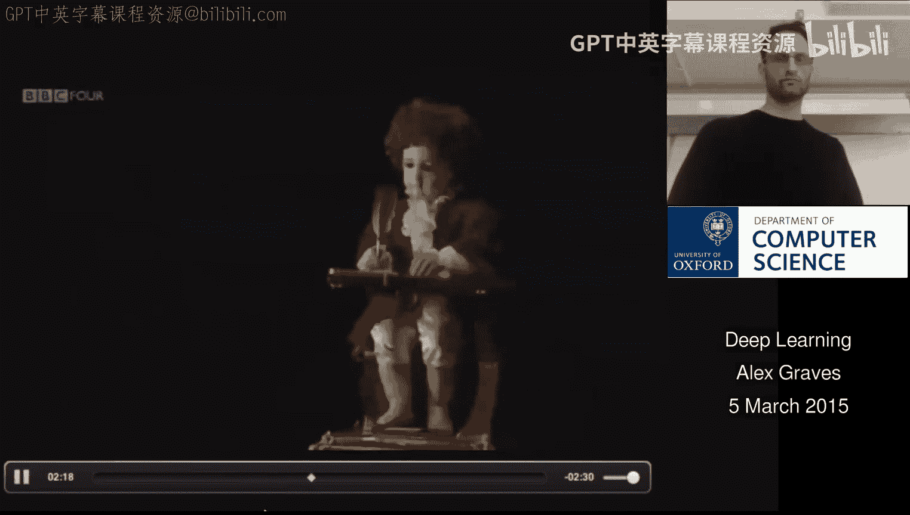

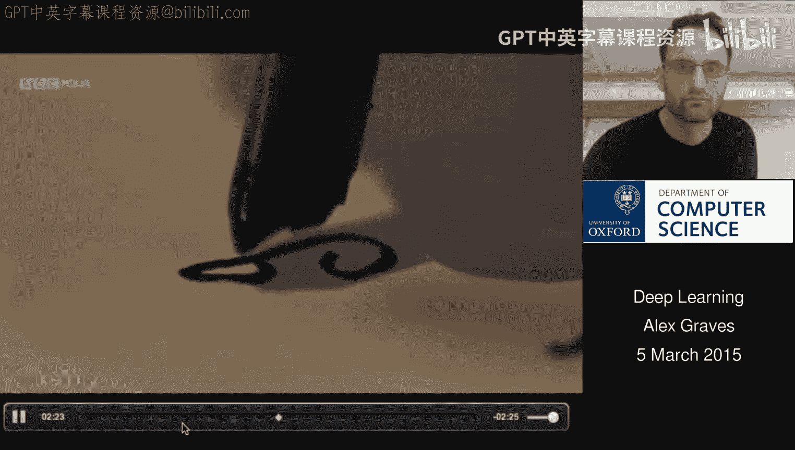

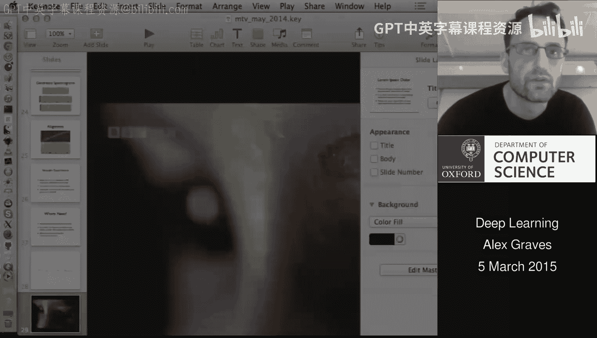

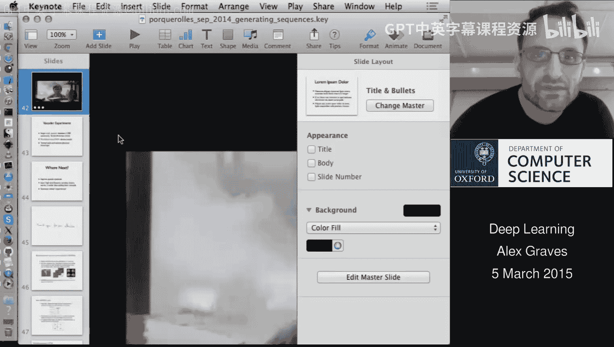

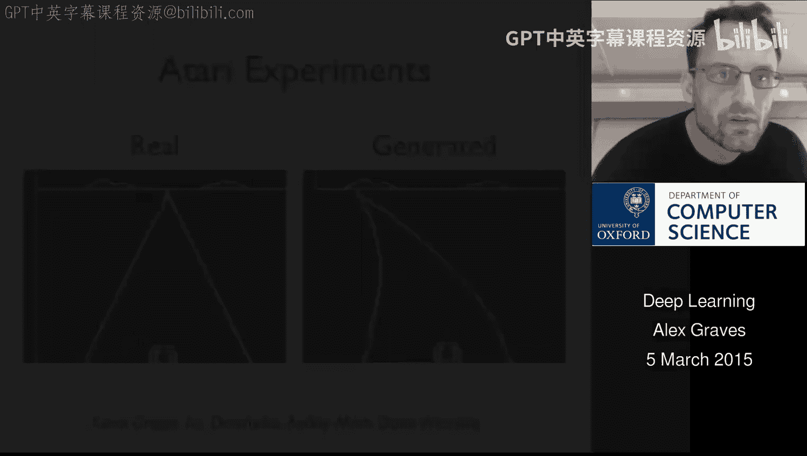

相同的生成框架可应用于语音合成。任务变为从文本生成音频，但这比手写生成更具挑战性。原因包括：字母到发音的映射复杂，人类对语音清晰度要求更高，以及语音数据本身维度高、表示复杂（如频谱图、MFCC特征等）。

初步实验表明，网络能够生成具有语音特性的音频，并在条件生成时说出可识别的单词，其韵律与原始说话者相似。然而，生成的语音在自然度和流畅度上仍有提升空间，要达到实用水平需要进一步改进。

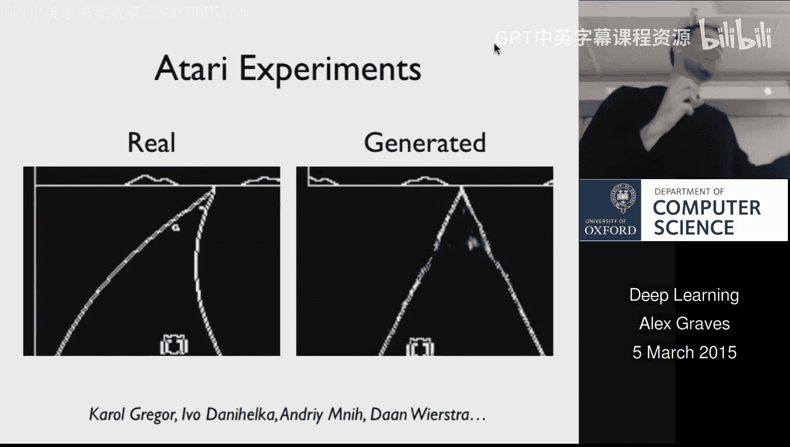

## 总结

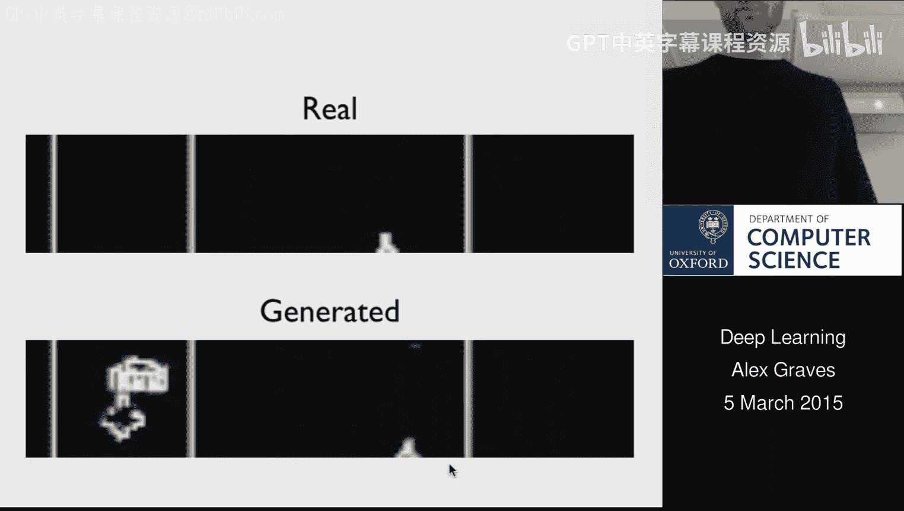

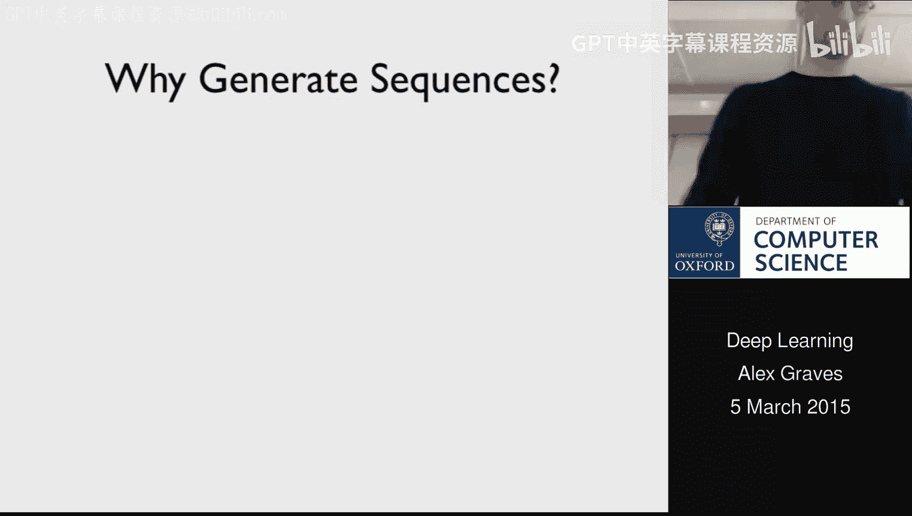

本节课我们一起学习了使用循环神经网络生成序列的原理与实践。我们从生成模型的动机出发，介绍了基于LSTM的深度循环网络架构，以及如何通过下一步预测和自回归采样来生成序列。我们探讨了处理连续数据（如手写笔迹）的混合密度网络方法，以及实现文本条件生成的注意力机制。实验表明，这套方法能够生成逼真的手写体和初步的语音，并展示了通过调整生成过程来控制输出特性（如清晰度、风格）的可能性。序列生成不仅是一个强大的工具，也为我们理解模型如何学习和内部表征数据提供了窗口。