#  014：深度强化学习 - 策略搜索

在本节课中，我们将要学习深度强化学习的基础知识，特别是策略搜索方法。我们将从监督学习和无监督学习的回顾开始，然后介绍强化学习的核心概念，并详细推导策略梯度算法。

## 概述

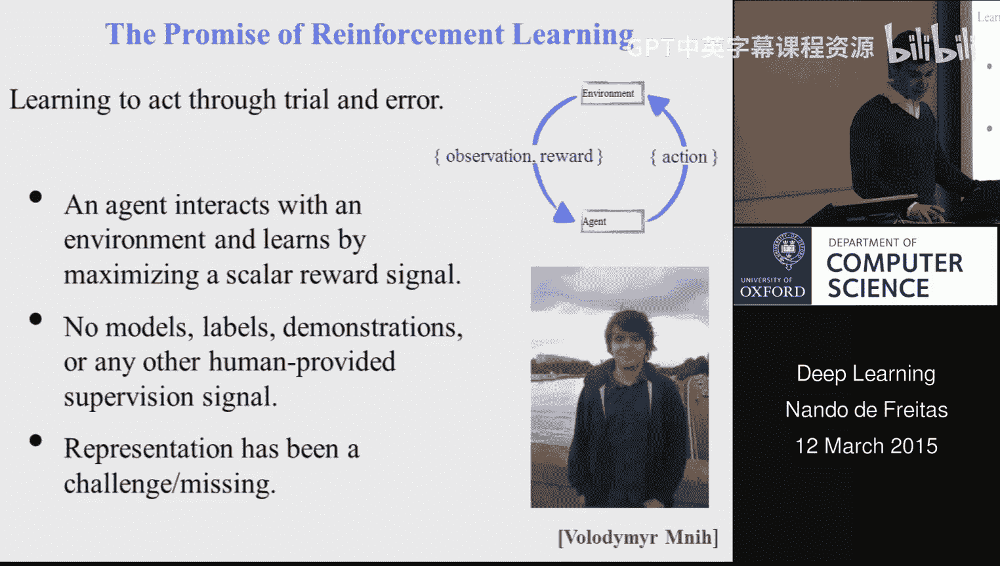

到目前为止，课程已经涵盖了监督学习，即当老师提供标签时的学习形式。我们在线性回归、逻辑回归和神经网络中看到了这一点。当你有标签时，可以很容易地定义一个损失函数，例如回归的均方误差或分类的交叉熵。我们还使用了像合页损失这样的替代方法来处理分类器。或者，当只在匹配级别有监督时，你知道两件事匹配或不匹配，或者你知道某个信号是正确的，而另一个是它的损坏版本。但所有这些都使用了某种形式的监督，在某些情况下可能更间接，例如我们在进行最大间隔学习时。尽管如此，监督是存在的。

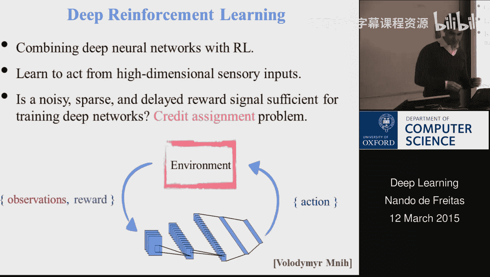

在上节课中，Carol 向你们介绍了使用自编码器的无监督学习。自编码器的典型思想是，你有数据 X，创建一个瓶颈，对数据进行编码，然后解码，你的预测应该再次是 X。如果你看到世界，将其放入你的头脑，然后能够生成或描绘世界，那么你就能够理解环境中正在发生的事情。这是语音合成、手写合成和视觉合成等酷炫事物的基础之一。传统上，自编码器的瓶颈是通过使隐藏层小得多来实现的，这在过去尤其是使用堆叠 RBM 时常用。另一种策略是添加稀疏性，因此只有少数神经元可以激活，这也创建了瓶颈。如果你要通过这个编码和解码阶段重建 X，就必须学会正确编码和解码。Carol Greg 向我们展示了如何使用传感器分布，特别是噪声，来创建这个瓶颈。他特别选择了一个非常均匀的分布作为中间层，一个高斯分布，一个具有两个矩的最大熵分布。尽管存在这个非常严重的瓶颈，仍然能够重建信号。当你被迫使用一个非常严重的瓶颈，并且能够再次重建信号时，这意味着你真的学会了在权重中表示信号，因为网络中没有任何其他地方可以让你只是记忆或复制那个实体。

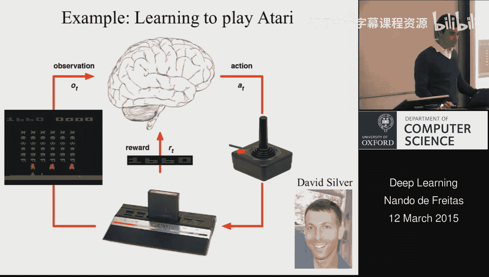

现在，我们将转向一个不同的设置，即我们有一个智能体。这里的智能体可以是一个机器人、一个人、一只蟑螂、一个小型机械打印机等等，或者一个游戏智能体，或者网络上的软件智能体。智能体与环境交互。这个智能体产生动作。假设是智能体的动作不足以改变环境。因为如果你认为智能体能够改变环境，然后环境对智能体做出反应，那么我们就进入了博弈论的领域。但在强化学习的设置中，我们假设有一个非常大的环境，你作为智能体可能只能对环境进行一些局部改变。但大体上，你只是处理这个环境，并试图做出决策以最大化某种奖励。可以想象你在玩股票市场，除非你非常富有。你的行动不会影响市场。如果你非常富有，你的行动会影响市场，你实际上可以测试市场，你可以提出引起反应的动作。但你基本上会采取行动以最大化，例如你退休时获得的回报金额，并且你会观察新闻文章、朋友告诉你的信息等，以做出决策。所以这是一种决策。你必须做出决策，也必须感知环境，并且必须有一些衡量你表现如何的指标。我将讨论这个性能衡量问题，因为事实上，很多时候，即使对我来说，奖励信号的概念也不明显。量化一般奖励非常困难。如果我不提醒，我会在最后回到这个问题，但让我们尝试更精确一些。设置是智能体将与环境交互，它接收奖励信号和其他观察信号，然后我们将尝试通过试错学习如何行动。特别是，我们将学习策略和如何做事，以便随着时间的推移最大化其奖励。策略的另一个名称是策略，这通常是强化学习中使用的术语。因此，智能体正在学习一个如何行动的策略，以最大化回报。强化学习已经存在很长时间了，但它并没有带来重大的突破。它是机器学习中存在了大约50年的东西之一，但它从未像导致巨大收益那样。几十年前有一个叫做 TD Gammon 的游戏，基本上学会了击败人类玩西洋双陆棋，这很酷。但除此之外，你只能得到像电梯控制器这样的简单东西。它从未真正在应用方面取得进展。最近，我认为有一些非常快速的改进，并且通过使用良好的表示法带来了这些改进。决策过程将学习如何感知环境，因此你需要一个感知模型。到目前为止我们看到的所有东西，如 RNN 等，都将变得非常有用，因为它们将使我们能够感知世界，如果我们能很好地感知世界，我们也能在世界中行动。因此，使强化学习非常有趣的是深度学习与强化学习的结合。如果你把这两者放在一起，你实际上可以构建一些非常强大的东西。我今天使用的许多幻灯片是由 Vlad 制作的，他是最近发表在《自然》杂志上的一篇论文的作者之一，我们今天将在第二节课中介绍这篇论文，使用强化学习和深度学习。

我们的智能体基本上将是一个神经网络。这个神经网络将接收来自环境的图像，例如，这里你可以看到一个卷积网络，然后输出将是动作。所以你可以把这想象成一个小生物，它感知环境并在环境中行动，试图最大化一些奖励信号。也许它试图最大化其存在感，或者不耗尽电池，或者探索环境等等。使强化学习与监督学习非常不同的一个问题，是信用分配或延迟奖励。通常，设置是你正在玩游戏。你可能在下棋。你移动你的棋子。两个小时后，你发现自己被将死了。现在你要弄清楚，在我所做的一切中，哪些是聪明的举动，哪些是导致我获胜的举动，因为奖励只发生在遥远的未来。现在你必须从那个未来的单一信号中找出，哪些过去的行动是我应该真正记住的，哪些小策略、行动片段是我应该记住的，哪些行动序列是我现在应该存储在记忆中的，以便下次我玩游戏时可以做得更好。这就是困难所在，你没有在每个时间步都有监督标签。即使你在每个时间步都有一个标签，那个标签也可能没有信息量。有些标签信息量更大，你可能会得到奖励信号，比如能够站在这里，能够看着观众等等，但最终的大奖励信号是如果你实际上在这门课程中取得成功等等。

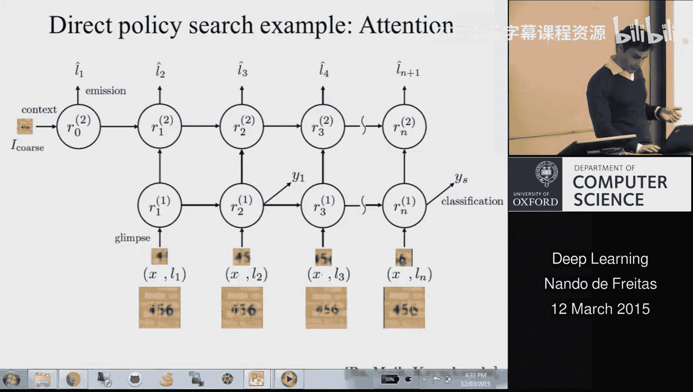

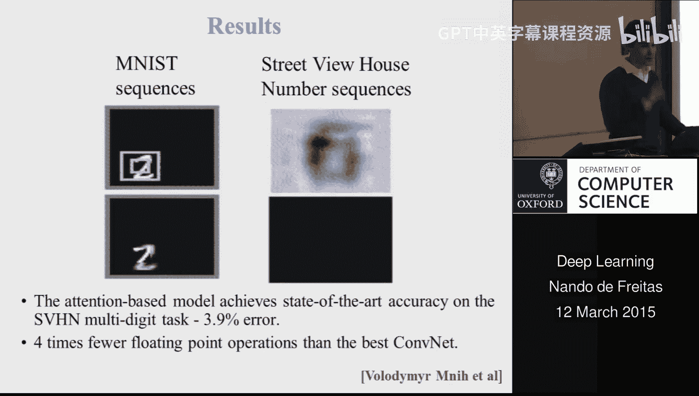

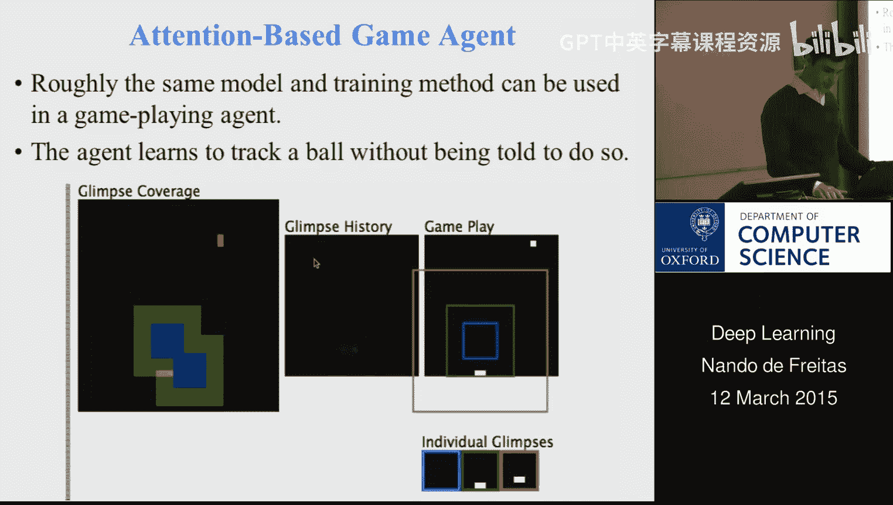

这就是困难所在，这里有一个例子。在强化学习中，你本质上有一个与环境交互的智能体。与我们迄今为止所做的所有机器学习不同，在那里我们将智能体与环境分离，我们只是在进行感知。现在你真的必须把环境纳入其中，因为你只能通过在环境中行动并观察环境如何评判你来评估。所以你在环境中做某事，比如你可能走到某物的边缘，如果你掉下去，那就是环境告诉你做了愚蠢的事情，不要走过悬崖。当我们测试强化学习算法时，有一个额外的复杂性，这使得在这个领域进行研究很困难，你需要一个环境来进行研究。所以你不仅要构建你的模型，如果你要攻读博士学位，你还必须构建一个环境。环境可能是物理世界，如果你在做机器人技术，这是强化学习的一个应用领域。或者环境可能是游戏。因为游戏有这些美丽的模拟环境，所以通过将智能体嵌入游戏中，并希望它们学会与其他智能体交互并学会聪明地做事，我们就有了一种训练智能体的方法。游戏是 DeepMind 遵循的策略。我们将要做的本质上是这种类型的设置，其中会有某种计算机。一个老式的 Atari 为神经网络提供一些奖励。它通过移动操纵杆来行动，它看到的只是屏幕。所以它必须学会看才能玩游戏。这个神经网络将进行端到端的训练，所以除了能够访问奖励信号和观察结果，以及知道根据操纵杆哪些动作是可能的之外，神经网络将没有任何额外的帮助。所以没有演示，没有标签，它只是面对一个游戏。它必须学习，必须最大化其奖励。它必须保持活力，捡起正确的东西，吃正确的东西，不吃错误的东西等等。帮助我制作幻灯片的另一个人是 David Silver，我认为他是世界上最有前途的年轻强化学习人员之一，非常聪明，我强烈推荐阅读他的论文。他在开发算法方面发挥了非常重要的作用，这些算法特别擅长玩像围棋这样非常具有挑战性的游戏。

所以有两种策略涉及深度网络和强化学习的结合，我们今天将研究。有更多的策略，我只研究两种，在这两种策略中，模型都是一个神经网络。所以我不需要构建额外的环境模型，比如一个物理模型，说明加速度如何变化等等。所以我们将避免尝试做基于模型的事情，我们将做一些被称为无模型的事情，尽管有一个叫做神经网络的模型，但没有像工程师或科学家会构建的那种标准模型。这被称为无模型强化学习。我们将研究策略搜索，然后在第二节课中研究动态规划。

这里有一个很好的例子，来自 Jimmy Bar 最近的一篇论文。想象你有一个网络，比如在这个例子中，一个循环网络，它从看一个非常粗糙的图像开始。特别是，这个带有数字 456 的图像与这个图像相同，这是谷歌街景数字之一。然后它进入某个潜在层，所以这只是一个 LSTM 中的隐藏层单元。它输出两个数字，x 和 y，或者两个整数 x 和 y，表示位置。你应该在图像中看哪里。所以你可以把这想象成一个非常大的图像，你看图像的特定小区域，并提取一瞥。我在开始这门课程时展示了所有这些视频，并说服你正在这样做，因为你无法跟踪整个图像，世界上有所有这些你错过的东西。甚至有人在我的 Facebook 上发布了一些非常酷的东西。我知道首先，是的，有人与我分享，显然一些广告公司正在利用这一点。所以我们不得不应对非常快速的信息流，能够关注正确的事情，能够做出那个决定，将帮助我们应对涌入的过多信息。所以你在这里关注，然后你只读取一小部分信息，然后选择下一个选项。然后你决定是否预测一个标签，如果你选择预测一个标签，你就预测一个标签，所以在这个例子中，你会预测你读到了哪个数字。你继续这样做，所以希望你会得到 y 的序列是四、五、六。你基本上会读取数字，所以你本质上是在给定一个图像的情况下，学习通过只关注文本的特定部分来读取图像的内容。这里的动作是离散的，所以我们脱离了可微性的世界。上周我们看到了很多努力，旨在构建端到端的可微系统，而不放弃这种可微性，因为强化学习将使我们能够构建不需要可微的系统。

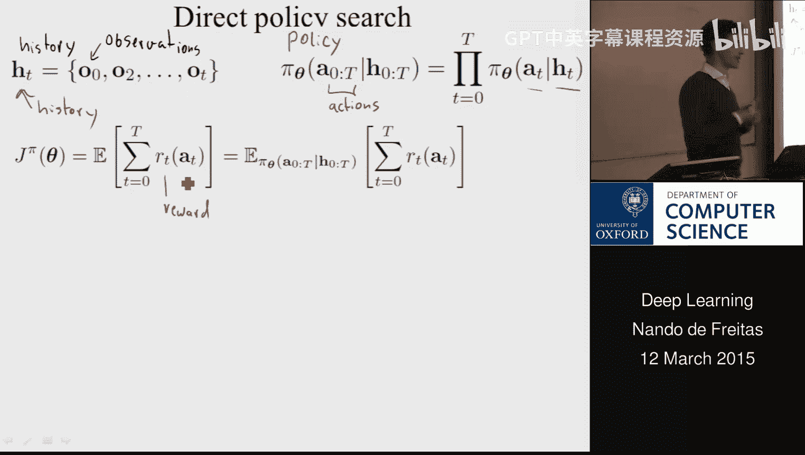

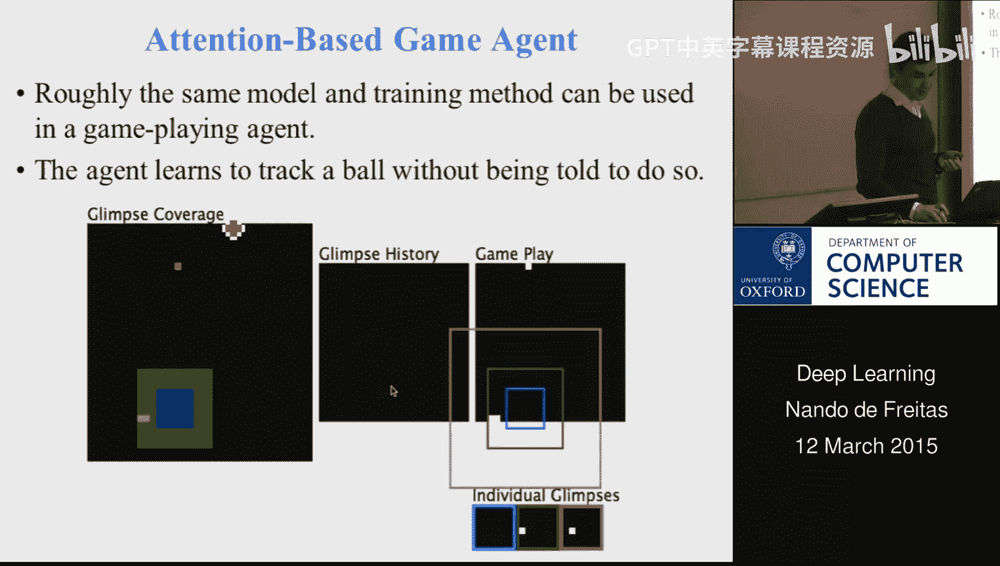

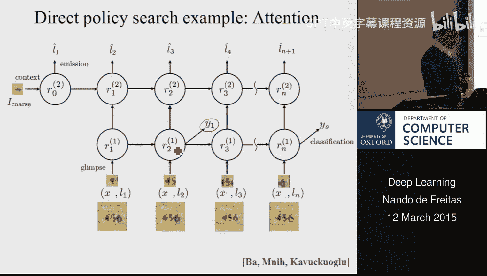

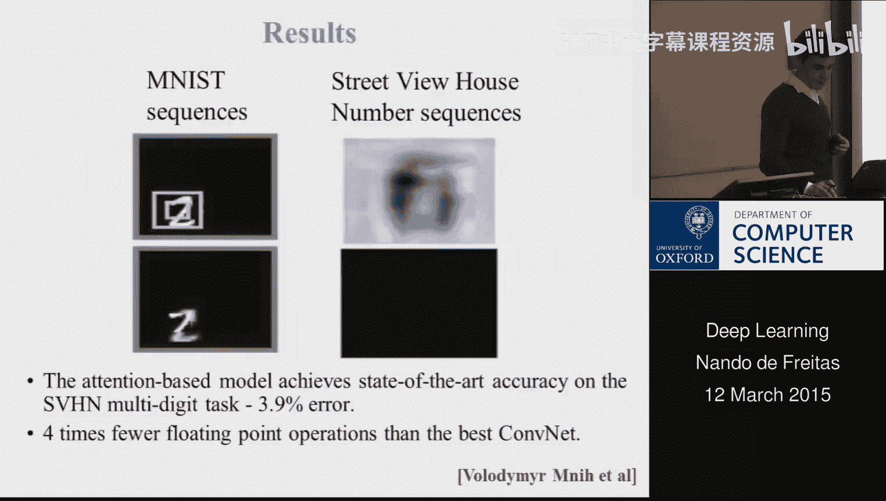

这是一个例子，说明这个系统在实践中如何工作。这是在读取数字。所以这是它学会做的明显事情，就像我们做的那样，你跟随数字，你不读其他地方。这是他们的网络读取街道号码的例子。重要的是，通过只使用较小的输入数据集，而不是输入完整的图像卷积网络，如果你只看较小的图像块，你能够实现更低的错误率，所以你的性能提高了。特别是，在这篇论文中，他们报告了在这个数据集上的最先进准确率。正如他们在这里指出的，与使用卷积网络相比，浮点运算次数减少了四倍。所以这非常有用。

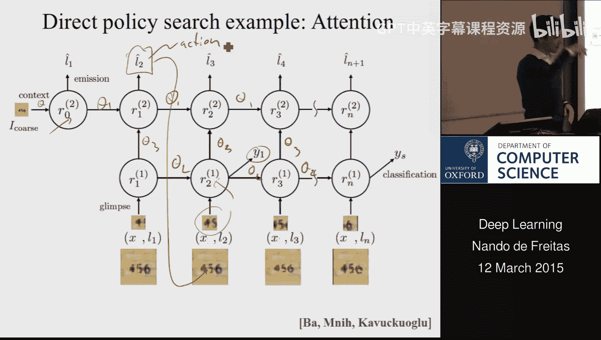

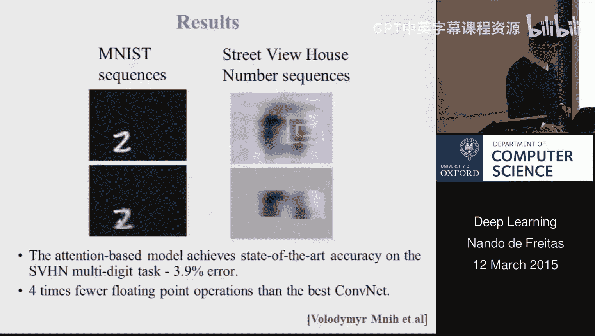

他们还将其应用于两个游戏，Atari。有趣的是，它学会了关注。它的奖励信号本质上是最大化这个游戏的分数，在这个游戏中你必须弹起这个小球，但你不告诉它如何玩或任何东西，你只提供一个奖励信号，它学会了玩这个游戏，你应该注意球在哪里。所以它自动学会了做明显的事情，你会认为是明显的事情。

那么它是如何工作的呢？让我们用剩下的时间来推导构建其中一个所需的方程。从根本上说，我们有一个循环神经网络。我们将进行瞥视，所以我们将查看数据并选取数据片段。如果你有一个大世界，一个大图像，你正在抓取该图像的小片段，然后给定那个历史，所以你本质上有一个历史 H。那个历史由这些随时间的观察组成。所以它可能是随时间的数字小片段，然后给定那个历史，你将进行分类，你基本上会说出你找到了哪个数字。所以你的决定，你的标签是动作，但你也可能做出某种其他决定，决定可能是你正在看某种外语中的这些字符，然后决定这道菜是素食还是非素食，或者我推荐你，我认为你会喜欢这个。如果你在外国，看不懂菜单，这可能非常有用。你还应该把这些想象成不仅仅是一个你收集数据片段的图像，本质上是一个你获取子图像的大图像，只是一个你获取数据小块的大数据库。所以把一个图像想象成一个记忆。你可以把一个图像想象成一个记忆，一个数据库，世界，你只是去那里抓取信息片段。如果你在一个巨大的数据库中有许多事实，并且必须回答一个问题，这本质上是记忆网络的内容。你去那个数据库，抓取信息片段，在记忆网络中，你读取，你去找到最重要的信息片段，然后你去找到第二个最有用的信息片段，然后输出问题的答案。使用这个方案，你会查看信息片段，然后输出答案，但与数据库交互的序列以及你从数据库抓取的信息将决定奖励，这里的奖励将是你回答问题有多好。例如，当他们试图使用你的某项服务时，他们是否进行了交易。但让我们再次回到图像上。实际上，让我们继续讨论，所以你进行一系列观察，这就是我们将要称之为历史的东西，然后我们将引入这个量，我称之为策略。这是一个策略。策略是将历史映射到动作的东西。给定我看到了所有这些观察，我将选择这个动作。我已经经历了所有这些状态，并观察到了这个。我认为这就是我要结婚的人。经过一些观察后，你做出决定。我们将做一个假设，即在这些历史条件下，动作是独立的，所以我们的大写 T 决策的策略将分解为决策的乘积，所以它们只在给定历史的情况下是独立的，如果历史没有给出，它们就会耦合。那么这就是我们需要的唯一抽象，我们只需要策略、动作和历史的概念。我们需要的另一件事是奖励。想法是我们想要最大化我们未来的所有奖励。特别是，请注意，如果你有直到游戏结束的大写 T 步，你的奖励可能是 0,0,0,0,0,0，然后当你到达结束时，你得到一个。所以这个奖励信号可能非常弱。再次，如果你在玩一个像小鸡过马路这样的游戏，小鸡必须过马路，不被杀死，只有当它过马路时才能得到一分。它可以在中间做很多事情，并且会得到零奖励。所以你必须学习一个考虑到这一点的策略。你可能想要做一些不会立即有价值的事情，所以可能有一些事情是有价值的，让我这样说，可能有一些立即有价值的事情，但你知道从长远来看它们对你没有用处，最好放弃即时奖励，希望你在最后获得更大的奖励。奖励会影响系统的状态。是的。所以在这个例子中，你引入了状态的概念，因为我假设你知道强化学习，这里的状态是历史。如果我知道历史，而历史不是全部数据，全部数据会太大，所以这里的希望是历史将只是一瞥的集合，当然，然后我不能继续获取瞥视并存储所有可能的瞥视，我将不得不有一个有限的内存。但历史是定义世界状态的东西。这是真的，我本可以在这里放一个历史，但在某种意义上。是的，整个推导将是相同的，事实上你是对的，因为如果你看我之前展示的模型，奖励将被衡量，你将如何预测这个，所以它是 H 的函数，基本上来自历史。但我会要求你相信，如果我改变，在这里放一个 H(T)，我接下来要做的每个推导都将是完全相同的。事实上，在第二节课中，我会把状态引入奖励。在第二节课中，你会清楚我可以这样做，但现在让我们假设奖励是你的动作的函数。如果你做了正确的事情，你得到奖励；如果你没有做正确的事情，你没有得到奖励；如果你在玩汉诺塔，这需要规划，如果你没有立即把积木放在正确的地方，你会得到零奖励或负一奖励。所以你想要做的是在期望上最大化你的奖励。换句话说，无论未来的动作是什么，在所有可能的动作序列上，你想提出尽可能好的奖励。这就是为什么我们边缘化以摆脱变量 a。所以这就是设置。历史是由动作决定的，在这个意义上，历史中的随机性在于动作，这可能是另一种思考方式。在这个网络中，当我开始时，我看着小图像，计算这个，这些是我的参数，它是一个 RNN，所以参数是绑定的。我可能有 Theta 1 在这里，Theta 1 在这里等等，可能有 Theta2 在这里。然后所有这些参数都是相同的。标准的 RNN 技巧。我可能在这里用 softmax 计算动作。然后我使用那个 softmax 分布来采样一个动作。我采样的动作确定性地决定位置。所以在这个意义上，我的状态中没有随机性。它只是一个大的记忆，我从其中提取一些东西，所有的随机性在于这个动作的选择。在这个例子中，动作决定了位置和图像中我要看的地方。但确实，在某些情况下，历史将是奖励的一部分，我们将在下一节课中看到这一点。

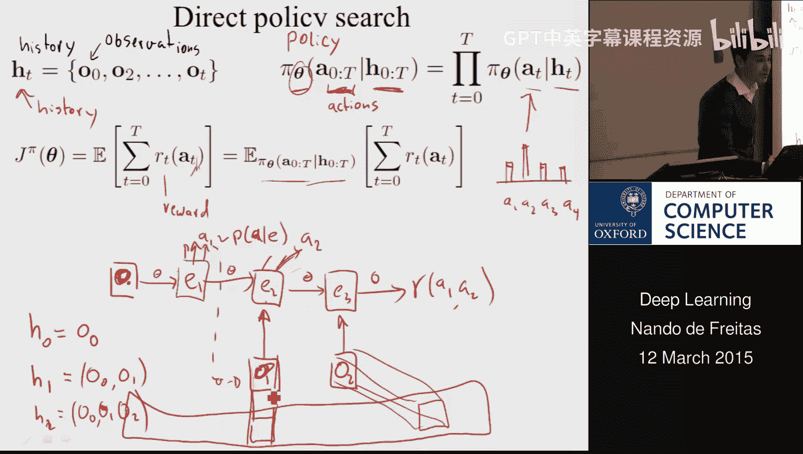

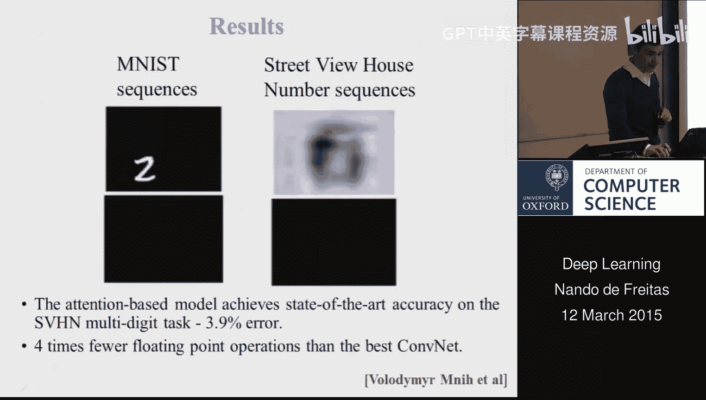

好的，一般来说，设置是你有某种初始信号。无论那个信号是什么。你计算一些嵌入，让我们用 E 表示嵌入，从嵌入中你将选择一个动作。你输出动作的方式可能是先输出一个 softmax，给出给定 E 的 a 的概率。就像你可能有一个有三个输出的神经网络，如果你有三个动作，然后你计算，比如 0.2, 0.8 和 0 作为你的三个输出，然后你根据那个分布采样以从那个分布中选择一个动作。那个 a1。然后确定性地选择一个观察，再次，想象一个非常大的数据库。这个观察是从这个数据库中提取的，所以你拉取这个观察。然后你把它输入到 RNN 的下一个嵌入层。然后你做所有这些，再次，你采样 a2。A2 然后决定如何从世界中获取下一个信息位。那个信息位进入你的 E3，也许从 E3 中，你得到一个奖励信号。这是所有动作的旧奖励之和的函数，或者在这个例子中，只是序列 a1 a2 的奖励。现在奖励出现的方式有很多种，奖励可能只在最后出现，你可能在每个步骤也有奖励，所以这有很多变体，取决于问题，你如何精确地制定奖励。

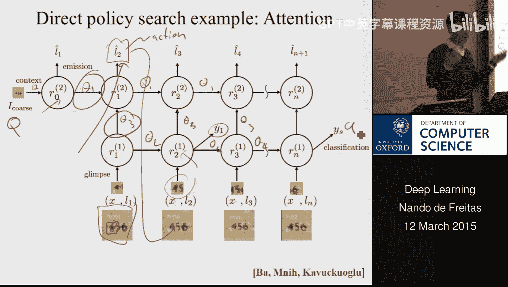

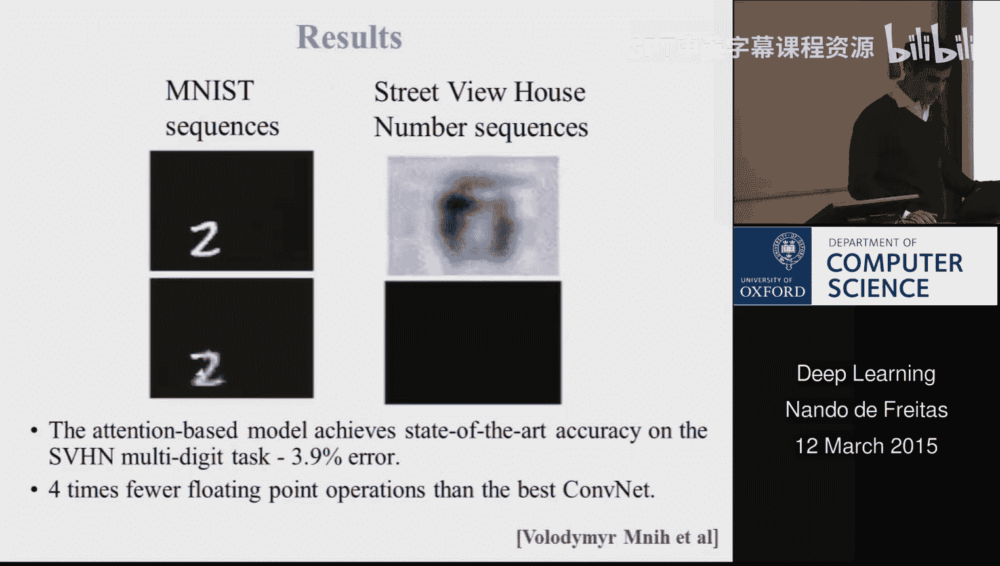

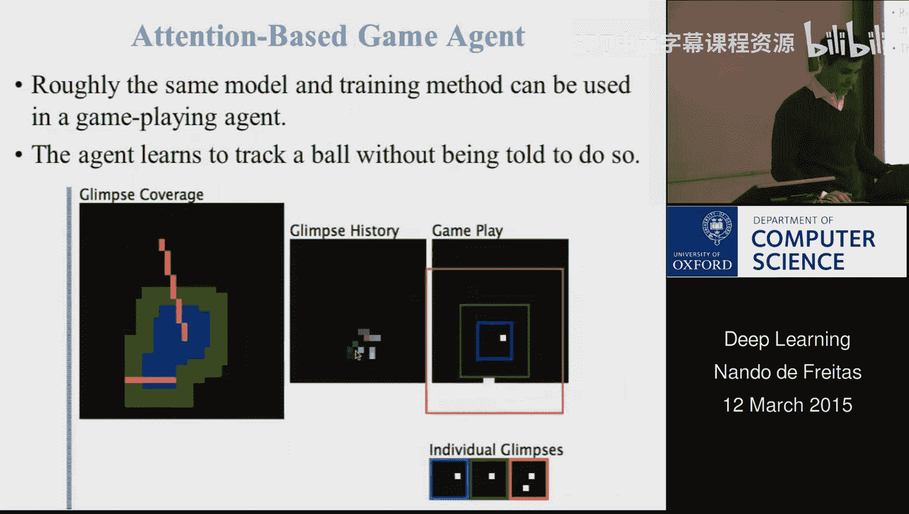

好的，所以本质上。策略是映射所有这些 H 的东西。所以你有这个初始观察，如果我们实际使用那个符号，然后我们得到这个观察一和观察二，所以你可以把第一个历史想象成只是第一个观察。第二个历史是下一个。然后现在 H3 将是，抱歉，H2 将是观察零，观察一，观察二。好的，所以设置是你的历史随着你抓取越来越多的这些观察而增长，每次你抓取一个新的观察，你把它输入到 RNN 的隐藏层，所以你使用先前的信号和新的测量来计算，然后你输出动作，你继续这样做。你可能在那个步骤立即得到奖励，或者你可能没有得到奖励，稍后才得到，这取决于应用。

我正在推导关于海滩酒吧的 s。第二个。我设置微是。哦，好的，现在我们需要学习，所以所有这些，这绝对是一个神经网络，但所有这些链接，它们是参数。因为它是一个 RNN，所以 RNN 有参数，我称那些参数为 theta，所以你可以把这想象成本质上是一个函数，它以 o 作为输入，产生 A 作为输出，所以它本质上是这个。它以历史作为输入，产生动作作为输出，并且有一些参数 theta。所以在这个例子中，我用循环神经网络实现策略。它不一定是一个循环网络，我本可以使用卷积网络，我本可以使用逻辑回归，或者我们在这门课程中学到的任何其他神经网络来实现策略，但假设我们这样做。所以为了决定采取哪个动作，我基本上需要学习 theta。好的，所以所有这些，每个时间步的这些家伙本质上是一个策略，基本上你可以把这想象成一个离散分布，比如超过四个动作。我需要学习网络的参数，因为由 softmax 分布给出的这些量的高度将取决于神经网络参数。这听起来还不清楚。让我们说图像雕像的比例作为你的观察。好的，所以动作是位置。所以让我澄清一下，也许用这张图片，所以这里的动作是我要看的位置，我有一个预定义的大小，实际上这里他们使用这种 foveation 模型，中间分辨率较高，边缘分辨率较低。一旦我选择 L2，L2 指示在图像中去哪里抓取数据。所以为了提出 L2，我需要知道这些参数。如果我知道参数，那么我将决定那个，知道神经网络的参数，知道先前的输入，决定下一个输出应该是什么。这给了我下一个 L，我继续前进。我唯一提到的是输出实际上是一个策略，你有很多动作，所以就像你做分类时一样，你只输出每个类的概率，然后在那个阶段你可能做的一件事是你只是从那个离散分布中采样一个动作，那就是你接下来要采取的动作。你也可以取那个分布的最大值。所以这就是设置，所以现在把这个大图像想象成一个大数据库，你所做的只是获取信息片段。如果你想为记忆网络做这个，以不那么贪婪，你会去，你会在这个大数据库中存储故事中的所有事实。然后你的动作将是去检索哪个事实，以便在给定某个问题的情况下回答，所以这将是一个问题，然后你试图输出一个答案，你只是挑选不同的事实。例如，如果问题是美国哪个州在投票给奥巴马的州中拥有最高的山峰，你需要知道两个事实，你需要弄清楚美国最高的山是什么，但你也需要知道哪些州投票给了奥巴马，你需要进行两次查询才能回答。所以希望这个网络能学会去挑选哪些事实以产生答案。事实上，这就是它在图像上所做的，学会看哪里，抓取什么信息，然后输出一个答案，在这个例子中是 4, 5, 6。这本质上是它所做的。

所以现在这个设置中唯一缺少的是我们需要一个加载参数的机制。当我们有奖励时，我们如何学习参数？奖励可能只在最后发生，奖励非常延迟，但不是在每个步骤都发生。但我们确实有一个目标，我们的目标是最大化这个奖励的期望，或者我们通常称之为遵循策略 pi 时的期望回报。如果我们最大化 theta 的期望回报，我们就完成了。这就是直接策略搜索。在直接策略搜索中，我们制定一个奖励，它可能是一个由许多奖励组成的奖励。实际上，你可以用不同的方式组合它，不仅仅是求和，求和是典型情况，对于动态规划，下一节课将必须使用这些和，但对于这个设置，它可能是其他一些时髦的组合奖励的方式。如果你这样做，那么本质上你所要做的就是提出这个策略，一旦你知道策略，一旦你有了策略，你就知道如何在世界中行动。所以你不是一个反应式智能体，你不是在我遇到的每个状态中挑选一个动作，所以你总是通过挑选一个动作来对环境做出反应，而是你学习这个函数，告诉你如何基于对环境的观察选择哪个动作，你学习一个如何在世界中行动的策略，你学习一个策略，我们将直接学习它，因为我们将优化期望回报。我们本质上将做的是计算这个的导数，并遵循梯度，这将给我们策略。所以剩下的在某种程度上是机械的。这将处理它，是的，因为我们已经参数化了策略，所以我们现在在所有可能的动作轨迹上取期望，所以我们不只是贪婪。但我们真的试图找出哪些是最有利可图的动作序列，所以当你得到奖励时，你实际上会理解序列的哪一部分，哪种序列是有用的。这将成为问题。你需要对你的所有动作进行期望，所以现在你可以想象问题是什么，如果你的动作是二元的，并且有 10 个决策步骤，那么你在求和中有 2 的 10 次方项。然后我上去。有反。很好的问题。答案是，在某些情况下，你确实知道奖励函数是什么。但在这种情况下，你不知道。请耐心听我讲一页幻灯片，我会回到你的问题。我将在世界中行动，我将得到奖励。所以我不需要知道它是什么，我只是做某事，然后根据我所做的，奖励会出现。当我们推导出算法时，这将变得清晰。好的，让我们看看如何计算梯度，所以计算导数的困难在于，我们只需要取这个的导数，我们可以重写这个，这本质上是对所有可能的 A 的求和，a 从 a0 a1 a2 开始，所以我们考虑所有可能的历史，所有可能的 A。它是奖励的总和，关于历史的分布，关于这个策略。是的，我只是在写，我现在只是在展开期望。所以困难在于，如果我有 10 个动作，一千个步骤，我需要做求和，那么我就完成了，那么我无法进行 10 的 1000 次方次计算。

好的。这是我们要做的。所以我们要做的第一件事是，我想取这个关于 Theta 的梯度。所以我想计算关于 theta 的这个量的梯度。因为奖励在这个设置中不依赖于 theta，我可以把这个家伙移进去，我只需要对 pi 取导数。好的，根据线性等等。所以为了计算成本的导数，我计算导数，因为一旦我有了导数，你们都是优化专家，你可以运行贪婪的随机梯度下降，你可以做牛顿法，一旦你有了导数，你几乎就完成了。让我们看看第一个导数。所以它会是这个家伙。现在这个的困难在于，你仍然有动作的和，我们能简化这个吗？所以我们可以做的第一件事是，它会变得明显为什么这是一个巧妙的技巧，这里我们有一个分布的导数。因为这是一个非常大的和，我将不得不提出一些对这个和的近似，我将使用的特定近似是采样，我基本上将在世界中行动，看看会发生什么，我将在世界中模拟轨迹。这现在也应该回答你的问题，所以我将模拟世界中的轨迹，当我行动时，我将得到奖励。所以在某种意义上，我不需要奖励函数。但这里的困难是，当我有分布的导数时，我不知道如何应用采样，只知道如何从分布中采样，而不是导数。但有一个非常巧妙的技巧，那就是 y 的对数的导数是 y' 除以 y，这本质上是我在这里使用的，对数的导数。所以你知道，所以这个好老的技巧 log(y)' 等于 y' 除以 y，如果你解，换句话说，y' 等于 y 乘以对数的导数，这就是我在这里做的，y 乘以对数的导数。现在我有一个可以从中抽取样本的分布，所以我可以从这个分布中采样，并且可以近似求和。我要做的另一个技巧是，这里我有这个分布的对数，它覆盖了 a0 到 T。但 a0 到 t 的概率分解为概率的乘积，所以如果我有一个乘积，并且取乘积的对数，我得到对数的和，所以我把它写成每个单独动作的对数的和。我要做另一个简化。那就是，与其有一个从零到 t 的奖励索引，我只从时间 T 到未来。所以想法是，未来的动作不会影响过去的奖励，你已经得到了那些奖励，所以下一个动作只会影响我未来的表现，所以你只需要看未来的奖励。这些就是我们做的所有简化。所以总结基本上是这表达式，这个表达式涉及奖励，涉及整个策略，并涉及每个时间步的策略的导数，这本质上只是这个循环网络的输出。所以我们知道如何计算这些，这只是通过反向传播，就像我们对 RNN 做反向传播一样，这只是通过反向传播三个时间。现在的技巧是我们采样一个轨迹。我所说的采样一个轨迹，实际上是你模拟循环网络。你观察一个图像，采取一个动作。你抓取一些数据，采取另一个动作，你抓取一些数据，采取另一个动作，你抓取一些数据，所以基本上使用你当前的参数设置，所以神经网络在时间步 T 的参数设置为某个值，我使用这个神经网络来选择动作。然后我得到一个性能度量，我得到一个错误，我分类数字有多好，我是否得到了正确的数字，是或否，基于那个性能度量，我把它插在这里。那将给我一个新版本的梯度。所以特别是，如果我从这个分布中抽取样本，那么蒙特卡洛估计只涉及我沿着轨迹累积的奖励。以及我通过反向传播计算的导数，然后这些是我的样本，我假设我抽取了 n 个样本，所以我尝试了 n 次。所以这几乎就完成了。所以那些通过读取数字比卷积网络做得更好的循环网络，正是使用这个算法。但你可以用这个做许多其他事情，所以你可以用这个来驾驶飞机或直升机。事实上，几年前有一个非常令人印象深刻的 Peter Bill 的名字，他们让直升机倒飞等等，他们使用的正是这个模型，正是这个方程，正是这个方程。然而，这个问题之一是，它的方差非常高。所以人们实际上把大部分精力都花在了提出这个梯度的低方差估计上，部分原因是你在处理分布的导数，它们看起来像这样，有一个正的部分，一个负的部分，通常当你使用样本来近似时，你可能有一些正样本，一些负样本抵消它们，所以当你试图计算导数时，有很多样本浪费。所以人们提出了一类非常大的近似方法来改进这一点，其中一个非常有用的技巧是，不是使用分布，而是试图将分布分解为确定性部分和随机部分，然后你只模拟噪声，然后你通过确定性部分反向传播，这就是 Carol 用他的变分自编码器所做的，同样的技巧在控制中可能有用，所以我以前和 Mat Hoffman 写过一篇论文。因为现在这些天，他是剑桥 Thevenaard Manies 小组的博士后，他一直在做很多工作，使用这些技巧来减少方差。进入他们技巧的小组是叫做公共随机数的方法，这导致了一个他们称之为 Pegasus 的算法，所以那里的想法很简单，你为模拟设置一个随机种子。如果你想比较谁是最好的放风筝的人，布莱顿的人还是牛津的人，这将非常困难，因为他们处于不同的随机环境中，两个设置中有不同的风况，所以公平比较他们的唯一方法是如果他们有相同的随机条件，所以当你比较两个特征时，确保你冻结随机种子。所以还有更多技巧，事实上关于策略梯度有大量文献，但这应该让你了解它们是如何工作的。使用 Torch，Torch 将给出循环网络的导数，所以你可以很容易地去实现这个。并做 DeepMind 的人所做的。好的，所以在下一节课中，我们将进入神经动态规划的其他方法，所以在五分钟内。

## 总结

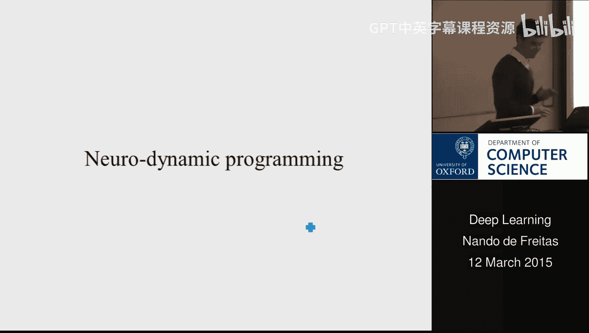

本节课中我们一起学习了深度强化学习的基础，特别是策略搜索方法。我们从强化学习的基本设置开始，介绍了智能体、环境、动作、奖励和策略等核心概念。我们详细推导了策略梯度算法，展示了如何通过采样轨迹并计算梯度来优化策略参数，以最大化期望回报。我们还讨论了该方法的优缺点，例如高方差问题，并简要提及了一些改进技巧。