# 牛津大学《深度学习｜Deep learning 2015》中英字幕（Claude-4-s） p01 1_ Introduction.zh_en -BV17NWWz6ErN_p1-

Let's start with our introduction as to why we do machine learning and we've seen a lot of the reasons for doing machine learning in the previous class。

 these are my reasons and I'm going to start by。An introduction to machine learning with an introduction to。

How we do things。How humans do perception so I know if you have seen this and if you have seen this。

 please。And those spoil it for the rest so I'm showing you here two images and I'm between these two images and there's a difference between these two images so the first question is who has seen this video before。

 I think a great many of you okay for the other half of the class can you tell the difference between the two images。

So who sees the difference？That you hadn't seen it before， who doesn't see the difference。

 and this is not an IQ test。嗯。Let me tell you that the difference is something that's very important。

 it's a lot of pixels and it also an object that is essential for aeroplanes to fly and it usually goes under wings if you haven't yet seen it the wing I should update these videos。

 there's many more similar videos this phenomenon is called change blindness。

 it's a term that was coined by brand Ransick。

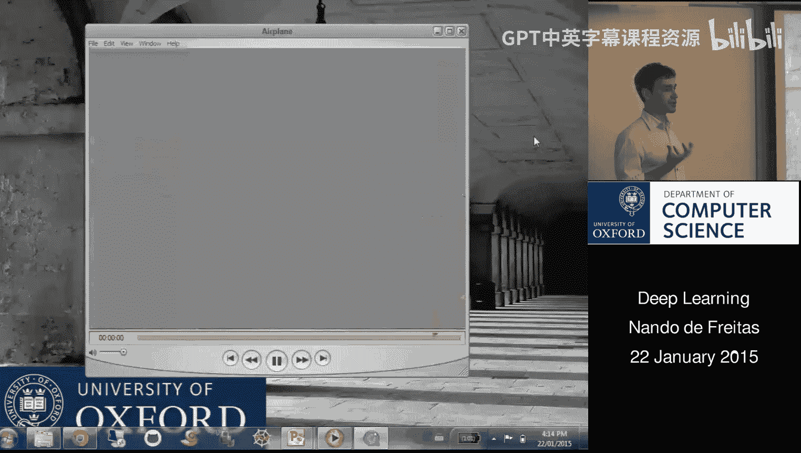

ACouple， I think decades now。And if you think。If you think， okay， that was just a trick。

And once I can tell what's missing， I will always see it like if I play this video again I'm not going to fool you now I'm going to play a video that some of you have already seen and you will still not be able to see most of the content in this video so。

Here is a video that I got from MIT， I'm going to ask you to follow the instructions at the top。Okay。

 so。Let's start with those of you who haven't seen this video before， what changed？

这The building something经过堆个。The building this time on the rights， where those with just。

 it wasn't there。Ply。Okay， the sign。It was bar side in the middle。There was a barstein。

 I never noticed that I learned every year。Yeah， the color of the door。

 the color of the door changed， who saw the color of the door changing？

Who didn't see the color of the door changing？If did change。And， in fact。This whole building。

There is now sort of pinkcake salmon， that was a different building before it was a brick building。

 this always different， you you could have been suspicious that this sort of fence is broken here。

Okay， so I mean， this doesn't seem very sick， put a door up there and then cut the rough iron so that someone could jump on So even if you know sort of common sense would have told you something's wrong with the scene So before there were windows up here and this wasn't broken there was a sign there were people here more people have appeared some people have disappeared。

 the scene has changed dramatically in front of your eyes。

And none of you was able to see all the changes。That this is the original image。

 so as you can see there were people here there were less people here， the door changed。

 there were windows， there was a sign， it was a complete brick building。

 so most of this image actually changed。And you are not able to perceive those changes。

A lot of people don't believe this。When they see this， I'm just going to play this one more time。呃。

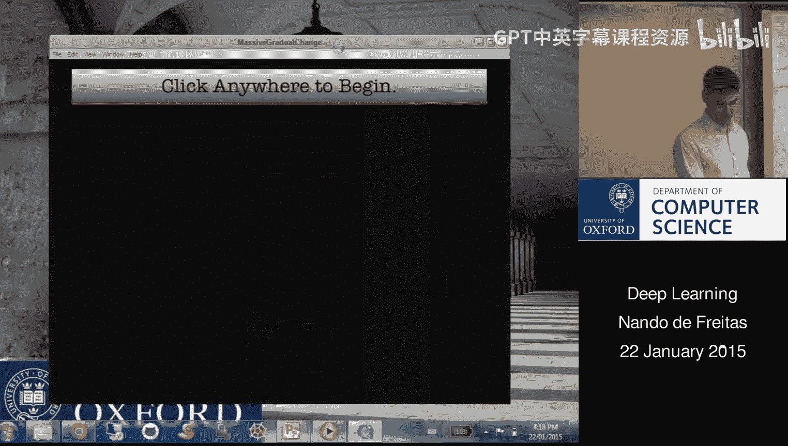

And this time you'll probably， if you focus attention in one particular area of the image。

 you might be able to see some of these things changing。

The price to pay for focusing attention and seeing that one thing changing is you will not see the rest changing。

And this seems crazy， right， because you're looking at this image。

 how many of you believe that what you see in the world is there？Okay， this is like。

 you believe you're seeing it， but you're not seeing it。

Okay you're secing this image and your at higher resolution is something of the size of your thumbnail and you're going about three times a second and that's what's going into your brain there' three images。

 vision is temporal temporal process， you have limited memory in the official buffer so you can't store too much。

 you can't store this whole information。And so on， vision is an extremely complex process that。

We don't understand。When we've made incredible progresses， I'll soon show you。

 but we still don't fully understand it。And so and learning is a big part of vision， as I will argue。

 and also in the rest of this introductory lecture。

But if we cannot introspect into the world of how we learn to see things。

There is no hope that we could have a program， a vision system。

It's just we completely enabled to introspect one of the biggest problems with artificial intelligence is everyone thinks they're an expert on it。

 no matter who you are， you are an expert on artificial intelligence because you know how you think。

 you know how you see， you know how you hear things， you know how you make decisions。

 it turns out that all of those things are false。We get fooled。

F our own minds all the time and it's part of survival。

That puts us in up quandary because we want to build intelligent systems。

 but it's very hard to build intelligent systems when we don' not good introspection。

So that's one reason for why we need something different other than just introspection to go about solving this。

Here's another reason。Suppose you want to recognize you are。

Do any of you have any trouble recognizing that that creature climbing the tree is a giraffe？

As ridiculous as that。I don't think anyone has any issue with recognizing that or that the big lobby one is also giraffe。

 the one that twisted and things that are completely possible in the world are still giraffe。嗯。

Trying to build machines that are capable of understanding all these imvariances in the world and trying to code this and you would sort of give up on coding。

So coding is not the way to go the machine learning way to go is if you want to， for example。

 understand what a face is and you want to be able to look at an image and say that's a face。

Just like you would say that's a you off， you want to off say that that's a face。

It's not to try to call what a face is and people have attempted this I remember like about decade or so 15 years ago I was doing some consulting in Japan and there was a system that was working really well。

 you could sit in the driver's seat and would quickly detect your face and so the idea is you would know exactly where you're looking and be able to tell whether you were driving attentively or not。

嗯。And it was working really well for them until a friend of mine of Scottish descent sat and it completely failed。

And we're trying to understand why doesn't the system work until we realize it's being tested in Japan。

 everyone has dark eyebrows， what this thing has learned to do is detect dark eyebrows or images。

And it worked with me， it didn't work with my friend and this is the problem when you tried to call these systems。

 there's always this sort of rare， little rare advance for you。

The machine learning way is collect a lot of images of faces， label them as faces。

 collect a bunch of images that are on faces that may or may not be necessary， as we'll see later。

And Bola， that's how these devices exist。 We all take them for granted。

 Everyone has a face detector an image。 It's kind of funny that in computer。

 folks decided to put this box around it。This first came up。

In the truth classes with a paper on boosting， which some of you saw last term and now I see that even the TV ads have this box around is people just expect this to be a normal thing that a machine should do another thing about intelligence once you figure it out is no longer intelligent at its office。

And you can do this with any object， like for example， pedestrians。And if you do pedestrians。

 you can sort of do the sort of thing automatic driving cars automatic driving cars will be soon part of our reality I hope we manage to deal with all the legal issues and economic issues to make that a reality currently in the world1。

2 million people die every year in car accidents and don't you think that because you don't drive you're okay turns out most of those people at pedestrians。

It's part。Over a million people are dying every year and we don't do anything about it and we could just fix it by make every car the automatic self-driving car。

 so when people talking about the dangerous path， AI and so on。

 the dangers of building AI number one by not having self-dring cars we are killing a million people every year。

We shouldn't let that happen。And so I think that by itself is good enough reason to take this course and to make good vision systems。

 good systems available to the world。And of course they're also great for entertainment。

 you can use the same technology to track hockey players， me being Canadian， have to champion hockey。

And once you know where hockey players are， you can sort of design strategies。

 you know exactly what each player was at each part of the game。

You can improve entertainment systems and so on， you can automatically generate games of teams that play like the real Vancouver Ks or in soccer pars。

 football parls that play like the real man Uniteded。嗯。Recently， there been some emphasis classes on。

Doing the data processing with neural networks， which were models that were very popular。

 they have been popular within the 80s and then went out of favor and that have recently come back and become very popular。

And not only popular， but actually successful， successful to the point。

That companies are investing millions， if not billions of dollars right now on these technologies。当。

And a lot of them were inspired by neuroscience。And it really this pressure comes from York time but it also comes from statistics from optimization and mathematics。

 great advances in computer science， and none of this would have been possible if we hadn't invented without you know all the inventions in Harvard that we've made over the last few decades。

 GPUs central to all this， being able to do distributed computing in the new Harvard platform。

Is essential being able to store， being able to store videos。

 we take it for granted when I was talking my PhD， which I ended up in 2000。

 you know you only have six images that you could play with in your computer。呃。

It seems like a joke that this wasn't that long ago but the way we interact with computers and data has really changed dramatically。

 we're very likely to have lived through in this stage in the world。In terms of neuroscience。

 there's been some interesting findings， we have neuroscientists here。

 so I'm not going to embarras myself too much by spending time in this。

 but you know the basic idea here is that the brains machine， its a biological machine。

 I'm not going to go to the metaphysical aspect of it I'm going to take a very practical view of it that if anything if I have recollection of anything that happens in the world is because some cell is firing or cell fire。

And so in particular there are cells that will fire depending on where your position in the world。

 as shown by the diagramogram here， there's place cells that will fire depending on where a rat is。

 and if you actually take， I guess you do these experiments with your rats， if you put not you。

 but folks put wires on rats。And then able to measure it。

 you know you'll see that there's some cells that will fire depending on where you are in the world。

 this is how you know where you are and in fact you also build maps of the world。

And these masks reside in your brain， and they're all based on the firing after no neurons and very recently this year。

The scientists received a Nobel Pri for some of this work。

 actually looking at these sort of cells at these grid cells。

An internal cortex that allow you to actually get a map of the world。Mo interesting。

 what really drove a lot of the models that exist today and that I will describe was an experiment by chance。

By Huber and Fasel several decades ago where they had a cat looking at and you can you this Hoberland Viasel cat and you'll see the actual cat。

嗯。And the light， some of those videos are not for people who love cats。

But you'll see a beam of light here and then what they realized that when the light is in a particular orientation or moving in a particular orientation。

 there's these cells the experiment is far more complex and there's simple cells a complex cells and so on。

 but let's suffice it to say that when the bar is moving in a particular orientation as shown in this diagram。

 the neuron fis， out of us the neuron doesn't fight and these are neurons that are measuring are here at the back of your head。

 the first neurons of the visual cortex v1， and so basic what this is saying is that the neurons at that stage they're coding all the different angles of things in the world。

 coding for edges， changes in intensity and so on。And if you take a little bit of cortex。

 that's pretty much how they would be placed and they would be coding for different angles。

And we know this is learned because you can take a cat and make it live in a world where there's only hurt lives and then this cat will not develop receptors to horizontal lines。

 or I think how do you keep this cat standing all the time a different I found this picture and I'm not quite sure how they do that but one that is much more plausible is you cover one eye of the cat because the optic nerve process and project the different parts of V1 in one side of the cortex you that I will develop detectors in the other part of the cortex not and I think folks have done this experiment so the important lesson here the important outcome is a lot of vision is learned。

So the learning mechanism is quite。啊。And so that's the idea。

 so the idea is you sense a small part of your image， you sec to a part of your image。

 this is basically one of the sats， I mean it' not round， it's not square， it's round。

 but I've just drawn it here as square。And then the idea is that you have many neurons。

 in this case we have four neurons， each of these neurons is basically from each pixel in this image。

 there is a line that goes to each of the neurons。And so if you look at each line。

And since there is one line from each pixel， the lines themselves form a grid。

 so if you were to cut at the lines and you look at the value of these lines。

 the sort of the amount of shall we say， conductance that's allowed through these lines。

 you would get an image that looks like this。And what that means is each of these four cells corresponds to one of these four images。

 the cell， let's say this cell here， the leftmost red cell is the top one。

 so that means that that cell will fire every time the image that it looks at has a difference between white and black in other words。

 an H。 So if you if you look at an h an H usually has one type of color and then think of it as black and white you would have。

Something that changes。In intensity。 So white being a very intense part of light， black。

 low part of light。 The second neuro is detect something that's more sort of。嗯。Cornerish。

 the third one is detecting two vertical bars。 and the other one is looking at a color filter。

 We call these filters as well so。These neurons at the lowest level are just detecting little changes in the world。

 little brush strokes， if you will， but you know the power of brush strokes with brush strokes you can compose many paintings。

 just go to the National Gallery， convince yourself。啊。

People have trained and well one of the things we will learn about this course is how to train covolutional neural networks and the idea of a covolutional neural network is something that's not necessarily entirelybily possible。

 but is's very much inspired in terms of its training。

 but the architecture is very much inspired by Hu and Visel。

 the idea being that you have these filters the small images that will detect edges in a particular part of the image like it might detect this inclined edge here between the house and the sky。

 and then that's the first layer of neurons， then it goes to a second layer of neurons sort of complex cells。

And the first layer they tend to be make sure that they're sort of like and operations and the next layer they like or operations。

 and this is sort of what we find also in our study in the studies of Google and Vis of simples complex cells or is sort of invariant so things could move a little bit and you would still be able to see the same thing because vision has to be invariant。

If the light changes a little bit， I still have to recognize you being the same people weren here five seconds ago。

At the same time I need to be selective， I still have to recognize that it's the same person that's there。

 and these architectures have several layers。呃。And people nowadays build them with 20 layers or so those are the latest in terms of object recognition performance these models are state of the A Object recognition。

 so there's these competitions for object recognition and about two years ago。

 Alice Keski and his teammates from the University of Toronto。

 they entered a computer visionion Conference and they completely completely trashed everything that the computer visionion field had ever developed until that point。

Their performance was so much better and their system was completely trained and the only sort of prior knowledge that they built into it is essentially the prior knowledge that goes into building this architecture it's called a Coition neural Network Yla Kun has championed this for a long time。

 Yli Kun heads AI now at Facebook a lot of this work is also based on something called the Neocogni which was Jan told me that he's actually looked at Neocogniture and the paperspers in。

Yeah。5。嗯。And having talked to Fukushima who is the creator of the Neocornrant。

 he told me when he was working in Japan， he was very much inspired by the experiments of Hubble and diesel。

 so there's definitely the dream has come from neuroscience and it allowed people to realize it was feasible and it led people to design his architectures。

Now， in the previous image， I show you the filters for when you look at images。

 if you go deeper in these models， so in the first layer。

When you take essentially what you do is you take a bunch of images and you take labels for image。

 so just like we did for faces there's a face you will take images like this is a cat。

 this is a camel， this is a bike， this is a house， and that's essentially the data that this competition provides you with。

And when people train these models in the first layer， they learn the filters that are shown here。

 so vertical bars， so this is very similar to what we had before。

 but in the second layer you start looking at things that look like。

More interesting compositions like ages， vertical things。What these guys。

 Matthew Zeieer and Rob Fergus， Rob Fergus is at Facebook， Matthew Zeer has his own company。

 he won the big competition last year， this year the competition was won by Oxford。

By Karen Simonimmanian。And Andrea Ssman， who are here in information engineering。

 Karen is now working at Google Delined with me。And so they looked at what are the images that are most similar to。

TheThe images to these filters which are what each cell responds to so a neuron will fire when it sees these different circles。

 so each of these images correspond to one neurons that were automatically learned and so these are the type of images image patches that would match those neurons。

If you go higher up。Oops， sorry。You start seeing。Near one that fire for particular textures。

 like you start getting this type of path。Patterns and eventually you start getting dog neurons。

 so neurons that fire for particular types of dogs and neurons that fire for birds， parts of birds。

 as you can see here， bird legs， and dogs and so on。This again。

 in neuroscience they're called grandmother cells and IT。And so it's being well known， I mean。

 there's like there's just they called the Jennifer Anison cell that if you show pictures of Jennifer Anison。

Does the cell with fire。All this experiment was supervised and supervised in the sense that the way the data was present。

 I will make this more well find this more clear because progresses when we go into the details but the idea is you had a teacher telling what the output should be if the image was azebra then the output should be the wordzebra so we should be able to produce zero of course throughout life we don't get supervision at that level and we still managed to learn all this automatically so a lot of the learning happens in an unsupervised manner or by trial in error is something。

Something that we model with reinforcement learning， which I will cover at the end of the course。嗯。

And in unsupervised learning， there is no teaching。

So Google a few years ago this experiment where they took some models by Apple Kiva and of the University of Finland。

 and they just made many models with many layers of that sort of basic model and they added the same operations of the polling。

 coalitions of polling that were common in the conves。And they were able to。

Just by making this network watch YouTube too。So it takes YouTube in and it tries to generate YouTube so that's the basic idea of reconstruction and that's a great principle for learning and that's the most important thing about learning if I close my eyes and I'm trying to simulate what I think I'm going to see in front of me when I open my eyes and I'm imagining an African savannah full of lions then I have to learn。

Right because what I'm seeing and what's coming from my mind don't agree， and so I need to adapt。

So simulation is very important to learning。😊，And in fact。

 a lot of learning will see us just different ways of doing this， if you can hallucinate well。

 you can learn。And so what they do is by doing this， and this is by the way。

 also very much tied with things like schizophrenia and so on。

 so this learning these mechanisms coming up with computational theories of these models will hopefully guide neuroscientists to probe the brain and hopefully design better drugs eventually to help people with mental disorders。

嗯。So what Google did is they actually were able to learn neurons that were actually detecting faces and cats。

Because that's what you find in YouTube。And this was in the New York Times from Page and so this was very popular at the time when it came out。

 we're going to go over this model in this course， it's actually an easy model。

All the things that people use now， so all the image search that you use and it's whether you use Bing or whether you use Google or the thing that says detects that labels your face in Facebook。

 the device that is able to tell what clothes you're wearing。

 when you take a picture and put it anywhere online， that's all a continent。

So every company now is using this technology to basically know what's in a picture。

So it's very much part of all these companies， all these technologies improve image search。

 video your search it hasn't quite hit video， there's still big issues of scaling。

 but eventually it will get there and also speech recognition because when you learn there's no we don't separate images from video or DNA or audio。

 it's all data， it's all the same signal， as long as we can extract the features from signals。

We're able to apply these techniques and why does it work at a very high level think about it the optical nerve is probably has about a million fibers so let's say that you get an image that's。

A million1 thousand00 by100 pixel image going into your head。So very rough calculation。

 it could be off by an order of magnitude so， but it doesn't matter。

Now if that image was black and white， you have two to the 1 million possible images that could go into your head。

 but that's more than what scientists speculate is the number of atoms in the universe so if you wanted to do computation and represent all possible images in the world our brains would not fit in the universe when you do these very rough calculations and so that must point out that there's something else and my speculation here is that the world is actually very。

Very commonplace in the sense that there's a lot of structure in the world。

 there's a lot of continuity。 You don't expect if I'm seeing a bit of white。

 I expect that bike to prolong。same was sound I if I'm hearing sound at a certain page。

 I expect that in the next microsecond it will still be at that page， things don't change abruptly。

 I'm not seeing salt and pepper images in the world but I see very regular images and then what we're extracting。

And in fact， with these models is the statistics of the images， the statistics of the sounds。

 the statistics of the data， what are the common compositional patterns in the world that if we knew those compositional patterns。

 we could synthesize any video or we could synthesize any sound， we could synthesize the universe。

Here's another application that's very common language。

 language is also very regular most of the time the conversation in here at the coffee shop is sort of dejahu because you've heard it before because people who say the same things all the time they use the same expressions。

 occasionally there's a beautiful difference and of course there's a lot more to intelligence。

 but there's a lot of regularity so you can also exploit。

 there's certain passions and language to exploit you know sort of verbs coming up mountains and English and so on。

So these models are also analyzing text they're able to， for example。

 predict whether a sentence is being positive or negative。

 so if you launch a product in the market you want to know how much people like that product and now there's automatic ways of doing that and so this is big because there's a lot of products who value。

 you can only ascertain once you have consumed things like movies you can only know the value how much open I like a movie after you watch it the same with。

I know lots of things like in this case I found this cool one， it's from Tripadvisor， it's a psyk。

 so you only know how good a psychic is once you try to psychic。This one's not very good， it seems。

And right now the push for these models and some of the companies is to give you an idea。

 and I think there's a push at all companies， even though I put Facebook here。

 but it there something that Apple Siri would be very interested， you exist in a social network。

 you imagine you're in Facebook you see an image， you click on that image and you talk to your computer and you say。

Who might want to watch this with Siri， who do you think is going to want to watch this movie with me on Friday and you would like the Siri or the Google now or the Facebook to tell you your best bet is Phil because he likes。

当00年。So there's a lot of push now for making these machines of multi model。

 combining different types of data， just like animals combine different modalities。

A lot of the recent push has been for models that also have state in them that have memory。

 and so up to now we've talked about this sort of one shot in time where you see an image you say what's in the image。

 but some things involve memory， I mean memory is essential。

 we can't just erase our memories and expect to continue well tomorrow。

And so right now we're building networks that have memory over a time。

 were going that's going to be part of the course as well。

 we're going to go over them and one of those nice things you can do is you give it a sequence as input and the models learn to predict the temporal sequence and in between these boxes there will be networks that have memory。

And so we're going to learn how to implement these memories and how to maintain things over time。

And what people use these for these days， like Ias Sotzskiver is he takess。Something in one language。

 English， he output something in different language， Japanese， in other words it translates。

So you basically if you take sentence as one language sentence another language you train one of these models and learns to translate and so there's a big push these models have actually been quite successful so there's a big push for doing translation with these models likewise if you take a sequence in one language you produce a sequence of words you produce a par of that sequence so you learn to automatically parse so for people who believe we' born with。

Pase structures in our head， I met with other this universal grammar argument。

 these models are seriously questioning whether that's true because。

That're showing that you can learn it。You can learn from。The other thing that they can do is， I mean。

 you can imagine all the things you could do could this could be a sequence of code and here comes out an execution of the code。

And as cr up might some， these machines actually able to do that right now。

 so you'll find on the web if you look at things like，Some of the work of Eli is doing exactly that。

 it's doing interpretation。

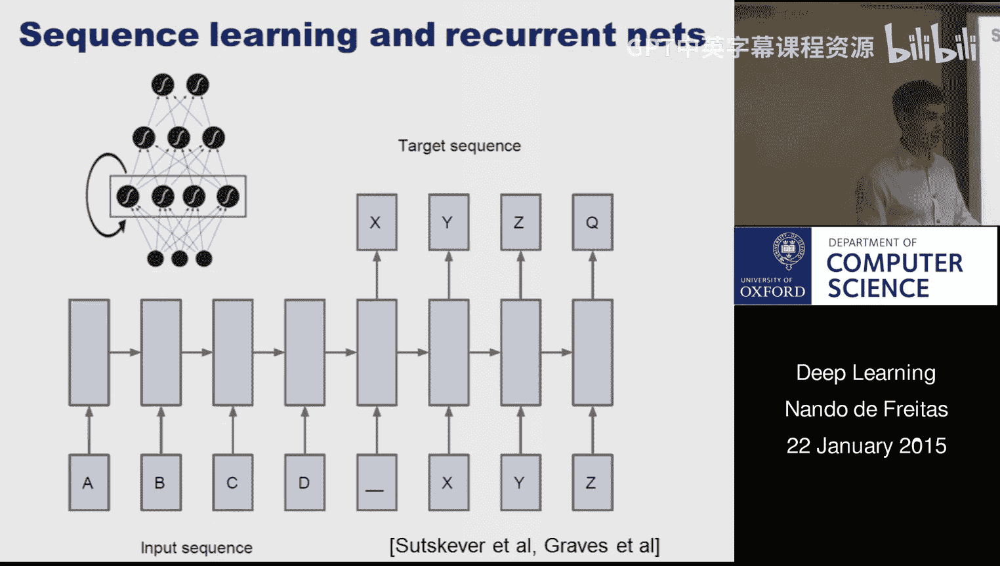

嗯。One of the projects Deep mind that。

That one of the guys that Bu has done a lot of work will get to see a lot more of his work。

 Alex Gves， he presented these slides recently at the conference where。

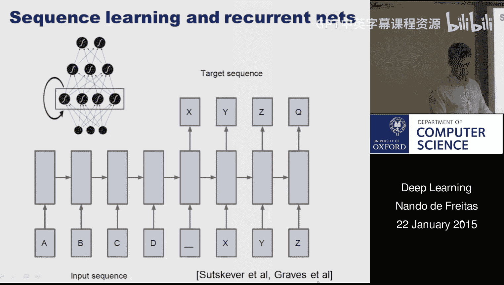

He was showing how some of his， unfortunately I don't have the video。

 but I'll try to play quickly if I get my hands on it。

 but some of his colleagues at Google Deep Minine wish were basically generating a full video and someone else from Montreal actually presented a video at NIPPS doing the sort of a different model at NIPps。

 a machine learning conference in December showing the same sort of thing。

 how for some simple things like these Atari games you can actually generate a video of what's going to happen in the future。

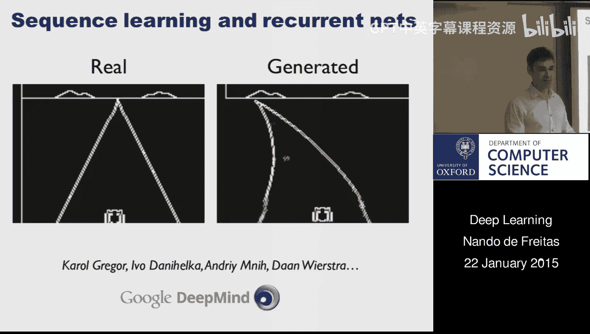

Because imagine if we can generate a video and it's like our brain。

 we have this huge black spot in front of our eyes because there's a blind spot because of the optic nerve and as I saw you with the illusions at the beginning。

 you're only seeing a few things and yet it feels like we're seeing this all because we have good generative models in our brain that are able to fill it in and make us feel that we're seeing this whole scene and so we're trying to build machines capable of doing that。

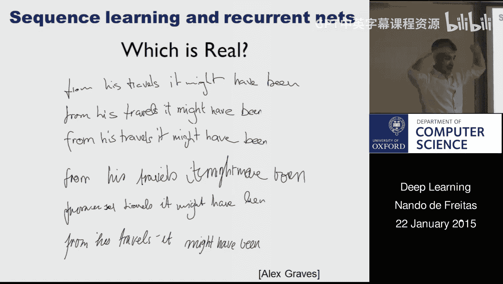

Because that is very useful for decision making if you can imagine what you're going to find someone else。

Then you can decide whether you want to go there or not。

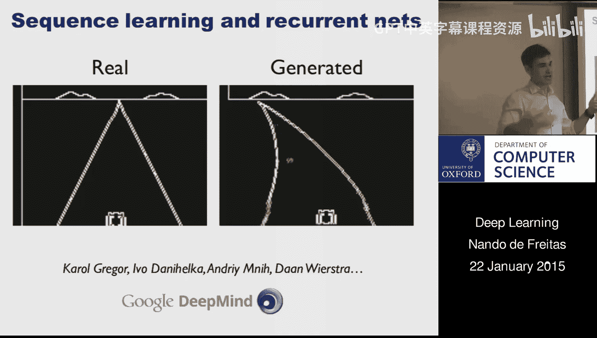

I have a slide with this that I stole from him。And。One of these， I believe， was written by a human。

And the other ones were written by his machine， by this neural network with time and memory in it you tell？

Which is human。I actually don't know which one was the human， but the point being that is so alike。

 so plausible that。That they sort of to start telling us for some of these task machines are performing incredibly well。

Phil Blesssom here in Oxford has also been doing a lot of good work on this for doing translation。

 for doing dialogue understanding， and you know you talk to a machine。

 the machine needs to understand whether you're complaining or asking to increase the order or。

Something like that。嗯。Another type of learning that's going to be very useful is learning that involves decisions。

 action， not so so far we've been talking about perceptions when you see the world。

 perhaps with the recurrenness where you have seccy a sequence output。

 you could already see that the secrecy could be speech and the output sequence could be actions。

 so you could build a game where you have a side gig。

And you could basically you could be playing a game and then you could be telling your sidek go。

 go around those guys， well I shoot these people and so on one of these games and you could in an agent by voice to perform sequences of actions and you could train it provided you can get to date。

嗯。We're going to see something called reinforcement learning that comes up with models of acting optimally in the world and there's been sort of great progress in that area by marrying essentially all the deep nets into these neural networks with reinforcement learning。

 we're also going to look at a bit of imitation learning。

 which is a big part of learning is' how we learn to imitate the creatures and as you can see monkeys imitate a lot of cur creatures too。

嗯。嗯。And these aren agents。Can you tell which one？Which one is human， which one is machine？

And here the chicken has to cross the road。On an American freeway。

 as you can tell by the duration of the traffic。And actually the game is called Freeway if it hits the car。

 it gets sent back， but it doesn't get penalized， it only gets points when it gets to the end。

And this is interesting because here the signal， the supervision is very delayed。

 the supervision only happens way in the future， you could be random walking。

And you're getting no supervision， I saw you when you get to the other side of the road。

 you get a point。And a lot of times when you， for example。

 playing in chess and you win and then you wonder what made me win with the sort of secret really important past。

 so that's a problem called C assignment or enforcement learning， we're going to look at it。诶。

Do any of you care which one is machine？I one them the rights as a machine？

Why because it's been more efficient it's getting more points。

 even though it started at the end I showed these videos for the first time that the CMU machine learning summer school and that was at the point in time parallel to my lecture there was the game of Germany。

 Brazil me remember that one So the joke was that on the right was Germany on the left with Brazil。😊。

And。far more efficient than scoring lots and actually for was even worse than this one。

Actually drinks the both machines。They're just two machines that learned to so I kind of trick you that So basically a lot of machine learnings about extracting good features from the world。

 I'm going to go for over another five minutes and I will take 10 minutes right I'm extracting good features from the world to solve predictive tasks decision tasks as well。

They're not just useful for AI as I've sort of championed this course as I' go in this course。

 but they're very useful for practical applications like finance anywhere where you need to do any forecasts and you want to do forecasts and you want to be able to also have good confidence bounce on your forecasts。

Missing data， so a lot of times you know that which movie someone likes。

 but you don't know if they would like some other movie and you would like to compute the probability that they will like that movie。

 so you want to fill in something that's also called imputation， filling in the missing information。

 detecting anomalies， that's a very important part so for security being able to detect something that you basically you learn a model of what's normal。

 and then whenever you detect something that's slightly different， you want to act。

So you could think of credit card。A fraud detection you could think of in terms of detecting a virus mutation if you're designing better drugs to combat HIV。

Classifying is a customer， should you approve a transaction for a customer or not， a lot of。

 this is now done with machines。Ba stretch that's problematic。OK拜。嗯。

rananking some problems like personalization the sort of things on the web that we used to summarizing。

 that's a big part you bomb there's a million reviews for this hotel。

 you don't read them all what you want is a summary and a lot of companies invest a lot of machine learning to provide you with that summary。

And ultimately robotics， I mean robots are getting better all the time。

 a lot of the Amazon factories use robots and the cars you could call the soft running cars that will hopefully join us very soon are robots and making these technologies into machines that can help us。

嗯。It's essential to make them a reality。But even in terms of making traditional tools just more efficient。

 like being able to come up with optimize how you integrate products that are being developed by different teams in large software projects。

 compiler tuning， trading， and so on。嗯。It's particularly useful when you don't have where there's no human expertise available。

 so if a robot is navigating in Mars， it will。You can't communicate at a fast rate enough to command a robot in Marchsh from Earth because of the length to send a signal and the window at which you can send a signal。

 So you would want that robot to be autonomous， like the one that， you know， we put on the comment。

 It has to know how to do things by itself。has to learn how to avoid you the new obstacles that are like cancer。

As I argued with the video in the beginning， there are lots of things for which we have no idea how our brains do it。

 to this day we still don't know， but we shouldn't like try to understand all the mysteries of perception in order to build a vision system and so learning gives us a fast way to solve that problem。

A lot of problems keep changing。If you're trying to offer products to people。

 it might be that their preferences will change over time and so you need to automatically adapt your products。

 and so learning is about adaptation adaptation to the environment improve to prove some objective。嗯。

Of course， sometimes you also need learning solutions because you want to develop a product。

 but this product should be different for each person because for example you want to build a digital magazine that everyone could read on their tablet。

 but everyone will have different tastes and you want to personalize this magazine to each of each individual taste。

 you couldn't just go to program this by hand so you kind of want that machine to learn you to there be a learning machine per tablet per person on the planet。

Or even some of these biometric devices like the digital persona here。

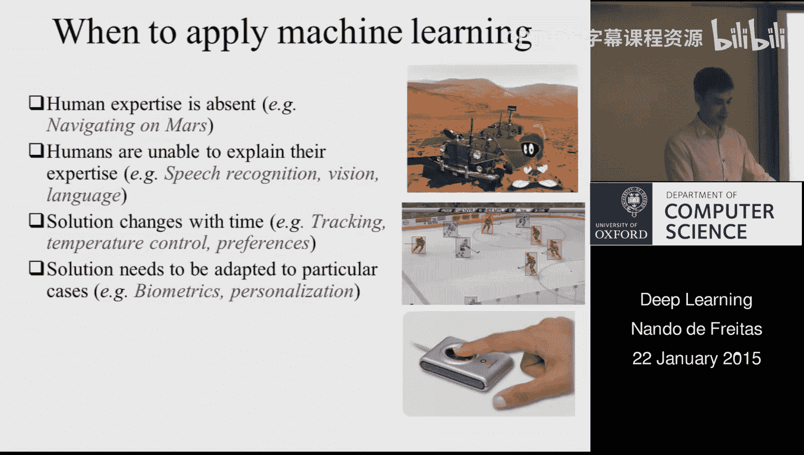

嗯。And also， yeah， some problems are too vast for humans to comprehend。

 like here I have things like matching ads to pages and so on， which a lot of the。

Big money in machine learning isnt advertising， but also I think there are some problems in the world that humans are incapable of solving like how to fix our economy。

 we're doing an atrocious job at it。By fix how to manage our environment in an intelligent way。

 we're terrible at doing that。So there are some problems for which I really hope we can one day build machines that help us will help our。

Econommetricians， our senior politicians as all make better decisions。What are the challenges。

 things we can't do yet， we're not very good at one shot learning what I mean by that is this so the three things that I've shown you there in red are toothths。

Okay， so how many of you think this guy here is a Tfa， would I have my cursor？Not many people。

 how many people think this is a tooer？But half of the people， how many people think this is a truer？

More people， Okay， so you've only seen like I've told you three things are troer。

 I doubt that any who knows what a trofa is or has even seen a truer before or heard ever of a troer。

 but you very quickly learn what a trofa is。Very quick learning。If I'm playing a video game。

 if I see someone playing a video game and I saw that they did like something smart that gives them lots of points。

 Ill need to see at once and I get it， our machines are not that smart。

 we don't know how to do that very quick learning that immediate inductively is something we don't have。

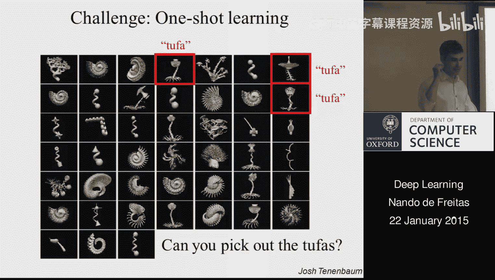

呃。You want to learn in one task and what you learn doing in one task。

 you want to transfer to do another task that's going to be one of the things that I'm going to be posing as a big challenge of things that we still have to do well。

 a big challenge is scaling to make these models larger and the problem is as we make these models larger they're consuming a lot of energy my brain consumes about 40 wts so less than one of these lights here so it's extremely cheap。

To run。But a convolutional network used for vision by any company is taking a lot of energy out of this planet and there's still a huge gap there in energy efficiency that we need to address。

 we still don't know how to generate like the world and sort of the H richness that we can generate。

And then there's going to be other challenges that are about putting components for perception in action together so these are things that will not be able to solve in this course。

 but I want to kind of give you an idea of what it is that people are trying to solve now and going ahead okay so in the next lecture we will go into the simplest possible model and then we will build on that and so by the second week。

We will be looking at very models with one neuro by the third week we will be looking at arbitrary models by the fourth week we will be doing the convolutional models used for vision and at that stage I hope your new practices you'll be implementing these and trying them out by the。

Then there's a few things you have to do， then I'm going to try to look at this each of generating realistic signals。

Then we're going to look into study sequences， how we can do translation and so on。

 and finally we're going to end up at。Decision making。

 having these agents learn to act upon the world using these models。

 the only limiting factor for you will be the fact that in your experiments that if you won't have a big form of GPUs that you can use to actually train on all the data or you won't have all the data either。

And so access to enough competing resources from our end will do the best to make sure that at least you get on some reasonable data sets get to experience this and Brandon I know is working very hard to ensure that you have this。

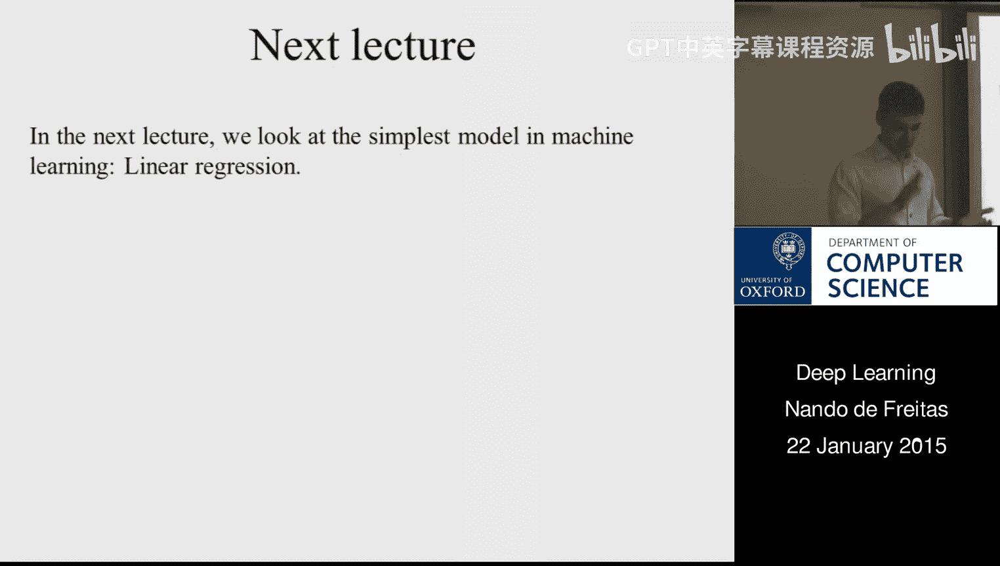

Okay， so I'll see you back here in 10 minutes， thank you。

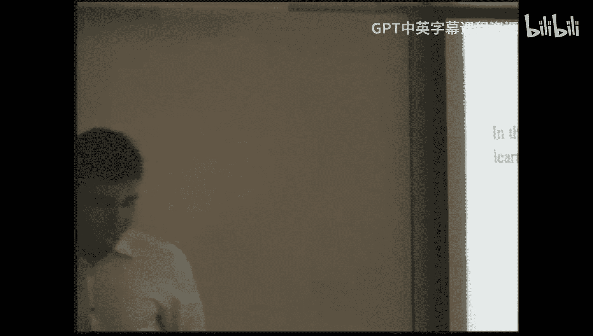