# 深度学习：1：引言

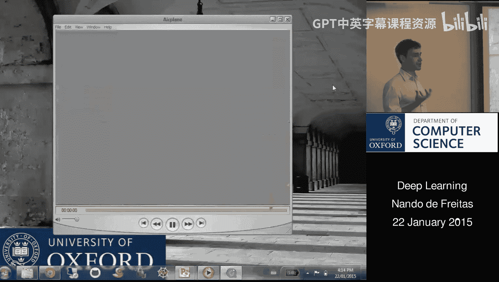

## 概述

在本节课中，我们将探讨为什么需要机器学习，特别是深度学习。我们将从人类感知的局限性出发，理解传统编程方法的不足，并介绍机器学习如何通过数据驱动的方式解决复杂问题。课程将涵盖机器学习的动机、核心思想、应用领域以及当前面临的挑战。

## 为什么需要机器学习？

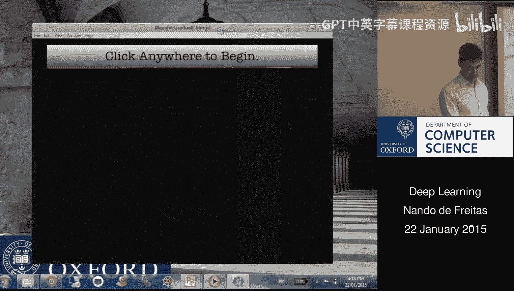

上一节我们讨论了机器学习的普遍动机。本节中，我们来看看一些具体原因，这些原因促使我们采用机器学习而非传统编程方法。

### 人类感知的局限性

人类对世界的感知并不完整。我们常常无法察觉到眼前发生的巨大变化，这种现象被称为“变化盲视”。

以下是两个经典的视觉实验，它们揭示了人类感知的局限性。

*   **实验一：飞机图像对比**
    *   两张看似相同的飞机图片之间存在一个显著差异。
    *   对于首次观看者，很难立即发现引擎从机翼下方消失了。
    *   这个差异涉及大量像素，并且是飞机飞行的关键部件。

*   **实验二：MIT场景变换视频**
    *   视频中，一个街景发生了戏剧性的变化：建筑颜色、门窗、标志、行人数量都改变了。
    *   即使被告知会有变化，观众也很难捕捉到所有变动。
    *   专注于某一区域的变化，会导致忽略其他区域的变化。

这些实验表明，视觉是一个极其复杂的时序过程。我们眼睛的高分辨率区域只有拇指指甲大小，并以每秒约三次的速度移动。视觉缓冲区内存有限，无法存储全部信息。我们无法通过内省完全理解自己是如何“看见”事物的。

**核心观点**：由于我们无法完全内省自身的感知和学习过程，因此不能仅凭直觉和编程来构建智能视觉系统。我们需要不同的方法。

### 传统编程的困境：以物体识别为例

试图通过编写规则来定义世界中的物体是极其困难的。

*   **举例**：识别长颈鹿。无论是真实的、卡通的、扭曲的还是在树上的长颈鹿，人类都能轻松识别。
*   **挑战**：为机器编写代码来涵盖所有这些变化（视角、姿态、风格等）几乎是不可能的。

传统方法会遇到“罕见情况”问题。

*   **案例**：一个基于规则的人脸检测系统在日本测试良好，因为它学会了检测深色眉毛。但当一位苏格兰血统（浅色眉毛）的朋友使用时，系统完全失败。
*   **结论**：手工编码的规则难以覆盖所有可能的变异和例外。

### 机器学习的解决方案

机器学习采用数据驱动的方法。

*   **方法**：收集大量带标签的数据（例如，许多“人脸”图片和“非人脸”图片），让算法自动从数据中学习规律。
*   **成果**：这正是现代人脸检测、图片分类等技术的工作原理。一旦成功，人们便觉得这些技术理所当然。

## 深度学习的兴起与灵感

近年来，神经网络模型重新成为焦点，并在许多领域取得突破性成功。这些模型受到多个领域的启发。

### 神经科学的启发

大脑是一个生物机器，认知活动与神经元放电相关。

*   **位置细胞与网格细胞**：大脑中有细胞（位置细胞、网格细胞）会根据生物体在空间中的位置而放电，形成内部地图。相关研究获得了诺贝尔奖。
*   **胡贝尔-维泽尔实验**：在猫的视觉皮层（V1区）发现，当特定朝向的光棒移动时，某些神经元会放电。这表明初级视觉神经元负责检测边缘、朝向等基本特征。
*   **学习的重要性**：实验表明，如果猫在只有垂直线的环境中长大，其大脑就不会发育出对水平线敏感的神经元。这证明视觉能力很大程度上是**学习**得来的。

### 卷积神经网络（CNN）的雏形

受胡贝尔-维泽尔实验启发，人们设计了**卷积神经网络**。

*   **第一层**：像简单细胞一样，学习检测图像中的基础特征（如边缘、角点）。这些特征可以看作构成图像的“笔触”。
    *   **公式/概念**：每个神经元通过一组权重（形成一个**滤波器**或**卷积核**）连接到输入图像的一小块区域。该神经元的激活值计算为图像块与滤波器的点积（或卷积操作）。
    ```python
    # 简化的卷积操作概念
    activation = sum(pixel * weight for pixel, weight in zip(image_patch, filter_weights))
    ```
*   **更高层**：像复杂细胞一样，组合底层特征，形成对平移、微小形变等更稳定的表示，最终识别出物体部件乃至整体（如“狗神经元”、“鸟腿神经元”）。
*   **现状**：现代CNN可拥有数十层，在物体识别竞赛中性能卓越，已成为计算机视觉领域的基石技术。其架构灵感可追溯至更早的“认知机”模型。

## 深度学习的能力与应用

深度学习模型不仅能识别物体，还能学习数据的本质结构，并应用于多种模态。

### 无监督学习与特征学习

并非所有学习都需要明确的标签。

*   **谷歌“猫神经元”实验**：让大型神经网络观看大量YouTube视频，目标不是分类，而是学习**重建**输入。网络中间层自发出现了对“人脸”和“猫脸”敏感的神经元。
*   **核心原理**：学习即模拟。如果系统能很好地模拟（或“幻想”）它将要看到的数据，那么它就学会了数据中的规律。这类似于大脑用生成模型填补视觉盲点。
*   **意义**：这类生成模型有助于理解精神疾病（如精神分裂症）并开发相关药物。

### 超越图像：处理序列与多模态数据

深度学习适用于任何具有结构的数据。

*   **自然语言处理**：分析文本情感（如产品评论）、进行机器翻译。
*   **序列模型**：使用**循环神经网络（RNN）** 等具有记忆的模型处理时序数据。
    *   **应用**：机器翻译（序列到序列学习）、视频预测、代码执行、甚至生成逼真的文本。
*   **多模态学习**：结合图像、文本、语音等多种数据来源进行理解与推理，例如，社交网络中的个性化推荐。

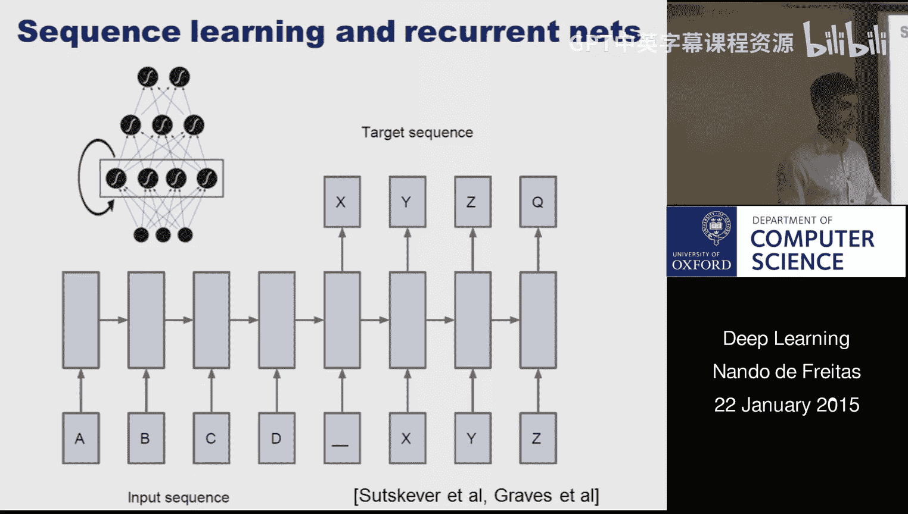


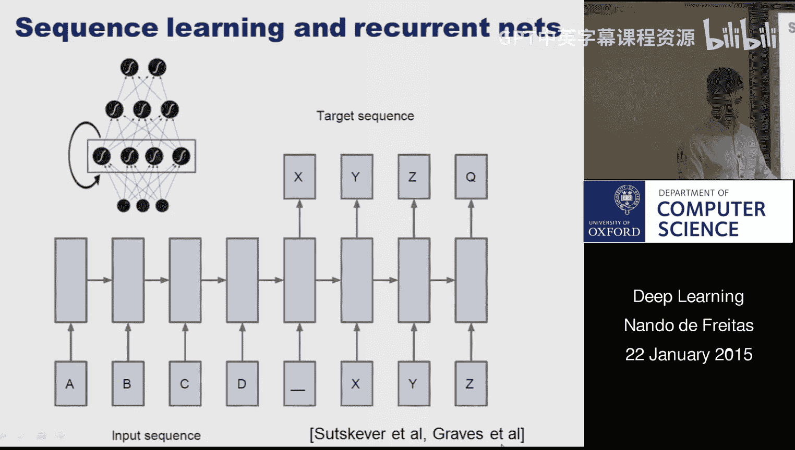

### 强化学习：从交互中学习决策

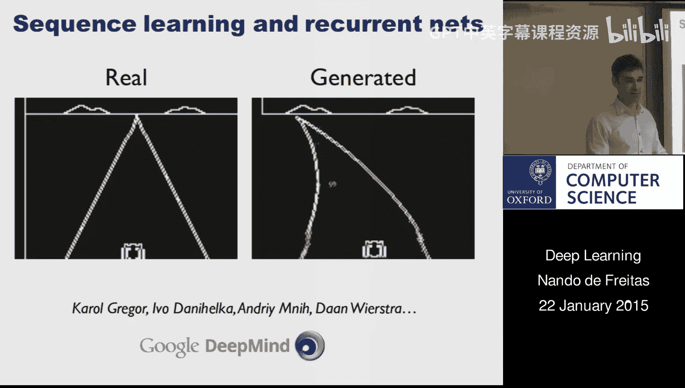

智能体通过与环境的交互来学习最优策略。

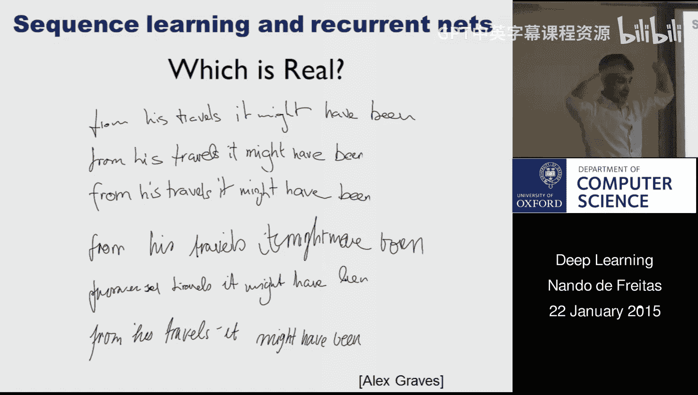

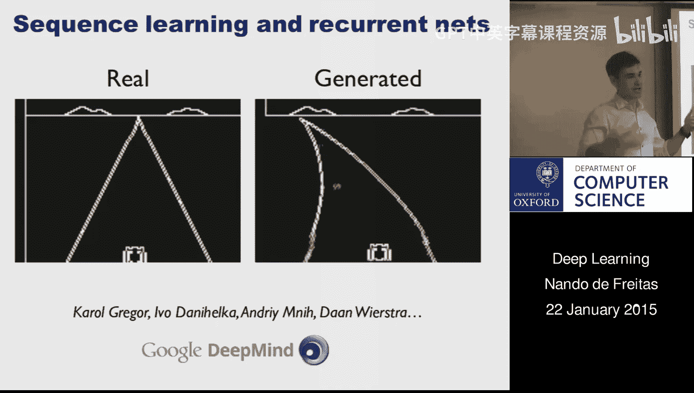

*   **特点**：反馈通常是延迟和稀疏的（如游戏结束时才获得分数）。
*   **案例**：训练智能体玩《Freeway》游戏（小鸡过马路）。智能体通过试错学习，最终找到高效策略。
*   **挑战与结合**：将深度神经网络与强化学习结合（深度强化学习），已在游戏等领域取得显著成果。

## 机器学习的广泛应用

机器学习不仅是AI的核心，也是解决实际问题的强大工具。

以下是机器学习的一些关键应用领域：

*   **预测与预报**：金融预测、天气预报。
*   **缺失数据填补**：推荐系统中预测用户对未评分项目的喜好。
*   **异常检测**：信用卡欺诈检测、网络安全、病毒变异识别。
*   **分类与决策**：客户信用评估、交易审批。
*   **排序与摘要**：搜索引擎结果排序、海量评论自动摘要。
*   **机器人学**：工业自动化、自动驾驶汽车。
*   **优化**：软件项目集成优化、编译器调优。

在以下情况中，机器学习尤为必要：

1.  **缺乏人类专家知识**：如火星机器人需要自主导航。
2.  **问题机制不明**：如人类视觉原理尚未完全清楚。
3.  **问题不断变化**：如用户偏好随时间改变，系统需要自适应。
4.  **需要个性化**：为全球数十亿用户提供定制化服务（如个性化新闻）。
5.  **问题规模超乎人力**：如在线广告匹配、宏观经济调控、环境管理等复杂系统优化。

## 当前挑战与未来方向

尽管成就显著，深度学习仍面临诸多挑战。

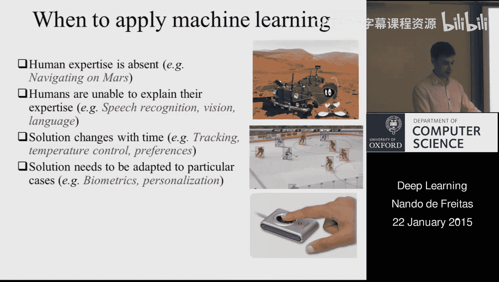

*   **小样本学习**：人类只需看几个“Tofa”的例子就能学会识别，而机器需要大量数据。
*   **知识迁移**：如何将一个任务中学到的知识有效迁移到另一个相关任务。
*   **可扩展性与能效**：大型模型耗能巨大（人脑仅需约40瓦），能效远低于生物系统。
*   **感知与行动的整合**：构建能感知、思考并行动的完整智能体。
*   **生成丰富内容**：生成与真实世界一样丰富、多样的内容。

## 课程路线图总结

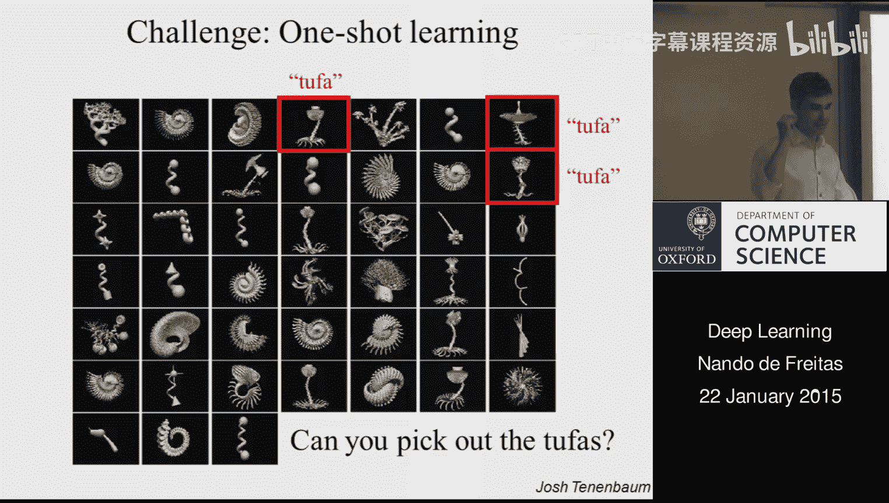

本节课中，我们一起学习了机器学习和深度学习的核心动机与广阔图景。我们了解到：

1.  人类感知的局限性促使我们寻求数据驱动的方法。
2.  深度学习受到神经科学的启发，并通过卷积神经网络等在视觉领域取得革命性成功。
3.  深度学习能处理图像、序列、语言等多模态数据，并可通过强化学习进行决策。
4.  机器学习在预测、检测、个性化等众多领域有广泛应用。
5.  尽管强大，该领域仍面临小样本学习、可扩展性、系统整合等重大挑战。

在接下来的课程中，我们将从最简单的模型开始，逐步深入：
*   **第二周**：学习单神经元模型。
*   **第三周**：扩展到任意深度的神经网络。
*   **第四周**：深入研究用于视觉的卷积神经网络。
*   **后续课程**：我们将探索生成模型、序列模型（如RNN），并最终学习决策与强化学习。

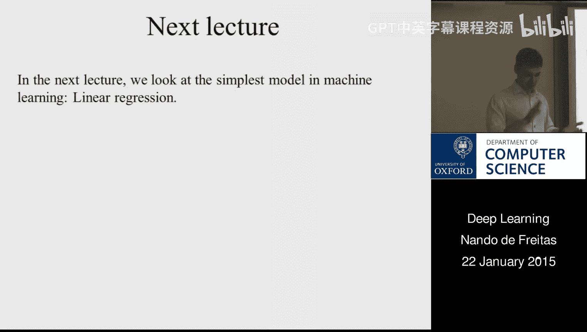

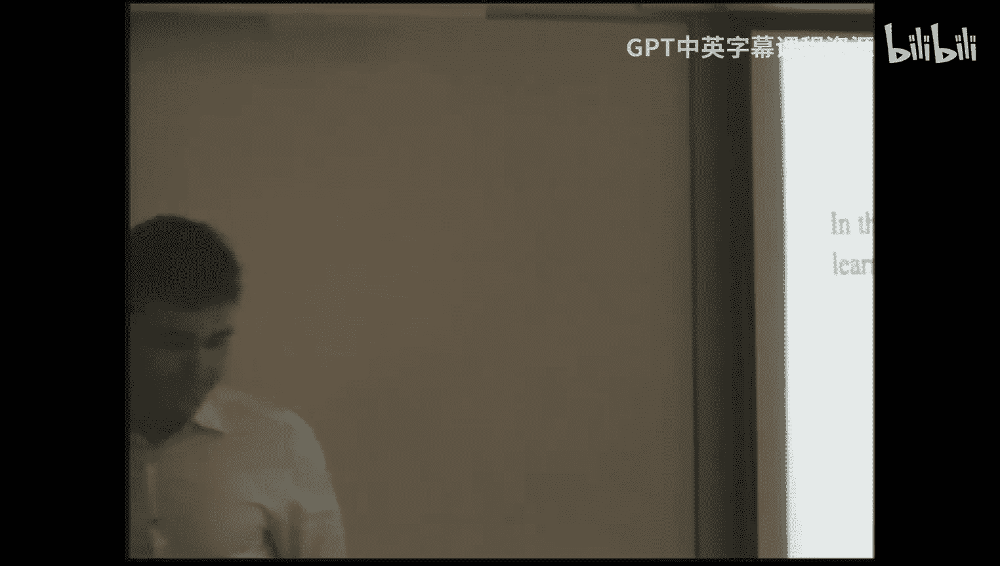

希望本课程能为你打开深度学习的大门，并为你将来解决实际问题或进行前沿研究奠定基础。