# 牛津大学《深度学习｜Deep learning 2015》中英字幕（Claude-4-s） p02 2_ linear models.zh_en -BV17NWWz6ErN_p2-

It the caught only the drugs by 5% of the election that's not that。

Theres to be a big draw after this All right so now we go into the new of this and when you actually discuss this is a lot about statistics and linear algebra ands and then all the things important things to know the more mathematics you can take the better。

 but again this course will be focusing on practice skills and the practices are important。

 nonetheless if your linear algebra is rusty， I strongly recommend that you Google linear algebra。😊。

I't algebra lectures and you can take Gililber Strangle lines， lead algebra lectures。

 or you can go to what's that famous attractive， he really good or。Ks Academy。

It's got brilliant lectures on linear algebra bring because it's us to just go back there and count as well so important things that are essential for taking the course in terms of mathematicale background you have to know what a vector is and what a matrix is so these are very important skills I we just sort basic background if you don't have that basic background you don't know what a vector what a matrix is then there's kind amy thats global strength lecture so you can just Google the linear algebra that's Wikipedia everything is in Wikipedia that is background for this course。

Some very basics of statistics like for example for next week。

 we're going to go into Gaussians and multivariate Gaussians， Gaussians are more than one dimension。

 so they're extremely useful and so some basics of probability statistics are essential as well and again if your basic Kevin had an introory caution probability statistics again there's very good ones for the undergrad level online。

And finally the calculus。One of the key methods for learning that we will use here is something called gradient tocent。

 which is optimization by going downhill。So how many of you ski or snowboard？Okay， nice。

If this was my class in Vancouver everyone would finish actually the class would be authentic as often the people would be up on the mountain snowboarding。

 but it's just learning is just like snowboarding， just look for the steepest descent and go for it and put put food in front of the board and and。

😊，あ。That's pretty my steepest dis centers in therefore where it's really steep and going in that direction。

 is that the double black diamond or where they tell you enough to go， that's what it's fun。嗯。

Don't take this as advice。O。SoAnd that basically clu is something called gradient and you need to know that possible the derivativeatives。

 a lot of the things that we're going to do will be about differentiation。

 we'll try to build machines and the session what we try to do is build machines that we can differentiate if we can differentiate we can find our optimum optimum operation so we can take a tuuring machine and if you can differentiate a tuuring machine if you build a differentialiable tuuring machine。

 you can build a tuuring machine that learns from data。If you can take a graphic extension。

s something that generates graphics movies and you can make it differentialable and you can generate movies。

 if you can do that with speech， you can de generaterate speech。So basically。

 if you take any machine， make it differentiable， learn from data and now it can adapt。

 that machine can adapt to the world。So derivatives are extremely important， go gradients。

 gradients are very important。We're going to get into them next not next week the week after but they will be essential and already will touch on them today Okay。

 so this class now is going back to some very basic statistics and we're going to look at something called linear regression。

And we're going to try to understand it and this is essentially something that's also known as these squares。

 we're in this setting of what people folks call supervised learning in the sense that there is inputs and theres outputs and the teacher gives you for each input shows you what the output should be if this is an image of a CA。

 the output should be the label CA。And so on， if this part of speech is say chameleon。

 the apple should be a string of characters that say chameleon。嗯， thanks so。

There's many ways in which so there's also in learning any new field。

 there's language associated with it there of pars and inputs are often known as covariates。

 that's in statistics or theyre also known there as predictors， we often call them features。

 or we call other things features as well， but think of often the inputs are called features the outputs are variantates。

 things that vary depending on input， they call targets， they're trying to learn some target。

Class or theyre known as labels， and I'm sure there many other words by which these get referred to。

 but perchan law we'll probably use these terms the inputs office。

And so in the first thing in linear supervised learning。

 we assume that the relation between the input and the output is linear。So if you are in1D。

It would be a line and would be a plane in high dimension or be a plane in high dimensions。

 but there's a sort of linear relation depending on put the outcome not very exciting because it's just a line is just basically saying to increase that to increase y。

If the slope is positive， but what we learn here will be useful late。

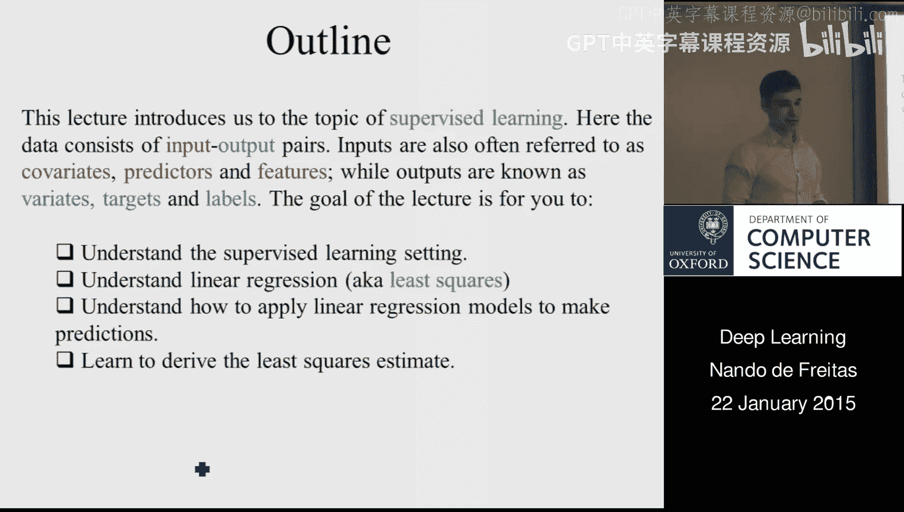

嗯。And in particular， a lot of processes basically pretty much everything in life is in a nonlinear。

But if you look at it locally， sometimes it's linear so by linearizing in a local region you can actually design very nice machines。

 for example， machines are able to land automatically from the sky and you owe your lives to these machines。

あ。If you've taken a plane before， so linearization is very useful in engineering and so knowing how to play with linear models turns out to be useful also you'll see that most of these models have as a submodule。

 a linear module so if you can use linear modules you can understand how these submods work。

Then you can take advantage of them to build large architectures The new models are also nice because I can teach you the basic concepts of statistics。

With them because I can do everything by hand so all we need is piece of paper to do this we don't need computers or computer later we will not be able to do things by hand。

 but the same。Pinncciles about learning that apply to these models that we will discuss next week are applying for new models。

So。Just saying here we'll learning a basic concept Okay。

 so how does it work so the setup is the following。

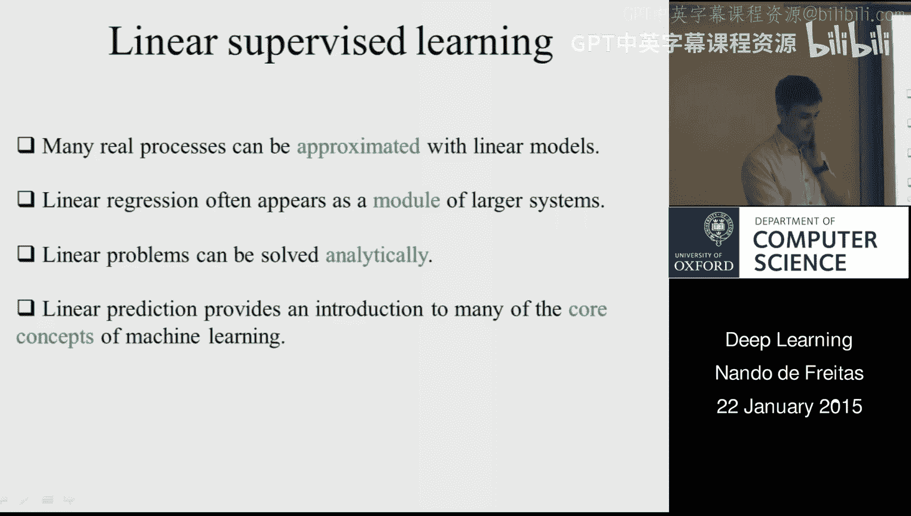

We're going to start start introducing some。Notation here。

We're going to be given what I call the training data set。Training set double contain and instances。

 so these instances could be pairs of images under their label。

 the text label that says what the image is about。And so the inputs will be the axis。

And the labels will be the outputs Now I will use this notation where x1 call n basically is a set which is includes x1。

 x2。All the other xs up to X and。So its just a shorthand notation for all the access X that indicates how many there are。

Each of these access could be， for example， a factor with the components。

 and that's what I mean by this。Here， I just mean a vector of numbers that are essentially D numbers and those d numbers happen to be real numbers they could be other thing。

 it could be binary numbers indicating whether you prefer something or not that you know categorgoical variables and so on。

Un's say they're just d numbers or D inputs， the attributes as deelson or D predictors。

The output is going to be the target， and we are going to assume for linear regression for simplicity。

 the output is just going to be one single real number。Okay。

Their inputs in a science could be integers， that could be other things。

 but that's sort of not too important。

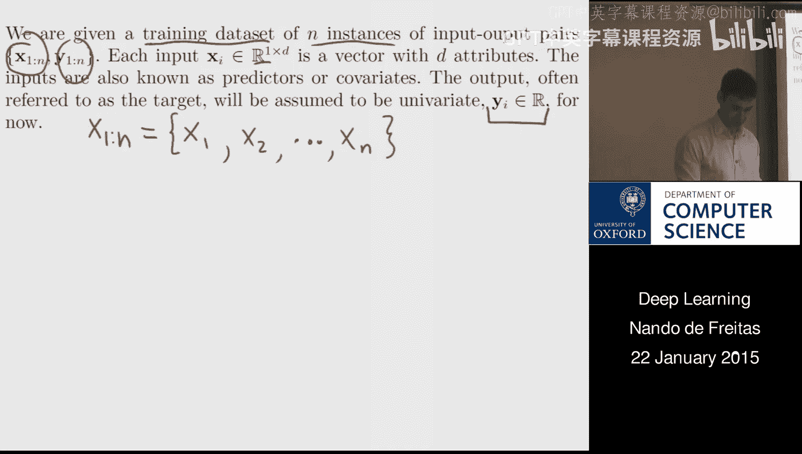

So let's look at an example。An example might be something like this we're given a table of data and this is what this data set might look like where we have。

The wind speed outside this building and we have the temperature inside this building and then what we would like to do right now what we're doing is we're opening these windows by hand to control the temperature in this room but imagine that we wanted to improve on that and we wanted to put an automatic thermostat in this room that would detect how many people walked in the room so it would know how many people are inside here enough you would know the temperature outside this because of the wind speed and then you would automatically predict what is the energy requirement to keep this room at a comfortable temperature okay so in this case this was。

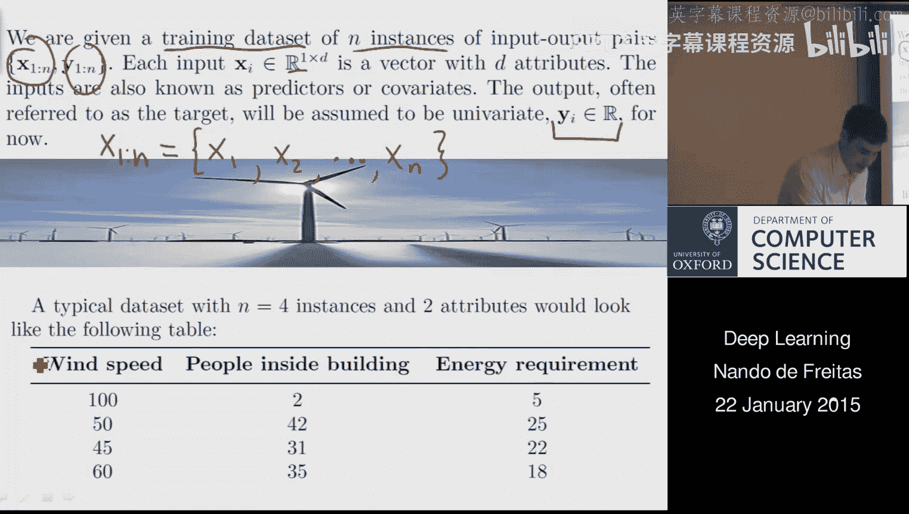

Just as so。This would be。X1。And this would be why1。

So I want my model to given the speed of the wind measured outside by some meteorological station and given a counter that just count by some sense of how many people I walked into this room and what out and would automatically be able to predict what the setting of the thermostat should be。

Okay so to regulate the temperatures so we' comfortable okay so the inputs on the excess the output to Y we would like to learn this model because if we do learn this model。

 then this thermostatcle solve out or problem it would just adjust the temperature based on how many people are here and based on the temperature outside and if that works we。

Then we' well be happy on having to often do in this morning。So that's x1， x3 would be dis factoro。

And this will beY3。Okay， so in this case， in particular D is equal to2， as you can tell。

 and there are four data set instances there are four。There are four rows of the data set。

So that's a simple form， a simple data set and already if it could。

now how to manipulate just so data said we could build useful technology。呃。And so in particular。

 as I mentioned， given now a different number of people and given different temperatures measured outside on any arbitrary day。

 I would like to automatically predict what the temperature。

 what the energy requirement is in the thermostance so that this room is at the nice temperature。

And so we're going to do this in two stages and this is going to be true of always in supervised learning。

 so the first stage is going to be called I will refer to it as training。

St called the statistical estimation and so on， the idea is given the data。

And the data is essentially a table of numbers， which has n axis。And N wise。

The y on one column the X could be several columns， the columns in total。응。This gets。Put as an input。

To what we're going to call the learner。And what we're going to learn is a model。Quite often。

 and it will be the case in this course， not necessarily always， but certainly in this course。

 the model will have parameters。Yeah。So statistics is a very vibrant area for surgical nonparmetric statistics。

 I will not be covering it but that areas are very big here at Oxford as well there's people like UICha in statistics Michael Law born in engineering on that all do excellent work in that area Frankwood as well so I recommend you attend their courses if you want to learn about that but here I will focus on models that have parameters I will however let these number of parameters be very large so the models will be in a sense nonparmetric in the sense that the parameters would be a billion parameters and so on。

The models will be so large that you will not be able to sort a parameters in a machine。

 you really need a server with several machines and you need to have some very interesting architectures to be able to smart architectures to distribute defect vector parameters。

 That's like how most recognition image recognition systems work at companies you need to know what people call parameter server to just handle simple recognition model。

I often use the Greek letter theta or theta to describe the model parameters for linear models in the simplest form align。

 the parameters are they intercept and the slope。So learning is just computing the intercept and the slope。

Of the line， it's basically learning the plane， if you can learn the plane you've learned。

 once you have the plane。You're going to take a new data point。

And this is what I'm going to call testing。Or predictions。

So the new data point goes into the predictor。The new data point and the learned parameters go into the predictor。

And they generate。A prediction and I'm going to put a heart to indicate a prediction。

So the hat denotes prediction， and it's the prediction for that point。嗯。

Which I will write either like this or write it as a function of the input。

So I could provide to Black that as well。So the idea is during training or learning。そ。

Can put here learning。We estimate parameters from a data。And instances and during prediction。

 we used the estimated parameters， the model that we've learned to make decisions to make a forecast。

 as we will see， I mean this is the first way we're going to do this， as we will see later。

 this can happen in an online fashion you're adapting the model in the data is fund。

 so most of the things that we do have to be adaptive in fact of the data because it's just too much data to load the data to memory。

So you really have to learn with small batches of data and be able to update them and how big the batches can be that depends on statistical conservation。

 but it also depends on a lot of systems constraints in terms of communication access to this。

 how much it costs us and things of the net， how much memory asT have and on。

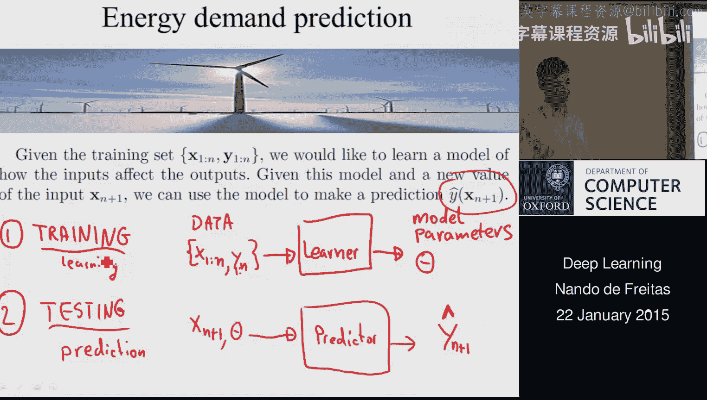

Yeah。Okay， so let's look at the first linear model， the first linear model was aligned line。

 it has intercept Theta 1 and slope theta 2， the input is just one variable in this case D is equal to1。

 it's just one column and then the output is also just one column。And when we do learning。

 we also need to specify what I call an objective function。Objective。Fangchun。

Some people call it an energy。And or a loss。It's something that makes us how well you are to。

So in supervised learning， you want some function that will tell you whether you。

You've done good learning or not and let's look at one example， so one example could be。

 you know you've done well if the difference between the true data in the training set。

So the wises that you have in the training set。Are close to the predictions that you make in the training set。

 so basically you train， you learn theta， once you do theta。

 you multiply your theta times the X and the trainings and your computer Y has。

And if you're white hearts。Are close to the wise。Then that error is going to be about zero and gals came up with that 300 years ago and they worked for a lot of problems and it became very popular。

 this very very tractable and medium use it because of that， even though it's very。

I act as dangerous as I'll soon show。But。Basically， graphically。

 what we're saying we're doing here is we have a function。嗯。

With X axis x and with the height of the y。We're given some data points。

And what we are doing is we're fitting a line to these data points。

And the way we're fitting this line is we're fitting in a way like a good way to think about this。

 we're right across from Robert H's building， so it only befits this place to use springs and think of hooks Law。

 and remember there was a chax square， the square。嗯。

And so one way to think about this and has the energy。Okay， excellent go。

Is that if you imagine that each of these red dots。And I should say what these red dots are actually。

 so the coordinates are basically the data point， so this would be x1。This would be say x3。

 I mean there's no the data can be scramble， there's no particular order。

 so I'm emphasizing that by writing it this way。嗯。This height here is the corresponding。HideY1。

Thiss this a corresponding height？W3， so that's the data。

 the date is these red dots and also its coordinates。This line， which is our model， has slope Theta2。

And the height of danger have to sleep to one。Okay。And this difference here。

Its what we want to minimize。If this is y4， I y4。And this guy here is the prediction y4。

 and so this gap here is y4 minus the prediction of y4。And we use square because we're using sprays。

We're trying to minimize the energy， we're trying to find a minimum energy configuration for this。

line。So if you were to and new can actually implement this with praggs if you want。

 and so basically if I try it twist the line and Ill let it go。

 it will sort of converge at one point minimum energy and there is only one such point。

As we will see soon。And that's essentially how this works and this works extremely well。

 a lot of science is based on this and theres all sorts of things with this。

 and there's millions of papers out there using this model to describe some sort of data。

Turns out to be a very useful small directly。Wech the springs。Basically。

Here're measuring the distance to the white coordinate and not the distance to the line screen have be always this is very important that's the first dangerous thing about this model's why should we prefer it so anyone looks at this thats a number bit of computer graphics we made it or very bit of common sense but so why don't we measure it like this？

That would be better， but in school we always see the first one。嗯。

That's what we learn So it turns out that this indeed people doing this way in the next class we're going to go over and look at measuring things this way that's going to give rise to total these squares and so on。

One of the big problems with these models as well is you might have data that looks like this。Okay。

 so when you would like your line to be going to the point that because。

 but then this fails because what happens is when you have something that looks like this。

This spring is really stretched and when you have a spring that's really stretched。

 even if it's only one spring that's very stretched， it completely destroys the line。

 you'll end up with a fit to the date that it looks like this just because of that one spring and that all comes because of our choice of。

Matric。So we will learn other choices throughout the course and so this is always this is something that you need to think about carefully for each problem。

 what kind of metrics should I use and in fact coming up with good metrics is one of the most fundamental problems I think in。

That's certainly in the whole scheme of public intelligent machines。And。

I think big part is learning these good metrics so then if you generalize it to high dimensions。

 then you would have we move on to instead of just having。Thehita1 plus theta1 times x1。

 you would now have many。You have Ders， so you have。X i1。Phita1 plus X I2， Theta 2。Hold the way to。

X I D Fe D， so for each state point the prediction is you would use a plane to make a prediction and as a convention we typically set this first guy。

Always to be one。Because then that gives us the offset。

 so that gives us the bias term we call it the bias term so which's basically just got here so as you can see there is a one here。

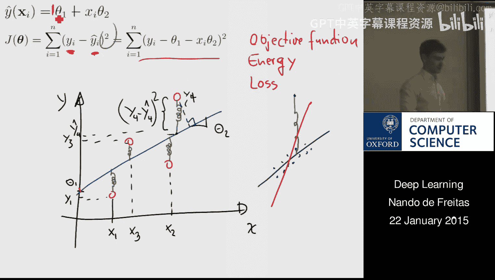

That changes the height of the line， the height of the plane。

Marices are great for this because instead of writing all these sounds details。

 we can just group all the various variables into a single data structure。

 we can just manipulate the data structure because the data structure has also took properties which started for centuries。

And so we can write this novel instead of writing it component wise。

 instead of expanding it like this， or writing it using these sigma notations， with loops。

 we can just try to very succinctly in matrix representation this way。

And so that basically says that， as you can see， I。I goes from one to x。

 so you have y1 to I N and x goes from one to D， and then you have the parameters so we can group this in a single。

So the linear prediction is you just multiply matrix of the input data。

Time parameters let's look at an example。Back to our thermostat design。

 so we have two inputs to Winpe and the people inside the building。

And we're trying to predict the adjustment of a thermostat， how much energy。

ItNeed to be injected into regulating this rule。So in this case， as you can see。

 the y is this vector， so that corresponds to what I've drawn here。And。Yes。The x。

 which corresponds to these four columns， is what I've put in here。

Now I've just copied it so if your data is stored as a table。

 it's very easy to form these matrices and then in order to compute parameters。

 you need to just multiply this table。Oh， hangy， I haven't told you have to move performance。

 that's coming soon。嗯。But if you want to compute the y。

 basically the models y is equal collects theta， you would multiply this x times this factor and that would give you what We still don't know how to get the theus how to compute the theus from date。

But we already know the loss， we're going to try to minimize quadratic loss， the gaus loss。

And so in particular， let's assume that our feet。I suppose you you。

Someone come and give you that theta， some burn machine already gives you a theta。

 then in order to make a prediction on the training set。

 in order to generate the white hats from one to four on the training set。

 you will basically take the data gain X。And you would multiply by theta。

So x times theta that's going to give you predictions y。

 and now you get y hat and now you compare y hat to y and you sum those square differences and that tells you how well you do it。

so that's how we would make predictions so let have the a a single value of single back to food can make any predictions so the question is how do we get that feature？

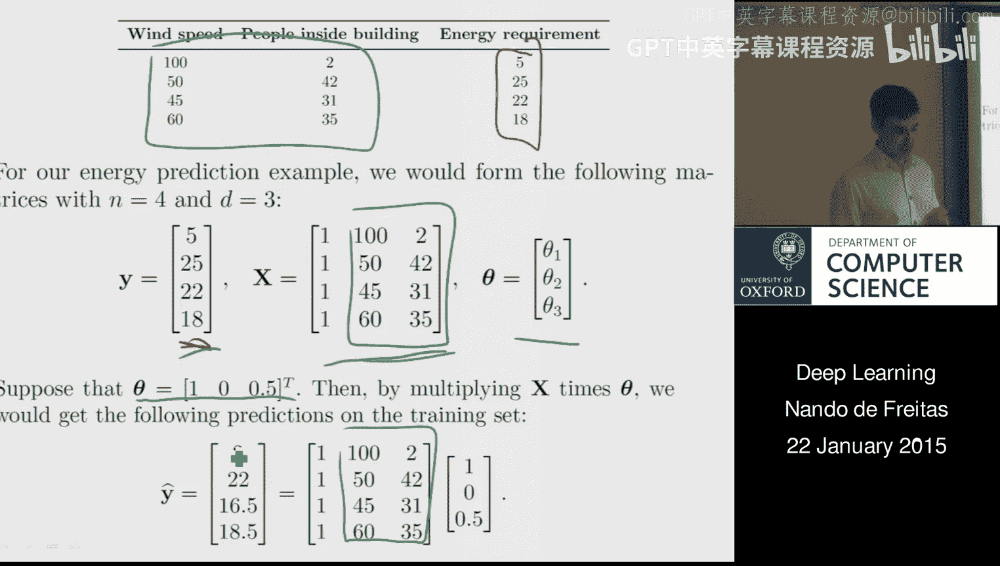

嗯。Of yeah so again you can predict those predictions here should have added。

 these are predictions on the training set but ultimately you want to get new data that you have not count before the training set and you want to make predictions there and hopefully those predictions will still be good one so if I have a new X vector I added to that matrix and a multiply times to my vector of theus and that's how I compute a prediction this is essentially mathematically the same as evaluating the line at that point。

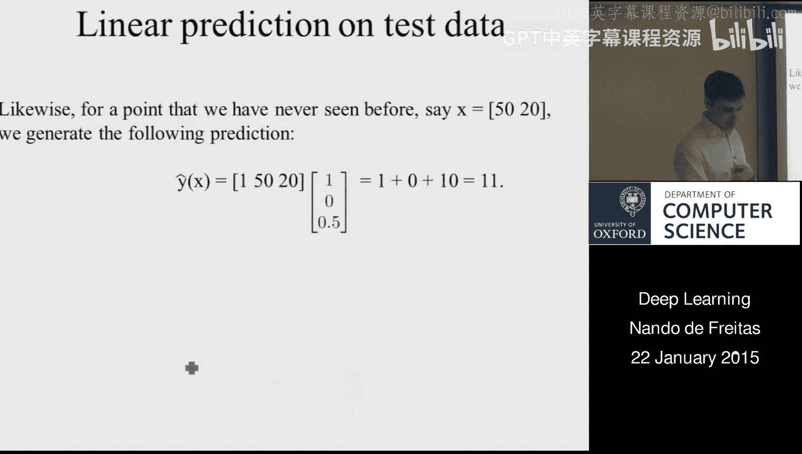

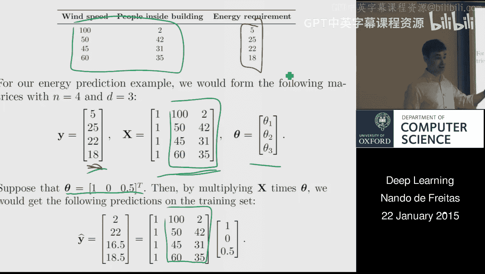

Okay，Just like I vectorize the description of a alarm instead of using the sal or a loop and code。

 I'm going to use just direct operation， so this is important not to shorten the math and in order to derive things more quickly but this is also essential to get code that runs fast you have to vectorize code but be doing lots of loop。

嗯。Because we have very good libraries these days to deal with matrix operations so we can take advantage of them so this quadratic so the quadratic form。

The sum square losses can be very compactly written as this。And to see that。

 the first thing you should note is that if you have a vector。Here I'm using bolt for vectors。

 by the way， and non bolt for scalrs， is so matrices are typically capitals in bulk。

NowSo this is a matrix times the factor， I'll use a bar when I write。And so to see that this is true。

 well， if you have vectors。If you have a vector x that has a， x1 and x2。

And effective has entries wide。1 and2， then you know that x transpose actually should let me transpose these。

So x trans plus y。It's just x1， x 2。1，1， why，2。And that's just equal to x1 y1 plus x2 y2。

 and that's equal to some overall X。About the transport。X三冇有。Okay， and so。

It's a trivial exercise for you to then go and rewrite this a third because essentially。

 if you let's say look at this， what we have here is a vector of y1 all the way to YN。Minus。

And then you could write each of these is x1 transpose， x2 transpose， all the way up to xn transpose。

 each of these x vectors has the components。And it multiplies the vector theta。

 which is in this case， a vector with one component。So that corresponds to。

So this term corresponds to this term here。I'm going to let you fill in the remaining steps again to convince yourself that you can rewrite this expression you make your back on your that much more efficient。

So the dot product， as you can see here， what I'm doing is I'm taking a dot product between this factor and this vector。

 which is the reason why I get the squared here。If it's the same vector， x dot x transpose x。

 it's just the sum of the Xi squared， and then I just need to break into its various components to actually identify effect vector。

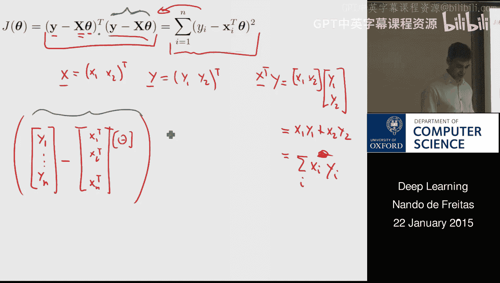

啊。And so from now on I'm going to use this form because it turns out that this storm is a lot easier to manipulate than to be using these sum and these loops Now you can also plot this function like for example if my theta is too dimensional so in other words I only have two parameters in the model theta1 the2 so back to the line intercept and slow。

Maybe I choose not to have an intercept and I have a plane going through the origin and then I just need to choose it two angles。

 Theta one and theta2。This is a quadratic function， so it's a ball。And in fact。

 it's a bowl and if I merge a content if I were to slice it from what I would get is ellipses。

So these guys at which the height is the same， these curves here， these are the contourt curves。

These are the lines at which you're at the same height， you're at the same cost。

 So if you follow this line， your cost doesn't change， you're always at the same cost。

 your objective is to go。To a lower cost， so learning is about doing this。

Most important thing I've said today。It's the snowboarding thing。

If you go forpendicular to these lines。If the lines are a constant height。

 if you go withpenic this line， that you pick in the direction of steepest descent。

Actually the gradient is this mathematical function， the vector of derivatives of this function。

 such a vector of derivatives， and it exists at every point， these little arrows here in blue。😊。

These are the gradients。The gradients point outward you go in the opposite direction of the gradient when you go to the minimum。

 if you go to the if the function is flipped and there's a maximum which usually happens with probabilities。

 you want to maximize probabilities， you follow the gradient to the top。

And that's essentially what we're going to do all the time， follow gradients up and dark。

That's going to be our mechanism for learning if we know that the loss is this ball。

 then we know we know ball only has one point that is the optimum point down here so we know if we follow the gradient。

 if you go downhill， you're going to get there。It's impossible to get anyone else。With a bit of math。

 you could formalize to proof now， don't you it int Jewishish？

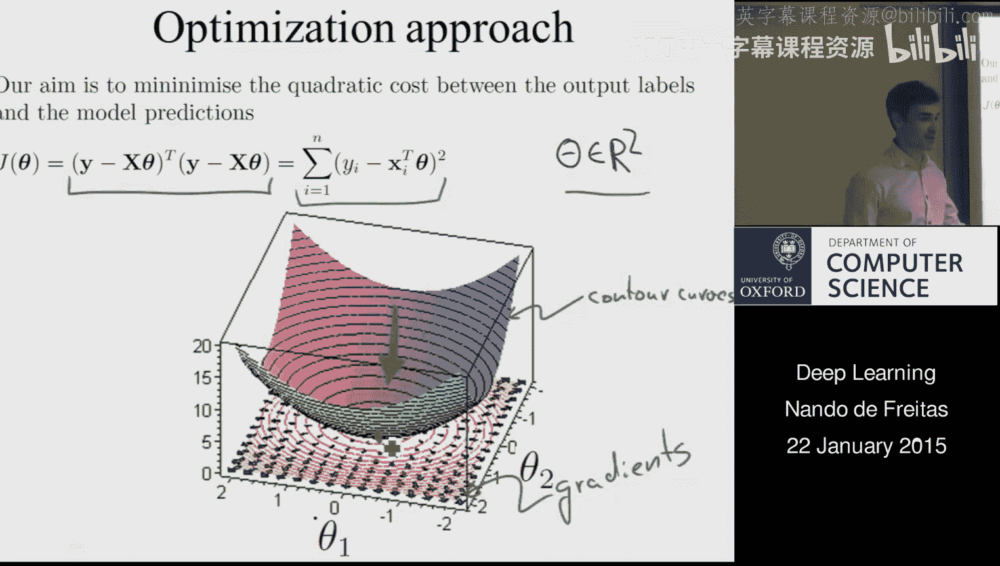

嗯。It turns out， well， so then find a solution to find the optimal theta is just a matter of differentiating。

 so you can do it in two ways， like in this case， what I would do is I would take the derivative。嗯。

Of this， I would take the derivative of J of theta with respect to theta1。

And then I will take the derivative of J of theta with respect to Theta2。Okay。

This would gave me some function was an equation with two variables。

This would give me another question。With two variables， two unknowns。

So basically a function of two equations with two unknowns， these are called the normal equations。

They are described at length in the Wikipedia page。So if you doing this square。

If your Google list squares， wiki。You'll get the details of how you would do this。

It's very tedious I'm not going to do it this way。 I'm not going to make you go through that this painful exercise。

 There is a fast way you learn you Google matrix differentiation and you learn that you can differentiate with respect to matrixrices and vectors and you spend some time learning these rules and you learn that oh the derivative for matrix sum of vector it just a matrix transpose and for a quadratic this is the expression and then you realize that there's a fold of algebra called matrix differentiation which has chronic of products as all of these things。

We're not going to need to go and look into that， but I can tell you that the basic data structure of the language we' use in dis course torch is a tensor。

And so it really helps you to learn a little bit about this， so Google Matri differentiation。

 there's very nice Wikipedia pages on this。And the nice thing about this is allows us to do things quickly。

 instead of me trying to solve all these questions who figured out how to solve them， I can just。

Look at the derivatives of。With respect to the entire vector of the expression of the cost and what I can do is I can expand it by just multiplying terms。

And I have minus-2 y transpose。Ex， feet。Plus theta transpose X X theta so this is where linear algebra comes in you need to remember what transposes are and how to multiply matrices and so on and how to infert matrices never divide by mates that sort of thing very essential so basics of linear algebra useful but once you have them you can do these calculations very quickly。

嗯。And oh， by the way， who knows why I group the two terms， the two cross terms into a single term？

使けな。It's a scaler。Another piece， very important thing to do is always keep track of the dimensions both in the code and when you do math。

 always keep track of dimensions On that topic you need a transpose after theex on that。There you go。

I would have got it by looking at the dimensions。😊。

So these are the dimensions of each of these quantities。 keep track of them。

No I'm sorry to interrupt that your x is are column vectors。

 but when they're in the matrix therere as rows， is that correct because Yeah I think the way I defined them。

And it varies according to the lecture， I think I to find them。I have defined fund them this way。

Because I started， I wrote them initially as rose， it's all about definition if I define them to be rose。

Then like that， I'm defining them to be factor。 so I have to transpose to make them roughs。

And if I define them as column thing。But that's a good point。If sometimes those things are not clear。

 just let me know and we'll fix those transposes。And then if you do this。

 then you apply the rules of differentiation， you get zero， you get sorry， minus2 x transpo y。

 and then you get plus x transpo x theta。We equate to zero。

And then we get that theta is equal to x transpose x。Inverse x transpose y。And that is the solution。

 so you can calculate this very easy， so if you have the tables in torture to have the testor。

 you just transpose it， multiply， invert that， multiply times x multiply by the vector of y。

 and that's speedta that's how you learn。So in this case you don't need to follow gradients。

 I can do this by hand。 That's why linear models are popular because we can do them by hand。

One problem with this is it requires that you load all the data。

So this is easy until you have to invert a matrix that's a billion by a billion and this approach sort of collapses and then the other problem is a lot of the times this matrix is ranked deficient so you will not be able to invert it。

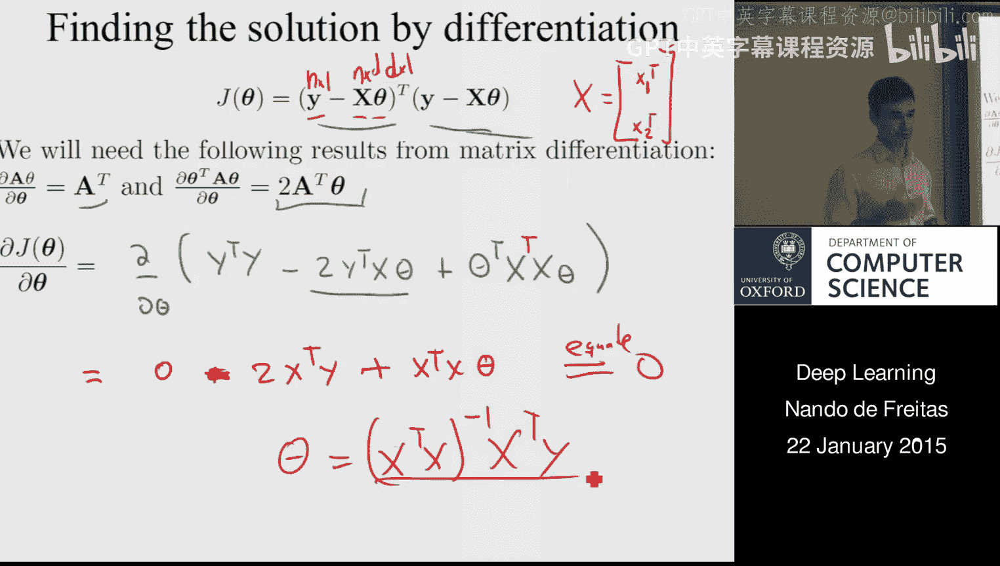

Very quickly to finish this lecture， so we will be using Torch 7 so you can Google Torch。

Seven that's what we'll use for this course， basically because every neural network that we'll discuss in this course is already implemented there you can reuse it。

 you can do new things with it， it's a very nice library to manipulate this and as I mentioned it's a library that is heavily used at I think some of the companies are doing groundbreaking work in machine learning so if your're intention is to get a job in one of those then I strongly suggest you learned this and also because it's a new language for everyone this is for those of you who have a background in neuroscience or mathematics and you're learning to program this very easy language to learn。

It has very little in it， it's an extremely dangerous language though。

 but it's one that's very easy to learn。Brendon will be doing the exercises。

 pointing out the dangers， but so in torch the first thing you would do if you're doing like in this case。

 we're trying to predict corn yield based on amount of fertilizer and insectic side you would load the data I will make these slides available so you will have these links so you can actually this tutorial exists online you load the data you basically form a matrix or in this case a tensa which is。

outer product of two vectors you could scale this to higher D because like a video has X Y and Z。

 so we like csus because we like to look at data that has more than just two facets that has many possible facets like a video has three that you could imagine though a lot of data like in recommendation and so could have easily a thousand facets and so on。

So it's good to manipulate tensors。This is how easy you build that model。

 You basically say the model is sequential。 We're going to do this as a neural network。

 It's going to have inputs x1 to X D， each input。Will be feeding。Into。

A linear our really abstract model for the neuronS computational unit that is linear。

 and that's going to make a prediction why hat。And basically it has two inputs。

 it has one output that's how you specify a model when you specify a model like this Torch knows that you're talking about this model that's linear regression seen as a neural network from a neural network perspective is just a single unit that has a linear response to the input and each of these things here is basically weighted by a parameter。

And typically in torch even though it's not made explicit here， one of the inputs X1 will be set to1。

 so youll have a bias term， so you'll end up when you specify a model like this。

 it automatically generates for your vector of three parameters。

You then need to specify the training objective， like in this case， the squared loss。

They have quadratic loss， and so it's just 1 minus1 hat squared。And finally。

 you need to compute the parameters and it does not do the exact solution like we did。

 It will follow gradients。Fororge will do this。It will go downhill by taking little steps and well visit each data point like each group small groups of data points and we'll follow the gradients and so we're going to in the following lecture we're going to play more with the models we try to go low linear we're going to look at statistical problems。

 things like cross validation and so on and in the week after that's when I'm going to spend all the time looking at optimization。

 gradients， Hassians and how we use optimization to get here or here。Sometimes here is really good。

 too。So we don't always get to the， but typically your learning problems in reality are like this。

 they're not both， and that's what we encounter。We try to convert them to balls。

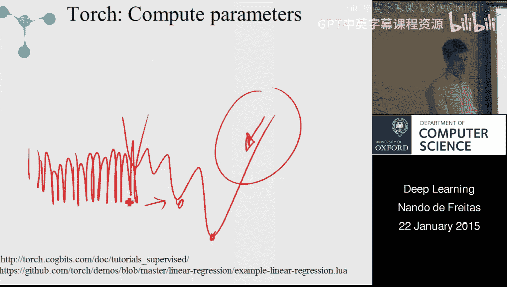

They tend to be like this。All right， thank you very much。看到。Yeah。I。

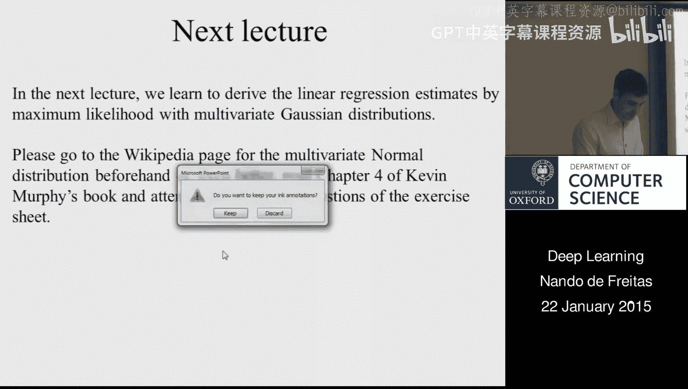

Yeah。I。

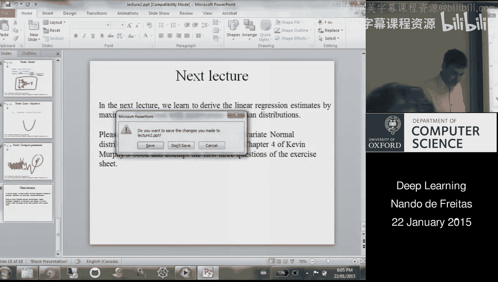

Yeah。Yeah。