# 牛津大学《深度学习｜Deep learning 2015》中英字幕（Claude-4-s） p03 3_ Maximum likelihood and information.zh_en -BV17NWWz6ErN_p3-

so we saw last week， we saw had to do a linear model and how essentially we write a we have some data which we have in the form of the table and then using we essentially express a table as the table of x's and y's as matrices。

And then we formulate to the cost function。In terms of those matrices and then we differentiated that cost function and equ it to zero to get a solution for the unknowns and that's essentially the least square estimate。

 So now if you have a bunch of points that are linear related and you want to find。

A model that predicts what the output should be for a particular input， you know how to do it。Today。

 we're going to say you do the same thing again。But instead of using an interpretation in terms of costs。

 we will start interpreting everything in terms of probabilities and this interplay between cost and probabilities is sort of one of the fundamental things that you have to master issue and go into deep learning and machine learning in general。

So to look at probabilities， we're going to revise Gaussian distributions。

 I hope you all went to the Wikipedia pages I asked you to last week and revised you what your Gaussian is。

 bell shaped curved， we're going to do a very fast revision。

But if you find you're a bit shaky with the concept of Covariious expectation and so on。

 then you do have to revise， you do have to go back to and if you haven't learned them before then just read the Wikipedia pages really。

嗯。We're also going to then。Formulate regression That is the fitting。The points to align。诶。

In terms of a probabilistic argument and in terms of a principle of learning called maximum likelihood。

 which was one of the dominant one of the I I guess great achievements of statistics last centuryric and then we' going to we're going to trying to sort of dig deeper into this principle of maximum likelihood learning and trying to see how does it relate to how cognitively we learn humans could learn again。

 Ive I made this argument last time that if what you imagine and what you see are not the same that you have to learn that you're not able to make predictions of the world about the world and so in fact people who have some mentalal disorderisms。

 they start imagining things because it's not coming from the senses it's coming from the heads and you saw that you imagine most of the visual scene。

 you believe that you see the visual scene but。Hopefully those solutions that I showed you convinced to you。

That you actually are not seeing most of what you think you're seeing。 It's coming from your head。

 And if that rewiring gets mixed up， then you start seeing things that aren't there。

 But they're just as realistic as the things that are there， because。If you can't tell a apart。

Two things because a switch is wiring gating to a different from a different channel。

 then you really get that experience， it's real so if you have some formal schizophrenia and so on you feel you're being threatened all the time you really are being threatened all the time by somebody alien or whatever and it's a terrible thing。

And so understanding how we imagine and how we sense and how that determines our experience of the world and how we learn is to me one of the most important things。

UTo do。Much of our experience of the world is clouded by how we's thinking that day。And so to me。

 that's one of the。Key things makes us human。嗯。We're also going to look at this from more mathematical principles and from sort principles of information。

 so we're going to look at this concept of probability and hopefully by the end of today's class。

 we can for very simple probabilistic models， very simple models we're able to talk define clearly what we mean by entropy。

 what we mean by information what we mean by likelihood， probability by learning， by loss。

 and we're able to relate all these concepts and know how they all connect。Together。

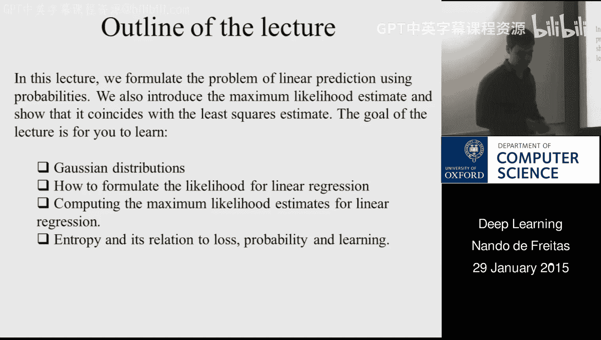

Okay， let's talk with。A revision of some basics， speak purple。

So the first thing is you need to know what a Gaussian density function is。

 it's essentially this curve here， it's a function of x。If you plot this function of x。

It looks more or less like this， so the x axis here would be x。

 the y axis is the density function P of x。And we know some properties of this density function。 So。

 for example， we know it is。For a Gaussian distribution。

We know that its center is what we call the mean。We know that。

The way we describe it is with this parameter sigma squared。Wwhich we call the variance。

 so the mean and the variance are the two parameters if you so you have this belt curve。

 if you know the mean and you know the variance you can draw it so we call these guys sufficient statistics。

Because they are sufficient to describe the whole curve。 So if you know these two values。

Which we refer to as parameters。Or sufficient statistics。We can describe the process。

 and so there's one more thing that we know about。These guys， densities， oops， sorry。

 let me not complicate this。If we have the integral of P of x。

 dx between minus infinity and infinity。And by the way， throughout the course。

 I will just draw this as the integral of P of x。DX。

 so I'm not going to write minus infinity to infinity， and if I don't。

 then you should always assume that it's over the entire space。And the answer is。我好啊。

I am very happy to hear that you guys are all on board。😊，豌豆腐。And。

Which means that the area under this curve is。Has a name。

 what's the area under the curve of a density？C意。Probability。

The area corresponds to what we know as probability。Okay。For probabilities。

 if we want to have discrete variables and continuous variables in the same grounding。

 the type of integral that we use is something called the Labe integral。

 it's not theman integral as you saw in calculus is to find slightly different。

 the definition in Wikipedia is very clear and the main reason is because the Riman integral is the limit of this sums of f evaluated at the point times the delta integral and there are functions for which sum does not converge to a single value。

The sum diverges and when we play with real numbers functions that are for example one at the irrational zero at irrations you can get things that diverse so that the re sum ends up being insufficient and so there's this minor refinement that we do to use Labe integrals for this course the type of problems we're going to deal with don't require that we have that knowledge so we don't need to go into those details but if you do go into courses in nonparmetrics。

 nonparmetric machine learning and statistics then you do have to get a grasp。

Of the differences the subtleties that between those integrals。 But for now。

 we can just a good mental model to have。Is that if you have an interval。

 a finite a small interval of with Dx， you can think of the probability。PDX。

As the height P of x times the width dx。

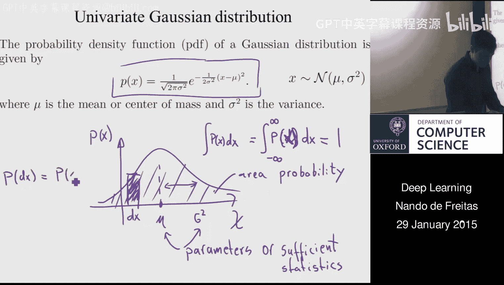

So very much as we do for say agreement。

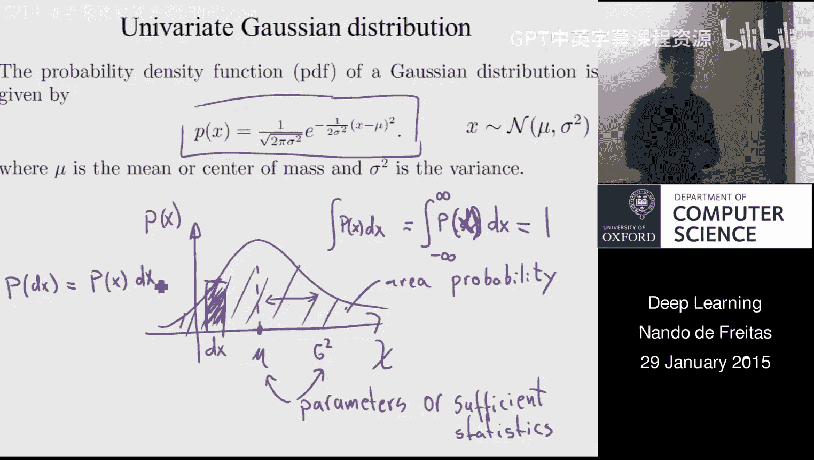

Because it's the area under the curve at an infinitesimal point。

And so often and this I just mentioned to you because of what you might find in books that might confuse you。

 you will often see this written this way， or you might see it written as P of，Dx。So。

If you ever see this， its people are referring to the same thing。But in this course。

 I will use a classical thing， which is like a Raymond integral。So the areas， the probability。

 the curve sacity， think sum to one， and had you had many points？

What this is saying is if these are data points， if the red circles are data points。

 it's much more probable that you'll find red points that the height of the curve search is indicating how probabilityable it is that you'll find red points in that area。

So if you look at this interval， this interval will have many more red points than this other interval over here。

We call these details。Of the distribution。I guess think of a cult tails。

And the reason why the parameters are sufficient statistics is because if you had a million points distributed according to this。

 that is that the number of points in a particular interval is sort of proportional to the height of this curve or the area of this interval。

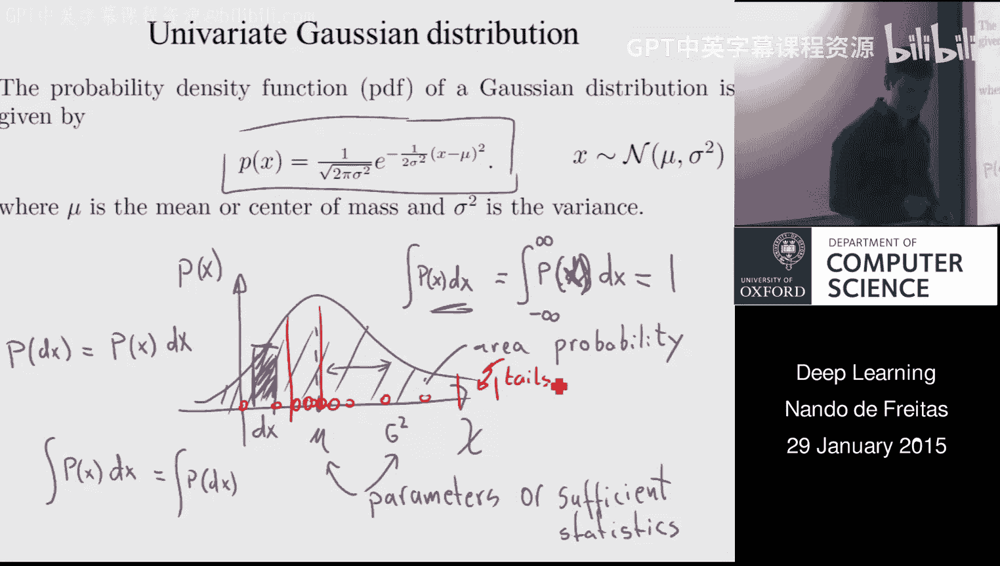

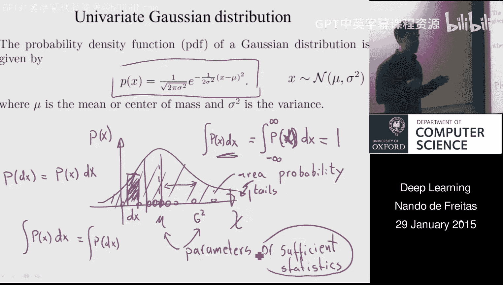

If we had。Points that were distributed according to that in that proportion。

 then if you knew mu and sigma by knowing new mu and sigma。

 you're not exactly the proportion in which the points are going to be distributed。

So if you have a million points in your compute mu and Sigma。

Then you don't need to store a million points because mu and sigma are enough to reconstruct the properties of the points in this case。

 how they are distributed， and that's why they're call sufficient that they theyre enough to reconstruct the properties of the points。

As we go to more complex data with our parameters， for example， in our convolutional models。

 are sort of filters that we get， like little faces and little edges and so on。

 those are the sufficient statistics that allow us to talk about all the images in the world。

We're trying to find- despite the fact that you might have， you knowrillions of images。

 we're trying to find a representation that is small and succinct that describes all of those images because from that perspective。

 we've been able to compress the world into something that you can fit in a computer。

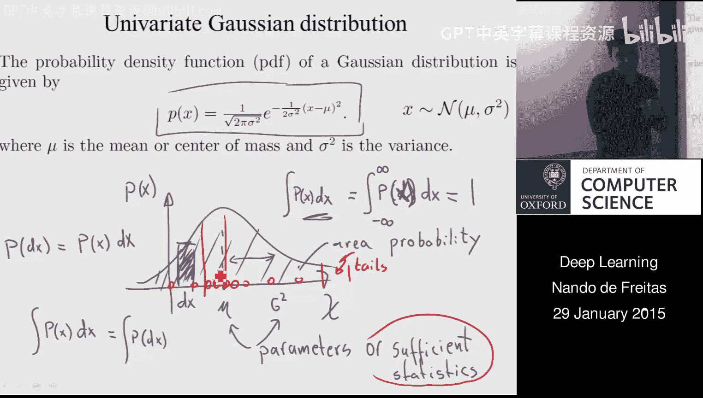

Okay， so。Often I'm going to write p of x， so that's similar to if I write p of x。

 and that is a way of saying that this is a Gaussian distribution that has been mu and that has various sigma squared so now this is just notation by saying this I'm just saying my data follows that curve。

 follows a Gaussian distribution。This is also the symbol that's used to simulate。

And st is the same as imagine。Or hallucinate or depend of。Jeff Hampton loves hallucinations。I mean。

 he loves to use that word。嗯。And。When you simulate from the model。

 you're basically drawing random numbers according to that distribution。

 so in a computer you can say giveive me access that are distributed according to particular mean and a particular variance。

And。The waiter is done in a computer。Is follows the following scheme。So first。

So suppose you have this curve。That is like this。The Gaussian distribution。

If we want to draw samples from a Gaussian， then a common trick。Is to。

Be able to draw random numbers from a uniform distribution。

 so a uniform extends from zero to one and it has high1 and then the area。One by one is one。

 so it's a probability distribution。And so a typical trick is you draw a number here。

You then project， oh， I actually made。I made a mistake with my drawing。I need to draw one more thing。

Okay， so we're going to extend this。I forgot to define an important thing。

 so we have the density is here， so that's x， and that's P of x。

And then what I'm going to construct below is something called a CDF。And what the CDF is as you move。

 imagine moving from left to right and as you're moving you're summing the area that you encounter so when you get to the end the area is one。

 initially the area is zero， so if you plot this curve，And exactly at this point。

 you would have seen half。Of the area and beyond that， you would have seen all the area。

So the way we then。So we compute this function。Which will look something like this。

That's the integral。That we call the cumululate density function of x。Does this still X？

And so now going back to how we draw numbers from how we draw draw is another word。

This is just like throwing the dice， except we throwing the dice with continuous numbers。

 And what we do is we provided you know how to throw the dice for a。Uniform random generator。

 you can then generate samples from any of the other 1D distributions because you essentially build a cumulative。

 you project it， where it intersects， you map it to the domain。So you map the image of the main。

 and then you get your sample。And if you keep doing this。

 you sort of kind of can see that intuitively most of because the function is steep there。

 you'll end up with many points around this area occasionally you get points drawn over there。

 so the proportion of points will be distributed according to the right density so in a computer this is called the InCF method and it's a method by which if you have an RD function which is actually a pseudoraum generate in your computers provided you can generate a sequence of pseudoad numbers from zero and1。

 you can outraw， you can generate sequences from other distributions。So this process of is。

What I will often say that if' sample。Its sample or hallucination or simulation comes from a distribution P of x。

So if you have lots of data。Like this。You can compute the mean and the variance。

 and then you can draw the curve。But if you also know the statistics， mu and Sigma。

 you can generate data， so we have both the ability to do both things。

 how to go from data to mu and Sigma and given mu and Sigma how to generate data。

And we always need to be able to do this so for simple distributions this is what you would do for much more complex distributions we'll see throughout this course how we would go about generating good simulations。

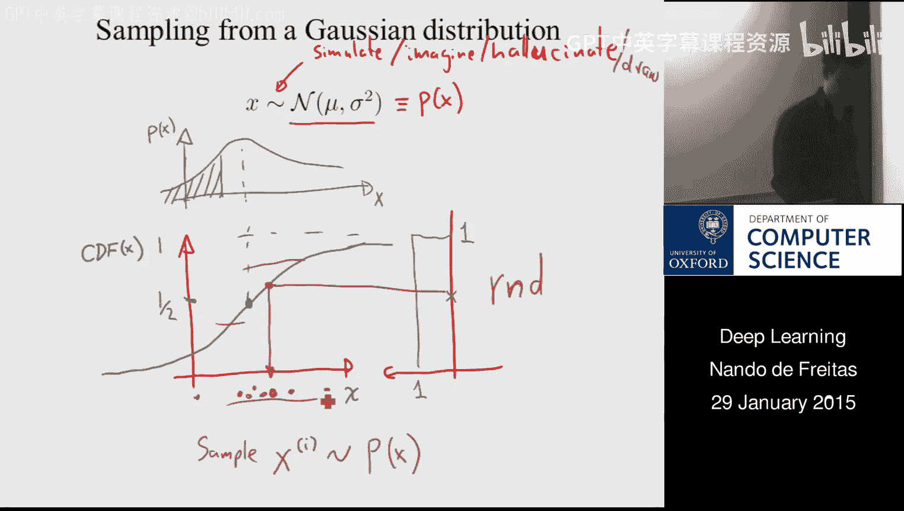

Okay， some more revision。Actually， before you read this。

 let's start with a very simple concept expectation。The expectation of a random variable x。

 which I used as symbol to denote it。Is the integral of x times P of x dx。

Which for a Gaussian distribution is just the mean， right， because the mean is。

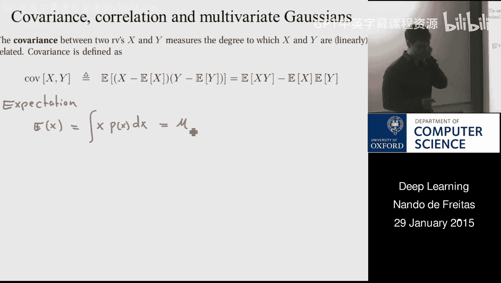

The mean is the center of mass of this distribution。

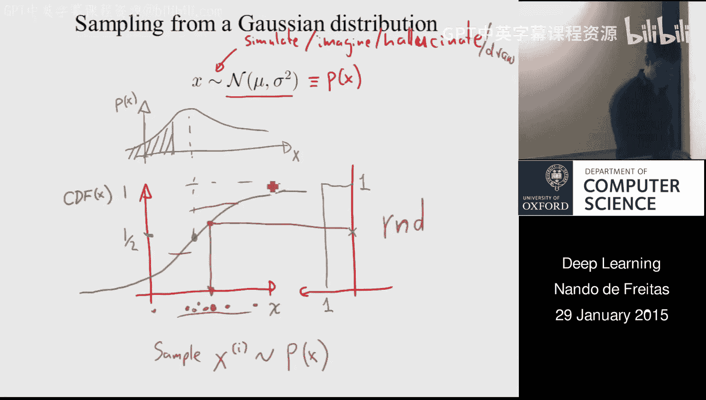

And that is the definition of the mean， it's also called the first moment。

And one of the ways we approximate this is。And I will use this symbol to mean approximation。

Is if you had n samples from this Gaussian distribution。You would approximate it this way。

In other words， you would sample all the。All the data。And you're divided by the number of data。

 So if you had a。Several real numbers， 2。1， 2。3， 2。5， and that is your data。

 you want to compute mute， you simply compute the average。

And there is something called a lo of large numbers。And that tells you that this estimate， this sum。

 actually does converge to the integral as the number of samples goes to infinity。

And we also know how fast it goes， there's a lot of theory which I'm sure a lot of you saw like opening bandss on last term。

 youve got to get a good sense of how quickly these estimators converge。

 another way to think of this。

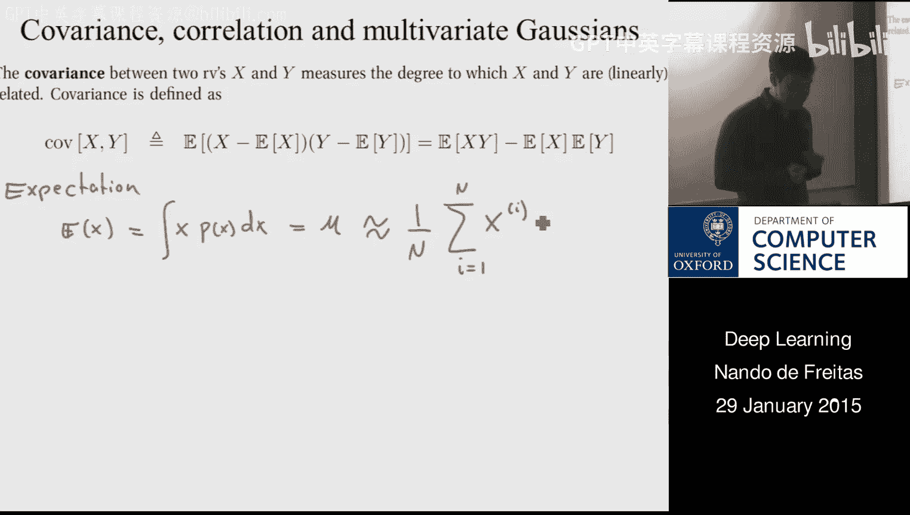

When we go from here to here。Is to think that what we're doing is we're replacing P of x。Times。

We're replacing this with。Histogram estimate。In calculus， there is this function called delta。嗯。

And delta is defined basically this way if you multiply delta at a times the function and you integrate over the whole domain。

 you essentially evaluate a function at that point So a delta function think of it as a sampling function。

 it just samples the function at that particular value。

And so what we're doing essentially is we're replacing。嗯。Our expectation is being replaced by x。

 and then we're putting here one over n。Some of Dltas。At X i。Okay what's that？So miss。

Let me know if I made any mistake on the slide。Oh。So essentially what you're doing is you're replacing P by a several deltas。

 in other words， instead of having a continuous distribution over here。

 you're replacing by something that's a bunch of spikes。Not necessarily at regular interval。

 but at irregular interval， so were sampling the distribution at points。

 we're replacing that inside and then if you apply the property of the deelta function。

 that's how we get to this。Delta， oop， sorry。That is how we get this excile。

And this in most machine learning problems， the samples are data cases， so N is the number of data。

 we will have many examples and you can think of nature as a distribution that's giving us data。

And from that data， we will infer properties and the rate at which does。

Conclusions that we draw from the data are true converging to what would be true if we had to preserve all the data is something that theoreticians devote a great amount of time we're not going to look into that but this interplay between sample average is an expectations is essential you always we will be always switching between the two so you always remember that sample average is just a finite approximation to an integral So integral is sharp P complete that extremely hard it' one of the hardest computational problems。

However。And as the dimension increases， however， approximating sums is one of the ways in which we can attack that problem by drawing samples at the right places。

 and this is a statue folks called the Monte Carlo methodod。What we've just seen comfort today。Okay。

 so one more okay， so now we can look at covariance so we've seen what the mean is and if you have two variables x and y。

Then the mean of variables， x and y。Of x and of the vector of variables， x and y。

 if you have two possible variables， that will also be a vector and that will be just mu x and mu I。

Okay so you now have two meanss， one in x， one in y。And one way to think about this。

If you have two random variables， x and Y， I'm avoiding having to define random variables and from scratch you can think of random variables as quantities like temperature pressure。

 they have some uncertainty associated with them， like the what is temperatures just the result of many particles in this room colliding and so on it's not a。

In many sense， it's just this macro variable that we used to describe a phenomenon that involves very detailed。

Interactions of our particles， and you should think of random variables as just like that。

 they're just variables that we used to describe some phenomena and they have some noise associated with them。

So in particular， if you have variables x and y， you might find that you。

You might have one realization that says this is what x I observed。

 this is the y that I observed when I observe this x。You know。

So they might be related somewhat like this。So you observe data now and now the data has not just one dimension as in my previous slides。

 but now the data has two dimensions X and y， so they points in D。

 each observation could be say the height and the weight of an individual。

And so one natural question that we ask is how does height relate to？

Weight of individuals and so we get to this the concept of covariance or which is also related to correlation。

 even though I want to find correlation precisely， but like in this case for these points we observe an interesting trend which is。

If you increase x， then on average， the variable y also seems to increase。Right， because。I mean。

 we see that there is this trend here， so the higher Dx values， the higher the y。嗯。When that happens。

 we essentially say that the variables x and Y do covarirate or they have a strong correlation in this case a positive the way we measure that is with this concept called covariance which。

Which tells us how variable x and y are related in this linear fashion。And to compute Cavarias。

 it's just like how you did various in high school or earlier in in university。

 you subtract the means from each variables and then you multiply them。

And you also can talk about variance， which you could call。

 say the self covariance where you have x minus mu x times x minus mu x minus the expectation。

So recall that this is what I'm defining as the means UX and U。

The expectation is to mean and then in one D， the variance just gave you told you how broad the Gaussian was。

 but now you have more degrees of freedom you could have。Something that varies like this。

Or you couldn't have points that are。Sort of maybe placed in a circle like this。

You could have something that varies where x and y vary。In a negative。Relationship。When you have。

The points distributed in this way， like circles， then essentially by knowing X。A particular X。

 you can tell little about what all you can say is basically an expectation for that x your y is going to be zero。

 but you can't tell whether you have very you don't have much information about。The y variable。

 whereas here by。If I know my value of x。Or all the information you have is that it's zero or an expectation。

 whereas hereby knowing the value of x， I can tell that my y is going to be high。

 so it has a positive correlation。

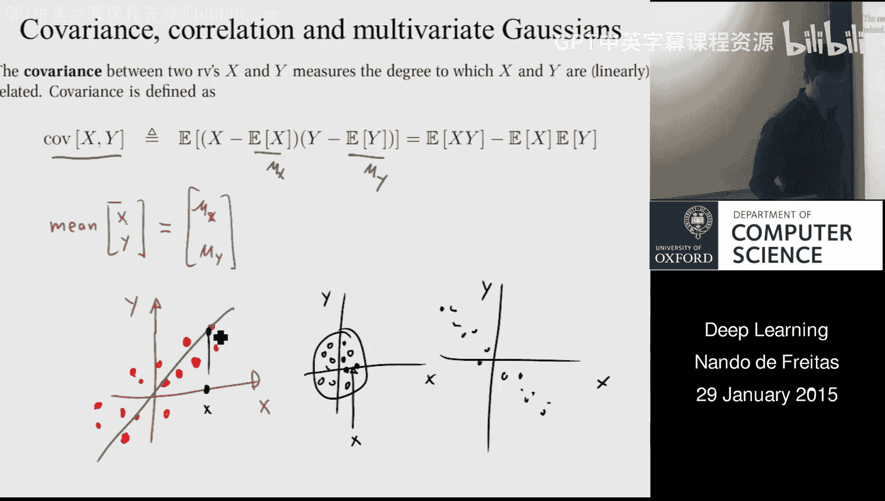

So。When I use， instead of using a X and a Y。I now plug in here the same vector x。

 and I subtract the mean of x， which is a vector。I get and I write this covariance。

 I end up with this matrix expression， which essentially is looking if my vector is got d dimensions。

 I'm essentially looking at a covariance or the linear relation between each dimension and every other dimension。

So the self ones are called thevaris， the other ones are the covariances and they essentially tell me how linearly related each dimension is。

 so I have a vector in high dimensions that this could be for example。

 DNA profile from one of you could be like say the exps of 20。

000 genes and I want to know how these genes are related are correlated with each other and this covariance captures it statistical a very simple。

 very simple statistical way of capturing that。

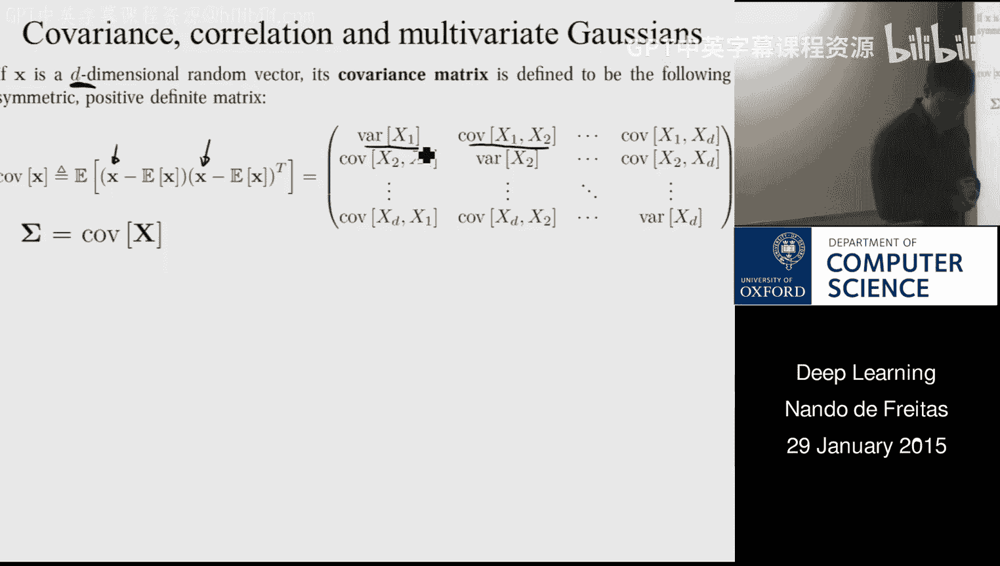

This allows me to not define a Gausian dis solution in high dimensions。

 a Gaussian dis solutionion in high dimensions。For example， as I show here in 2D。嗯。Looks like this。

 So you have X。X is now a vector that has two components， x1 and x2。

So that might we may define this as x2， this as x1。So it's the function in D is still bell shaped。

When you draw samples from it， this is how the samples look like so that the samples are points in 2D。

And depending on what the covariance is， you could observe any of these scatterpls。

 we call these scatter plots。And so here I have。I've chosen to the。Covariances， they look like this。

They're symmetric matrices。嗯。So covariance x1 x2 is the same as the covariance x2 x1。

And the actually symmetric poit are definite matrices。

 for those of you who have encountered that concept。And so if we have covaris therefore 4 by 4。

 the means are  two by 2， that means that if our points are in 2 d。

 the important thing here to remember is do you need five parameters to describe your points。

 you now need to know mu1， you need to know mu2。

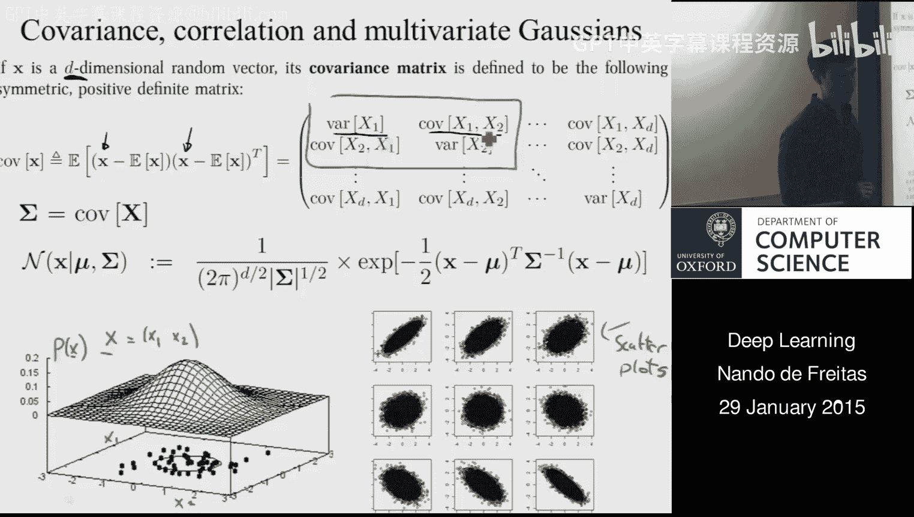

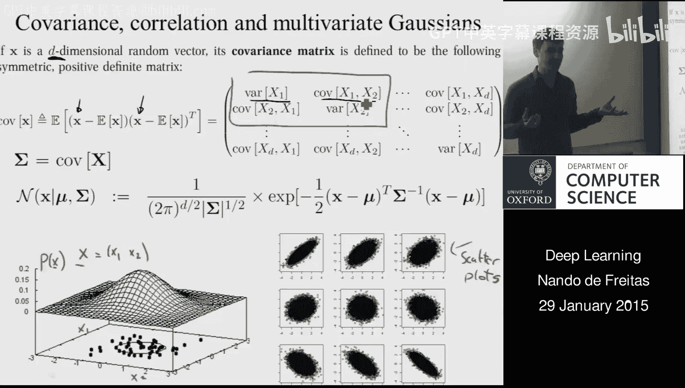

The two means。And you need to know the two variances， the two diagonal variances。

 and then you need one of the off diagonals， and if you know that that's enough to describe data in 2D。

 So if your data is described if the data that you measure for， say height，And wait。

Of your patient is。Distributed in this fashion， x1 is high， x2 is weight。

're able then you know that if you want to throw away all the points and only retain the quantities that fully describe how those points are distributed。

 you would just keep those five numbers。

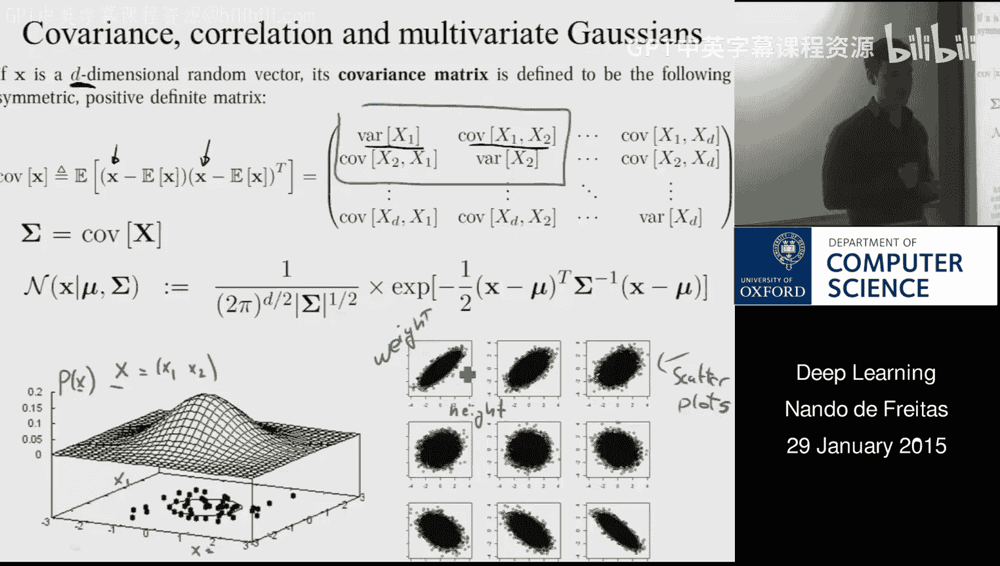

Okay。And so。So that's essentially a Gaussian distribution， a multivariate Gaussian distribution。

 Okay， so moving on。嗯。One of the。Properties， suppose now you have two Gaussians。

 a Gaussian4 in one dimension， another Gaussian in another dimension。

 and let's assume that these variables are independent。

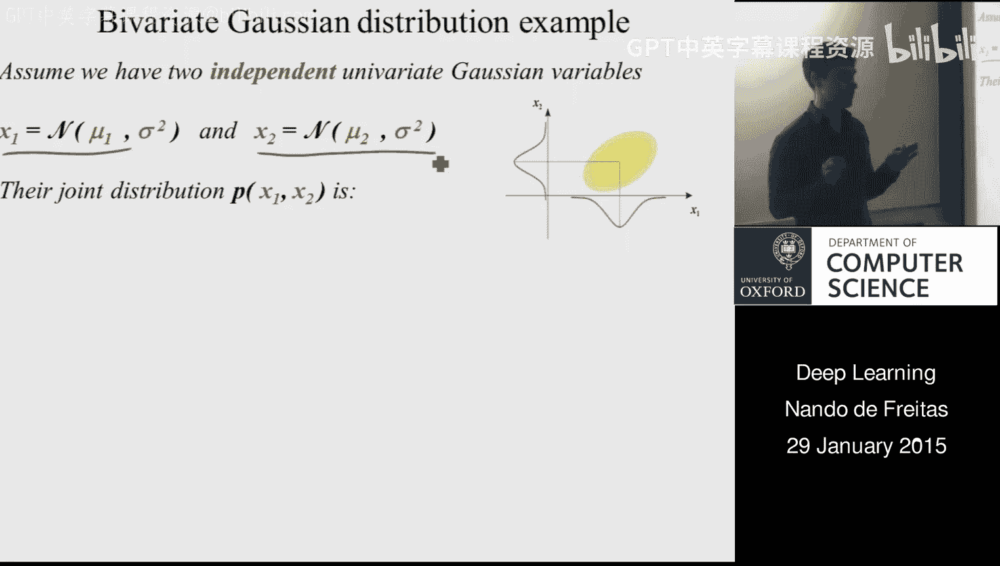

So in statistics， if we have a joint distribution。We can use the conditioning rule。

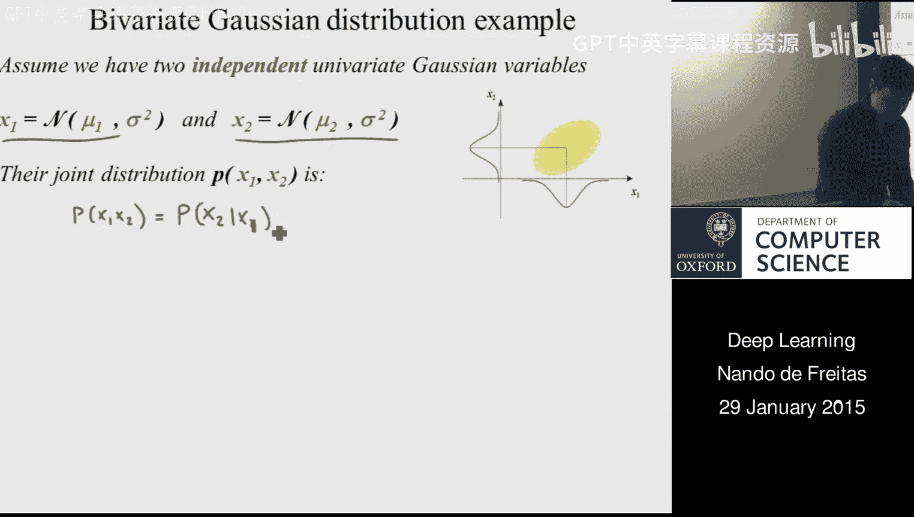

And the definition of probability of A and b is probability of a given and B times probability of B。

 that's what I'm using here， if variables are independent。

 what that means is that x2 does not depend on x1， so x2 condition on x1 is no matter what the value is x1 it doesn't affect what x2 is。

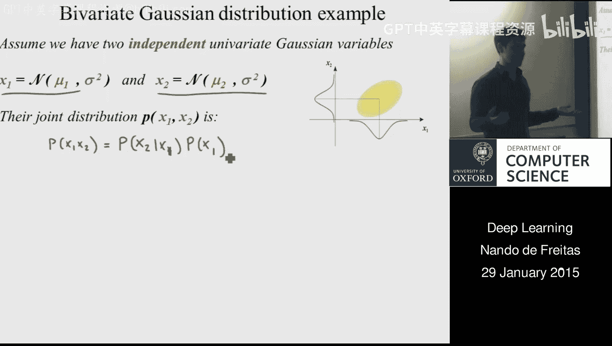

And so。

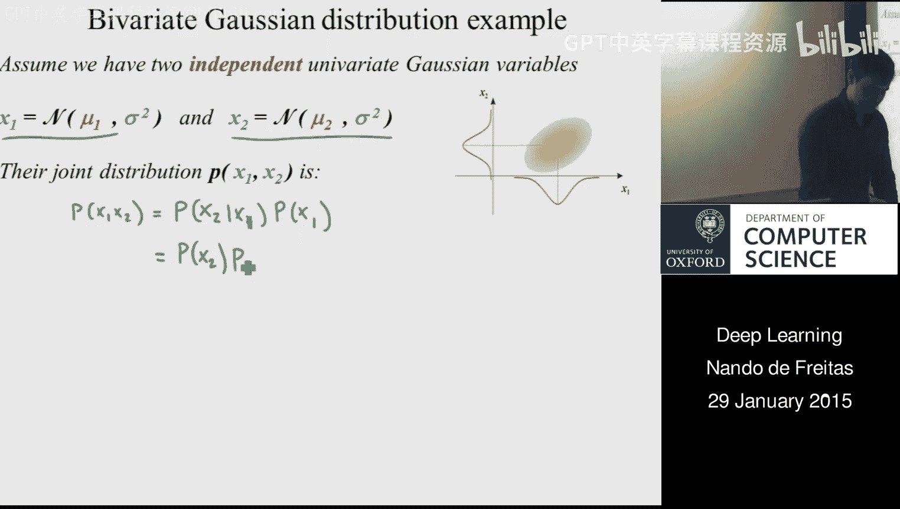

Independence just means I can drop the x1， x to given x1 need not be there。

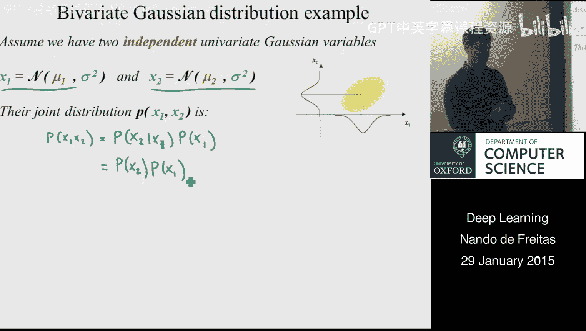

And I can now write the expressions for these two。Distributions。X1 minus mu1。Squared。

Times2 pi sigma squared each to the minus1 over two sigma squared。X2 minus near2。Square？

And I can group terms， and I can rewrite this as two pi。Sigma。

And I'm going to define sigma to be the matrix that's going to have sigma square。

 sigma squared0 and 0。So。That the determinant of sigma。Is equal to。Yeah， sixigma。Basically。

 sigma squared。To the power too。And that allows me to write。Oh， I forgot the square root。

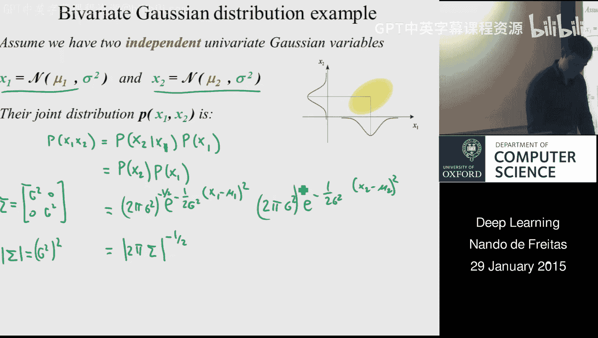

That allows me to rewrite the product of the determinants of two pi sigma squared and the other two pi sigma squared in terms of matrices。

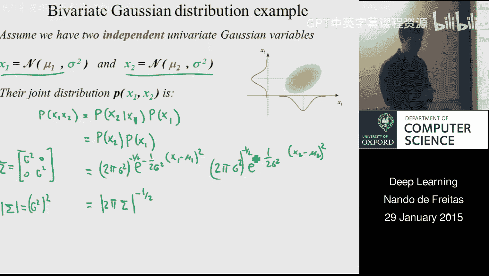

And one property of， if you have a scalar times a matrix。

And that is two by two and you take that scalar out。

Because that scalar is multiplying each of the sigmas， it's a times a， so you have to square。

That's Ka。So those' are some basic properties of determinants。And if we proceed， then。嗯。

I have e to the minus a half， and if I group terms， I can write this as x1 minus me 1。

And x2 minus mu2。Times sigma squared0，0， sigma squared。And I have x1 minus mu 1。And X to。Mus muu 2。

And。Let's use a curly bracket for this to make it clear。And I can rewrite this in this form。

And so this is two pi sigma。To the minus a half。And I could write this now in matrix notation as the vector x minus the mean vector。

Times sigma minus1。And you can make this transpose times the vector x minus the vector mu。

Where the vector mu is the vector that has mu1 and mu2。So basically what should be a minus one。

Oh yes， thank you very much。Because the sigma squares are at the bottom and I'm moving up。

 So I've gone kind of quickly over this calculation because I。

If you do machine learning you do these all the time。

 I advise you to at home go slowly over these steps and convince yourself that these steps are correct this is the multivariate Gaussian distribution the Gaussian distribution for more than one variables and the important thing here is the variables are independent if one variable is not affected by another variable that is manifest in the zeros in the diagonals of the covariance matrix。

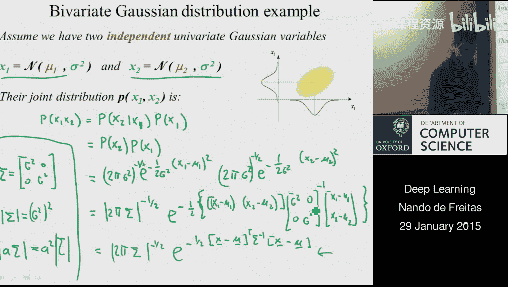

Okay， so now we can introduce the concept of likelihood。

Let's assume that we have observed three data points in the world。

 and now we're back to 1D and these data points are maybe three observations， 1， 0。5 and 1。5。

So you're measuring some physical quantity and you observe those three values。

And you believe that those three values are governed by a Gaussian distribution。And your task。 and。

 and you know that the variance is one。 someone， you have whatever knowledge that you have。

 you have strong reason to believe that the variance is one。 So your question is。

 what is the mean of those variables。 So what is the theta。And we know how you would compute it。

 you would just average them， right？The sample average was our approximation of the expectation of the meat。

Here what I'm going to try to， with this very simple example， introduce the concept of likelihood。

We're going to assume that these points are independent again， that these points are not interacting。

 like in for example， if I'm cooking I can't say that every action that I do is independent because whether I put something in the oven that depends on whether I actually put something inside that tray otherwise I'm just including an empty tray in the oven。

 so my activities when I cook depend on previous activities so in that case my data is not independent。

 each time depends on the previous thing and soon we'll see for most models we have to relax that。

But if all I have is realizations of images， I see an image and I see another image and there's no connection between these images。

 those images are independent and I treat them as independent data。

 so a lot of the data that we will encounter we will be able to treat as independent。

And so independence in terms of probability just means that if I have three random variables describing my observations or I have a random variable and I have three realizations of that。

嗯。I can decompose thus as there should be a two there as the product of those distributions。

 so independence means that PFA and B P times PFP。And so now let's assume that I tell you there are two possible values that Theta could have。

 2。5 or1。And then the question is。Which one do you think it's more likely？

be which theta do you think is more likely to be the one that generated a date？Any guesses？Yeah。

 if you just find the data one seems to be more obvious， the formal way to do this。

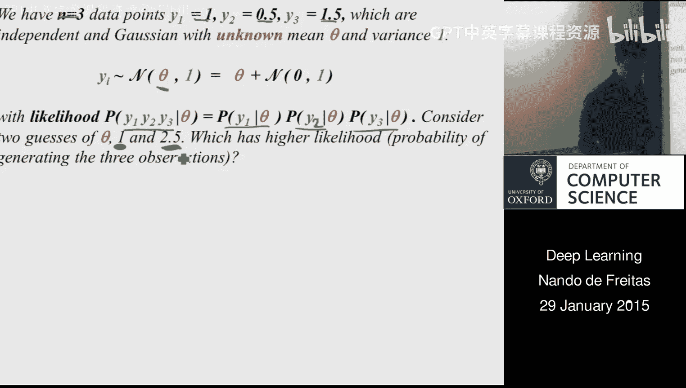

です。

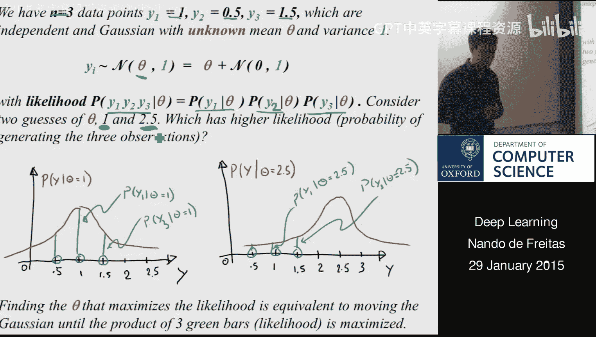

If you guess that theta is one。Okay that's your guess。

 you would plot a Gaussian that has mean one and various one。And if you believe that the mean is 2。5。

 you would plot a Gaussian。That has mean 2。5 and various one。

And then what you would do to evaluate these probabilities is you would look at the height of each of the observations。

 the observations being 0。5，1 and 1。5。

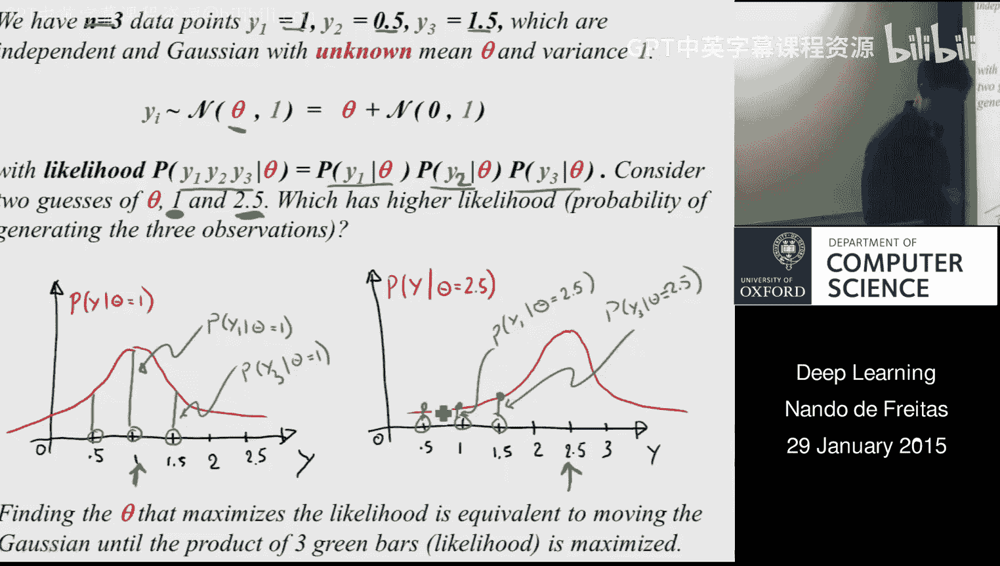

And then what we do is we multiply those three heights。

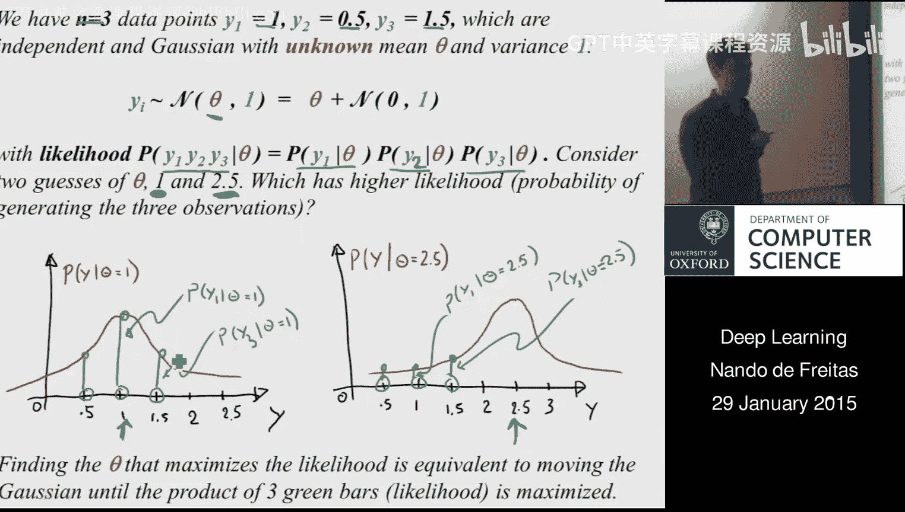

And the。The one that givess us the highest product is the one that's the most problem。

That's the likelihood， that's essentially maximum likelihood。

Each observation is treated as independent。We take their product and if the product is the highest。

 that's the one that's most likely， that's the one that we accept。And for this problem。

 this seems to be an overkill because we could have just averaged and that would be enough。

 but then we'll see that the same principle can be used for any of the models I described in introduction。

 whether it's a recurrent neural network or a differential tuuring machine and so on we're going to use this same principle。

To be able to figure out which parameterizations give better explanations of the date。

 regardless of what the data is， whether it's code or images or text。

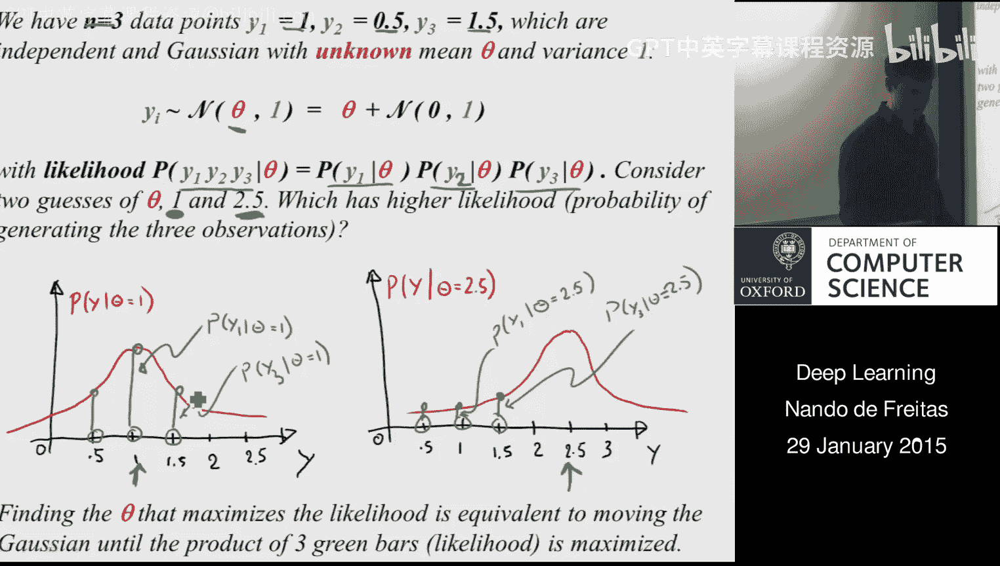

Okay。If you're Gaussian distributed with mean， so the first thing is if you have a Gaussian。

 you can just。Essentially this gives you a noise model about the mean。

 so if you have a random variable that is got this value。

You can describe it in terms of a height plus an oscillation signal。A height。

 which is this height and then some oscillation， so I can take this outside of the end。嗯。Yeah。

And so basically we've now what given， what we've been saying is that the Ys are distributed according to Gaussian distribution。

So now we're going to look at regression and we're going to allow for access as well。

 so now we have a process that takes access input and creates a Y is out。

The uncertainties is in the Ys， the probabilities over y x is given， there's no in our model so far。

 what we will assume is that there's no uncertainty in the x's。

Someone gives you X and then your goal is to predict why X is given to you， it's a no input。

And the parameters we're also going to condition， there's no probability in the parameters。

 the parameters of quantity whose value you try to estimate。

 and we'll see later there's something called basin sta which takes a different beyond this。

But from the perspective that we're looking at now of maximum likelihood。

 we're going to describe the probability of a vector whenever you have now regression where you had this vector of y1 all the way up to yn observations。

 and you had a matrix so we had this vector y and we had this matrix x。

Which had x1 all the way up to x1 D。And then all the way up to X and D。So他。

As we had in the previous class。Then to describe the distribution。

We will consider the distribution of each individual point y。

And I will soon draw a diagram illustrating exactly what we're doing。

 but if you do this and if you write a distribution for each point。

 so were basically say the mean of the point is a line， it's the line x times theta。

And the rest is kind of tedious math if you have a product of functions。

 special exponentials that e to the sum。And then a quadratic form。

 as we saw last week can be written as the dot can be vectorized and written as the dot product of y minus x feet。

So this starts looking interesting。 let me write it a bit more cleanly here because what you realize is that。

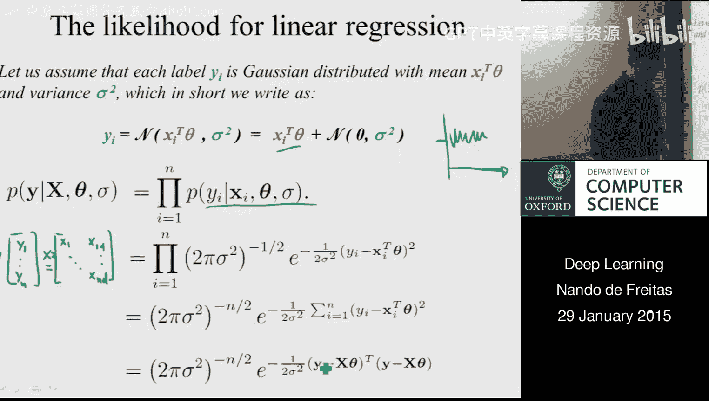

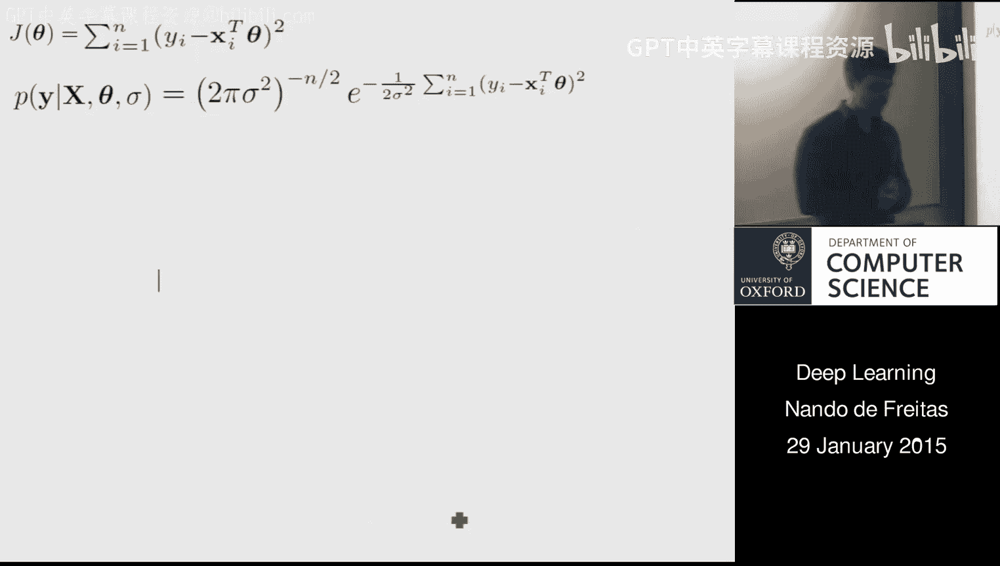

The probability。Of data。For some parameters。This line， by the way， I say it in words。

 but let me emphasize this line and my notation means given anything to the right of that line is given so you see it there's no uncertainty about it。

 the only uncertainties is about the variables that are to the left。

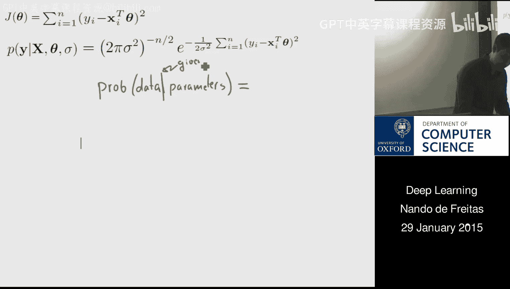

So data here is the random variable because the universe is giving us data by sampling from some distribution。

That can always basically be written as one over some constant， which we typically call Z。

 this is the standard notation for the normalizing constant。

 and it's the constant that ensures that things sum to one so that you have a probability distribution over the data。

E to the minus。Los。Of data。And parameters。Parameter。Okay， so if you take if you take a loss。

 you're negated， exponentiated， and then you divide everything to make sure that。

that you get an integral that sums over the data that sums to one。

 you get a probability and we will interchangeably go from loss to probability by doing this if you have a quadratic loss like this。

Oh， the mean squared loss。The mean squared error， mean squared loss， quadratic loss。

 then if you exponentiateate it multiplyied by a constant。

 which in this case is one over two sigma squared and defined it by the right constant which in this case is theres two pi sigma squared to the minusrs n over two。

 then you get a probability distribution， and this will be true for other types of data。Now。

 let's go and revisit our example last week， which was how to fit a line to observations X and Y。

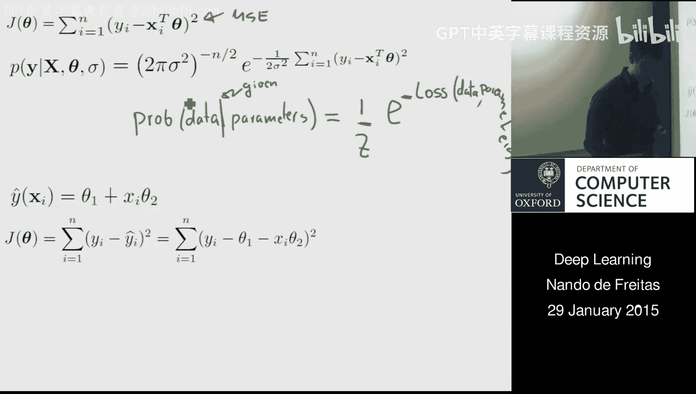

Okay， so last week we saw that， okay， so our model is aligned。

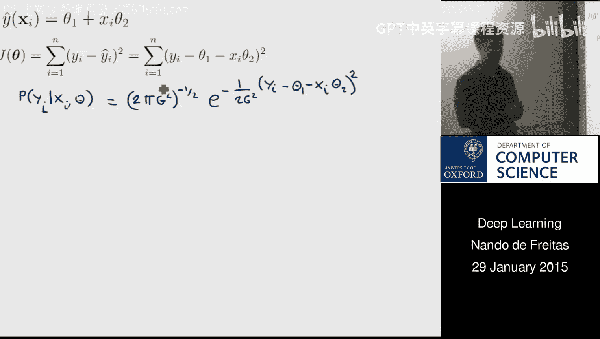

So。We have the setting is。We have the y variable here。We have the x variable。

And we observed several points。Something like， say this。Okay。

 and so what we did is our task was to fit a line to these points。And we did this by requiring。

That these springs come to a minimum energy point， so that was our way of minimizing loss so and in particular。

 each of these guys is a point。 these are the Y coordinates。These are sorry， the x coordinate。

 this is the y coordinate in it。And the prediction here is what I call Y I hat。

And why I hat is essentially Theta1 plus X items theta2。Is the evaluation of the model。

What we're doing with probabilities is we essentially are placing a Gaussian。At each of these points。

OkayBecause that's what we've been doing in the math。

 We said there's going to be one Gaussian for each y and we're going to multiply them。

 So I'm going to put a Gaussian here。The center of the Gaussian， the mean is x theta， is the line x。

Theta 2 plus theta 1。So I have a Gaussian like this。And then for this point， I also have a Gaussian。

And for this point， I also have a Gaussian， let's do one more。And。

The probabilities of each point are these heights in black。

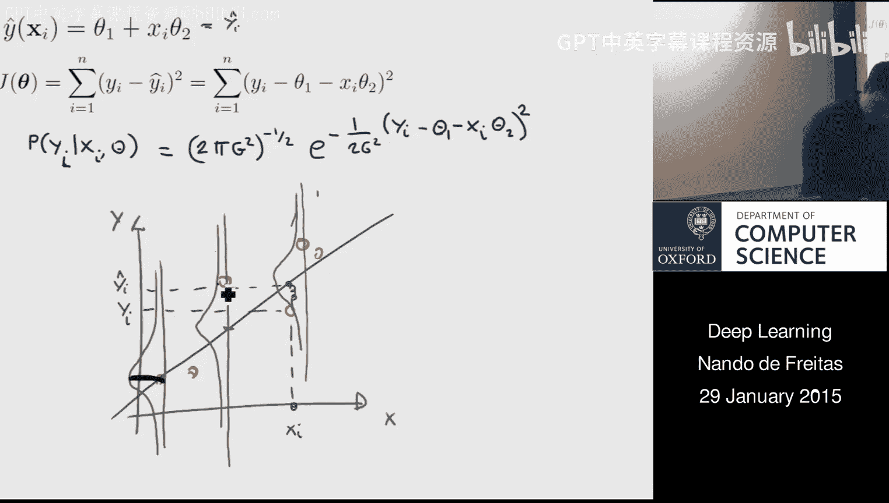

And I've only done it for three points， but you would to not flat my drawing。

 but you would do this for every point。 so each point is a Gaussian is distributed according to a Gaussian。

 So the uncertainty here is in the vertical just like least squares in least squares we minimize vertical vertical distances。

 our uncertainty here is in the vertical and instead of minimizing。

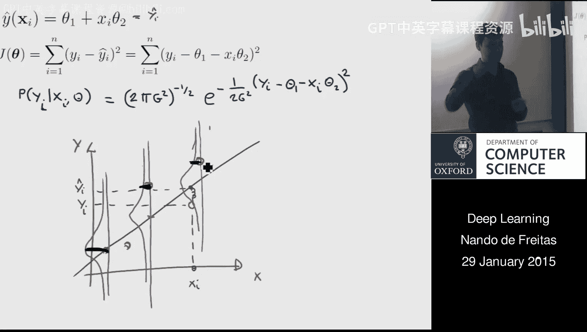

We can do two things， we can minimize the length of the springs。Or we can maximize。The vertical bars。

It makes sense because what we're doing with the loss is we're negating the loss and if we negate the function and then we just make sure that it integrates to one。

 but if you have a function，啊。个。If you have a function。

A probability that looks like this and you negate it， then you get the loss here you find a maximum。

Here you find a minimum， and that's basically all you need to know to。Compute theaters。

And this essentially is a visualization where you're doing with maximum likelihood。

 you're saying that each point the height is Gaussian distributed and then you're making those probabilities。

 you're making the multiplication of all the black bars as high as possible。

And you can see that you wouldn't have to shift， move the line until those。嗯。

The closer the line goes through the point the higher the black bar is。Okay。

 so this this forces your line to again equilibrate nicely at the data points Again。

 if we had outliers like I mentioned last week， this would be problematic， this model would fail。

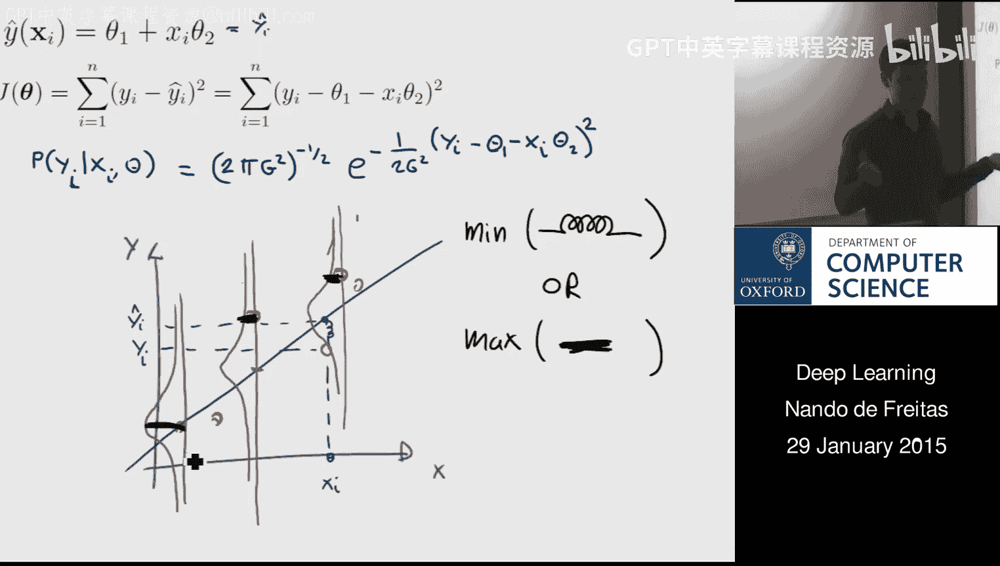

How do we compute this， Just like we did last week， the rest is really tedious。

 Once you know how to specify a distribution and you know how a distribution relates to a loss。

 basically， the distribution is each to the minus is a constant times the loss。

 If you want to compute the solution， What's the most likely mean What's the most likely Theta。

 One trick that we do is we write the log likelihood。

And it's called the likelihood as it tells you the likelihood of the data given a particular model。

And the local likelihood just allows us to write this in a form that is more amenable to do computing。

From analytical derivation perspective。Oh， I forgot a log。

Actually actually a question about the linear reduction of previous slide。かしていいんで。

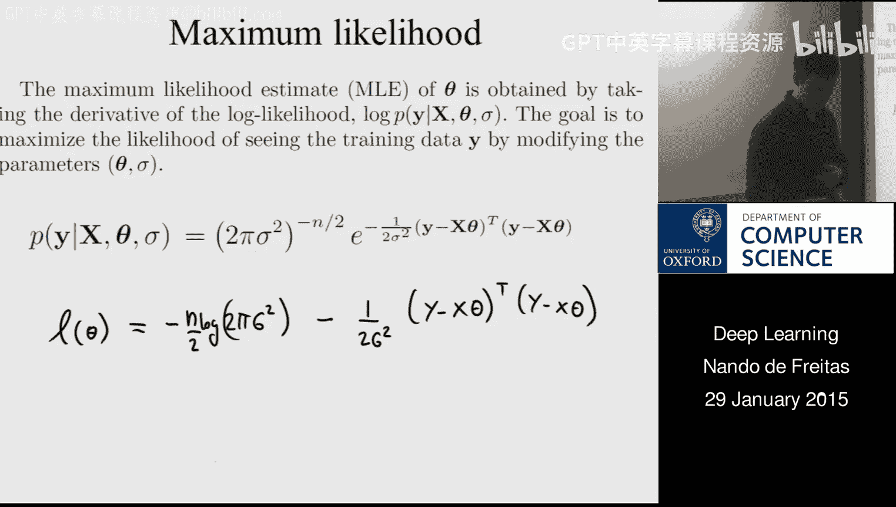

Eurgical business。As opposed to the organ。Oh yes， that was a question someone paused last week。😊。

This is not ideal。 As I mentioned， one of the things you would want to do is measure the distances like this。

For example， what' design with。Oh， the line was particularly you're in trouble。So。Oh， yes。

 but under the maximum likelihood perspective of the Gaussian。

 as we've defined it with the uncertainty device， the least squares， you are in trouble。

So you can also take the square instance before to coming into the environment。

But that would not be the same model， there'll be another model and this is what we do in statistics we look at this。

 we have a model， I mean in school you've been using this model all the time and you believe it and you do calculations。

 but indeed you soon realize that this is just a model。And sometimes to describe data。

 you need to come up with better models because this model will not suffice。

And you have to be very careful when this points out vertically。

 and that will be motivation for the next lecture。

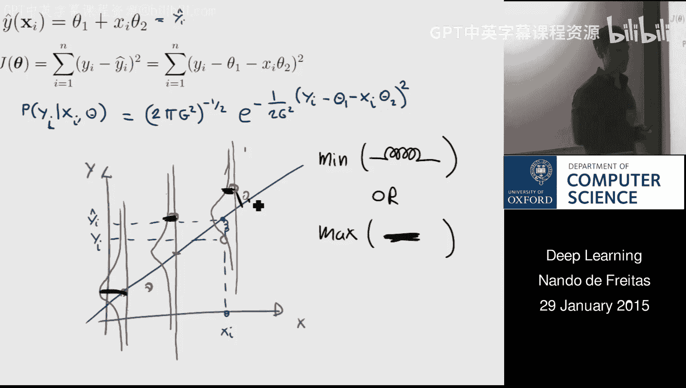

But to finish this here， just a few more mechanics very quickly， we write the log likelihood。

 sometimes we write the egg。Log likelihood of Theta， which is just。And over two， we just neggate it。

Okay。And the reason I ingate it is because now it's more obvious that this is a loss function for both x and both theta。

 so by taking the negative log likelihood we go from probabilities to loss functions or loss functions as I mentioned。

 they're also known as energies and so on。So you need to maximize the goal here is to maximize this。

 the goal here is to minimize。T the minus of a function just flips it。

And so if I want to maximize and the lock is a monoonic function。

 so it doesn't change the location of the optimum， so if I want to find a maximum for probability。

 all I need to do is find the minimum of this loss。

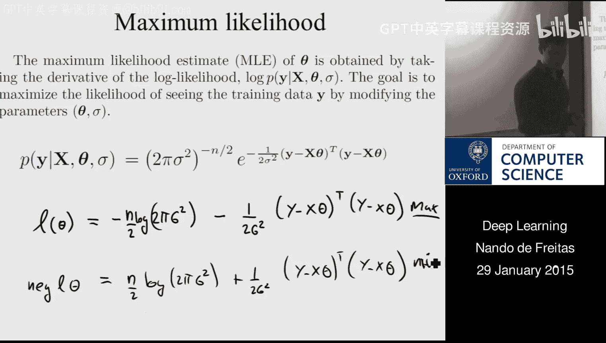

And so I need to compute a derivative with respect to theta。

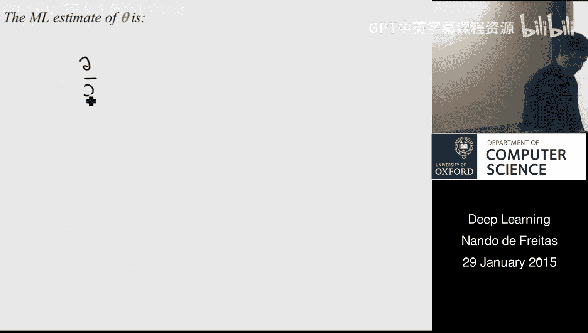

Off。The first term doesn't matter because it doesn't involve thetas。

 and so I just need to compute a derivative with respect to theta of one over a two squared。

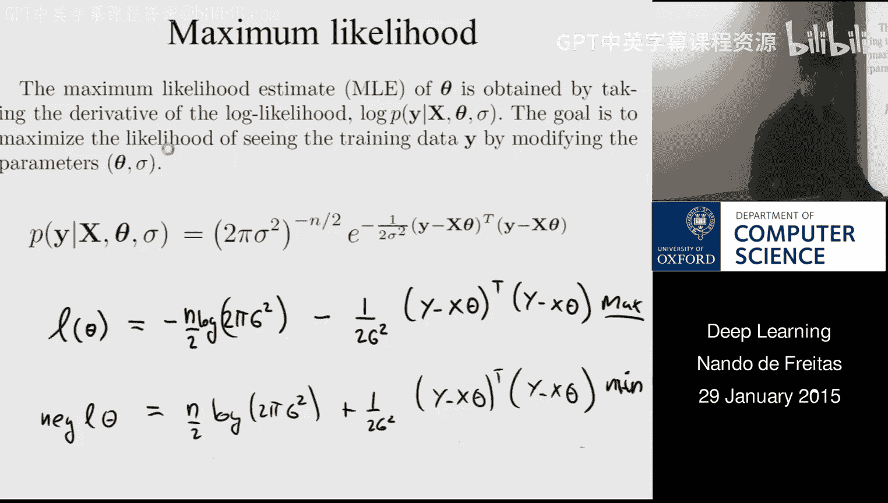

Two sigma squared y minus x theta transpose。Y minus x theta n equator to 0。

But this is exactly the calculation we did last week when we compute the least squares。

 and so once again， when we equ to zero。😊。

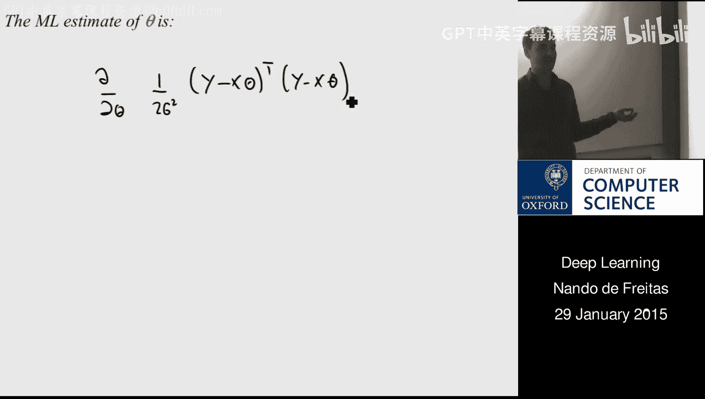

We get that the theta maximum likelihood， the estator maximum likelihood。It's x transpo x minus 1。

 x transpo y， we get to say mass。As before， so maximizing the likelihoodli。

 this is the mathematical way of algebra way of verifying our picture。

 maximizing the likelihood is the same as minimizing the law of the quadratic loss。

And you can also do it for the various， so I did it in more detail on the slides which I'll upload this evening。

 where you take the river effect back to the various you solve for the various and you get your standard estimate of the various so not surprises there。

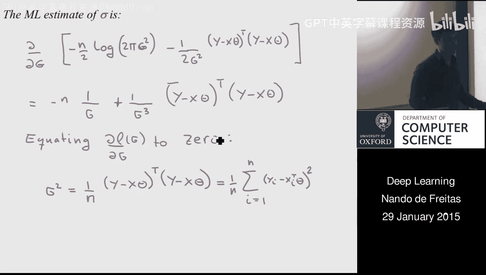

嗯。If you need to compute make predictions。So， now you learn basically the process of learning gave you theta 1。

 which is the slope and gave you theta n。 So if you're now given a new test point。

That you haven't seen before， if you want a computes most likely the corresponding most likely value。

 you say you compute the mean and that's your prediction。

 so the prediction is you evaluate the likelihood you it at that point。That's not what patients do。

Basients do something called marginalization， they would integrate over all the possible values of theta that you could come up with。

 they assign prior to theta， I'm not going to do Bayesian statistics in this course because I just don't have enough time to cover it all。

 but be aware that when you bin frequentists using optimization techniques but we're going to be using throughout the course。

 we get very good estimates of the function but often we have terrible estimates of the uncertainty unless we introduce more sophisticated models。

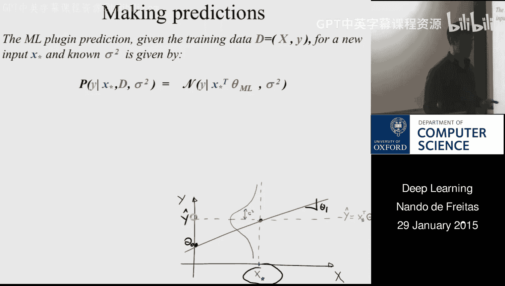

The baseway。Using a posterior predictive mean tends to be not confident where there is no data。

 which is what you want。Maximma likelihood is overconfident。So this is problematicmatic。

 keep this in mind， you're good where there is data， where there is no data， don't trust it。

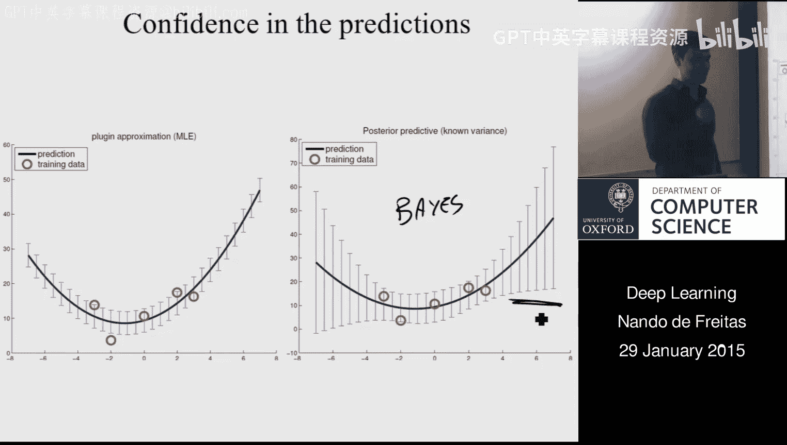

嗯。Quickly another random variable we'll use in this course is the benoulli variable。

 this is the other simple distribution， it's just a distribution for a coin with probability theta。

 the coin is tails with probability1 minus theta its heads and so if the coin is01 you can write the probability of it being 0 or1 of x being 01 as in this form it's either a theta or 1 minus theta if you sum the two you get one you can draw it。

This way you can draw it with a picture or if you really don't like to write too much then you very succinctly write it in this form theta times1 minus theta and then theta to the power X and then one minus theta to the power1 minus x this is the form that you will find in described in all the neural network implementations so Brnoulli noise is very useful when were doing classifications you're trying to predict for example whether a patient will is healthy or not healthy so the output of the neuron the output of the neural network will be governed by Bernoulli distribution。

And essentially this is where probability is going to come in。

 how we interpret the outputs of the neural networks。

 and so that just gives us a succinct way of describing it。

 you can also compute a maximum likelihood estimate and no surprise theta will be the number of times you saw one divided by the total number of coin flips and you can verify that by computing the log likelihood differentiating with respect to theta and so。

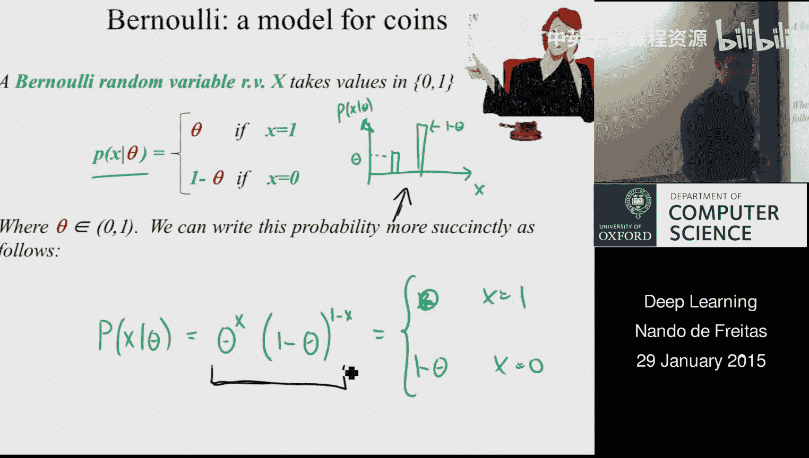

嗯。The Bnoli variables also allows us easily to define a quantity called entropy。

And what the entropy is is just the probability times the log probability summed over the domain of the random variable x in this case。

 and importantly negated。Now， entropy is a measure of uncertainty。

 I will illustrate that with an example。 if you take a Bernoulli random variable。

And I basically substitute in this expression the expression for the pernoulial random variable。

 and I substitute x equals 0 and x equal 1， I solve the sum， I end up with this function。

And what I do is I go and I plot it， and if I plot it。

 I see that my entropy is higher when the coin has probability 0。5 of pink tails。Our head。

And that's essentially basic an unbiased coin， you have very high if I start flipping in an unbiased coin you have very high uncertainties as to whether it's going to be tails or head however。

 if I put a lot of lead in one side and most of the time it comes out head。

 you have less uncertainty， you'd be much more quickly ready to predict that it's going to be heads because you notice behavior so entropy is a way of measuring uncertainty。

 just like various measure is a measure of uncertainty。

The opposite of entropy information is what we actually call information in a principled way。

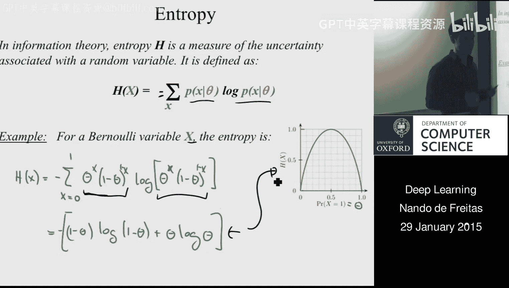

If you do this calculation for Gaussians， which I think will be one of your homeworks。

 you will find that the entropy for a Gaussian is proportioned to essentially the determinant of the covariance。

 it sort of makes sense how much spread you have measures you uncertainty。

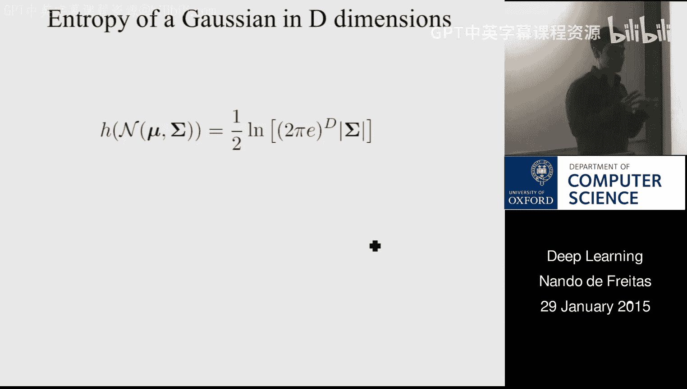

To finish， I just want to make now a connection between maximum likelihood and information theory。

 the concept of entropy introduced by Shannon with half a century ago so this is sort of one of the fundamental building blocks of our digital age。

 entropy information， this is what led to coding theory。

 and it's what makes us be able to you know chat with our friends in Facebook。

 which has enabled us to do that。Among other things。Now， to finish this。

 I'm going to connect entropy with maximum likelihood。

 and I apologize for going over this a little bit， but I will still take a break。嗯。

The idea is let's assume that there is a true theta。The universe has one true parameter。

This is the true value of the distribution， the true mean of the Gaussian， the true variance。

 the true neural network from which God is generating the universe as we see it。

 that true set of parameters。

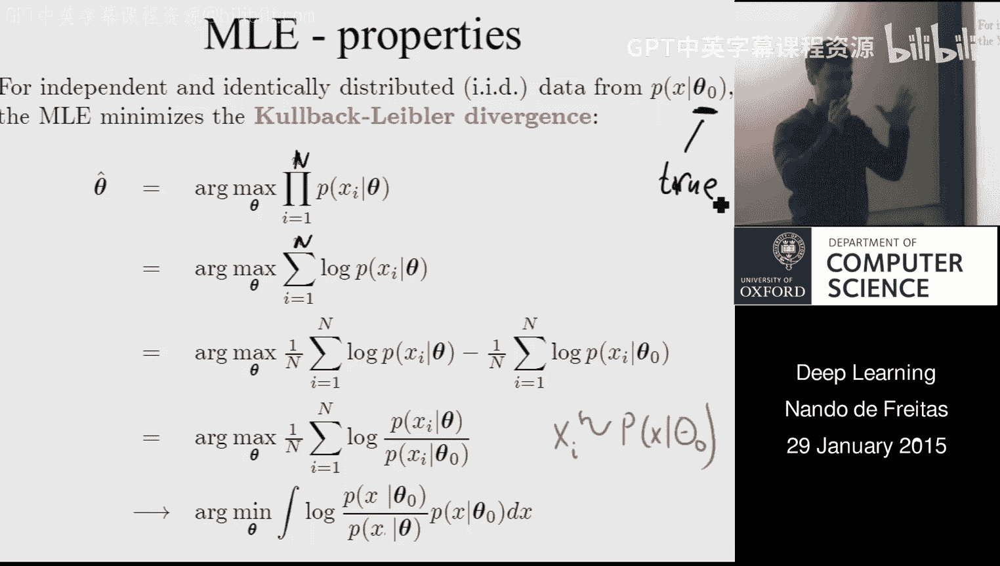

It's not far fetch if you think that we can simulate AI。

 maybe we're a simulated AI in another simulation， and so we basically are a sample of a model。Yeah。

I'll leave that for the philosophers。But let's assume this is essentially where maximumim likelihood is assuming that there is a true process。

From nature that generates the date。And this data comes with some sort of distribution。嗯。

Then maximumim likelihood basically says if these points are independent。

 take their product over every n observations and maximize that， maximize each of the heights。

 each of the probabilities， the product of these heights。And if we do this in large space。

Oh I forgot to say this we take logs because it's easy to do calculations by hand。

 but logs are also important to computers because if you multiply lots of small numbers they go to zero very quickly you get under flow problems so always working log space it's a good。

When playing with probabilities， get used to using logs。We can move this to logs。So。啊。

The monoonic transformation doesn't change the location of the optimal。Another thing。

 so basically through。The location of this max doesn't。If I sort of lift this a little bit。

 the location of the max doesn't change。 Likewise， the location of the max doesn't change if I shift this curve up and down。

 So if I add a constant value to it， it's not changing the position of the max。

And so that's what I'm going to do next。 I'm going to add this constant value to it。

 and it's constant because the free variable here is theta。 Theta node is known is the God parameter。

That's been given to us。And so I can add it without changing the maximum。

 and now I can combine I can combine it too because。I have the log of a division。

 I can separate it into the subtraction of the logs。

And now I'm going to do the reverse of Monte Carlo remember the Monte Carlo。

 the idea is we went from an expectation to a sum， now I'm going to do the opposite。

 I'm going to assume that the number of points goes to infinity and I'm going to use the law of large numbers such that as n goes to infinity。

嗯。And actually I did one more thing here， which is I swapped， I'm going to swap the order of this。

So in other words， I'm multiplying by minus1 so that my max becomes a min。

And the reason why I'm doing this is so that because this thing here has a name。

 it's called a KL divergence。It's a key concept also from information theory measures。

It's non symmetric so it's not a distance， but it basically measures the difference between the two distributions if have two probabilities and you want to know how far they are from each other。

 you would use this it's always positive and when the distributions are exactly the same the KL will be zero so KL is a good way shall we say measuring the distance between。

The ga distribution in our distribution， so our distribution is our line。

 which has parameter theta 1 theta 2 theta is an unknown that we tried to estimate and theta not is a true distribution and so maximum likelihood。

The idea of maximizing our searching for the model that maximizes the data can also be rephrased in information theory as minimizing this thing called the Koc Libla divergence。

 which is also known as the relative entropy。Because we're taking a ratio。

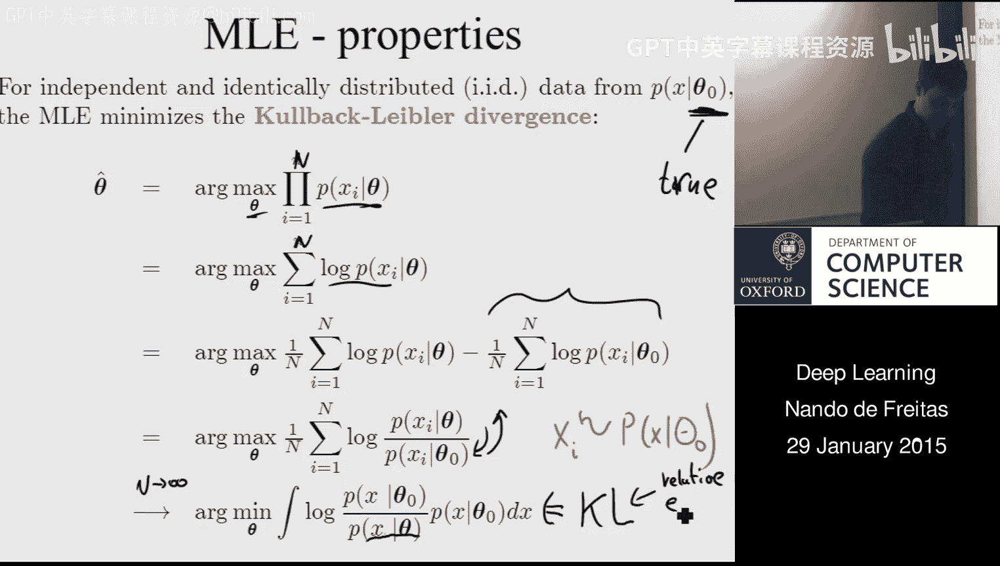

Then。Now can I'm going to once again use the property of the log of forivation。

 so log of a over B is log of a minus log of B。And I'm going to rewrite it in this form。Now。

 the negative of the integral of P log P is the entropy uncertainty。

 the positive value is what we call the information。So this quantity here on the left。

This is the information of the distribution。Of God。

 So we say the distribution of the true symptomotic value， the true。

 the true mechanism that generated the data。This is the distribution。

 or this is the information in my model。And so basically what this is saying。

Maximmal likelihood is essentially looking at the information in the data produced by nature。

And it's comparing it or contrasting it because there's a minus here against the information of the data that my model produces。

 if this is my model。Okay。So。It's。In both cases assuming that the data came from the true observation model Im comparing the information in the data that I imagine against the data that I see。

 and Maxim likelihood gives me the lens through which I compare things。

 I compare the hallucinations against the world through the concept of entropy or information defined in this way。

 that's what it does。

It's not the only way。And in fact as we go but it's important that you realize that behind all this math and maximizing probabilities。

 essentially what we're doing is we're comparing some statistic of what I imagine against some statistic of what I see and when these things are different。

 that's when I will move my parameter the， I will update it and when the two are the same。

 there's nothing to minimize I've reached the minimum so I don't need to update my parameter the。

That's the basis of learning everything we're going to be looking at。Okay。

 so let's take a five minute break。 and then I'm going to do。Deal with this issue of vertical lines。

