# 牛津大学《深度学习｜Deep learning 2015》中英字幕（Claude-4-s） p05 5_ Regularization, model complexity and data complexity (part 2).zh_en -BV17NWWz6ErN_p5-

Let's start so the plan for today is I want to in the next two lectures to first finish the lecture we started last week。

 which was all about model complexity and so I'm going to quickly review what we did in the last class and then I will finish covering that class we'll have a break and then we'll do the class on optimization。

嗯。So。What we came up with one of the things that we did last week was to introduce this notion of a regular riser。

 so a regular riser was something that was in some ways make the problem easier by avoiding some。

Problems， and it will be easier to explain this when we talk about nonlinear models。

But it's also a problem that makes the optimization problem or the numerical problem more stable。

 So in particular I introduced it as like we have think this matrix。

And these measures could be poorly conditioned by adding a diagonal to the matrix so we make it well conditioned and enabling us to invert it into compute the answer。

So that was one way to look at it and another very useful way to think about this regularisizer is by changing the coefficient of the regularisizer。

 by changing the coefficient of theta transpose theta， we would get a whole family of solutions。

 so when delta is equal to zero， you would get the maximum likelihood estimate。

 which is what you were computing in your practical yesterday。

 and as you make delta increasingly larger， then we have the only possible solution is by making that will decrease the costs by making theta equal to zero。

Importantly。The regularisa by itself is kind of a silly cost function。

 okay it's a cost function thats just saying make penalized for large thetas。

 make theta equal to zero， so by itself it would not give you a reasonable answer。

The likelihood that by itself， we've already seen that least squares has problems and in the nonlinear case。

 even more so。And so here's a case where you have two terms， none of which is sensible。

 but you put them together， and it's in their balance by trading of their balance that we will come up with a cost function that actually works。

One of the things I didn't mention last week that it's worth knowing because we're using to and we're using the neural networks toolbox is that rich regression in the neural lingu is known as weight decay and the reason why it's called weight decay is the sort of picture we looked at last time that as we increased ir regulargisizer。

 the parameters of the model tends to go to zero， so they decay to zero。

 so when it was invented the neural networks have received that name。

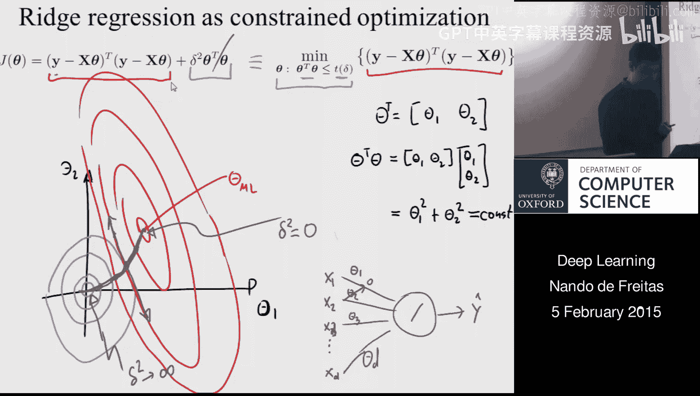

And we also saw that。The L2 regularizers that we're using the quadra regularizers。

 if we plot them there with circles， but we could use other different types of regular rises。

 like for example， the L1 norm of the parameters， and that would give us contour plots that our diamonds like the one shown here in purple。

Now the solutions would still appear in a trajectory。So we still get a family of solutions。

 but that family of solutions will。And be such that。For the good range。

One of the parameters in this case， theta 2 will be equal to0。

So regularization also gives us a way of doing parable selection if you have many inputs to your model。

But some of the thetus got to zero， that means you don't need to measure that theta。

 so if we had like 20，000 genes and we wanted to predict whether a drug will be effective or not。

 and we find out that 18，000 of those that have parameter zero。

 then we don't need to bother with those genes we move on to focus on the other ones。

 the ones that could have a relation to the effectiveness to the drug。

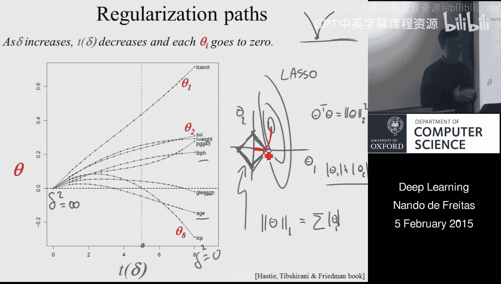

Another thing that I'd like to add to what we said last week。

Is maximum what's known as maximum posterior inference。And。So far。We。Previously。

 we knew that when we had this energy function。If we exponiateated that energy。

 if we negated it and exponentiateated， we could get a likelihood。 So in particular。

 if let's call this part here E of。Theater。In particular， we could we。嗯。

Let's say E of theta comma x comma y。In particular， we said that we defined the likelihood。

 the probability of the outputs given the inputs and the parameters to be a distribution only over the output。

 in fact， is the product of several Gaussians vertical ones。

And that we argued could be written as some normalization constant。

 one of a z times e to the minus E。The energy with parameters theta and variables， x and y。

X is a given variable， there's no uncertainty on it。

 and y is the quantity we want to protect the output。

 and so there's uncertainty as to what our prediction should be。

And so there's this nice interplay between energies and probabilities。The same applies to this term。

This you can also exponiate。And that distribution depends only on theta。

And if we were to exponiate it。嗯。We would have something of the form each of the minusrs。

Delta squared theta transpose theta。Okay， so that's a calciumian distribution。

 multivariate calcium distribution。The mean is zero。And the variance。

 so the covariance is essentially a diagonal covariance。

 where the variance terms are one over a delta squared。嗯。

And so that's so what we're doing when we do regression。And we drew。Estation of the rich solution。

 we're essentially finding the max of the product of two distributions。

 So what we're doing is if we multiply these。嗯。AndAnd I mean the product。

 because if you were to take the log of one， if you have a product of two distributions and if you were to take the log to get rid of the exponential。

 then the log of the product becomes the sum of the terms。So what we're trying to do when we do this。

So we're maximizing of a theta。The probability of y given x and theta times p of thete。Okay， times。

 sometimes are constant。And that constant。It's just P4。It's the normalization constant。

So using the rules of probability to get P of y given x， you integrate P of y given。

X and theta times P of theta。Defeat。Okay， it's basically you sum over all the values that the numerator could take to ensure that it sums to one。

Now this quantity that we're maximizing is what does it remind you of？

This idea of multiplying to probabilities and dividing by anotherce。Yeah， base rule。

So one of the rules of probability， how many of you have seen base rule before？Okay， so。

You've all seen the vast majority of you have seen it。 So base rule。

 and if you haven't seen it before。Wikippedia based rule。Base rule is like。For me。

 far more important than Newton's laws of motion。Because it's a law that gets applied on every day by people and it's a law that gets。

Blaantly abused by judges， by lawyers， by doctors， and unless you know this rule you will make the wrong decisions in life。

 so if you do not know what this is， immediately please go to Wikipedia， learn base rule。

Because it really is one of the most fundamental laws of thought。But there exists。

You've probably heard of these examples， you go for the test。

 you're told with certain probability that you're likely to have the disease and should you be worried or not。

 and so knowing the probability of the disease in the population and so on and if you apply based rule。

 products of probability is normalized appropriately。

 you will reach a different conclusion than you would if you don't。And。

And if you Google this on Google News， you'll also find articles like a judge band based rule from the courtroom。

嗯。EconorRS is not a good thing。So base rule is really useful is what I'm using here。

And so base rule gives you is a way of multiplying a prior times likelihood。

 and then you get a posterior and you find a maximum of the posterior。 So another way to think of。

Of a regular riser is we think of a regular riseor as this quantity here， which is a prior。

So in basin statistics， instead of specifying regular rises。

 researchers will and scientists will specify distributions， prior distributions。

 and then what they do is they multiply the prior distribution times the likelihood and instead of optimizing so you could then at that stage optim and find the optimal theta but that would not be a very basin either。

 what you would typically do is you would solve that integral。

 you're doing some Monte Carlo simulation and once you solve that integral。

 you come up with a Monte Carlo estimate of。Of the。Of the posterior distribution。

 the probability of theta in light of the date。 So base rules away in ver。 So if you know。嗯。I。

 I feel like I should quickly。Introduce a slide on this because this is actually quite important。

In this context。

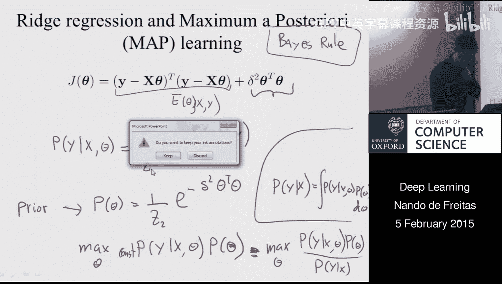

嗯。

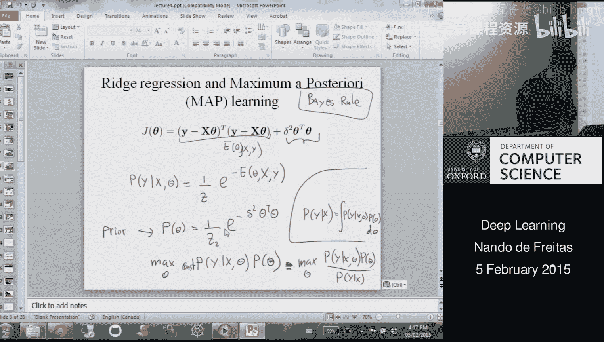

O。Okay， quick primer on base rule， So what base rule tells you。Okay。

 the standard form that you'll find in Wikipedia will be that P of A given B is equal to P of B given a times P of。

A divided by P of。唔俾。And proving this is trivial， you just move a P of B to the other side。

 P of A given B times P of B is just P of A and B， so both sides are just the statement of the joint of P of A and B。

Now， in this context where we're going to think of a term being associated with likelihood。

And another term associated with prior。Base rule tells us that probability of theta given x and y。

I is equal to p of y。 I'm going to condition on x。For all the terms。

 And that's like if I had another term here， C， a good condition on that C。Through。

So one way to think of it is by conditioning and see as base rule applies both in China and in Canada。

 it doesn't matter where you are， it would still apply。

And so I'm going to invert y with theta because y is my random variable？

X is just something that's given to me， an input that was given。

Theta doesn't make sense to depend on x， so I'm just going to write the asP of Theta。

And then the numeratorators P of y given x。Okay。This quantity here is called a posterior distribution。

So instead of maximizing the likelihood， what I do is I maximize instead of maximizing the log。

Likelihood， I maximized a log of posterior， which is equivalent to minimizing this cost with the regularizerr。

And in this case， it also becomes more clear。That。On the left hand side。

 I have a distribution of a theta。 so theta here is my n， my random variable。

And so it must be that it's the integral of a P of theus must sum to one。

 so the normalizing constant is indeed just the numerator。Over the， okay so。

The way it's thinking with base rule is that you have a model。

 you have a beliefs about the world in form of P of Theta， and from that model you can generate data。

You can generate twice Once you have distribution of a parameters and you have an input X。

 you can go and generate many。Wise， so in particular， you generate one idea of feet in your head。

You see some input act and that's all you need to then produce a Y Y is a function of x and theta once you know x and theta you can come up with a y so that's a geneative。

It's a generative model of the world。And。What base rule allows you to do is to flip so generation is easy and recognition is difficult。

 so to make this more concrete， let's think of an example。Let's think of a speech recognition。

 So in this case， well let's say that X and Y would be some sound wave。

And what you're trying to find here is award word。If you hear sounds。

Figuring out what is being said is actually very hard。

But you all know that if you type words on a computer and you make the computer say it。

 it says it it might be somewhat a robotic voice， but computers are very good at synthesizing words。

Sorry， synthesizing some given words。Base rule allows you to invert this process if you're good at imagining you could use the base rule to inver a process the difficulty is that you have to solve this very high dimensional integral and so most forces in based and learning and based statistics then go on to the topic of how you solve this integral。

In this course I will not go into this， I will not cover this and I will not go into the issue of solving this integral except for one class in one class later on we're going to talk about variation origins where we will see one of the techniques for solving these problems this way。

Instead of trying to solve this high dimension integration problem， which is NP hard， well。

 we're going to solve another NP hard problem which is。Optimization by differentiation。

 so instead of going with integrals， we're going to take a differential approach to the problem。

And that seems to scale better at present definitely。

For very large data systems only can get gradients going。

 but it's very hard to get Monte Carlo going well， although for some applications you would want to do Monte Carlo instead。

The nice thing of the Bayesian way is it gives you a full distribution。

 so it doesn't just give you the answer that it's going to be that word that you should choose。

 but it really gives you a distribution of a word and a lot of applications where you have multiple hypothesis and at some time one hypothesis looking better but with a little bit more data you realize。

 oops that was the regular hypothesis not a hypothesis much better it really helps to keep those hypothesis alive because if you kill one and you go in your greed and you go with a weak hypothesis then you'll never be able to recover the good solution to the problem。

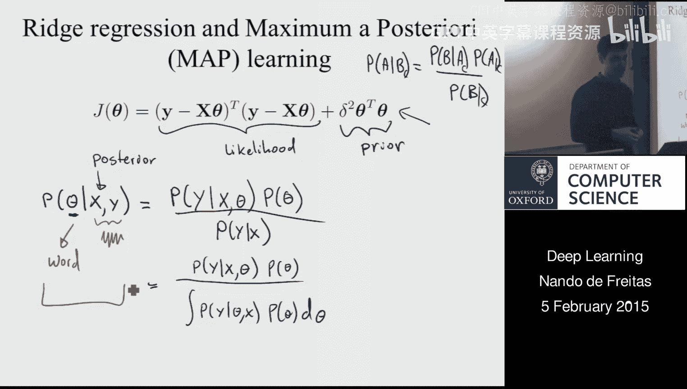

Okay so then we then in the last class we also then decided to go do something a bit more interesting so we started looking at nonlinear models。

 but these nonlinear models are actually somewhat deceptive because they are still linear so the way we deal with it we dealt with nonlinearity was well if we believe our points are in a quadratic what we're going to do is we're going to construct features。

 so we sort of cheating because。Instead of we learning the machine figure out what the features are。

 we are constructing these features， we're saying it's going to have a polynomial one it's going to be a polynomial with degrees one。

 two， and three。Sorry。Or in this case， the constant term， the line and the quadratic。

 and we're going to let the machine figure out what the coefficient should be for each of these terms。

嗯。And this。It's really what most people would have been doing in statistics and in machine learning。

 they've been constructing features by hand and a big sort of。

Something that's going to be with a theme of this course is we're going to try to move away from this。

 we want to learn features automatically from the data opposed to crafting features by hand。

For classification， for example， there's several classifiers out there， HVMs posting random forests。

 neural nets and for a lot of applications they're actually quite comparable there's mainly papers out there comparing classifiers I hope you never write one because there's enough of them。

But。Often you find that the real tricky thing is how you come up with features for those classifiers。

 the features of the problem that allow you to make good decisions。

 and that ends up actually being where people are really putting all the work。

Just trying to classify as easy， you can download it in any language these days and run it。

 but engineering features has sort of been the challenge。And with deep learning。

 we're going to try to， for some types of data， try to move toward a procedure that is much more automatic for coming out of features。

Okay， and。And the reason why this is deceptively nonlinear nonlinear because once we have these features。

 instead of having a matrix x， we've just changed it to a matrix phi。Reform the matrix phi。

 so for each data point。For each X， each of these numbers X。

 we build something that has three columns and then that will give us a matrix would be n by3 and then we just use the standard reach regression estimate and that gives us theta。

As you did it in your Laes， we'll do tomorrow。And then once we have those parameters。

 we can make predictions， in other words， given a new X。Given a new value。

 the prediction is just evaluation at the line， so that height there would be our prediction。

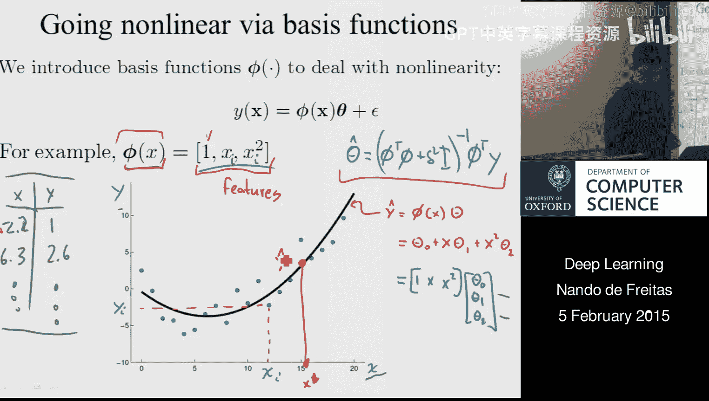

And of course we could go to high dimensions， I mentioned that with polynoms we need to start adding all the possible cross terms and the problem with this is that the dimensionality of theta will grow very quickly because as you start getting like terms like in the powers of 10 where you have x1 to the9 and x2 to the6 and so on。

 you start having this combinatorial explosion of terms。

 and so the methods scale doing regression with polynoms will not scale well。

It will work if you had enough computational resources it would work because we know from the stone wire trust theorem that you would be able to approximate functions pretty well with polynomous continuous functions to arbitrary accuracy。

You just would not have the computational resources。

 you would not have a combinatorialarily large brain to do that。

So we need to figure out smart ways of doing approximation。

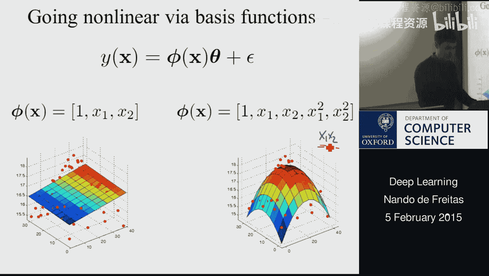

And we also went over an example that is extremely important that shows that if you generate the data with。

If your model， say with a quadratic polynommal in this case。

 if your model happens to be of the same complexity as the mechanisms that's generating the data。

 you can get good fit。

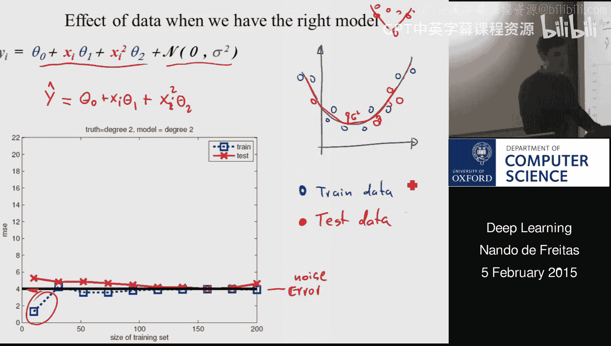

If the model is too simple in this case， like a line trying to fit a parabola。

 then you get very poor fits， no matter how much data you have。

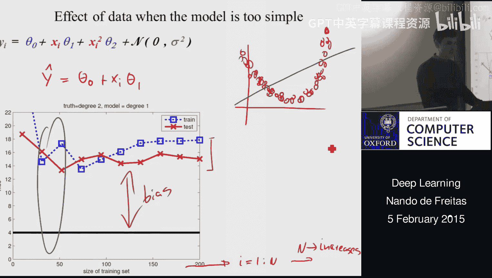

And if the model is very flexible。Then for few data， it will overfi。

But as we increase the number of data so a few data sort of wiggles and here we see a clear。

A situation where。As you recall， this was the train data。And the green was the test data。

So the train data is where we train the model that test is what we leave aside， we never look at it。

 we only use it to test whether the model makes reasonable predictions and here what we saw is that well you can do well。

 a line that is flexible enough will go through all the data will fit it perfectly。

 the error will be zero。But then it will make these huge errors。These spring errors。

 vertical errors for the test data， so it would be terrible at making predictions even though it had zero error on the training set and so that's what we see here when you have very few data。

 the training error is very small。It's smaller than it should be。

Because there's a fundamental limit as how well you can do impose bad noise。

 you can't go through all the points， that's what you have to accept。

 so you have to accept that there's going to be some error。

And your contract to do better than that error。 So it's always important to have sort of training data and test data to verify this。

 However， as you get lots of data。The data could be enough to constrain the model。

Of course there's a balance here between data and number of parameters and that's really what matters。

 don't think of big data or big models， rather think of the balance between big data and big models is what we try to do strike a good balance and there's more to the story。

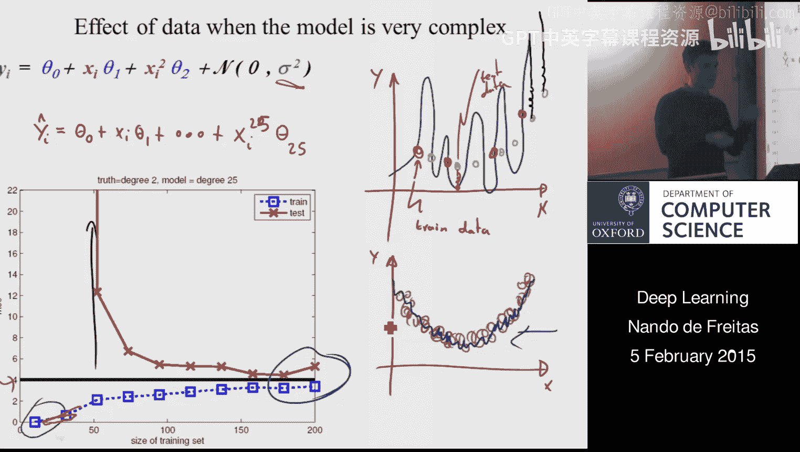

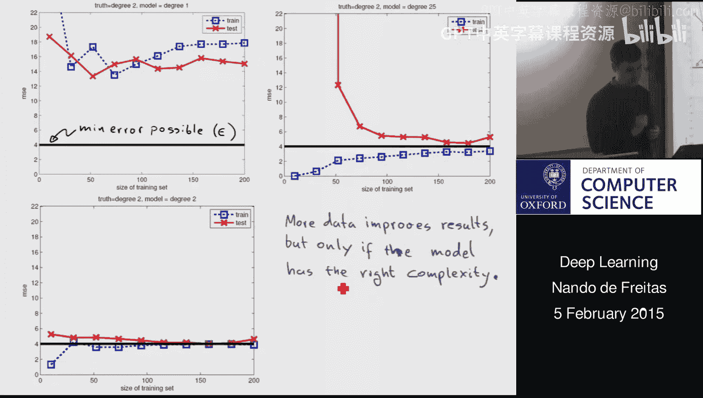

Which is regularization because。There's another way to control complexity is by adding a term like this that forces some of the parameters to go to zero。

 because if all these guys go to zero，Then the polynomial of degree 14。

 all of a sudden becomes a polynomial of degree2， so it will fit the date。

 so regularization is particularly important because if you come up with good regularizers and this requires thought。

嗯。Then you can actually。You have a mechanism for controlling complexity。

Provided provided that you know how to set。Delta by hand。

 so coming up with a good deelta now is the game。If Delta is too small。嗯。

The polynomial will still wiggle a lot， by choosing the right delta。

 the polynomial will wiggle less and by using a delta that is too large then the polynom is becoming too constrained so we'll not do what we want。

So we need to figure out how to come up with this guy。

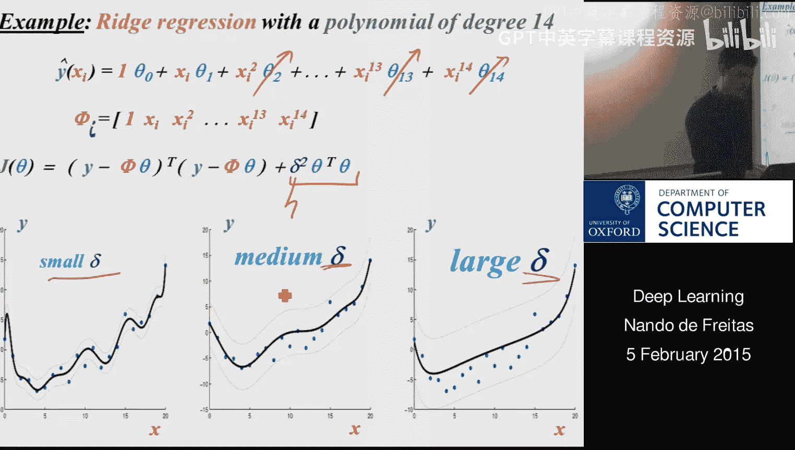

There's another interesting way of going and dealing with nonlinear。

Approximation while still using linear techniques， and that's the idea of kernels。

So what is a kernel， a kernel is a basis function。And like a polynomial， a kernel is， well。

 it's this guy here in red。Is it could have different shapes。

 I'm going to use particular kernels in this case， which I like these bell curves， they like Gausss。

They have a location， mu is where they're located。So in particular in this drawing。

 I have three kernels， one kernel is located at position one， as you can see here。

One kernel is located at position 2。And one kernel is located at position4。

3 red kernels at those three locations。For a kernel， I also need to choose its width。

 the width of the Gauss， and in this example I've chosen the width to be one。Just for simplicity。

And then。What I could do then is multiply each kernel times the parameter。Okay。

 so I'll multiply each times sort scalar and then I will add them up。

 if I do that I get a green curve。 So if I take the red。If I take。These guys， and I scale them up。

Or scale them down。With a negative theta。So theta3 would be negative。

Then I get the green curve and the green curve and fit can go through all those points。

 so another way to construct a nonlinear nonlinear function against using the idea of bricks we're going to use basis functions to build the green curve。

Once I have this function， essentially I can generate a new feature vector。Fhi。

 and then I'm back to linearar regression。So once again， you get an Xi。

 once you have an Xi for each data point Xi， you evaluate the kernel at different locations。

And then you build this vector。So for each X I。Point。I would evaluate this。For now。

 assume that Miu and lambmbda is given。And a good heuristic is to just make mu be equal to the data。

 so that is you put one。One kernel in each data point， so each data point owns one kernel。

And so when you form this matrix， it will be if you have n data。

 this matrix will be n by n because you have to evaluate。For each x， there's one of the other x's。

And we'll come back to the choosing how lambda is going to be similar to how we choose delta squared。

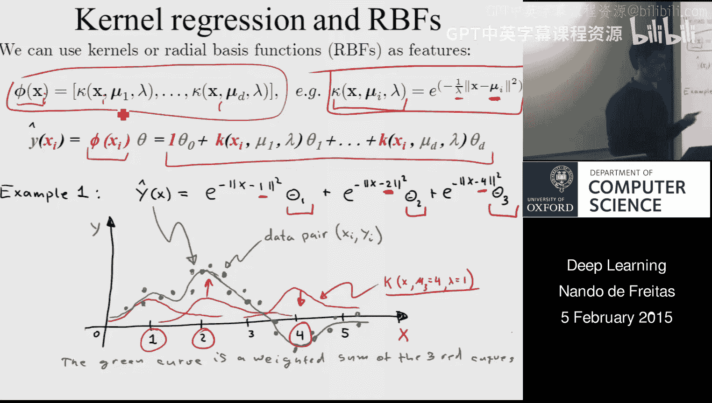

So the procedure would go like this， given a U Xi， you form the matrix， you form the feature phi。

So once again， we're engineering the features。 The method will still be linear and we're engineering the features。

 I added one here。 Sometimes people don't add the one， actually the most common cases that no one。

People don't typically have that one there， but again。

 the one gives you the opportunity to shift for the practical tomorrow， Keep that in mind。

 I think some people yesterday forgot about the one， the one's important。

It's what allows you to move functions up and up。And so。So again， for each data point。

 if you have three kernels in this case， in my toy example。

 you would need a vector of four parameters， theta not for lifting and then theta 1，2 and three。

And then your predictions will be just evaluating five times theta for any new X。

And now if we have in data。So we have a vector of n observations， you would form the matrix。

In this case， that is n by four。This one is n by one， you would form the matrix5hi。

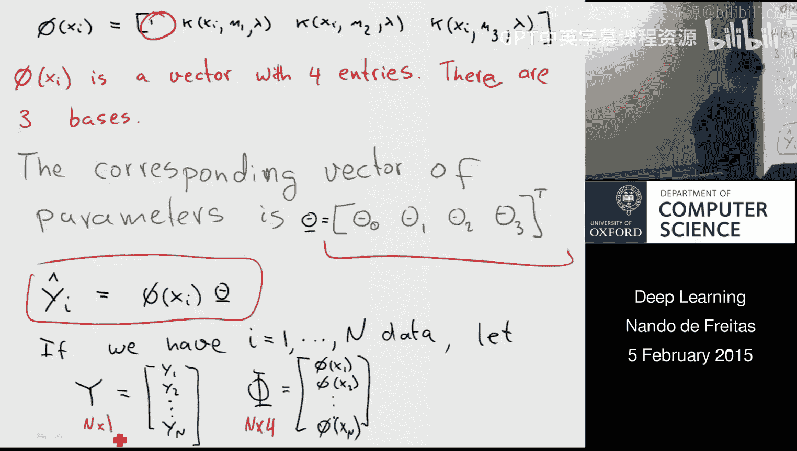

And then the rest is just as before， we can compute these scores estimate。

So here there is a little word in trying to convert the x to a matrix phi。

 so we do that initial work， that's exactly what we do with polyno once we do that we're back to linear regression。

And so we can use retro regressiongression or least squares and we can compute solutions。In Torch。

 this is how just to do this golf with this one more time。

 you would import the packages that you need， a few folks I was told were look thinking about plotting。

 you could use new plotot or Facebook' to release some very nice libraries for plotting。

And like Itorrch and so on。 so I recommend you use those as alternatives Brenon is thinking of options for you to run in your lab。

The next thing you would do is I don specify variables， the number of data。

 in this case I'm choosing 10 and choose the kernel width， that's that lambda。

And what I'm going to do is I'm going to place one kernel at each data point so the first thing I'm going to do is I'm generating data。

 so what I'm going to do is I'm going to generate data by first I choose several xs。

 so I'm choosing a uniform grid of X。Between minus1 and 1。And in particular。

 I'm using 10 points in that interval， then I take all those points and I square them。So essentially。

 I'm constructing a function that looks like this as the Y train function， the Y function。

So that's X， there would be a Y。And then I'm adding Gaussian noise with some variants to it。

 so I'm producing a bunch of points like this。So for polynomials， this is how I generated the date。

And you can use that in your practical as well and the last question。

You then need to create a kernel function， and so the function5。

You pass in x and y and it evaluates x and y， so that's my kernel。

That just evaluates x minus y squared。Times one of the kernel width， and then you have each of that。

So that's the basis function or kernel。嗯。And then I need to fill in the matrix。

 I need to convert the xs and so essentially what I do is I evaluate this kernel。

At each data point because my big matrix phi。我 be。Made of。And terms。

 there is one kernel for each data point so for so I center one kernel and I need to evaluate。

I need to evaluate this quantity， so this function is fine。

And so all I'm doing here is in my I've created that function' evaluating and I'm filling in the matrix。

 and once I have the matrix， then the next thing is just to do the computation。

 so this is my delta squared here。And this is just。Essentially。

 the matrix phi transpose phi plus delta squared I。Inverse。Times5hi transpose y。And that gives me。

Fate。So it's really easy to write this now。And then if you have new test data， and in this case。

 I'm generating 100 test data points。I construct my matrix again。

 in this case will be 100 by 10 because I'm comparing each test point of each。Training point。

 and then the predictions is just the usual way of doing phi transpose heat。And then you can plot it。

So I'll put these slides up online and you can actually go and type this and you can verify that it does。

 and I strongly recommend you do that if you get a good feel for how it works， you can play with it。

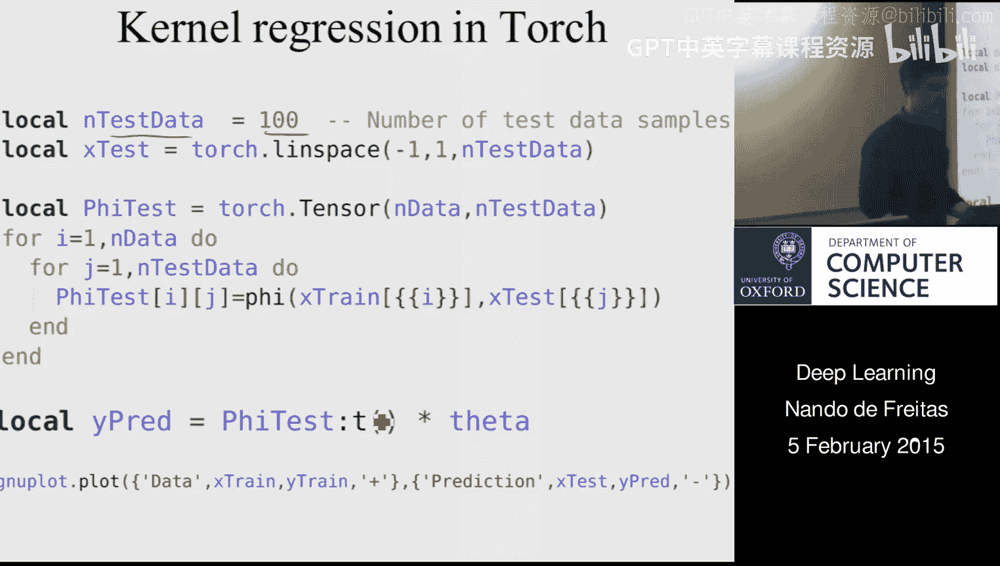

What you'll find is when you do this that if your lambda is too small。

 that is if you use kernels that are too narrow， you'll get a fit that looks like this。

So when you run that code， it will give you something that's very wly if your width is too small。

 if the width is too broad， then you're going to get something that looks like this doesn't give you a good fit and then what you want really is you want to pick the right lamb that the right width will give you the right。

So once again。We can。We're able to do these very intricate fits now。

 but the issue is one of complexity， it's still linearard so this is totally easy to do。

 it's easy to code， it's easy to do math， it's easy to understand what's going on。

But the difficulty here is coming up with this quantity。And if you're doing rich regression。

 you also need to come up with Delta square， so you need to come up with lambda。

 you need to come up with Delta squared， you need to come up with a form of the basis function。

 like I use as exponential， but is that good enough？Well， if you had。

There's theorems that say there the number of basis functions because infinity could approximate any in continuous functions with these Gaussians。

But of course you have finite resources again， and given that you have finite resources。

 what should you do？

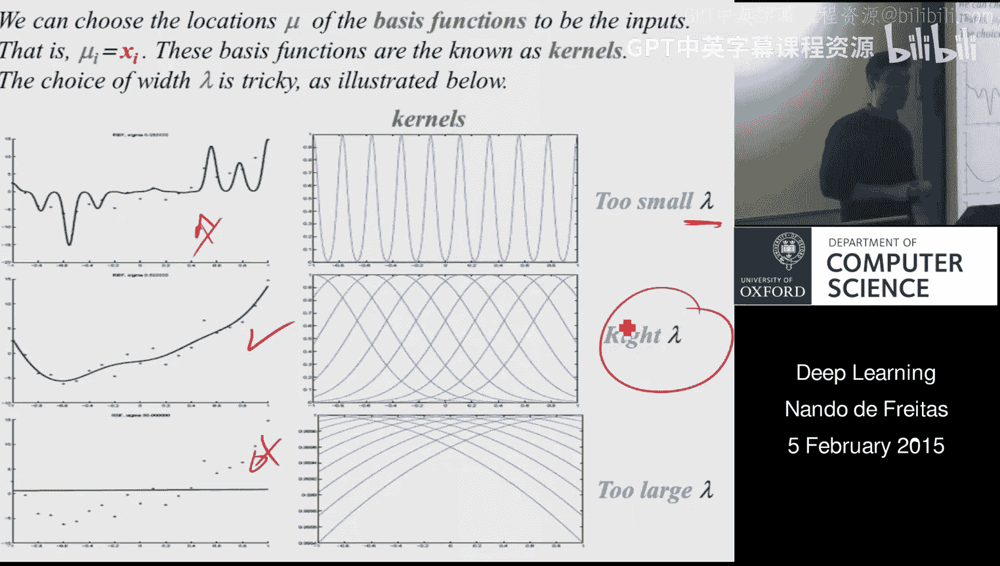

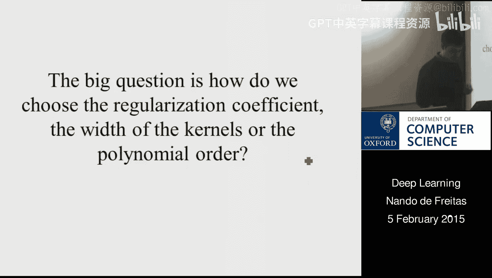

There is one good answer to a lot of these questions and that's cross validation。

So what's the idea of cross validation and this is something that you have to do always。啊。

Every time you solve a problem， don't just try to learn on the training data or it works on the training data and stop there now you need to test your model。

And you need to make sure that you test it properly that you don't cheat because you might allow your model to occasionally look at the data the test data at the moment you've looked at the test data once you've corrupted it。

 you know what the test data is and so you don't keep looking at it because you' overfi again。

 so it's always important to have a pristine set of data that you never look at so that you can have good sanity。

Evaluation。Now， the simplest there's many ways of doing cross validation。

 the simplest process follows， you're given a training data set。Okay， a set of inputs and outputs。

 we're going to call them X train and Y train。And I'm going to do this for Delta squared。

 but you could do the same thing for lambda。We're going to choose this regularization coefficient。

And the goal is to compute theta hat。Now。If you're given a data set and you're given Delta。

 you know how to compute Delta。 sorry， how to compute theta， So that we just used the。

The least square solution， so x transpose x inverse times x transpose y。

And we add the delta squared to extrapo x。Then we know how to make predictions。On the training set。

And for the test set。We can also make predictions， so we can make predictions of the training set and on test set。

嗯。Given those predictions， we can evaluate the root mean squared errors。

 the mean squared errors which in this case is just the truth y minus y hat。

 and let's assume that we have access to the truth in the test set so that in the test set we can also measure the test error so we have the train error and we have the test error。

And。The thes were calculated in the training set again。

And what you can do is you can repeat this for different values of deelta so you can try。

I know a log scale of values of delta， or you can just pick them at run。And actually。

 random choice is not a bad idea。Maybe random with the log。scale。Now。结婚。

Given that you have Dltas and your compute errors and test errors。

 then the next thing that you have to do is decide out of all of these， which is the best Dlta？

And there is no entire agreement on this， and to just demonstrate that I'm going to put this to a vote how many people like 0。

1？And you will have to vote for one。Okay， I have one vote。 You're not allowed not to vote。 Yeah。

 this is not like。Sure， let's allow for that， but this is like this is not like actually to simplify it because I'm going to have to come quote only once。

😊，Yeah， this is not like the election for president or something here you have to vote。😊。

Now you also have to vote there。Now one。5，6，7，8，9，10 and 1112154 birthday，617，191921。装个。

About 31 people like one。啊。How about 10。No one likes 10， and this is very surprising。Sure。50。

So we have about one， two， three， four， five， six， seven， eight nine， 10， about 11 people， 100。

Going well， going twice， someone was feeling sorry for 100 All right， so according to this。

 Delta should be one。😊，Now， here's two ways in which you could go and solve this。

The first thing we're going to do is we're going to take the max of the two numbers。

 and so the max of the two numbers in this case is 111。1920。And 1000。Okay。

And one strategy is to choose the men of the max。11。Now。

 this strategy most of you chose is it makes sense。You know， you've looked at the data。

 you know that the worst that happened was an 11。So this is the game theoretic way of approaching things。

 you want to cut a cake， you have two children and you want to cut so your task is to divide a cupcake into two so that the two children could each have a half。

But if you cut it and one piece is slightly larger than the other one。

 and even if they're the same size， in fact， one child is going to complain that the other one's getting the bigger piece so one solution of that is you give your sharp knife to one of the children。

And you asked that child。To cut the cupcake very carefully， not the other child。

 but we don't endorse that。😊，And then who gets to choose？

The other child gets to choose right because now I'm cutting the skate and oh， my daughter is smart。

 she will take the biggest piece， so I have to make sure that they're about the same size。So。

 I recommend you do this with adult supervision。So that's what you're doing there and we I just do that we're minimizing the worst case situation。

 so this is the worst case， the Min Max risk approach to risk or worst case analysis。

There's another way of doing things and it to take the average。And pick the lowest average。

And if you did that， you would have found that there's two winning solutions and there would have been the solution here。

And this solution here。Because if you take the average of1 plus 1920， divide by two， so that's 10。

Same here，10。And then you could even use a combination of worst case and average in which case you would。

Now there's something really interesting in Oxford， you very worst case scenario people。

I've used this example in eight+ and you can go back to YouTube and you can see what the other class answered。

 you're the first class that has been so anti average case。

But isn the combination would be the second because the average would be75。Second please。

It's not going5 years fast。てて说。Oh， I see。 that is true， so that's not too bad。

 Yeah that's a probably a reason。The average would be 10。5， it's not too bad right？So in a sense。

 you're sort of trading off average and worst gas。But there's certainly something that is subjective。

 sort of depends on the situation where you are in life。

 if what you're building is a plane that has to land， then you probably want to be worst case。

But if you're building， I don't know， an agent。To drink coffee properly。 you know， So for average。

 to drink your coffee properly， that's fine。まそれ。At the numbers。ther。I more likely than when you。

New that it would be。Like get a stimul error and get hit of being。St like。嗯。

Or is that not something that you do？Good question if we were to get yet another data set。

 so we have a train test， suppose we get another data set and let's call it validation。vow。

What's likely to happen there？もけに test。Most likely。You have no guarantee。

 so it's important that you have the right model and so on。

 your're forecasting if you believe that that validation set will have the same statistics as your training a your test set。

 then you should make a similar prediction on that data set。

So if you have a good model that recognizes cats。嗯。

You somewhat have confidence that when this new cat comes along。

 you will still be able to recognize that as a cat。嗯。嗯。But in some data sets。

 if you have 10 training points and 10 test points， you can fit your data to get very。

 very low error and both of those data sets， but your validation might still be very different。

So it to a large extent depends on your model and even more so on the data， how much data you have。

 if you only have a few data points， it's very easy to come up with a case where you could have just not enough training and test data。

And that's the shortcoming of this method。Cross validation is very powerful for you to choose Delta。

But at least it has that flaw。 you need to have data to validate。

You need to not be able to cross holiday。 And for that you need enough date。

So you need to start creating these extra sets and you're actually not learning in those sets。

 you're only doing the mental learning of Delta in those sets。

There's another problem that it also has。 and thanks for the comment。 That's a really good point。

 Another problem with this is that。This was just to choose Delta squared。

 but now suppose you have to choose also lambda。And whatever other quantities。

 the the basis function centers。 And let's assume you had alpha 3 and alpha 2 and alpha 1。

Or mu or whatever I call them just arbitrary parameters。

 so the difficulty here is that if you suppose these parameters are binary for arguments sake you have five binary variables that you have to cross validate so now you have two to the five choices。

So this combbininatorial is exploding， so you would have to do lots of tests。

So cross valuation is only sensible when you're just testing a few things when you're adjusting a few parameters。

In some cases， for some problems， it is possible to derive estimates of cross validation and so you can do this optimization directly。

 but as's an optimization technique， this is Bri， so when we go into RBFs and if we have to choose where the centers are and the coefficients and the regularization term and the type of basis function and we crossoliating all of these terms this is going to become very intensive。

And it's a sort of black box routine where you're doing your PhD， you try this setting。

 you run this for a couple days， you see what answer you get and write Mar he does that he's been doing that where he's running experiments on imagenet that go on for two weeks on a big cloud of GPSs and it's not fun so so you want to have automatic ways of doing this and there's some good tools for automatic having automatic cross validation in particular it tool called basic optimizationization。

 which I want't cover in the course but it helps with this but ultimately what we want to do is move away from RBFs and we want to go to models where we can specify a cost function that is the fable that involves all of these variables or as many of these as possible they will still be some will have to cross validation。

But you would like to have a cost function that has a lot of these variables。

 and then you just want to launch and optimize around that。

And follow gradients to find an optimal solution。

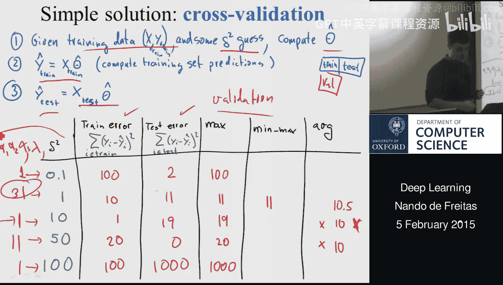

Just a couple more points about cross validation so you could split the data like that。

 another popular way of doing cross validation is through this Kfold cross validation in this case I'm showing an example of fivefold cross validation so you break your data set into five chunks。

 one two three45。And what you do is you train on the whites and you test on the red points。

And then you repeat that， but using the other， and at the end you pick the average and that's your error。

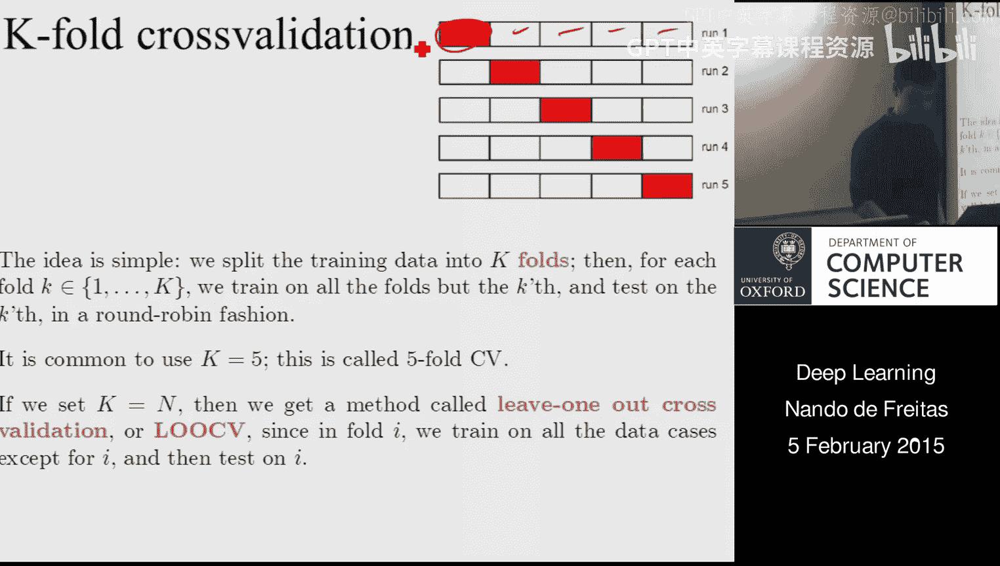

嗯。And typically， when you do this， it's a good idea to plot the train error and the test error。

 And when you do it with data， you'll often find that the。

You're sort of looking for a sweet spot where you sort of trade off train into that error。

Since you're averaging with fivefold cross validation， you just picked them in of this curve。

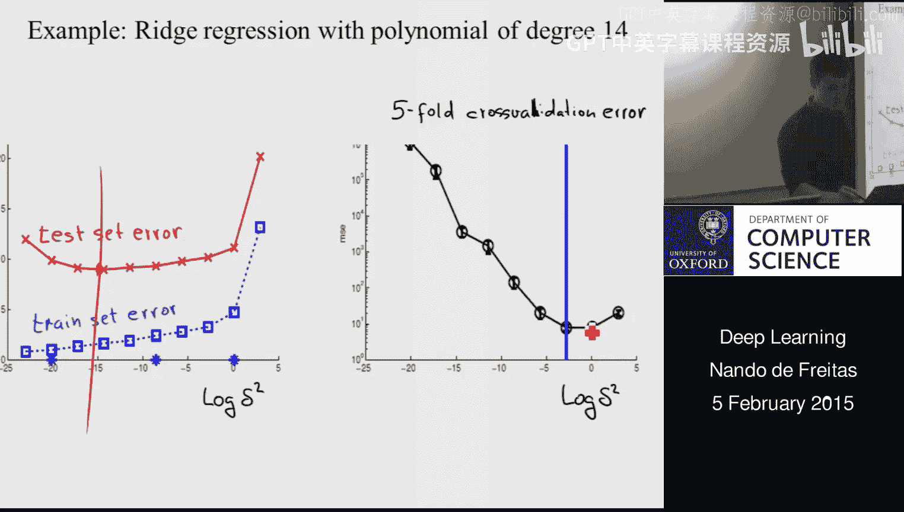

Finally， here's another case where cross validation fails。

 so up to now I've been dealing with these problems whether that it's an input and there's an output。

 supervised learning。😊，And since since we're doing this in a supervised way。

 we make a prediction and then having predictions enables us to cross validate date because we can check how good our model is by looking at how well it predicts。

 but let's look at the different task let's assume that what we're trying to do is to try to assign points to clusters so the end product is this。

There is a very simple algorithm。There is used a lot for doing this clustering called can meanss。

 and it works as follows。You initialize。Two means at random， in this case。

 you pick two points in the space。And what you do is your compute distance from each point。2。The me。

And then youll give。You assign the color of the point， so if a point is closer to the blue mean。

 you assign a blue color and if it's closer to the red guy， you assign it the red color。

So I should probably erase。so that you can see it。So we first compute all the distances from all points to the two means。

And then we assign。We color the points with the color of the mean。

 so there's blue mean and there's red mean。After you do the assignment based on distances。

 you move the mean to the new。Mean of the points。 So you have now， this is the cloud of blue points。

 So you move it to the center。And likewise， I moved this slightly to thescent。

And so we get to iteration two where the mean one mean is here， another mean is here。

 once again your computer distance between each point and each mean and read color and you proceed to do that and it could fall in a local minimum but for a lot of these sort of simple situations you will。

This will cons to a nice cluster。Now let's assume that you want you chose to mathematically before I point out a problem。

 you can formulate it as a cost function as well， so basically you're trying to minimize the distance between each point x and the mean and x hat here is the mean。

And the mean is essentially defined as you have， in my case， I had two means blue and red。

 So that I basically tells you either blue and red， and it's。

You will assign it to the mean that is the closest， the mu that is closest to Xi。Now。

 the problem that arises here is if we don't know how many clusters。

 often scientists want to know how many groups of languages are there in this population and so on and might try to infer this question of the number of unknowns。

In this case， the difficulty is that。If you try to do cross validation。

There is a very simple way of making this error go to 0。 Where would it be。Parddon questions exactly。

That's marked。If you put a mean， choose if you have an in data points。

Let the algorithm choose N means。So in other words， it will put a mean on each point。

 the error will be0。That's the optimal solution， I it useful， no？

So in tasks like this and unsupervised， there isn't a teacher doesn't like there's just beta X。

 there isn't a prediction Y， and for these unsupervised tasks which are illpost。

 there isn't sort of an optimal solution that for which we。

Have a prediction if cross validationization is not going to help you， it's problematic。

And so here we're going to have to be inventive and so this will take us to later in the course when we study autoing quarters on supervised learning。

 how do you learn。Just by watching video and so on。We'll。

 we'll have to come up with methods other than cross holiday to be able to do it。

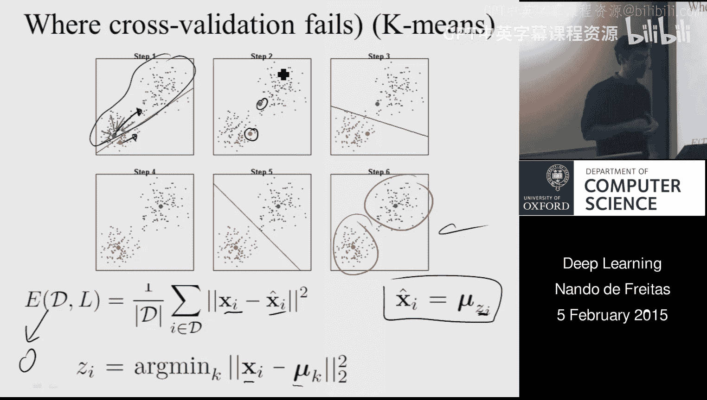

Okay， let's take a break and then we'll do the optimization class next。

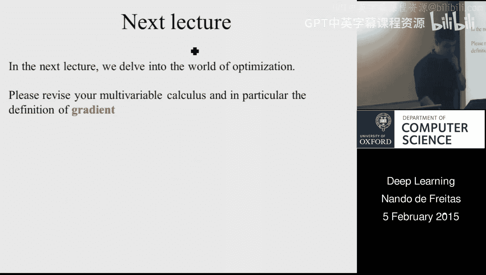