# 牛津大学《深度学习｜Deep learning 2015》中英字幕（Claude-4-s） p06 6_ Optimization.zh_en -BV17NWWz6ErN_p6-

Optimization is an extremely important part of this force。

 so this class in particular will be very important and we're going to rehearse everything that's going on here next week in your practice。

So let's try to finish this class。嗯。Very quick background。

 suppose you have a function of two variables， so you have a function that depends on the variables Theta1 and theta 2 and let's assume for example。

 that it's this quadratic ball that we've seen before。In other words， it's。

A bowl like this centered at theta 1 and theta 2。Then its height is f for theta 1。And the。

We can cock planes。で。And if we cut planes。And we visualize it from the top。We will see circles。

As our contours。Okay。No。The derivative， so when you have the functions of several variables to compute derivatives。

 we're sort of going to proceed similar to what we do with the calculus of in 1 d。

 and we're going to define the derivative， which I will use to symbol NaBla。

 I think it's called who Greek here， NaBA。Thank you。The derivative of theta 1 and F through。

With respect to and I will just for simplicity write this as f of theta， so if there's no subendix。

 I mean the vector。With respect to Theta1 is going to be。 you sort of want to have something like。

Okay good。What we had in normal calculus。Which is the rate of change。

But you only want the rate of change along one of the directions， in this case， direction one。

So it's like you have a function of two variables and you're only exploring it along the direction theta1。

 so you're moving maybe along this direction here， but not along the direction theta2。

 and then the derivative is obtained when you look at the infinitesimal rate of change as the interval of exploration goes to zero。

Okay， so let's essentially what the partial derivative is and in this case。

 d f of theta d theta 1 is going to be equal to two times theta 1 and d F。

Of theta with respect to theta2 will be equal2 times theta2。Now。

 instead of writing all the derivatives one by one。

 we use matrices so we create a vector that has all the derivatives and that's what I'm calling a gradient。

The gradient is just this factor that will contain both of these derivatives。

 two theta 1 and two theta2， so the gradient contains all the partial derivatives with respect to each variableable。

An interesting thing about this is if you pick a point， for example。

 theta1 equal 1 and theta 2 equal 1。And。You look at the gradient。Evaluated at that point。

 so the gradient of j at theta 1， comma theta 2 will be equal to the vector 2 comma 2。

K the gradients effect。And that vector。Is perpendicular to the contour the level curves and you could do。

 you can do this check at 1 minus-1 and minus-1 minus-1。 And if you want to do a bit more work。

 you do look at the plane that in。That is tangent to the surface and then define a normal to it and then just basically do a little bit of calculus to prove that the gradient is always perpendicular to the tangents of the level curves。

So that's a basic fact we know from calculus， I'm just revising it here because this is one of the most important things。

 The gradients indicate the direction of the maximum change。

Okay that's important if you want to learn fast， you follow the gradientding。

 the gradientd points to the steepest descent。And sorry the steepest ascent。

 so if you want to minimize you go in the opposite direction of the gradient if you want to maximize you go in the direction of the gradient。

We also， so that's the gradient。We also talk about thehesian。

 and so we can compute the derivative with respect to theta 1。

Of the derivative with respect to theta1 of f of theta。And for short， we write it in this form。

And in this case， we have two theta 1， if you differentiate that with respect to theta 1。

 you get two。And likewise， you will find out that the derivative of F of theta with respect to Theta2。

Oops， I didn't mean to write that squareta。Yeah， no， actually I did。

 So that to indicate a second derivative， that's all equal to two， the derivative。Of F of theta。

With respect to theta1 and then with respect to theta 2 will always be equal。

And there' is another theorem that we prove in calculus， which I won't prove here。And in this case。

 it's equal to zero。Mainly if you want to take the derivative respect to theta 1。

 you get two theta 1， if you differentiate then this with respect to theta 2， you would get zero。

 we can put all these derivatives in a matrix。Oops， got the wrong one。

And that matrix is called the Hessie is the matrix of the second derivatives。In this case。

 it's a very nice matrix。It will always be a diagonalally dominant matrix with all positive ienvalue。

We。You can find a minimum。In this case， we're dealing with a ball。 it's well defined。

 The second derivative， what information does it give you？Parddon。三。Yeah。

The rate of the change of the gradient。You can use it to check for complexityveity。

 which in other words， whether it's a ball like this or a ball like this or whether it's a saddle point。

It also measures curvature。Okay， so if I had if I had a ball that was more。

 so I could have a ball that is like this or I could have a bowl that is like this。

And so for one the hesian will be if you have a larger diagonal and for the one that the hesian will have a lower diagonal。

 so the hessian sort of also gives you a lot of information about the curvature of the cost function that's going to be useful for for of optimization monization so the gradient tells you where to go。

 the hesian tells you something about the curvature。

Another thing that's going to be useful background of calculus that would use for the course。

 and if any of these concepts are not clear then I advise you to Google these with the word Wikipedia。

 go to Wikipedia and revise these or go to your calculus book and so on。

 these are what I think are the essential calculus that you need to have for us to do optimization。

And machine learning， the chain rule basically， I'm going to show just with an example。

 if you have a function。Oops。If you have a function。A variable that is a function。Of two variables。

And each variable is， in turn， a function of two variables。So so Z is a function of x and Y。

 and X and Y are both functions of。U and V。 So one picture sort of to illustrate it is you would have U and V。

嗯。And I guess you would have something like。呃。Something like this where you could。

You could have something where you。You sort of pass UNP。And then you get out x and you get out y。

And then they get combined。And then they produce a signal Z。

 So you can think of it in terms of a signal model where you start with U and V。

 they get combined in a node to produce X。 And in another node to produce Y。

 and then they get combined in another node， and they produce a Z。 So there's。

 there's compositionality。The then the derivative of Z。With respect to。呃You。Is。And。

 and here we sort of need to think of。Rates of change。 if you want to know how you。

Deds how said depends on you， which is what you're looking with a derivative。

 how by perturbing you you would perturb that， there are two ways in which you could perturb that。

 you could either perturb from you， you could either perturb it by following this path。

Or you could perturb it by。Following this other path。

So both there's two paths to go from you and said， so your derivative will capture that。

So you will have to compute z Dx。Times dx。Do you。And then you have the other path。Through why。

If you have cake paths， then be we would have to some cake termss。Okayけ？

And this is in Wikipedia you'll find。The I think it's there not sure， if not there。

 if you Google the change rule for multivariable calculus you will get a proof of this。

We will be using this a lot because what I've done here is essentially a neural network。

 a neural network is a compositional function approximation tool。

 and we will be using the chain rule in order to compute derivatives。

So here is an example of optimization， were trying to fit a line to points， we have end points。

 we have aligned line with intercept theta0 and slope theta 1。

 and then we decided that the kind of cost function we would like to optimize is something like this like the rid cost。

And if you do this。Then the first thing you would want to do is compute a gradient。

 and the gradient will just be the vector of the two derivatives。 So in this case。

 you would have the sum of our I equal one to n。 the derivatives with respect theta not。

 which would be just。2。Times y I minus theta n。Minus。嗯。Theta 1 X I。

 and then the derivative with respect to theta node is just minus-1。

And then you would have the sum from one to n。To the same term。The derivative of theta 1xii。

 which would be minus  Xi。Using the chain rule for 1D variables。

 and then you would have Delta squared theta 1。Okay， that's your gradient。Thank。Oh yeah。 forgot too。

Thank you。Once we have the gradient， now we can。We'll just be able to do all we need to do is have a rule that tells us what to do with this gradient it's the direction of steepest descent so we should adjust theta n to theta1 and so that we follow this vector to find the optimum solution。

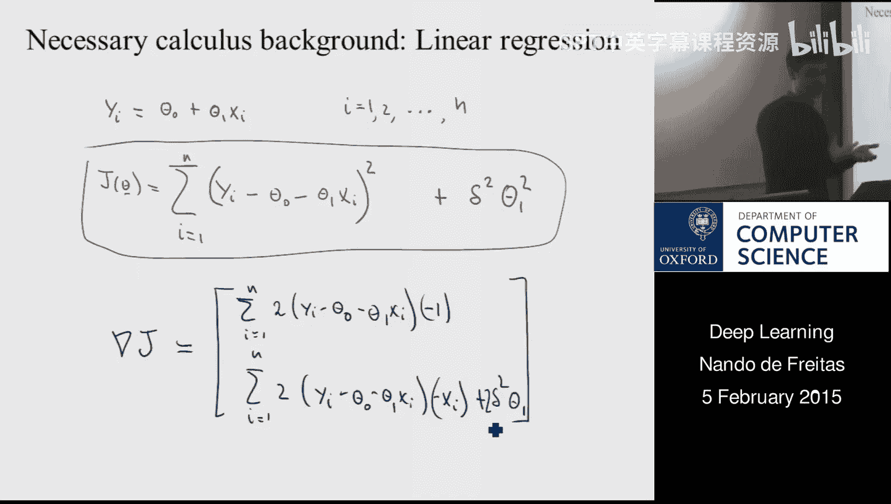

Okay。Let's now try to go from an example to more general settings， so in a more general setting。

 the gradient will be effect where we have many parameters。

 like if we're doing trying to fit a model， a linear model with many parameters。

We will have to form a vector that has all the derivatives。

We need to come up with this gradient and as I mentioned before， like in this1D case。

 the gradient is associated is these vector fields， the pointing out toward a max。

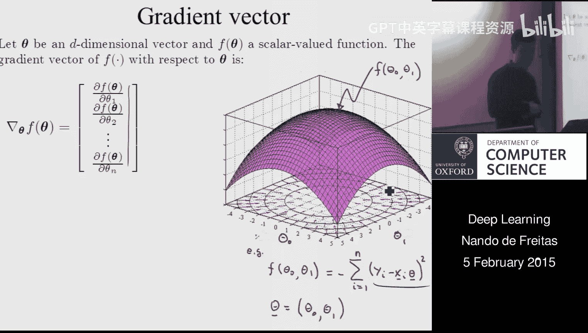

In a quadratic you guarantee to find the optimum， typically the type of cost functions that we will look at。

 you know they're more like this， they have many optima， they're not convex。

 and so when things are convex you guarantee that you can find the optimum provided that you have the right rates of acceleration as we'll see in an example soon。

 but if you have multiple optima， all you'll be able to guarantee is that you'll hit one of them。

And you don't know。You'll never know whether that's the global one or not unless you do some。

Mathematics to understand what's the probability that you've hit a global optum in practice you will not be worrying too much about that。

 you will just try to come up with an gradient need optimizer that takes you to one mode When we look at neural networks we'll see why that is why one solution is enough it will have to do with identifiability。

And just like for the simple case， we formed the Hessian。

So you should think of the gradients and Hassians， like think of two routines you could have in your code that given any function。

 you pass a handler to the function and it returns the derivative or it returns the second derivative。

 the matrices。And factorss。And so for。For data， our objective function will always be of this form。

It will always involve the data。Because essentially， and this is sort of an approximation to。

The expectation of f of theta and x with respect to P of x d x so if the data is being generated by nature and nature has a distribution P of x。

 all we're doing is we computing Monte Carlo estimates so given a finite set of data we're maximizing and the theory of empirical risk minimization as well as statistical tools like the bootsstrap attempt to answer the question of do we have enough data to learn this corrupt。

We will assume that everything is continuous and smooth enough that we will be able to interchange integrals with derivatives there are cases where you can't do that but in this course for all the type of problems that we deal with we will be able to do that。

And so by taking the derivative， we will use linearity and we'll just take the derivative。

The derivative of the cost function is the sum of the derivatives sum in torch you'll find that sometimes you there is variables called accumulated gradient and so on。

 so the idea that is you're actually computing the gradient at one data point and then you're adding it to the gradient of that you know the accumulated gradient from previous points that you had already computed so you're computing the sum sequentially。

Now in least squares you can either write a cost function like this or like this。

 I've been using this form so far but this form turns out to be easier to do calculations as I show here because we've already done this calculation before。

 if we take the derivative of this quantity using matrix differentiation that gives us the expression for the gradient。

 so you get to two entries in the one theta is two dimensional immediately。

So if theta is the dimensionsal， the gradient is the dimensionional， the hessian is D by D。

And if we take the derivative once again。And that sort of makes sense because this is D by N。

 this is n by D， so you get a matrix that's D by D， so the hesiness got the right sizes。

So you can either go with sums or you can do it using matrix algebra。

 it turns out that in torch sum doing things iteratively is still used a logic。

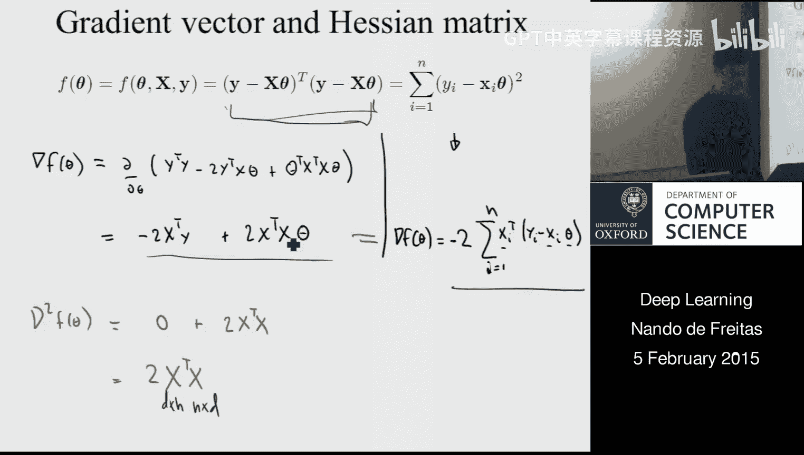

So the first recipe for learning is to follow as I mentioned to go in the opposite direction of you want to minimize an objective and the gradient is pointing to the maximum so you go in the opposite direction。

 so if we say that GK is the gradient factor or alternatively gra F as we've used in our notation。嗯。

We。We started the theater and to get the next theta。

 what we do is we travel in the opposite direction of the gradientland。

And we travel by an amount eater。so as this picture shows， you're at theta K。

You want to go to3 K plus one。And you travel by a strength eater times the direction of the gradientage。

Get the direction in the opposite direction of the gray I sorry so the gradient is telling you to go you go exactly in the opposite direction and the gradient it is pointing out in direction that is the steepest direction。

 the most vertical direction so you pick that direction to get your next feet and you keep going and so。

Again， in a paraboloid this paraboloid， it's very because the gradients are perpendicular with traveling perpendicular to these level curves。

 so whatever you start， you will get to the minimum。If your function again has more than one peak。

 as will be the case for neural networks， then you're not depending on where you start。

 even if you just pertuurrbbed initialization by a little bit。

 you could end up in very different parts of the space。Now if we use our。So for linear regression。

 if you compute a gradient。Wwhich is this expression that we've seen all the time。

 then the form that the algorithm takes， you just plug that in here。

 you just plug in the expression for the gradient， whether you're using matrix methods or sums and。

That's your algorithm， you initialize Peter not at random。And then you just look over features。

Until the theater stop changing and you have a solution and you're done you've learned。

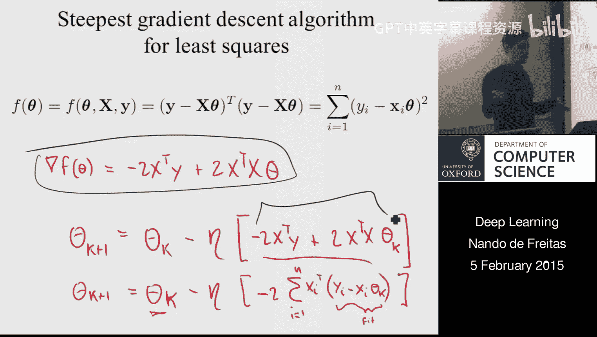

However， it's not that simple。

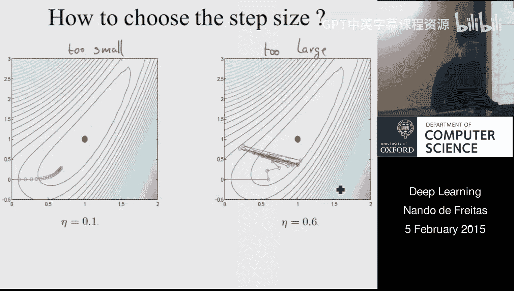

Because you have to choose。This guy eat it。

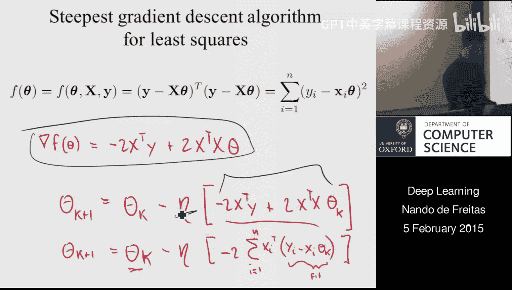

And even if your function is complex， even if you you're guaranteed to find the optimum。

 if your it is too small。And it's the king saying it like one over n to the one1 or something like that is the king too fast。

 what happens is you become really slow。And unless N goes to infinity。

 but we don't have infinity time before the PhDE people start harassing us to hand in the thesis。

You're going to be here and you're going to be far from the optimalum。

If you decide to get this done quickly and pick one that's very large。

 remember that the gradient is the negative guess of the gradient here is pointing out it's perpendicular pointing out to the minimum so if you follow the gradient you will swing to the side and then you follow oops sorry。

 and then you follow the gradient again and you'll swing to the side。Okay。

 so you essentially will be doing this。Very slow convergence you'll be wly so too large delta will get in trouble so there seems to be a so there's a question here of how we choose this sorry this interverable。

 this learning rate variable。

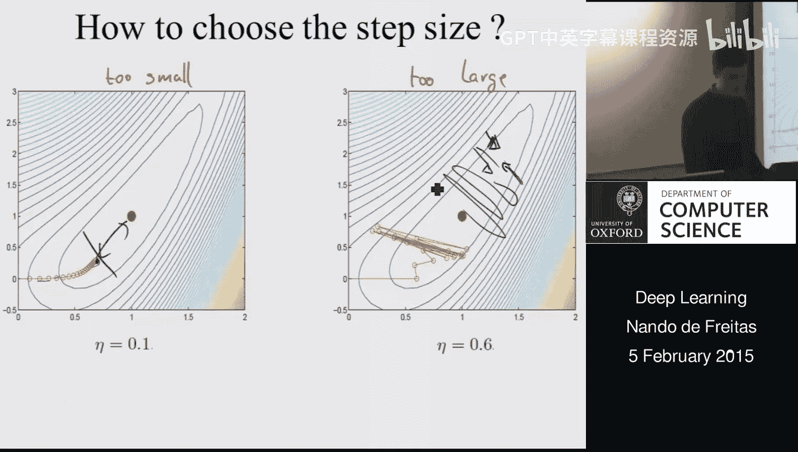

One solution is to use thehessian because in a sense， if we knew the curvature， which could use。

 take advantage of knowing that information。

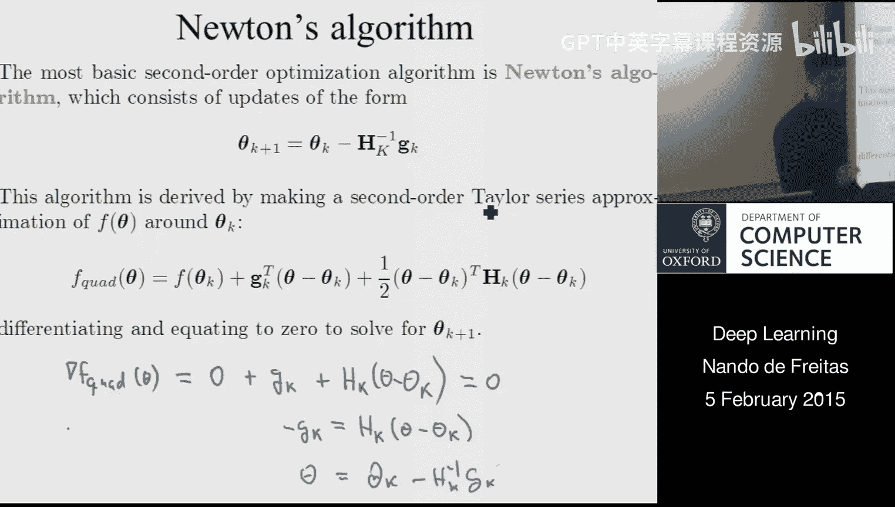

If a ball is very peaked， we know it should probably go slow because we could swim to the other side very easily。

Because it's very steep， but if the ball was very wide。Well。

 then you know you need a larger reta because you need to go faster。

 so knowing that curvature should help。

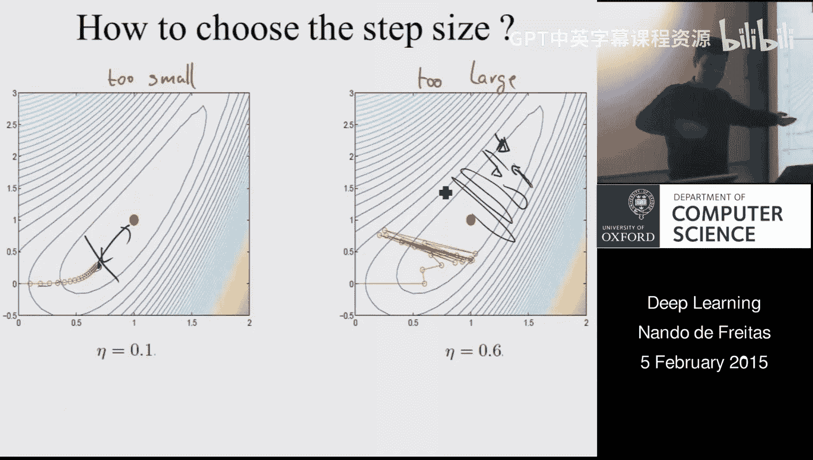

And that's essentially intuition for Newton's method。

 Newton's method uses instead of using the eater。To multiply the gradient。

 it uses the inverse of the hesian。Okay， so we're going to use the curvature。

 one way to derive this algorithm is to think of a quadraic approximation。

So just like a Taylorlor series， so we're going to come up with this quadratic approximation to f of theta and so the Taylorlor series says that f of theta is F。

 the Taylorlor series that trying to approximate F of theta with a quadratic function at theta K。

iss essentially f of theta k plus the first derivative times delta theta and then the second derivative times delta theta squared。

 and this is essentially what I've written here is the multivariate version of that table series expansion。

Now， if you differentiate the Taylor series expansion with respect to zero。

With respect to theta so as to find the minimum of that quadratic。

 So essentially we have a cost function F。We're approximating it with this quadratic ball。

 and then we're going to find the minimum of the quadratic ball。

And we differentiate this with respect to theta the first term。

This guy here does not depend on theta， so the derivative cost is zero。

The derivative respect theta just you transpose the vector that was the rule。

And then in your next class， I're going to ask you to do some of these to get used to。

Mattrix differentiation。And then the derivative respect to theta here is just h k times theta minus theta K。

 if you equate that to zero， you get Newton's method。

So neutralances method is what you get when you make a quadratic approximation。

And you mean a master qua。

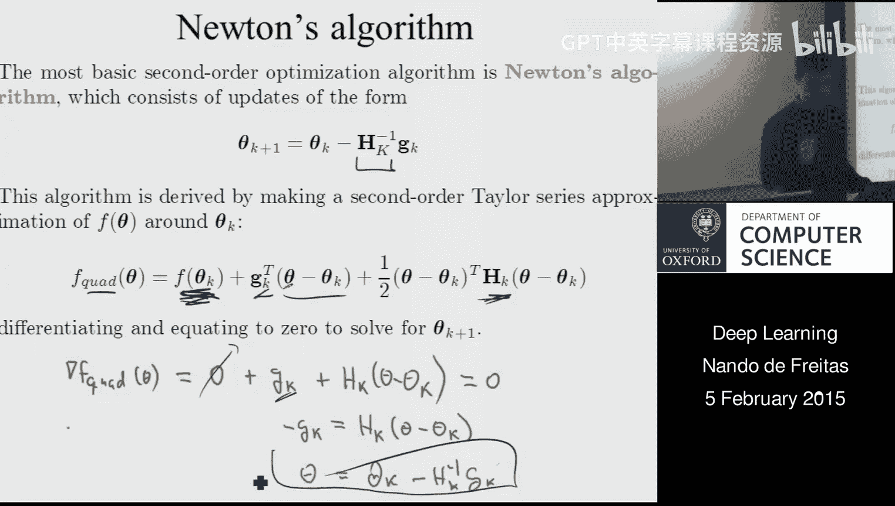

So that's in math and word。 The picture is this。You have your function F of theta in red here。

And let's assume that you're currently here。You're descending and you're currently at this point what you do is you fit a quadratic that provides a very good approximation near theta okay。

 it' the typical thing of a Taylorlor seriesius near the point is a good approximation far away。

 the error is large， but where you don't care about it far away， we just care about it close by。

So you' approximate near there， and then you find a minimum of it， in other words， you navigate。

Until you find the minimum of the quadratic。And that is your new theta K。And so Newton's method。

 really， if you have something that looks like this， all it's doing is fitting。Qudras。Well。

 that's a terrible drawing。 But you get you get the idea。

 it's fitting in quadratics and minimizing quadratics as you go down。

 So it's upper bound minimization。This is Newton's Street in Cambridge because you're wondering what this picture is and this is one of these was his room at in Trinity College。

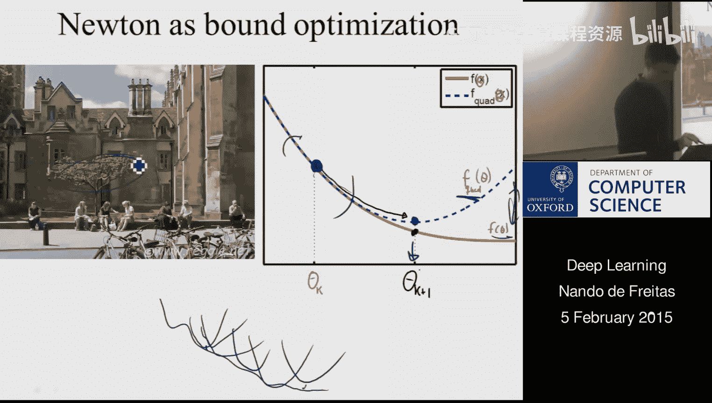

嗯。Now now let's put this， let's see how good is Newton's method。

 How well would we do if you knew the curvature of the ball？

For linear regression where we have were our F of thetas like this。嗯。This is the gradient。

 this is the Hassian。 Let's assume we decided to apply this。Newton's master。 so we would write this。

 We would have two x transpose x。-1。Timester gradient minus 2 x transpose y。

Plus 2 x transpose x theta。And that will give us theta K。Minus。

So minus times the minus will give us a plus plus。X transpose x。Inverse times x transpose y。And then。

 minus。X transpose x。Inverse times x transpo x。Theater。And it's the grain evaluated a K。

 So I should have put a K here。Okay， there would be a four maybe a four。Should it be four。No。

 because there's an in first here the twos。Okay so how many steps does N take to find a minimum？1。

Newton was a very smart guy just piping in Cambridge。这。Right， because this is the inverse cancel。

 x transpose x inverse cancels with x transpose x， and then you take theta minus theta cancel and you get the least square solution。

So if you follow the gradients with Newton's method。Bom。这样子。Not with the gra。 with a grain。

 you need to think about that eat。 Even in a quadratic ball， you could be osciating for a long time。

 or you could be too sluggish。

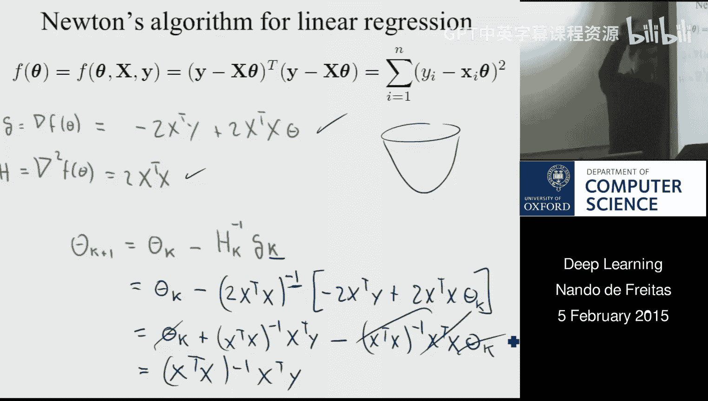

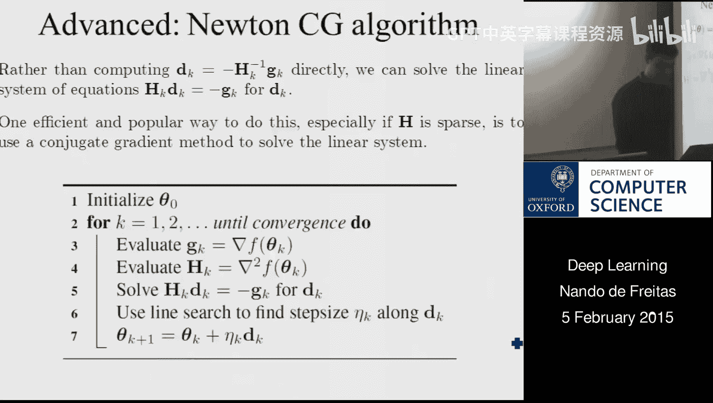

晒佢。Did you got。Good question for a ball。I mean， if the steps has to。

 they jump within the major minority。おでル。楼空。爬信。Oh no， no， but I'm just thinking a quadratic bold。

Well happened， okay。I need to think about that， it happens with how you deal with infinity with you're going to have to take limits。

😊，We can think about that puzzle afterwards。

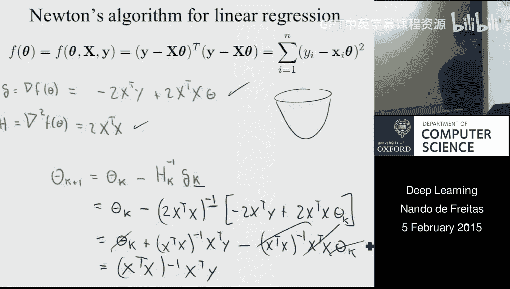

嗯。So one detail about implementation of Newton's method。

 so essentially the direction of Newton's method， so we can call this decay the direction of thescent。

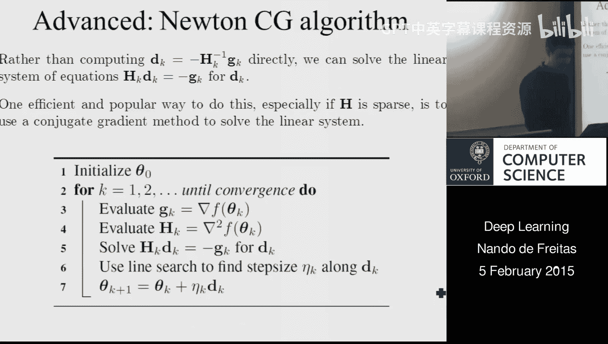

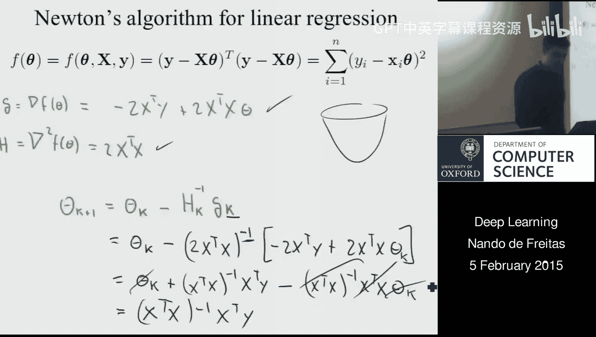

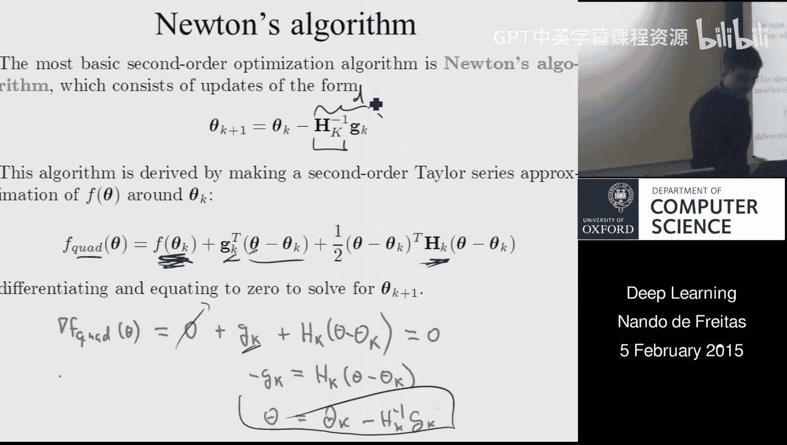

And。That direction is given by this term， for gradient would be Eta times g。

 but for Newton's method is this matrix times vector。And so if we write it that way。

 we can multiply both sides by thehessian and what we have is a linear system。So in a sense。

One way to implement yourton's method is you have a function。That gives you the gradient。

 You have a function that gives you the hessian。 You solve this linear system to get the direction of descent。

 and then you descendscent。Oh， hang on， this one I haven't explained to you yet。

 so let's put a question mark here。And then， you descendsent。So even for Newton's method。

 we do something called let's come back to this question mark。

 we do something called line search so line search is you sort you can look a few steps ahead and you can sort of。

Do imagine with gradients more intuitive day， you could look a few steps ahead and you see if the arrow went up then you would backtrack and make Eta small。

 and that's essentially what line search is and there's many ways of implementing this。

I'm not going to go into those details。Now coming back to even with Newton method。

 as you go and deal with non convex functions and so on， it's still a good idea to do this。But。

There is a catch and the reason for doing this step I should add I didn't finish my thought there was。

Solving your linears， there's lots of very good techniques out there for solving linear systems。

 And a lot of those techniques for solving these linear systems when they involve products of。

Marices times vectors can even those projects can even be done implicitly。

 so there's a lot of very good techniques that allow you to solve these systems very efficiently and so you can take advantage of that this is conjugate gradient algorithm and there's a very nice course taught here in mathematics by Nick forphathan that I think he's teaching it now that we'll teach you all the theory behind these algorithms。

Now， what is the catch with Newton's matter compared to gradient tost？The got all steepest decent。

No catch。It's more expensive It's more expensive。 You now need to store the hesian。 Now。

 let's go to our neural networks。 We have a billion parameters。

Now we need to store a billion by a billion。Say you tell Google， you can either use a billion cores。

Or you could use a billion billion core。You know what your manager is going to say。Hello。

So Newton's method， the cache with Newton's method is to come up with the Hessian and there's approximations to the so people try to come up with approximations I will talk about one at the end called thetagra that's quite effective factor but there's other methods things called BFGS LBFGS is a common method that you'll find in torch it's very popular it can do some mind surge and it's basically it builds an estimate of the Hessian based on the last few observations hence why it's called limited sort of has a limited memory over which it builds the Hesian so those methods sort of implement heuristic shall we say to approximate the Hessian but some of them are quite effective in practice LBFGS is one that I like。

啊。However， all these methods so far assumed that we actually looked at all the data and then we took a step。

A pass through all the data is called an epoch。In the language of neural networks in the torch language a pass through all the data is an input but what if your data is streaming okay Twitter data coming at you。

 you can't pass through all the data or in another case you might have so much data this idea that you're going to load the data to RAM like forget about it it's not going to fit in RA it's not going to fit in your computer so you're going to have to go over the data by chunks you load a bit and you over it or we'll see at the end if you have several machines。

 different machines could be loaded different chunks of data。

So we need a way of going through the data in an online manner。

 and that takes us too stochastic gradient to set。And it's schastic， because you only have seen。

A little bit of the data， so there's uncertainty about what other data is out there。

And it goes as follows。You want to compute a gradient of some objective function that you're optimizing。

It of quadratic fo these squares。As we just mentioned。

 what you're really doing is you're computing the gradient。With respect to。

Of a gradient that depends on the date。And you're taking its expectation over actually integrating over x to eliminate the to marginalize the effect of x。

And then what we do is we're approximated by joint samples from PFX。So what I'm going to do next。

And what we want。Is the sort of gradient to become zero to vanish because where the grade weather slope is zero。

 you sort of hit the optimal， and let's for now not worry about saddle points。

One way to derive SGD is in its sort of it's the way you would derive a lot of large class of algorithms called stochastic approximations is as follows we start with this guy here。

And let's just call it the expectation of f of x comma theta of the grad f of x comma theta。And。

I'm not writing what the expectation with respect P the data， P of x。

 and the gradient as with respect to the。And so we could say that that expectation grabbed f of x comma theta。

Is equal， we want it to be equal to zero。I'm going to multiply both sides by Eta。Okay。

And I'm going to add Theta to both sides。Okay， so I haven't changed anything。

And then I'm just going to introduce indices， and I'm going to say that theta K oops I forgot to eat。

I'm going to move this term to the other side。And I'm going to say that three plus one。

It's going to be equal to theta k。Minus Eta， the expectation。Of broad F。Of x comma feature。Now。

 if we drew samples。From P of x。Then you could approximate this as theta k minus eta 1 over n sum from  equal 1 to n。

Glad pe。Of X I commfi。That's essentially the batch method that we had before if your data set consists of end points。

 this is exactly what our gradient looked like before。

 but then what folks realized is if you're doing many curs。

You actually can do the following approximation。You only draw one song。Okay。

 and one samples enough to give you convergence intuitivetuly。

 it's wasteful to use a lot of data to get approximation of the gradient initially when you haven't learned much at the initial stages of learning。

 so it's best to just。Learn as you gather data， be much more aggressive and as you're going down Another way to look at this。

Is to analyze this a little bit more carefully。And to realize that what this is saying is that theta K plus one。

It's equal to theta k。And now what I'm going to do is I'm going to add to this the true gradient。

 and so I'm going to add and subtract it。 So I get minus Eta， the expectation。Of the true gradient。

I'm just going to write it like this。Solve X and theta。 And I'm going to subtract it。So I'm gonna to。

Minus grad F。At X K and theta K。Apologies for going a bit to offer。Close the bracket。So basically。

 I'm taking a question about a automatic to2 gradientd。And I'm subtracting it。And if you do that。

 then you realize that。This is what we want， this is the same as the initially question that we had here。

 the true gradient。And then this other term is the difference between the true gradient and the gradient with only one term。

So this is this form of noise。So that's going to be changing over time so you can think of it and that's why we think of it stochastic gradient descent because it has this noise term。

 it's gradient descent but it's on the true objective if you knew all the data。

 but it has this extra noise term because we only observe one data point at a time。

 or you might observe only a small batch of data at a time。If you make this guy。Be equal to1 over n。

Or one over K with iterations。Then this tends to behave very nicely for if you had say infinite data if you were going to infinity because the series of one of a k diverges that means you can。

This theater would never get sluggish。 It would be able to visit the whole space。

 and it will eventually find a minimum。And the noise has some variance that you need to bound。

And the series of， if you think of this as a noise， when you multiply noise by a constant。

 it's like squaring the variance， multiplying the variance by a constant squared。

But the series of one over our k squared type converges。And so the variance is finite。

 but you can go everywhere in the space。 So in other words， you don't oscillate。

And yet you can get there。And this is sort of the arguments that theorists use to prove convergence of this。

 and you can also just sort of map this to differential equation and you can study its convergence。

 so there's a whole field of study out there called stochastic approximation that is dedicated to these problems。

For us， it's the important thing is to understand that the noise here is coming from the fact that we haven't seen all the data and that in order to compute。

This online we only need to load a few data points at a time and that there are people out there who figured out that this scheme can converge in fact。

 if we use a constant value for ETta， this would still converge if you have a finite amount of time you know the number of durationerations you're going to run for。

So there's three ways in which you could run gradient decent， you could load the whole data。

 this is called a batch way。You could go one data point at a time。

Or you could do what we always do in practice you use this thing here called a mini batch you pick a subset of points in this case 20 so if your data has 100 points you would break it into five groups of 20 points and you computer grading for 20 points and then you take an update of the parameters and then you load the next 20 and so on that's what we always do in practice in your next practical I'm going to try to get you to implement each of these different ways and see how it behaves as you change the mini batch size so that's an exercise I recommend。

嗯。Now what you find， sorry previous batch is， why would there still be iteration？

Or you have all the data。So you might have all the data。

So in which case you know the objective function， but you started your theta at some particular point and you still need to go downhill to find out what the theta should be。

So you might have， so it's like back to the least square， so we started at a random point。

But unless if you use neutral method， you can get there in one step。

But it's true that in these squares， you kind of can get there in one step because we know the optimal solution。

 But if you have any sort of function that。Has sort of multiple solutions。嗯。That is non conxt you。

You're going to have to descend on theta， even if you know X。

 you might know X but you don't know theta， so you guess a theta and then you keep updating your theta until that theta minimizes a cost function。

In the stochastic case， it's always important to plot the training error curve to show the error as you go down。

 and in fact I forgot to mention this， but this is extremely important。 you would also plot。The test。

One thing I'd recommend is break the data into two sets。

And then look at how the error is going down on the training set。

 but also look at how it's going down on the test set because often what happens is you're going down on the well on the training set。

 but on the test set your error starts increasing so in that case you're overfitting。

So a good technique to prevent overfitting is always plot both curves and watch for this and when you get here stop and this is called the early stop being。

There's a difference between learning and optimization and optimization you care about finding minimum objective function。

 but in learning don't forget that what we're doing here there is trying to make good predictions so always remember to look at your cross validation and you can do cross validation during the training。

And of course， the error can go up because it hasn't seen all the data。

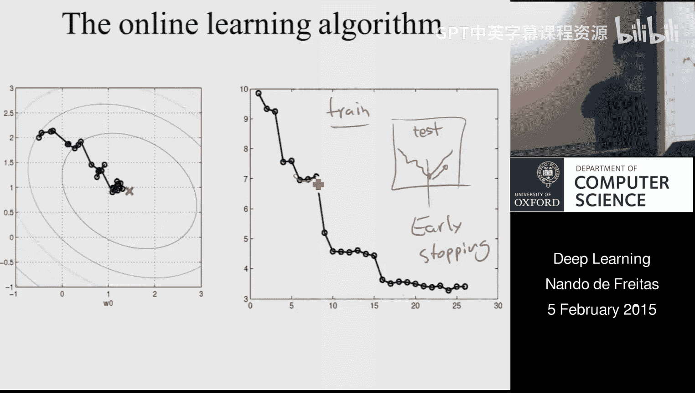

At Google， this is how this gets implemented。The parameter， so first of all。

 imagine that the parameter lives in a server。 so this parameter is really huge， lots of numbers。

 lots of bytes。Then we're going to create model replicas of the model of the neural network。

 and so step one。Is a replica like one of。One of the local models that has access to local data。

I forget the word serverver and slave is what I remember Master slave， you know， these guys。😊。

Blue guys， as for a copy of the parameters， they have access to a local amount of data。

 just a subset of the data because there's just too much data to load it into a single machine。

And then the compute gradient， the compute mini batch gradient。And then they send this mini batch。

So the second step would be here， Comp mini batch。 And then the third step is they send the update of the gradient。

 and Jeff uses。Delting， instead of。The other way around。

Instead of the Nala and so you send the update of the gradient back to the server and then the server once it receives that gradient。

 it updates the parameters using that gradient that was sent The nice thing is you can do this asynchronously they don't be in the machines need to be in log。

for this to work， because you're just some ingredients。

 so it doesn't matter which term you sum first。One further thing that is done is that if you have a very large neural network。

 you break it， so each H here is sort of a parameter of this network。

 you break it into groups so there's four blue boxes that's essentially what's shown here。And now。

These four blue boxes actually only do local updates and it's only the things that cross machines like these dark edges that you actually need to communicate So you also there's some good methods out there also I called hog wildild and so on for some models that has parsity to try to exploit this to do completely asynchronous so you try to get two things。

 you try to get data parallelism by breaking the data into different regions and you try to create model parallelism by breaking the model in this parameter server。

Like these days to train very large models that's not what you're going to do in your computer at all。

 obviously， but if you're going to join a company and you're going to work training large models。

 you're going to be using a platform like this。Okay。

 there's a few more tricks that are used to train neural networks， a few more optimization tricks。

 one is averaging， so the idea is you take an update of your parameters in this case I've called them W。

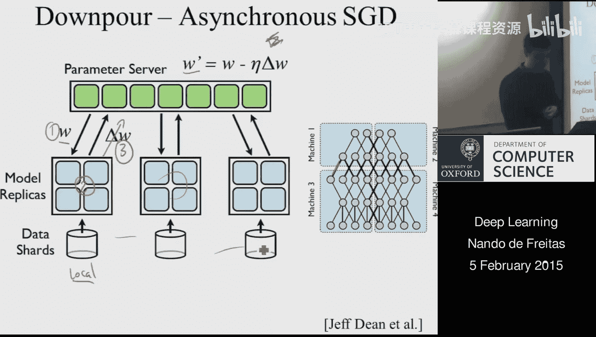

And then you average the parameters。And this is just a running average of the parameters。

 you can confirm that this is just the average。One of a t plus one。Some of our IWI。

So your average all parameters。And intuitively， the reason why this helps is imagine that you pick a very large step size and you're oscillating。

Then you pick the Aldage。And you're right there so that's a sort of situation where this would work well and there's a lot of theory behind this as well and this is actually a sensible trick another trick that you oh I was going to run by you is momentum and for those of you who've done the practical you've already seen that this is one of the things you need to choose in your code so I got this picture from Jeff。

It's kind of nice。 He draws this。Disfunction that looks like this。It's like this。

 and so what happens is that if you're following the gradients， you could be doing this。You know。

 so it's going to take a long time for you to get done， so you're going to be sort of going around。

 and so it would be nice to use the momentum of the case would be I guess of。

Of this particle to accelerate it to go down， so if it's going to be down the gravity。

 so try to accelerate it。So we want a trajectory like this as opposed to like this。

And so what is done？Is。The following thing， your add introduce a new parameter alpha。ふ。

And then the rest is the usual gradient。And so so now。Your descent。

We'll have this extra term that is sort of essentially looking at at the rate of essentially what you're comparing。

 let me move this to the side。And write it like this。 You're looking at your deelta。T plus one。

And this is your delta theta T。 So the rate of acceleration now sort of depends on what the previous rate of acceleration was。

 So you're not just like going at constant speed， but now you can actually accelerate because you're using this extra acceleration term。

 So you get a better。Converge just to the min。So momentum is very useful。

 another thing that's extremely useful。😊，Is this trick called Adergra？

And eithergrad is based on the following observation that some data points。Often。

 like you have these sort of three inputs in this case。And some inputs， really。

 like these green guys and these red guys， they're the ones that are really determining what the output should be。

So very rare things are important， whereas very common things are not very useful。

 and that's essentially what happens in language， you know like you want to try to predict what an article is about。

 the rare words are often very informative about what the article is about。

 the common words like that and is and of， they're useless。

And so John Duuchci and colleagues used this intuition to develop an algorithm that basically exploits this that looks at so what he does is he accumulates。

The gradients。So you basically now start looking at the history of how much a sample changed the laws。

 and so you build a history， think of it as like one way to think about this as well as like an approximation of thehasian。

So that only the more the sort of the rare terms， the rare features are able to influence。

 are able to get a larger update for the parameters。

 so rare features will become more important than common features。

This is extremely useful because in typically in data parts of this nature， theres。

There's just a few features that are important， so if you have a model like a brain。

You would want that brain to only fire for each neuron in that brain to only fire for very few signals。

Because if you have a neuron that fires for everything， that neuron is useless。

 it's not selecting anything If I have a neuron that fires only when I smell coffee or see coffee and so on。

 that neuron is useful， it says something about the world。So。

So you want models that are very sparse in that sense。

 and so if you have sparse models you want to have optimization methods that handle that well and this is a brilliant optimization technique。

So what's keeping。Oh， ge is the gradient。 I'm so sorry。

 I I was looking at the clock and I'm worried because you guys really want to go home。

 It's the gradient。 And so what you do is just just arrive by the sum of the gradient。

 So you keep you keep a tally of your gradients。 and so you normal by。

All the changes that happened along that feature dimension in the past。How的这。

The cost change as a result of updating that feature。

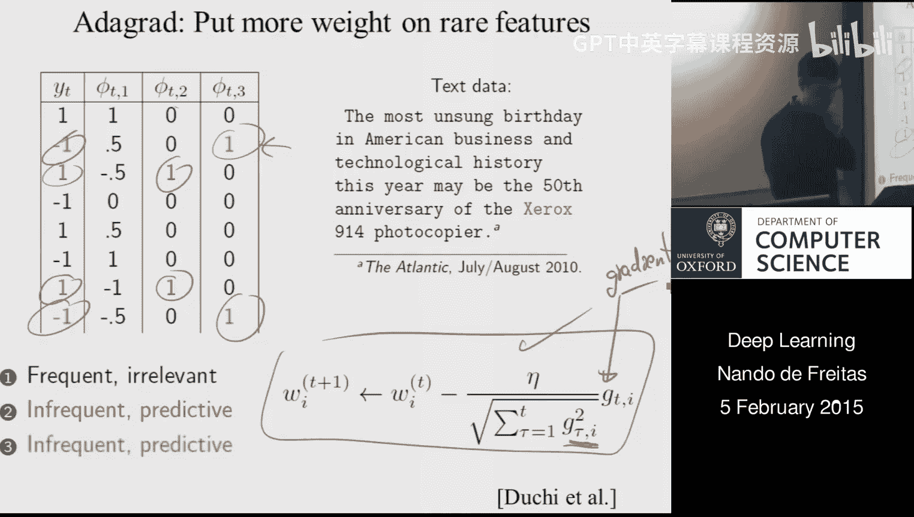

Now， so that's one good technique and then there's a lot more that I haven't covered。

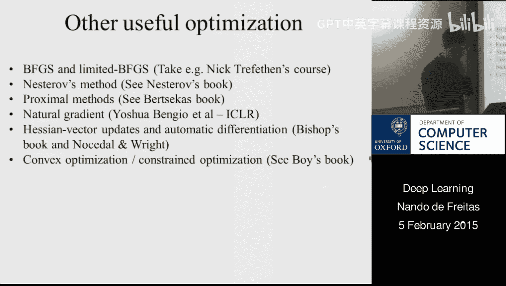

When you play with neural networks， definitely always try this technique， it's very useful。

And a synchron then in your case I guess synchronous stochastic gradientcent is also very useful with momentumpoli ca that's what you're going to be playing with when you're training neural networks Of course there's a lot more to optimization that I cannot possibly cover in this short 50 minutes。

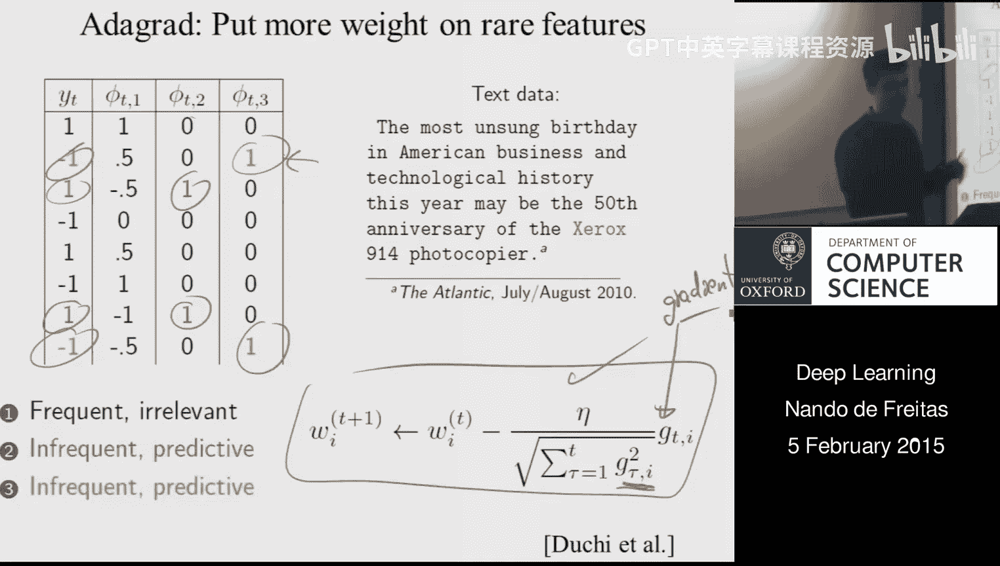

And and I recommend you go to one of the courses that is offered here like Victor Fathton's course。

 there is something called Netrorov's accelerated method。

 Nestro has a beautiful book on this which for anyone doing machine learning seriously。

 this is a must read I love Perecka's many books he calls things nonlinear programming instead of optimization and he has some old books on parallel computation and so on that are extremely good。

Natural gradients are very nice things where you look at gradients， not in terms of parameters。

 but in terms of the distributions， say the likelihoodlis and so on。

 so it's a very nice way of optimizing。嗯。There's a lot of tricks on how to do。

If you know that the hesian only appears as a Hasian vector。

 you actually never need to form the hessian and so there's a lot of very good tricks to exploit that called Hassian free optimization methods and so on。

 there's a whole topic of optimization with constraints and so on that I didn't touch at all on so for all that I would recommend that you go and look at this for us for deep learning。

 what's going to matter is online mini batch gradient toscent。Online you SGD。

 and you will care also about improvements to SGD like EG。

 polyac averaging and momentum provided you get a good feel for those techniques。

 you'll be able to trade the big models because that's what folks do out there。All right。

 so next week， logistic regression and neural networks。So I don't get an applause today。

That's the problem。

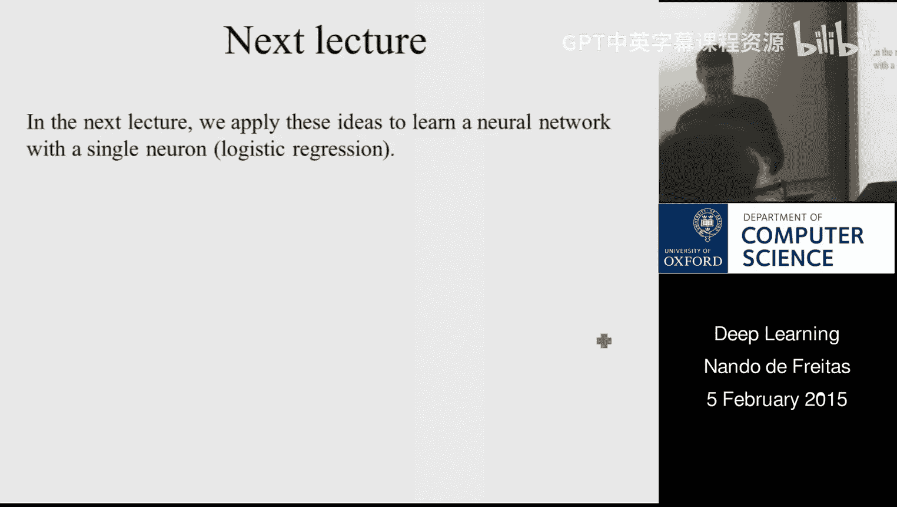