# 深度学习：06：优化 🎯

在本节课中，我们将要学习深度学习中一个极其重要的部分：优化。我们将从基础概念开始，逐步深入到实用的优化算法，并理解它们如何帮助模型学习。

## 背景知识

上一节我们介绍了优化的重要性，本节中我们来看看优化所需的基础数学工具。

### 梯度

假设有一个关于两个变量 `θ₁` 和 `θ₂` 的函数 `f(θ₁, θ₂)`。例如，一个以 `θ₁` 和 `θ₂` 为中心的二次曲面（像一个碗）。其等高线是从顶部看下去的同心圆。

对于多变量函数，我们计算导数的方式与单变量微积分类似，但需要定义偏导数。梯度是一个向量，它包含了函数对所有变量的偏导数。

对于一个简单的二次函数 `f(θ₁, θ₂) = θ₁² + θ₂²`，其梯度计算如下：
*   对 `θ₁` 的偏导数：`∂f/∂θ₁ = 2θ₁`
*   对 `θ₂` 的偏导数：`∂f/∂θ₂ = 2θ₂`

因此，梯度向量 `∇f(θ)` 为 `[2θ₁, 2θ₂]`。

梯度有一个关键性质：在任意一点，梯度向量的方向指向该点处函数值增长最快的方向（最速上升方向）。相应地，梯度的反方向指向函数值下降最快的方向（最速下降方向）。如果我们想最小化一个函数，就应该沿着梯度的反方向移动。

### 海森矩阵

除了梯度（一阶导数），我们还可以考虑二阶导数。海森矩阵是一个包含所有二阶偏导数的矩阵。

对于函数 `f(θ₁, θ₂)`，其海森矩阵 `H` 定义为：
```
H = [ ∂²f/∂θ₁²   ∂²f/∂θ₁∂θ₂ ]
    [ ∂²f/∂θ₂∂θ₁  ∂²f/∂θ₂²   ]
```

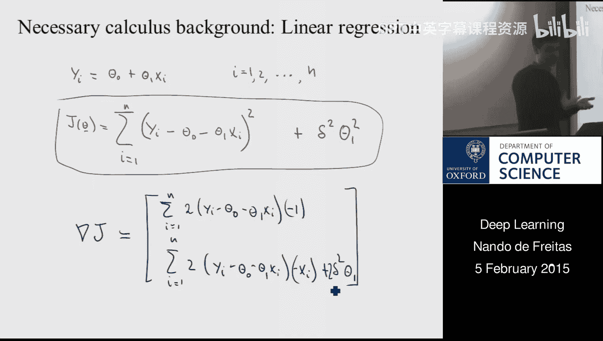

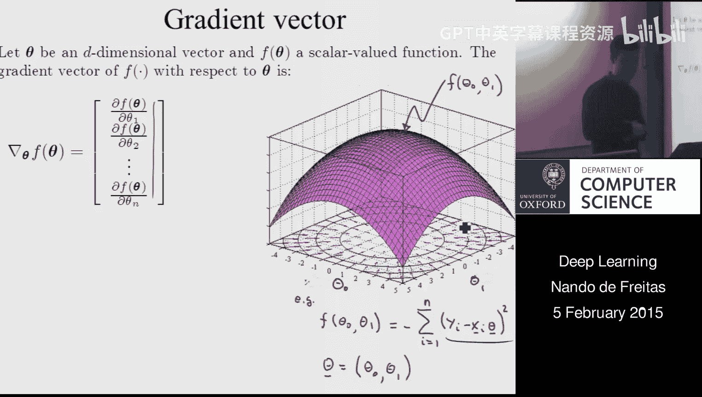

对于之前的二次函数 `f(θ₁, θ₂) = θ₁² + θ₂²`，其海森矩阵是一个常数矩阵：
```
H = [ 2  0 ]
    [ 0  2 ]
```

海森矩阵提供了关于函数曲率的信息。例如，它可以告诉我们当前点是位于一个“陡峭的碗”还是一个“平缓的碗”中，这对于确定优化步长很有帮助。

### 链式法则

在深度学习中，神经网络本质上是复合函数。因此，链式法则是计算梯度的核心工具。

假设 `z` 是 `x` 和 `y` 的函数，而 `x` 和 `y` 又分别是 `u` 和 `v` 的函数。那么 `z` 对 `u` 的导数可以通过以下方式计算：
`∂z/∂u = (∂z/∂x) * (∂x/∂u) + (∂z/∂y) * (∂y/∂u)`

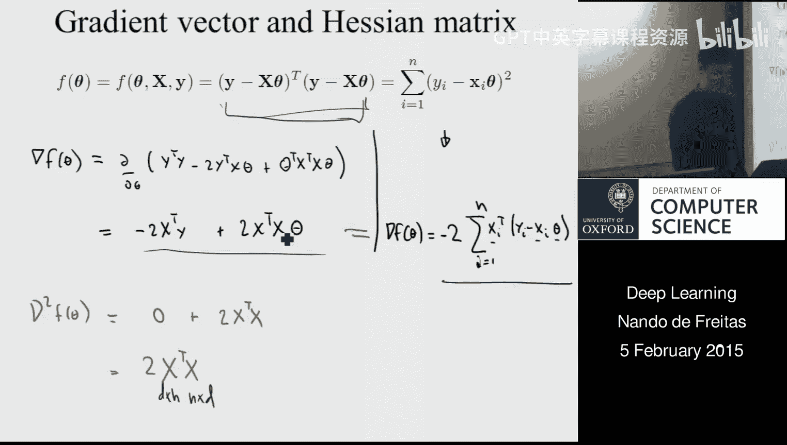

这反映了从 `u` 到 `z` 有两条路径（通过 `x` 或通过 `y`），总的变化率是两条路径变化率之和。我们将大量使用链式法则来计算神经网络中参数的梯度。

## 优化示例：线性回归

现在让我们看一个具体的优化例子：用直线拟合数据点。

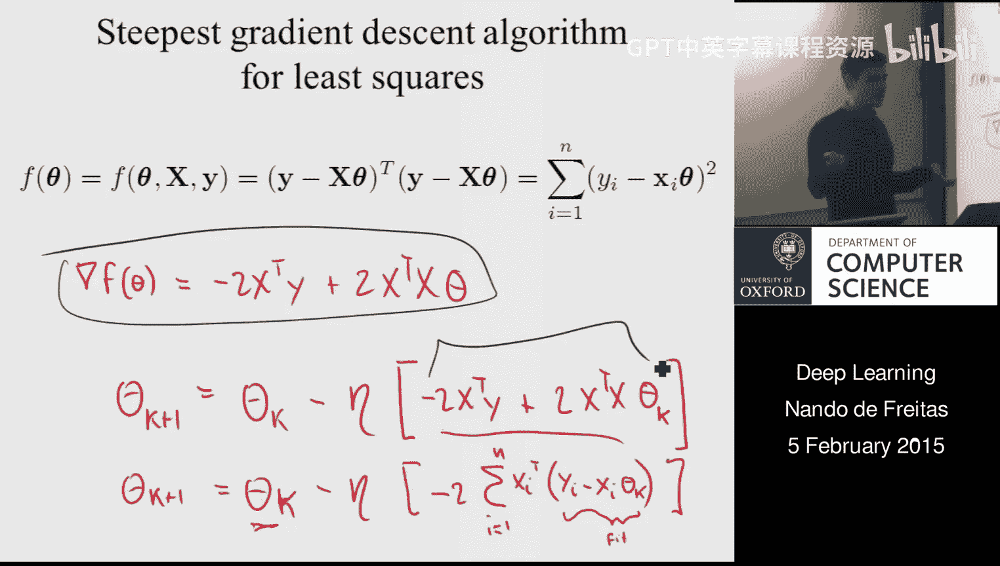

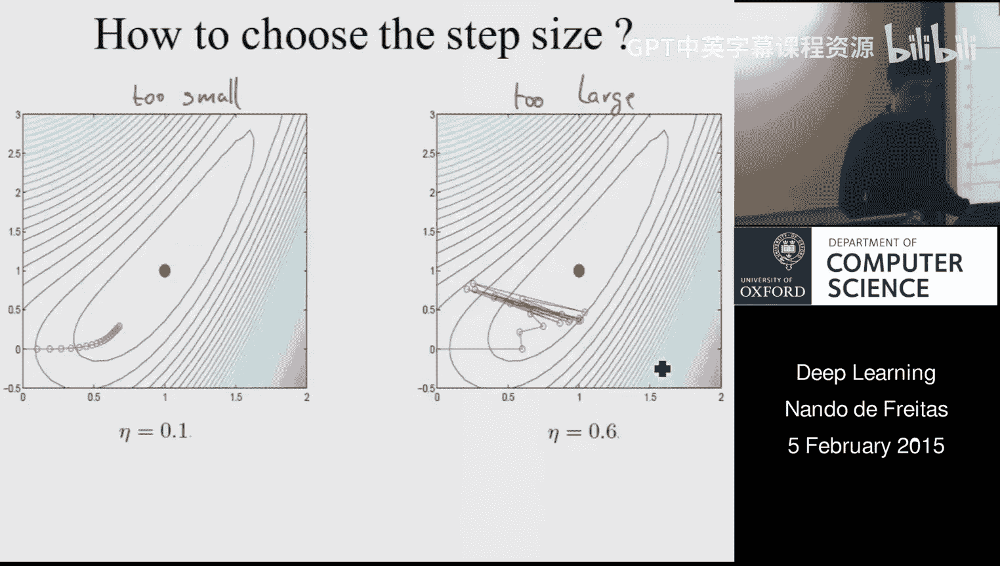

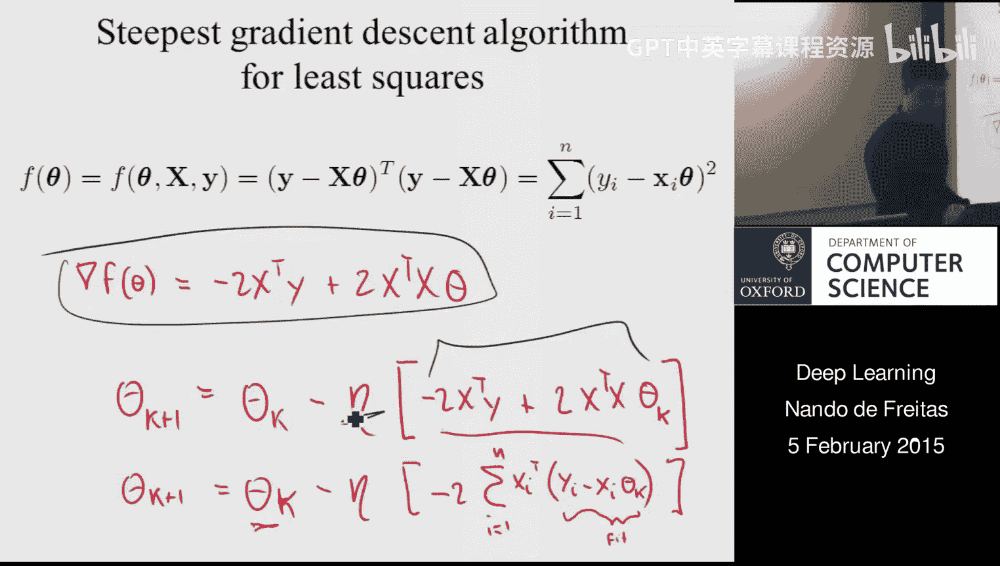

我们有一条直线，其方程为 `y = θ₀ + θ₁x`，其中 `θ₀` 是截距，`θ₁` 是斜率。我们使用最小二乘损失函数：
`J(θ₀, θ₁) = Σ (y_i - (θ₀ + θ₁x_i))²`

为了最小化 `J`，我们首先需要计算其梯度。以下是梯度的计算过程：

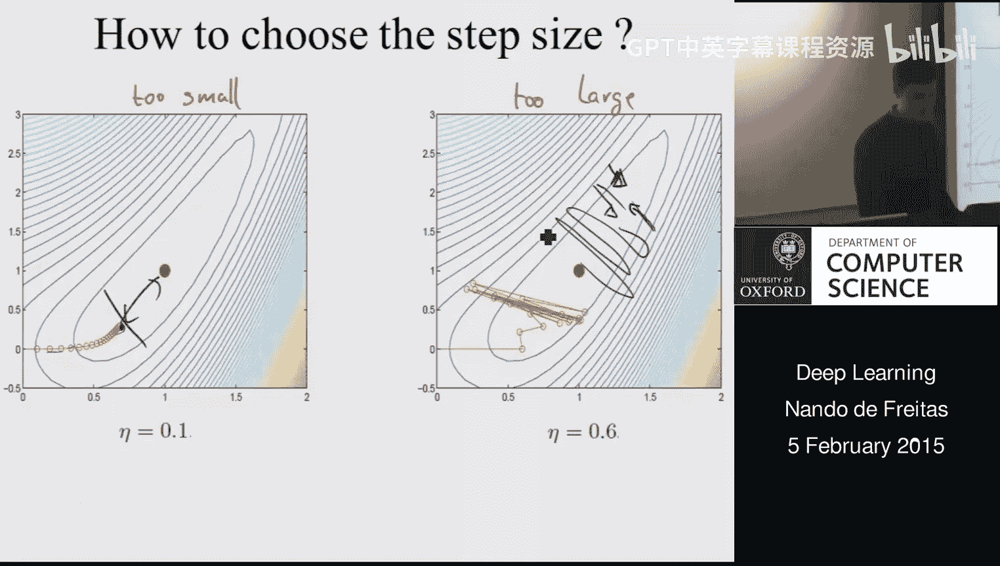

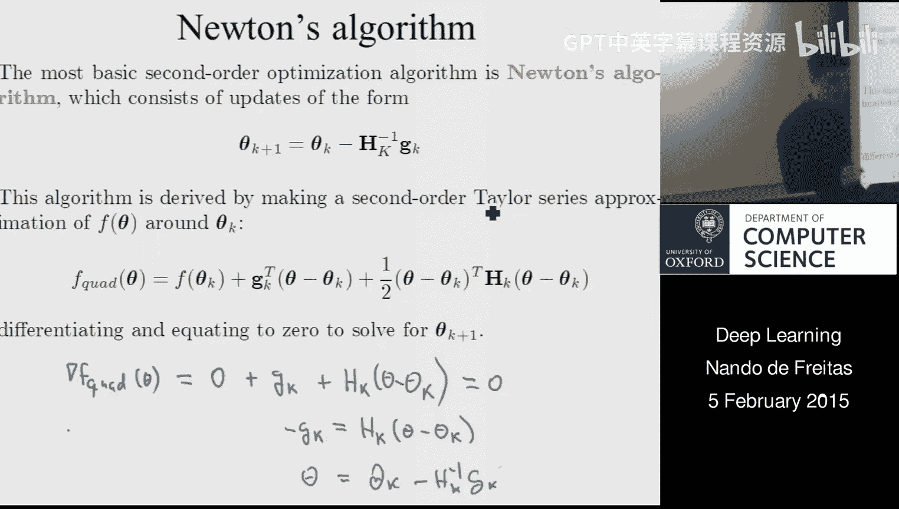

*   对 `θ₀` 的偏导数：`∂J/∂θ₀ = Σ -2 * (y_i - θ₀ - θ₁x_i)`
*   对 `θ₁` 的偏导数：`∂J/∂θ₁ = Σ -2x_i * (y_i - θ₀ - θ₁x_i)`

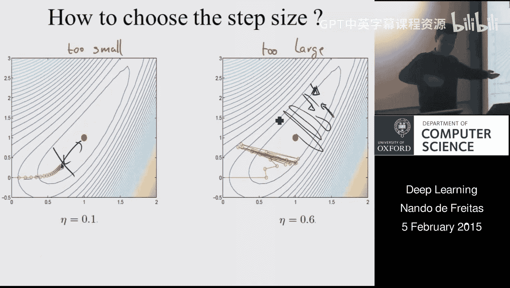

因此，梯度向量 `∇J` 为 `[ ∂J/∂θ₀, ∂J/∂θ₁ ]`。

得到梯度后，我们就可以利用它来更新参数，朝着损失函数最小的方向前进。

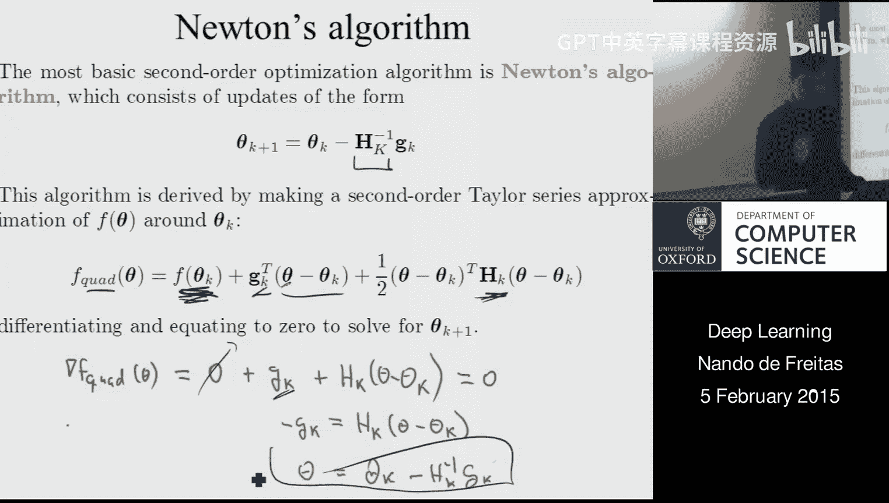

## 梯度下降法

上一节我们计算了目标函数的梯度，本节中我们来看看如何利用梯度进行优化。最基本的方法是梯度下降法。

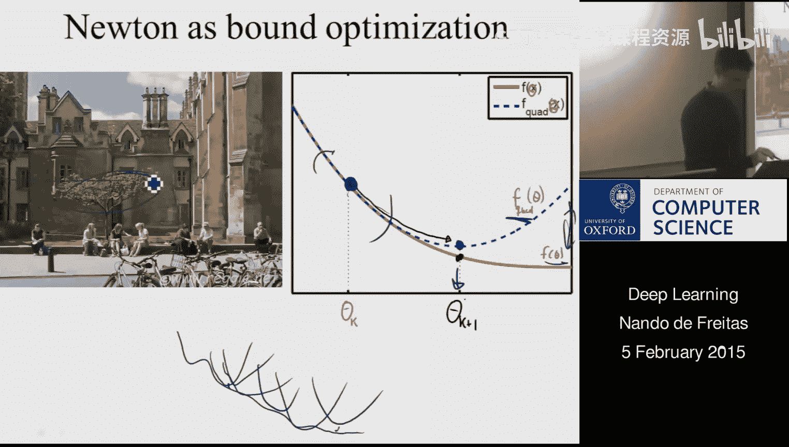

梯度下降法的核心思想是：为了最小化函数，我们沿着梯度的反方向（即最速下降方向）更新参数。更新规则如下：
`θ_{k+1} = θ_k - η * ∇f(θ_k)`
其中 `η` 称为学习率，它控制着每次更新的步长。

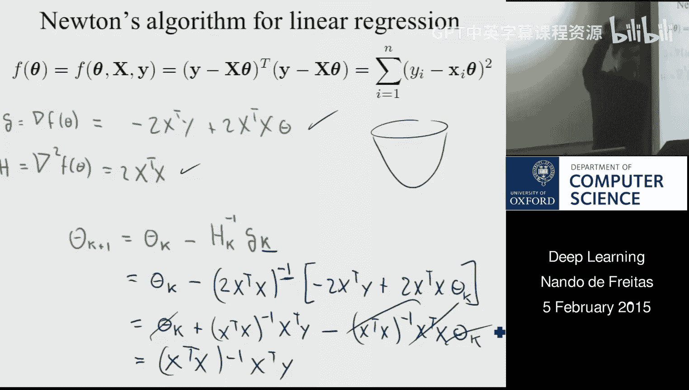

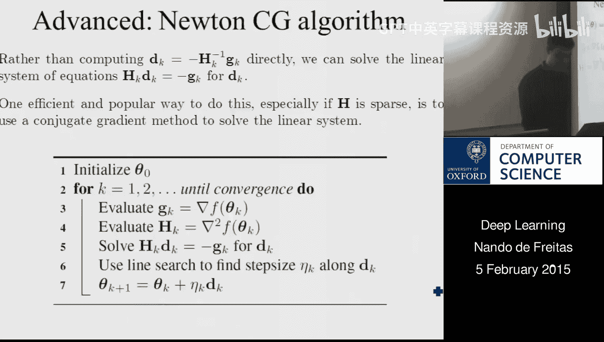

对于线性回归，将我们之前计算的梯度代入，算法流程如下：
1.  随机初始化参数 `θ₀` 和 `θ₁`。
2.  重复以下步骤直到参数收敛：
    a. 计算梯度 `∇J(θ₀, θ₁)`。
    b. 更新参数：`θ₀ = θ₀ - η * ∂J/∂θ₀`，`θ₁ = θ₁ - η * ∂J/∂θ₁`。

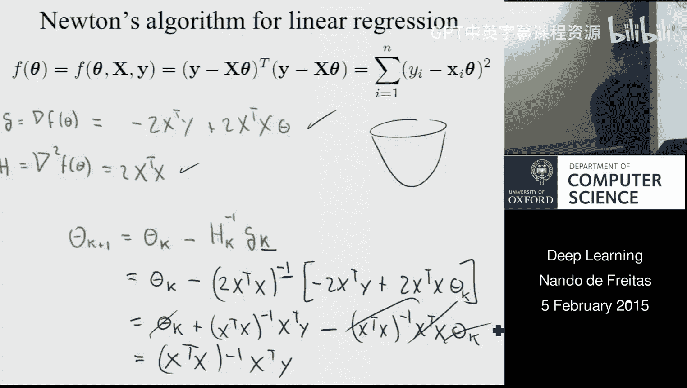

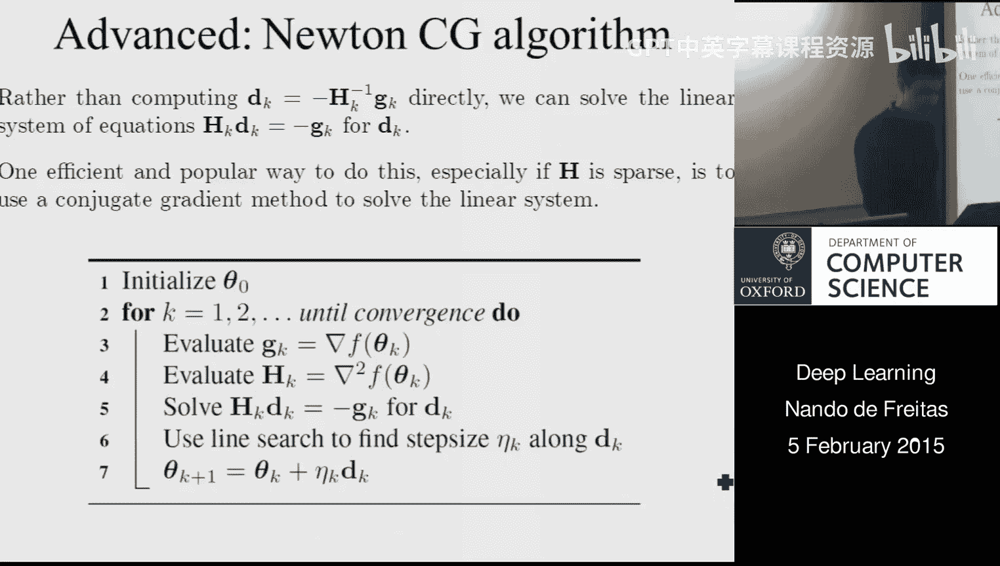

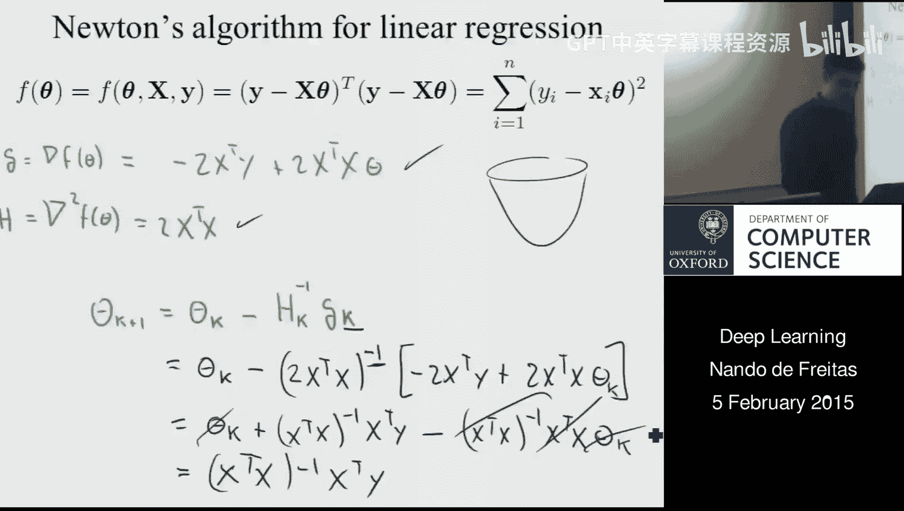

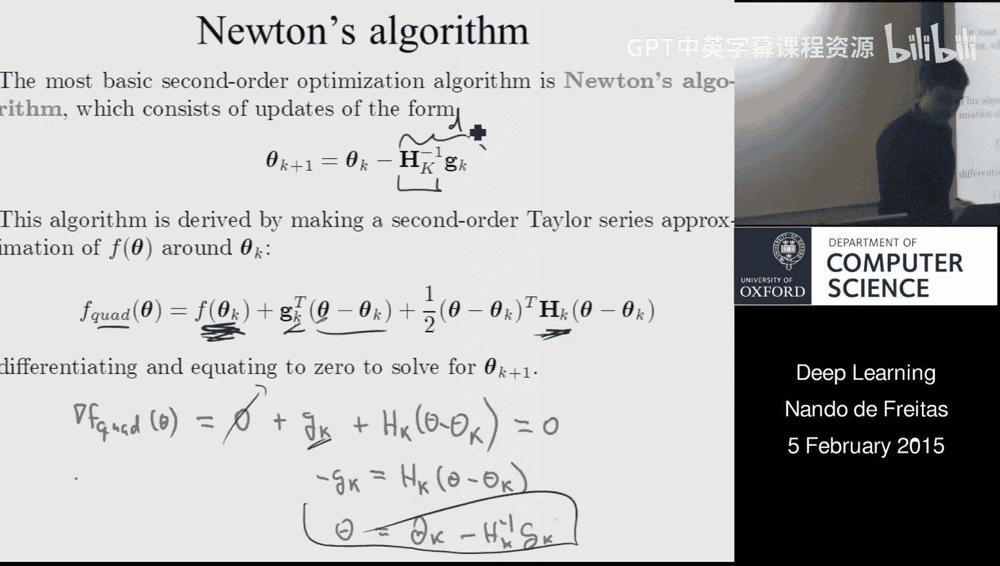

然而，梯度下降法并非没有挑战。学习率 `η` 的选择至关重要。

以下是选择学习率时可能遇到的问题：
*   如果 `η` 太小：收敛速度会非常慢，需要很多步才能接近最优点。
*   如果 `η` 太大：参数更新可能会“ overshoot”，在最优点附近震荡，甚至发散，导致无法收敛。

因此，找到一个合适的学习率是使用梯度下降法的关键。

## 牛顿法

梯度下降法只使用了一阶导数（梯度）信息。如果我们还能利用二阶导数（曲率）信息，可能会更高效。这就是牛顿法的思想。

牛顿法的核心是利用当前点的二阶泰勒展开来近似原函数，然后直接找到这个二次近似的最小值点。其参数更新规则为：
`θ_{k+1} = θ_k - H^{-1}(θ_k) * ∇f(θ_k)`
其中 `H(θ_k)` 是海森矩阵在 `θ_k` 点的值。

直观理解是：在当前位置 `θ_k`，我们用一個二次曲面（抛物线）来局部拟合复杂的损失函数。然后，我们一步跳到这个二次曲面的最低点，并将该点作为新的参数估计 `θ_{k+1}`。这个过程不断重复。

对于线性回归这个特例，牛顿法可以在一步之内就找到全局最优解（最小二乘解），因为它要优化的本身就是二次函数。

然而，牛顿法也有其缺点：
*   计算成本高：需要计算并存储海森矩阵及其逆矩阵。对于有 `D` 个参数的模型，海森矩阵是 `D×D` 维的。当 `D` 很大（例如在深度学习中参数可达数百万甚至数十亿）时，这几乎是不可行的。
*   实现上，牛顿法的更新方向 `d_k = -H^{-1}∇f` 需要通过求解线性方程组 `H * d_k = -∇f` 来获得。

由于这些限制，在深度学习中直接使用牛顿法并不常见。人们发展出了许多近似牛顿法的优化算法。

## 随机梯度下降

前面的方法（批梯度下降、牛顿法）都假设我们在每次更新参数时，都会使用全部的训练数据来计算梯度或海森矩阵。当数据集非常庞大时，这会导致计算效率低下，甚至内存无法容纳所有数据。

随机梯度下降（SGD）解决了这个问题。其核心思想是：每次更新只使用一个或一小批（mini-batch）训练样本来估计梯度。

SGD的更新规则与梯度下降类似，但梯度是基于单个或少量样本的估计：
`θ_{k+1} = θ_k - η * ∇f_i(θ_k)`
其中 `∇f_i(θ_k)` 是在第 `i` 个（或第 `k` 批）样本上计算的梯度。

我们可以从理论角度理解SGD：我们的目标是最小化所有数据上的期望损失 `E[∇f(x, θ)] = 0`。SGD用单个样本的梯度 `∇f(x_k, θ_k)` 来近似这个期望，并加上一个噪声项。通过适当降低学习率（例如 `η_k = 1/k`），可以证明SGD能够收敛。

在实践中，我们通常采用小批量随机梯度下降，它平衡了参数更新的方差（噪声）和计算效率。以下是几种梯度下降变体的比较：
*   **批梯度下降**：每次使用全部数据。更新稳定但计算慢。
*   **随机梯度下降**：每次使用一个样本。更新快、噪声大，能跳出局部极小，但路径震荡。
*   **小批量梯度下降**：每次使用一小批样本（如32、64、128个）。这是最常用的折中方案，兼具效率和稳定性。

在训练神经网络时，监控训练误差和验证误差曲线至关重要。当验证误差开始上升而训练误差继续下降时，可能出现了过拟合，此时应停止训练（早停法）。

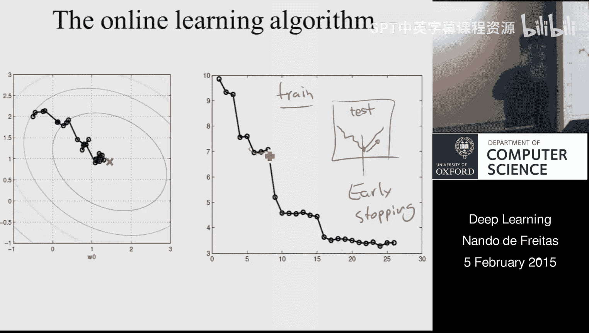

## 高级优化技巧与分布式计算

在实际训练大型深度学习模型时，我们还会用到一些高级技巧，并常常需要分布式计算。

### 优化技巧

以下是几种常用的高级优化技巧：

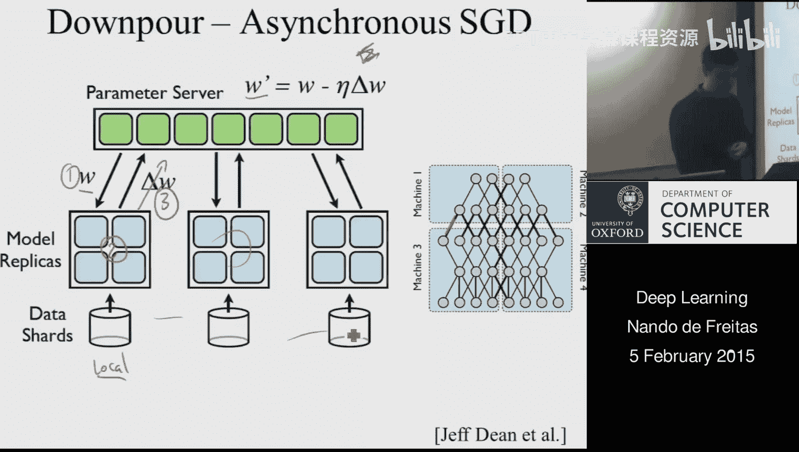

*   **动量**：为了加速SGD在正确方向的收敛并抑制震荡，引入了动量项。更新规则变为：
    `v_{t+1} = α * v_t - η * ∇f(θ_t)`
    `θ_{t+1} = θ_t + v_{t+1}`
    其中 `v` 是速度向量，`α` 是动量系数（通常为0.9）。这模拟了物理中的动量，使参数更新不仅考虑当前梯度，还积累了过去梯度的方向。

*   **参数平均**：在训练过程中，对参数的指数移动平均值或算术平均值进行记录。最终的模型使用平均后的参数，而不是最后一次迭代的参数。这有助于稳定训练，特别是在使用大学习率时。

*   **自适应学习率方法**：这类方法（如Adagrad, RMSprop, Adam）为每个参数自适应地调整学习率。其基本思想是：对于不常更新（稀疏）的特征，给予更大的学习率；对于频繁更新（稠密）的特征，给予更小的学习率。例如，Adagrad的更新规则为：
    `θ_{t+1} = θ_t - (η / √(G_t + ε)) * ∇f(θ_t)`
    其中 `G_t` 是一个对角矩阵，其对角线元素是截至 `t` 时刻所有梯度平方的累积和。Adam则结合了动量和自适应学习率的优点，是目前最流行的优化器之一。

### 分布式训练

当模型和数据过于庞大，单机无法处理时，就需要分布式训练。一个典型的架构是参数服务器架构：

1.  **中心参数服务器**：存储和维护全局模型参数。
2.  **工作节点**：多个工作节点（模型副本）各自拥有部分训练数据。
3.  **流程**：
    a. 工作节点从参数服务器拉取最新的参数。
    b. 工作节点用本地的数据子集计算梯度（小批量）。
    c. 工作节点将计算出的梯度推送给参数服务器。
    d. 参数服务器聚合所有梯度，并更新全局参数。
4.  **并行策略**：
    *   **数据并行**：不同工作节点处理不同的数据批次。这是最常用的方式。
    *   **模型并行**：将大型模型的不同部分分布到不同的机器上，适用于单层参数巨大的模型。


这种方法支持异步更新，能极大提升大规模模型的训练速度。

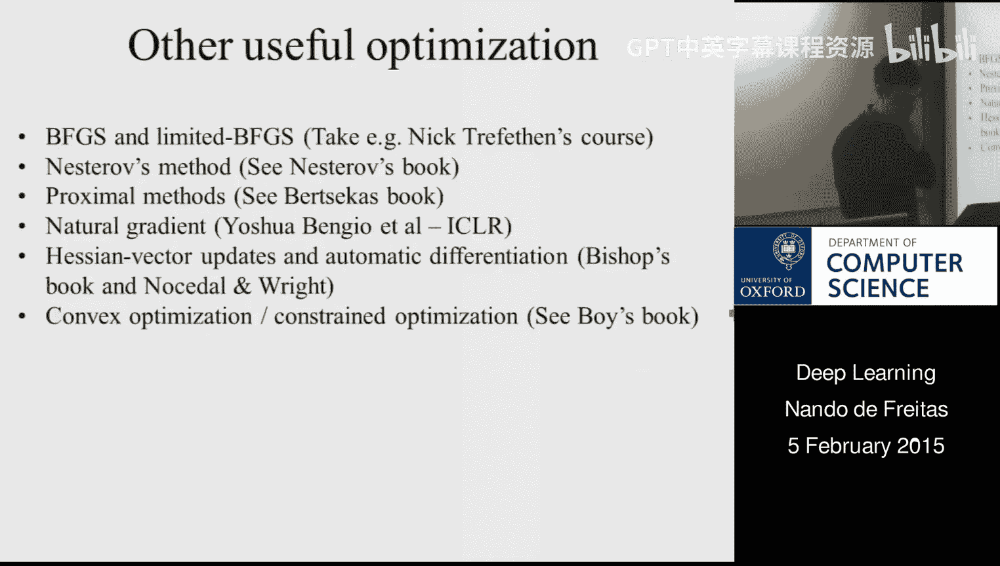


## 总结

本节课中我们一起学习了深度学习的核心——优化。我们从梯度和海森矩阵等基础数学概念出发，详细探讨了梯度下降法及其面临的学习率选择问题。接着，我们介绍了利用二阶信息的牛顿法，虽然精确但计算成本高昂。为了处理大规模数据，我们引入了随机梯度下降及其变体小批量梯度下降。最后，我们了解了几种提升训练效果的高级技巧（如动量、自适应学习率）以及支撑现代大模型训练的分布式计算框架。

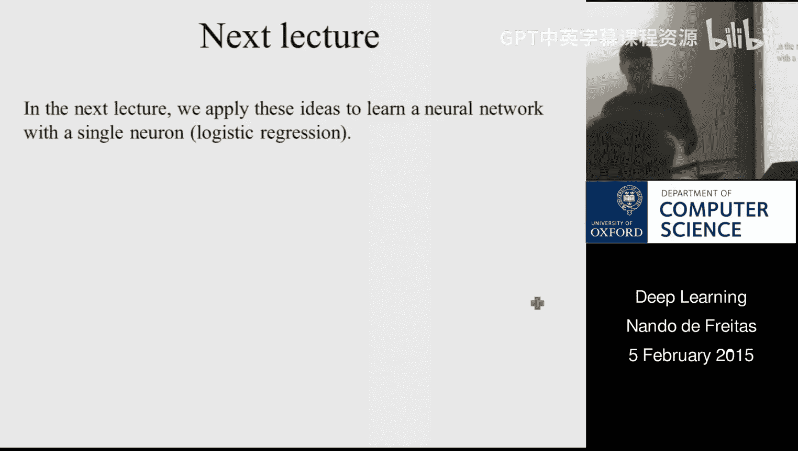

掌握这些优化原理和算法，是成功训练深度学习模型的关键。在实践中，通常从小批量SGD配合动量或Adam优化器开始，并根据需要调整学习率策略和批次大小。