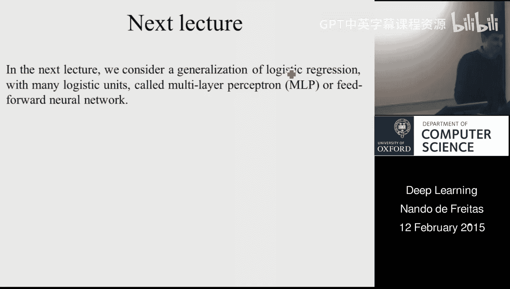
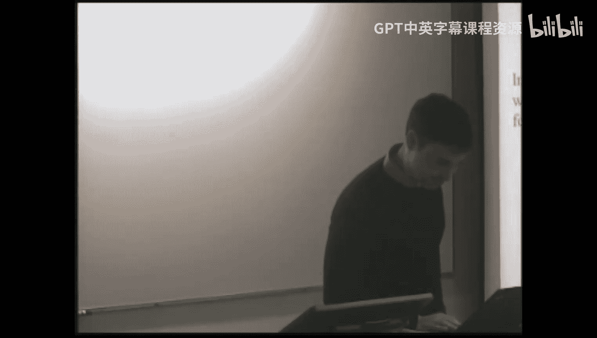

# 牛津大学《深度学习｜Deep learning 2015》中英字幕（Claude-4-s） p07 8_ Modular back-propagation, logistic regression and Torch.zh_en -BV17NWWz6ErN_p7-

So in this lecture I'm going to introduce the time propagation algorithm and unlike most folks。

 I will introduce it for logistic regression because I made logistic regression a little bit extra complicated by introducing the soft marks instead of using the standard logistic function。

But that allows me to treat this as a neural network and already allows me to apply the back propagation algorithm and I will teach it in the context of this very simple example as opposed to try to do it for a very general network because for a very general network to introduce abstract indices and I have to go over all these computations and it's sort of very hard to explain it in that generality so I will explain it with a simple example。

 I will however introduce a different kind of generality which you will not find。

 I think on any book， which is the layerwise generality where we're going to think of instead of think of back propagation as taking derivatives through a network。

 you know go passing a signal through a network and then back propagating derivatives as you'll find in the post for example。

 excellent books of Kevin Murphy of Chris Bishop， we're going to instead take the modular approach of frankly。

Figure out what computation does a single layer do？What does a layer need to know。

 it needs to sort of know how to compute from the input from an output。

 and it need to have a mechanism of taking an output the refer and then propagating it back。

And it also needs to compete the derivative to respect electrons。

 so we've seen three types of layers。Linear layer， which just does linear regression。Softmax layers。

 which log softm layers， which just expiate the input and divide by the sum of the exponiated inputs。

And we've seen the another kind of layer， which happens to be a loss function。

 which is the the theanthtropy。 And it's very clear that we could have a layers， for example。

 for Riine chorara， quadratic error or know。The exponent of a calciumsian。

 we would just have a layer for that， we could construct a layer for that term。

 we could construct layers not for sigmoid function， but for any arbitrary function。

And then in this layerwise way of doing things， we will only have to specify what is the function that the layer computes。

 what is the derivative to respect to input， and what is the derivative both respect to the parameters。

 if the layer happens to have parameters。So you need to specify three things and this is how we code neural networks properly。

 you code each layer independently and you provide three functions， forward， backward derivatives。

 gradients。So provided and I will talk about them as messages so you have。Layers， which are objects。

 they have three messages， and provided you have this， you can construct arbitrary networks because。

If you have software where you have all these layers and this is。

 in fact what you're doing with torch， you have all these different layers in a class called NN for neural network。

There's another class in N graph that allows you to build all sorts of arbitrary apologies and that's a very nice extension。

And so。When you code things， if you have an idea for a different layer。

 maybe you don't like this sigmoid function and you want to have something that's piecewise。

 a quantized sigmoid， for example， because you're dealing with you know some aspect of the signal that requires quantization。

 then you would just write。The forward message for it。

 you might make this piecewise somewhat smooth or you can actually write the derivative backward and if it has parameters you write the expression for the derivative so instead of of taking the derivative of the whole network provided you know how to take derivative of very simple functions。

That's all you need to know in order to code a method。You code layers， you don't code networks。

 you don't try to write an algorithm which for whole network。

 you write an algorithm a which for a layer and then the other thing you need now is when you optimize basically just call layer after layer。

 provided they send the right messages building a neural network is just a question it's like label。

You take a block in the layer， put another piece that's the next layer and another piece another piece and you can make all sorts of shapes and those are your neural networks and then the provided we have the right protocol for the passing messages forward passing derivative messages backward we'll always be able to do local computation and get global consistent computation so we'll get the right derivatives all throughout the network and we'll get the right messages forward messages right throughout the network and once we have all the derivatives then we just call SGD we put also those derivative factor and we just do the usual thing theta is equal to the all theta minus alpha。

 the gradient。はい。And you repeat that for a few billion iterations of whatever it is that you have to do。

 and you have an answer。And then you can use the model to do all sorts of predictions。Okay。

 so that's sort of the idea I'm going to go from local to global consistency and we're going to do this in Torch The only reference I found about this is the likeol paper by Leam Boto on this。

 but there's a sort of separation between how you will find back propagation written in books and how it's。

Implemented in torch and cafe。 And the version I'm going to give you is the version that。Is used to。

I've talked to Kevin Murphy about this and he's working in the as part of the next edition of his book。

 he will include this layer wise formulation by propagation。Okay， so logistic regression。

 we know how to write across entropy loss， so we had inputs Xi， we multiplied them times parameters。

 there were two vectors of parameters， theta 1 and theta 2。And then we do the log soft max function。

 and we do it twice for one term on the other term。

And then we add the map weighted by the indicators of data and that gives us the cost function。

And we can express this as an network as we saw， so we have an input X that goes into a linear layer and a linear layer produces two outputs Xi times theta 1 and  Xi times theta 2 when I just write XI I mean the whole vector so that's a dot product of the vector Xi times the vector theta1。

And then I put those two one dimensional variables into the softmax layer。

 which just basically computes LSF 1 and LSF 2 takes the log of the softmax function。

And then the negative log likelihood is the function that I'm showing you here in purple。

 it just takes the indicator of class0 multiplies it times LsF 1， it adds to it indicator of class。

One times a list two， and it does this overall the data set。嗯。

How you do messages and how you do past messages is sort of very important。

 so in some of the code that you will find online， some of the demos of logistic regression。

 the points XI are being passed through the network one at a time。

That's not necessarily ideal when you try to implement this and GPSs and so on because you might be calling you might be passing information。

 getting something started just for one point， so often you try to pass it in mini batches and the code that we've given you for your practical is' using mini batches so you actually pass a little batch of data in this case the size of the batch is small n so you have i equalL12 and points in your batch。

 you pass the whole batch forward。This is a particularly useful thing to keep in mind when work in which should be used。

Okay， so that's the architecture and to make this general， I'm going to introduce some variables。

 I'm going to call this Z1。And I'll use the index upper index here not to indicate a power。

 but to indicate the layer。So they expon it and the getss layer。This is going to be。Z 1，2。

 And this is Z 1。Said tutu。So layer two， and I have output 1 and output 2。This is going to be Z31。

 and this will be Z 32。And then this guy here is that four。Okay。

And the reason why I'm going to have on these sets is because I want to write an algorithm to only any dependent sets。

It'll be easier to do the derivatives done。I mean， you saw in the previous class what happens when you try to carry all these terms。

 it's very tious。And prone to error。Now， once we have。Once we have and just to make it clear， Z1。

2 is equal to X I theta 1。Set to2 is equal to X。There's an eye times theta2。嗯。Z 1，3 is equal to。LSF。

 which is this function， which is log。Of E to the Z I 2 divided by。So each to the Z 1，2。

Divided by E to the Z 1，2 plus E to the Z。22。And like y z 2，3 is equal to log。E E to0 to2。

And then it has the same。Deenoinate。OkayAnd finally， we know that。Zed。4our。

 which is just equal to the cost。Is the sum over I。Indicator of class zero。Times。Said1， three。Plus。

 the indicator of class1。单色。2，3。So I can write all this in terms of honey sets。嗯。And if I do that。嗯。

And。And again， using the definitions that I have where this is。This whole guy here that said one。

 one。How am I going to parse this， This is very hard to parse let's do it with colorss Cols are a good way。

 so I have one one。It's basically the green guy。Appears here and here。And。Purple is。

Something that depends on X I， which is at1 and theta 2。 So well be this。And this guy here。

And then I have Z two and Z two is。The the products。So I have two of these products。Anyway。

 so that's the true that just the products between these guys。 I should say  one， one is。Sorry。

 I made a mistake here。He and I got confused with so many。Let me try to write this cleanly。

And the colors one more time。Zed1，2 is the。It's hard to deal with it Z 12 is just x1 theta 1。

Exile Eta 1。 so this guy here is Z 1，2。And so that's computing this function here。I then have。

These are a function。Which is computing this block。And then the lots of soft marks is that。

3 and then Z4 is the cost function The point that I'm trying to make here what what we have with this network is we have compositions。

I'm taking Z1 and' multiplying times theta 1 and then I have a function that calls it。

 which is a texted the dot product of theta 1 and Z1 and then I have。

And then I evaluate the logs soft Max twice。And that keep you。

 and then evaluate this whole expression to give me the cost。So if I want to。

And I just realized one thing， this theaterta should have a test。

For consistency before I've had it below。It's layer one， parameter1 and parameter2。Now。

 if I want to compute a derivative with respect to this。

I know how to do it The the of respect of the of，With respect to one particular parameter。

 a big theta 1。By using。Because I have a function。 I have a function。哦。

Two variables and each of those two variables are functions of two variables and each of those two variables are functions of two variables and so we have this nesting of functions and that's why I need all these brackets。

If I want to compute derivatives and this is still not the efficient way of doing it。

 this is still a tedious way， but it's faster already than than one I had before。

 I would have to compute a derivative of Z4 with respect to the function Z13。

And then I have the computer of thoset 1，3。With respect to Z12 and then Z12 with respect to theta 1。

But I also have to compute derivative roofrow set for with respect to that。3，1。So 3。

1 and then31 depends on the to2。And that only dealt with this first term here。

 And so I also have the derivative of Z4 with respect to Z。3， two。

And then with respect to the first input， which is at12。And then theta 1。

 And then I have yet one more。Which I will have。Need to look at， to look at the across term。

And set 1，3。Oops， that should have been two through， Se 1，3， Se 2。

 Se  two is the one that I need now。And that's the expression that I get just by applying to general and I'm applying it twice because I have a function of two variables。

 which is in a function of two variables。嗯。Now the thing to note and this will give us the intuition for the algorithm。

 how we're going to design this algorithm is that if I were to compute derivatives this way。

 this will be somewhat inefficient because I'm computing the same things a bunch of times。

 like for example， this term I computed here and I computed here as well，I'm also computing。

This guy here， and then I'm computing it here again。 So I'm computing it twice。

So there's this all this computation that is being wasted。

 if I had an efficient way of only computing these terms each term once。

 then I will have an efficient algorithm。And essentially what I'm going to show you next is an efficient way of doing this。

Okay， and so the way we're going to do it is。By thinking of the network in terms of layers。

 as we've already done。And I'm going to abstract it a bit。So， I have layer。3。Layer 2。And layer。One。

 I'm going to do three layers， but。This is true for n layers。

 I'm doing three layers because that's what we've been doing in our example。

And so initially I have Z1， which is equal to x。As I pass forward， I get Z2。

 which is a function of Z1。Then I get， I guess the function will change。 So then I get Z 3。

 which is equal to another function of Z。2。And eventually I'm going to get the cost。

 which is equal to Z4， which is also a function of the previous layer。Said 3。

Hopes that should be exponent。Okay so Z1 phs into function， I get out Z2， Z2 phs into function。

 I get out Z3， Se3 goes into function and I get Z4， and for the particular example。

 we looked at the functions where the linear function and the submax function and the negative look likelihood function。

嗯。I will then want to design an algorithm that sends the derivative derivatives back。

And I'm going to initialize this as the output derivative， I will initialize it at one。

 so the input gets initialized at X， the output will be initialized at 4。

 and then I will pass the derivatives backward。And in fact， all I have to design。

And this is the important part。 I only have to design。A module that has this form。That it takes Z in。

And it outputs。As that output。If this is layer L， this would be layer L plus 1。And it will take。

Delta L plus1。And it will produce deelta L。And occasionally。

 it will produce something that's a derivative of the cost with respect to。

The parameter of that layer。Okay， so that's the setup。 We're going to focus on one。

One net and so in a sense and one layer sorry and so you only have to worry about this function that sense that computes that goes from input to output you need to worry about a function that will deal with derivatives and will need to have a function that computes sort with respect to the parameters of the now and see being again the cost。

 the final cost。I still have to define for you Delta， and I will define next。

I will in particular need a function。In order to propagate， so in assess， I need to know how。

How the output in order to know how suppose I have a parameter theta in layer one because case it's a linear layer and essentially I want to know how perturbations of that theta will affect the output and to know that I need to know how theta changes Z2 and how that two affects Z3 and so on so I need the perturbations between the inputs to layers and the outputs of layers。

 if I take all these perturbations I will know the perturbation of how the perturbation of theta affects perturbbed the output。

And so I will need to compute the derivative with respect to any input to a layer。

And that's what I'm going to define as Delta I。And here I'm specifying I as an index of a units in the layer so remember this each layer has many could have many units in our example there were only two。

 but in general you could have n units per layer。And for that， we're just going to use。嗯。

The chain rule so essentially I'm going to apply the chain rule to a single to a single layer。

 so I have the derivative of C because my output is z out and there are many z out I need to take the derivative respect to each output Z。

Okay。So I have many output， so I have each。Each of these zs is a vector， so it has with sub xj。

 So there's many of these。 I need to take the derivative of each output with respect to input and I need to do each because。

As you saw in this example， because there's cross terms here。

 the way this guy could affect the output， it could affect it by following this path or it could affect it by following this other path。

So I need to consider all the possible output paths to make sure that if I do a small change of theta to be able to calculate what a small change of theta will imply in terms of the change in C of theta。

But that's a change rule for a single layer， and I can write this。As's a sum of a J。Delta J。

L plus one， because by definition， the derivative of C with respect to Z is delta。And that's it。

 that's the trick。It's recursive now。 So if either write derivative respect to one z。

 that's given in derivative of respect to the next set。So now if I have a way of initializing it。

 provided I know how to write provided I have written code that computes a derivative of the output of a layer with respect to its input。

I can compute all the deltas back。The forward message， I just need to specify the forward functions。

So I need to know that z out。Is equal to some function。Of the input。 Okay。

 so this is called the forward pass。And this is。The backward pass。

So if I do a forward pass from the input。I will be able to these function these variables that they're evaluated at X。

 so I need to put in X。I evaluate it through the network by passing it through the layers and then I evaluate all these terms here。

 and this is just one function in the code that I get to call every time I execute a layer。

And finally， I need one more thing is and if the layer has parameters。If layer L has parameters。

 in this case， layer 1 has parameters， none of the other layers have parameters。

I do exactly the same thing， some of a J。Deerivative of the cost， respect to Z。J oh plus  one。

 and then derivative。哦。Sa derivative of said。J L plus one with respect to the parameter。

I keep doing this。Okay， and I can most succinctly also write this as Delta J。L plus one。Times。

The derivative of the output layer or of the output of the layer。With respect to the parameters。

Of that layer。So once again。Provided I specify a function for each layer that competes to the derivative of the output of the layer with respect to the parameters。

啊。I just need to call， I need to， I do a forward message to get all the z。

I do a backward message to get all the deltas， and once I have all the deltas。

 I can compute with respect to any parameter。And if I have that， I formed the factor。

 I do gradient set I'm that。This slide here is the most important slide I've shown you today。

It's the one that if you have any question now， this is this is the magic of how torch and calf and so on work and that's why you always need to specify three methods I'm going to go for some torch code now that looks at these。

 but its essentially you have a forward which most often is called forward in fact。😊。

And then you don't overload that， you overload something else which I' forgot the name。

 but if you go to GiHub and you look at the NN class。

 you can actually look at the implementations of these different layers and you'll see that every layer gets essentially implemented this way。

 you specify a forward message and a backward message and then if the layer has parameters。

 you specify a way of computing that derivative。So you need to have three functions andvo。

 you have a layer， so if you want to get inventive and come up with a wavelelet layer。

Then provided you just specify a three。Factctions you can add this to the code very easily。

 and you could still have all the other layers。 you can build networks as you wish and be able to do all sorts of compute。

Most of the layers in NN and I was trying to look at examples to show you some examples in they have a tutorial there and they explain how to build a particular layer called dropropout if time permits next it's a very nice regularization layer。

 if time permits I will go over it next week。After I explain neural networks。

 which is just an extension of this。嗯。And so they explained， yeah。

 they go over the step by step how to build each layer if you under look at one of the layers I'm using in class today。

 I actually looked them up because I wanted to show them to you but late last night and now realize they're all coded in C so I think putting a slide with sea code will just make this unreadable。

But you can go over the C code and what the modularity gives you is that each piece of code is also short。

 you know， writing a function is easy。And so if you just write three functions it's very easy to code。

 it's very easy to use an existing piece of software and be able to contribute to it and I think that's what's nice about it you can have many researchers using the same tool and having the tool grow and the moment you come up with something that's really good at's getting better results and some in some test set out there and some performance testbed then you can add that layer to GiHub and everyone else can start using it。

 so it allows for some very rapid development。嗯。Okay。

 so if you do the derivative via this layer Y specification。嗯。

So we've already computed derivative one way， which was the chain by doing the chain rule and what I want to show you next just to give you some reassurance is that if I apply these rules to computer derivative。

 I get the same expression I think to a lot of you that should already be obvious but if not this would be the steps。

So let's assume we wanted to of respect to theta 1。Then applying the formula that we have here。

So I'm going to apply essentially this formula。That's just J。The derivative of the。Of the cost。

With respect to。Pta  one。It does hold the linear layer。you start at the line。 So I'm basically。

I need to sum over the outputs。 So at this stage I'm looking at。I have the linear layer。

And I have said one here。And I have the two coming as the output。

 and this is the delay that has parameters feet。So if I just think it as a single layer。

 the right way for me to complete derivatives would be to just use this expression。

But I can now apply this inductively。And I can now。

Use the expression readwrs in terms of the expression that you would use for it using again the previous rule。

 and so that's equal to the sum。Over K。Of D C， D Z K3 times D Z3 K。These。Z2 J。Times T Z， J 2。

Deit one。Okay。And。And then C is C with so that would be now。Me， looking at a soft mark。

So what I'm looking now is that the log soft mark。Which takes as input there two。And output Z 3。

And now I need to look at one more layer。Which is the one that takes Z3。

The negative log likelihood and output set4， which is just a cost， and the cost is just one。

 so I don't need to take a sum over all the cost because the sum is just one term。

So I have derivative of the cost。With respect to Z4 times d z。For this of course。

 is one because the of the cost the Z4 is equal to c， so the derivative is obviously one。

 that's why we initialize that one when we go back。These are four。嗯。

And then I have the other term p at four times D Z 3 k。D Z 3 K。D that。2 J。Do you said。Well。

 I mix them up here。Yeah yeah， two j。And this is the one。And if you。

If you have more patience than me and I I。I did it on the train on the way here。

 I'm not doing this again。 Just expand the term of a K and the term of a J。

 So you basically now have three products。 You have three derivatives multiplying each other。

 If you sum of a K twice and if you're sum of a J twice because in our case for logistic regression。

 there were two。😊，Two outputs in each layer。That one was equal to x， then you will get。This guy here。

 you'll get the same derivative of those before because basically we have one term， two terms。

 three terms， four terms。嗯。And you' summing of。Four times this guy。

And so that's how we essentially what we've done is we've just under chain rule and we just figured out a way of computing it efficiently so we don't do a redundant computation。

 and also we learned a way of how to specify when you have a very large complex system。

 how to specify that system in terms of small components。

And how to that allows you not only to write。That allows you not only to write more of code much easier and to share code much easily。

 but it also allows you to think of the problem in much easier terms。

If you you don't need to be carrying the complexity of what we did in the previous lecture of all these layers。

 it becomes really easy。So the back propag algorithm does pretty much what we see。

 so you start at Xi。Which is Z1。We then get Z2， which is a function still of Xite。

 so that's important。For example。This was X times theta， that was our definition。

 so then we get set three。Still a function of X， and then you get set 4， which is equal to the cost。

And then you go back。So you start with Delta 4。Delta 3。Delta 2。And then Delta 1。

And Delta1 in particular is the derivative of the cost with respect。ずと。あさ中と。Oh。

 that4 is still a function of Xi？Yeah， yeah。 if I'd make it explicit。一。Yes。

 all of them were functions of X。 I don it like in， in my explanation。

 I didn't put this bracket X to keep it clean， but essentially。The way you compute x the compute x。

 so z2 in our case was Xi times theta， this other guy was a log soft Mac so it' E to the X i theta。

 let's say theta 1， divided by you know that' sum of terms。

And then the last one was the negative cross entropy。 And that's one way to write it。 But。

 but the way we've， we， I've been advocating is don't think of writing it as this complex function of a function of a function。

 But rather just think of single layer。Iput and then input out。And then input and input out。

 so basically you would write it as Se2 is a function of set1。

And Z3 is a function z2 and then Z4 is a function Z3。

 but I wanted to emphasize that this startss at the date， So each layer is a function of the date。

 So now so what I'm trying to say is in order to know。The values。That the layer is computing。

 You need to do a forward pass first。 you're going do back propag without putting the data through the network。

 And once you have those values， then you can now work backward。And propagate again， using the。

The Delta rule。嗯。You get because you have the derivatives of the output with respect to the input evaluated at the data。

 so you're evaluating everything at the data and so you go back and you get all the derivatives for that particular data set。

So， for instance， if you have an image。I don't know An image of。嗯。A cat。呃。Don't get paid for drawing。

If you have an image of a cat and you have some very complex neural network with many layers。

 this could be linear。 This could be sigmoid。 It could be a mix of all these things that's looking at this。

And eventually you have some cost function。If you want to know， and this is essentially Z1。

 which is the data。Sincely， the image gets stored as a vector。

 So if you want to know the derivative of the cost with respect to the input。

 you can actually compute that。Or the derivative of any of these outputs with respect to input。

So if this guy， let's call it output1， and let's call this output K。

We can compute the derivative of each output。So if you only go up to the output layer and send a message back。

 you have the derivative respect to each X， let's say each X I to each pixel。

So you know how each pixel affects the output。And you can take advantage of this。

 because if you've trained a neural network。On your given images of half of the label cut。

And images have the level snake and the level dog and the level person and chair and so on。

 that's essentially what the imagenet competition is。And finally。

 the computers have beaten humans that that was recently on the press or something。

 This competition was very hard to make progress for a long time。

 and it's the one that I told you that two years ago。

 neuralneists make huge progress and since then every year it's just like a really dramatic reduction in error now I think it's done。

We need bigger data sets， and。The quality is good enough， I think very soon。嗯。

We might be able to classify every image on the Web each object every robots in the image。

So if you take the derivative derivative of the output through。

 but what you have is an image with the label cut。But there might be a cut and there might be a glass of milk and so on。

 so which of these pixels is the cut， so there's the glass of milk here。嗯。

And so when you take the derivative with respect to the input。

And you take its particular you look at its absolute value that gives you the rate of change of the output with respect to input so it tells you which pixels are more likely to change the output。

 a particular output so if each of these output units is coding for a class dog card。

 zebra and so on， you pick a single output unit， you back propagate you go from the image to that output unit。

 then you back propagate all the deltas to the image and you compute these guys here and that will give you。

系。Sency mask。 It will tell you what the car is。There's a very nice paper by Karen。Conian。

Who was a postdoc until a few months ago， here at Oxford。 He won Inet last year。

 He has some of the best cons in the world right now。 It's not it's。If not the best。

 he's among the top three for sure， that exists。诶。And one of the exercises he did was to do this and he gets these beautiful segmentations of the objects there's other ways to do this that are more effective。

 but this is a very simple way to actually check you have trained your model right besides just doing predictions you can also do this to you might be classifying like one of my students Mi Daniel。

嗯。And these are good people to know on GitHub because they have good code you're looking for good Python code。

😊，He takes the derivatives of outputs of classifier for text with respect to input and so he's able to detect which sentences are more predictive of labels in documents。

 so it extracts summaries of document by doing that。Okay to finish， this is how torch does it。

 you first have to specify a model。 and so now it should be clear。

 you' basically what this is saying is a neural network that's in a sequence。 That's what a class NN。

 if you want anything but a sequence， don't use an N。 I know that NN allows you to。

 but don't just go to an N graph。An NG allows you to do more exotic。Graphs， like， for example。

 Google。嗯。Had in the competition that won some of the categories of Iagenet last year had networks that were doing this sort of thing。

So there were these sort of auxiliary tasks that helped train the middle layers。

 so if you have many tasks that you're trying to solve， this is one way to do it。

So you're trying to predict many things at a time and sort of schedule。

How to balance how much weight to put on this class versus on this class。

To the best of my knowledge and open problem。 So for the MFlk students。

 that's one problem you could think of do we。And then for logistic regression。

 actually I just told this code from Cogbits and they were going from two inputs to three classes。

 they have a marketing application， it's one of the links I gave you earlier。

 so CogBs has some old code but it actually has some nice demos。

And so they were going from two input to three classes， so that's why they needed three。

 for our model， we just say we first need a linear layer and then we need a log soft max layer。

Now towards this one thing that I haven't done differently from what I've explained up to now is it doesn't treat the loss as another layer。

 it is another layer， but it treats it specially。And the main reason is quite often you need to just get the predictions。

 you don't want to go in the network all the way to the loss， you just want to go to the output。

 just like we were encountering here， you just want to go to the output。

 not all the way to the loss and so they actually break it this last section。

 which is the condition the loss as its own special layer。So you specify linear， like soft masks。

 and then you specify the loss。Not negative log like here。You specify by calling criterion。

And then you have parameters， the model that get parameters will give you the parameters and derivatives respect parameters。

 here x means parameters。And it took this from their webage。And so。Then in order to compute。

So in order to evaluate everything， what you do is you first。And this is the forward pass。

 you take the inputs and you forward them。To the out to the output。

And then you need to do one more forward。To evaluate the loss， because there's two。 So there's the。

There's the input。And you go the way， and then you have the。Output。And then， that goes into the。

And to the loss。Criterion。And then the loss criterion basic looks at the difference between what it should be。

 the target minus the prediction。Which， I don't know， outputs。So essentially you evaluate the loss。

 to evaluate the loss you need to know the labels， the target is just the labels。

 so you go forward and then you go forward one more step。

 that's why it's coded this way and now to go backward you need to go backward sort of in two steps again。

 so you first go backward in the loss and then you go backward to the inputs。

And just by pulling those two functions， you get hold the deltas。

And then you're all playing with the code right now so you can look at the rest of the code。

 which basically tells you the only thing left was once you have that is you call a function like that。

You specify the course of those functions in a separate functions。

 these are the parameters and then you need to specify the learning rates， momentum， weight decay。

 et cetera， whether you're doing line search or whatever。And that's about it。

 that's how you implement back propagation and torch and everything this is the same building blocks when we go to Comp。

 when you go to RN， the rest of discourse is always based on these three messages forward。

 backward derivatives respect to。And because it's all modular like this。

 we will not be able to construct any kind of neural network we want。

这。

