# 牛津大学《深度学习｜Deep learning 2015》中英字幕（Claude-4-s） p08 9_ Neural networks and modular design in Torch.zh_en -BV17NWWz6ErN_p8-

So today， I it's a shame that we have a drop because today's when we actually start doing interesting stuff。

Because the models we've done so far they're all linear models， they're very simple models。

 there hasn't been really anything new that you couldn't have learned in a statistics class and so on except for when we started talking about just a modular approach of doing logistic regression so the plan today is to take that to neural networks used to say modular approach for neural networks and that's essentially what is what I will introduce a deep learning。

😊，More than just neural networks， but really a very flexible framework for doing。Building models。

 distributed models。To do all sorts of pattern recognition and prediction applications。嗯。

I will however a start with the old view， because I think the old view is useful。

 And so I'm going to first take you through。Essentially neural networks circuit the 90s and perhaps was up there up to eight years ago where essentially people were using very simple neural networks which were not much more complex than the logistic model that we saw。

 they just had one extra layer。And the idea at the time was that we knew that was just that one hidden layer。

 we could represent any function， relatively sort of continuous and on。嗯。

So we thought we don't need any bigger models and so there was a time where models that just had one layer。

 like SVMs became extremely popular and they were the sort of thing that everyone was doing in machine learning and the attention then focused more on optimization and trying to figure out convex ways of training neural networks with one layer with one hidden layer efficiency。

More recently， thanks to greatly advances in computer science， I think。

 advances in and I guess in physics and in engineering。

 essentially advances in how we deal with data， how we're able to store more and more data。

 how we're able to do more computation， but above all， I think really data。

The fact that I can store videos in my computer that I can send videos easily across a network from one person to the other。

 that's really been what's changed the game When I started my PhD and I wasn't long ago I did my PhD I finished my PhD in 2000 at the time folks who did computer vision just had a couple of images in their computer and that was it。

 you had to do your PhD with those images。And so a lot of work was into geometry。

 figuring out invariances and so on in geometric objects that would allow you to recognize things。

 very useful work and continues been extremely useful today， but it really was missing the picture。

There is no way you can train a machine to see the world with 10 images because the world is so rich。

 you really need a lot more data to extract all the sort of the features that arise in images and once you able I mean。

 especially if you compare the size of our brains with the size of our machines。

 it was clear that our machines were severely underfitting。Some folks。I think mainly Joshsha andjo。

 Jeff Hton。And。や的可那个。My community， but there were other communities。

 many other folks like Ugen Schid overber its on。 they sort of believe in neural night was they continued working on it。

 they were hacking it。And in the end， I think they won。 in the end。

 these days they've been able to scale these models with lots of data， with lots of parameters。

 And they're essentially， you know， every few months， they beat a new benchmark。They， in fact。

 very recently， there was a network that came out。On a very tough object recognition task in muchnet。

 these models now outperform humans in recognizing objects。Okay， so that's some sort of motivation。

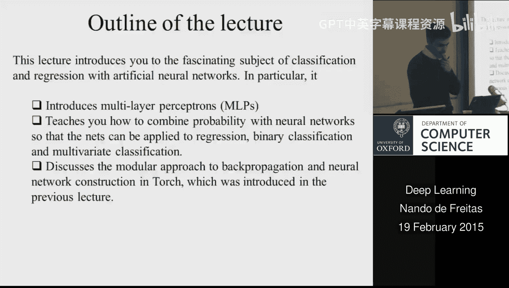

Let's look at the old view。And we'll start with logistic regression。

Because it's something we already know from the previous two lectures。

So the idea with logistic regression is you're given in this case， my data consists of two features。

 one feature here and one feature are there， and then my goal is to predict binary variables。

For example， I could be measuring height and weight。

 and I'm trying to predict whether that the patient is likely to。

Do you have a relapse in five months or something like that？

And so we said that one way to model it was with parameters。That get multiplied。

 that multiply the input。 And then that gives you a linear output that then is squashed through a sigmoid function between 0 and 1 so that we can interpret the output as the probability of that。

You should be of class one。And in that class， we also saw that we could plot。For the two features。

 we could plot each point in 2D， where the colors red and green indicate the crosses and circles they indicate whether you class 1 or plus0。

 and essentially what you end up computing is a line that separates the point and that's a line x theta in high dimensions you have a plane that separates the point。

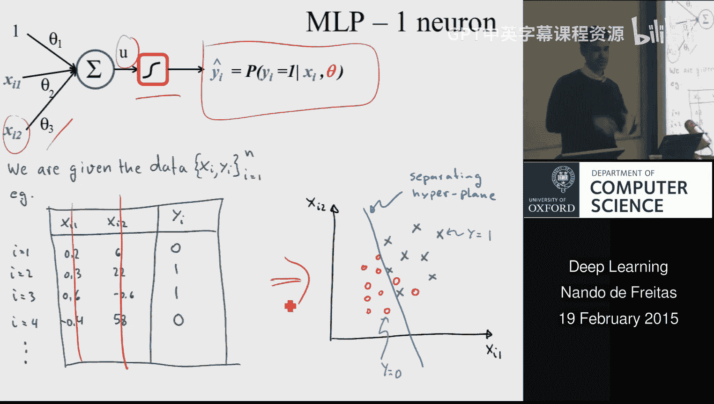

And。You we went through detail on how to write down the equation for this。

 so you either think of this as in terms of this flow diagram where you have inputs that get multiplied by weights which get aggregated so there's like a sink and then get propagated through this network or you can think in terms of the mathematical way of doing this。

 you have a sum and then you evaluate a function at sum and that gives you the probability。

And then if you have lots of data， we formulate the probability for a single point and in order to get the total probability because the points are an ID。

 we do the usual trick， we multipied individual probabilities。

And if we take the negative log likelihood of this， we got the cross entropy。

 which is a major uncertainty and we use that to optimize for learning the parameters theta given X and Y。

 we learn theta， we have a way of saying whether something should be on or off。

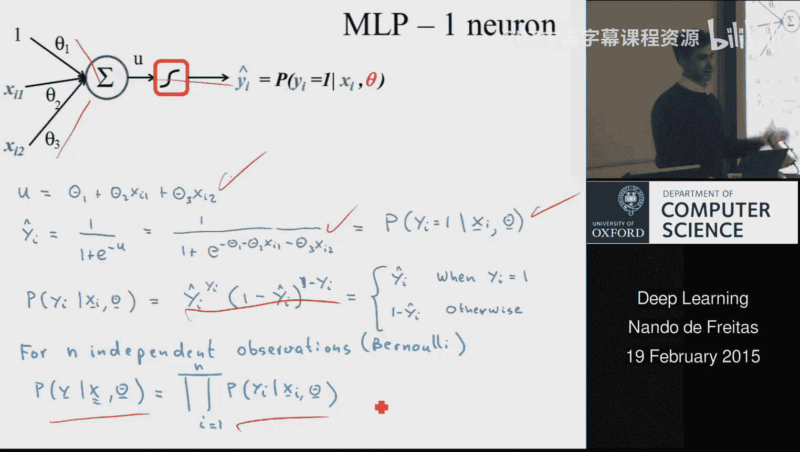

The world， unfortunately， is not。All linear， but often you get points like the ones that I'm showing you here。

 the green points and the red points where you conscious fit a line。That nicely separates the points。

 You always make some substantial error。And then what we can do is we can construct more complex functions and a simpler way to construct more complex functions is just to add this extra layer。

 which is what I call a hidden layer， is something that's between the impulse input layer and the output layer which gives you the probabilities。

And essentially what we're doing here is composition。

 we're taking in very simple basis functions and with the output now is a basis function of a basis function of the input and it would be a basis function of two basis functions and I'll soon show you some diagrams that illustrate how we compose these diagrams。

How do we compose these basic functions。But when we introduce these models。

 then the separating hyperplane is no longer aligned。 It will be some sort of function。

And it will be our job to control how smooth that function should be。

 So this is back to how what we were doing when we did regression with。Ponomials。嗯。I。

 I'm going to turn this on you。 Can you suggest two ways。That would allow me to select。阿妈。Option one。

 option2 or option 3 as the deciding separating。Discrinate functions。So two is the nicest。 I agree。

 And then the question that I really want to ask you is。

 imagine you have an optimization algorithm that。You already have played with that optimization algorithm you've played with SGD and torch。

 So now let's assume you run you implement this model in torch， you run SGD。

 it gives you estimates of the parameters。But now the question is you。

You might want to build models that have different flexibility like one or two。

 initially you don't know exactly how much flexibility you would have。

And so the question then is how would you create that flexibility。

 which factors control whether you end up with a separating surface that's one， two or three？

Let's go back to polynomials， what made polynomials at all weekly or less weekly？华arlan。

The degree of total polynomial that's one complexity here。

What would be equivalent to increasing the degree of the polynomial？The number of bases， exactly。

 So if I had more neurons， this will get more and more。 I will get a more complex function。

 What else could I do。There was more and more thing to change the shape of the predictions。

It's the biases in this case the biases？の人在。The data indeed will change things because you know。

But let's assume we do have a data set， and I just heard the other answer that I was looking for。

 which is regularization。Important， we had a delta， the weight decay parameter。

 and if we made it very large， the parameters were called0。

 So if I make if I come up with weight decay here and I make delta absurdly large。

 all my parameters will be 0。Right， I'm not going to get a very interesting function。

But so I have two， again， have these so far， two mechanisms of controlling complexity。

Optimizing is not a challenge for you。Torch will do that for you unless you really want to go and invent your new optimization techniques。

  building networks is really easy with the modular way。

What will be required of you is the ability to control complexity of models。

Because that's really the challenge， is knowing how to cross validation。

 knowing all the many ways in which you could underfit or overfit when you're trying to fit a model to date。

 that's the sort of thing that I would like you to start like be thinking very seriously about because that's what's hardest to optimize。

The other things are easier to optimize， so an assess machines can do that。

Designing models is also tricky。 and， I mean， complexity。It's very。Tied with designing models。

Until we've seen all the data， there is the infinite amount of data that we would need。

You really don't know how complex the process is。And so you never know how complex you need to make a model。

 Learning is an ill post。诶。A ill pose problem in the sense that there isn't a single best solution。

 the data sort of informs you， but you really have to bring in a design that's based on context and other prior knowledge that you might have。

It's a complexity control。

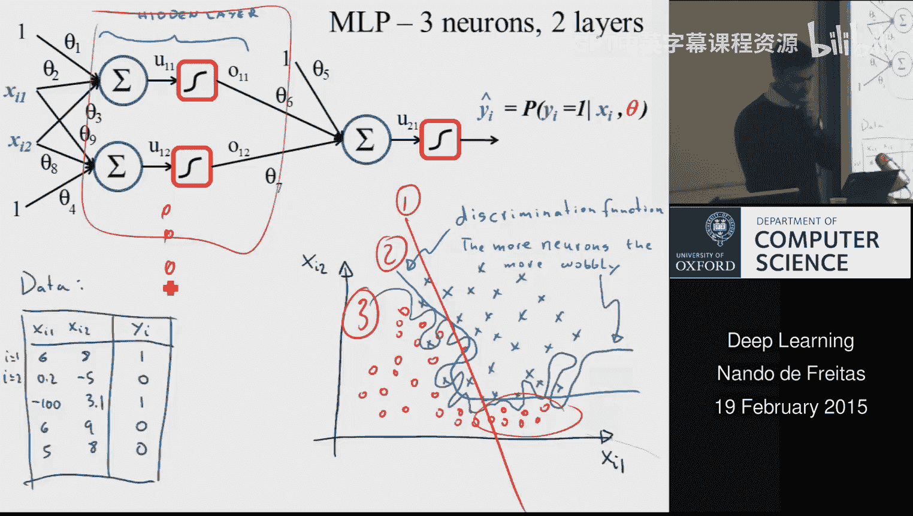

Extremely important。Just like before we will do exactly the same thing。

 we will think of this as a flow that takes inputs， multiply them by parameters， produces outputs。

 and in this case the flow has two channels。And that corresponds to this equation and this equation。

Then they both go through sigmoids corresponding to this and dysfunction。

And then they go through one more output sigmoid。And so once again。

 the probability is just as for logistic regression， the uncertainty is in the y's。

 the x's are given， the inputs are given， the uncertainty is in the y， so if the y' is are binary。

 we just place again a benoully distribution on the outputs。

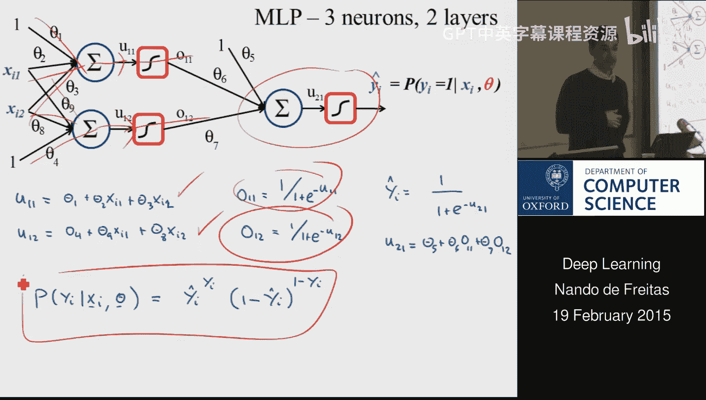

And we will get if we have several data we take the product。And to get the cost function。

 we differentiate and we get the cross entropy。 So it's exactly what we didlogistic regression。

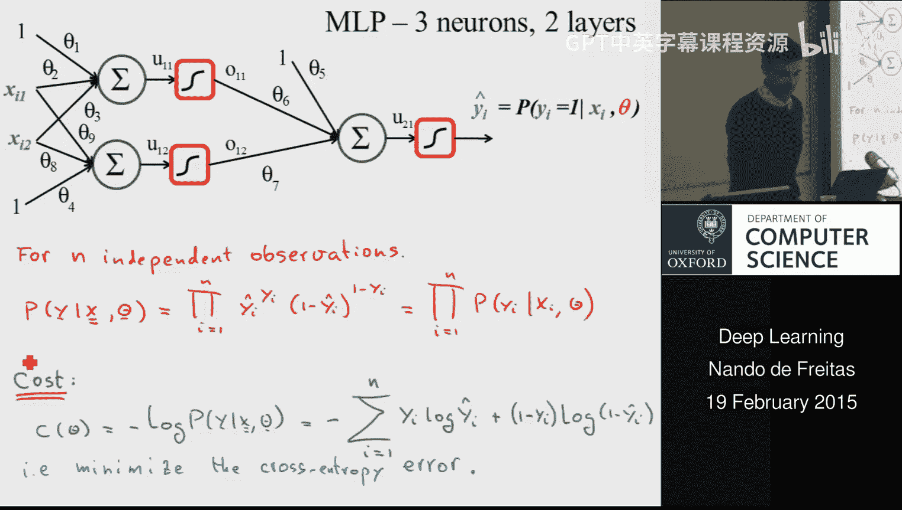

But we can start building much more interesting models， we can build models that will predict。

 for example， whether you're worthy of a loan or not。

 now that's extremely useful because imagine all the transactions that banks have to do with humans and credit cards and deciding whether to authorize them or not。

If they didn't have automatic fraud detection， banking would be a much slower process right now。

 there's a lot of comfort that's already happening in our lives， thanks to classifiers like these。

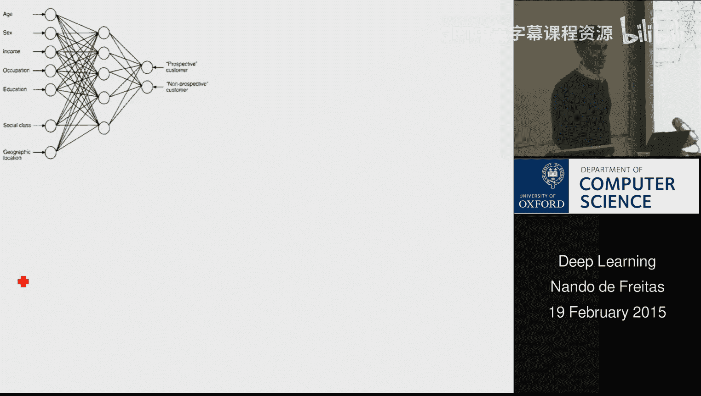

There's more researching questions and that cognitive scientists might want to understand for how memories work in the brain。

 as in this case， by Professor McLan in Stanford， where there's items like in this case a Canary。

 and then there is relations like Can。And hes trying to quickly understand what is the knowledge that is the。

How to quickly learn knowledge in this database， for example， that canaries can grow。

And we will see in the second lecture today that sometimes it's nice to organize these neurons。

 especially if you're doing vision where the input is really an image。

 it's often useful to organize the neurons as an image so the neurons will be organized in a spatial layout and the spatial layout with change with the layers。

 we'll see a lot of that in the second lecture。

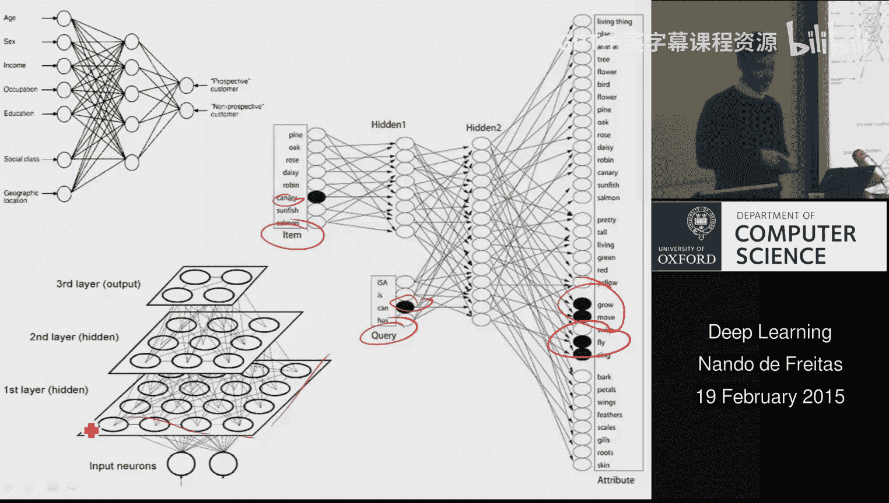

coming back to neural nets， another thing you could do is regression。

And so the only difference with what we had before is now that the output has this linear。

 I've emphasized the linear mapping there， so the output y is just you， it's just the identity。嗯。

And because for regression， we don't want to predict zero and one for regression。

 we have a data set that has， as in this case， 1D， it's a scalar。Real numbers。

And so what we're really doing is fitting a function。

 so this is just like least squares and it's precisely least squares except that it's nonlinear。

So we still have the same。we will still use the same loss and everything as us as we go over soon。

 but it will allow us to do not nonlinear new things Now this one is regression is easy to analyze so imagine we have this network where we have one input and one app。

Since we have only one input and one not， but we can actually plot it like I've done here。

RightBecause it's 1 D， one input， one out。And we can imagine that for all those so the data the red circles。

 and what we're trying to do is we're trying to fit that green curve。

 we're trying to come up with a green curve that fits the data。Now that's a nonlinear curve。

So we're out of doing linear fit。But in a sense， that curve that bumped can be easily modeled。

In this way， if we have a function that goes up and one that goes down。

 then provided that we can make those functions of the right shape。And placed at the right place。

 we can build the buff。We can get this equality。And that's essentially what neural nets are doing for us。

They function approximation tools。This。Guy here。givesives me this first neuron that we have here。

So as you can see。嗯。It's taking the input and a bias。It's passing it through。

 it's doing the linear term here。Theta times X plus theta times 1。 you put it through a sigmoid。

And then you scale it with theta 6。Okay。And then we do the same thing with。There are the term here。

Which corresponds to this neuron here。 So we scale it with theta 7， and it's a neuron。

 And now each neuron has， And then to move this up and down， we add theta 5。

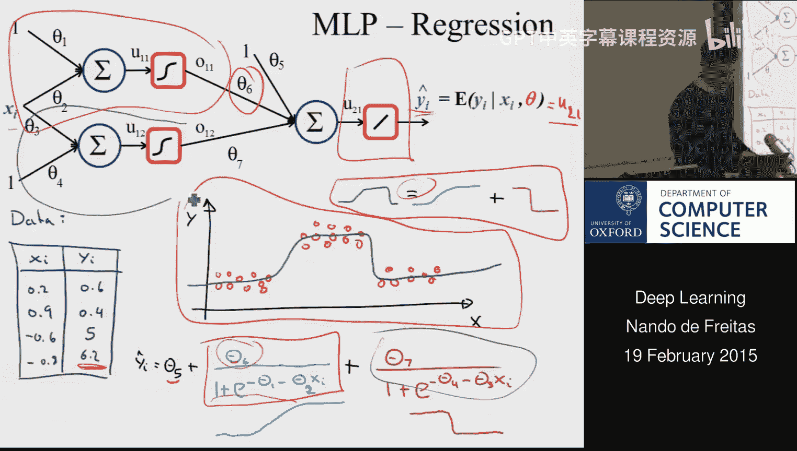

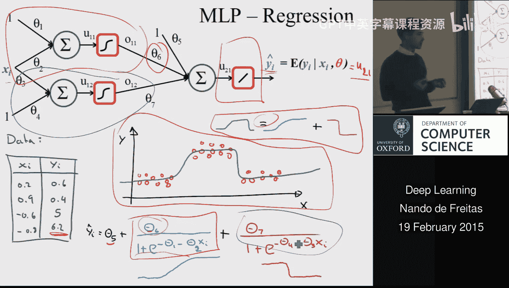

So theta 5 can move the function up and down。Each of these functions is a sigmoid。

Between zero and one。But I can scale it to be larger than 01 by using theta6。So now I have a break。

That I can move up and down。And I can stretch it this way。So I can move it out， stretch。

I need two more degrees of freedom， so I need to be able to also move it like horizontally。

 and I need to be able to then stretch it or compress it horizontally。

Provided that I have all those degrees of freedom， so if you have bricks and you can make them wider or narrower and taller or you can build anything。

Just like you would go and build a building， have the ramp break。You're in business。

So the whole question of learning is coming up with the right bricks。

You basically you're given the cathedral and you have to figure out given those constraints that you have。

How are you going to size all those bricks。Together to copy the cathedral session。

That's a nice way of thinking about what we're doing。

 We have humans that are cathedrals of intelligence and we're copying them with these models。

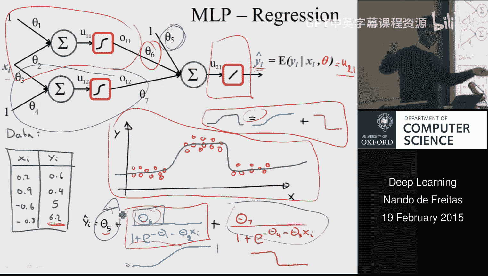

In terms of the error， again when we do regression， you measure the error with the squared loss。

 just like we for these squares。And then if we expiate if we ne and exponiate the loss we get a probability。

 in this case we get a Gaussian probability， so each point is Gaussian and it's the same diagram that we had before。

 the only thing is we replaced the line of v squared by an arbitrary nonlinear function。

In terms of the understanding of the problem， and this is why I spend so much time in these squares。

 once you get that understanding of whats how do you navigate between costs and probabilities。

And understanding that when you're fitting。You can either measure air in terms of these springs distances to the line。

 or you can model them as the height of the Gaussian centered at the line。

So you either maximize probability or you minimize energy。

And once you have this graphical understanding。That， essentially。

It allows you to generalize and knowledge to arbitrary networks。

And it allows you to really see the interplay between probability and energy minimization。

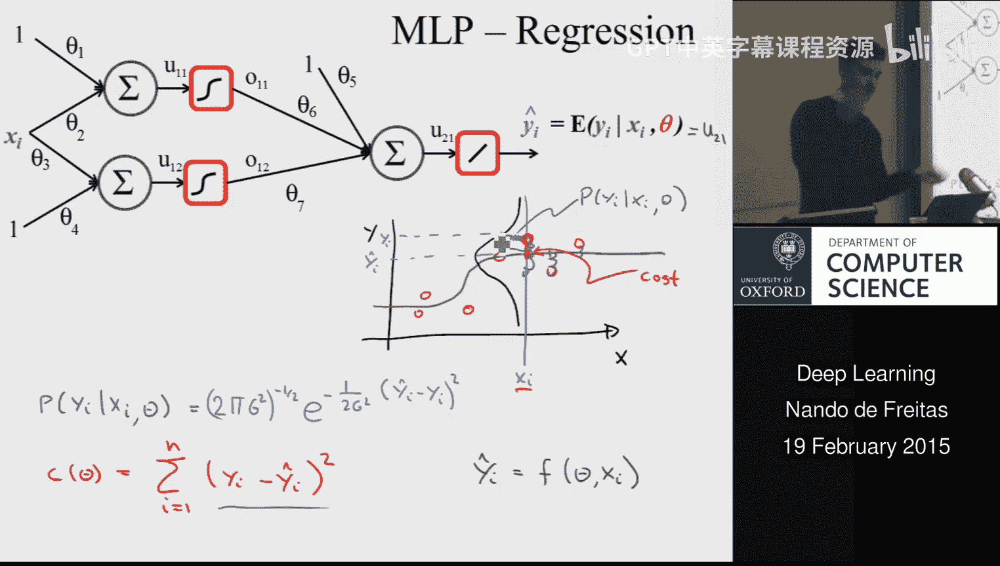

One can also go to other types of graphs。Torch does this slightly differently。

 so I'm not going to spend much time on this， but this is。

We sort of did this in the last class where we did a soft match。

But one way you might also encounter people doing neural networks is if you have multiple classes like this problem here with there's three possible classes。

You could do an encoding where class 2 becomes the vector 010， class 1 is the vector 100。

 and class3 is the vector 001， and so that way when you provide labels you provide labels with the encodings 100 or 001。

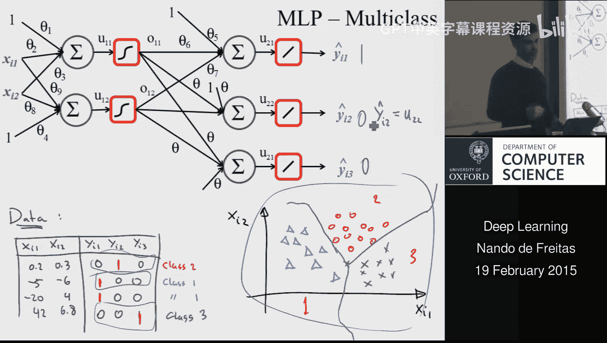

And then we do what we did last time， the probability that y is 010。

 which corresponds to class 2 is just soft max and this what we introduced when we did logistic regression if we just exponiate one variable and abide by。

All the alternatives exponentiated because they're all positive。And because you're normalizing。

 there'll be between zero and 1。

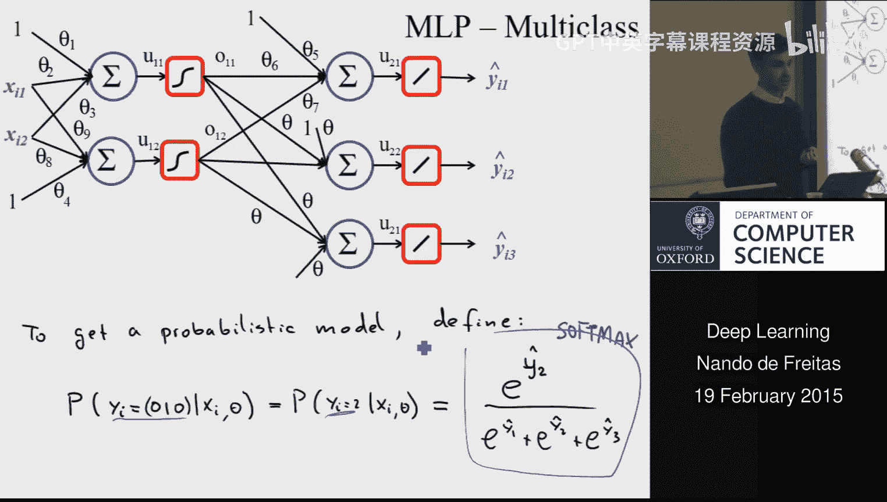

And if you add a map， the three possible cases， the three probabil you get one。

 so we have a well defined probabilistic model。So we went over this as just a generalization of the binary case where you have indicators now that check whether you're class1。

 class2 or class three， and depending on which class you are， you use the right soft max。

And if you take the derivative and equator zero， as we also did in the last class。

 you get this once again you get the cross entropy loss。

 so going to more classes in a way it's no different than when you do just two classes。

And you probably saw that in your practical， which I hear it's gone well。

 so everywhere I've had good feedback， so in your practice you were doing two classes。😊。

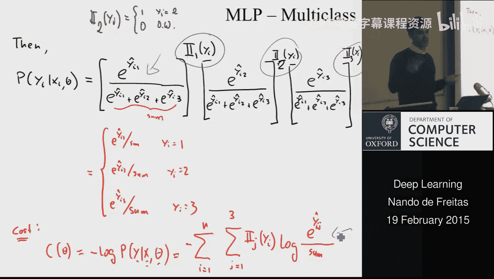

I said， no， you ended up。Okay， that was actually a good point for this for this system to break down。

 So that was。😊。

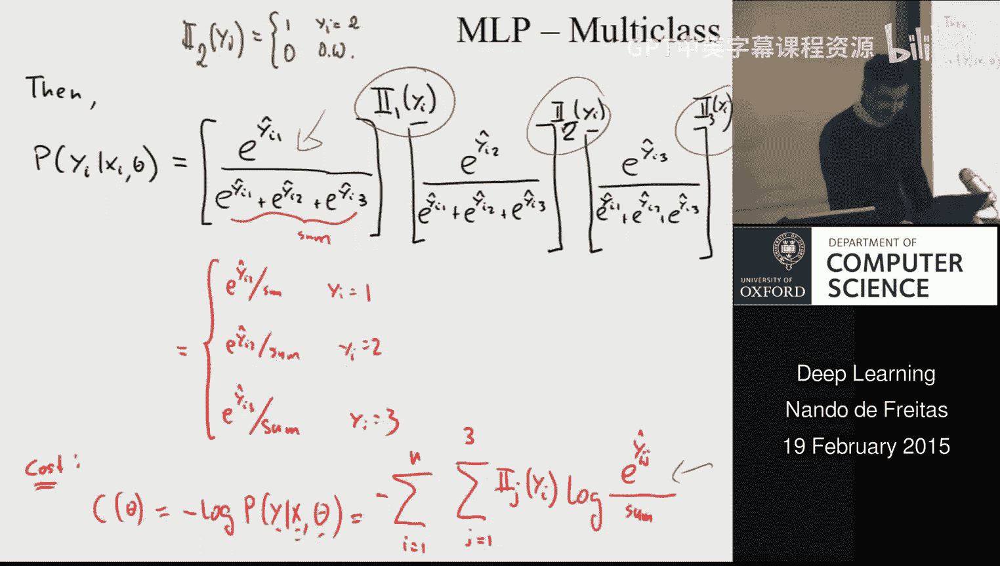

So in this old neural lens， you kind of see。That theres this interplay between probability and energy functions also referred to as loss functions or error functions or the criteria。

Some folks called them in torch。啊。We could approach and then the sort of view was this view that I was showing you here in this case with regression。

 which is you can approximate any function by just having enough breaks in that layer。

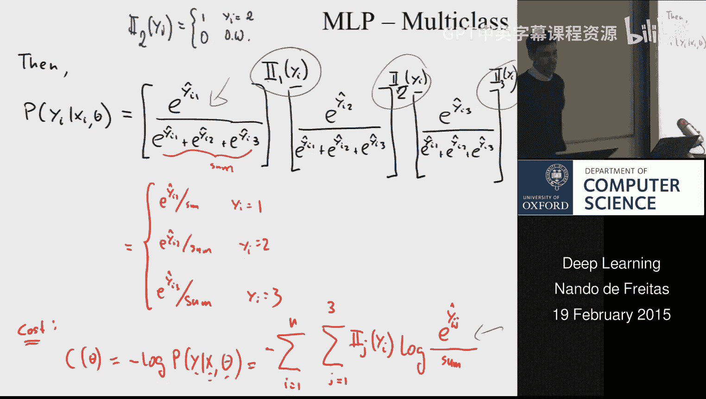

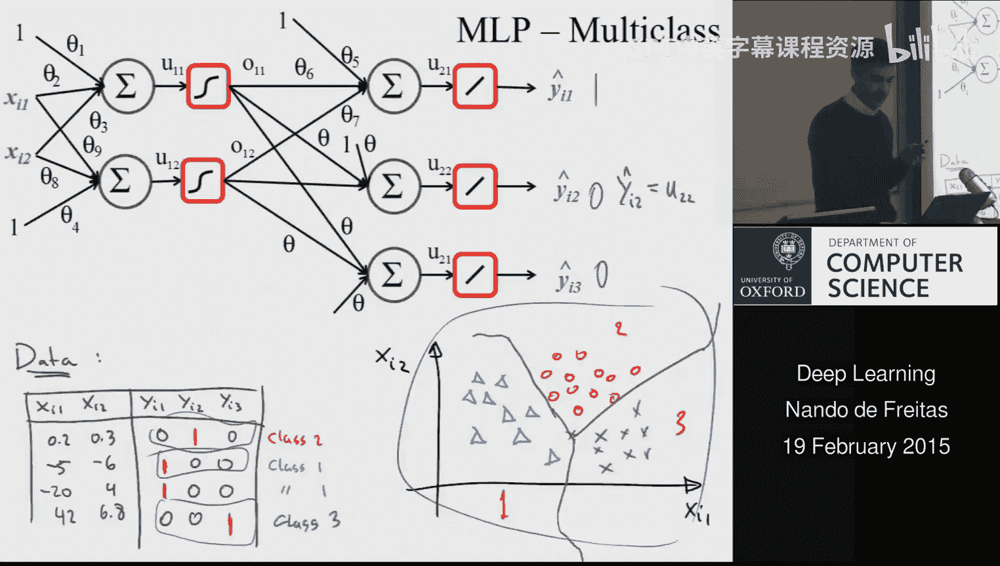

But there's another way to approximate functions to increase complexity。

 and that's by having more layers。And so whenever folks tried to do that with little data and limited computation。

 it was very hard to train the models。 So you would do all sorts of optimizers and nothing good would happen。

 So somehow we became trapped in this local minimum of only using one hidden layer。

And occasionally there were two layers， but not much work happened in terms of generalizing this。

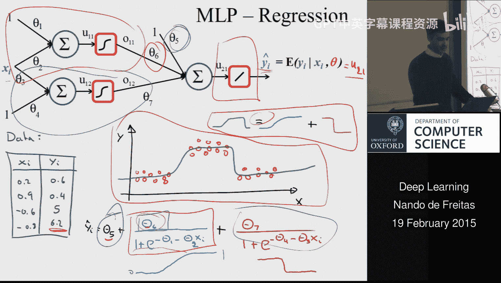

Now our computational resources are such that we can do a lot more layers， and in fact。

 it was almost by accident。 people tried more and more layers and all of a sudden realized that we're getting amazing results。

嗯。There were also chances in terms of learning how to initialize the networks and a few other things that I will go over suit。

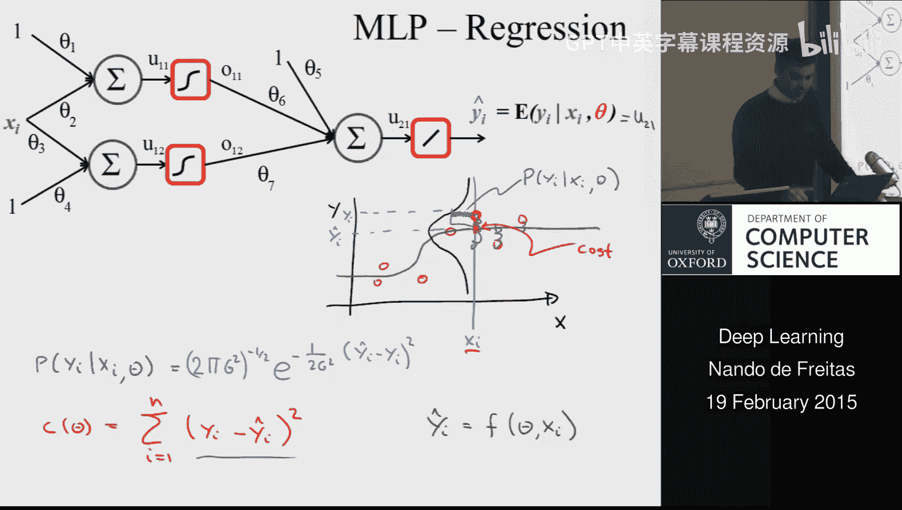

嗯。There's been an explosion of work in deep learning and I think partly has to do with the fact that the software has also become very nice。

 it has become very modular， and that enables us to very quickly craft new networks very quickly train them and reuse and we come up with sort of very generic learning methods。

嗯。As I mentioned in the last class。The way you should be thinking about neural networks is these sort of compositional models where you have。

 as I' showed you showing in this picture， you have several layers， oops。And。We bring a pen。

There we go We have several layers， many of these in this case the structure is simple。

 it's a sequential structure， just a straight set of layers， it could be different。

And each of these layers is taking an input and generating an output。

And then it takes the error from the output layer， so you start with the error and then it takes the output error and it propagates it back so provided that each layer knows how to propagate the error back and how to propagate a signal forward and how to compute the derivative with respect to parameters if it has parameters。

Then each layer can sort of。They be designed independently。So you just need when you design a layer。

 you need to design three functions， the forward message， the backward message。

 and the derivative with respect to the parameters of the layer， if the layer has parameters。

 some layers don't have parameters。And provided that you designed that。

 then a mental question is how you compose。These layers。

And there's two ways in which I'm composing them in this picture。

Can you tell me which I've already told you1？So I've told you one sequential。

 I'm exploiting sequentiality in here because there's one layer after the other layer。

 there's another thing another structure that I'm exploiting。It's not using here。し。

same they're just sequential。Just one mot box in the picture hint。Your Christmas， yes。

This whole thing is one leg。That's sort of a key thing to understand。

 a neural net is recursive in the formulation。A layer is made out of many layers。

And so if you build an interesting neural network that is capable of doing。Some interesting things。

 you can reuse that entire neural network inside another neural network。

Provided you have a good mechanism for propagating messages and we know how to do it is by propagation。

I'll revise it again， but it essentially it's what we did it with logistic regression in the last class。

So provided that you have a way of coordinating how the messages get passed。

You can build arbitrary networks。And again， you need to first forward to go from the inputs to the loss。

Or losses if you have several losses。And then you have to。

Send the messages back by computing derivatives and once you have all the derivatives。

 you just do gradient updates with HGD or AOgrad or RMS Pro or any other optimizeizer and you get you get to the answer。

 you have a trained model。The tricky thing is making sure that we have good algorithms that can train arbitrary models and as the models get really large。

 we start getting into problems and I'll measure some when I talk about pumps the challenges we're having these days with。

Comp with doing very large data sets and also with temporal neural networks like long short term memory networks。

 which are known as LSTM record networks， because theyre recurrent sort of the output feature today input。

 and in fact you have a very large network if you expand it over time， if you unwra it over type。

And so some issues arise with。How information gets propagated in the networks and they issue that information could get corrupted or if information could vanish。

Or that errors could expand and compound and have everything diverging and exploded。

So there's some issues as to how to control the optimization， but the framework pretty much is set。

It's extremely generic。You can just use Agrad or SGD or synchronous SGD， any very simple optimizers。

 so we don't need to be worrying about what inference to come up with because there's already good techniques out there。

The design is extremely simple because you don't to design nets， you just design a layer。

And once you've designed or you could design networks too。

 you could just use all the layers that people have designed and the networks that people have designed and compose them。

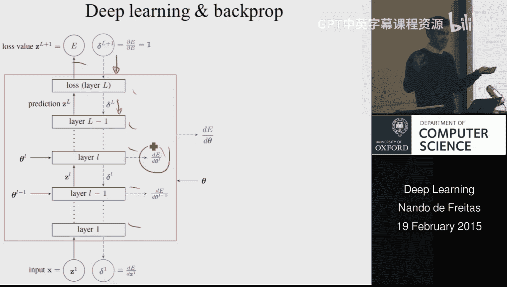

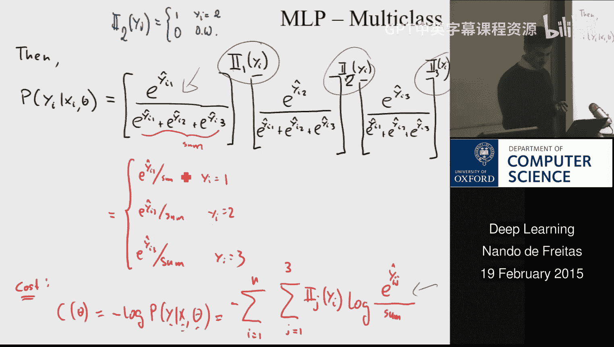

Oops。And so the focus then is to just design a layer and when you as I move to the talk about layers。

 I will just use。Instead of using a superin Z L plus 1 and then the input is ZL to get rid of that extra index。

 I'm going to use as input X and as output to Z， so Z will always be the input to the layer Z as the output and here for some because I haven't figured out a better notation yet I'm using L plus1 and L。

To indicate that is a message coming from the next future layer。

 and all I have to do is figure out the mechanism for updating。Given Delta L plus1。

 I need to get a message Delta L that I said to the layer below me。And if I have parameters。

 and here I purposely designed parameters as input。So when we take derivative derivativepers。

 I could， in fact。Take the features and take the axises and just concatetnate just a panda and a vector。

They're serve very similar like。One type of computation， just one message as a opposed。

 but to keep things clear， I will use two messages and that's also what Torch does。

If you actually think of this as the whole sequential network as in torch。

So Torch will build a sequential network like for example。

 for logistic regression with two inputs and three classes。

You basically say you're going to build a sequential model。Using the module NN neural network。

 if you want to arbitrary shapes， then torch also has something called NN graph。

 which allows you to build arbitrary shaped graphs。

And then we basically construct the network by saying， let's put a first linear layer。

 Let's put a lot soft max layer next。 So it's really easy。 So you could just go crazy。

 You a build can network just。Just add two more light， a linear and a soft box。

 a linear and a soft box。You can build arbitrary big networks that way。

And one of the things you probably saw when trying to go over the code is that there's these global parameters。

 in this case， the parameters are X。And DLTX in the code was the gradient with respect to the parameters。

And that' it。Basically in torch all your parameters get put in this vector there's a single storage for all your parameters。

 they get appended one after the other， and that's more or less what's going on here。

 I have a single parameter vector which consists of all these parameters appended。

So you could think of that input parameter actually gets broken into the parameters go into each layer。

 so it's essentially the architecture of it's essentially how torch works。

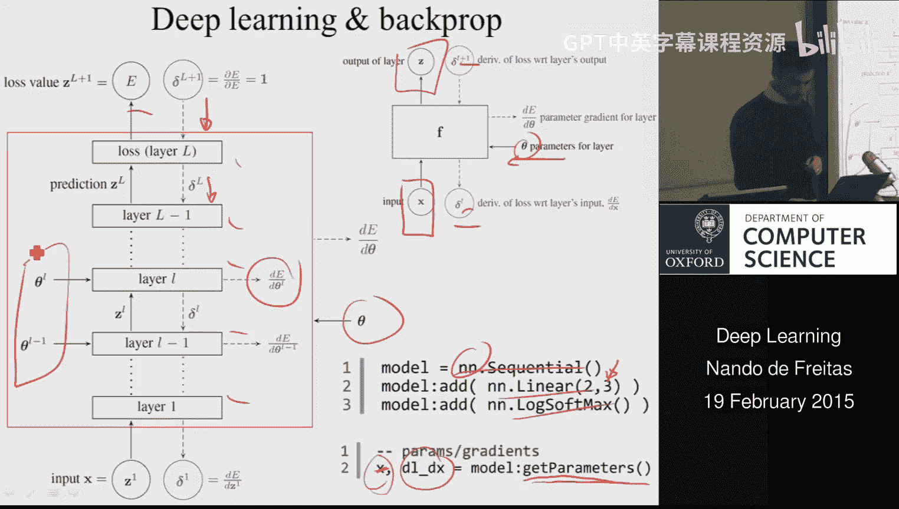

Okay。Let's look at back propagate。 So in back prop。

 we do the following when we do in the layer wise view， we need a forward message。

So if we have an input， we send it to the next layer by evaluating the forward message。

We compute the derivative with respect to the input to get the backward message。

 to get a recursion for the deltas。And in order to get that。

 all we need is to be able to compete for the layer。

 what would be the output of the layer with respect。

 the derivative of the output with respect to the input？

It is important to realize that these quantities here are matrices if you have many inputs and many outputs。

 you need to take the derivative of each output with respect to each input in turn。

So one output with respect all the inputs will give you a vector。

 you move to the next outputs with respect to all the inputs will be another vector。

 so this quantity here known as the Jacobian。Is the matrix of derivatives of each output with respect to each input。

And so there will be number of outputs by a number of inputs。

And I'm purposely writing it here in- so this is essential matrix times the vector。

And the derivative of the loss is a factor because the loss is a scalar。

 so it's one single output with respect to several inputs。So we have a vector。Multiply。A matrix。

And that's why when we write it in this form here， you can see that what you have is a scalar times of vector。

Sorry times the IJ entry giving a DI component of the vector。

That will turn out to be very important very soon。The other message that we need compute is the derivative with respect to the parameters and that again we went over this derivation last week and that's again a recursion that uses the delta that come from top from the top and then so all you need is to compute the derivative of the single layer with respect to the parameters。

So whenever you create a new layer， you just need to do these two derivatives by hand。

If you know how to do those two derivatives， oh， and you know how to。Right the function。

 that is the layer。Then you're done。

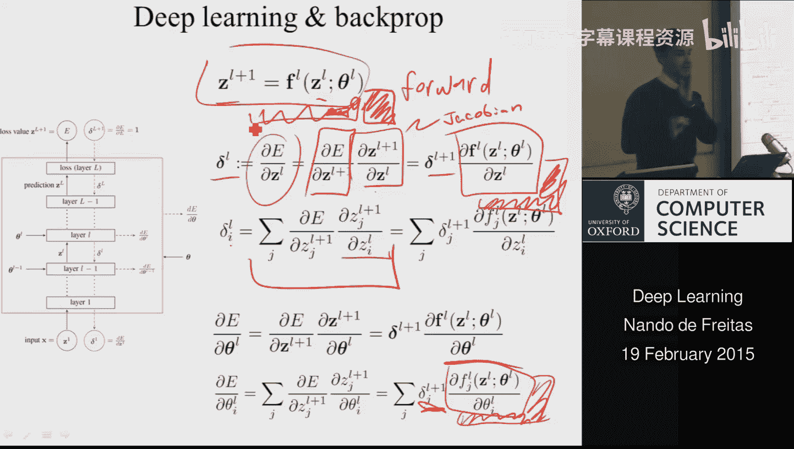

Because then you just use these recursions to get everything。

Now there's two ways in which you could implement this。

 so let's now think of a neural network with capital L layers。

 so you started layer 1 and you all the way to layer L and for simplicity I've omitted to write the thetus here or you may just wish to think the thetus as being part of the vector X treat them as inputs it's irrelevant。

And which approach you take？The main thing is we have a function that is being built by composition。

 so you have f of x， you have x， you compute F1 of x， and then you use that as the input to F2 of x。

 and then you use that as the input to F3 of x and so on。Until you get to this other F。

 which is a scaling， so importantly these are bold because these are all vectors。

 so the input is multivariate， the output is multivariate， so many inputs。

 many outputs or vector input vector out。And sometimes the input is an image。

 but we can just take an image being a matrix， we can vectorize it。

 we can break the matrix into its columns， so take a row and append it to the previous row and so on。

 and we can create a vector。So， let's think。So there's two ways。To go about doing this。

One way is you would compute all the derivatives。And use the chain rule to multiply them。

And we did this for logistic regression instead sort of using matrices we were using。

 we were evaluating them with sums， so we went into the calculation in more detail using matrices it's much easier to write this calculation。

 but it hides one important thing which I'm going to get you to think about soon the other way I can do this。

Is I can first compute。So I can use nesting， so I first compute。嗯。the product of these two terms。

 and that would be equivalent to what we do here。

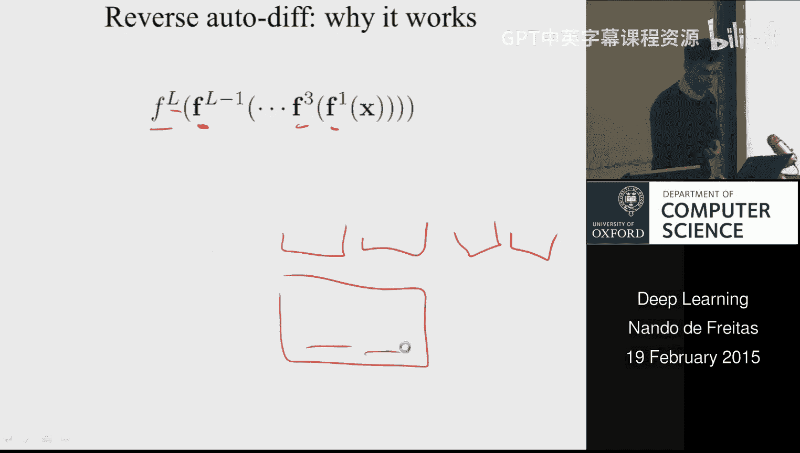

We computed just two terms at a time。

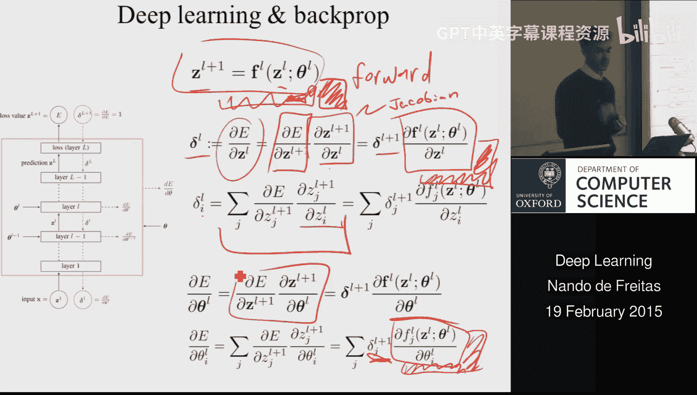

So I compute my two terms in back and once I've computed that。

Then I proceed to take this guy here and I can the next。Product and and so on。

 And I keep going out until I'm done。 and I return the the derivative of。

The output of the network of the loss with respected him。Now， which one is more efficient than why？

Is that don't between them is that a mutual picture thought It's a very good question So this notation is often used and it what it's hiding is。

Exactly that so this guy here is a matrix。This guy is a vector。This is a matrix。This is a matrix。

So think of this as vector matrix， vector matrix， this is a vector。And this is a matrix， of course。

So that makes it a bit more clear。Once you have that。Still why。Is one more efficient than the other？

Think of storage。Here in particular， I'm computing sequentially， I first compute this。

 I don't worry about the remaining terms。And we have a vector and then everything is keep something on a vector。

I' talk if you you keep it arbitrarily。And exactlyly is absolutely right on the spot If you are to compute this way and you are to allocate memory for all of these and their computer product。

 then you will have to allocate memory for all these matrices remember that these layers can have。

Millions of parameters。 these are very distance。Is at。Currently， neural networks aret as big as RAM。

As there is ro in the world。That's what's stopping us is not having more rap。

And so if we have opportunities of doing things that reduce storage， we do that。嗯。

This here takes a vector， multiplies the matrix， and then you only need to keep that vector。

 and you pass that vector to the next layer。 and then you do again， vector matrix。

 you only keep a vector。So you don't need to be building all these matrix operations。

So it's a much more efficient of doing it。 This is essentially what's called reverse auto differentiation in scientific computing。

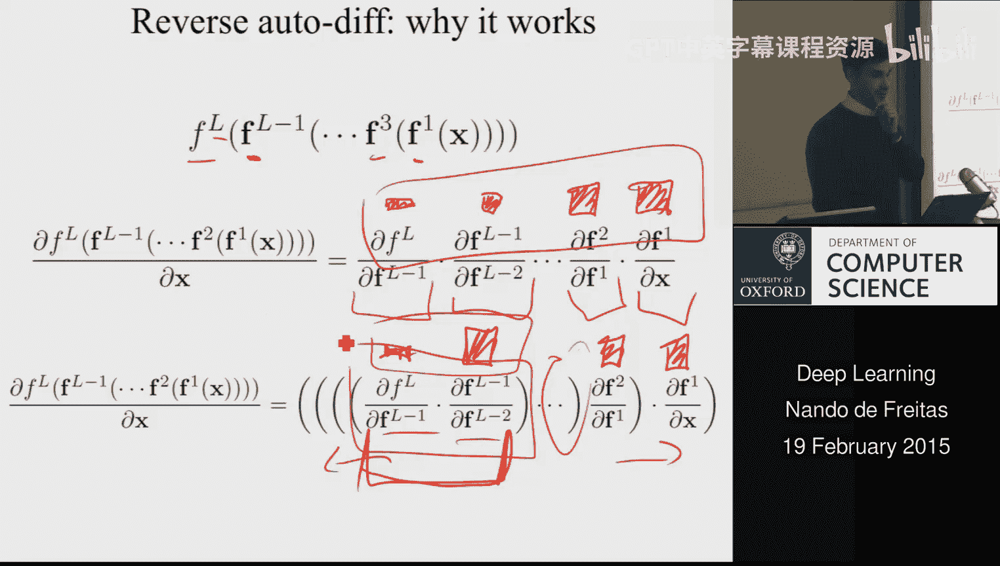

嗯。So let's look at some examples， if your neural network is essentially a linear model。That is。

You take the input， so this is like the linear regression。You have several neurons。

You have several inputs。And each neuron multiplies the inputs x1。I， X2 I， X3 I。

All the way up to exitD。So if you have the inputs。I is the sample each data case。

And then you multiply diat times parameters， theta。1，1， Theta1，2， and that gives you Z1。

 and then you would have here Z two and so on。啊。So that's a standard linear layer that's how you would do linear regression if you had many linear regressions for least squares you would only have one output neuron so this would be least squares and then if you are doing multiple output least squares you would have several of these and you would have a linear layer。

When we derive these layers and by the way， go to the torch。

 go and look at the torch code and GitHub and look at the NN module。It has actually many layers。

 many different kinds of layers， so you can actually look at these layers and you can convince yourself that they're doing exactly these operations。

They keep these three messages。Provided you have the three messages you're done。The rest is sort of。

Just making sure you have the right syntax。So。So we have the forward message。

Here we just need a derivative of the function with respected input。

 which in this case is kind of trivial if you take the derivative。Of this term with respect to x。

 you just get the coefficient that multiplies x， which is theta Ij。嗯。Likewise， if you。

If you take the derivative to respect your theta Ij， you just get X。Note that here。

 so over here the sum over a j， the sum over the output units。

 so this goes from J equal 1 to j equal 2， although way up to j equal whatever that is cutped OK。

In this case， only if you have a unit J here。And then this is unit I。不し。Then this parameter。

 theta Ij only connects theta Ij only connects to one single unit goes from and neuron I at the input to neuroj at the output。

 So when you sum over all the outputs， there's only one output that is relevant to theta Ij。

 and that's why the sum of a J here disappears because there's only one theta IJ。

And the derivative with respect to that thet Ij is just X， which is what we have here。So。

If you can differentiate。Building neural networks is driven。

And that's the sort of the graph model of the layer。 You have an input， you have an output。

 And then this gives you。The backward message and then these are the guys what we get over here。

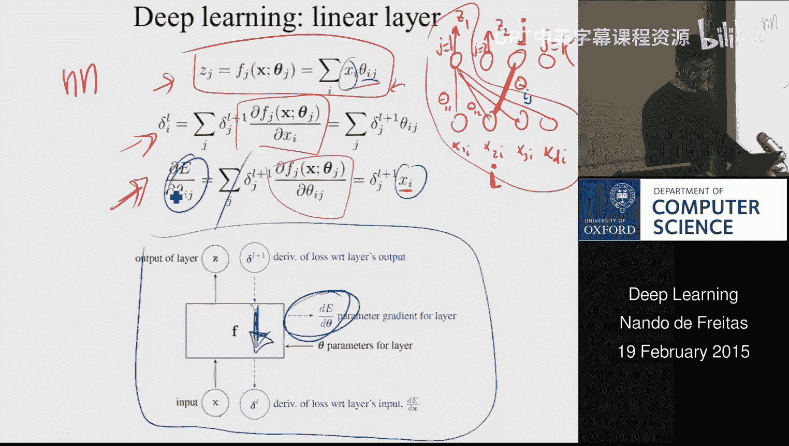

Here's another layer just to introduce yet more layers。

 so the Re layer is something that was the earliest。

Reference I know for this is by Professor Fukushima。And he came up with this in the 70s， late 70s。

So what you look at。And then no one used it， and all sudden it became nowadays。

 it's extremely popular。So a rail unit basically is like this。So does z does this x， so it's  zero。

 and then it has a slope。And so if you want to compute this derivative， the derivative over here is1。

 the derivative over here is zero。And no one talks about what happens。

Over here there is a generalization of the derivatives called sub derivatives and at this point here you would actually the sub derivative is an entire set of potential you know because if you were to put a line。

😊，Under。If you are to hinge。A corner with a line that is all this flexibility for the line。

 So the derivative really can be anything that there is that。For we should hike。

Any member of these lines in the set that I can get by moving in this case is plan around。嗯。

The way it's implemented in torturerch people just ignored at that point。

 and so the derivative is just one over here and it will be zero over here and actually haven't checked the code to know whether that's a greater than or less than or equal。

It's very popular everyone now use most networks use Raello most of the state of the art networks will use this there's something very similar to Relo called Max out。

And by Josha Benon and his colleagues， and that's also a very nice unit。

And what it does is it takes a piece wise。Set of lines。嗯。There are many other type of units。

Online the tutorials you'll find on how to build layers， teach you how to build a dropout layer。

 a dropout layer， another way of controlling complexity。If I have time。

 I will come back to it in the course。 I don't know if I will have time。 and if not， I will try to。

Oh wait， you do have， you need a practical for next week， there we go， drop out。

 you'll get to learn to play with Drop out and in short the idea is。

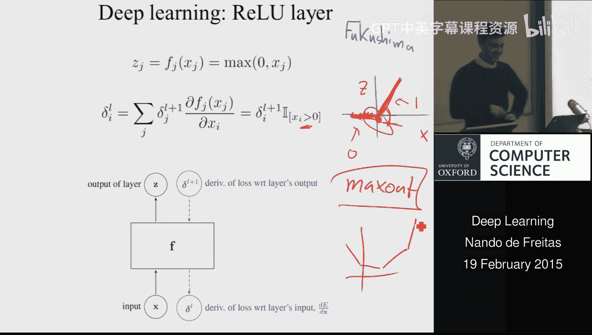

If you have N units。You select。Half of them are random。

And then you only update the parameters for half of them。And you do this at deit of SGD。

And then at the end， what you do is you put all the units together。

 so you still you keep them all and you just multiply the output by a half to account for the fact that they were only half of the time to normalize。

That actually is a very nice way of controlling complexity and the reason is because when you add basis functions。

 so we've seen this view that suppose you want to create a basis， the truth is this。Red curve。

 And you want to approximate this with basis functions。

 and assume that you decide to fit this function with two Gaussian basis functions。

 What often could happen when you learn is that you'll put a Gaussian here。

And then you'll put another Gaussian here。And when you add two green curves， you get the red curves。

 you get the right answer， but your complexity is completely wrong。

 you haven't really learned to fit this， you're wasting resources because you're adding two things to get the red but that can get you in trouble when you try to do predictions and so because you model is too complex and so what drop part is doing is basically is forcing this to not be the case because at each it durationeration it drops one of these units。

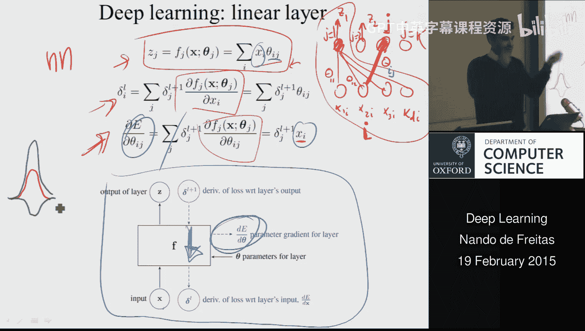

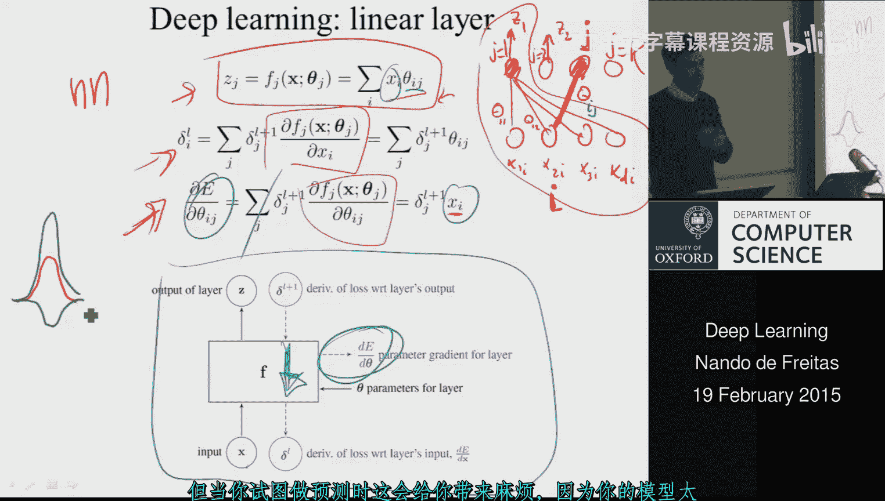

And so this other unit cannot just stay up there at that stage， it has to come down。

toward the red line， so you can't codepend a basis function cannot codepend on the otherer basis functions too much。

 and that's a very useful trick。

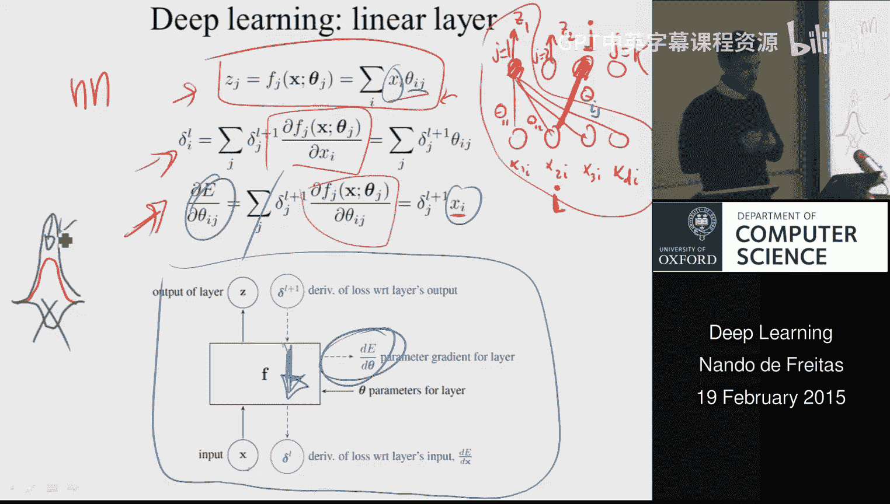

嗯。In general， the sort of thing that I really want you to keep in mind is that。These models。

If you think of our extremely flexible， you can build all sorts of cool layers doing all sorts of things。

You can then treat them。As。Single modules。That connect。And maybe there has the。

The theater and the theater here。And now you can think of them as connecting to other layers。

It might give you different losses。And so on so you can build repetitive structures and that's going to be key in order to understand the state of the a neural networks for translation。

 essentially you build a very complex model of a neuron so we will become a bit more realistic and start coming up with more interesting things In fact。

 a neuron is more like a neural a real neuron is more like a neural network with many layers and so if you implement a full neural network with many layers and then we pick this model。

 then we have a neuron and that neuraln now can connect with other neurons。

And this seems to be a much。Much bettered model to try to to。What we see in neuroscience as well。

But even without going there。And practice is just a very flexible framework to build all sorts of things。

 so I expect is understanding this generality and just playing with this code and knowing how to compose things where I think there's been going to be a lot of progress。

But there's some also there's this local minimum where a lot of people are working on。

 there's a particular sort of instantis of these models that are extremely useful。

 one of them is compositionvolal networks and that's the topic of the next lecture in five minutes。

Thank you。

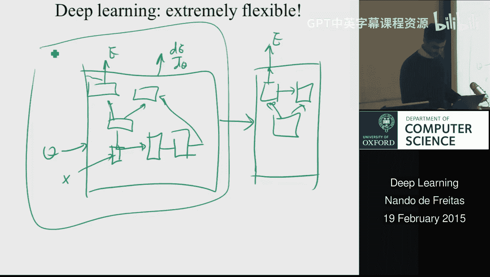