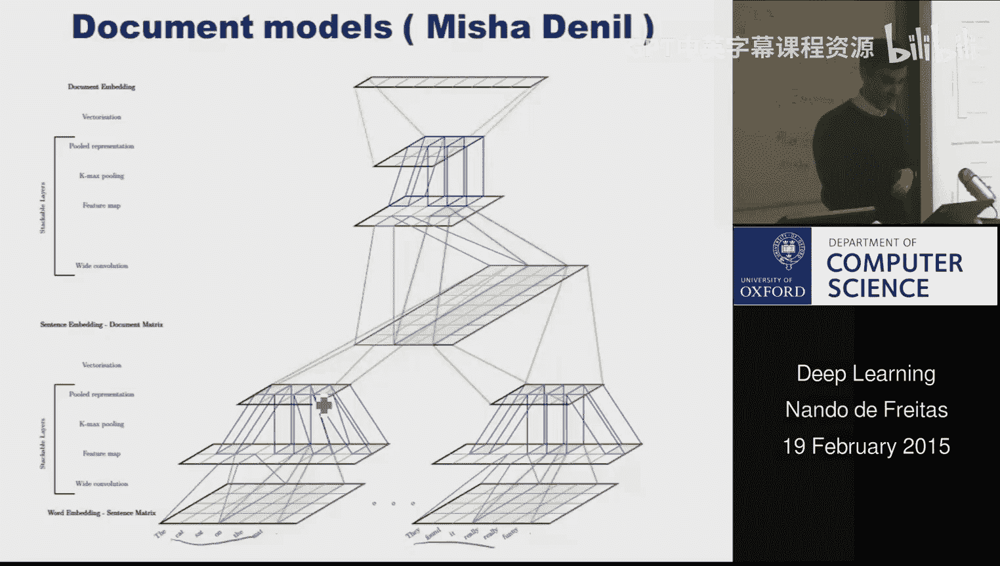
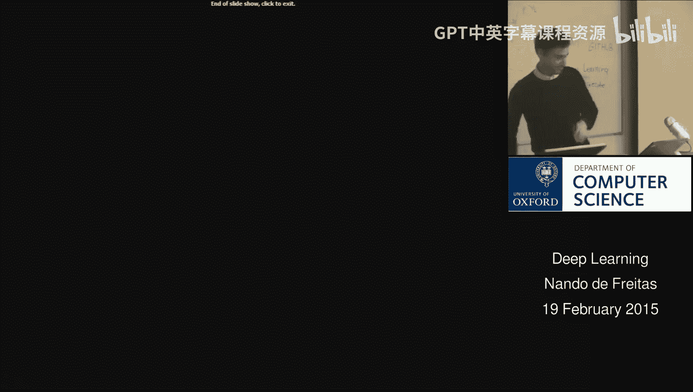

# 牛津大学《深度学习｜Deep learning 2015》中英字幕（Claude-4-s） p09 10_ Convolutional Neural Networks.zh_en -BV17NWWz6ErN_p9-

Just a quick re so I was being asked for an example of where you can see this modularity of Tor code so one that I like I'm going to cover this in class but if you're eager to get to see how this is done。

 have a look at the GiH code of budget Z Em。You can just Google LSTMs or EM and that's the code for his paper for learning to execute and there's two modules in his code。

 there's an LSTM function and then there's an network and。

Stuff that Alex Gras has been using for a long time。呃。

And if you put these very simple modules together by some researchers that we will have done。

 you can build by using simple you each module here is itself an interesting type of network that we site here。

 but we can combine them。In sort of theal structures that have memory in there。

 and we're able to actually， if you provide sentences in one language and sentences in another language。

 it looks as nice light。So you you have a model that learns to go from one language to another language。

And you should think of translation as a very general way of going from one kind of data in the sequence to a different kind of data in the sequence。

 so you could go from English to。A sequence that basically tells you the structure of that sentence is。

 it tells you what's a noun， what's a verb。And so on。

 you could have music to language or you could have gazes in an image。

A description of what it is that you're seeing as you're gazing in the image and all of these things have been done。

Yeah。There's so much， I mean， you could have speech commands and you could have a sequenceus of actions of a robot if you're in a control of robot。

 if you're playing computer games and you want a sidekick character that you're sort of shooting monsters or whatever you're doing in the game and you can ask your sidekick to run the monsters or whatever it is difficult to do。

So。They approach to being able to pose such models that are extremely flexible and extremely powerful。

 and that I actually make us question some of our beliefs about what can be learned and what can't be learned by machines。

 like for example， what I mentioned going from a sentence to syntax that's showing that you could learn syntax。

It's in itself quite interesting。For many years， people thought that syntax is something you couldn't learn。

All， but in this lecture， the focus will be out confidence。

These models are probably the most popular besides these new things， L STMs。

Are the most popular models in the world of deep learning and because if you want to solve problems。

 this is the reason actually why companies are so interested in this because covenets allow you to do object recognition。

 given any image on the web you can figure out exactly who is in that image。

 what are they wearing and what poles are they et cea et。

Don't try to protect your information by encoding it as an image because any text in an image can be read。

No matter how you write it。No matter what language it is。嗯。And but it you know。

 it's not just about like snooping on you， but it's also about being able to and advertising and all that。

 but it's also being able to dev all sorts of apps。You can go around and imagine。

As soon as we figure out how to build energy consumption devices。

 you would walk around in a foreign country， you arrive in Japan。

 you look at all these strange signs that would move more or less like these。

 but everything will look to you in English as you look around and everything you could even have it being translated to voice and you would hear。

What's around you？Even if you're blind。If we get the technology， right。啊。

Certain if you partially impaired blind people， I think this promises a lot。诶。

Especially if you go to voice that even if you're blind。

 you will get a signal as to what you're seeing and that's you know the bus 99 is arriving。It。Okay。

 and of course this image is not the only input， the only signals， there's haptics。

 sort of very important for robotics and so on and there's also speech recognition。

 extremely important because when people actually ask for something on the phone they usually really need it and so from a marketing perspective。

 you can see how this is how useful or advertising perspective。

 business perspective this is extremely useful。嗯。Okay。

 I'm going to focus on images and I'll come to language at the end of the class。So in image。

 a coconut pretty much looks like this。 You have your input data， oops。Which is an image here？

Important， this is gray scale image， images are RGBs， or images are really volumes。

With three channels。 start thinking in terms not of images as matrices。

 but think of images as pencils， in other words， three matrices。So there's a depth as well。嗯。

And every convolution architecture sort of has these two operations。 One operation is convolution。

 where a filter like and we're going to go over this in detail。 But essentially。

 you take a small window。A filter with something that has a particular shape。

And you move this filter over the whole image， think of this as search。

 you're looking for wearing the image。If the filter is a sort of a vertical eye。

You're looking an image for vertical lines， If the filter is the image of a dog。

 you're looking in the image for images of dogs。And the filters could have different sizes。

And we'll see that when we nest， if we nest appropriately。

 then the filter we'll be able to see a big part of the image once they get to very high layers。So。

When you do this， each unit， each neuron。And the number of neurons in this case， will be。

The size of this image。Sorry， that's actually not true。 The number of neurons will be the depth。

Because we're about to do an extra trick。But we will assume that the same and this is very key。

 we will assume that the same neuron is being used for each of these images that we call feature maps。

Okay， so one neuro goes over the image。And I'll just you sort of。When it if it moves up here。

 then it would project to this point。So by sliding over the whole image。

 you will be able to construct this entire image。And then you pick another neuron。

 which might be a horizontal part and you do the same thing。

 and so you'll have as many neurons as you have maps here。Now。

 what's useful about this is that the parameters are being shared。So for each map。

 I'm using the same parameters theta Im just which is in this case a vertical bar at parameters。

 I'm just sliding it over。 If I use the full neural network。

 I would have I would need as many parameters as。The depth， height and width of this volume。

And that would be just far too many， we wouldn't be able to fit them again now machines。

 so convolutional networks allow us to convolution gives us this， gives us a much more。

 much smaller representation because the parameters are shared。

The other thing that we get is that if an object appears at different parts an image。呃。

We will see some firing response here， so they also give us they give us in various to location。嗯。

Once we have done the convolutions， most architectures then tend to do something called subsling or Mac or pooling。

so we usually have convolutions， convolutions can be followed by like a railro unit in practice that's the typical implementation。

 you have a convolution， you have a rail load to get some non nonlinearity and then you feed it through a pulling layer and what a pulling layer does is it looks at the region。

If it's a max pooling layer， it just looks at what's the maximum value here and it only keeps the maximum value that occurs。

 so it down samples， it only picks one single value。And you do this because of two reasons。

 one storage。This guy here is much smaller than the guy on the left。And the other reason is invari。

 if in this little po something moves slightly， if there's slight changing in eumination。

I will still pick that point， so you become insensitive to per your patients。

 so poll just gives you some sort of local invariance。

And typically what people do these days is the use。

As many of these layers as they can train 3 layers or so。3ty60。At the last competition。

 I think it was 19 layers that Karen used to win。Image net。And then at the end。

 often people slap in a fully connected neural network。嗯。

Some researchers are questioning whether it's valuable or not。

 an interesting thing is most of the computation is here。This is very computationally intensive。

And this is very storage， actually， this is very parameter intensive。

Most like 90 something% of the parameters are in that fully connected out the player。

 which is just like a standard neural network with full connections。

But the pulling operations moving and so on are the things that taking a lot of our storage。

 and we rely on GPs to be able to do them efficiently。

Pararameters are a problem because if you have too many parameters。

 you can't store all parameters in one machine， you have to create the parameters across several machines。

 and communication is what's killing us。Communication costs lot。Whenever you go。

 you have to transmit something between cores， never mind going to this or going to。A bus。

An external bus。 you will get in trouble with communication costs。Another problem is storage。

 we compute these feature maps， we have to store them。

And so storage is one of the big challenges of this model。And in the end， after you do all this。

 you're able to predict what objects are in the image and also the location at which they are。

If you have that， that's your training date。Yeah。Here's the model on one imageNe two years ago of Matt Zeer and Rob Fergus。

 again the same idea， so just illustrating it one more time。

 you do these feature maps convolve and pull at the same time and then you do this densely connected net at the end。

And when you do this。The parameters that you get because the input is an image h。And each image。

Pixel here gets multiplied by one theta。So there is a matrix theta， that matrix theta。

It's a matrix of parameters。And so a matrix can be visualized on the computer screen。

 It's an image as well。 So the parameters are images。 And this here。It's one image。

This is one matrix of parameters。 This is another matrix of parameters。 So each of these parameters。

Sina's images here is what the net learned。So basically， in the first layer。

 it learned to look for lines。It makes sense if you look at shapes。

 you want to what you do naturally when you're drawing， you draw the contours。呃。AndIn the next layer。

Then it starts getting some textures and so on， and as you progress it starts getting these cool objects like dogs and et cetera there's some other interesting people and so on。

嗯。Okay， let's go to the basic stuff。 What is convolution and I'm going to go over and one the convolution。

 How many of you have seen convolution before？Not many， so this it's a good thing prepared this。

We're going to use very simple images， 1D images with only three pixels so that we can write it down。

I'm going to have an image X。And it has pixels x1， x2， and x3。I'm also going to have a filter。

filter is essentially what I'm calling the matrix of parameters。

 so the guy that I slide over the image and so this filter W is going to have two entries。

 W on and W2。And I'm going to compute an output。 that's going to have three。Now。

 let's do to for simplicity。Zid one and said two。So the way I do the sliding。Is。I first do W1。

Times X1 and W2 times。X2。And then I will do W1 times。X2 and W2 times x3。 So basically， Z1。

I's gonna be。W1 times X 1 plus。W2 times x 2。And that two is going to be equal to W。1 times x2。

Plus w2 times x3。 Okay， so you can see that I've basically split。 I essentially consider two cases。

 I consider the case where w is on top right here， and then I move W。NW is on top here。

So that's the sliding。For an image it's the same thing。

 which is except that you're sliding a whole block。

 and you could also slide a 3D object or a 4D object or any dimensional object， same ID。嗯。Now。

 the way Im write， I'm going to try to generalize these equation and I'm going to write a Z I prime。

You see equal to the sum over I。Of WI。Times okay， times x。I prime plus I minus1。

 and this goes from one。And I'm going to give the size of this filter。 I'm going to call it。

Which is MF。Just think of MF as the size of the filter。So this goes。From one to2。

And that equation summarizes these two equations， so you can check that when so if I start at one。

 I need to subtract to one。Because if I prime 1 and1， then I have1 plus 1 minus1 x1。

And I would have w1x1， which is this term here。And。This guy is still1， this guy moves to 2。

 so I get W2 and then x。One plus two minus1， which is x2， and then you can check with the other one。

 you have the same thing。There's another operation you can do with this W that we're going to define。

And we're going to call。So this is called correlation。

I'm just if something is similar if the w and the x are similar so you'll get some value。

 if the w and the x are not similar and if they're actually the opposite if one is one0 and the other one is01。

 you will get a zero so in a sense it's a measure of how similar they are。

 so think of this a similarity。You have filters and you're looking in the image for things that are similar to your filter。

The conscious you don't know the filters， so learning is about figuring out what are good filters。

 so what are the things that if you were to look for them in the image you would see them a lot and learning is about that is finding is all the。

Properties that occur in the world in natural data that happen enough times that they're more than just noise that you can't rule out。

The common things in the world。What the statistics of the data in other words？

So we could write it like this， another way that we can write it is by introducing W。

And I'm gonna to。Call this the flip operator。And what F does is as the word implies， is just W2 W1。

 It flips the order of the filter。So it just whos the other way rock。And if you do that。

 we can rank Zite prime。It's again the sum of our I， WI。

But you can write it as and I'm not going to go。Yeah， why not， I'll do it Mf。

You can write it in this way。And if it turns out that the two are equivalent。

 you can convince yourself because what we did is we flipped this we flipped the filter。

 but we also flipped。Wops， sorry， I made a mistake here。I'm still keeping X the same way as it was。

And I need to keep it exactly the same way because I only goes from one to two。

 but x goes from one to three， so I have to keep it indices。But this is going to be the index of W。

Clippped。So if I rewrite your question this way， I get the same as。I get these two guys out equal。

When written like this， when you have it， basically when you have minus。

 so you would have i and then minus I here， just thing is what we call convolution。

Now convolution is a huge field if you' do an undergrad in an engineering and electric engineering or physics。

 you will devote an entire course to convolution there's beautiful theory between convolution and the plus transforms Four transforms so I'm in no way making a justice here。

 but I'm just telling you the very basic in very basic terms for a discrete signal not what convolution is。

 and that's enough to sort of for you to understand what convolution means in the context of convolutional networks。

But in particular， the thing to note here is that correlation is the same as convolution with a flipped field。

听到。That turns out to be a useful thing to know because you'll see it mentioned quite often when you read papers they will use be flipping filters here and there。

 and sometimes they use the word convolution， sometimes they use the word correlation and unless you notice this you would be confused as to what's going on。

Okay so that basically is convolution。 there's one more thing that's important to note if we define the size of this guy as M2。

And this is as M1， which in this case is3 and this case is 2。

 then M2 will always be smaller than M3 by1 in this case and in fact，When I move this window。

 I'm only moving this window in steps of one， one by one。 if I moved in steps of。Different steps。

 I would have an even smaller window here。And for this case， you what's the formula M2 is equal to。

I'll let you derive this at home。 But one thing we typically do so。There is this thing called stride。

Which you have to choose when you build a convolutional layer is by how much you jump。

 Typ people just jump by what。The other thing is you have to。

 there is this sort of glitch in the sense that you come over with the filter and this guy is a bit smaller。

And so to deal with this boundary effect。If you have this， what folks typically do is the augment。

The boundary with two zeros。And now the filter can actually be placed here or here。Or here。Or here。

That is so that you。That is so that the next layer has exactly the same size as the previous layer。

 so this is called zero paing。And you'll hear about it as well。In a lot of papers。

 so these are standard tricks that folks do with compvolution。呃。So zero padding is a trick。

 you have to decide by how much you tried， and when you do computer vision and you have many filters。

 you also have to choose how many filters you have。嗯。It is a not to tune these models。

 I recommend you read。There's a Stanford blog by this guy and Drakecottpathy and I think there's a course as well associated when he was a TA or something and he sort of goes over several heuristics as to how you should tune each of these various parameters when you're building a co and I do recommend it。

 it's very nice， it's a very nice compliment presentation to this lecture。Okay。

 so those are the sort of things that you need to keep in mind when you need a convolution。

 and that's basically what that's it。 That's what convolution is。 you have a signal。

 you're multiplying by a matrix of parameters， and then you just。

Should think of this this way as you're sliding。You have an image and you're sliding your filter all over the image。

And every time you slide， you compute an output。For each position， you can be out。

And that's always the same filter。I do this and if I compute the output。

 I get one thing and if I want to do something else I have to use another filter。

And then I get another output image， and I get as many output image or feature maps as we've been calling them as I would have。

嗯。As I would have filters。So here's a picture that sort of illustrates this with images。

 if my filter is this guy here。And my image is this X。 Now we're moving to 2D。

 and basically think of dark shaded。呃。As say pixel value1 and large shade pixel value is 0。

 I'm sliding this filter and in this case I've done some zero padding on the edge。

 well I haven't this guy did it。And so here there is knowing when you multiply the filter times the image。

 you get a zero because there's no dark。Value set to one。

 and you get the idea when I get to a place where there's dark points， then these three fire。

 so I get a three。Here， I get it to。And so altogether， by moving this filter over the image。

 I get this as the output image。 So in this case， the filter sort of blurs the image。

And that's essentially so this is the feature map for that filter。Typically， when we learn filters。

 we end up with filters that look like this。In the first layer and so they're looking for edges and the output images of the filters will look like these images。

 so this image is the result of taking the guys that appear the images。

 the filters that appear below， convolving them with the image。

 and then you start getting features that sort of capture shape。

And then you do the standard pipeline， you do down sampling， you can apply linearities。

 linear layers， and you can sort of do contrast enhancement and so on。

One way to think of these in is to start thinking of them as volumes， because in effect。

 when we convolve， the input image has three channels。And this is the model that wanted。

First neural network to an image Nd three years ago， Alex Ksevsky's neural network。

 and this is exactly the model that he had where he's doing this convolution and here he explained he had strips of four。

 then he did this pulling。Operation， he does convolution again with these volumes。

 these are the filters over which he goes。As you go to the next layer now you don't have just three channels。

 but you have as many channels as you as filters that you used in the first layer。And so on。嗯。

And what I will use in my， and this will come up later。When we analyze just convolution。

 I'm going to use。嗯。I'm going to consider the convolution of a single for a single step。

Where we have a volume here。And this volume will fire just a single unit up here when we。Look at it。

 so I'm going to use the following indices to explain this operation in detail。

 there will be indices I， J， I for the depth。Jy for the width。And then， F。For filters or channels。

And then as we moved up， I'm going to use a prime to indicate that we're。In the next layer。Okay。

And essentially， so。And then my filter。I'm going to say that the filter has some width WF。

 it has some height。So this is the width of the filter。Height。啊。And F is the number of filters。

Now essentially what we need to do if you do torch is implement a layer that does this operation。

 a layer that slides this window and multiplies。Multiplies all the numbers in this box times the number in the x。

And that's what it looks like。Well， here I was using W。

 but in the course we also use parameters theta， so statisticians tend to use theta。

 neural net people tend to use W pole because it means weights of the neural network。

But essentially you have these parameters。Now， importantly， the parameters go from。

A little patch that exists in some channel to some other channel。So。There is。

 this parameter exists as a particular height here， that's F prime。And when I'm convolving。

 I if I want， this is a block of parameters， if I only want one particular slice。

 if I want to index a parameter here inside this box， I need inices IJ and F。

 so in total for all these parameters I need IJ F and F prime。So I end up with all these indices。

And in fact， typically we actually don't pass just one data at a time through the co to be more efficient in the CPUU。

 and this is something that is done in the practical that we handed to you。

 so Misha and Brandon did a lot of work to make sure that that would be the case。

 but like the demo that's available online， actually only passes the points one at a time when you do mini batches and if you're trying to use that GPU efficiently you should pass the whole mini batch through so typically there's yet not on theta。

 but on next there's yet another index with this index of the mini batch which I have omitted in this presentation。

I think there's already way too many indices in this， but basically you have a volume。

 so for a volume you need three indices and you have an output which has three coordinates。

 IHJF prime， you have an input that has three coordinates and this is exactly the formula that we had before I'm just taking it it's no different。

Then this friendly guide that we had here。The only thing that's changed is that instead of just having one index。

 we now have to keep track of volumes。 And so there's many indices。 But in effect。

 what we're doing is this multiplication。Of The times X。And we're just loopping over the hole。

 going from the one to the height of the filter， the size of the filter。

 and we're repeating this for all the filters。当。In the course。

 I often add a column of once to the parameter here to get the biased term that allows me to move the line up and down here I've explicitly put it separately。

嗯。Then the other thing you need to do that the rest is。

 and this actually was my whole train ride this morning and Brenan had to help me with。For。

 these are very tedious derivatives just because of they're really easy。

 but you have to keep track of not making mistakes with the indices。😊。

If you enter derivative the parameter for layerF prime。

You have to take the derivative of this function， which is the function that appears on top。

This is F。And so you end up with just the input， so in this case it's really easy。

And that's how you would get the derivative with respect to any parameter。

You also need the derivative with respect to， but the delelta， so we always need three things。

And there I'm sort of going to let you do this or go over this carefully at home。

 I introduced double indices here， so it's the same expression as before I just added two primes whereas before there were no primes and that so that when I do derivatives I do derivative with respect to the input IJF so that I don't end up with yet set of another set of symbols here。

And。When I do this， it derivative with IJF。All the terms。Will be zero except for the term IJF。

And let's look at just I。So everything will be0， unless I。嗯。And this i is equal to i prime。Plus。

 essentially this guy。It's only when this guy happens to be equal to when I differentiate this with respect to this。

 only when this guy happens to be equal to I， I will keep that term and I will get the corresponding term。

The reason why I write this this way is because then I can solve for I double prime。

 which is this guy， so I know which is the thermal theta that I need to keep。Because I only keep one。

And if you solve for I double prime， you get this guy here and that's what I've plugged in here。

 and then you do the same thing for J theres only one channel over F prime and only one input F。

 so I keep those the same way。And that essentially now is our backward message。

The other operation that we do is to down sampling the pulling again， what I do is I use。

 I want to compute the app so in pulling。I have a region。Like say four。

And then I'm going to get us the output， a much smaller image where the four gets replaced by a one。

Okay so I select the max， so for example， if there's a 1， three，5， six here， this guy will be6。

And I keep track of the position。So I keep track of that it was the bottom left。

 whatever coordinate to come to for this corresponding。So I know the gates。So I get a sixth there。

 if I picked the max。嗯。And then this is the window over which I'm looking。 So that's the W。

 and I could have sorry， ohomega， I could have defined this window in different ways。

And if I take the derivative。Then， essentially。So I still have my delta as before。

 And so I need to take the derivative of this guy with respect to the input。

 and then this will be on only when。I， Jay。Is if I want to propagate a message back I J。

 only when I J corresponds to the the pair I prime J prime that was selected。

 So if in the forward pass， you selected this， your Delta message。Gets copied to that unit。

 and the Delta message for all the other units is zero。

Okay because essentially there was no change of information here。

 you didn't multiply by anything All you did is you gated and so all you've done is you've created a door and so the information goes through。

The door the new re wring。I find that somewhat unsettling because when you go back you drop a lot of information。

 but in a sense， when you go forward， you're compressing。

Getting more invariance means that you will lose information。呃。At least in this particular form。

And so coming back， you're missing that information in your country construct a signal。

 This is problematic because it。It allows us to see an image and be able to tell whether it's a dog or a pen or something else。

 but it doesn't allow us to imagine the dog， this is not a very good model for imagining the world implemented in this way so there's still a lot of work in trying to figure out how to do this pen。

Jeff Hnton's been pushing in an approach called capsules， which is very exciting。

 I recommend you look at it， I'll write it down here。嗯。

And there's also a very nice paper that came out of Deep Min very recently。 it's an archive。

 It's called D。 I strongly recommend it actually does。Generate。Super nice images。

 it sort of generates like digits， it generates like numbers like any numbers you would appear in with different fonts and colors and so on。

It's super cool。All right。The nice thing about torch and once you've implemented these layers is that it's really trivial for you to go and implement a con and you can implement this in your next practical so you basically create a sequential module you might reshape the data so that it's in the right size and then essentially you do convolution。

 linearity pooling， convolution， linearity pooling and you repeat this many times and then there are some smart students that spend their lives adjusting these numbers until it works。

Other folks out there are trying to come up with automatic ways of setting those hyperparameters。

Initialization is very important， this is something we've learned over the last few years。

 and I forgot to mention that there's some very nice work by this guy Savier Gho。We。

Itter of initializing all the ways to be just the same amount of random， you look at the variances。

 essentially look at what happens with the random signal。

 if you had a random input and you propagate it through the network。

 the variances sort of scaled through the network and it's important that you keep track of those scales and unsscaleed them so that there's no explosion of。

You might be initialize something small here， but because it gets amplified。

 it ends up being bake somewhere and so even some of the recent work that the folks that beat。

I think their claim was that they beat human performance for the first time。

 they were using that trick。嗯。They were coming you know using variations of that。

 that's sort of a very hot area， hard to come up with smart initialization。All right。

 so I'm just going to end this in the last two minutes of the lecture。

 so so far I've talked about images and how you essentially implemented pulling the convolutional layer for images and in torch you essentially just plug many of these and at the end you slap in one big linear layer and a soft Mac。

 so that's your fully connected network。These models are also used a lot for language if you're interested in particular on this view of。

Differentiation with blocks。 then I actually recommend you look at the work of Rodon Collobert and Jason West in particular。

 they have a paper title called。I think if you Google NLP almost from scratch， you'll find it。

They do all sorts of very cool applications to natural language processing of componentss in the appendix。

 they essentially have a lot of forward messages derivatives so they actually do use this modular approach。

There's also a paper on this that the modular approach。

 the first paper that I saw on this is by a researcher who writes amazing papers I strongly recommend youll essentially read everything he writes。

 Leon Boto， he has a very nice paper on the modular approach to fact propagation。

That is essentially the only paper I know that of seriously devotes time to talk about。嗯。You know。

 the advantage of coding nets as way， there's been other works and of course a lot of people are aware of it because that's how implements and practice so soon I think the presentations and folks will be doing that。

Convolution and Ne for language are old things， as you can see they appeared。

I don't know when this paper is from， this is a very old paper which Jeff Hinon。I'm embarrassed。

 I didn't put the year， but it's very， very old， as you can tell by the writing and the fonts。

 And in those days， note how small the networks were。Three units， eight units。

 whereas before I was talking about a million units， 100，000 and on。

So for language what people do is each word gets coded as what folks call a one hot encoding。

So there's a vector for all the words in your vocabulary and you put a one if the word appears there。

And then。This huge factor gets multiplied by a matrix that is the size of the number of words in a vocabulary by the number of features。

So when you multiply this matrix， you essentially just pick a row of the matrix。

 That's called the word embedding。And so that's what you then form a matrix that if you have several words in a sentence。

 so word1 up to word s in a sentence that gives you now that matrix is how your word is being mapped to a continuous space the trick here is that words are discrete things。

But what they refer to meaning is not discrete。And so in a sense we this discreteness is somewhat artificial。

 I believe， and what these nets are trying to do is try to map these discrete objects。

 these categorical objects to continuous spaces again。

 and in continuous spaces it becomes a lot easier thanks to continuity to do all sorts of transformations on these and optimizations so we're able to do things like translation and so on。

 because it's easier to operate in continuous spaces than in discrete spaces。

And so here now was illustrating convolution where he's moving a filter on the sentence from left to right。

 and then he's taking out the output， and this is when he does zero paddings。

And his implementing models now is still a PhD student here， in fact。

So what he does is the same idea as what we do for images you have。呃。

Marices that are features by words。Which you have to learn。

 and then you convolve them with some filters。And he has this really cute trick。

 And instead of just picking the max of a subset of units。He takes say the max 5。

 So what he calls dynamic K max pullinging because he also adjusts how many he chooses。

 It could be 5 could be 3， depending on the size of the input。 that way。

 he keeps the structure of the same size。So he readjusts it。And essentially。

 what he does is convolution pulling operations and then does some up at the end and。

Is able to take sentences and then he predicts things like sentiment about sentences or whether sentence is positive or negative so you can classify tweets into all sorts of categories take one common thing that folks do is take a lot of tweets with happy faces。

 you know the emoticons and a lot of tweets with sad faces。And you learn a classifier。

 And if you take all the tweets that mention the word Obama。With happy and sad faces。

 you can build a predictor of how happy people are with Obama。Or with any brand。

And this' is actually quite effective。It stupidly trivial。

 but it's effective because you have a lot of data。Miha Daniel， who， by the way。

 helped me a lot with getting the last lecture set up with the modular view of back propagation。

NowHe's implemented networks， he's extended modified Nll's ideas so to enable him to actually start with sentences and then go the way to documents so he's able to say whether a review is positive or negative and then by propagating signals and look at the derivative of the output to input he's also to find which are the most important sentences like which are the sentences that are predictive of an output positive review and that basically what that means is that he can throw away most of the text in the review。

 just keep a few sentences so he's able to do extractive summarization。And in fact。

 if you only have labels at the document level， so for example， for reviews。

 we have how many stars are assigned to the review。

 but we don't have information at the entity level。

 so there could be a movie that is talking about Tom Cruise and someone else Bradpi。

And Bre is a good actor and Tomnk is a terrible actor in that movie and the review is three。

 but if you have many movies that involve these two actors。

 you would be able to actually figure out using this approach。

 what is the truth score in acting for each of these actors independently so you'll be able to get sentiment at the local level with on information at the group level。

 likewise， if you have districts that have all voted and I can get features for people that's enough to figure out how each individual voted。

 so it's a way of breaking privacy in other words。Which is usefulful to know because then people are aware of it。

Oh， that's it。 Thank you very much。

