# 牛津大学《深度学习｜Deep learning 2015》中英字幕（Claude-4-s） p10 11_ Max-margin learning, transfer and memory networks.zh_en -BV17NWWz6ErN_p10-

Okay so so the plan for today is to cover two really important topics in deep learning that and I'm going to accelerate the pace a bit of the lecture and accelerate in the sense that I'll be talking about things at the high level and so I'll essentially be following the torch model so once you know how to go and code layers and so on individual layers individual modules then you can start talking about how would I use a convolutional network to solve another task So I want to be talking about at that high level assume that you have this module called the convolutional neural network which you do have I mean you just need to go for it to code many code demos on how to put the convolution network in torch as I was saying we're going to start to assume me that we do have convolutional networks available as modules and we'll start using convolutional networks to solve different types of tasks。

Later I'm going to talk on the second lecture I'm going to talk about recurrent neural networks so there's two essentially big ideas in the learning there's convolutional networks and there's recurrent neural networks if you understand both then in order to come up with all sorts of applicationss you just need to know when to use one or the other how to choose their sizes and how to combine them in order to do all sorts of cool novel things and that's pretty much what researchers do they get used to manipulating these objects in a language like torch or some other environment like CAF and by doing this they're able to attack all sorts of data from max margin learning。

嗯。The the idea of max margin， max margin will be a way of。

Creating new tasks for learning and those new tasks will be very data rich。

 The idea of maxmaring then is to create auxiliary tasks that allow you to learn models。

So that you can use those same models in to solve problems where there's little label data。Okay。

 so there's many problems。 So one of the things about deep learning is that they're big models。

 you require a lot of data to train them， but for a lot of problems out there。

 we have very little data or very few labels。 labels are expensive。 Supervision is very expensive。

And so if you don't have supervision， we need to come up with alternative ways of learning the models and learning them in a way so that you can use the same model to solve this new task。

 That's essentially the sort of idea of general AI is that you learn to solve some tasks and then you can use the same models to solve other types of tasks。

So we often refer to this as transfer learning， multitask learning。

 and I'll give you a particular K instance of that called multi instance learning。

There's many auxiliary tasks， I'm going to go over them in detail， matching。

 where the things are similar preferences， corrupting data。

 and I will then present away a mathematical formulation of the problem。

 a couple of mathematical formulations of multitask learning。

 and then we'll pick one that's very popular involving the hinge loss。

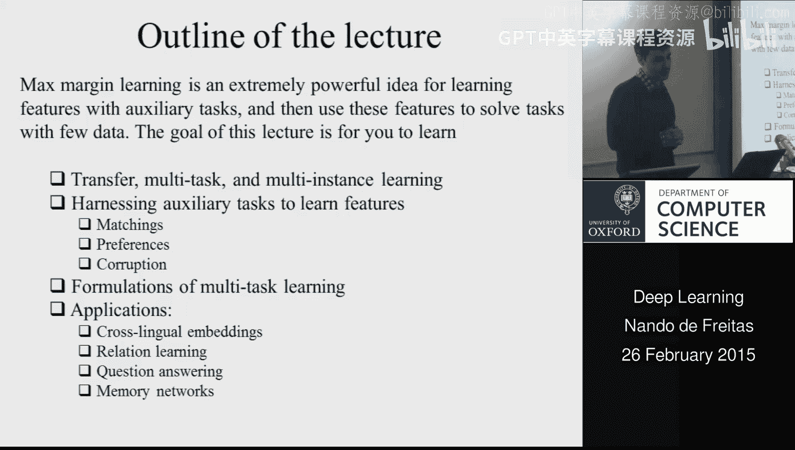

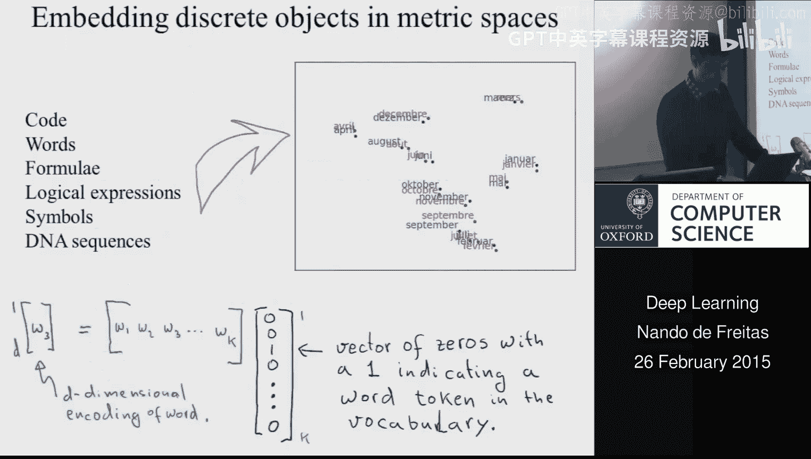

And then we're going to look at examples that involve doing tasks with language so in some languages there's a lot of data and labels like in English。

 other rare languages， there's very few labeled data。

 and so how could we learn how could we take advantage of labels in one language to solve classification problems in another language where there's very few labels？

And then we're going to look at other examples like relation learning。

 learning relations between items， relations terms in the sense of triplets。

 like subject acts on object like Jamie likes ice cream。So that you could then ask questions like。

 what does Jamie like？And the computer would answer ice cream。

So for question answering systems that's going to turn out to be very useful。

 and then I'm going to discuss memory networks， which is sort of one of the hottest ideas out there right now。

 which is also an application of max margin learning。

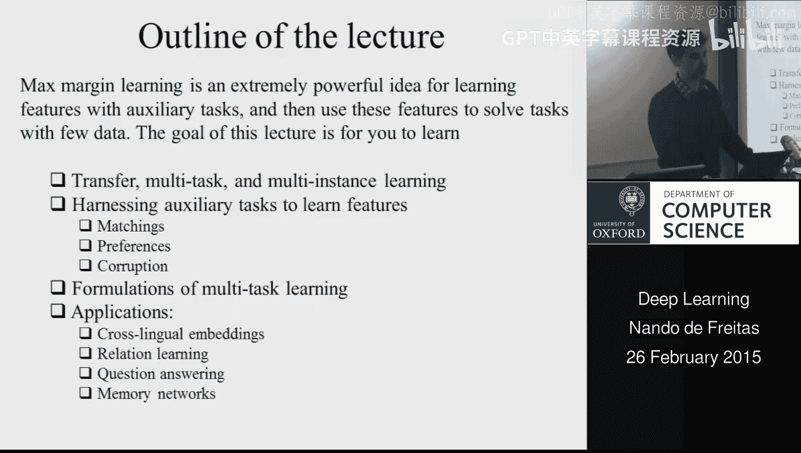

Now we're going to do a lot of language， so I'm going to just revise something that I went over briefly in the last lecture as to how do you get word embeddings。

 how do you map works to continuous spaces so words are categorical objects like the word cat or dog or person and so on and the way we're going to represent them is imagine you have a big vocabulary list of all the different words that occur。

And that vocabulary list， in fact， will be of size k in my explanation。

So that will be the size of the vocabulary list。 And if a particular word is mentioned。

Then you place a one。And in the location corresponding to that word。

 So for each location in a vector of zeros。嗯。The index of this vector will indicate which word is present。

 so if we're talking about the word say cat and cat is position3。

 every time we want to mention the word cat is mentioned， we put a one there and zeros elsewhere。

If you want to encode several words at the same time， like say three words。

 then you would three different words， you would have three ones and the rest zeros。

 so you could encode in that case triplets of words but let's assume that you do a single word。

 so the first thing is to encode it in this one what folks call the one hot encoding vector。

And then if you're on a map to a metric space to a vector， for example， in RD。Some fact WI。In RD。

In those case here， there's WIs and R2。So this sort of illustrator I have several words and these words I put in a metric space。

 and in this case the words are very different tokens like the token for August in。

 I think this is German。In English and German， the tops are very different。

 they use completely different pardon。Oh， I wasn't。That's French， thank you。呃。

Oh there you go I knew there was German， I simply assumed because I got this picture from Carl Herman。

 who's German and he was working as German。😊，Prety terrible for someone who speaks five languages。

Not the recognized French。So the point being that you're mapping these categorical objects to a metric space。

 and the important thing is that in this metric space， things that have similar meaning。

 one intuition would be that things that have similar meaning will be close in that space。

And things that have different meanings or opposite meanings， you want them to be far apart。

That's the idea of encoding。 We'll see how we could learn that so that doesn't just happen magically we need to essentially learn how to do these encodings that's the idea of actually feature learning feature learning is about taking any categorical object。

 whether it's a logical expression， whether it's a formula。

 whether it's any symbol and try to encode it in a continuous space and then try to encode it in a way essentially what we're doing is extracting features because once objects live in a space where they're。

Space out in the space according to relations and so on。

 it becomes very easy to apply transformations to do classification to do all sorts of things。

 so the process of embedding is essentially the process of extracting features。

The simplest way to embed， which is usually the first layer on any language model。

 is to just multiply this vector that's this K dimensional vector by a matrix that is D by k。

And so effectively， what you're doing is you're just picking one of the vectors。

The dimensional vectors， and that's essentially how we've now if d is equal to 2。

 this is how we're mapping the word to a two dimensional space。Of course。

 we don't know these parameters W and we will learn those with by propagation At this stage all this is is just a linear layer。

Though if you implement it this way as's an expensive linear layer。

 you could implement it as a lookup table and do something a bit。A bit less expensive。

Now let's take so that's usually the first layer， we extract these de dimensionional feature vectors。

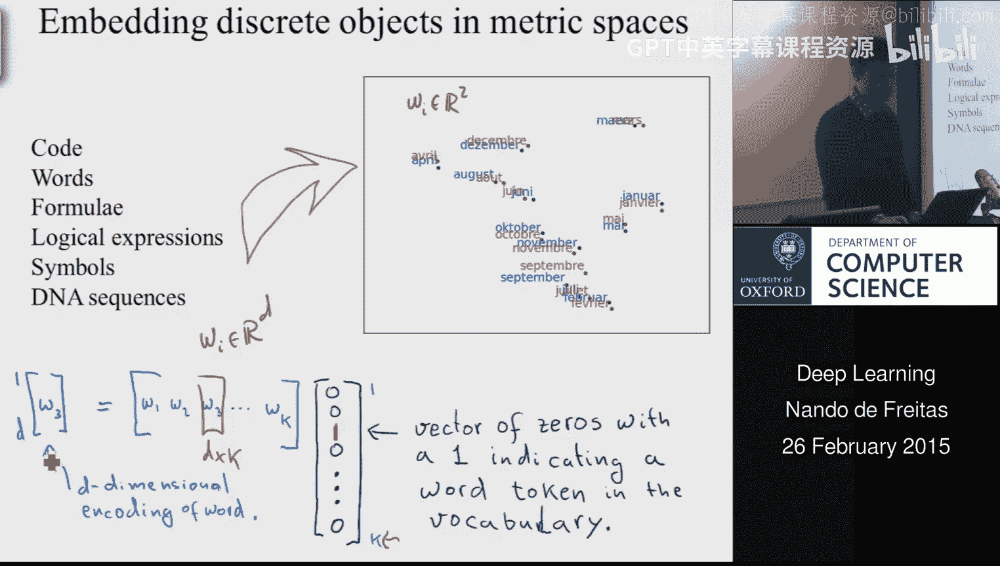

Now each of these t dimensional feature vectors， if we now go and do a convolutional neural network where you have say one sentence。

Followed by another sentence。Each of those vectors corresponds to。One of these。One of these columns。

 And so in this case， the in this picture， D equal4。 So you have。For each word。

 you will be learning one of those vector。And then when we do convolutions。

 we essentially move a particular filter say is red filter。

 we move it in strides of say1 along the sentence and we get the response of multiplying the filter times this input and we place it the response in this map。

 in this case I'm using。Two features。So two different convolutional filters。

And then when does's a pulling operation， for example， take max the4 max。

Elements to reduce the size of the sentence and also to ensure say that all sentences of the same size as you move up in the architecture。

 just to make it simpler。And now this here can be thought of as the embedding for a sentence。

 so now if you go to document， you would have sentence one。Sentence2。And so on。

So you've now taken all the embeddings of the sentences。

 you're grouping them to give you the embedding for the documents。

Once you have the data placed in this way， once again you can think of this as an input and perform exactly the same operations of convolution and pooling to eventually get the feature vectors。

 the embeddings for the entire document。So in the process of learning embeddings for the document。

And here you will have eventually， this could be out of here。

 you will get you might want to do some classification， and you might for example。

 have reviews for movies。And what you want to and for those reviews you actually have scores。

 so like whether people like the movie or don't like the movie。

 there's plenty of data like that on the web， the web is full of opinions and stars and thumbs ups and hearts and all of that。

And so if you have the labels， you can now back propagate those labels through the network。

And by back propagating those labels， you essentially learn all the parameters。

 so you learn the word embeddings， you learn the sentence embeddings and you learn the document embeddings and you protect this to character level and there's a recent paper in the that I think there' that and you also get those embeddings。

So this is essentially with a convolutional network and you can now。

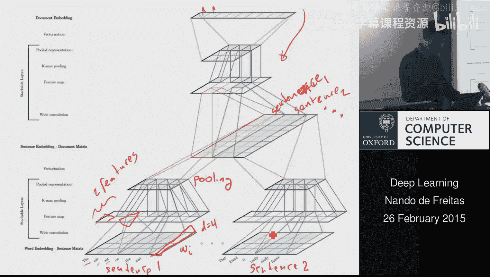

Take advantage of having learned。Using data about reviews now learn about individuals in those reviews like individual sentences or individual things being discussed in the reviews。

 so you might have that okay， the reviews for this restaurant are great。

But it just happens that there are things in the restaurant that are fantastic and there's one thing in the restaurant that is really terrible。

 so there's this waiter who everyone justs in the review， but the ambience is great。

 the food is fantastic， you know it's romantic， they have parking outside， they love children。

 dogs or whatever， but the problem is this waiter and you want to be able to detect that。

And this is actually a real problem， like if if you go to websites like Airbnb and so on。

 where reviews are overwhelmingly positive， you would like to detect anything that's being said that's negative。

And you would like to do that automatically。あ。And so that you can you know。

Provide better service to customers。So one way to do this is let's first step one is train your convolutional network。

 which is some convolution network and torch。嗯。And you use the labels for say the reviews。

 say reviews for hotels。And as part of doing this， you will learn sentence embeddings and word embeddings。

 so my word embeddings are here I'm just using these green things to denote them。

 you'll get a sentence embeddings， you get the document embeddings， you get all the parameters。

So the idea of transfer is that I could then suppose I now when to predict how much how positive a sentences or how negative a sentences now I don't have I have data at the review level。

 I have stars for the review， the entire reviews I guess three stars or four stars。

 but I don't have stars assigned to particular sentences so the question is then how do I come up with labels for the sentences。

Let's put it， let's look at a different application。Suppose there's many districts。

And people vote in these districts。For a candidate or for to make a decision about some community。

And then you record this course at the district level。 so you at the neighborhood level。

 so for each neighborhood you know。Who they voted for？

What the neighborhood voted for so think of those neighborhoods as reviews。

 like full reviews with a score。If I have features for the individuals。

 I could now figure out who which individual voted for who。Or for what？

So essentially this is a way of breaking privacy。If you have information at the group level and provide you have good features。

 you can find information at the individual level。So it's sort of useful for people who think about these type of issues。

So we could reuse。 We could copy exactly the， the sentences embeddings and the word embeddings。

But what we don't have is the output classifier， the softmic classifier。

And so that's the only thing that we're going to have to be ingenious about coming up with in multi instance learning you can come up with an objective function that looks like this。

 there's many ways of doing this is probably one of the simplest The first thing is you construct a similarity measure。

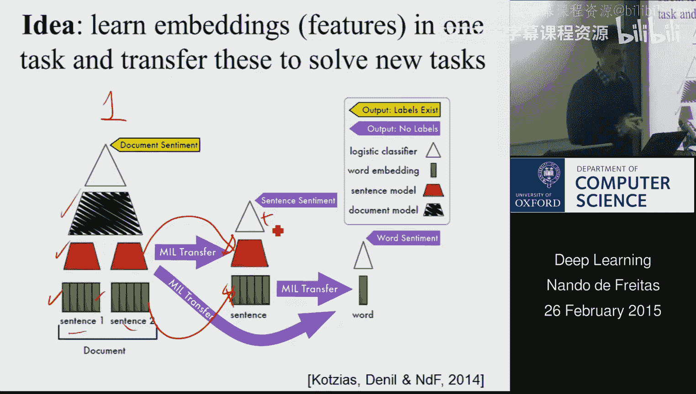

Where the X are the sentence embeddings。Okay， so think of the output of this part of the network as an X。

Has a sent and Betting。Now for that centerus andbedding。

 what we want to do is we want to compute that prediction。So this has parameters theta。

 and we want to compute a prediction y of X comma theta。

 we want to decide whether a sentence is positive or not positive。

Whether an individual voted for a new bridge or for the demolition of the bridge or something like that。

So we have the information， the input X。But we don't have the label， however。

 we can do the following thing， we can construct a similarity metric。

 and then we construct a cost function that says that if two individuals are similar。

If two sentences are similar， they must have the same leg。

so this cost function basically this is between0 and 1， so if x I is equal to xj。

 you have e2 to 0 which is 1， so they're very similar if they're very far apart infinitely apart this will give you zero。

嗯。If I put a minus here， apologies for the type。So by having a similarity between Xi and Xj。

 the only way I can make this cost go down is when Xi is equal to Xj is by making y of Xi be equal to y of Xj。

Now this still has a problem because I could also make bothwise go to zero in which case I would get rid of the cost。

 so we need to introduce a regular riser and one possible regular riser is if you have to score for the review。

You can force that the average score of all the sentences give you the score of the review。Now。

This part or this part by themselves are all very useful。

 This is no different than when we do regression， do when we fit kernels to data。

 when we're doing the nonlinear regression， the regularizer said make the parameter0。

Which by itself doesn't make any sense because you don't understand to set the parameters equal to zero。

The likelihood term also didn't make much sense because by itself what you would do is you would just go over each of the points with very weakly curves so you would overfit。

 but when you combine it too and choose this with cross validation。

 you can come up with reasonable answers。

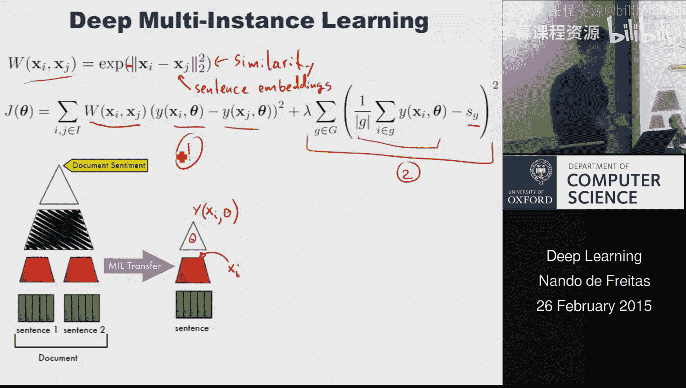

And so。The key point here， so you could have done those in many ways。

 but the key point is that by learning embeddings in one task， you can reuse them to solve new tasks。

Now that people have learned how to train convolutional neural networks in very large image databases。

 you don't have to train these networks every time you need to use them。

 especially because you would need a lot of resources to do that。

 but you can just take an already trained convolutional network which already has good features and you can use it to solve new tasks。

 so you only need to worry about the output classifier。

 all you ever have to worry about is this guy here。

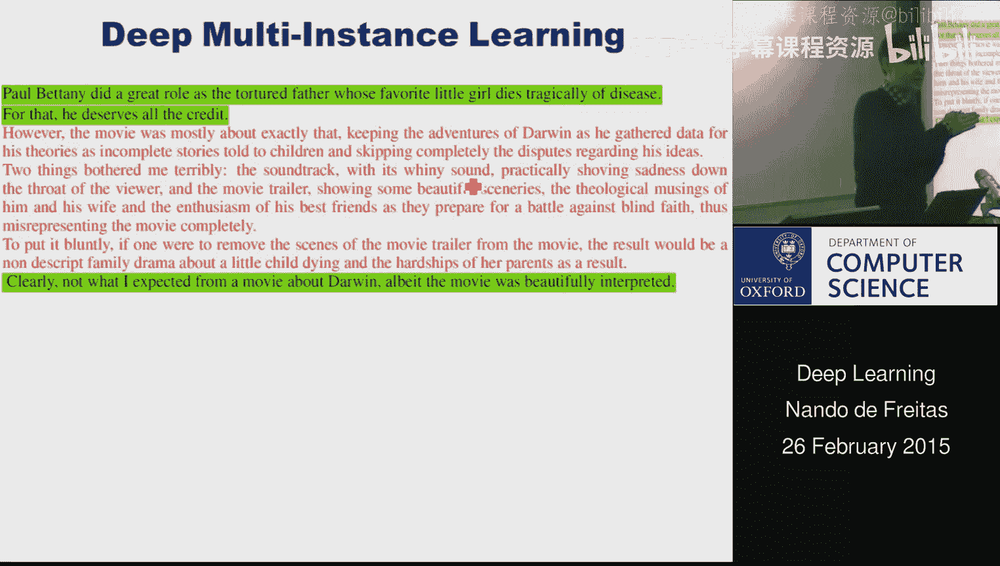

The last layer， so reuse what's already been learned。

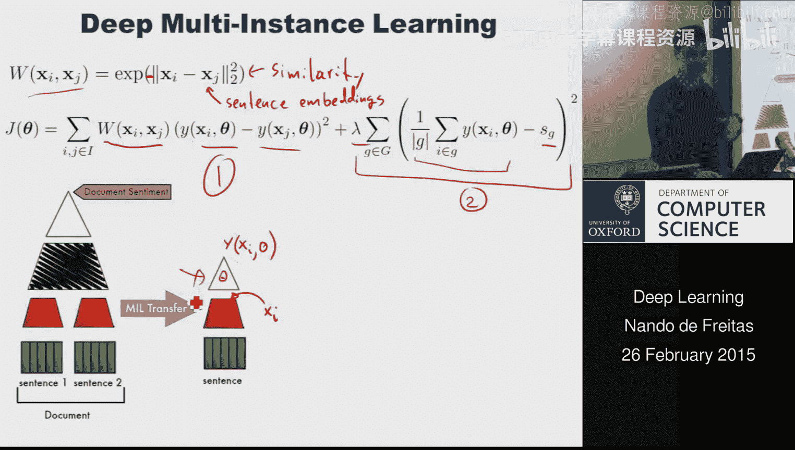

And here's an example of what it does with a review， it picks the positive sentences。

 it's able to pick the negative sentences and so on  importantly if you are trying to summarize and you only pick the first sentence。

 you might end up with the wrong sentiment for the entire review。And。Because in this case。

 the first one is positive， but then the rest is negative， so。

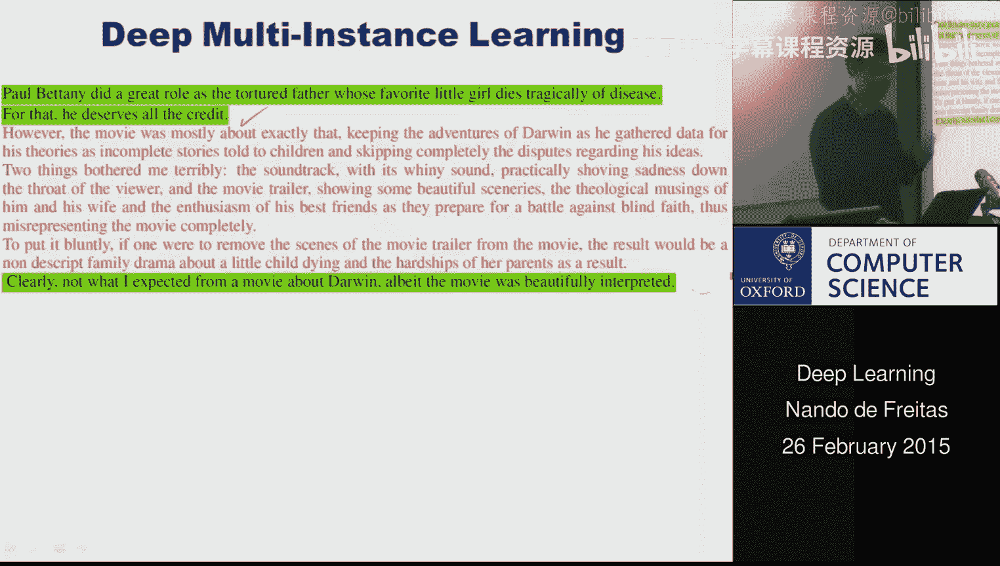

Another way of constructing data。For an auxiliary task is by finding things that either match or don't match so here's a specific example suppose you wanted to construct a classifier that will take images and say who is in the image so for that you would like for a particular person you would need a lot of data QA2 face recognition and so this is actually really expensive so you could go this way and it would turn out to be very expensive。

A simpler way is if you have video of people。嗯。You can make the assumption that if someone is in a successive video frame。

 so if two people appear centered， just one person is at the middle of a video frame in two subsequent video frames。

In all likelihood， they're the same person unless there was like a severe cut going from one news present to another one。

But you know in all likelihood， it will be the same person。

 you know we don't watch video or faces switching， usually you have a face there for quite a while and then it might switch and so most of the time it's the same person。

And you could detect how when things change。Autoomatically。And so that kind of data is available。

We have plenty of that data。You also can assume， except for some Facebook apps， I guess。

 that most often if two people appear in the same photo， they're probably not the same person。

And so that would also give you the other type of data， the negative data。

 which says this person does not match this person。And so by using that。

 you now have a binary classification task and you can train this。

You can come up with a convolution that， the yellow thing， and then once you've trained that。

 you just plug it in here and you just use a few labels。And train the screen guide。

 you train the classifier。 So the idea is you train on a task for which is abundant labels。

And then you reuse the features and train a classifier and tasks with those few labels。嗯。

And this sort of thing where things match and then match there's lots of data like this think of back again a translation。

 we know what when there's plenty of data saying that whether a sentence in French matches a sentence in English so we can use that to learn really good embeddings and then once you have a convolution model for language for sentences。

 then you can sort of construct a classifier very easily that predicts whether some for example some tweet is positive or negative。

And you can do that for rare languages for which they weren't labels， so the idea is you exploit。

 you exploit that there exist pair data in that you have labels for one language to be able to predict labels for the second language。

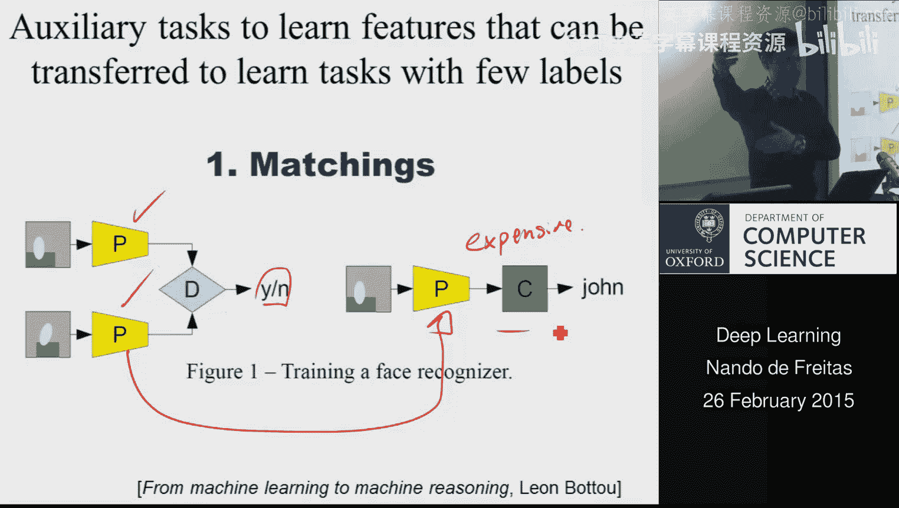

Another strategy to construct auxiliary tasks is to corrupt data。

 so you could do something like what's being done here。

Which is you take a sentence and you change a word。

So you corrupt the sentence by creating an English sentence that doesn't make sense。

So now you know that that sentence is not right。And you also know which one is the right sentence and so now what you need to ensure is that the right sentence has a higher score than the wrong sentence。

 so you need to say that one should be preferred to the other。

And that's again a binary classification problem if a is preferred to be。

 you assign label1 and otherwise label zero。So we're going to see how to do this in a bit more detail soon。

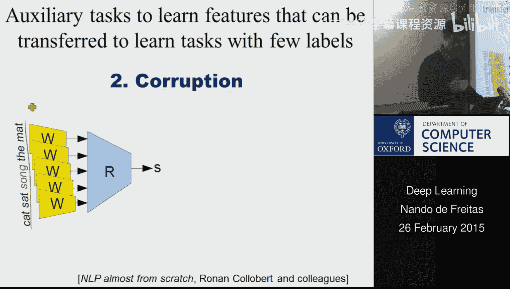

And the folks who've done this in this paper called NLP is from scratch。

They were able to pretrain the network using this， and then they were able to solve many different language tasks。

 they can do part of speech， you know be able to extract whether something is a noun or an adjective。

 it's all automatically， given a sentence， they can do named entity resolution。

 they can whether something being mentioned， whether it's a person or whether it's a location。I mean。

 the point is they do all these language tasks and whereas previously every time someone tries to solve a task that will invent their own model and write their own papers and so on。

 these guys were advocating， you can do all these tasks with the same model。

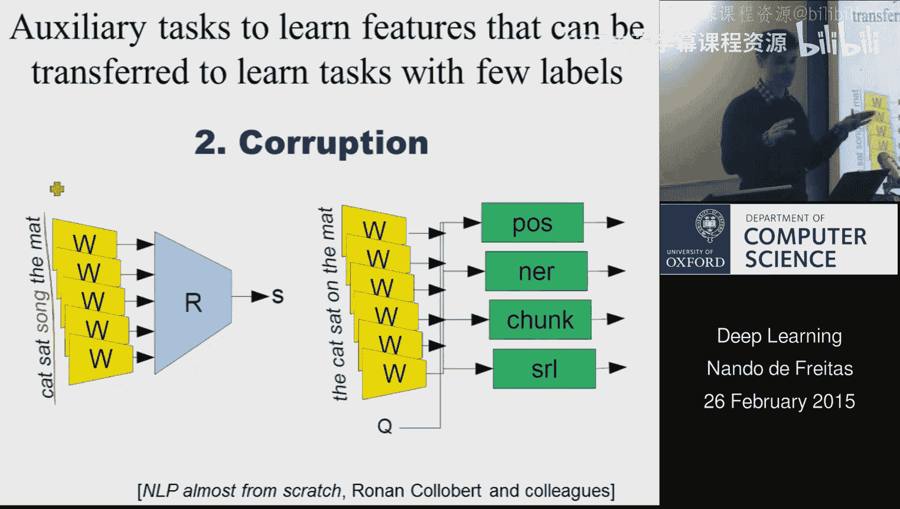

Provided you learn the right features。嗯。And again， as I mentioned preference is a way of providing data and especially think of clickthroughs。

 and so when you go and do an image search， you might click on an image that's the second image in the list at that point you're giving information to Bing or Google that that second image is a better answer for that query than the first one and that gets used。

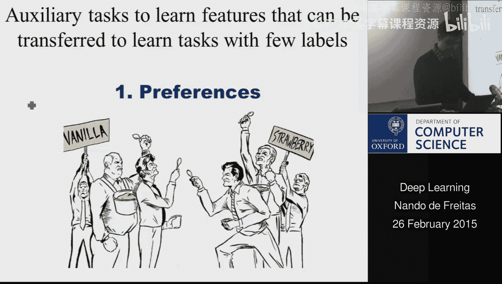

Okay， so the first formulation that we will look at is a probabilistic formulation。

So what we're after basically is how do we come up with a way of saying that similar things should be put together。

 should embed to should have similar features and a different thing should have different features。

 just essentially what we're after。A tiling of that matrix space so that then it becomes really easy to construct a classifier because the signal is there doing the right thing。

So if we use probabilities， we can in general， always write a probability as E to some energy function or energy or error or loss。

嗯。And then there's this normalizing constant that requires summing of the de numerator to ensure that the probability adds up to one。

This is the problem。嗯。These integral are intractable for most inference problems。

 so working with probabilities turns out to be very hard。嗯。

This would be essentially if we wanted to do maximum likelihood in the setting and for many models this quantity here。

 the normalization constant depends on theta， so the gradient also involves an integral and it's just very intractable I'm not even going to go that route and some of my previous courses have sort of derived a gradient and shown that an integral is still there and that that's really bad but I'm just going to ask you to take that deep of faith and believe that that's true。

So let's go rather straight to what folks actually do now in practice， max margin。

 so it's very hard to come up with this integral。We could then relax the problem and just say， well。

 I want a problem that has a low L2 norm for the parameters so like greater regression。

 so we have a regular riseor， but we want to enforce that the probability assigned to data points is higher than the probability anywhere in the space。

So。Think of it this way。Suppose list。Suppose I have some data over here。

And I'm going to copy it again。What I would like to do is I would like to make this distribution higher where there is data and lower everywhere else。

So it to end up with something that maybe looks like this。So this would be the process of learning。

 then is to take you from a distribution。Where there are other xes that have higher probability than the actual data to a situation where the data is the most probable thing。

 That's essentially shaping。The distribution so that it models the date。So。嗯。To do this。

I still have to deal with probabilities， but equivalently I can stop working with probabilities and simply work with energies because x only appears in the energies and not in the normalization constants。

 so if I work to take the negative log of this and I compare one with one side with x and the other side with x。

 the logs of the z with cancel and I would just be looking at the differences in energies。

So in effect， all I need to guarantee is that the energy of the data is better than the energy of any other point by at least the margin of M。

Now， and any other point， if I'm in a continuous space。

 I have to say that any other point should be a point that's away from the data by a certain。

Interval。This is still problematic in the sense that。I need to， if you think about it。

 the constraint here is that for all points X， for an infinite number of points X。

 I want to make sure that the energy of the data is better than for all those points。

 but it essentially creating an optimization problem where there's an infinite number of constraints。

A way of relaxing this is by。Instead of taking every possible X， only take the most offending X。

 so we pick the X that minimizes the energy。OkaySo that's the biggest rival。

 the guide is the lowest besides the data， and then I only need to make sure that the energy of the data is better than the best of the remaining axis。

Okay， so I only need to do better than。The data has to be there and then X star has to be the second best。

 so you can think of now it having an algorithm that iterates between computing Theta star。

 computing X star， Theta star and X star。嗯。Just like we did for rich regression instead of writing a problem as minimize。

Pameter subject to a constraint， it's possible to rewrite it as a single equation without constraints where you put the objective and the regularizer as two things that have to be attained and then we introduce a tradeoff parameter called lambda。

Now this is still saying the same thing， we want the energy to do better by a certain we want the energy of the data to be lower than the second alternative by a certain margin。

And this function here that I'm introducing here， the max between zero and this guy。

 it's called the hinge loss。So we've learned about the quadratic era before。We've learned about the。

嗯。Soft marks and cross entropy losses。 And this is another of the one of the most popular criterion used there to measure quality is the hinge loss。

 The hinge loss essentially。If you have。The quadraranttic loss。

The quadratic clause will look like something like this。 So if this is x， this is x squared。

The hinge loss。You have a margin M。And then you pay linearly。So in this case， after minus M。

The hinge loss is zero and then it becomes increases linearly。When this is E to the x and。

Theta minus V x star feet。The reason why we like this type of loss function instead of quadratic losses has to do with a question that someone asked me in the beginning of the course。

 which is how to prevent vertical lines。If you use quadratic clause and you have an outlier。

Suppose that the true mean is here。If you have an outlier。

 you pay a huge cost because this is increasing quadraically。But if you use the hinge loss。

 any value within here has zero cost and once you have outliers that go off。

 you pay only a linear cost so when we were doing linear regression，Where we had lots of points。

 instead of using a Gaussian like this， if you believe that your data has outliers。

 you should be using the hinge loss。So this is probability， but if I were to do。

This is kind of mixing two things。My loss， instead of being a loss that looks like this。

Should be a loss that looks like this。And then if I have a point， that's off。An outlier。

 I don't pay a huge cost in the quadractic case， a single point would make the line tilt。

But the hinge loss would prevent that， to some extent。So you incurred no cost。谢荣。Up to minus M。

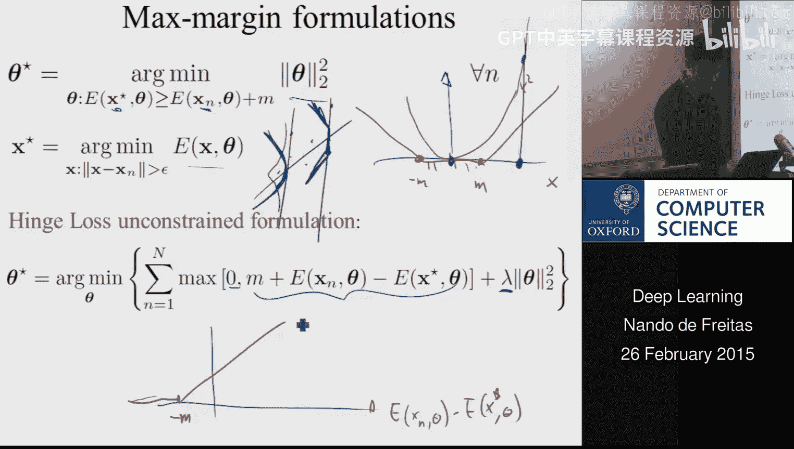

So you give yourself this margin and after that you start paying at cost。

Now that still turns out to be very expensive because it still requires that you find the best of the second。

 and so that's another NP hard optimization problem。

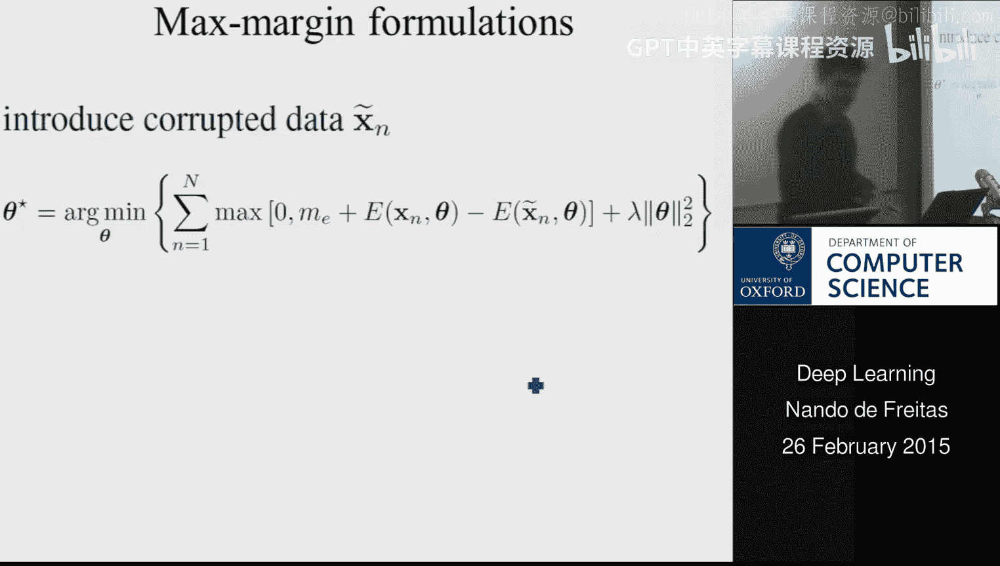

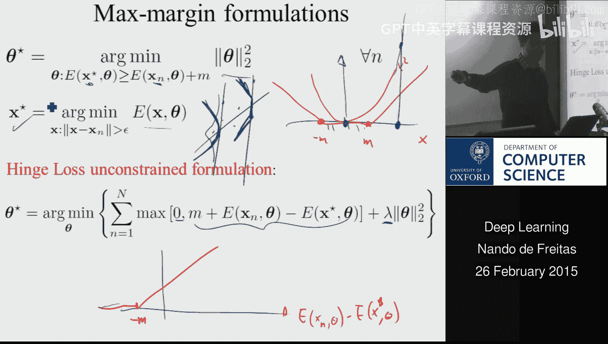

What folks end up doing in practice is they introduce samples， so you sample some corruptor data。

So we've seen one example is you pick a sentence and you corrupt it。

By changing the order of the sentences or by introducing some random word into the sentence。

And so now what you need to optimize， essentially， this is the energy， the score of， say。

 a correct sentence。 So this would be the correct。Sentus。So you take a sentence。

 you put it through the convolutional network， and this is the output， the E of X n comma theta。

And you can think of this as the energy as the loss as the output。

 you can think of it as also a score， this will be the score for a correct sentence and this will be the score for an incorrect sentence with incorrect syntax and all you're saying law with this loss is you want correct sentences to have a higher score than incorrect sentences。

Okay，And that at least by a margin， ME in this case。

By a positive margin and this is essentially the hinge loss is what we use everywhere。

 so to solve all those problems I mentioned in the beginning。

 it's just applications of the hinge loss。In torch。

The hinge loss happens to be the loss that you put here on top of the neural network。

And what that loss x2 inputs， x1 and x2。The two guys that you're comparing。And。

All you need to do then is take the derivative with respect to the input to have the two messages。

 so the message forward is just the evaluation of this。

 the message backward is just a derivative of that max。

And in this case you do need to compute two derivatives with respect to x2 you'll have plus 1 and with respect to so that derivative will be plus 1 and with respect to this one it will be minus1 and that's essentially what I've written here and I introduce this signal。

This I， which is either two or one， to simplify to include both cases。But that's essentially。

Max margin in one。In one。In one equation， so I kind of tried to take you through a bit of a root of approaches that folks have tried before。

 but at the end of the day， if you have a mechanism of corrupting the data。

 which you might not always have， it's very tricky to come up with corruptions of data sometimes。

 but if you have a good way of indicating corrupting the data。

 then you can always try to come up with this loss which assign higher weight to that basically says。

That you want lower energy for the correct sentence。

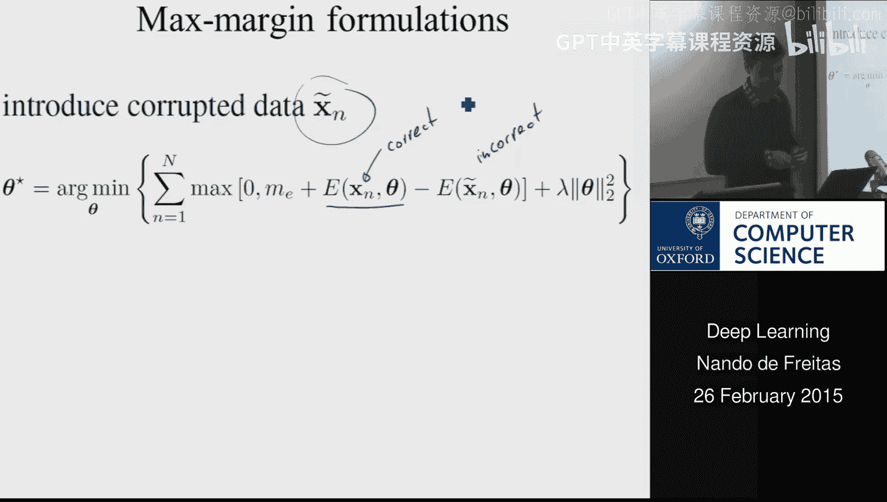

Now。Here is an example of this，'s where you take a sentence and let's say now that it's French。

And one in German。And what we do is you apply a covenet， we'll assume we know how to do this。

 and for the German sentence we compute the embeddings， function G。

 and we compute the embeddings for the French sentence of function H。

And so what we want is that the two sentences are saying the same thing。

 we want the embeddings to be the same。So we want basically Da to have the same features。

 that sort of picture I showed in the beginning where the mans， whether they were in French。

 the names of thes， whether they were in French or German。

 they were in the similar points in the metric space， so we want these vector to be close。

 to them to have the similar meaning basically。But we also want to introduce a margin because we want to make sure that if they are not the same。

 they should be far away from each other by at least a margin of M。Okay， so we want them close。

 but we also， but if you introduce。So this will ensure that if the G and B will be similar to each other。

 if the inputs are similar， they'll be similar， but if we introduce。

 I forgot to mention here a corruption。So we don't use the correct translation。

 but some other centers in the other language， you want this one to be preferred。

This option to be preferred to the second option， so it has to。

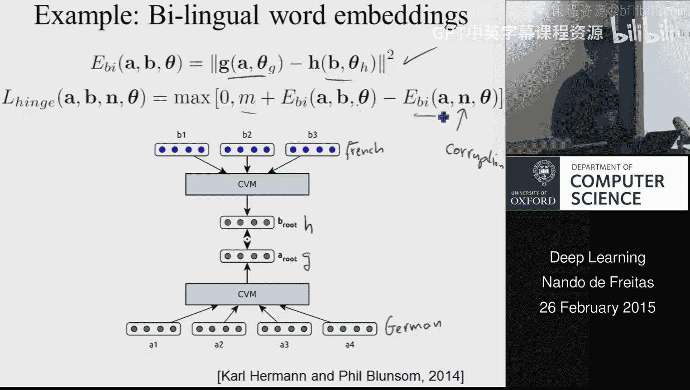

Have lower energy。A similar idea to this when you can't corrupt the data is to use similarity。

 so when you use similarity。If what you can essentially say the same thing， if HRD embeddings。

 and this is calledsMEs networks because you can think of you have two networks where you're feeding in two different types of data but they're identical networks so that you want them to have the same embedding。

So essentially you're requiring that network one。嗯。Networks that for which that are similar。

 So if you know that Xi is similar to Xj indicated by this function S， then you want to minimize。

You want the men to be close to each other in a bedding space。 And if they are different。

 you want to move them far apart by at least a margin image。

So this is the same thing and in fact you can map， you could use the same approach to do the centerus embedding so you could do a little manipulation that will take from one approach to the other from an input from a designer perspective you would do this when you have similarities if you have ways of corrupting data than you use the other approach so Jason West and colleagues at Facebook have also used this to train when you only have labels for a small set of the data and you have a lot more data without labels and so they so here they use the negative log likelihood where they have labeled data。

And where they have no labels。They simply use this principle that if two things are similar。

 for example， if two video frames says one after the other。

 they should probably embed to the same latent space and they actually did something like that for video。

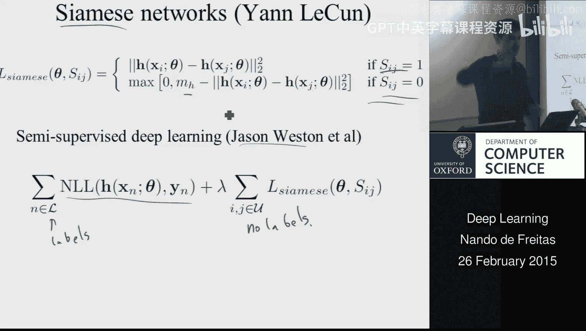

There's many other ways of doing this， or you might have similarity by having paraphrasse data sets。

 there's a few of these out there， and Phil Blosom here works with some of those。

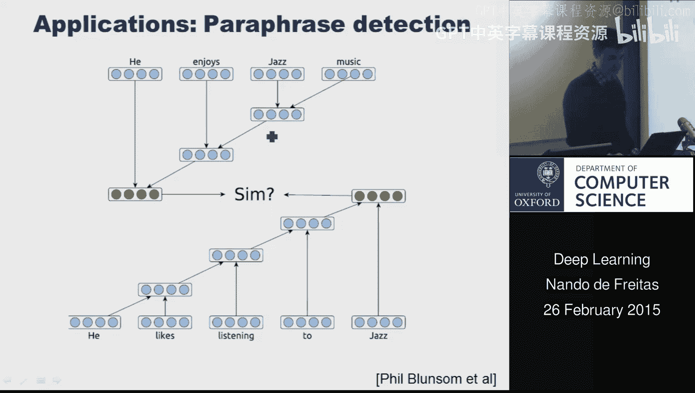

You might also have something like。Ebeddings。You might have questions that people ask。

And for those questions you might be able to have database queries， so for example。

 freebase has a big database has all sorts of entities of the form against subject。

 object and relation like Peter likes ice creamam， and so if you have a question in natural language like what does Peter like。

 you can transform that to a query and then that into the database。

And so the way folks do this is by embedding the query。

in the query language and embedding the question and making sure that they have the same embeddings and by doing this you actually all you need to know is that this query matches this question or this piece of code。

Matches this question， and you embed them to， to the same space so that when you。嗯。

So that when you then try a question， you basically evaluate the embeddings and then from the embeddings。

 you try to generate a query， this part of how to generate a query that that will be the second lecture today。

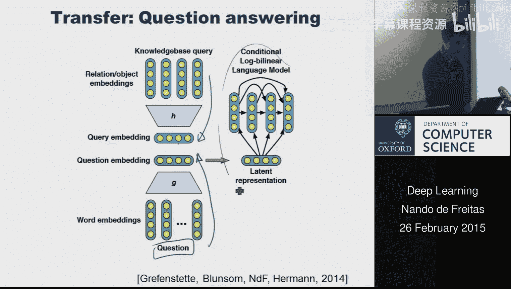

Folks do this using these， here's another example like blackca， its white miles。

 and folks try to use networks that take us input also the embeddings for the three words in the relation and evaluate the output energy of the neural network。

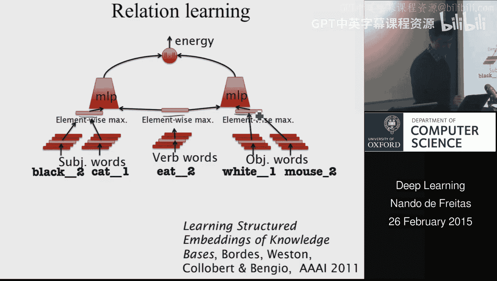

And like Yoossha Bener has this really nice example where he wants to learn a joint embedding for the triplet so that he's able to from the triplet ask questions like。

What is part of a car， as he mentioneds here， or who is Obama married to and so on？And again。

 in order to learn， he considers corruptions and he considers corruptions of the subject。

 corruptions of the object and corruptions of the relation。And of course。

 you have to have lower energy for the correct data than for the corruptor data。

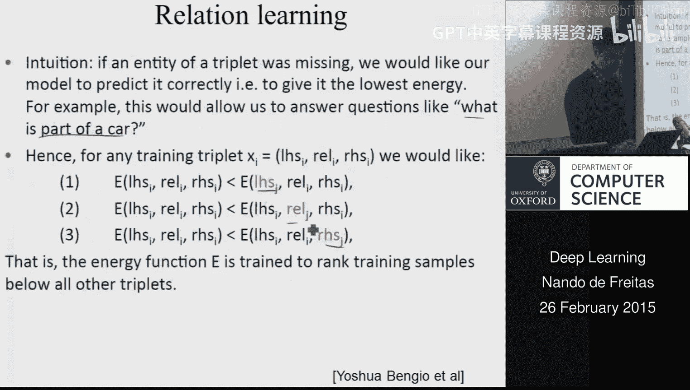

At training time， you do this again with online SGD， as we've seen before。

 you pick a correct sentence， you then corrupt it in one of three possible corrupting mechanisms to produce an extilda。

 and then you simply minimize this loss， which says that the energy of the corrupted。

Data should be higher than the true date。

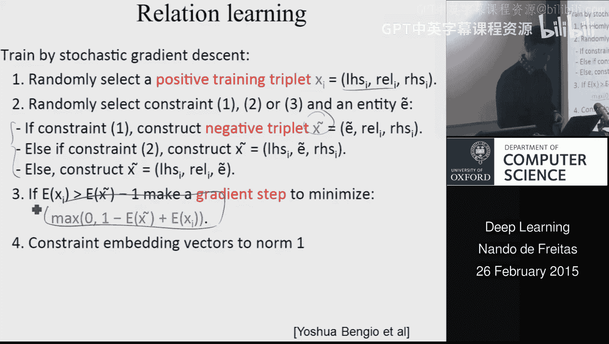

And that's pretty much it， and if he does that， he can then ask questions like army attacks。

 and then his model predicts these outputs。Which are all very reasonable， or you can also ask。

Given the output at the right hand side， earn money， and then you ask who earns money。

 business firms earn money， people earn money and so on。

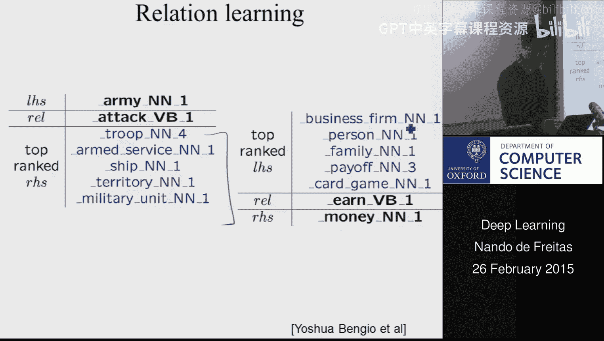

My final example of max margin is memory nets， so the idea of having memory is that if you have some input and you can put it in short term。

 so you might be reading a story and you want to store some of the facts about the story。

You might process some of the facts and send them back into some short memory。

 so think of this as like your cortex。And think of this as some facts that you're just putting into working memory。

And then when someone asks you a question， you then answered that question。

Now there's a nice biological story about this， if short term memories your hippocampus and by any chance someone cuts your hippocampus and this has happened in the past before we knew better。

 then you will not be able to form new memories。But you will be able to recall all your old memories because they will be coming from your cortex。

 but the hippocampus will not be able to consolidate new memories。

 so it's like you will remember all your past， but every time you meet someone new and that person leaves the room and comes back into the room you will not remember that person so anything new that happens you can't remember。

And so patients like these have been very much studied in neuroscience。They provide， I think。

 some of the most compelling。Information about how we could design intelligent machines， in fact。

 so I think this topic is extremely important。 People who have also got impaired hippocass can also not make。

Of've also troubled planning。So from that， we can think that this is important because when this goes away。

嗯。During sleep the hippocampus talks to the cortex and when we sleep that's when our brain actually is works the most and it's consolidating memories and you can do this because you can prime subjects at night by presenting them list of words and then next morning ask them to recall and the list of words and because of associations that will come up so one example neuroscientists run by me recently is you might prime the subject by presenting the words a heart and 16。

And the next morning you ask them to repeat the two words， a lot of them will say sweetwe 16。

Because they just it wouldn't happen during the day， but during a sleep time。

 you consolidate memories。 So if you actually want to make sure you sleep， it's very important。

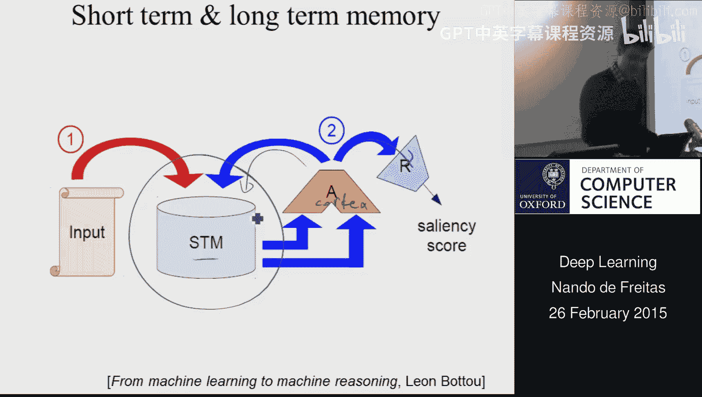

Now。Okay so memory networks， this is like super hot paper that came out of Facebook and there's two papers that came out and they hit the press and so on they were why。

 we're going to look at the Google one in the next lecture， but first let's look at the Facebook one。

嗯。The idea is you have some input。And you create some feature representation from the input。

 but then you want to add that input to a memory。Okay， so some sort of working memory。嗯。And then。

Once you have memory and inputs， you want to produce outputs， output features。

And then once you have output features， you can think of slapping that last date。

 which is the classifier to predict something， so you might have features out of a cove and then you have an output classifier that converts that output into words or sentences so on。

We're going to see a lot of examples of that in the next lecture。

The way it's implemented by these folks at present is the memory that they use is just a slot memory。

 so essentially they just take input sentences and they just put them in basically in a database and that's your memory and they just put one after the other。

In order to and you can in order to now。Predicor output。

 they will use a neural network and they like to use S instead of E because they like to talk about scores。

 and I think in this case actually it makes more sense to talk about scores。

And so score basically will take the input and will find the memory that is most helpful towards producing an na。

Okay。And once you have the most helpful memory， you look for the second most helpful memory。

 and you could do this。By picking， so you're basically going into your memory。

 so you have some input， someone ask you something。

 and then you're going into your memory to find facts that will help you with your answer。

And once you have pulled all these facts， then you do one last thing which is to generate the answer。

Each of these scoring functions could be just any sort of they use some sort of embedding and a do product could be any type of neural network that we've discussed so far。

How do they train this max margin？The same idea so this is their margin and then in this case they actually have labels for the sentences that are so they create data sets where they know which are good sentences help that would provide evidence for you to answer a question and then they also know which are bad sentences。

So they put good sentences here。And bad sentence is here。And then just trying to make good sentences。

 have higher score， or equivalently have good sentences， have lower energy than bad sentences。

And then they do the same thing for the second sentence and they repeat the same thing again for the output of the system。

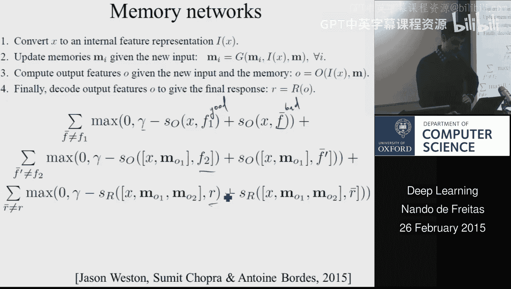

The answer in this case。And here's an example and this is actually what the network does so here there's a story。

 Joe went to the garden， then Fred picked up the milk。

 Joe moved to the bathroom and Fred dropped the milk and then then moved to the living room。嗯。

So it's a bit of a contrived story but it makes it easy to answer this type of simple story makes it easy for these networks to work well。

 then you can ask a question what is done， the network answers living room I believe。

Where is Joe the bathroom？And then the story can continue。

 Fred moved to the bedroom and Joe went to the kitchen， blah， blah， blah， blah， and you get the idea。

 you keep asking questions that the network is able to answer because it's building this sort of memory of all these facts of what's going on in the story and it's able to look at forever look at in this memory for evidence to be able to answer。

Whatever question you ask of it。 So， yeah， super cool。 I think that you can build this。

 And to do this， all you need。Is the max margin criteria， the hinge loss。

 which is one layer in torch， which has already been coded for you。

 so if you can implement a covenet。In torch and you can slap a hinge layer on top of this。

 which is just just a hinge layer error crerion then you're done then you can actually go and code this yourselves The hardest bit will be for you to generate this data and do the experiments and so。

And。And that。Like especially as you do the practical。

 if you find this like overwhelming to just get a date in a format and all this。You know。

 don't be overwhelmed， it is truly overwhelming but you know these folks they don't spend one day and come up withnaA。

 usually there's teams of people in this case extremely smart people like an adjacent and Antoine and it's been a good deal of time in order to come up with one of these models so I'm kind of not make justice to it by just going over it quickly and this course you're being asked to learn all this in eight weeks and you only have seven practicals so don't be does hard and if you not able don't feel like you could go and implement this right now it would take some time but I'm confident all of you would be able to hopefully we've given you enough tools that。

With a month of your own time。You can go and implement memory networks。说了。Co the steep。あは。感そまして。

Whereed to vote。Yes， one detail I haven't。But in here is time。But time is in the max margin criter。

 so in their paper， if you Google memory networks， you'll get this as the top hit。

 they do introduce time constraints for facts。And it's also done quite a hinge loss， I believe。

 my murmur doesn't tell。But yeah， time is important，s good very good observation。Okay。

 so the next lecture will do record networks and we'll look at what Google's version of this is。

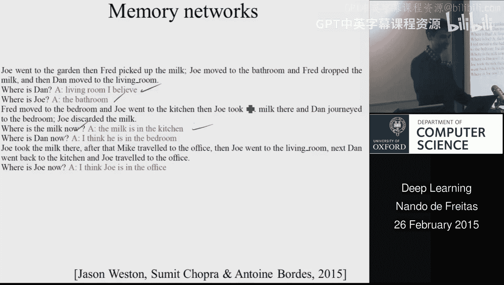

Five minutes。