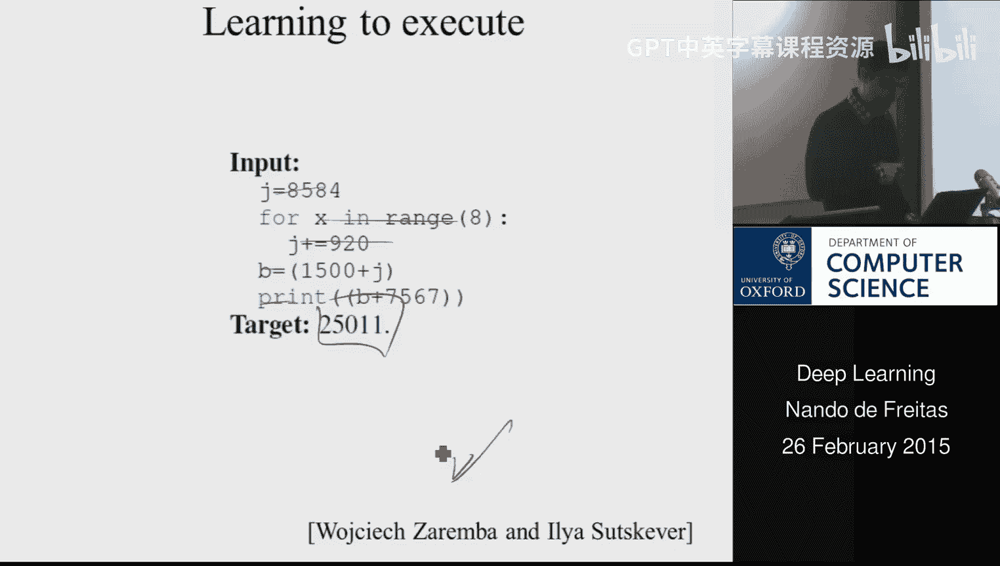
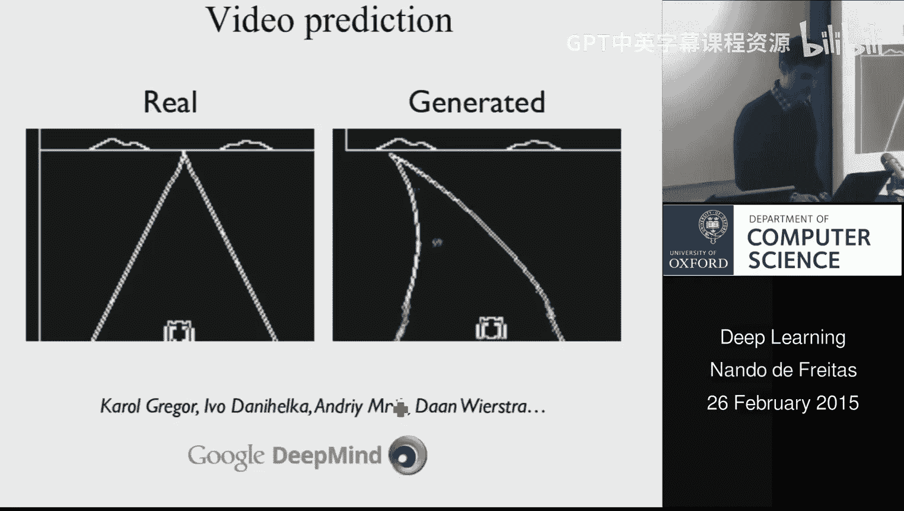
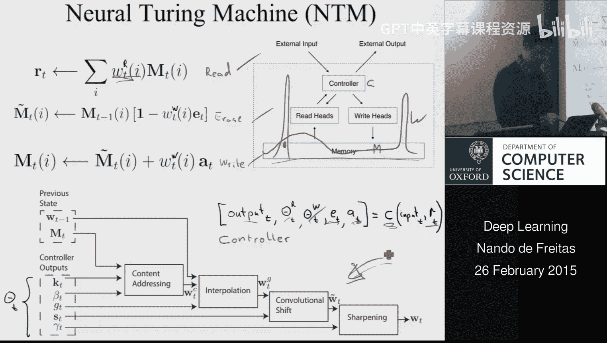
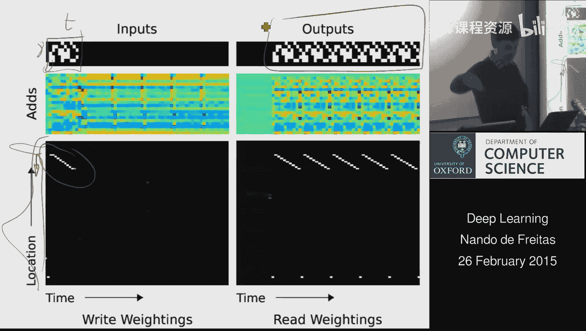
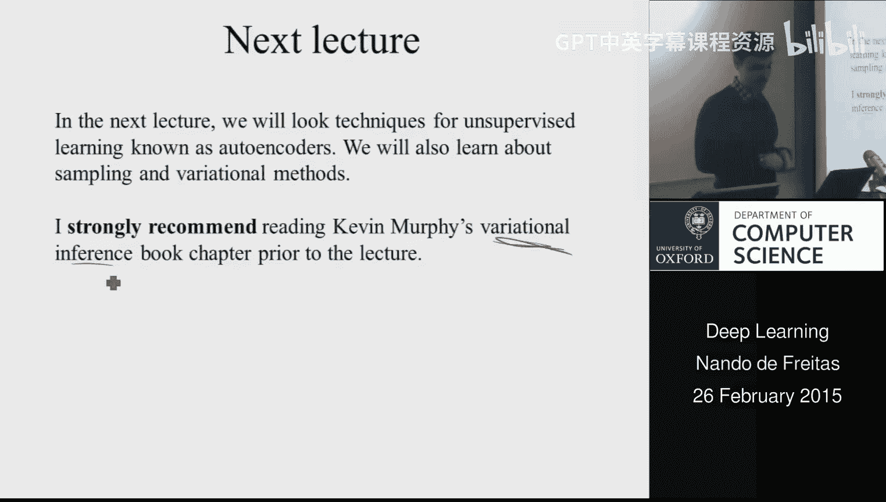
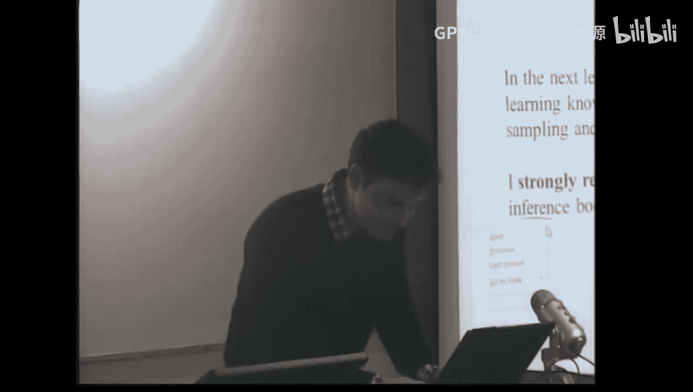

# 牛津大学《深度学习｜Deep learning 2015》中英字幕（Claude-4-s） p11 12_ Recurrent Neural Nets and LSTMs.zh_en -BV17NWWz6ErN_p11-

As I mentioned in the last lecture， there's two important networks that you need to know coming out of this course。

 convenets and recurrent nets， COVnets have changed the world of object recognition and speech recognition you use conves every day。

 even if you're not aware。Comvenetets are very much part of your life。

 they're very much part of your social media life and so on， they're your friends they with you。诶。

And they'll stay with you until we invent something better。 yeah。

 they've been incredibly successful technology。 and， and especially if we can now。😊。

Sor of follow the principle of transfer learning which is use the embeddings that we already learned in a previous task we can now move on to do all sorts of new problems like for example an even simple example then everything I've shown before if you have a confnet trained on Inet and I don't know if any of you were Yala Kon was here a few months ago write where I am giving a talk and he took his laptop was much bigger he has a big GPU very happy and he took a picture of the audience so firstly so he took a picture of the audience I think he might have taken a few objects like whatever was available here saying so you take a picture of this microphone。

Then of course， these objects like the audience did not exist an image net。However。

 you take the image， you feed it through the conv， you compute the output of the conv。

So that's the feature vector that describes this。Now you store that feature effect。

Now you move the camera away。When you move the camera back。

 and what you can do now is you take the input image， feed it through the net。Complee the output。

And the dot product is a similarity。Or if not the dot product。

 you could use any other similar information like e to the minus Xi minus xj。So。

Because you've stored the factor for this image。As you move the camera。

 you keep computing the output vector of the conve。And when you go back to the same image as before。

 the output factor will be very similar to this factor that I've stored for the audience。

 and so the dot product will be high， the normalized dot product will be close to one。

 it will be correlated， and then it fires， the unit fires and you can tell here is the crowd。So。

 and it's very important that you only need one data sample to do this， one shot learning。

So if you've already trained a neural net cove， you want to go apart and train it on many new objects like my dog。

 mom， my house， my boyfriend。My boyfriend in the morning and so on。

 you would just be taking shots like this， and then you keep storing them。

And you've built now a very powerful recognizer our daily for everyday experiences。

And all you really need is to be manipulating the output of the continentve。

 you don't need to be retraining it again， and that actually is quite important like if you don't end up coding coves and very few people end up coding conves and training conves。

 that doesn't mean you shouldn't be using them， you can actually reuse what other folks have already done it takes weeks to train one on INe。

 but once with lots of GPUs and resources and so on， but once someone else has done it。

 these embeddings exist now they're all over on the web， trained models， so you can reuse them。

The other very important and successful model is recurrent nets。

 and recurrent nets have become really hot， they're very good at all sorts of task like translation。

Translation is an extremely important task， like imagine that if you want to conduct business with three foreign countries。

 let' say two foreign countries， here's a very terrible example， it's a bad example。

Possibly borderline politically correct， you're a cloth manufacturing company。

 you saw fashion in London， you get your textiles from India you get a manufacturer in China and they get sent here so your office in London might consist of just three people and you coordinating all these people that are in foreign countries and speak foreign languages。

 but thanks to Google Translate， you can send an email saying。So translate any translate。

 you can send an email to someone。😊，And they receive an email already translated。

And then they can do the right thing， they can place the order， and then they can send。

 actually the example is correct， is the way they do it。

 that is incorrect because they sort of break some laws in the process。😊，嗯。

But the important thing here is that you would be able to talk to people in other languages seemingly as if there were no other languages。

And it's just it will be within your lifetime that you'll be talking on the phone to someone who speaks a completely different language and you will not even notice that。

There's already demos of that。 Microsoft hasn't good demos of。

So even if the only application was that of Ricurness， a successful application， which is。

Essentially， it's like the little fish in。What was that book？

The hitchhike has got to the galaxy that allows you to understand any language that's basically what this would gave you。

It would be pretty cool。And translation is more important than just from one language to the other。

 translation is transcribing one signal to another signal。

So you can translate images to image captions。You can translate songs to lyrics。

 lyrics to songs and so on。 So this is a really important observation because the process of translation is really taking one type of data that's matched。

To another type of date。And a lot of what we're going to do here with recurrent nets sort of exploits that principle so in this lecture go over recurrent nets。

 I'll mention the problem with the old networks why didn't work。

 I'll mention one trick by Ho Rita and Sid Hoover two researchers in Switzerland who actually made these networks work。

And then we're going to go over a myriad of applications， things like language models， translation。

 how to generate captions automatically for images。

 how to take a piece of code and generate the answer just by looking at the code and eventually something that's very cool that it's an archive called neural tuuring machines。

 so differentiable touring machines， tuuring machines are learned from data as opposed to hard coded。

So fundamentally a recurrent net is something like this， so it's your normal usual neural network。

 but now the outputs of some neuron feeds back again into the input。So that's sort of a recurrence。

And that's essential to get tuuring completeness。Let's look at a very simple network here。

 so I'm going to assume that I have an input X。😊，I have some hidden with just one hidden layer H。

And I have an output layer Y。 So x maps to H。H maps to Y， but H also maps to itself。

 So one way to draw this network。Is to think of， I could draw it。嗯。That's why。Layer x， layer H。

H points to itself。And then x goes to y。An alternative， so。So H will always depend on its past。

 and it recurs add infinitefinum to the past。 So this will allow us to model data。

That depends on previous data。It will allow us to model sequences of data and most data。

 everything we've done up to now in this course it always assumes that the data are independent and identically distributed。

 they're independent from each other。Whereas now that temporal dependence or the spatial dependence the old really matters a lot。

And in fact， that's what we're going to exploit and for cognition。

 this is very important and the biggest subject can I take on you as a subject。

 Can you set the alphabet forward？AOkay he's very good at that， can you say it backward？Yeah。

Thank you， good support。We store the sequence， we don't store the symbols， this is not random access。

 try with your phone numbers， you might be able to say in the old days we could see all sorts of phone numbers。

 these days we don't remember， I don't even know mine。

 but most of you will remember your number forward but not backward。

Cops often use this as a test to see whether you're drunk or not。They ask you to say things backward。

So sequences are very important to intelligence and also sequences are sequences of predictions as you're about to touch something like I don't have to touch it。

 I already know what it feels， what the texture will be， what the temperature will be， and I know。

I'm almost predicting everything I do I'm predicting ahead and if my prediction doesn't agree with the sensation。

 which is totally what I imagined， then I have to learn that then there's some correction but if my predictions are fine and I just use those predictions。

 so prediction and secret prediction is extremely important to build intelligent machines to solve all sorts of data tasks。

嗯。Okay， so another way to draw this network is to expand it over time。

 so this just gives you a single time slice of the network。

 let's introduce the time index another way to draw this that you'll find is when people try to expand these networks。

And the way I'm going to expand them is。I say going backward like this。And so the idea。

Is you have H1， H2， or actually let's put time to make it more obvious minus1， t T plus h T plus1。

So basically， I'm enrolling the recurrence。You get the picture。And importantly。

 when I underroll this。Is to realize that the parameters are tied so my parameters going so I have this hidden layer。

 it goes through some arbitrary basis function could be a rectified linear unit could be a sigmoid。

 any basis function that you could find in torch you multiply times some parameters you add the input and that's the next h so H depends on this h here depends on the previous h and on x and the parameters then are in this case theta。

 this is the matrix of parameters theta x and this is the matrix of parameters theta y。

So you could think of this as a linear layer followed by a sigmoid layer and so on。Or in this case。

 sigmoid followed by linear layer and then you need。

A new element that well discuss later which is when you add the inputs of two layers。

 in fact for the next practical， we're thinking we're still discussing it。

 but I think the next practical it will be more like just like a tutorial so that you can understand how to group layers together so basically understand torch NN graph。

because you need to understand that to be able to do the last practical which is I'd like you to run an RN and feel confident at taking at this。

Pull an RN out of torch and do something with it so then one day if you have real resources opposed to what we have in the lab here。

 you can actually train big RNNs and solve all sorts of interesting problems。

Especially if you go to work for a bank。These type of problems of sequences。

 I think that bankers love， just imagine each y is a dollar sign。嗯。Okay， and so when I expand。

 these are the parameters theta。So it's always the same parameter， I'm just copying the parameter。

So the parameters are tied， and that's kind of nice from a storage perspective。

 is you're not creating many more parameters。And there's different ways in which you can trade this。

 how you do the passes through the date and so on， and that's something we。

We can attack during the practical as well， but first I want to sort of mention why this sort of。

 I mean， these methods have been with us for a long time。

 then they weren't working and the problem is that derivatives became zero。

When you're back up a gate。And or they exploded like they become not a number of things in your computer。

And so folks you don't know how to get these models to work。

 and it's very frustrating because here is something that's still incomplete， you it's a model。

 a neural model that is trainable and extremely powerful because you could implement anycomputable function。

 but you can't train it。That's a cut because the derivatives don't quite work out。

And so I'm going to try to take you over why that was a problem and for that I will use an example of that I got from Yohu Ben and some of his colleagues。

 I think Ras one one of my。New colleagues at Deep Mind， actually was the main author in this paper。

So the。So we have this model， this sequential model。And if you wanted to compute the derivatives。

For each of these after each of these wises， we still have we still compute the loss。

 so we would have the loss at time T， we would have the loss at time t plus1， the loss at T。Plus。

 two and so。So you can compute all the losses if you enroll and so you really want to minimize the predictions at every time step so the sum of those losses so we use if we go over a horizon of capital S steps。

 so you enroll this for capitalist steps， you would want to minimize that。

If you do the chain rule and you want a derivative of let's just look at one of the terms a time T for now if you want to compute the derivative of ET with respect to say the transition parameter theta。

Then you would have to go from。嗯。And suppose that you're looking at the theta that happens in layer K。

 and here very importantly， the theta happens in all layers。so theta doesn't happen only once。

 so when you compute derivative and I really recommend you do this， take this model。

 do two steps by hand。So in your notebook， do just two steps by hand and compute a derivative of respect to feet。

Nothing I say in these slides will help you more than if you do that。

Because then you'll see exactly what the exact derivative is and you'll see where all my sums come from。

嗯。Because the parameter occurs many times， you need to sum over all the places before time T where the parameter could have occurred。

And you can confirm that by doing your derivation。And so my derivative。

 I would have to go from when I do back propagation， I have to go from ET to YT， YT to HT。

 and eventually through the network。Many layers from HD up to the layer K。

 which is further back than the layer T。And then I take the derivative。

 the immediate derivative with respect to feet。Okay， so basically。

I would be picking one of if this is T。If this is the one that I'm capable care about。

I would be back propagating like this。And then the derivative would involve that XD。

 but I would also need to deal with the previous the so it'd also have to go like this and so on。

 so I would have several paths that will encounter the and I need to add them up。嗯。Now this term。

 which is the derivative of time T with respect the hidden layer。

 time T with respect to the layer at time K， is itself that Jacobian is itself a product of Jacobians because I still have to go from T to K。

 if I go layer by layer taking derivatives， I actually need to take a product of all the Jacobians。

Between step K and step T。G is the chain rule， essentially I have many inputs， an input and output。

 an input and output an input and output and the channel I have to do the chain rule throughout all these stages。

And if you do that for a simple model， once you get to stage h minus1。

 essentially is the derivative of this guy with respect to this guy。

 which would just give me a theta translse。And then the derivative of phi。

 which I'm just calling phi prime。And I'm putting it in a diagonal matrix so that that dimensions agree。

 and I also recommend for these sort of tedious calculations that you check at home that they're correct。

More importantly。I want you to get to the global picture。

 we're competing derivatives through the network using essentially the chain rule。And if I do that。

 I will end up with these Jacobian terms that multiply many times。

And that's what the problem will lie。Because let's assume that I pick some basis function so that its's derivative is always upper bounded by some constant say。

A half or something like that。嗯。Then if I look at the norm。If I can also look at the L norm of。

The alter norm of this matrix of parameters。Theta is a major of parameters that multiplies the input because we're working with the linear layer。

And the also norm corresponds to what in terms of eigenvalues。

One of the I think I gave fit as an exercise。Parddon。The largest eigenvalue。

 Did I give that as an exercise， I think it was one of。Yeah， first， first， yeah。

 because I often do give exercises that become useful for later stages。Or for the exams。😊，嗯。

And the lectures are certainly useful for the exam， so the videos will be useful。😊，At that stage。

When we multiply the exam， by the way， I'm going to be testing understanding and I'm going to be testing that you can。

Given the understanding you have from this course that you can go and read a paper out there and you can basically say what's good and what's bad about it that's the kind of type of understanding I expect from students at this level where you are regardless of precisely whether you're in fourth year or masters and so on that's the kind of thing I don't want you to be memorizing I don't want to be testing your linear algebrator that would have been tested hopefully two years ago or so。

The linear algebra， however， is useful for this type of calculation I'm doing here。

I can look at this and I can say， well， if the largest eigenvalueu is lambda Theta。嗯。

Then this whole thing。We'll get multiplied t minus k steps， and so if k is say 100 steps before T。

 if I'm trying to computer with this all the way back 100 times steps。嗯。Then this Jacobian。

 this term here。Let's trace it back with another color。The term blue。

The norm of that matrix will be given by a essentially a constant2 a power t minus k。

 What happens if it's large than1？It explodes， it becomes a very large number because it's an exponential。

If it's less than one， it goes to zero。So the gradient either explodes or goes to zero。

So that means that the input at stage K。Any of the signals at HK do not influence the output at stage T。

 so the information from the past is not going to really help you。

 you're not really learning temporal if you have something that requires very long memory。

This is not going to give it to you。Okay， so for example。

 assume that you want to build an RNN that fires when it sees a sequence of A's followed by a sequence of B of the same length。

 so for example， if it sees AB， its output should be 1。Because there's equal number of A's and Bs。

 if it Cs AA， BB， the output should be1。If it sees a million A followed by a million Bs。

 the output should be1。If it sees anything else， the output should be zero as long as what you want is to output this automa and to basically output a1 when the number of A's the number of b's。

 so it needs to learn to count basically。嗯。And if the number of phases very large and then if the sequence are very large。

 you really need a big memory to solve this if you implement this type of you implement an A like this。

 and so this approach is not going to work。啊。You sort of want this to be a one。Okay。

 so then the information gets and recently there is a paper coming out of Facebook with Thomas Michello and on where I think they take a sublock of this matrix and just slap a diagonal there of you know with a constant so that。

The gradient doesn't ban。The popular way of doing this however is via LSTM and so LSTM was introduced to solve this problem。

 so it's good to motivate it like this， so let's go back to this simple recurrent net but in order to be able to use the language of LSTMs I'm going to change the symbols so H is now going to be the output for this simple neuron。

The input is going to be G。It often is what you appear a lot of code is use for gate。

 and the recurrence is going to be in this thing called C， which stands for cell。

So we're going to try to build a cell with memory。So our picture， as before was。

That is the cell here。With parameter theta， you have G， and there's a parameter theta G here。

And then there is an output which is HD after doing a tonH nonlinear linearity。Which reminds me。

 I don't think we've done a ton H。 A sigmoid is between。We see11。A tonage function。

 hyperbolic tangent that is same thing， but between plus1 and minus1。对。

So it's nice if you don't want to have zeros and so on， choose something between minus one and one。嗯。

And now this is just the same neural network that we still had and that when you do the Jacobian you're going to multiply this theta many times and then if you look at the norm of all those multiplications it's either going to explode that it's going to go to zero so we still have the problem。

 so as I just mentioned before one solution is。Put a one here。Okay。Now。That is problematic。

Because essentially as you're feeding the input。You're just basically adding to the counter。

 the previous counter， so this is just basically incrementalcr things。

So this is not a very good memory， it's a memory that just grows。

You need to be able to decide when you have a memory。

 when are you going to put more stuff into the memory？When are you going to read out of the memory？

And you need some way of erasing the memory， resetting。Like in a modern computer。

 so we arrive at LSTM。So in LSTM， we're going to use something that's gating and gating is just component wise multiplication。

The idea is we're going to create。These symbols， these signals between zero and 1。

 so for that we will use a logistic unit between zero and1， a sigmoid unit。

And we're going to feed as input， the previous age， the previous hidden signal。

Previous hidden layer and X。And so now there's two quantities， there's the hidden layer。

 and then there's the cell。Which also has a recurrence。So we have the previous age， the current x。

And that goes through sigmoid and gives you something between zero and1。

And that decides whether the input goes into the cell or not。

That multiplies the input and you just essentially have a switch zero or one。

 except that it's a smooth switch， somewhat zero somewhat one sometimes。Of course。

 you don't know the switch。 You don't know when to write to memory and when not to write to memory。

 So the genius of this model is that you learn that from data as well， the data。

This is all the same data， the input data will go into a readr gate。

 sorry a read gate into a forget gate that basically multiplies c times this input FT。

So if 5 is0 multiply it times0， you era the memory。

And you also will have an output gate which again uses the input data。

 and then you produce the output for the next cell。Okay。

 so you essentially take- so if we go back to our picture。We're still taking an H in。

We're producing an H out。And we're providing a signal X。And for now， I've not included the Y。

 but you could also output the Y。And we'll see that later， but for simplicity， I kept that aside。

This age could be actually the y when you get to the last layer and the previous and you could start from x。

 as we will soon see。So that's basically what an LSTM unit is。

 it's something that now and originally what folks did is they just put a one here and there was no forget gate and that was you basically wouldn't keep writing to it。

 but you would only write into the memory when this gate allowed you to。

And then you would read it out when the output gate。Here， I allowed you to。

The forget gauge just allows you to reset the memory。And the beautiful thing about this is it all。

Like if it has this beautiful principle that sometimes you would want like if only I knew this context。

 I would know which model to use。But I don't know the context。

 And if you don't know that and you should learn that too， and you should learn the model。

 and you should learn them both at the same time。And so these multiplicative operations are very useful。

When you implement it， this picture gets translated to this code， you have x。

 you have the previous H。That allows you to get I， and then you do exactly the same operation for the other gates。

And then you do this pointwise multiplication， so that's scalar multiplication。 so if you have x1。

 x2。Multiplied by y1Y2。By this I mean， you multiply each entry one times the other。

And three wise multiplication。And then that's it Now these are linear layers so you would know how to implement them in torch so you can implement this very easily in torch linear layers followed by sigmoid layers and toage layers。

 the only other things that we need to know is how to add two layers。And how to multiply them。

 so we again need to design layers to do these two operations and then we're done。

We can implement this。Its just sad done though， you'll see that the court is actually tricky Brendan and I spend quite a bit of time with him actually helping me with through it。

The multiplication layers are very simple， you now have two inputs。So now we're moving away。

So you now could think of this as x1 coming from one neural network。

 x2 coming from another neural network， so now we actually have a graph that's no longer sequential。

 but you actually will have node converging and node diverging and so on。

And then the output is the variables that。And if you take the derivative or with respect to， again。

 the chain rule as before with if you want the derivative with respect to the input， in this case。

 if you pick this input， you need the backward message。

 which is the derivative with respect to the output times the derivative of the output of the module with respect to the input of the module。

 and that will give you this expression here。And。You can go over the I've done it in entry wise。

 I've redirectiveed it here， component wise so that you can convince yourself that that's correct。

In torch， a single LSTM cell will essentially again， you basically specify the input。

 which is a sigmoid， and then you need to pass to it。

 Wx sorry theta x plus theta H the previous H and for that you implement a function。

So instead of introducing the parameters here individually。

 we just call a function that creates linear layers from x to H and from the previous H to the new age。

 and then we create a module that adds those two。So add you have this note add a note， you add them。

 then you just pass that through and I will create them with different parameters so this nice thing about having a function inside a function。

So that creates the end gate， the input gate， next you create a forget gate just the same way。

 the cell gate， then the C gate is you had to add to two things， the forget gate。

C mouth table that implements the layer that we just described in the previous slide。

 entry wise multiplication， so you do the entry wise multiplication of the previous C with the forget gate。

The appators says the other layers and you compute the next H， and so update C。

 get the next H and you're done。Okay， so typically it's this module where you take the x。H previous。

Which in this case is called the prev H， the previous H。And then you get out。The next age。And。

And you get out the next。是。So that's a single cell， it could be multivariate because the cell。

 I mean， these are all。You can think of all the h's， the Is as vectors in RN。

 as we've been doing when we described it here， so x could be an input vector。

 this could be a vector in RN， this would be a matrix that's n by n。

 and so the gate would be a vector in R n。嗯。And that will create a single unit。

 if you want to create a network， you just need to copy these units。Right。

And if you want to have them with the same parameters。

 so you first will copy them like this and if you want to have them with the same parameters。

The copying code is this， but for that Brenda will help you with it and then in order to clone them。

In order to move， they use the same parameters to just clone the network。And if you do that。

 you can build networks like this one here where you can put an input sequence of words in English。

 input and an output sequence of words in Mandarin， and then you learn all the parameters。

By doing back propagation on this LSDM。And for a now， you get a translation model。

And if you add more layers， you just add more layers here。If we pick one of these guys。

It takes the H at t minus1。So basically it sense。Essential sense they it has its own parameters。

 so each of these guys have different parameters， so this will have theta 3， this will have theta 4。

 the parameters get replicated on these cells， so they get replicated over time。

 but they're different parameters。As you go up in the hierarchy and that all gives you different time scales for these processes。

And by having multiple paths， you have different time scale。

 so different ways in which one word in one language could get propagated to influence another word。

So there's more ways of propagating information on the network than when we just have one layer。

And so that's for the network Theta I， one of those thes， and you also get as output as CT。

 so it's a single SDM cell， but so HT gets sent up and to the right and you also send CT to the right。

And then。And then you have the h of the previous layer coming。

 so the x is essentially the h of the previous layer， and when you get to the bottom。

 the x is the data。These models are huge。As you can tell。By these parameters。They take a long time。

 so this allows you to go from one language to another language。If you have instead of doing syntax。

 like the usual way as you would do。The old school way， you can just。

If you have already linguists have already given you supervision。

 linguists are not needed anymore because now you can just use。

This model to go from English to a parse。Then we still had a very useful staff about how that was a joke。

嗯。You can also go from a sequence of code instructions。

 which is just a sequence to an output and there's a paper by these guys that does that with some success。

 it's not perfect and there's some bugs in it， but it's nonetheless quite impressive result。

You can predict video， video in， video out， so some of my colleagues are very busy working on this for games。

I've already shown you this before Alex Graves and a lot of the work the stuff。

 this is I really learned a lot of the stuff from Alex and he has a very nice report on his webp page on recurrent neural networks which like if you want to spend more time on it and in fact in the next class we're going to go over this and I want to go in detail of this just as example and then in the second lecture I want to go over how to generate images。

And here， I think the first one is the real one and all the other ones are。Just a model writing。

Just pretty impressive。And more recently， Alex and some of other folks at Deep Mind implemented this neural Turing machine。

 which is very， again， we saw memory networks in the last lecture。

 the Turing machine has a controller， essentially as an architecture of a typical Turing machine。

 you have red heads， right head， and you have some sort of memory。And it would take datas input。

 an input sequence， an output sequence。And it just basically learned which things should I store。

 which things should I retrieve in order to say answer a question。

How should I do manipulations if you give me a sequence and the output is a sequence sorted。

 how do I sort so it should learn how to sort。So you can think of any algorithm from your algorithms class that where you took an input and you had an output and you use a modern touring。

 you know one of actually randomax， use whatever algorithm that's implementable on a touring machine。

 this should be able to do it， except that you only presented input examples and output examples and it should figure out what the program is to do that。

嗯。I'm not going to go in detail into it， but essentially it has read gates， it has era gates。

 it has write gates， they're very similar to what we saw for LSTMs。

 the main difference is that instead of having just a single cell memory。

 it will have a whole matrix of memory。😊，And you can access you can access this memory to write into the memory and you can access it to retrieve facts。

 and the axis is given by this weight function， like to read。

 you just there is a function that goes over this memory， maybe something like this， that's yourW。

And you just multiply dark times the memory， usually this will be actually very spiky。

You multiply that times the memory， and that's the fact that you retrieve。嗯。The controller。

 you could implement it in many ways， it basically takes the input。And some reads。

 and it has to output what should be added to the memory， whether you should erase。

 it outputs the parameters of the heads。 So it controls the heads and the arch output of the machine。

And it involves many steps。 I'm not gonna to go。 obviously don't have time to go over them in in detail。

 but they're described in the paper。

And here's an example where they provide us input this sequence。

Whi is here time goes like this and this is， I think eight inputs， so it's8。

 eight sequences of numbers and then the last one is just something a number that says how many times the machine should copy the task。

 so the machine is presented a bunch of inputs。And what it learns， here。

 we're looking at this W function。 And as you can see， it's sort of very picked。

And it changes over time， sort of moves to the left， sort of moves down。

White is where that W function is。 So it's essentially learning to write the input。

And once it's so this is what it learned， it learned to write the input when it's presented。And then。

It learned to then withdraw the input， read the input and copy it。

 so it's able and it copies it the right number of times showing that it's capable of having this long term memory。

Longer term memory。嗯。Another model that's also very popular though。

I'll just go over this quickly because the application， as you'll soon see， is super cool， is Dmitri。

 Barno and bunch of folks in Montreal。They implemented this model to the translation。

 where once again you have the input sentence x， the output sentence y。

But instead of just going through all these nodes， he decided to have a gate。bottlenecks。

 so that you would know， so essentially he's very interested in having a neural network that says how much a word in one language should be associated with a word in another language。

 so he doesn't just want to generate us a translation。

 but he actually wants to be able to say that the word Gato in Spanish much is the word cut in as。

And so he does this。This way so this is basically a parameterized neural network so you have the outputs all of all of your hidden unit and then they get gated again by this scalar alpha so we see this concept of gating appearing again and that determines then which of these hs gets matched to this s could be this H could be this other H he does one more thing is he does a twopa a listM which I haven't described at all but you can sort of find out about that。

 that's not the most important thing the important thing is this gating。

And the gating is useful because then you can do things like this， you can take an image。😊。

You run an already trained convolutional network and you get features and where the features occur。

 So the connet will also tell， I know I will say that there's a wing feature here and there's maybe a water feature here and so on。

 So you get many of these features。And then so here's where the alignment comes in because you basically want to say what in the image is what。

 what is a wing， what is water， what is a bird？And it will do this by doing this thing that we started the course with。

 which is attending to things where you don't see everything， but you just see a little bit。

And so it will learn to attend to these different regions in the image by using gateating。

And then giving the gate， then it generates a word using a recurrent net。And in fact。

 recurt output can output one word and then the next word and then the next word。

 and so it actually generates a sentence。And here's an example of what it actually does over time。

 so right now we're talking about there's two results here right now we talking about the top one we'll talk about the bottom one in two weeks time。

But essentially， it's going a。When it says bird， it's attending to the bird。Flying over。

A in our body so it attends to the water of water。So， I。

I picked this result because that's one of the nice results in their paper on archive。

They have like an appendix full of other results and some of some of which are not compelling as this one。

 but nonetheless， very cool。I'm not going to go to the model， but it's basically the same thing。

 It's gating。 So it's again， it's using this sort of。

Gating mechanism here with these gates on the outputs of the convennet。

 So you have the outputs of covenet， all the features that occur。

 you have a sequence of words and you essentially gate over the outputs of the conveant to figure out which part of that image maps to what word as you translate it so you're looking in different places and as you're looking you're coming up with an explanation。

That's pretty much it for today's lecture for the next lecture I'm going to focus on Alex Graves that how he actually。

 we're going to look into the details of how he generates text and those are important details because those are the same details that I didn't go over in order to describe a neural T machine。

And those are details that will be needed in order for me to show you something called variationals。

 which allow you to generate。Beautiful images。 So close your eyes， boom。

 beautiful images of numbers and so on。 And thatll be in the second lecture。And in order。

For you to get the most out of that lecture， I recommend you take Kevin Murphy's book which is in the library。

 there's several copies if you don't have a copy and there's a section on variational inference that he describes and just read the one or two pages introduction to that because then the lecture will be bit easy so this requires a little bit of more sophistication and inference in order to go to the variational world but even if you don't get the math in that lecture I want you to at least see the application of what you could do and understand the idea and essentially what we can exploit is。

嗯。View of learning where you learn when the world doesn't match what you imagine。

Except we're going to come up with a very cool way of doing that and yeah the videos。

 I'm sure when I show you the videos you'll think like me， but it's pretty cool。

感谢。