# 牛津大学《深度学习｜Deep learning 2015》中英字幕（Claude-4-s） p12 13_ Alex Graves on Hallucination with RNNs.zh_en -BV17NWWz6ErN_p12-

Okay， everyone， so。So in the spirit of this course being a course that takes you from the very basics of regression and linear algebra to the latest in research today we have two guest speakers who are definitely the latest in research and deep learning。

 Alex Grace who came up with but I think is the best paper of last year and he also helped Carol who's going to be our next team for the next lecture who I think came up with the best paper I've seen this year。

 this's really amazing work shorter it will inspire you so we talked about the neural tuuring machine this is Alex's work and he's done a lot of the work that the type of code that you've been using for you or will be using for your practical LSTMs and so on。

 you can thank Alex for。Having made that easier for you， so without much more， thank you for coming。

Thanks， Mano。嗯。So yes， today I'm going to be talking about generating sequences with recurrent neural networks。

 and so this is based on a paper that I published in 2013。On archive。

Something making a sound was like a b。什么原因？Because I just see you okay， Well that's all right。

And yeah， so if you submit the paper is obviously still available so you can look through the kinds of things that I'm talking about afterwards。

And so the first question to ask here is you know why do we want to generate sequences in the first place and this kind of speaks to generative models in general like what's so good about generating data。

 and I understand that Nanddo has already talked to you a little bit about this。

 but I'd just like to kind of go through what my motivations are for looking at this field why I think this is so exciting。

So there's lots of reasons you can give for why generative models are good and I think that one of the ones that became popular。

 especially around the time of sort of 2006 with deep belief nets and so on was to improve generalization so there was this idea that you could use generative models or unsupervised models as a sort of pretraining method。

And then once you had done that， you would end up with a supervised model， for example。

 a classifier typically that would generalize better， so in other words。

 even though the generative model isn't the thing that you were using in the end。

 it would help your model learn some kind of better internal representation and that would make it a better classifier or whatever it was you were doing with it。

Well， another motive is。If you have a generative model。

 you can use it to create synthetic training data personally I think this is something that I often hear people talk about personally I think it's kind of a poor motivation in the sense that it's always better if you can to get your data from the real world if you're generating data with a model and then training another model on that data then you're kind of limited by any flaws there were in the original model will be reproduced in the model that you train them。

So then there are also obviously actual practical problems that involve generation and the one that I'm going to kind of talk about in this presentation is speech synthesis or text to speech where the actual task requirement is to generate something that sounds like real audio。

 like a person speaking。One thing that we are very interested in a deep mind is the potential for sequential generative models to be able to simulate future situations。

 so this is really looking at the kind of reinforcement learning setting and you want to be able to imagine what's going to happen if I perform a particular sequence of actions without having to perform them because in many cases having to do these things is prohibitly expensive。

 but being able to imagine them is quite cheap。But I think really what it's about and what excites me about generative models and specifically about sequential generative models is that they give you a way of understanding the data。

 so just being able to model everything in the data forces your system to find the salient structure in the data forces the network or whatever you're using to actually understand the data it's looking at and I think's kind of that's the underlying the thing that underlies all of these other benefits。

 so the reason you get better generalization if you pretrain with the generative models that you have a model that has learned more about the structure in the data and the other really nice thing about generative models is by looking at what it generates。

 you can see how much it is actually understood and hopefully we'll get a feel for that from the examples that I show you。

Okay， so in you know practical terms， generating sequences is pretty straightforward if you have a。

As long as you have a predictive model。 So basically the easy way to generate a sequence given' say a next step predictor is basically you just keep on predicting what's going to happen next in the sequence。

 and then after each prediction you treat the last prediction you made as if it was real。

 So in hobabilistic times what we're talking about is just the conditional model here。

 the probability over this whole sequence X is' just given by the product of the probabilities of each step in the sequence conditioned on everything that happened previously。

 and the way I like to think of this is that you're asking your computer to dream。

 So like when you're dreaming you're imagining some situation。

 and then it being fed back into your kind of into your brain as if it had actually happened。

 you're saying okay， know imagine that something could happen and then say， well。

 if it really did what would happen next。 And I think this allows you this allows you to this iterative process is what allows you to generate things that are really rich and interesting。

And so the actual so all of the experiments I'm going to show you are all based on the same architecture。

 really the same recurrent neural network and the basic structure is actually pretty simple。

 so it's a deep recurrent neural network that just means it's a recurrent so I don't know if you're all familiar with recurrent neural networks in general essentially take a multilayer percept and then connect up the hidden layer to itself so the hidden layer receives inputs from itself once step back in time and you've get a recurrent network and a deep recurrent network is just the same thing with multiple hidden layers stacked on top of each other and basically what we found is that the same advantages you get from having deep feet forward networks seem to carry over to recurrent networks。

And so the sort of topology looks like this， I like to use these skip connections where the information。

 the input data is fed not only into the bottom hidden layer but into all the hidden layers and all of the hidden layers connect forward to the topmost layer and the reason to do that is basically to make sure that you don't have these problems with you know did you get with very deep networks when it's hard to propagate the gradients through lots of different layers because there's all these shortcut paths that the signals can take。

And so as I say it's a predictive model I'm using here。 So it's always just next step prediction。

 essentially the task。 the inputs from your sequence come in one at a time。

 and then the network predicts the input that's coming at the next time step and predict here what it really means is determine or parameterize a predictive distribution。

 So depending on the type of data， you're can have a different predictive model at the output layer of the network。

 but that predictive model the parameters for that predictive model will always come from the network。

 they'll just be the network outputs。 And so the simplest case would be if you're doing if you've got discrete if you're predicting a sort of one of K discrete symbol sequence。

 then your output is just going to be a softmax layer。

And what the network is going to do is just give the K numbers that are required to give you the K probabilities for the different classes。

And then once you've defined as the training is totally standard， it's just regular log loss。

 or to look at it another way， you're measuring the ability of the network to compress the data。

So you're just looking at the negative log probability of the input sequences given the model and like I say it this conditional model so you're always looking at the log probability of each stat conditioned on the previous steps and as I've said in the last slide。

 once you've trained this model generation is straightforward。

 you just keep on feeling an input and then sampling from this output distribution。

 probability of x given X of1 up to t minus1， pick a sample from that and then feed that in as your next x of x subt。

 your next input rather than the real input。Okay， so so it you know。

 it's a relatively straightforward architecture， but there is there are a few subtleties。

 and one of them is that， you know what people have found over the past。

 you know recurrent neural networks were big news back in the 90s。 and then they kind of died off。

 people stopped using them。 And I think the main reason for this was that the standard sort of vanilla。

 recurrent neural network just doesn't work very well。

 It doesn't do the thing that's really supposed to do。

 which is to store memory in store information in this internal memory that it gets from having recurrent connections and you know be able to sort of store and access that memory at will over longtime periods。

And so long shortter memory is an architecture that was introduced a long time ago now in 1997 to address this problem。

 and the idea was to design a network specifically around the idea of having information that you could protect and having the ability to choose when you were going to read and write this information。

And so this was implemented using these multiplicative gating units。

 which are illustrated in this diagram here。 Don't worry too much about the kind of the， the。

You knowThe exact topology here。 so one thing that's happened recently。

 LSTM has now become after many years in the doldrums， LSTM has now become very popular。

 people are using for all kinds of things， even commercial scale。

 and there are also a few alternative sort of variants of LSTM out there。

 usually the the thing that they always have in common is that they involve these multiplicative units。

 these gatelike units。And the way I like to think about LSTM intuitively is that basically these three gate units act like differentiable versions of read。

 writeite and reset operations， so just to kind of go through that in a little bit more detail。

 this point here is the input gate and essentially that is just that's just the number is the number between0 and1 is received from this unit here to the normal sequence1 unit and then that number multiplies the number received to this unit here。

😊，Take two ordinary soidoid units like you have in every recurrental network and then multiply them together。

 which doesn it sounds like kind of a trivial change。

 but it gives you a much richer set of dynamics that the network can instantiate and in particular。

 what it can do is just as long as it ensures that this number is very low as long as that zero。

 go information gets through into the cell。 and that immediately gives the network。

 the cell being the kind of the place where the memory is stored within the sub network。

And this immediately gives LSTM the ability to store information from much longer periods of time is what happens in a normal recurrent neural net。

Is that there's nothing to stop the internal representation of the network。

 the memory of the network being overwritten by new information coming in。

And basically the other gates， the output gate and the forget gate。

 these kind of do analogous things only so the output gate multiplies the output of the network to the rest of the system。

 so if the output gate is closed， no one can read what's in the state if it's open then that state can be read and the forget gate as long as that remains open。

 the information remains in the cell as soon as that closes， the cell is effectively resetet。

So basically put together what these things do is give you a system that can has much more introspective control over where and when it stores and accesses memory and in practice。

 basically what this means is。FSTM networks can do the things that RNNs were always supposed to do。

 And I'll show you what I mean by that soon。And so just to give before I get into the experiments just one more kind of。

Highlel comment。 I'd say， you know it's kind of obvious that there's this。

 you know this is a predictive model and know the strength or failure of these models basically rests entirely on how good they are predicting what's going to happen in the future。

 And kind it's kind of obvious to say， but know you need memory in order to make predictions。

 you have to remember the past to predict the future。

 And there's lots of reasons why having a longer memory or the type of memory that LSTM gives you is an advantage。

 So know one of the most obvious ones is well， if you have a long range pattern。

 If you have some information that's spread out over a long period of time。

 you have to be able to to accumulate that information to integrate that information over a long period of time in order to do anything with it。

 basically if if you don't have a long enough memory。

 then you're not going be able to see the whole picture of once。

 And this is especially obvious when you look at disconnected patterns。

 And so one nice example would be when you look at text when you look at language data written。

You often have things like quotation marks and brackets。

 and if you at the text if you look at the text between two brackets from a normal sentence。

 nothing in the text itself tells you that it's within a bracket。

 So in order to be able to remember where to close the bracket。

 you really have to keep track of the fact that you are in a kind of open bracket state。

 what you're writing is now part of a parenthees of a parenthetic clause。And。

That's something that you know where that's sort of a。

That's something that will reveal whether or not your system is able to store a kind of discrete piece of information over time。

And sort of maybe the more profound point to make here is that。

The more your the better use your system makes the better your system makes use of its memory to make predictions。

 the more robust it becomes to prediction errors。 And so what I mean by this issue of prediction errors is that if you're generating a sequence by iteratively picking a sample from your model and then feeding it back in then picking another sample and feeding it in。

 what tends to happen is it works fine for a few steps。

 and then you generate something that doesn't look anything like the training data it' seen before and from then on the model just breaks it walks away from the manifold where the training data lives and everything it generates from then on this garbage。

 And what I found in practice is that long shortterm memory networks are much less prone to this than other nets。

 And I believe that's because they are using a much wider range of memory to make predictions。

 So they're using the memory let's say a very precise memory of the last few steps。

 but they're also using a more compressed memory of things that have happened over different timescales。

 tens of。hundreds of steps。 And so basically， they're no longer going to break if just a few steps are wrong。

 like the network has to go sort of much more substantially wrong before it stops working completely。

Okay， you know what this is I've just realized this is like I altered this talk slightly this morning and somehow it's reverted to its earlier version。

I had an extra slide about text generation， but maybe I'll start with the handwriting。😊。

Experiments anyway， because it's possibly more interesting。

So one of the two tasks that I applied this system to in the paper in the archive paper that I mentioned。

Was handwriting online handwriting generation。 And so just to explain what I mean。

 by that online handwriting is where you get pen trajectories， you know someone is writing。

 say on a tablet or something like that。 and the trajectory of the pen as they write is stored。

 So you have basically just a series of coordinates for where the pen tip is。

 and that is is your handwriting signal。 And it's a much nicer signal than taking say a photograph of someone's handwriting and that it's very compact。

 It's very low dimensional， it's much easier to work with。

 You should basically just have two coordinates per time step。

And the database that I used was this I am handwriting database collected by the University of Barron。

And it hass you know I guess the most interesting features of this are that it it's a data set with lots of different writers and it's very unconstrained So it was actually recorded by people just writing on a whiteboard with a pen with an infrared sensor and the sensor recorded where the pen was as they wrote and you can see from these samples here that's first of all。

 you can you clearly see that these were written by three different people who have three very different styles of handwriting。

 Secondly， you can see that it's kind of messy there are some mistakes and there you know mistakes made by the people there are also a few mistakes made by the scanners and there're just you know it has the normal kind of。

Diversity that you get in real handwriting。 So this is as opposed to。

 you know there are some data sets where people are， for example， told to write， you know。

 isolated words or even isolated characters and write very neatly。

And all that made it much more interesting in my opinion as a testbed for a generative model and so the first problem I faced when I came to this was how do I deal with this continuous data it's Lo mentionedal it's only two points at a time but it's still real valued and so like I already mentioned the simplest perhaps the simplest variant of this predictive model just has a softmax layer at the output it's designed for discrete data and so the question is what can I do to replace this softmax layer with another predictive model that will work for continuous data。

And the solution that I chose was to use what are known as recurrent mixture density networks。

 which it's kind of a fancy name All it means is that the network outputs are used as the parameters for a mixture distribution typically a mixture of Gaussians and just to kind of youve probably heard about Gaussian mixture models before。

 this is a little bit different in the I'm not fitting a single mixture of Gaussians through an entire data set。

 rather the parameters emitted by the network at each point in time。

 which are conditioned on all of the inputs that are seen so far in the sequence are used to predict a specific mixture distribution。

 so essentially what you have is a different Gaussian mixture model at every time steps you go through the sequences and hetero scastic。

I right there's some term for statistical models that vary over time there's something like that。

 but the way I like to think of it intuitively is that if you've got a Gaussian model with 20 components。

 a mixture of 20 Gaussians than what you've got， the network has 20 choices for what kind of thing will happen next。

 it has 20 different modes that it can use basically。And usually what you find is that's enough。

 so you if you're fitting a single mixture model to an entire data set you usually need a huge number of components。

 but if you're only fitting one data point at a time condition on a previous data point and you don't need so many components。

Yep， okay， getting a bit ahead of myself。 So basically you know， that was I just I just。

Define this network， so this was this kind of。Mixer density model was first considered by Mike Schusster in 1999。

And I basically just took this thing and fed the handwriting data into it one step at a time and asked it to predict the next step。

 And I was very pleasantly surprised that it generated stuff like this。 So you know。

 once it was trained and I ran it forwards to generate。 Now， obviously。

 that doesn't this doesn't make sense。 you know， you can't really， you know， there's not like。

A consistent sentence being written under here。 But it has many of the like the important features that I really wanted from this kind of generative model。

 So first of all， you can kind of see that theres something like a style for each of these lines of handwriting like。

They look like it does sort of look like each line was written by a different person and the style seems to remain kind of consistent throughout the line so like the third line is quite loopy。

 the first line is less cursive and the letters are more separate。

But maybe even more fundamentally than that is the fact that it generates letters at all。

 in fact it generates strokes， it generates letters and it even generates whole words so you can see the in there。

 for example， know theres obviously there probably the most common word in English that are are and so just from you know this was really encouraging to me that just at the level of predicting individual dots。

 it's generating these kind of high levelvel chunks and the data that exists at the sort of the scale of maybe100 dots like so for the word that maybe it takes 10 separate coordinates in a row to generate that。

And so it was clear that the system was。Doing the right kinds of things for a generative model。

And in this example at the bottom here， you can see that it actually learned how to swear as well。

 and actually that's an interesting point because there's no swear words in the training set。

As far as I know。But there are， you know what the network has learned。

 like SH is a common morphine in English is a common letter combination， and so is IT。

 so it is actually is learning to generate words out of common English morphs。

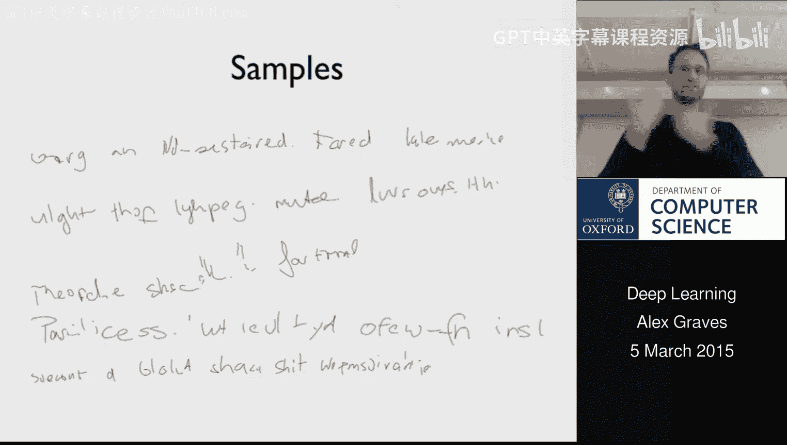

扫客凳子。Yeah。嗯。And another nice thing about dealing with this two- dimensionsional data is that you can visualize it very easily so you can say。

 okay， you can plot a two- dimensional heat map that tells you how this mixture model actually distributed its probability maps and that's what I've done here。

 so basically we've got here is the network predicting someone writing the word under。

And I've superimposed all the predictions on the same heat map。

 so each of these little blockss here is the prediction。

 so that ball there is the prediction that the network made。so on this。我放实系。And。

And what I mean by that being a prediction is that's the probability density that the network assigned to the position of the next quarter that was given by these。

fuunny shaped blos and you can see you know it's a lot of things you can see straight away。

 I mean one of it is that there's kind of two separate modes here so while the pen is predicting。

ですです。lot of pen is all in the paper and it's followed smooth stroke。

The predictions are pretty precise， because it's a continuum and it has all this information about thegra and was before it just has to kind of extractly。

And then there's these points here， these big spread out blockss。

 and basically those of the points in the pen lifted off the paper。

So the pen's position was not recorded while it was in there air。

 it was only recorded again once it was put back in the whiteboard。

And so essentially once the pen is lifted off here。

 the computer doesn't really know where it's going to be put back down。

 the person could do anything to the app then put it back down。

 so it has to give this quite spread out prediction and you can really see that in order to make a shape like that it needs to use a bunch of these Gaussian components。

啊。You know， your average sort of access aligned Gaussian blocks。

 so it uses the curvature that it's got quite a lot。Oh and the other thing is at the bottom here。

 and this is done with2y mixture componentss and at the bottom here you have to mixture your weights。

What you can see is that while it's in this kind of stroke regime， it's mostly just using 304。say。

Where it switches to the end of the stroke regime which is this here switches to a completely different set of the problem。

 so it has the ability to learn a kind of switching model。

 and this what's nice about having these mixture is it can sort of separately optimize different modes for different regimes that the system might find itself。

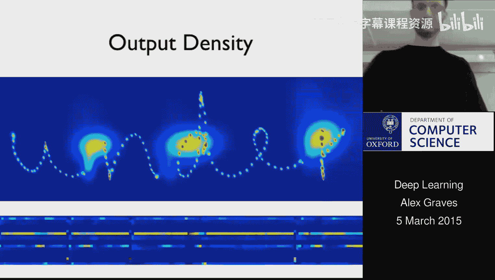

Okay， well you know this was very interesting， but what I really wanted to do was to actually generate handwriting that looked like handwriting。

 in fact， to be able to control what the handwriting was that the network produced。

 so I wanted to tell what to write without losing this nice distribution over the way it write without having this nice freely generated style that we were getting from the generation。

And so in probabilistic terms， what this really means is I wanted to condition the next step predictions on a text sequence。

 and the challenge here was that you don't know the alignment between the text and the right answer so the number of time steps required to write a single character could be as low as 10 or 15 or it could be as high as 100。

And it's really not， there's no sort of and because you know。With persive handwriting。

 people can write many characters in a single stroke all joined up together。

 so there's no sort of easy way of segmenting the writing into individual characters and defining those alignment。

And also I didn't want to have to rely on a pre segmentegmentation module because then again。

 if there's some mistakes in the pre segmentegmentation module and those get transferred to your generative model。

 rather I wanted the network just to be able to decide where it should attend in the text sequence。

 essentially give it a differentiable attention mechanism for the text sequence。

So before each prediction， the network just decides which character it's looking at and therefore which shape it's going to generate。

And so the way this is done， like I always seem to have trouble， this slide never seems to work。

Essentially， what I did was。I allowed the network to output a another mixture of Gaussians。

 And in this case， the the Gaussians were。The Gaussians describe or define the attention。

 say say the attention distribution of the network over the text sequence。

 So if you look at if you look like so basically the way those characters are actually represented to the network is just as one hot vectors。

 like kind of standard and covi。 So this thing along the bottom is one hot vector。 that's the text。

And what the network has to decide is each time that makes a prediction。

 which of those vectors should I look at and should make an important distinction here。

 I wanted this all to be differentiable， So one way you could think about doing this would be to have an explicit decision like I'm looking at character three year I'm looking at character four。

 but then you're into the land of reinforcement learning in policy gradients and things like that。

I wanted to keep this like smooth gradient of everything to be trained in。

And so what I did was to find this Gaussian model where the network outputs the mean and the variance and let's say。

 the mixture weight。Of a bunch of different components and then these Gaussians are essentially convolved with the input so you just get this this sum is is basically this sum over time that says。

 well， how much attention， this W value does the I here that basically says how much attention in the network。

Give to the character at Se key。I rather a step by。系快啲。how much attention。

 whats the attention weight for character I and then the final vector that it gets out it's just the weight of sum over the1po vectors so run over the1p vectors。

 multiply each one by the weight given to it by the attention module and then at the end you have a sum that is a kind of muned together version of these different vectors so it contains more or less of each character depending on how these Gaussians are defined。

And this is something that this notion of attention is something that' in the last couple of years has really been catching on so Carol's also going to talk to you。

 I think， about an attention， a different kind of differentiable attention next talk。

 there have been other papers， some of you may have seen Yoshuio Benjo's machine translation paper。

It seems that this is something that's becoming a very。

A big thing in machine learning in general is that you don't want to look at all of the data。

 all of the time， you want to choose to focus in on a small part and the network should be kind of free to learn how to do that。

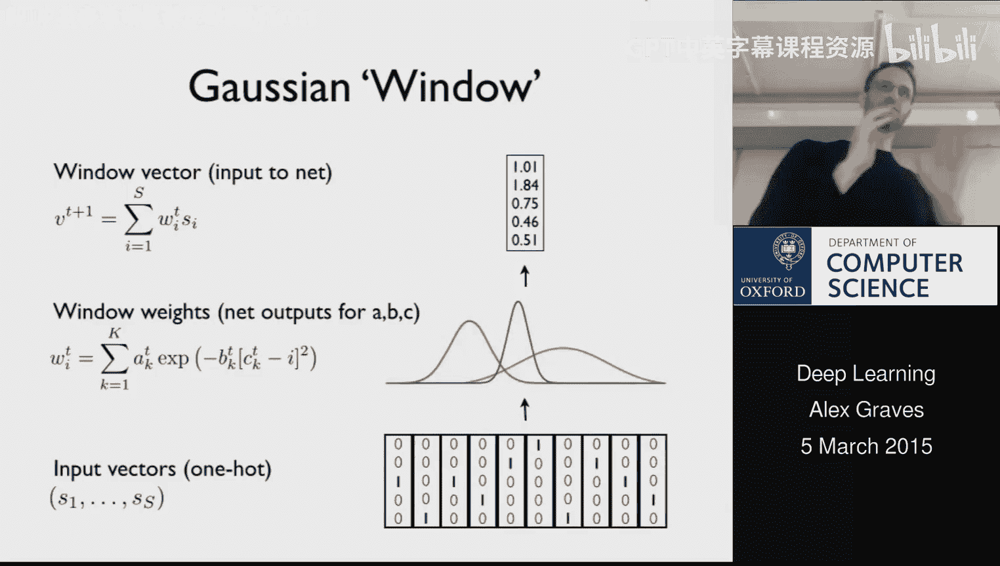

And so what happens when you do this when you run this attention module。 So here's an example where。

系。U the side， so this is the input text network is conditioning on and then the handwriting is along the bottom and what this alignment does。

 what those Gaussians do is essentially。They define a kind of an alignment curve between the text and the handwriting that shows essentially shows。

 you know。At time step at this time step。Times that plenty or something like that， which character？

分際。Ping the factor each is that second step。That， and and it's really。

It always gives these kind of clear cut， this clear kind of alignment band。

Between the input and the output。And okay， that's all very well。 But then the question is like。

 does it actually generate good handwriting？ So I think Nando might have already showed you this slide。

 but I'm going to test you on it again so。

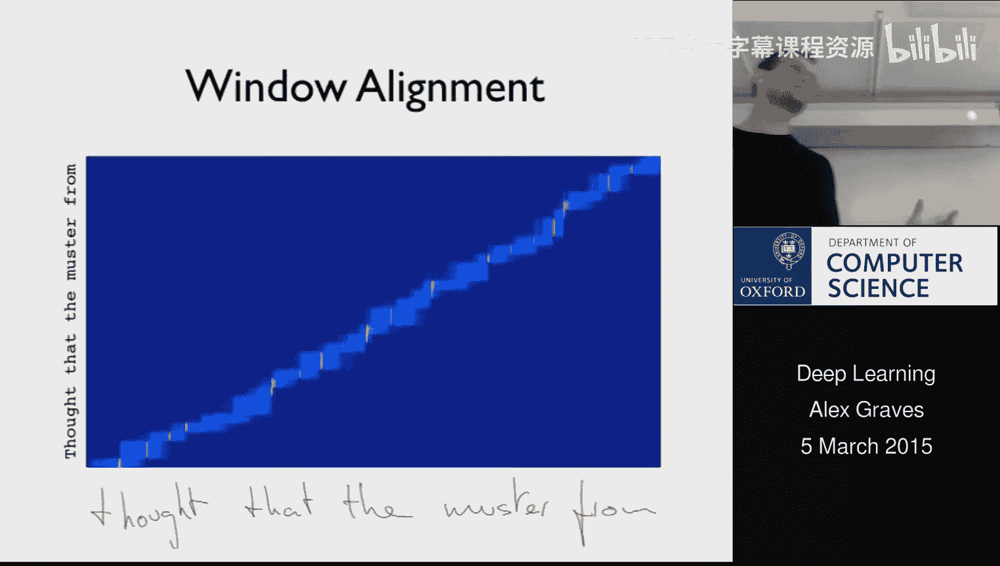

One theseOne of these samples is real and the other ones were generated by this RNN。

 who can anyone tell me which one was real？Which one do you think。Just shop out， No， no。对对。This is。

 strange Every other time I've shown this one， everyone has told me that the last one was real and the others were fake。

 and that's actually true。I don't know what that says about you guys。

Maybe it's just that the screen's a bit fainter or something。And here's another one。

Which one do you think this time。Don't be shy。Obviously see， this is like a psychological trick。

 right？Because the big one at the bottom was right last time。

 you think that the big one at the bottom is right this time。

 it's not true that one at the bottom was generated。 I think it was the fourth one。 Yeah。

 it's the fourth one was real this time。And so oh no， actually I only'm okay。

 I've limited myself to two slides here， as I'll tell you in a minute。

 there's an online demo for this so you can try it out yourself just in case you know。

 you don't believe me。Another interesting thing you can do。

 you know once you've got this generative model that can generate these sequences so you feed in text。

 it scans to the text deciding where to look as it goes and then it generates this handwriting and then you can start mucking around it and that's kind of where it gets really fun so one thing you can do is the method I've described so far as an unbiased sample is drawn like basically this predictive model defines implicitly a distribution over sequences and these things are unbiased samples drawn from that distribution。

But you can actually bias， I mean one thing you could do， in fact。

 if you were thinking about a commercial application for this， you might not want a really noisy。

 messy kind of handwriting， you might want to get some nice neat kind of reliable handwriting and one way to do that would be instead of looking for。

Instead of looking for an unbied sample， try to try to get the mode。

 try to get the single most probable sequence that the network thinks would correspond to a particular。

Particular text input。And to do that properly is actually kind of difficult。

 like maybe you need to do some sort of beam search or something like that。

 but there's a simple hack that gets you a lot of the way there。

 which is basically you just artificially reduce the variance of your。

Predictive model at each time step so you've got all these Gaussians with a particular variance you say okay。

 leave the means where they are and shrink down the variance and basically what that means is that each of the samples you draw is closer to the mean than it would be normally。

And what happens as you do that is you increase this bias is that the handwriting goes from looking。

Like this stuff at the top or like any of the other handwriting samples we've seen towards this stuff at the bottom and basically it always looks exactly like this handwriting at the bottom as you get。

 you close to the mean， which I find kind of fascinating is I don't think。

I don't think anyone in the training set has handwriting as neat as that what it's kind of like is a principal component of people's handwriting。

This is like if you take a whole bunch of handwriting， it's like these experiments with eigen tastes。

 sorry。こ美す？Yeah， so I think the writing thing is probably worse overall than it would be。

 but most people still don't like anything that's right， I mean maybe some people can。Its。

It's very regular， but it's not perfectly regular， so you know like when you first look at that you went。

 well， that's just one of those f supposed to look like hand。If you look closely。

 you'll see that every as is different from every other S every E is different。

 and there is this small， still the small variationeg going on。呃。

And it's it's as if it's as if this is what you get if you。

 if you averaged out lots of different people's handwriting， took the first component。

 you get this very neat， completely noncursive。 You notice that there's no nothing is joined up here。

 every letter is the same and then presumably the cursiveness and the slope and all of those other things。

 these would be other less prominent components if you could， you know。

If you could lay it out that way。Okay， and another interesting thing is you know so far in the so far there was no control over exactly which style the network used。

 I thought it'd be kind of nice to be able to say， okay， I don't just want。Random。

 I don't want handwriting in a random person style。 I want to choose a specific person style。

 and then you generate stuff。looks like that and this actually works。

 So if you feed in the things in brackets are real handwriting it was fed into the network and then those are used basically to prime the network so you run it through all of that stuff。

Without generating it and just run that through and then start generating and what you find is that it internally stores the style that it's seen so far and then uses that to generate some ri。

 which looks at least passively similar to the stuff。

 the real stuff and obviously you can see I chose two very distinct types of handwritings you can really see。

I's generating two different styles。 One thing I have found， though， unfortunately。

 this only works with。Handwriting by people in the training set。 So unfortunately。

 I can't just take a random sample of someone's handwriting。

 feed it into the net and then get it to generate in that style。

Which means it's not as useful for ransom notes and things like that as。People at hoped。嗯。

And actually you can combine the two as well， you can say， okay。停。Give me someone's handwriting。

 Give me a real sample of the handwriting， then generate in their style。

 but bias the generation so that it's biased towards the mode。

 And what it does is it generates something that looks like a cleaned up version of the original。

 So like sub tops， the real writing。 And then at the bottom， it's like this neatton version。

 which I don't know could be interesting。嗯。Especially for people like me who have terrible handwriting。

 I'd be interested to see what it could do。And yes， as I say， this is all。

This is all available online so you can get it to you you type in text and it generates stuff and you can play around with these bias parameters and the priming a little bit。

Just to get a feel for it。Okay， so how am I doing for time like about halfway through？No。

 that crops wrong。あです。No， it's not wrong。 Oh， there's like 15 minutes left。 Okay。

 so I need to speed up another way。Well so you know this is a very generic system right all I'm doing is taking data and predicting what comes next so there's no reason that there's nothing about it that was really specific to handwriting except that you know the predictive model that I used was two dimensional because I had these two dimensional data points so I thought well what's you know。

Another task to apply it to， and an obvious one is speech synthesis。

 so text to speech because it has basically the same format you give some text in and then you want to generate some speech that sounds like a real person。

And so instead of going from letters to pen positions， you're going from letters， well。

 you're going from letters to audio and there's several reasons why this is harder than handwriting synthesis so one arguably is that you know there's this intermediate representation。

 especially for language like English the map from letters to sounds is notoriously inconsistent and really what you want to do is get to this phonetic representation of the sound first。

 but that can be you know you can do that as a sort of preprocessing step reason but there's like pronunciation dictionaries and things like that。

I think another thing is that arguably people are more sensitive to garble speech than they are to handwriting。

 So I mean if you think that you know if you spoke， if someone spoke。

Spoken language that is the equivalent of that handwriting。

 I think would sound kind of slurred and in this thing。

 you' sound like you were drunk or something like that。This line at the top here， you know。

 people will tolerate this kind of thing in writing or they expect it。

 But I think for speech because speech is more basically more important to us as a mode of communication。

 I think we have higher expectations。 But actually the biggest problem is just with the data itself。

 So instead of having this nice compact。 two real numbers per time step。

 you have this high dimensional data know there's a lot of different ways that you can represent a speech signal。

 all of them are difficult。 So just to give you an example。

 one thing you can look at the simplest thing is the raw waveform itself。

 I haven't even drawn that on here。 But the problem with that is that you have 16000 samples a second or something。

 So you have enormous have enormously long sequences if you do that。 So generally。

 people look at some sort of transform of the data。

 And really they're mostly based around furriier transforms spectrogram， for're not familiar。

 Spectrogram is basically just a window furriier transform。

 You take a bunch of furriier transforms of different kind windows of the data。 And then。诶 basically。

Andmalga making them together。And then。People in traditionally in speech recognition use the kind of simplified version of a spectrogram called mal mal frequency capsural coefficients。

 there's a little bit more to it than that。 Basically what you do is you start with the spectrogram and then you do this this transform that's shown in the second row there。

 which basically has this kind of it shifts around the frequencies so that they're more in line with the way we actually hear frequencies。

 or at least that's the principle behind it。 And then you do all this kind of。

Like the actual metall transform is like a transform of a transform， but it's not really important。

 I'm just sort of showing you this to show you how many choices there are and how complex it is。

And then another， the one that's more practical for text to speech， these kind of Vo codeder baseds。

 representations， which really they're like a mixed bag of tricks， they include a lot of things。

 they include these MFCCs， they include information about whether the signal is periodic or a periodioic voice or unvoice。

The fundamental frequency， harmonics， things like that。

' really engineered towards know the mechanics or the acoustics of speech。

And so I started off just trying to match spectrograms and basically that worked pretty well。

 or at least it generated things that looked good。To the naked know。

 this thing at the top is a real spectrogram。 The things underneath are generated spectrograms from the same speech signal。

 And if you kind of squint， you can it's hard to tell。

 but it seems that there's some you know consistency in the patterns here。

 You can see a bit more groupss。This is really the wrong。

 know I've loaded up the wrong presentation here， I'm sorry guys， it's not very different。

You can see it a little bit more clearly when you look at the filter banks。But anyway。

 and you also get this nice alignment again， so you have an alignment between the text and the sound and again you get this curve that shows you where the network is attending to in the text sequence when it's generating a particular sound But the important thing。

 of course is how does it sound。And so I'll play you some samples of that now。So let's yeah。

 just to start off， the first thing I did again， as with the handwriting was just to do next step prediction without using any text sequence to condition it。

 so I'm basically just letting it generate random speech without telling it what to say。

I forgot to check there's no way I can get this into speakers right because I don't think anyone can hear that。

😊，It goes louder than the front this。😊，Yeah。嗯。So again， as with the handwriting。

 you can say that it's generating something that has speech like qualities and occasionally has recognizable words。

 terrorist is an novel。U。Yeah，All the rest of us is the smoke screen， you know， but you know。

 obviously it's not forming whole words。 It's just getting this。

 it's a babble basically it's learning like like a kind of like a child's babble。

And this was all trained， I should say， on a database with a single speaker。

 So unlike the last one with lots of different people， there's a single American female speaker。

 and I'll show you what she sounds like。😊，Really， this is like a real sample of he also worked early with Joan Littlewood Theater workshopshop at the Theatre Royal in Stratford London。

So did everyone understand what that's said？He also worked early with Joan Littlewood Theater Workshop at the Theatre Royal in Stratford London Okay。

 and then here's the network trying to say the same thing。

He also worked early with Joan Littlewood Theatre workshop at the Theat Ra in Stratford。

 London So you can hear a bit like The Royal like the prosody。

 like the tone of voice sounds kind of the same and the words are recognizably there but there's something about the intonation of the prosody that's kind of random。

Ill you another example。So here's the real real thing but she rebounded with the critically acclaimed 2000 album Reconstructing Alice So should say that I mean this is real data that sounds almost mechanical to start with I think part of the problem is that for these speech synthesis data sets they tell the speaker to be as flat and to remove as much intonation as possible so it's easier to model so I think it would be more interesting to take more natural speech。

But anyway， then what is it generates， but she rebounded with the critical acclaim 2。

000 album at reconstructing Alice。I'll play you a couple of samples from the same things。

 you can see that there's this but she rebounded with a critical Igling 2000 album Reconstructing Ellis。

 So they're all kind of the same， but you know the emphasis。

 but she rebounded with a critically acclaimed 2000 album Reconstructing Ellis。And actually， this。

 so the other things I've shown you， let me get back to。What is a keynote？2 are一没 you啊。

So these experiments have never been published anywhere。

 I got halfway with this and never finished it， I guess the feeling was that for text to speech to really be useful。

 it has to be really convincing， it has to be better than Siri better than whatever is in Android right now。

And it needs a bit of work。And。And。

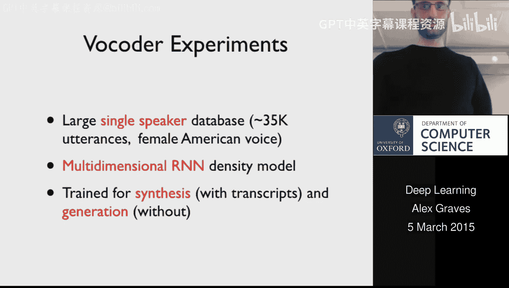

Yes， so I've got a bit of time here， so I'm going to show you some more videos。 Okay。

 here's the first one。 sorry I'm skip slide。 so this just to give a preface here。

After when I first published this thing with handwriting Generation。

 I was quite pleased with myself and I thought I'd done something really groundbreaking and new and then Jeff Hinton sent me this video。

🎼One of the most remarkable realizations of cam technology is a device in the shape of a small boy。

🎼It's perhaps the world's most astonishing， surviving， automaomy。🎼Z。🎼What's on this card。

Is a piece of writing。Made by a 240 year old machine。

 So I was scooped by almost a quarter of a millennial。We don't have time to show this whole thing。

 but what's really amazing about this machine is not only did it write by actually like dipping the pen and and writing on the page。

 it was programmable so you could choose which words it wrote。

🎼When he designed and built this masterpiece。🎼Inside the boy are almost 6000 parts。

🎼What's astonishing is that every one of these crafted components has been refined and miniaturized to fit completely inside the body of the boy himself。

What Jacqueroz did was to use the technologies of homeostaisive miniaturization to build really a true automaton。

Inside the little writer as all his source of energy and all the machinery that drives him。

He works on his own。🎼was with。

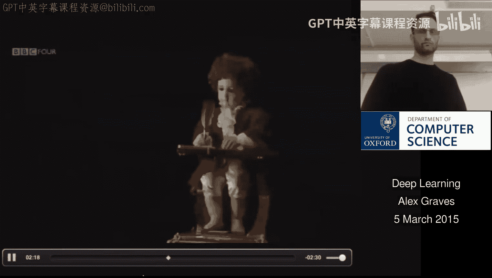

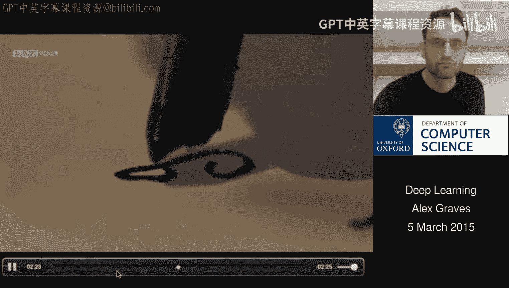

🎼Okay。Maybe I should stop it out you can look that up on YouTube it's the writer automaron I guess so I guess I'm pretty much out of time right Should I show the Atari videos or do you want to show those you don't have them okay so let's look those up。

This might take me a minute to find。

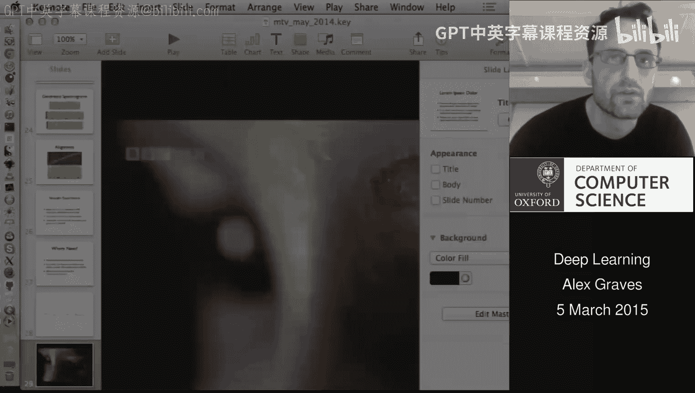

🎼，Nope。Yeah， in here。No。

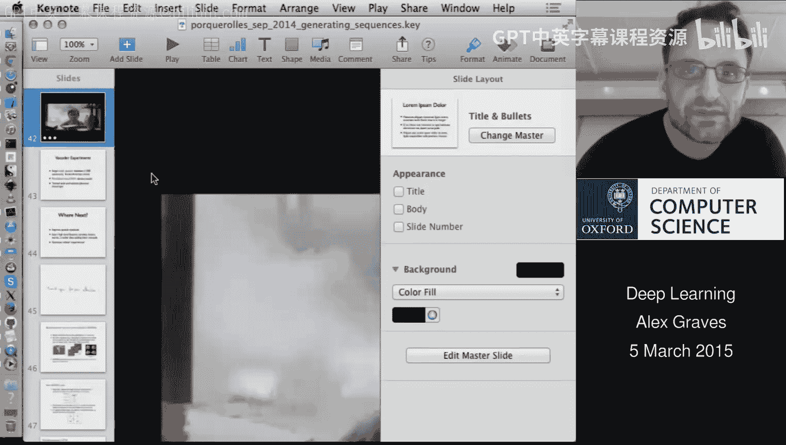

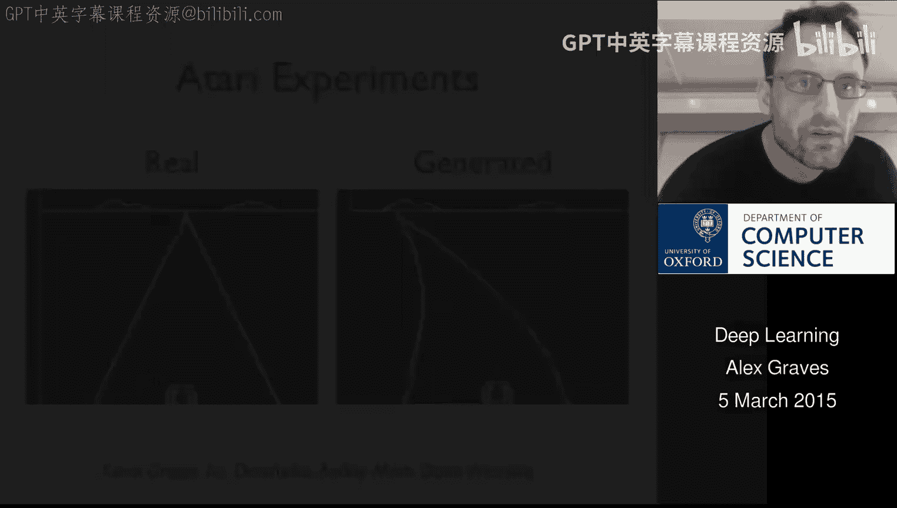

Yes。So this is kind of similar work in sequence generation。

 it was done by Carol here along with a bunch of other people with deep mind。

And the idea here was to actually generate video。 So it's video from the screen of an Atari game。

 It's not， know， like natural video。But it's kind of incredible what it does。

That way you side by side， okay。Okay， starting and both running， Okay。

 so on the left is real data from what's the game called again？And in Jro， yeah。

 from the game in Jro for the Atari。 And you， obviously it's pretty primitive compared to modern computer games。

But that made it easier to model as well。And on the right is stuff being generated by an LSTM network that's doing。

The same kind of next step prediction， generating a frame， feeding it in as input。

 and then generating the next frame。 It's a much more complicated generative model that I'm not going to describe。

But， you know， the basic sort of。Temporal component is the same。

And it's really interesting to see what it does。 So the first thing you notice is that it gets the car。

 it has a kind of egotistic worldview，TheThe car， which is the player that you control。

 is pretty accurately rendered。 The road that it's driving on looks fairly convincing。

 but it gets a little bit blobby and blurry。 Sometimes the mountains in the background look quite similar。

 The one thing that doesn't fit is the car is coming past。 So whereas therere obviously like。

Discrete shapes that move smoothly along in the real data。

 There are these kind of blurry clouds in the generated data， and they appear and disappear。

 But it's really， what's really fascinating is you're kind of getting a peek into the the mind of the of the computer here。

 You can see which， which elements of the data it's actually learned and which elements it's kind of approximated with some sort of。

嗯。You know， some sort of vague vague blurred out prediction。

 And every so often you can see that the screen kind of goes crazy and this kind of comes back to what I' was saying earlier about robust prediction。

 So this point when the screen starts to kind of flicker and stuff like that is the point when most generative models break they don't recover from that because you're showing them something that they've never seen in training that LSTM manages to recover from it because it has this longer range memory。

And so。The way I like to think， if you imagine that you were a human being whose whole sensory experience of the world came from low resolution atari games。

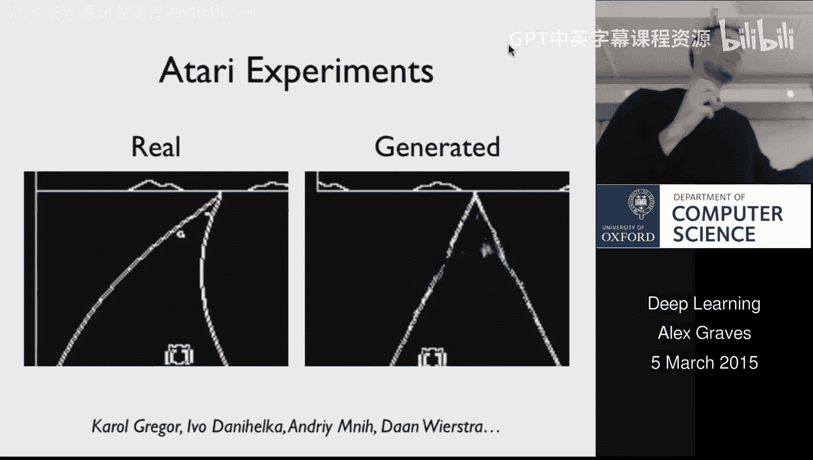

Maybe your dreams would look something like this。And here's another example。 So this one is River Ra。

 right Carol。And so we only modeled kind of a letter box of the screen here for technical reasons。

But you know so sorry just to go back that's the most interesting thing that happens right there。

 So again， you know you can see the sort of similarity between a generated and the real one。

 but what I want you to look at is what's coming up right now on the generated part。

 you see that it flew into something and died so it died inside its own dream。After it died。

 it went back to the star。 So it replayed this。That's that sort of starting segment when you see the parallel lines。

 it replayed that。 So it has this you know its learned a lot about what happens in the game and knows that if the ship flies into something。

 then the level restarts and when the level restarts， theres this particular pattern that appears。

 and there was even a version of this done by Evo Denny Helka where he predicted as well as predicting the next frame that would be observed by the agent he predicted the action and what this meant was that while you were generating it。

 you could control you could press left and right and the thing would actually move left and right in the dream。

 it the equivalent of a lucid dream where you can control the actions and what was really interesting is it wasn't reliable。

 you left that would usually go left but not always had this kind of。Sttochastic relationship。

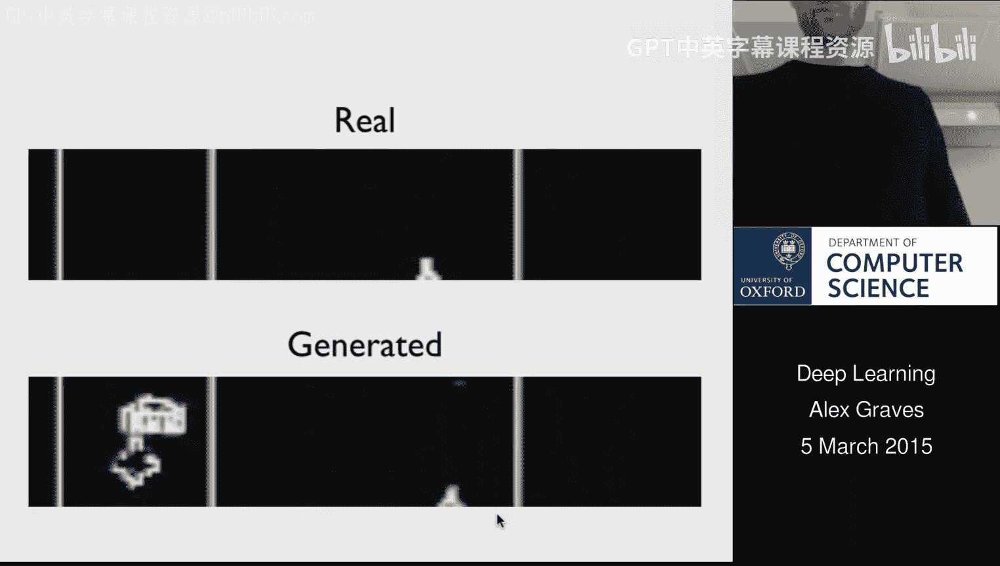

But anyway， you'll hear more about this sort of model from Carol in the next talk。

And I think I should stop there。Thank。人。

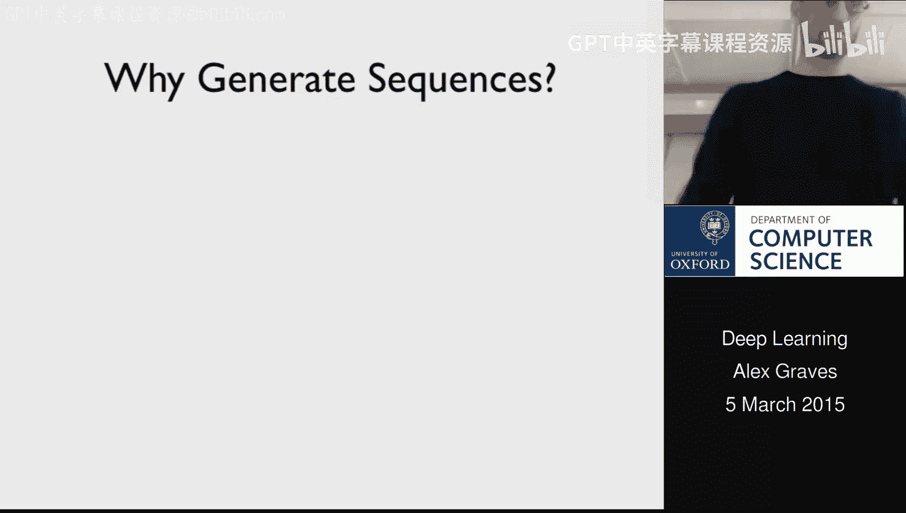

5 million。