# 牛津大学《深度学习｜Deep learning 2015》中英字幕（Claude-4-s） p13 14_ Karol Gregor on Variational Autoencoders and Image Generation.zh_en -BV17NWWz6ErN_p13-

All right， so let's get talk to Dan with our second speaker。Also from Co this mine， Carol Ber。Okay。

 so I will talk about the recent developments in genetic models that sort of make them easy to train and make them scale and feed the neural networks。

 and then the very models very latest models is you called the precurren autowriter。Okay。

 so one of our goals is to understand data right there is a lot of structure in this data for example in images you notice that nearby pixels are similar。

 there are a lot of curves in there and there are objects right and you would like a neural network to discover such structure you would like to build a neural that can discover these things that's one of the big goals of deep learning。

And the way you can imagine it is in the following way。

 so this is the picture which is inspired by the way the brain does it so you have these levels of representation。

And。It's a deep brain is sort of a deep network。And at the lower local cost。

 the beta have simple representations like edges and as you go higher and higher you get more abstract representations。

 so we would like to discover we would like to go net which could do that now and so far we haven't managed。

 but I think there will been good progress， so there is a hope。

So now let's consider how would we build such a network that can do that right so you know about neural networks。

 the basic neural networks。And so let's just mention some criteria that this network will have to have。

 right？So first， if you build a network， the hidden layers have to contain information about the input。

 obviously they can just be constant， you have to assure that the information is represented in these layers。

 right somehow how you need to force that into the network。

And you also don't just want these layers to be copies of the input。

 you would like the network to do something non with this information and it would also be nice to generate and Alexs already motivated generation for this so。

I'm not going to see it again。Okay， so now let go let's go through this step by step。

 How would we build it is sort of in a simple way。 Okay。

 so one way to make sure that hidden layers that the hidden layer represents input。

Is to ask it to reconsidestruct the input right if I can get the good reconstruction。

 then I know the information is there。So you can imagine that you have this forward pass。

 you take an input and you pass it to this hidden layer。

 and if you ask it to reconstruct and reconstruction is good。

Then is represented there and this is kind of the very standard output encoder Okay so that encoder takes an input X and it goes through neural networks。

 just like the standard neural network， WX1 H。So these are just several layers until we come to reconstruction。

And what you let say want to minimize is this is this objective x minus xr right so if this value is small then your reconstruction is good and there's a cost function。

 everything is differentiable so you adjust back properly。Exactly。

It's just a normal network which tries to reconstruct itself。 All right， so now this way。

 we can assure that， you know the information is really represented in these hidden layers。Okay。

 now but how do we make sure that the auto encoder actually does something nontri with this information。

 in principle could just copy it， take the input， copy， copy， copy。

 and you have perfect reconstruction that you haven't really learned anything。Okay。

 so you're looking for some principle that we can apply。

 and one principle is just to find a simple explanation of data。

Which is kind of similar to saying to maximally compress the data。

 right if you can compress the data， that means you are exploiting some structure。

 you found some structure in the data。And you can compress like。

 you know the certain things go together， so you don't have to represent them independently and things like that。

So we think this is our goal and we will see whether that works。

So now how do we apply that in the out and called， what we are going to do is that we are going to create a layer。

For which we restrict the information flow， you can say there is only this much information in this layer。

 this many bits， and whatever comes out of it has at least at most that much information about the input。

Okay。And in this case， the network will be forced to do something with the information because it will try to reconstruct as well as it can。

 but it can only use smaller amount of information。But actually if we do something better。

 we really are interested in compressing the entire data not just restricting the flow。

 so what we are going to do is we are going to compress we are going to measure the information through this layer and then given that information we are going to produce something like a reconstruction。

And if you want to code your input， then what you need to do is you to specify you need to code the values of the hidden layer。

 and then given this layer， given the reconstruction。

 you need to specify how do we go from reconstruction to the input？

So you code your hidden layer and then you code how much it takes to go from that reconstruction to input。

 So basically you can imagine that。You know，If the layer doesn't transmit anything。

 then there is not much information in the reconstruction and you have to call the input as if you are not doing anything more interesting just directing coding it。

Or on the other hand you can get some perfect reconstruction。

 but then you might cost it too much in the heat layer， so the network is going to find some balance。

Okay， so in order to do this mathematically， we need to sort of explain how do we measure information。

So consider a stream of variables which can take n values， these values。

 each of these variable can take n values。And the sequence can be compressed。

If you find regularities in it， for example， if you notice that the toolss always come in a group of four。

 then what you can do is you can replace。This group of four by a single two。

And then that completely presents the information by the original sequence。

Because you can transmit that and then I recover the original sequence。Now we would like to do this。

 of course more generally。All for any sort of sequence and an optimal way to do that is create the probability of predicting the next element of sequence from previous one。

 so you form this probability just like Alex was talking about。You form this probability and then。

You can show that you can compress the information to these many bits given by this lost L。

That's the number of bits， and there is actually a practical algorithm to do this is called arithmetic coding。

 but you don't need to use it you just want to measure the information。

So you can sort of see that the better predictions you make， the closer the p is to 1。

 if you correctly predict that p will be1 close to1 and log of that p is close to zero so it doesn't cost you many bit on the other hand if you didn't predict correctly you get ESM low probability to what you wanted。

 then P would be very small and then the log of P would be very large negative numbers and minus of large positive number。

Okay， so this is how we can measure the information。

And so now you can imagine putting that measure of information into a layer okay。

So we can say let's create some predictor so there will be some values in this hidden layer。

And we create some predictor of them。And that is the number of bits that this information carry。嗯。

And they can even do something simpler and you can just imagine independent variables。

 we often just do that， rather than co as a sequence you just a bunch of numbers and you compress them using these independent variables。

Okay so this is what we would do right so this layer that I'm talking about would look like this right so you take an input that produces some value here for this neural network。

And if what it produces is some binary sequence， some binary numbers。

 then you know that at most this many bits is transmitted through this layer。

And so now you can try to optimize the parameters。And similarly now given that they have transmitted this information。

 you would like to get the reconstruction and specifically rather than think about the reconstruction。

 we simply provide the probability of input given the latent variable and then the number of bits you would need in the input is log of b of x given z。

And so now what we would like to do is to optimize all the parameters so that the total number of bits is the smallest okay so they would like to maximally compress this data。

Now， the problem with've that here a little bit is that。This is a binary sequence。

 which is it's not smooth。 It's not continuous， right。

 We need to do some threshold holdinging or something to get this binary sequence。So instead。

 let's use real values。So what we are going to do is we are going to produce some variable。

 get the real values and pass them through now we would like to measure。嗯。

You know how many bits this pass through this layer。

 so what is it so for the P of Z for the continuous let's say we can use unit Gaussian。

Then how much if I produce some value of Z， how much information can I code， Well if I just do this。

 a real value has infinite amount of information， right， because it's contium。

 you can stop as much information as you want into into the real number。

 So we need to do something to restrict that information。And the basic idea is to ignore。So。

So what we are going to do is we are going to take the input and produce the new sigma a gassian distribution。

And then this layer is going to look like this， it's going to take the me sigma and produce the noisy version of the variable Z。

So where this epsilon is just drawn from a unit Gaussian。So if you do that。

 then you cannot transmit infinite amount of information because about think about taking two different inputs I would like to get really good reconstructions so that I don't pay bids in here right so the inputs if the inputs are very different but I would map them to very similar values。

Then I'm going to ignore so I'm going to mess them up。

 right so I'm unable to reconstruct two different values from these which are very close。

Because I'm adding noise right sometimes I get dizzy or sometimes I get dizzy。

 I get difficulties right so I cannot reconstruct。So I cannot reconstruct two different inputs from these which are very close。

 disease has to be separated by at least the noise amount。

 right so the noise amount is sort of like this discretization right the noise amount that we have。

Right， so。The values of Z are somewhere in the interval given by this Gaussian。

 let's say between minus 2 and 2 roughly， and the width of the Gaussian provides the discreteettization。

 it tells you how many different values you can encode in there。Okay， so。Said clear。

So basically by this noise， we restrict the amount of information passed through this way。

So that's just a pictureop。Okay， so now more generally。

 so this was for gasian distribution now but we actually need to compute this， what is the actual o？

And in general， we can write this as， we have this prior distribution P of Z。And we have this QZ。

 which is。Which is this girl sing。The one that produced the noisy z。嗯。And then we'd like to know。

 okay what is the actual cost can be computed and the answer to that which I will briefly explain how you get this。

 but I will also give a different durationri of this so if you don't get it。

 don't worry we can we can look it that， you can look at this paper。

Now basically that is the formula， it tells you in Gaussian cases roughly correspond the number of Gaussians that you can put。

分 the用边池吧。And the way you do this is that what do you imagine is。

Youmagine you take the real values and you finally discretize them and you transmit the trans。

He finally discretized then。And normally， it would cost you a lot of bits if you wanted to transmit that。

But we are having this noise， so rather than picking this noise independently。

 we got some other information into this noise。And then when we transmit the information。

 we transmit not only the information about the current sample， but also this extra bits。

 so the information about a current sample is smaller。So that's kind of how the argument goes。

 but you should just remember that I will give you another duration of this formula。

 but there is a specific formula that measures how much information is possible to lay on this and that's just the formula。

 it's just the logo ratio of these probabilities。Okay， so。Yes。So what we have is a layer like this。

The layer will take some parameter from here， adds noise basically samples from some distribution and gives you some cost of how many visits。

二人です。Now we need to back propagate through this and the way we can back propagate is to just change just rewrite what this layer does。

You can write this layer in default folder， so they you the groups。Take the input。

 take the input to X。Produce this mu sigma。And then use the deterministic function。

 which is this one。To get a noisey sample Z and now this is just a deterministic function with some noise of it。

 so it's trivial to back propagate through this it's just the back propagation for deterministic function and you can treat the addition of noises as just some other inputs to this。

So now we have layer which gives us the cost。And we can back propagate through。

So here is the summary of the entire algorithm， so the way the algorithm goes， you take the x。

 you compute the mu and sigma， you add noise where you produce the sample Z。

 which gives you this cost in bits， then you reconstruct on more precisely produce probabilityability of input given z。

And the total coding cost is this Lz+ alert。everything is differentiable and then what you are simply to do is use back propagation and stochastic gra in this and to optimize all the parameters。

So。これ品な。結構さし。嗯。Okay， I will explain that in a moment maybe， but in rest。

 so maybe when I write there's a genetic model then I will answer the question。Okay。

 and so this was introducing in this paper， a binary version in the first one and the Gaussian version of this in this other paper。

And okay， so now if we have a model like this， then we can generate easily from it。

 we pick a sample Z from this。So now we can drop this upward first pass what we take we simply generate the simply sample Z from probability PO Z we。

Then we calculate then we go down for the network， calculate P of x and sample。

 so it's very efficient you just do a single pass for the network。嗯。Yeah， so now in B machine。

 the difference is that here， this sort of model is called a directed graphical model。

 The way the probability of distribution is defined is this way。You generate a Z distribution。

You generate z from this distribution and then x depends on the z。

 whereas a state Balom N is undirected model。こちら？I to cut sample throughout it。詳戦。

It's just a unit from Gaussian， so this one is' a unit Gaussian。

So you just just sample me it dust and this pie。So yeah。Now there is different view of this， right？

So I like the compression view because you can sort of look at every layer and say。

 this is how many bits it has。But the other way to view this is forget about the upward model。

 the inference model。In engine we just have this generative model。

 we define this generative model by saying， as I just mentioned。

 you sample from a PL Z and then you go down and produce problem to your input。

And your goal is to simply maximize likelihood of the data。

You would like the PX distribution to match your data distribution and these are the problems has been this is hard to solve because。

In the solution of this， you usually need。To find the probability of z given x。

 And that's very difficult in general， intractcticable。

 And so what do you do instead we produce an approximate posterior。

 So this Q of z is supposed to the approximation z given x of P of z given x。

So you produce amount distribution that is supposed to occuring in this process。

And what we actually minimize is the bound on this quantity。And you can deduct this bound directly。

So here is a derivation， I don't know if I should go through after。

But it's basically you write the log of P of x， you introduce a distribution。啊。

So this works not for any distribution and then you follow a math。

And you found out that this cost is bounded by。Its cost equal to this。And this is the coding oops。

 this is the coding coast I had been talking about before。

And this is the k divergence between the approximate posterior and true posterior。

Sorry here the H is supposed to disease。So， you know， you can derive it directly。

 you can directly derive this。So now let me show you some results from these models。嫂子。

very common data set that people use is Mnesist， which are Hwritten congenous。So。On the left。

 you have a binized Mist， so these are。Yeah there are 20 by 28 essential binary pictures one the binary and then on the right are samples from this Gaussian generative model so the way you get these samples is very simple you just you just sample from this Gaussian。

And then you go down to the network。 Okay， so basically different real value in the Gaussian will produce a different picture。

あ thank you。And so these are some results on some other data， so on faces it works pretty well。

 the faces are relatively easy generally and then images are quite hard and I think you can do better now there you you scale it up and it works better。

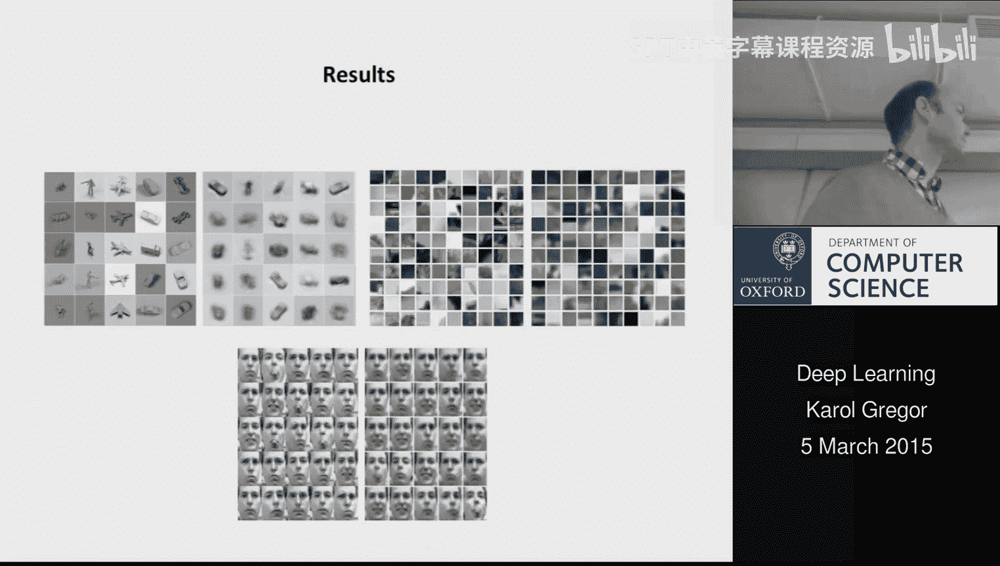

嗯。バつ。Yeah so this is one way of doing that here are some samples from similar models so this is from binary model which has this outerrigress prior on the hidden layer。

Where the P of Z is not just the uniform Gaussian， or in this case uniform binary distribution。

 but only distribution， that is this outer regressive one where you predict。

One value of these different previous ones， and these are samples from that。

So they look pretty realistic， and you can hardly tell a difference between the real one and。

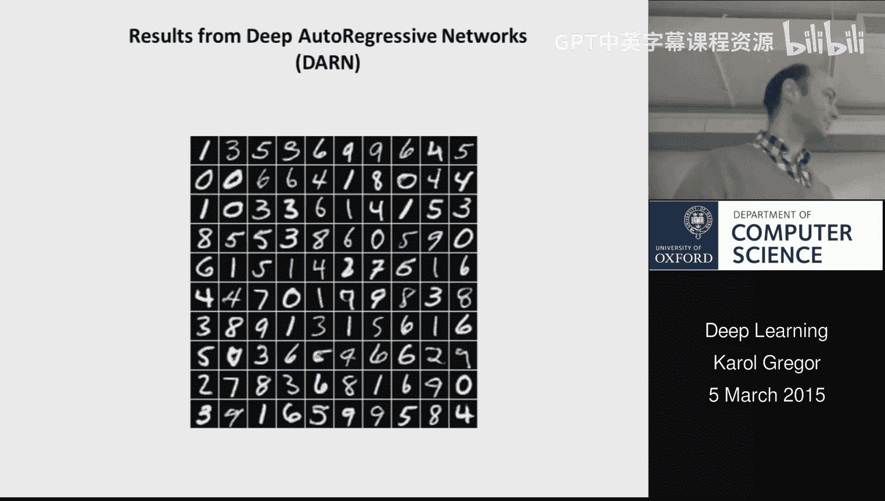

あ三ポ。And here are also some pictures from metal。 So Alex already showed you videos for。Videos。

 and these are just static images。So on the left you have actual so these are five different games and on the left you have samples and on the right you have nearest neighbor examples。

And。Yeah， so。So it gets things like the objects in there and it gets things like scores。

 so for example， look it can produce different scores in these games。

There's like 15 here and 35 and five。And sometimes it makes it makes a mess like that。

 but you can also produce a。A different number of the spa invaders。

In here now what they had difficulty was when there are different objects。

 when there are objects that can move around and there can be on many configurations。

 I think it's just a matter of scaling this and turning it longer， but for example。

 you can see in this game sequence there is supposed to be like a submarine and fish。

So maybe with more training it would get better result in here and then what Alex was talking about was basically this sort of network where this LSTM feeds into this latent representation into the Z in there。

 so it predicts in this space。

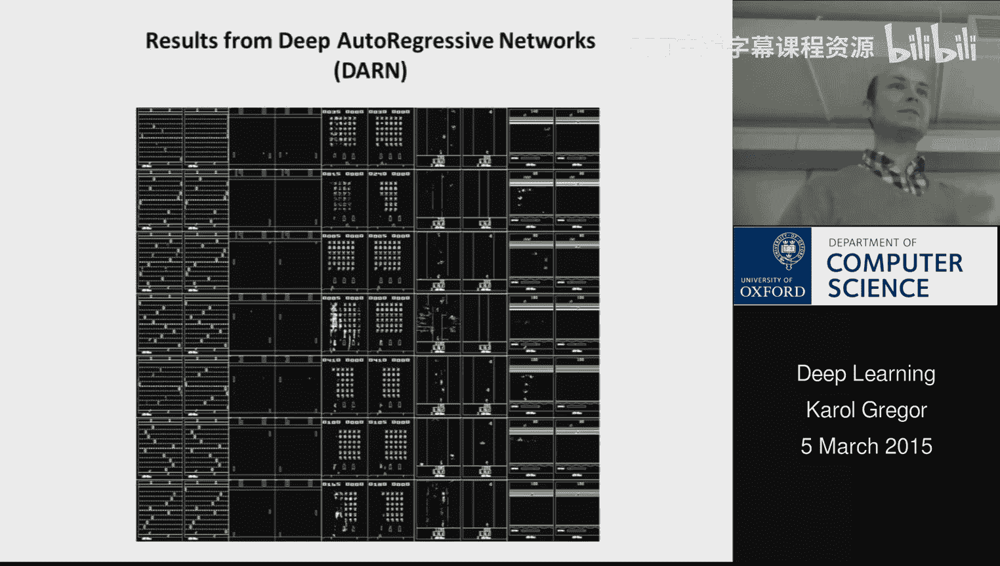

Yeah。So， O， Sir。What you can take from this is that we have this nice layer here。

 right that measures information。And you know the nice thing about neuro electrorog is in the normal feed board。

It's like a classification， you can build arbitrary architectures and it's very easy to train。

 or at least very easy to code right because it's just you back propagate through for everybody you can make any graph。

It's just play around with different architectures。

Now and basically what we can do is the same thing with with generative models all you need to do is you need to insert a bunch of these layers these are the information carrying layers。

The thing that we have to make sure is that that there is no path that goes directly from x to P of x given z。

 all of the information has to go through these layers。

 all of the paths have to go through these layers， other than that。

 you can build any architecture you know。So for example， here's just like some jumbo。All right so。

You can connect the arbitrary where you want to get the input， but for example， this is invalid。

Because there is a path from input to digital reconstruction。But other than that， it's the same。

 right and the total amount of information is it just some information in all these layers。

And if you want to generate from them， you're going just。

G from each of these layers according to that。ELZ， prior distribution。And you generated your picture。

Okay so all right， so now we have this new framework which is easy to implement and easy to use。

 it can build our battery architectures so we can ask what sort of architectures should be built and what do we want from them？

So here are some motivations so when you want to build something complex like images you probably need a sequential process。

 so for example， let's imagine we want to generate face right so you decide to generate the face and then you decide to generate what kind of eyes do you want to put there and what sort of shape of these eyes is supposed to be all these little details and this is sort of a sequential process by which you do that。

So you need some sort of deep network there that does that。

The second thing is that when we imagine a scene， we don't usually imagine it's just in one shot and as my friend Dan likes to say。

 you when you want to imagine a beach scene， you imagine a sand and then you imagine it's a palm tree and ocean and somebody playing a ball。

You know， you imagine this in a sequence and also you might imagine something rough， you know。

 I want to generate a red T shirt and then say， oh let's put some dots on these T shirts or something like that。

So you might want to refine it later and when we do that as humans I use the same neural network in each of these steps right we have one brain and it does the sequential process right it imagines sand and imagines a palm tree and imagines imagines a beach right so what they would like to do is build certain computational core。

We just repeats and does this operation。嗯。So for this。

 we introduced this architect called Deep precur Attentive Writes Dr。Because it throws stuff。

And it's basically a sequential process， with attention。So it is a certain computational core。

Which decides what to read， what to compute， what to represent。

 and what to generate it every time step。And in addition to this we introduced attention mechanisms。

 so we as humans we can look at this very explicit attention mechanism。

 we point our eyes somewhere so now we look here and now we look in here。And just as Alex was saying。

 these attention mechanisms are becoming very popular and he had one example of this sort mechanism and here there is one which is more appropriate for images。

Okay so I'm going to show you what it does first， and then I will explain the algorithm。

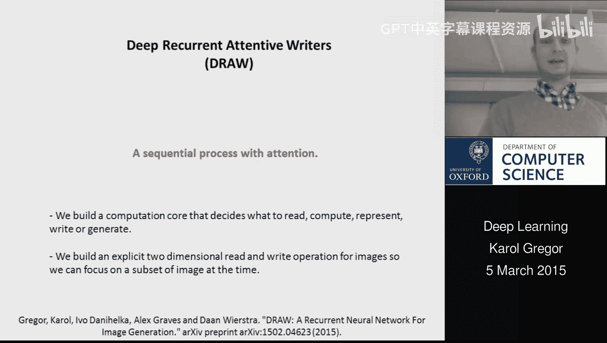

When he's reading， this is how he's reading the digits。

 so the green square is where it's paying attention to。

So that's the attention mechanism and the sequential nature is called the sequential nature here。

So you see that it's sort of falling the digit。So and then it needs to do this reconstruction。

 just like in these out encoders that I've been telling you。

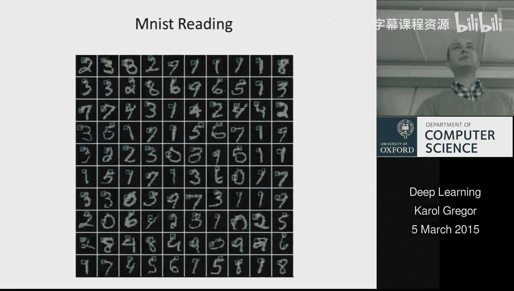

So this is how it does the reconstruction， it slowly reconstructs the input。

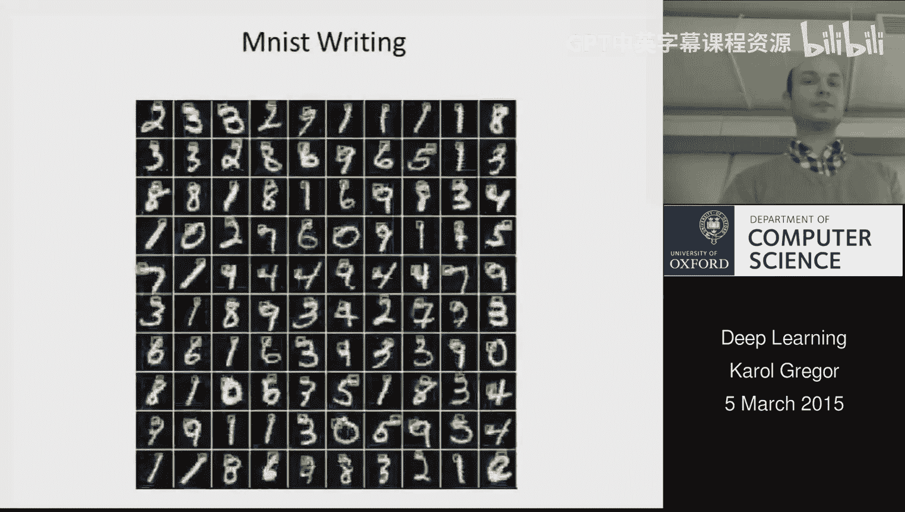

对。And once the model is traineded， the model can then imagine。

And it also that imagines that in a sequential process， so these are our imaginations from the model。

So you can see that， you know。It really generates nice digits。And sometimes it。Even。

YeahIt is a certain pattern of writing， but it generates a large diversity of stuff。

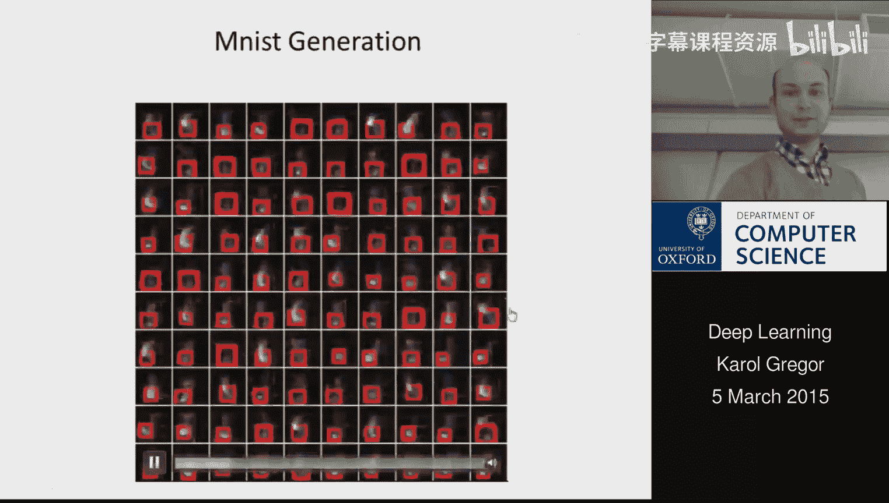

Okay so how does it work so what I have been telling you so far about is this conventional variation altering coder I'm just going to redraw it a little bit。

 so what it does is take an input goes through a network， produces that approximate posterior。

Then from which it samples you produce these noisey sample Z。

 and then need decos to calculate the probability to P of xq Z。

 the reconstruction essentially okay so this is the normal autoencoing and this is that information carrying layer。

So the draw architecture is the following， so it looks more complicated but this is unfolded in time。

 so this is the computational core here。So let me walk you through what it does so it takes an input X and it reads this input somewhere。

 so it has this attention mechanism and it decides to read now where it decides to read depends on what happened in the past and the random。

A decisions to have made in the past。K about where to look and stuff like that so it reads this and based on what it saw before。

 so it reads this then it passes through a neural network and in this case a rerent neural network specifically LSTN。

And then it produces these approximate posteriors and sample from it。

 and then it goes through another netro and decos， and then what it does it drives the result into an input。

So theres this， Alex says， there's this canvas and it drives into this canvas， at different places。

And once it's done writing， then this is probably the distribution of our input。

 So you have seen the videos， right？You have seen how the natural was reading it。

And then how it is dieting it and then during generation you don't need this bottom part。

 you just sample here from the prior distribution。And you go through this process to write the entire image。

And these are the information carrying layers， so you see that the process is valid because there is no direct path from input to the probability of x given。

Theres no direct path here， so we can have this path。

 but we cannot have path which could go like this。Okay。And。Yeah。

So during generation it basically makes decisions here when it's generating it starts somewhere and decides okay I'm going to generate this picture here and then I'm going to move here and then I'm going to move here and generate this and so on。

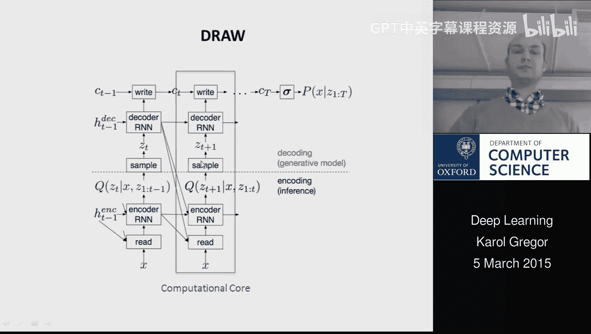

あ。So。

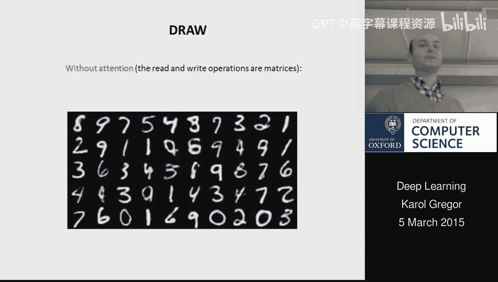

So this。The simple way to implement this architecture is first without attention。

 So when these red and bright operations are just matrix， you're looking at the entire image。

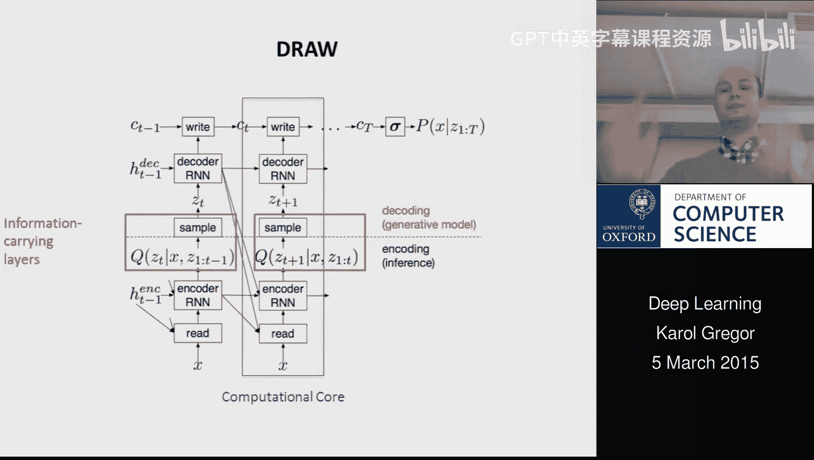

And this is what you get。So in this case， the network first generates a blur version of an input。

 and then it refines it and makes it sharper。And with the attention is what I showed you before。

 okay， so how do we do attention？

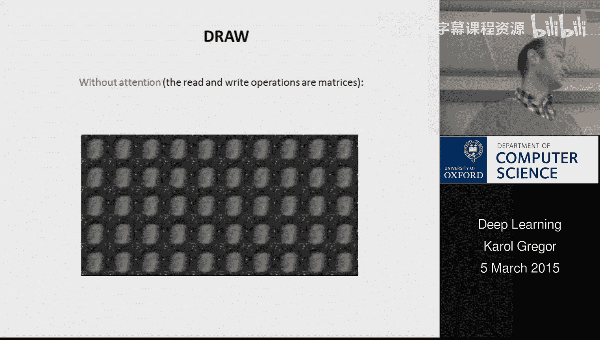

嗯。So in the attention we specify where we are going to read at which location。

 X Y location and then how big the window we are going to read and how blurry we are going to read that so here on the right you have examples of that so here we are written from windowow that is this large and the blurringiness is given by the width of this green square。

嗯。The thickness of it。 And so from here you read you know this little square like this。

And here basically it reads the entire digit， but it does essentially sub samplingampling。

It's very sharp and here there is a blurry version of it。

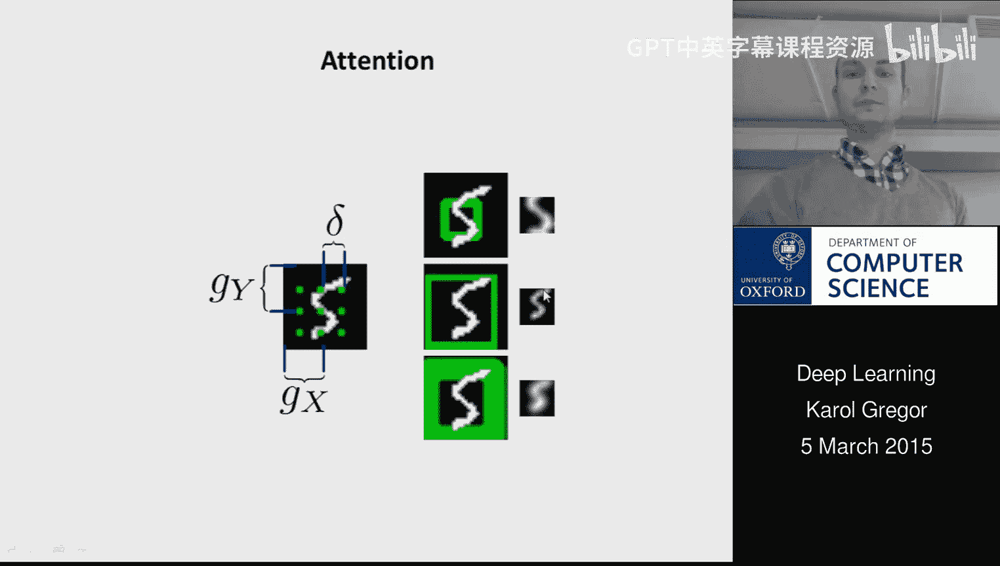

So for example， so what you get is you take a picture like this and from this little region you read a little squares。

 so after reading you obtain this sort of square。You obtain some low dimensional blur version。

 some smaller patch of the original one。And then during writing you decide where you are going to write and with what blur as you are going to write。

And you're going to take this and write it into the input。

And then you write it at all these different places and that composes the image the scene。

And this mechanism is differentiable。

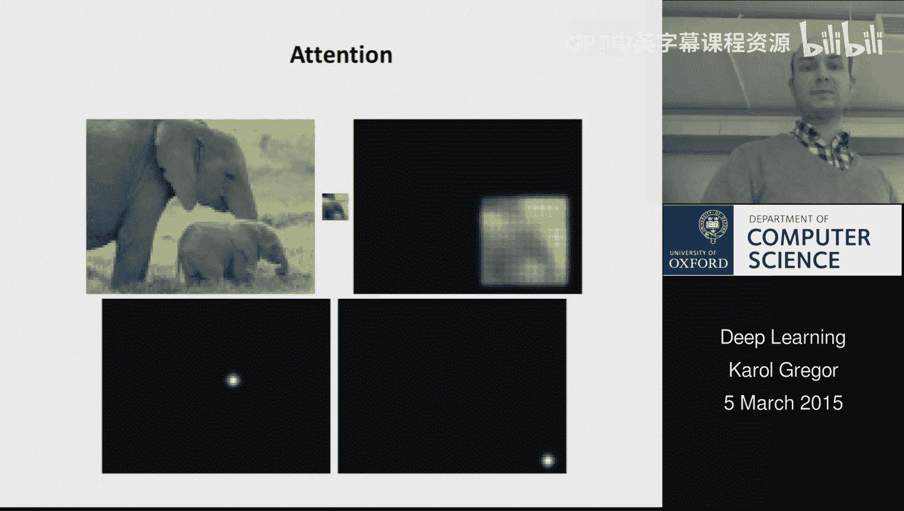

So now that you I show you the algorithm and now you can see again what it is doing。

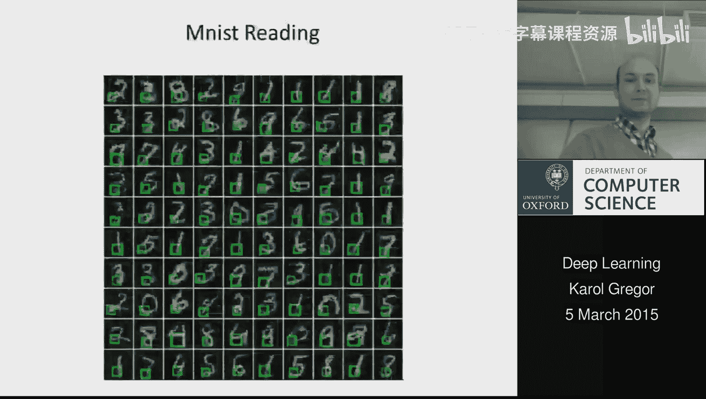

You know， it's it's， it's reading it。My square， this is the writing。In。

 sometimes you can see this cool like this digit4， you know， it reads this way and then it jumps。

You was's the other side of the。

And。The way these models are compared is how will they explain data。

 how good they're likely with this， which corresponds to how will we have compressed this data。

And these are different methods in here， and the left column is。

s the actual likelihood and the right column is that a variational bound or the coding cost that I've been talking about。

 and this is like thebalsum machine and different algorithms and this is the Gaussian model and this ultraregressive binary model。

And the oops。And the draw does basically， especially if the attention does a lot better than others。

 so it's not just that looks pretty， it actually works quite well。

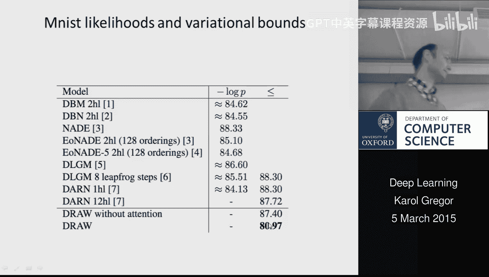

And then we did some more other fun experiments， so we put two digits and 60 by 60 diagrams。

 so this is like a mini scene， right you have two different things。And。

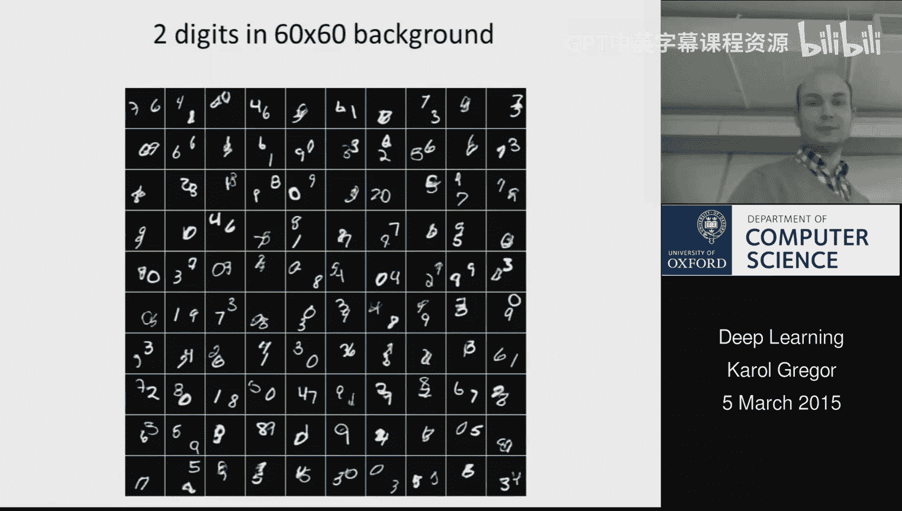

And these are generated data from from this， and these are generations。

 So what it does is in each of these pictures， it produces one digit and then introduces another one。

So you can see it produces zero and it produces three。

So this goes towards the sort of sink construction， right？

Except it's much simpler than the real images， the real imagess are quite hard。

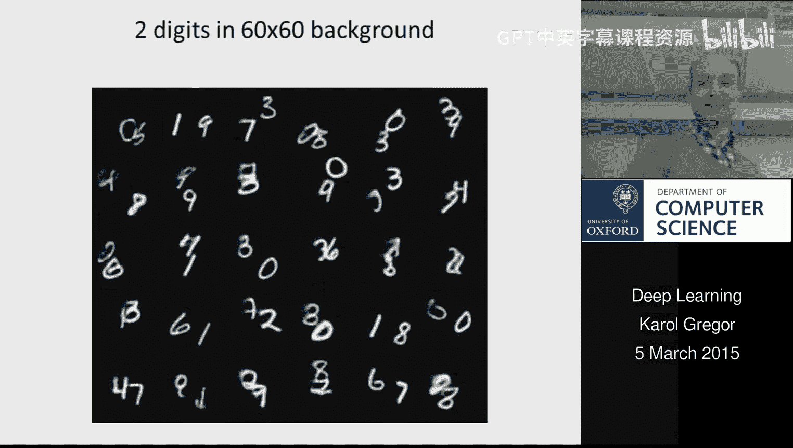

And then these are threeB house numbers。So now there is a lot more diversity than in this endless1written digits。

You have different。You have different colors， you have different shapes。

 different number of digits and different sizes and different slopes under which they are written。

 and these are generated data。So。Except for the right column， except for this column。

 which are like the nearest examples to this， these are generated data。

 so it manages to produce all this diversity。And this is the generation process。そう。

So you see like if the digits are smaller， it makes the window smaller。

I can here and you can draw these different slopes and different shapes。

And then the real images are quite diverse and this is the example from the real images。

 so these are generated data in this big square。And。And so the training set is quite small。

 it's only 60，000 images， and there is a huge diversity of real images。So you know。

 if you really see it。Perfectly generated data in this data set。

 you are probably just remembering what is in your training set。So you know。

 this generates some parts physically。

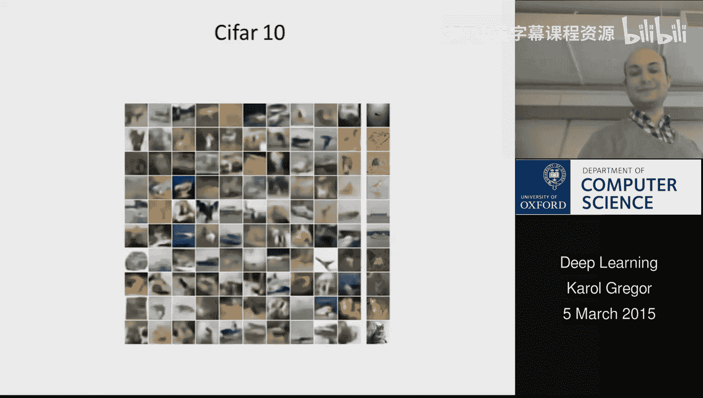

So我 just stop this。I just stop this。没听到。These are folks do this but we actually have time for questions。

 so if there's any fit for the lifetime changes on this would be the lifetime time for us。

Then by the way， it's amazing， I mean that you have an neural own network just。Generating staff。

We best to some the little。Theres particular reason it's getting right to live。Yeah。

 I just found a certain program， you know of doing it and it just doest this for yeah。

It should either go from right to left or left to right because for the digs of region， rich。

Maybe if you run it again， usually when you train it do several rounds。

 it you will find a different styles of writing strategies and endless。谢谢这些。解。所以原因都得出来。可多。

ThoseCan you put something the prior on。So what do you mean you want to put prior on the image。

 so we have this distribution of P of image given the hidden layer， right？

Now the distribution right now we are not using very good one。

 We are pretending that this is a binary data in this particular case。

 and we are using the same functional form， but you know we are trying other ones iss just a technical issue sort of。

Mdtoring the variance of it， you can get out statement。玩嘅你嘅。这定方。

AYou mean directly going over the pixels？くやプラえら。Okay。

 so I'm not sure whether that's what you mean but what you can do instead of going to this latent layer。

 you can organize pixels in a sequence and predict them one after another from previous ones。

 and there are models like this， the basic one is called named a neural autoregressive distribution estimator and they actually work quite well。

Not as well as this。嗯。Now， so it's interesting that it works。Now。

 but it's hard to scale it to deep architecture because it becomes slow at the generation process because you know each time you want to sample and you also you have to run for the entire network and run for the entire network you run for the entire network。

 another thing which is not satisfying about that is that each time you sample something。

 you're making a decision。So if you do this latent space and imagine that we achieve our goals of really creating this abstract representation at high level。

 then the way the network generates each time it makes a decision at this latent layer。

 it decides it will decide I'm generating a car or I'm generating phase and then I'm going to generate these details whereas if you go pixel by pixel if looking funny decision it's making you know I might be going to make these pixel zero or1 or some value and then based on this I make another decision so because decision don't correspond to this abstract decisions but the sort of finger。

We should be able to get， so I think this building these latent models is better。For the for。た。

You mentioned when you' were finishing certain layers which out which restrict the amount of information flow between your sort of upward and your downward parts a bit。

 you said certain things weren allowed weren't about a direct path。

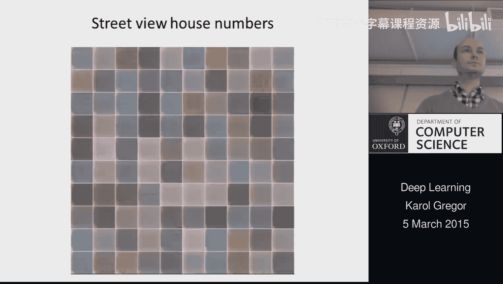

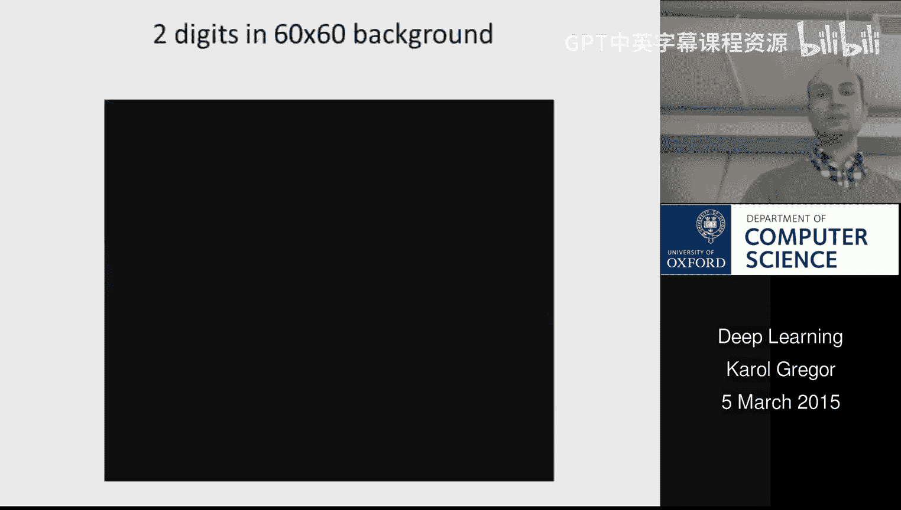

有し的。Yeah， I wasn't sure the thing red Adam， was that just direct plastic？

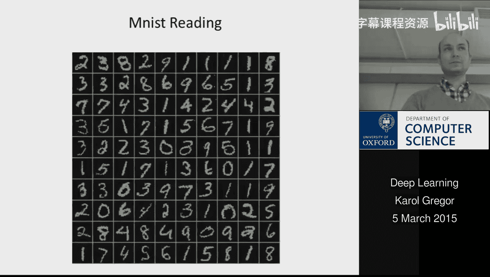

was thatYeah， it was like pits dealer yeah。我的。

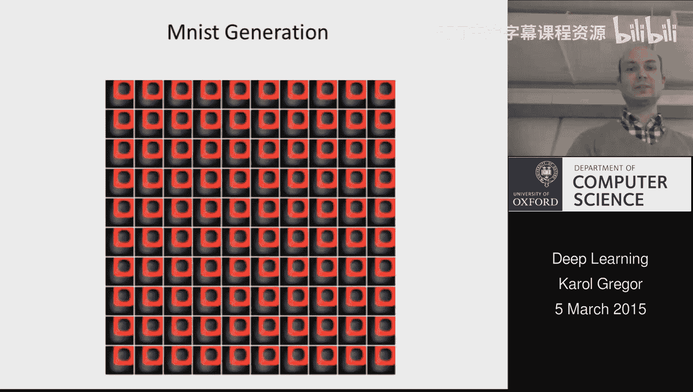

s little for these videos。Almost。So this path doesn't go you takes the input and it goes into here without going through any information errors。

it if I transfer information in different layers of the network。

Would not each there contain different， more or less information about the overall picture？

No the information is distributed through the layers。

 so each layer and somehow you can actually this nice thing。

 the reason why I went through this explanation that you can sort of imagine number of bits in each layer and the total information about the input is distributed through these layers and some over all of these informations。

啊。We have an estimate how much information you actually transed。来他系。Yeah， the cost the L in here。

 that's the amount of information that is in that layer but completely for。that is said。

How much information is。Yeah。That's a good question yeah for like you mean specifically what's the ratio between input and the heat。

 right？I think like the standard one is roughly like on MIS， it depends on data set。

 it's like half half， I think。Abs depends what you do。But think they are comparable。I if you。

If there's any specific reason why the attention squares are almost adjacent to me。

Oh why doesn't jump around？Yeah， I guess in fun that's the simple way of doing it。

Because maybe it's hard to jump precisely at someplace。If you are in here and I jump somewhere。

 there's probably not going to be anything there。でりそう。But you know depends how depends on the end。

 sometimes it there's a funny way of writing， you know where you write something and then it jumps and writes somewhere else。

So sometimes it does this jumpy behavior。But it just， yeah， it comes fine。 I think it's just。

 it will be hard to generate pure worth of jump in it because you jump somewhere。You know。

 once you see something in here， right then you know there is where the stuff around still is。

 whereas you don't know where on the other side of the image is information。Yeah。

 I should add that I've been doing research in this area for God very long a decade or so， and many。

 many very bright people have tried to generate digits as well as this。Fail in comparison。

 whether they've been using variational priors as sparse coding， different types of poker machines。

 and the list goes on。あ。Nothing as good as this。 like when I first saw these digits。

 especially the street the Google street view images being generated being drafted by a model and dreams is really the stuff。

 it's dreams and regrets It the stuff of intelligence。 If you can dream， you can think of how to do。

 you can plan and so on and through regrets， you can understand what if I had done it differently。

 And then you can based on that。 like understand the causalology of what's going on in the world and make your plans。

 So this is an amazing step toward understanding of intelligence。

 And I'm really happy that Carol come here today and give us talk。😊，I don't， thank you。

And next week we're doing reinforcement learning， you've heard about it today is the alternative way of doing things so we'll go into reinforcement learning and there was a nice article in the front page of Nature last week about some of the things we're going to cover。

😊。

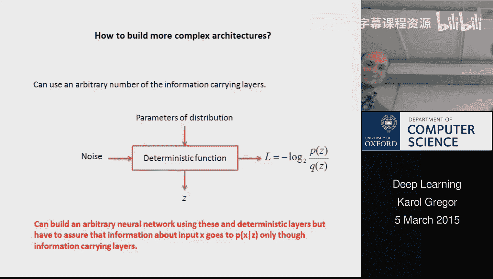

要。