# 牛津大学《深度学习｜Deep learning 2015》中英字幕（Claude-4-s） p14 15_ Deep Reinforcement Learning - Policy search.zh_en -BV17NWWz6ErN_p14-

Okay， so today I'm going to cover， so the two lectures today will be on reinforcement learning。And。

So the course so far has covered supervised learning。

 which is this form of learning when teacher provides you with labels。

 so we saw this in the form of logistic regression even before that linear regression then we move to neural networks and when you have labels。

 you can very easily define a narrow function which could be like a mean square error for regression of a classification。

 we use cross entropy， and we even use like hinge the hinge loss。

 as an alternative to deal with playersers。Or when you only have supervision at a matching level so you know two things match or don't match or you know something is correct and something is a corrupted version of the signal but all of those use some form of supervision perhaps in some cases a bit more distant when we were doing max margin learning but nonetheless supervision was there in the last lecture Carol introduced you to unsupervised learning using auto encoders so typically the idea for not encoders you have data X you create a bottleneck so you encode a data。

And then you decode and your prediction should be X again。

 So if you see the world put it in your head。And open and are able to generate or to draw the world。

 say， then you're capable of。understanding what's going on in your environment and that was the sort of basis one of the reasons for having speech synthesis and handwriting synthesis and vicious synthesis and so on。

 so all those cool things that we saw that the mind guys showing us last week。

Traditionally the bottlenecks for rotten codes had been done by either making the hidden layer much tinier。

 so that was used to be done with especially stacked RBMs in the old days。

 another strategy was to add a sparsity so only a few neurons could be on so that also creates a bottleneck。

You necessarily have to learn to encode and decode properly if you are to reconstruct X by going through this encoding and decoding。

These encoding and coding stages。And then so what Carol Greg has showed to us is how to create that bottleneck using sensor distribution。

 using noise， and so in particularly he picked a very uniform distribution as the sort of middle layer。

 a uniform a Gaussian distribution。A max entropy distribution for distributions of two moments。嗯。And。

Despite that bottleneck was able to reconstruct the signal。

 so when you're force with a very severe bottleneck。And you're able to reconstruct a signal again。

 that means that you have really learned to represent a signal in your weights because there's no anywhere else in the network where you're just memorizing copying that entity。

嗯。No。Now we're going to move to a different setup， which is where we have an agent and by agent here you can think of a robot。

 a person， a cockroach， a little mechanical printerter and so on or a game agent or a software agent on the web。

 there's many of those these days。Interacting with an environment。And this agent produces actions。

 The assumption is that the actions of the agent。The agent is not powerful enough that it can change the environment。

Because if you could think of like the agent being able to change the environment and then environment retaliating to the agent。

 then we would be in the realm of game theory， but in the setup of reinforcement learning we assume that there's this really big environment and you as an agent can maybe make some local changes to the environment。

 but why，By and large。You will just be someone dealing with this environment and trying to make decisions to maximize some sort of reward so a small think of you doing playing the stock market unless you're very rich。

When being in Oxford and all that and maybe some of you are。

 your actions will not influence the market if you're very rich yes and your actions will influence the market。

 you can actually test the market， you can come up with actions that cause reaction。

But you basically will act so as to maximize， I don't know like the amount of returns that you get for your retirement and you will be observing news articles。

 what your friends tell you， etc cetera， et cea， in order to make your decisions。

 so that's a sort of decision。Lu， so you have to make decisions and you also have to sense the environment。

And you have to have some measure of performance of how well you're doing。

I'll come to discuss this question of the measure of performance because this is in fact。

 a lot of times this， even to me， I will teach RL and this is what we use。

 but even to me sometimes this notion of a reward signal is not obvious。

It's very hard to quantify rewards general。啊。I'll come back to that at the end if I don't remind。

 but let's try to be a bit more precise so the setup is the agent will interact with environment。

 it receives signals in terms of reward signals， other observations。

 and then we'll try to by trial and error， learn how to act。

And so in particular we'll learn strategies and how to do things so that it maximizes over time its reward and another name for strategy is policy and that's usually the term that's used in RL。

 so the agent is learning a policy of how to act as so as to maximize returns。

I else been out there for a long time but it really did not lead to major。

 it's one of those things that has existeded in machine learning for Godnellls 50 years or so。

 but it's never like resulted in this huge gains I mean there was in a few decades ago there was a game called TD Gamon that basically learned to beat humans playing back gamon and so that was pretty cool。

 but beyond that you get like controllers for elevators and。The simple things， but it never。嗯。

It never really， I don't think although theoretically and foundationly has progressed。

 it didn't progress in terms of applications。Recently there's been like some， I think。

 some very fast。Iprovements and also were brought in by using good representations so decision processes will use will learn how to perceive the environment so you need a perception model so all the things we've seen so far like RNNs and so on will come in and be very useful because they will allow us to perceive the world and if we can perceive the world well we can also act in the world。

And so。What makes us like very interesting of aadin is the combination of deep learning with reinforcement learning。

If you put these two together， you can actually build some really powerful things。

A lot of the slides that I'm using today， some of them were produced by Vlad， this guy here， Vladney。

And he's one of the authors of this paper that was recently published in Nature that we're going to cover in the second lecture today using reinforcement learning and deep learning。

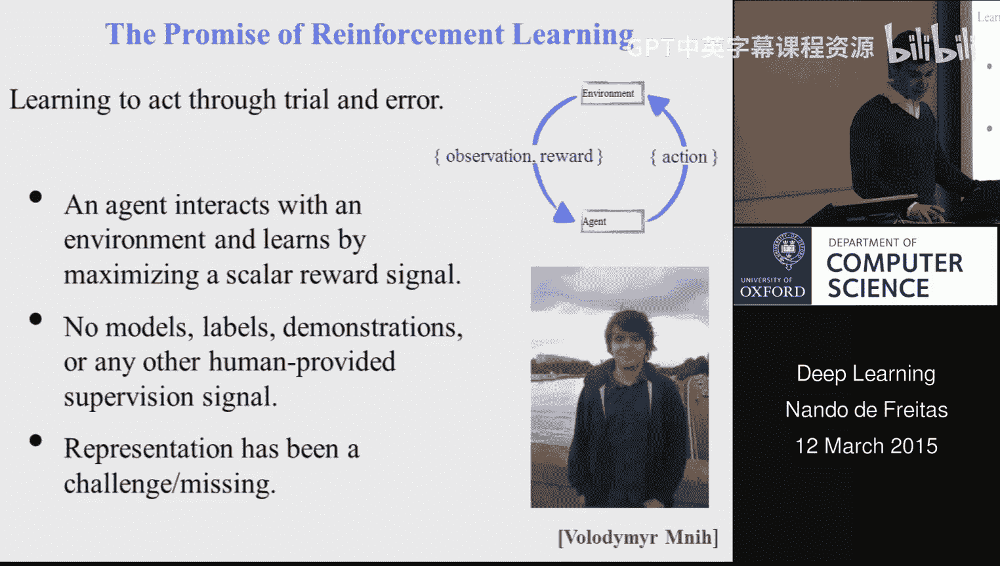

嗯。So。Our agent will basically be a neural network。And this neural network will take。For example。

 images from the environment and it could be a convolutional network as you see here。

 and then the outputs will be actions， so you could think of this now as little creature that says the environment and on the environment and is trying to maximize some reward signal。

 maybe it's trying to maximize its existence or not running out of the battery and so on。

Or exploration of the environment and so on。One of the problems that makes。Reinforcement learning。

 very different than supervised learning， is this thing credit assignment or the late reward。

Typically， the setup is you're playing a game。You might be playing chess。

And you play you move your pieces。After two hours， you find out that you went in a checkmate。

And now you're going to figure out out of everything I did， what were the smart things。

 what were the things that led to me winning because the reward only happens distantly in the future。

And you have to now figure out。From that signal， that single signal in the future。

What past actions were the ones that I should actually really remember well， what little strategies。

 snippets of action should I remember， which action sequences are the things that I should now store in my memory so that next time I play a game I can do better。

That's what makes it hard， you don't have that supervision label at every time step。

And even if you have a label at every time step it might be that label is not informative。

 some labels are much more informative， you might get reward signals for like being able to stand here。

 being able to look at the audience and so on， but at the end of today the under rewards the big reward signals if you actually all succeed in this course and so on。

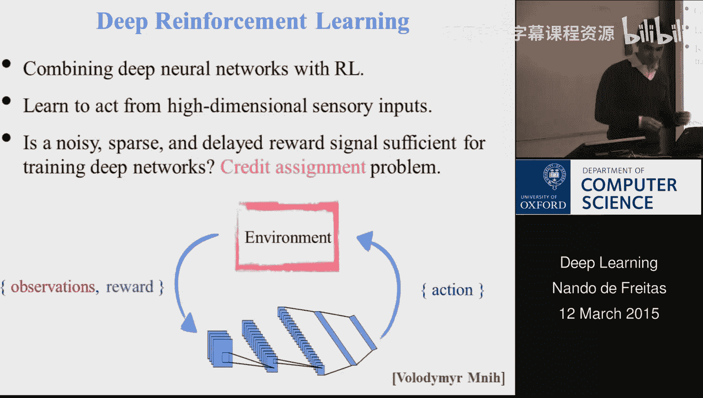

So that's what makes it hard， here's an example。In。In reinforcement learning。

 you essentially have an agent that is acting with the environment。

 so unlike all the machine learning that we've done so far。

 where we decoupled the agent from the environment where we were just doing perception。

Now you really have to bring the environment into it because you can only evaluate by acting on the environment and seeing how the environment judges you。

So you do something in an environment environment like you might walk over the edge of something and if you fall that's the environment telling you've done something stupid。

 don't walk over a cliff。嗯。And so when we test reinforcement and learning algorithms。

 there's an extra complication and this makes doing research in this field hard and you need an environment where to do research。

So you're not only building your model， but if you're going to do your PhD bummer。

 you also have to build an environment。And the environment could be like the physical world and if you're doing robotics。

 and that's one of the sort of application areas。For reinforcement learning。

 or the environment could be games。Because games have these beautiful simulation environment and so by embedding agents in games and holing that they learn to interact with other agents and learn to do things smartly。

 we have a way of training our agents gamess is the strategy that Deep mindd followed。

And what we're going to be doing is essentially this type of slope where there's going to be some sort of computer。

So an old school Atari that provides you the neural network with some rewards。

It acts by moving the joystick and all it sees is the screen。

So it has to learn to see in order to play the game。

And this neural network will be trained end to end。

 so there's not going to be any beyond having access to the reward signal and the observations。

And knowing which actions are possible according to the joystick。

 the neural network will have no extra help。So there's no demonstrations， there's no labels。

 it just is confronted with a game。And it has to learn， it has to maximize its reward。

It has to stay alive。And pick up the right things， eat the right things。

 don't eat the wrong things and so on。The other person to help me with the slides is David Silver。

 who is， I think one of the best most promising young reinforcement learning people now in the world。

 very bright， I strongly recommend reading his papers。

He's been very instrumental in developing algorithms that。

They are in particular very good at playing games like golf。Very challenging games。

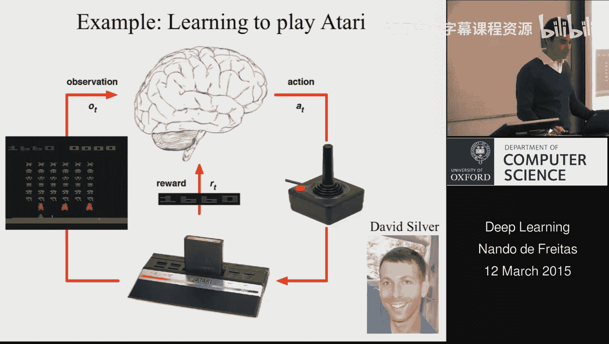

So theres two types of there's two strategies that involve the combined deep nets and。

And reinforcement learning that we're going to look at today。

There's more strategies I'm going to look at only2。

 and in both of these the model is a neural network。

 so I don't need to build an extra sort of model of the environment like a physical model that says how acceleration is changing to works and so on。

 so we're going to avoid trying to do things model based and so we're going to do something that is called model free。

 although there's a model called a neural network， but there isn't sort of like your standard model like an engineer would build or a scientist。

So this goes by the name of model free reinforcement learning。

 we'll look at policy search and then in the second lecture we'll look at dynamic programs。

So here's a good example of this in a recent paper by Jimmy Bar。Like。Imagine you have a network。

 like in this case， a recurrent net that it starts by looking at a very coarse image。

So in particular， this image here with digits 456 is the same as this image here。

 which is one of those Google's street view numbers。And so what it does。

 so then it goes into some latent layer， so this is just R is just a hidden layer of units in an LSTM。

And it outputs a number， two real numbers， x and y or two integers x and y。

Which indicate the location。Where you should look in the image。

So you can think of this as a very large image， you look in a particular small area of the image and you extract a glimpse。

And this， I started this course by showing all those videos and convincing you that you were doing this because you couldn't keep track of the whole image there were all these things you missed in the world。

And even someone published something really cool on my Facebook of。嗯。I know first， yeah。

 someone shared with me like apparently some advertising companies are exploiting this。

So there were some really cool videos about it。嗯。Anyway。

 we have to cope with a very fast stream of information and being able to attend to the right thing。

 being able to make that decision will help us cope with this excessive amount of information that's coming in。

And so you attend here and then you only read a small piece of information and then you choose the next option。

And then you decide whether to predict a label or not， if you choose to predict a label。

 you predict a label， so in this case you would be predicting which number you've read。

And you continue doing this， and so hopefully what you'll get is the sequence of ys will be four。

 five， six。You would have read the numbers， so you're essentially given an image you're learning to read what the image says by only attending to the particular parts of the text。

Here the actions are discrete so we're out of the world of differentiability so last week we saw a lot of efforts towards making end to end differentiable systems without giving up on this differentiability because RL will allow us to build systems that need not be differentiable whoops。

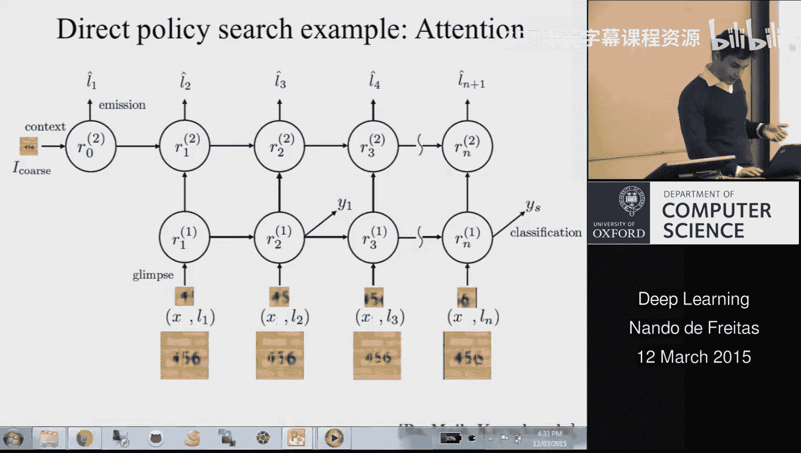

No， I do not want you to make James。And so here is an example of how this system actually works in practice。

So this is at reading numbers。So this is what it sort of learned to do the obvious thing like how we do it。

 you follow the numbers， you don't read everywhere else。And this is an example of their。

Network reading， street numbers。And importantly， by only using the smaller input data set。

 instead of feeding in the fullimage。comvnet， if you only look at the smaller image patches。

 you're able to achieve much lower errors， so your performance increases。In particular in this paper。

 they're reporting state of the art accuracy on this data set。With four times。

 as they point out here， four times fewer floating point operations than if you were to use a con。

So this is like very useful。

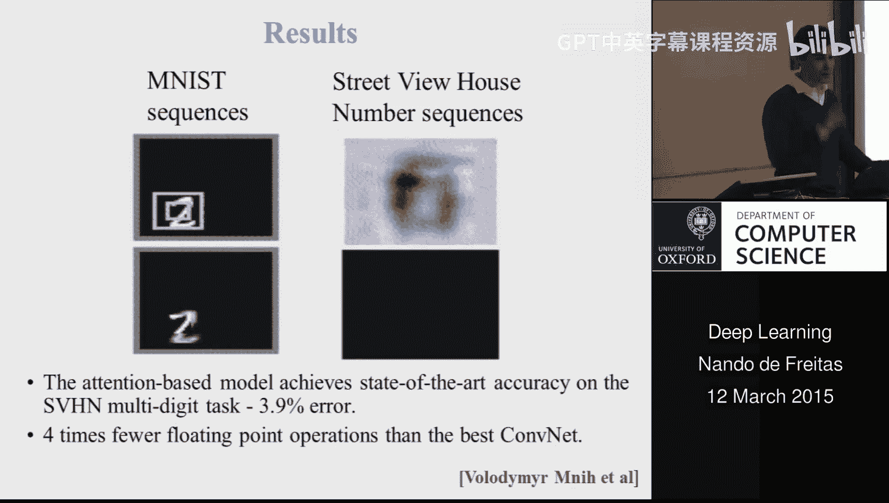

They've applied it also to。Two games， to Atari。Let me see if I can。不来。Okay， there we go。

So what's interesting， especially if let me try to move it to the end。Is that it learns to attend to。

Its reward signal was essentially to maximize the score of this game where you have to sort of basically bounce this little ball。

 but you don't tell us how to play or anything， you just provide a reward signal and it learns that to play this game。

 you should play attention to where the ball is。So it automatically learns to do the obvious。

 what you would think is the obvious thing。

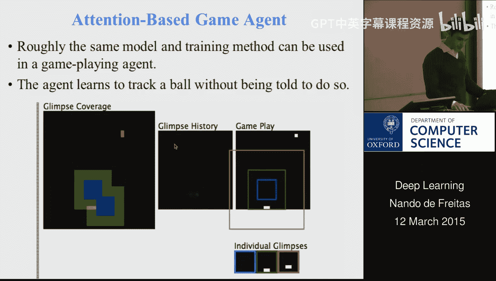

Okay， so how does it work let's use the rest of the minutes to actually derive the equations that we would need in order to build one of these so fundamentally what we have is a recurrent neural network。

And we're going to make glimpses， so we're going to look at the date and pick bits of data。Now。

 if you have a big world， a big image and you're grabbing small bits of that image。

 and then given that history， so essentially you have a history。H。

And that history consists of these sort of observations over time。

So it could be little bits of the numbers over time and then given that history you will come up with a classification。

 you you will basically voice which number have you found。So your decision here。

 your label is the action， but you might also come up with some sort of other decision。

 the decision might be that you're looking at these characters in some foreign language and then the decision is this dish is vegetarian or not vegetarian。

 or I do recommend you， I think you will like this。

And that could be very useful if you're in a foreign country and don't concrete't read。What's Rachel。

No。You should also think of these as not just an image where you're collecting bits of data。

 essentially a big image where you're taking sub imagesages is nothing but a big database where you're taking。

Small chunks of data。So think of an image just as a memory。

You can think of an image as a memory as a database it the world and you're just going there and you're grabbing bits of information so if you had many facts in a huge database and you have to answer a question。

 this is essentially what memory networks was about。

 you go to that database and you grab bits of information and in memory networks you're readinging。

 you go and find the most important bit of information and then you go and find the second most useful bit of information and then you output an answer to the question。

With this scheme， you would be。Looking at bits of information and then you would output answer。

 but the sequence of interactions with the database and information you grabbed from the database it's what's going to determine the reward and the reward here would be how well you've answered the question。

Whether the person proceeded with a transaction or not， for example。

 when they're trying to use one of your services。So the set， but list's surf ground again。On images。

 well actually let's stay with it on the after so you make a sequence of observations。

 that's what we're going to call the history and then we're going to introduce this quantity here。

 which I will call a policy。Which is a strategy。Well， today is my day for messages。How do I escape？各。

对。嗯。And the policy is something that maps histories to actions。

 given that I've seen all these observations， I'm going to choose this action。

I've gone on all these states and I observed this。I think this is the one I will marry。

You make a decision after a few observations。We're going to make an assumption that condition on these histories。

 the actions are independent， so the policy of our capital T decisions is going to factor as a product of decisions。

 so they're only independent given the history， if the history is not given they become coupled。

Then so that's the only sort of abstraction that we need， the only we need the notion of a policy。

 of actions and of histories。The other thing we need is reward。

And the idea is we want to maximize all our rewards into the future。And in particular。

 note that you might have， if you have capital T steps till the end of a game。

 your reward might be 0，0，0，0，0，0， and then when you get to the end， you get one。

So this reward signal can be very weak。Again， if you're playing a game like one of those chicken games with a freeway where the chicken has to cross the road。

 not get killed， it only gets a point when it crosses the road。

 it can do many things in between and it will get zero reward。And so you have to learn a policy。

That takes that into account。 So you might want you will have to do things that will。

Immediately not be of value， so there might be some things that are of value let me rather put it this way there might be immediate things that are of value。

 but you know that in the long term they're not going to be useful to you that it's better to sort of forego an immediate reward in the hope that youll get a larger reward at the end。

Have to reward from that impact the states of the system。Yeah。So in this case。

 so you bring in the notion of state because I'm assuming you know but of RL。

 the state here is the history。If I know the history and the history is not the whole data。

 the whole data would be too big， so here the hope here is that the history will be just a set of glimpses of course and then I can't keep taking glimpses and storing all the possible glimpses I will have to have a finite memory。

But the history is is what kind of defines the state of the world。That is true。

 I could have put in here a history， but in a sense。Yeah。

 the whole direction would be about the same and in fact you're right because if you look at the model that I presented before in this one here the reward would be measured and how will you predict this and so it's a function of H basically which is。

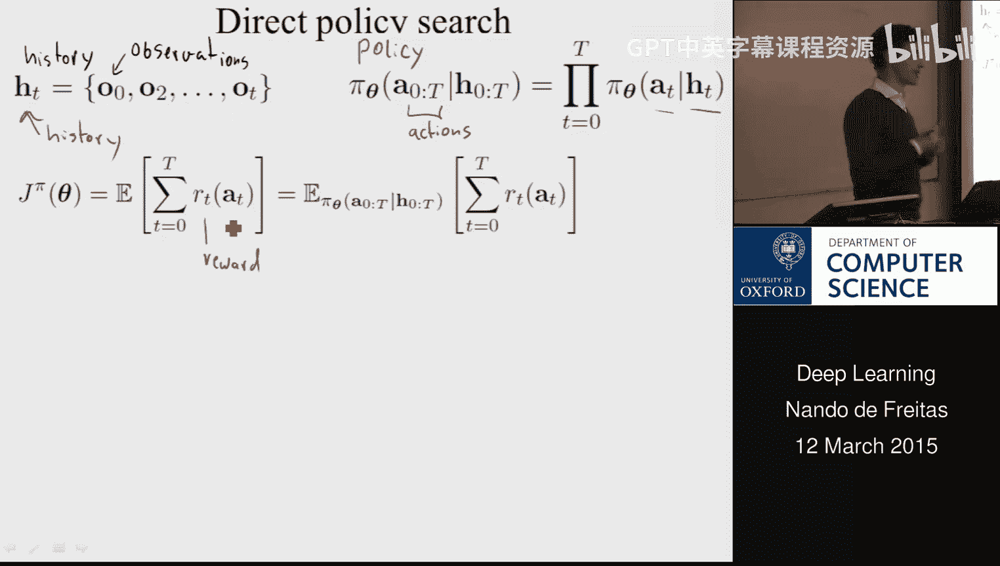

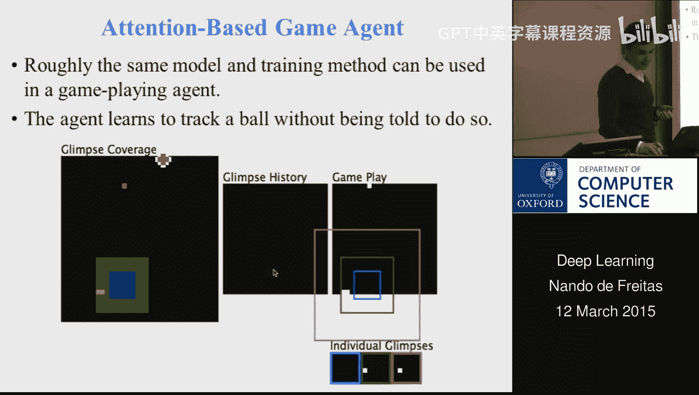

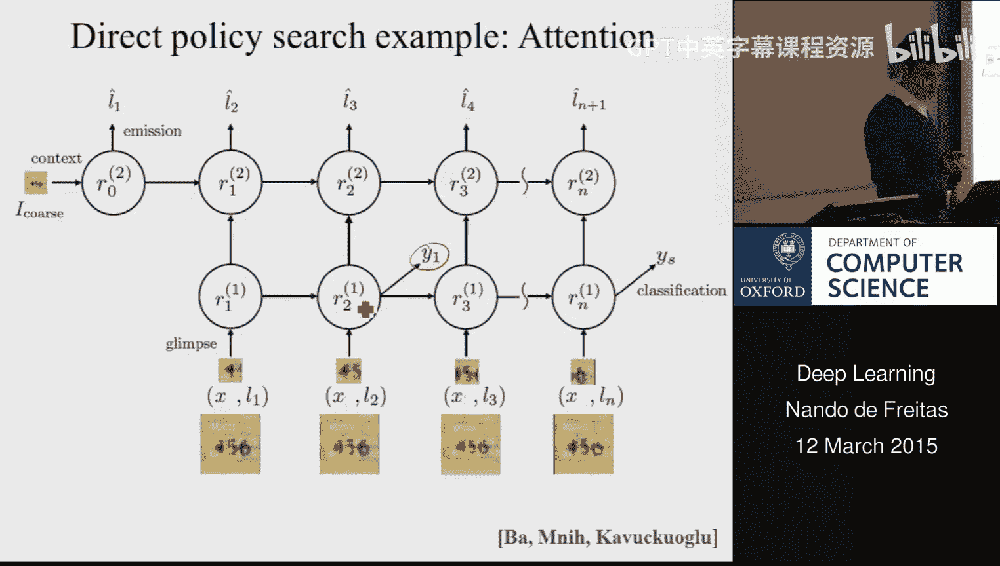

Coming from the history。

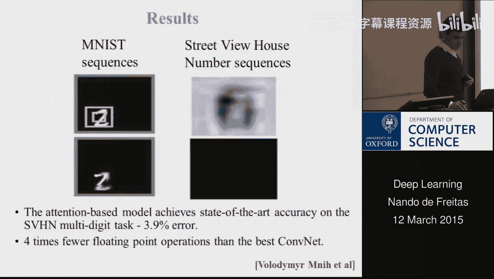

But I will ask you to。Take a leap of faith that if I were to change， put an H of T here。

 every derivation I'm going to do next will be exactly the same。In fact。

 later I'm going to bring the state into the reward。

It will in the second lecture you'll become clear that I can do that but for now let's just assume that the reward is the function of your action if you did the right thing you get reward if you didn't do the right thing you don't get reward if you're trying to play Hanoi towers which requires planning into the if you didn't put the block and immediately on the right thing you get a zero reward of minus one reward。

And so what you want to do is on expectation。Maximize your reward so in other words。

 regardless of what the future actions will be over all possible action sequences。

 you want to come up with the best possible reward。

 so that's why we marginalize to get rid of the variable a。So that's the set up。

And the history is determined by the actions in that sense。

 the history is the stochasticity is in the action， that might be another way to actually。

Think of this。In this network， when I start， I look at the little image， I compute this。

 these are my parameters， it's an RN so the parameters are tied。I might have I don't know。

 Theta one here， Theta one here and so on and might have Theta2 here。

And then all these parameters are the same。Okay， so the standard R N trick。嗯。

I might compute the actions here with a soft Mac， for example。

And then I used that softm distribution to sample an action。

And the action that I sample deterministically。We'll decide a location。Of the the。The guy。

So in that sense， there is no stochasticity in my state。

It's just a big memory from which I'm extracting something all the stochasticity ist the choice of this action。

In this case， the action is determining the location and the image what I'm going to look。

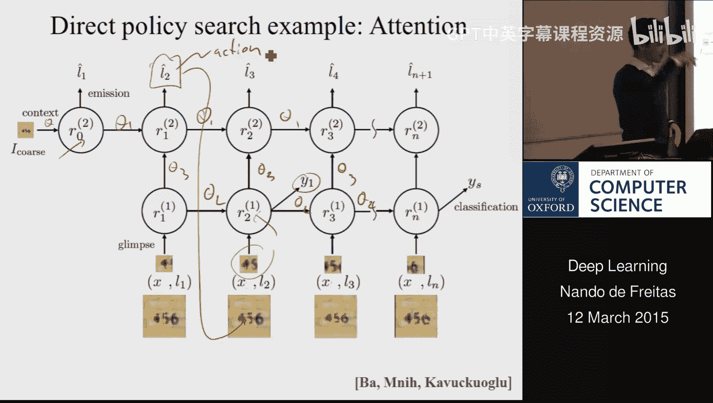

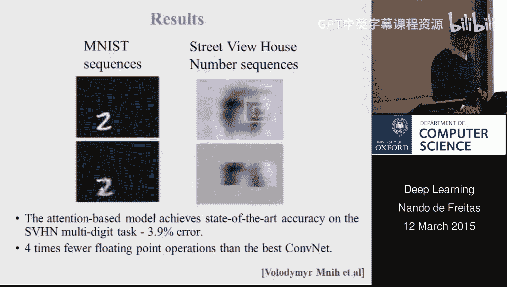

But it is true that in some cases。That history will be part of the reward and we'll see that in the next election。

Okay， I mean， in general， the setup is you have some sort of initial signal。

Whatever that signal may be。You compared some。Some hit an embedding and let's use E for the embedding from the embedding you will choose output an action。

And the way you output an action is you might be outputting first。

A soft mark that gives you the probability of a given E。

So like you might have a neural network with three outputs。

 in the case that if you have three actions， and then you compared I don't know， 0。2， 0。

8 and 0 as your have three outputs， and then you sample according to that distribution to choose an action from that distribution。

And that a1。Then deterministically we'll choose an observation and again。

 think of a very large database。And this observation。Is being。Drawn from this database。

 so you're pulling this observation。And then you feed it into the next embedding layer of the RNA。

And then you do all this and again， you sample a2。A2 then decide how to take the next。

B of information from the world。And that bit of information goes into。For your E3。

 and maybe be out of E3， you then't get a reward signal。Which is a functional of。

Whi could be the sum of their older rewards for all the actions or might be in this case。

 just the reward over the sequence， a1 a2。Now there's many ways in which the reward can come。

 the reward might appear only at the end， you might have rewards at each step as well。

 so there's many variations of this and it depends on the problem which type how you want to formulate the reward precisely。

Okay， so that's essentially。The policy is mapping all these H's。

So you have this initial observation if we actually use that notation and then we get this the。哦。です。

Observation one and observation two， so you can think of the first history is just the first observation。

The second history is。The next。啊。I keep making my oath theater， sorry about that。Just have it。

And then now half H3 will be sorry， H2 will be。Observation zero， observation one。看到。An observation。

 too。Okay， so the setup is your history is growing as you're grabbing more and more of these observations and every time you grab a new observation you feed it into the hidden line of the RNN so your compute2 using the previous signal and the new measurement and then you output the action。

 and you keep doing this。And you may get rewarded immediately at that step。

 or you may not get it reward and get it later， that sort of will depend on the application。

I was drivingib the s about the beach bar。第二个。我设微是。Oh okay。

 so now we need to learn so all these so this is definitely a no， but all of these links here。

 theyre parameters。So because it's an RNN so RN has parameters and I'm calling those parameters theta and so you can think of this as essentially it' a function that takes o's as inputs and it produces A's as outputs。

 so it's essentially this。It takes histories and produces ACce as outputs。

 and it has some parameters feet。So in this case， I'm implementing the policy with the recurrent neural network。

It need not be a recurrent network， I could have used a covNe， I could have used logistic regression。

 any other neural network that we've learned in this course in order to implement a policy。

 but let's say that we do this。So in order to decide which action to take。

 I basically need to learn theta。Okay， so all this is。

Each of these guys at each time step is essentially a policy that basically you can think of this as a discrete distribution。

 say over four actions。And I need to learn the parameters of the network because the height of these quantities given by the soft max distribution will depend on。

The neural network parameterss。That doesn't sound like it's clear yet。S about。

Let's say the proportion of the image statue you。As your observationserv。好后住。Oh。

 so the action is the location。

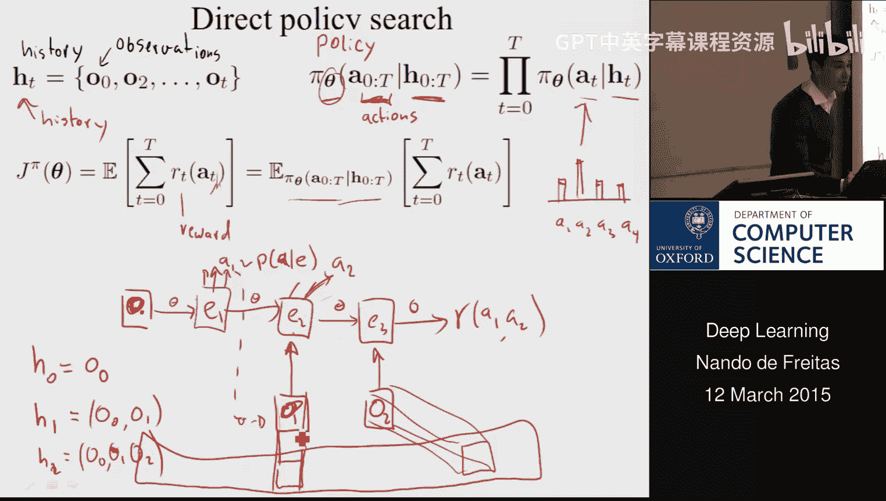

So let's I have sorry I don't make that very clear so maybe bring in this picture so the action here is the location where I'm going to look and I have a predefined size and in fact here they're using this phoviation model which is sort of higher resolution the middle lower resolution as you go to the edges so once I choose L2 I L2 indicates where in the damage to go and grab the date。

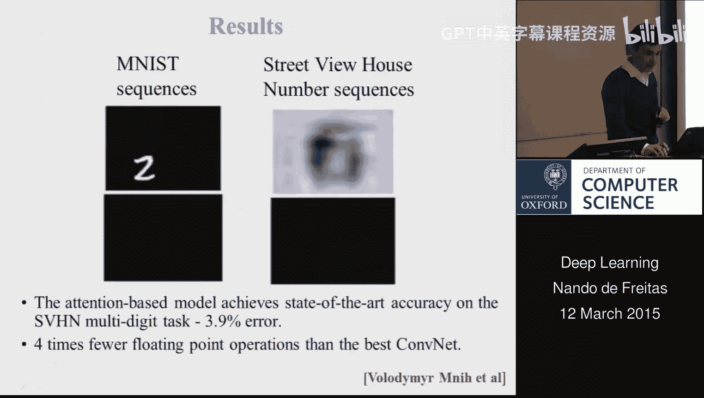

And so in order to come up with L two， I need to know these parameters if I know the parameters。

 then I will determine that knowing the parameters knowing the parameters of the neural network and knowing the previous input determines what the next output should be。

And so that gives me the next L and I keep going The only thing that I'm sort of mentioning is that the output is really a policys you have many actions so it's the same as when you do classification。

 you just output the probability of each class and then at that stage one thing you might do is you just sample an action from that discrete distribution and that's the action that you take next。

You could also take the max of that distribution。So that's the setup so think of that now this big image is the big database and all you're doing is getting pieces of information so if you wanted to do this for like you could do this for as a replacement for memory networks to not be as greedy where you would go。

You would store in at this big database， all the facts and the story。

And then your actions would be which fact to go and。

Retriieve in order to answer a particular question given so this would be a question and then you're trying to output an answer and you would just be picking up different facts so for example if the question was which is the state in the United States what the highest peak among the states that voted for Obama so you need to know two facts there you need to figure out what are the tallllest mountains in the United States but you also need to know who voted for which states voted for ob and you need to sort of do two queries to be able to answer and so the hope would be that this network would learn which facts to go and pick up。

In order to produce an us。And in fact， that's what it's doing with images is learning where to look。

What information to graph， and then it outputs an answer， which in this case is 4， five， six。

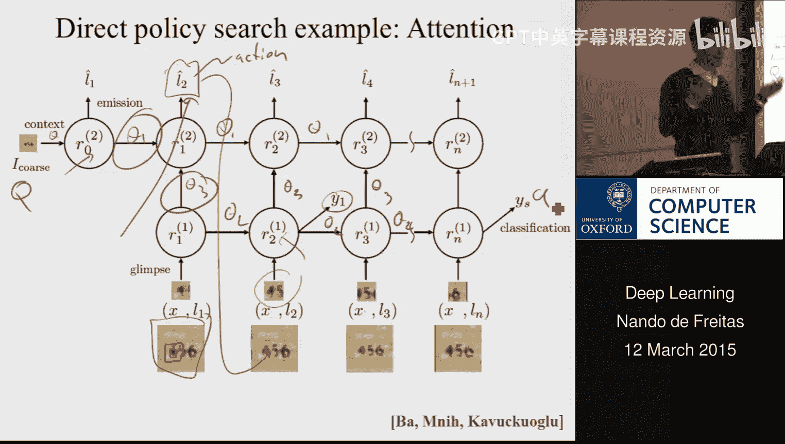

And that's essentially what it's。

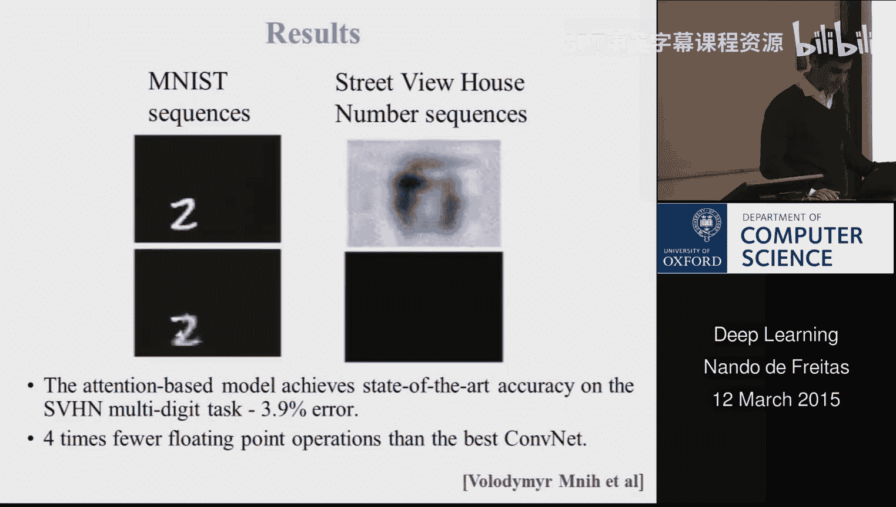

So the only thing that's missing now in this setup is we need a mechanism of loading the parameters。

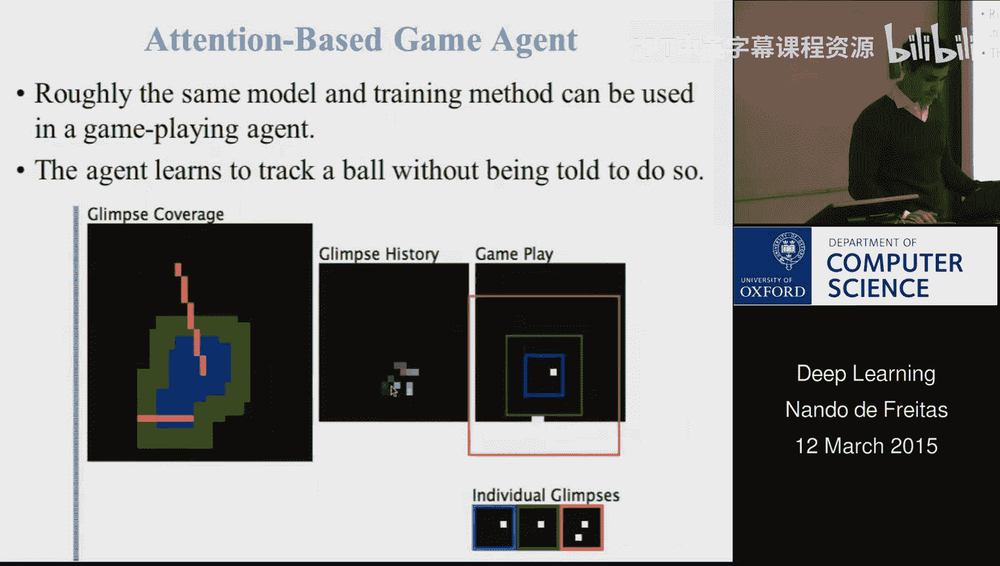

How do we learn the parameters when you have a reward？

That might only happen at the end where the reward is very delayed but it doesn't happen at every step。

but we do have an objective， our objective is to maximize this expectation over rewards or what we often call the expected returns when you follow the policy pie。

And if we maximize the expected returns of a theta， we're done。

And that's a direct policy search in direct policy search， we formulate a reward that。

It might be a concert reward consisting of many rewards。

And you may combine it actually in different ways not only with sum， sums is the typical case though。

 for dynamic programming， the next lecture will be essential to use these sums。

 but for this setup it could be some other funky way of combining rewards。If you do it this way。

 then essentially all you have to do is come up with this policy once you know the policy。

 once you have the strategy， you know how to act in the world。So you're not being a reactive agent。

 you're not picking in every state that I encounter myself， I will pick an action。

 so you're always reacting to the environment by picking an action。

 but rather you learn this function that tells you how based on observations of the environment which action you should choose。

 you're learning a strategy of how to act in the world。

 you're learning a policy and we will learn it directly because we will optimize the expected returns。

 we will essentially what we'll do is we'll compute the derivative of this。And follow the gradient。

 and that will give us the policy。So the rest is somewhat mechanical。That will deal with it， yes。

 because we're we've in assess we've parameterized the policy。

 so we we're now taking the expectation。Over all possible action trajectories。

 so we're not just like being greedy。But we're really trying to find what are the most lucrative sequences of actions。

 so you would actually as you get a reward you actually understand what part of the sequence。

 what sort of。Sequence was useful。And this is going to be the problem。

You need to do an expectation over all your actions。

 so now you can imagine what the issue is if your actions are binary。And there are 10 decision steps。

Then you have two to the ten0 terms in the sum。一いぐら。然后我上去。有反。Excellent question。And the answer is。

 in some cases， you do know what the reward function is。But in this case， you don't。

And bear with me one slide and I'll come back to your question。

I will act in the world and I will get rewards。So I won't need to know what it is。

 I will just do something and then a reward will come based on what I've done。

And it will become clear when we've derived algorithm how that happens。Okay。

 so let's see how we compute the gradient and so the difficulty in computing the de。

 so we just need to take the derivative of this and we may rewrite this。

 this is essentially a sum over all the possible A's， a from a0 a1 a2。

 so we're considering all the possible history all the possible A's。And it's a sum of the reward。

With respect to the distribution of histories， with respect to this policy。Yes I'm just writing。

 I'm just expanding the expectation now。And so。And so the difficulty is that I need to do the sum if I have 10 actions。

A thousand steps。Then I'm done， then there's no way I can do 10 to1 thousand possible computations。

Okay。Here's what we're going to do。So the first thing we're going to do。

So I'm going to want to take the gradient of this with respect to Theta。

So I want to compute the gradient respect feet of this quantity。

And because the reward doesn't depend on theta in the setup。

 I can move this guy inside and I will only have to take the derivative with respect to pi。Okay。

 bi linearity and so on。So in order to compute a derivative of the cost。

And I compute a derivative because once I have the derivative。

 you guys are all experts in optimization， you could run greedy。Stochastic gradient descent。

 you could do a newton method， you could do whatever you want once you have the derivatives you've pretty much done。

So let's look at the first derivative。So it would be this guy。

Now the difficulty with this is that you still have the sum of our actions and can we simplify this So the first thing we can do。

嗯。And it will become obvious to why this is a nice trick right here we have the derivative of a distribution。

And because this is a very large sum， I'm going to have to do to come up with some approximation to this sum。

 the particular approximation that I will use is sampling and I'm going to basically act in the world and see what happens I'm draw I'm going to do a simulation in the world。

And that now others should answer your question as well。

 so I will simulate the trajectory in the world and as I'm acting I will get rewards。So in a sense。

 I don't need a reward function。진 좋。But the difficulty here is that I don't know how to apply sampling when I have the derivative of the distribution。

 only know how to sample from distributions， not derivatives。

But there's a very nice trick and is that the derivative of the log of y is y prime over a y。

 and that's essentially what I've used here， the derivative of the log。So you know。

So this good old trick log of y prime is equal to y prime over y， and if you solve。

 so in other words y prime is y times the derivative of the log， which is what I've done here。

 y times the derivative of the log。And now I have a distribution from where I can draw samples。

 so I could sample from this and I can approximate a sum。

I'm going to do one more trick is here I have the log of this distribution， which is over a not to T。

But the probability of a0 to t thatcomps as the product of probabilities。

 so if I have a product and I take a log of a product I get a sum of logs。

 so I write this as a sum of logs of each individual action。I'm going to do one more simplification。

And it's that instead of having an index for the reward that goes from zero to t。

 I'm only going to go from。Time T into the future。 So the idea being that。

And future actions don't affect the past rewards， you already got those rewards。

 so the next action is not going to affect how I did in the past。

 it's going to affect only how I do in the future so you only need to look at the rewards that go in the future。

And those are all the simplifications that we do。So the summary is basically this expression and this expression involves the reward。

 it involves the whole policy， and it involves the derivative of the policies at each time step。

Which is essentially just the output of this recurrent net。And so we know how to compute these。

 this is just by propagation like just like we did by propagation for an R andN。

 which's just by propagation three time。Now the trick is we sample a trajectory。

And what I mean by sample a trajectory is actually you simulate the recurrent network。

You observe an image， you take one action。You grab some data， you take another action。

 you grab some data， you take another action， you grab some data。

 so basically use your current set of the setting of the parameters。

 so the neural network has parameters at time step T set as some value。

 I use this neural network to choose actions。And then I get a measure of performance， I get an error。

 how well I do that classifying the numbers， did I get the numbers right， yes or not。

 and based on that measure of performance， I plug it in here。And。

That will give me a new version of the gradient。So in particular。

 if I draw samples from this distribution， then the Monte Carlo estimate only involves the rewards that I will accrue along the trajectory。

And。The derivatives that I compute by back propagation。

and then these are my samples and I'm assuming that I have drawn end samples， so I tried it n times。

And so this pretty much doest。So those recurrent networks that we're doing better than the COVnet by reading numbers。

 we're doing using precisely this algorithm。But you can use this for many other things so you can use this to fly an aircraft or fly a helicopter。

 in fact there was a very impressive name of Peter Bill and a few years ago where they were flying helicopters upside down and so on。

 they were using exactly this model exactly the strict， exactly this equation。嗯。

One of the issues with this， however， is that it's very high variance。嗯。And。

And so folks actually devote most of their effort towards coming up with low various estimates of this gradient part of why it's high variances is you're dealing with derivatives of distributions。

Wwhich look like this， they have a positive part， a negative part。

 and often when you use samples to approximate you might have positive samples。

 some negative samples canceling them， so there's a lot of waste of samples when you're trying to compute derivatives。

And so folks have come up with a very large class of approximation methods to improve this one of the very useful tricks is to instead of using distribution tried to break the distribution into the gerministic part in a stochastic part and then you only simulate the noise and then you back propagate through the Germanministic part and that was what Carol was doing with his variational decors the same trick can be useful control and so I wrote a while ago a paper with。

Mat Hoffman。Because now these days a postdoc in。Cambridge was thevenaard Manies group。

 who's been doing a lot of work on doing those sorts of tricks to reduce the variance。

The group of enteringing their trick was something that's called common random numbers that led to one algorithm they had called Pegasus。

 and so the idea there is simply you phrased a random see。

For the simulations and that makes absolute sense if you want to compare who's the best person flying a kite。

 someone in Brighton or someone in Oxford it's going to be very difficult to compare their skills because they're in different random environments。

 there's different wind conditions in both setups so the only way you can compare them fairly is if they have the same random conditions so when you're comparing two features make sure that you freeze the random seat。

嗯。So there's a few more tricks， there's in fact a vast literature on policy gradients。

 but this should give you the gist of。How they work and with torch。

 torch will give it the derivatives of thecurnet so you can very easily go and implement this。And。

And do exactly what the folks at mind did。Okay， so in the next lecture we'll go into the other approaches of neurodynamic programming。

 so in five minutes。

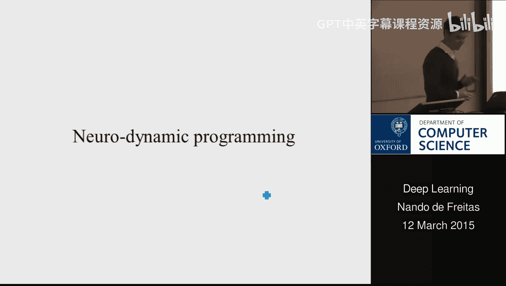