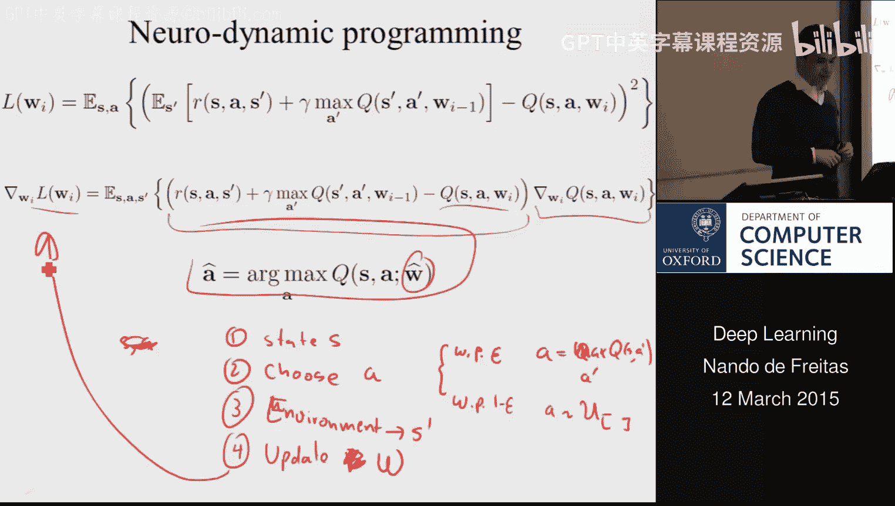
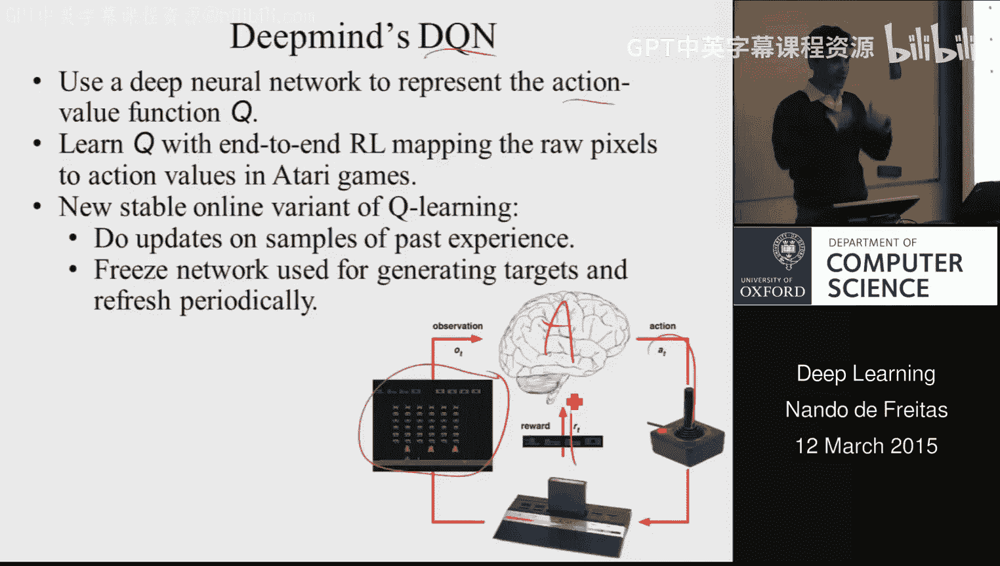
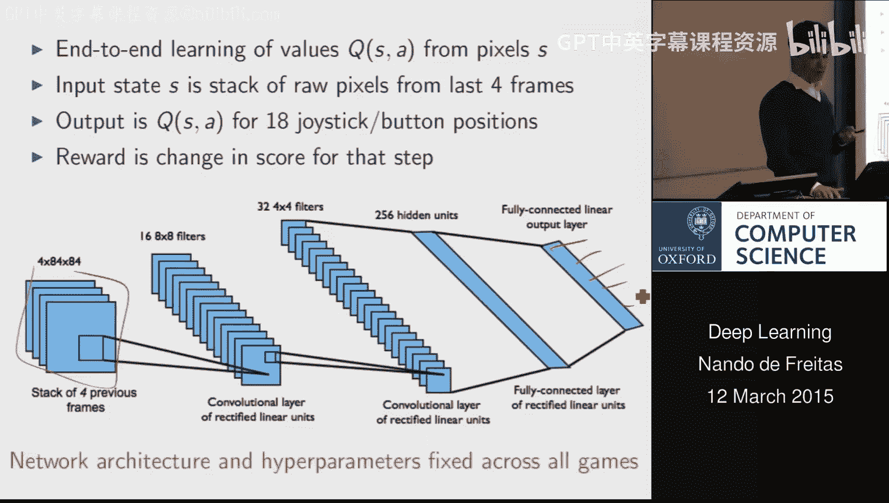
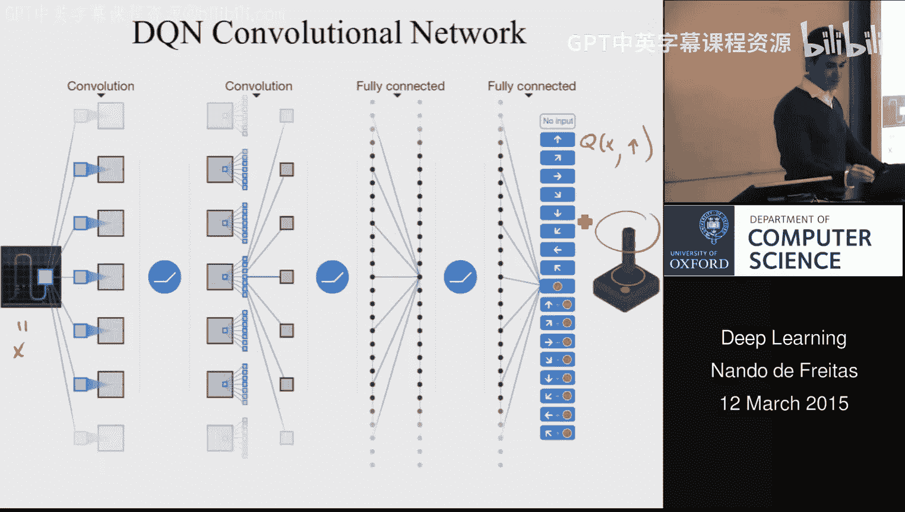
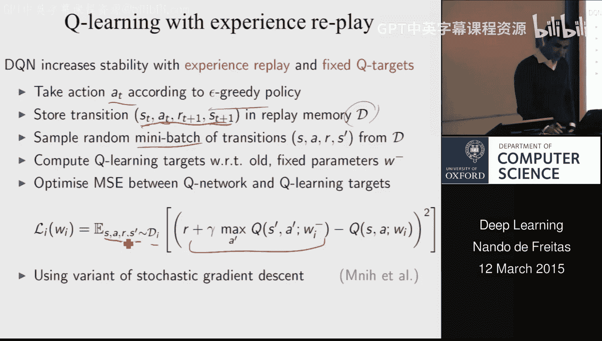
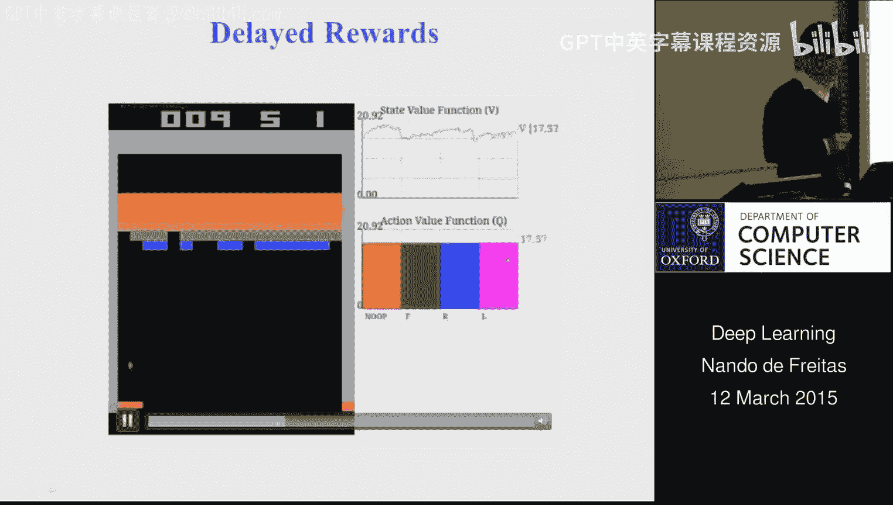
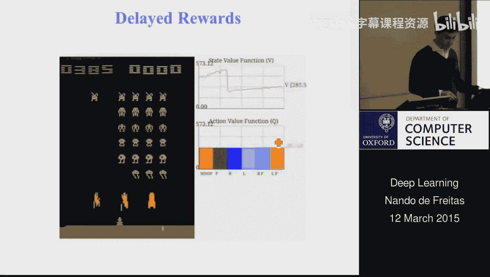
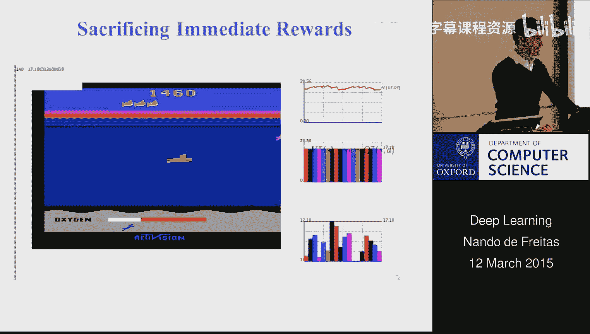
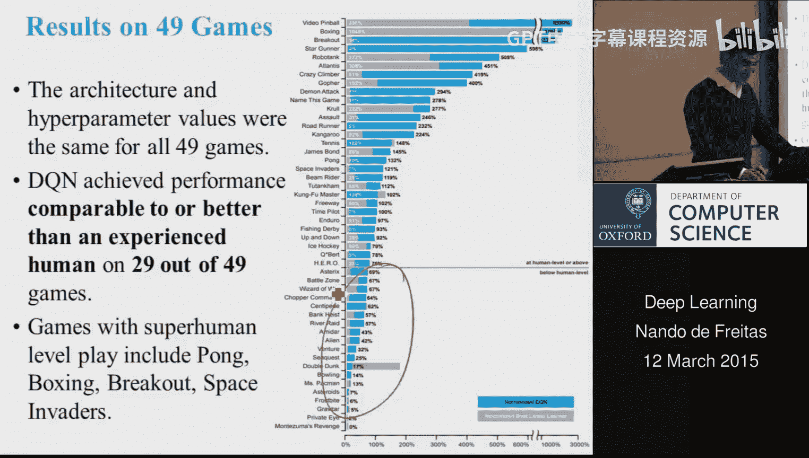
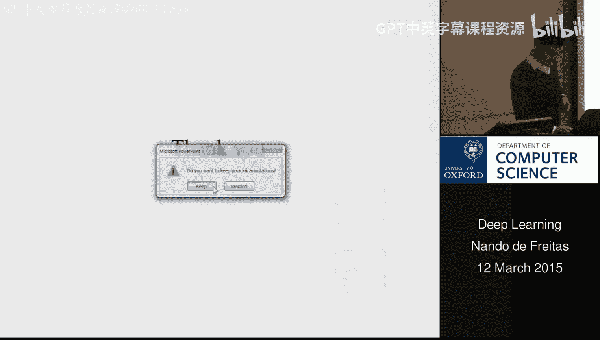

# 牛津大学《深度学习｜Deep learning 2015》中英字幕（Claude-4-s） p15 16_ Reinforcement learning and neuro-dynamic programming.zh_en -BV17NWWz6ErN_p15-

All right， so we've seen the direct policy search way where you essentially you。

The object of interest is this policy， a strategy that will take。

Histories and choose an action and or a summary of the history and choose an action a summary of a history there's another word we could use to describe it。

 to refer to it and now word the state。So。From now on。

 I'm going to think of policies as mappings that will take some states and produce some actions。

And I'm going to make this even more general， so the states could be histories but they could be something else。

 so if I have some latent variable if I have an understanding if I have a representation about the world。

 so if I have neurons that are firing with some rate and so on。

 that's the state the state is essentially whatever information I have stored in my memories etc。

 that determine which action I'm going to choose。呃。And。

In particular the policy now may not only be stochastic， but it could also be deterministic。

 so in the previous class I restricted myself to the class of stochastic policies and that's somewhat simplified the analysis it's also possible to do the policy gradients with the domestic policies but。

We won't have time to cover that in this course。If you're interested in that。

 I suggest you go the termministic policy gradients， there's a very nice paper about that。Recently。

 there's also ways of casting direct policy search as inference。

 So for those of you who might have done。Machine learninging course where you learn about the EM algorithm expectation maximization for models and on。

 I think some of you might have seen that before， it's possible to phrase that optimization problem as an inference problem and use standard techniques of inference to solve it。

It is also possible to cast it in a ba setting and then use Markerchin on the Carlo methods to solve that problem。

 so there's been really a lot of working policy search from many perspectives。

Dynamic programming is the other area that you know there's been like thousands and hundreds of thousands probably papers on this topic。

嗯。And instead of using expected returns。We're now going to introduce a slightly different quantity。

 which we're going to call the value function。And as the name implies。

 the value function essentially tells you what's the value of being in a particular state。

 so S notaught is essentially being in a particular state at time zero at the initial decision period。

If I'm about to make， if I'm going to be in an environment where I'm。

Going to be choosing options according to some policy。

 what is the value that I start here versus starting， I don't know， maybe in London or so。嗯。

And so essentially if I had the value of every possible state。

 this right now is an infinite dimensional quantity， this is a function。

 the value function now is a function that takes as input any state all the possible states of the world there could be an infinite number of possible states this could be a huge thing so in particular facts iss just RN then obviously there's an infinite among the possible states so S could be discrete could be continuous I'm going to first derive。

The dynamic programming algorithm without making any assumptions。

Of course it's not going to be obvious how to compute this because there's enough function over infinite dimensional spaces。

 but then we will make a simplification and the simplification will be that we will replace these functions by neural networks。

So we will approximate them and that's what's going to lead to neurodynamic programming。

 neurodynamic programming essentially dynamic programming where。

We replace these functions with neural networks so again neural networks are function approximation tools so a good function approximation tools so they'd be good function approximations of the expected returns in a sense we're sort of predicting the future here but instead of trying to predict each quantity one by one what we're doing is we're going to predict the sum of the things that will happen in the future and in particular of these the things that we will care about are these quantities that we call returns we will predict。

We will learn to predict the future rewards because if you can predict the future rewards。

 then you can act better。Now， we don't know what the setup is。

 we don't know what the future states will be。So we need to make the best decision。

 we need to compute the value of something regardless of what the future states are。

 so again we have the sum over all possible future states。And in this case。

 I'm actually making it even harder because there's something got infinity。

So now we will be really in trouble if we try to enroll the sum。

Sinceister sum is going to infinity so if you're summing rewards till infinity you might think of okay。

 that's going to blow up and so we're going to prevent that and we're going to introduce this quantity called the discount factor。

And raise it to the power T the reason why we're racing to the power T is so that future rewards will matter less than most immediate rewards so depending on the choice of gamma you'll be paying attention to different horizon so the way we're sort of cheating here to deal with the correct assignment problem。

Another way to think of this if your moles are probabilically inclined is we're essentially placing a geometric distribution when we believe we're going to get reward。

 so one minus gamma times gamma t。啊。Indicating that you get reward at the time step2。

But the most intuitive way to think about it is just a discounting of future rewards。嗯。

To make things easy， I'm going to make the reward depend on the transition。

When I'm in state ST and I act according to the policy， so I take the， so this is basically AT。

So I choose action A， I move to state ST plus1 so I'm in a sort of dynamic environment。

 I'm in a particular state， I take an action and I move to the next state。And of course。

 here the expectation is over all the future states， so the distribution is over S1 s2 and so on。

 S not is given。So it's an input， so I take an S node and I evaluate its value。

 take another S node and I evaluate its value。This is the key question。

Everything we're going to do next will be techniques for solving this equation and you can see how hard it's going to be to solve it once again we have this expectation that's intractable。

 we have sums going to infinity and this right now looks like a very hard thing to compute。

And so the dynamic programming will be just dynamic programming will be just a strategy for computing in。

 but before I proceed， are there any questions about the setup？But what questions are there？Okay。

 everyone happy。Who's unhappy？Good， I love honest people。ぜ。Bby。な都过事。Yes， very good question。

 so there is， so the value depends on the policy。So you know I we。

We write this notation over and over and over again and after 10 years we sort of forget to explain it properly。

V depends on pi。Thank you for that question that's really important if I choose a bad policy。

 if I start somewhere， if I start and state not and I choose a bad policy。

 I might end up doing very poorly。Even though I started in a good place。

 so I might start really close to the treasure if I'm searching for a treasure。

But maybe I decided not to turn around and I just use a policy where I'll just walk in a straight line never turn and explore my environment in that case I would do really badly so that finally depends on the policy。

Now I'm not going to go into theory here， but essentially there's a lot of beautiful theory behind this。

 I recommend there's a very nice reinforcement learning book。By Chaba Sezvari。

That's available online and in the appendix he proves a few of the key theorems that we need to understand。

Things like。嗯。This is a contraction operator in Badad。

 what's meant is that this will converge to fixed point， so if you had multiple agents。

 that fixed point will be the national equilibrium。

And in particular that there always exists a policy that will allow you to achieve the best possible value function。

 that's another important theoryem that you need to come up with and that policy can be is deterministic。

 you don't need a stochastic policy for decision processes you only need a stochastic policy when you deal with multiple agents。

 the stochastic policy essentially in game theory we call the mixed strategy。

If you're playing matching and or whatever you need to rub paper scissors。

 you have to randomize between drop paper and scissors with probability one third each that's a bit of a spoiler for if you play it again。

 you know exactly what to do now。嗯。And I hope my wife is not watching this because we always play rock paper scors and she was always frustrated that I always beat up。

I just random my wind third。嗯。Anyway。So there's a lot of theory behind this。

 but what I'm going to provide is with an introduction。

 I'm going to derive the algorithm and after this if you want to learn more about it。

 if this interests you and I recommend you look at Chave's book。

Which does not have an introductory material to the extent to which I will go over it today。

So I already mentioned this， but this is the value。Assuming a particular policy。

 and then we also can think of the value assuming the best possible policy。

 so if the policy was continuous I guess I will replace the max by soup。

 but this will be the best value。Or。A better word， the optimal value。And so that's what I want to do。

 I want to compute this optimal value and I will compute。And if I find the best possible strategy。

Which is what I'm after， then I will be able to compute the best possible value of each state。

 the optimum of R so essentially。The function is what I'm trying to compute。

 and this function depends on pi and I'm going to be changing pi until I come up with a function。

That describes the true value of each state and once I know the true value of each state。

 then it's trivial to know which state I should choose。If I know where to be to get the most money。

 then I will make sure that I'll just go there the trick here is learning what's a good value function and that value function depends on pi so I need to learn the best possible pi。

Okay so。What we're going to do is something called dynamic programming。

 and let me just summarize it for short if you're trying to compute。A B plus A。Yes。

Don't compute it this way。Computed it this way。Okay， so we all know this trick。

And this is exactly what we're going to do， the expressions are much bigger， there's small symbols。

 but this is really what we're doing here。So I'm going to start with the expression for the optimalim value function。

And then the first thing I'm going to do is the sum goes from zero to infinity。

 I'm going to take the zero term out， and now the sum goes from1 to infinity。Okay。

 so I've just looked extracted the first term from the sum。Then I'm going to。

 oh and I did one thing that I didn't need to do here， let me just。对。A not。

The first action is taken as pi of S0。So in general a is equal to pi of s。

 so I can either write here pi of S n or for short， I will write a n。

 so I will just pick the optimal initial a n， I still need to maximize over pi。

And that's pretty much what I've got in the next step。

So the next thing that I'm going to do is I'm going to use linearity of the expectation and in particular this guy here has only S1 variables so it can't come out out of the expectation for S1。

 but because it doesn't have S2 or S3， I can take it out of that expectation。

The expectation being just an integral and if the integral doesn't depend on what you're integrating over you can take it out of the integral so basically this expectation will move inside and that's why I have it here。

Likewise， there's no pie now appearing here so because I've made it explicit in terms of a knot so I can move pie inside。

I need to do one more thing is my first gamma here is gamma to the power0 which is one。

 so I need to make sure that this also starts at one， so I'm going to subtract I'm going to。

Divide by gamma so that I get t minus1 here， and because I divide it， I need to multiply by gamma。

 so I divide and multiply by gamma instead step。And now I just realized that this is the stuff that I started with in the beginning。

 this is just a value function at the next time step。And this is Bel once question。

Which is one of the sort of most fundamental equations， let me show it here without indices。

 so instead of writing time T time t plus1 and so on， this is going to be the current state。

And this is going to be the future state。Okay， so the prime indicates future。

And so that's essentially what we derived here where here I had the index zero and then the index one for the future and you had the reward。

 this was the value in the future so in other words。

What this optimality principle is trying to say is in the future。

 if you did the optimal thing in the future， then by doing the optimal thing now you'll still be optimal。

So you can think of this one way to think about it is if you're riding a bike。

Imagine yourself at that point at which you're going to budget your tip and you're going to fall。

And when you're at that point where you're going to tip。

 you just move a little tip away from tipping。And then at the next time step。

 you move yet another little bit from that step that could have led to the pit where you would have tipped。

And then you keep moving away and tell you a vertical， and that's how you learn to ride a bike。

Your work back from the point at which you tip。Okay。

 so that's called backward chain and game theory if you have a sequence and you do the optimal of finite time steps and you do the optimal thing at the end。

 you then backtrack。To get the optimal value。Except the way we've done it is over infinite。嗯。

time steps and in fact the way we're going to work with this。

 we don't need to sort of think of having to go to the future and work back。

 but instead we will be planning into the future。嗯。Here I'm not making the actions depend on T。

 so in other words I'm assuming that the strategy is stationary。

 so'm in other words that the strategy is not changing one time。

And this is perhaps the most common form of pulmonary equation with this。

 it becomes easy to derive an algorithm。The first reinforcement I。

Learning algorithm that people come up with。It's something called value called temporal differences。

 and so this is very similar， the algorithms， by the way。

 for enforcement learning that will be very similar to SGD。In SGD we have the following thing。

 we had the expectation。Of the derivative is respected the parameters of some cost with respect to distribution of the data。

 in other words we had something that was very similar to this and it was the derivative of the gradient。

 the expectation of the gradient was equal to zero the only difference is with SD you equate to zero。

Whereas here you equate to a function。But。But we can proceed just like we did an SGD and derive an online algorithm。

 and here's one way in which you could do it， you take this a question。And。I'm going to add。

This is going to be the learning rate， I'm going to add multiply both sides by Eta。

And then I'm going to add plus v of S。To both sides。So this was the same trick as how I derived。The。

SGD from the true gradient。The true gradient involved the expectation of all the data and then SGD would only load one date at a time。

 so here we're going to do the same thing， we're only going to load one state at a time。

 in other words we move it in the world， we observe a new state， we do update our parameters。

 we move in the world again， observe the state， update our parameters。

 so the algorithm will be very much like SGD。So from here we can see that。

 and I'm going to not now assume that we're at optimality。

 but I'm just going to write the expectation for any value function。

So that's going to be v of s is going to be equal to。The V of S。Plus。This guy。

That is the learning rate times。嗯。Oh， hang on。Now we're going to have to do something slightly different。

 sorry。Let me put us， we're missing one step。I apologize for that。

 let me just let me take you back one step。Because we're not going to do this for the optimal value function。

 but we need to do this for any possible value function。And so in particular。

 we're going to do this for。Any possible value function。

 because I need to make explicit what the policy is。

So the optimal value function is the max over the action of the value function。

And so I'm going to go back to the old value function。Okay， and。

I'm going to drop this mainly because I don't want to write it all the time。So， but。

Keep in mind that we're conditioning on the initial state。

Now I'm going to do what I said we had to do。And its I'm going to multiply this by the learning rate and I'm going to add the。

Of S to both sides or the pi of s。Okay。And now I will write this as the new V。

Because this is the optimal once you converse， so what I need is a recurrence that will lead to me updating V over time until I get the best possible V V is what I'm learning。

And so v pi of s is going to be equal to v pi of S。And plus。Eer。The expectation of a S prime。

Of R of S and A and S prime。Plus， the value function at the next date discounted by the discount factor。

Minus because I'm moving this guy to the other side， minus the pi of s。

And that's essentially our expression for the gradient update and so iterative well it's not a great in this case。

 in this case we're just finding an optimum by following some equation until we get to a fixed point。

So I'm going to make this。The new value function under the current policy。

Will be the previous value function。And now what I'm going to assume is that I'm going to sample。

I'm going to draw a sample of S prime from the environment， from some distribution。

which could depend on many other variables， so if I have a model it could depend on the previous state to previous action from in a Markovviian setting。

 but it really could be any state produced by the environment。

 so like for example in Atari you choose an action with your joystick and you see a new screen and thats new screen could be your state。

 the new setup of the environment。And if we draw a sample。

 we can replace this expectation just with the evaluation。

 the Monte Carlo estimate of that expectation with one single sample， and just like an SGD。

 we don't need to take or you could use a mini batch if you wish， but one sample is sufficient。

Because we will repeat this over and over again， so there will be an averaging over time。Oops。

 no expectation。And so we're going to get r of s comma a， comma S prime。Sample plus gamma v pie。Of S。

Cry。Sampled。Minus the pi of s。And that's basically is the。Update algorithm。

 so you're in current state S。You take action A according to your policy。

And I haven't told you how to define a policy to define I will do that in the next slide。

 but let's assume you have a policy， you take an action according to the policy。

And you move to the next state。And then you need to recompute the value function and the way your computer is according to this。

And the reason why you're going to be competing these value functions is because these value functions will help you choose the next action。

 We will construct。The policy using value functions because again。

 if you know the value of every possible state of the world。

 you could use that to decide which states you're going to follow， so that's essentially the idea。

So this algorithm is called TD0 and then because it's a stochastic。

 it's very easy to show that there's also in the limit as the number of samples goes infinity。

 you converge to an optimalim value function。And that's pretty much the algorithm。

 that's how you would implement it， it's very similar to SGT。嗯。Now。To introduce the policy。

 we're going to introduce something called the action value function。And that's this quantity here。

So we're now introducing a function that takes that is not just condition on the initial state。

 but it's also condition on the action that you've taken。

Okay so and then of course the way to go map between one and the other is by taking the max if you have the value of the state and an action to get the value of the state。

 the value of the state is the value of the state action pair by maximizing over the best possible action。

Now。This is Belman's a question again？And we can now using this expression that v of s is the max of a Q。

 we can replace v star with the max of a prime of Q star this is true for any whether this is pi or star。

And so we've replaced it here。And。But the max over this quantity is giving V is。ます。

By this definition， also have to be Q。Because the definition is that v is the max array of Q。

And so we get this other recurrence that now depends on action value functions。

or as people call them Q functions， so this is exactly as the previous recurrence but now instead of just looking at the value of a state。

 we're looking at the value of a state and an action。

 and this gives us a more immediate way of knowing how we're going to act in the world。

 we're just going to act in the world by choosing the action that maximizes Q of S comma a。

So if we compute this function， if we had a function queue that for any possible action。

In any possible state， it would give us the value of that。

 then essentially we encounter ourselves in a particular situation in the world， a state S。

We would use this function queue， we would optimize it over actions and find the best action。

 and then we would take that action and we would keep doing that and that that's essentially this function is。

Capturing the expected returns into the future， that's how we defined it before we got at the whole derivation of transforming the expected returns to a Belmon equation。

And so by doing this， we will find the maximum expected reward。

Now in the interest of time I'm not going to go over this because I've got a bunch of videos and applications that I want to show you。

 but if you proceed just like I did with the value function， if you drop the stars。

 multiply both sides by a learning rate， add Q to both sides， you get something called Q learning。

It's a very popular algorithm， one of the most popular algorithms。

 but it really is the same trivial application of the stochastic approximation ideas。

Now let's get into the interesting part。So that gives us all the frame， this was all done in the 50s。

 this was the framework for transforming infinite sums to a recurrence and that essentially that was Belelman's work that we can solve by using essentially stochastic approximation techniques。

 similar to SGD。Com。What we haven't talked about is how we're going to represent these functions。

And by and large， most of ourL for a long time was only doing with little great worlds and representing those functions with socially discrete points。

And that's probably one of the reasons why it didn't work。Many years ago。

 many people tried to use neural networks for this。

 but again the same stories always in this course that I've like mentioned over and over again。

 the resources where in turn in terms of computation and so people gave up on neural networks as representations and they moved on to use linear functions because could linear functions are more tractable and also linear functions lend themselves nicely to the theory because everything is complex and so on it can exploit all sorts of fixed point tricks to come up with nice theorems。

But you're not solving the real problems in the world。

 you're certainly not being able to build an agent that will watch Atari games and be able to win just by watching Atari games。

嗯。So now we're revisiting this where we're going to parameterize the Q function with parameters。

 so now the Q function think of it as a neural network that takes states and actions as inputs。

 so the state for a game for example， is the screen。You look at the screen that's s。

 and then you need to choose the action of the joystick and then Q will give you the value of that action and it's going to be a neural network。

嗯。Now。Because we've parameterized， we've restricted a set of possible cues to the queuees that are implementable by a neural network。

 so we're no longer doing exact。Exact Belmont， but we're doing only approximate Belmon。

 this is also known as approximateimate dynamic programming。

So what we're going to do is introduce a loss function that measures how far we are from Belmont。

 so this is the neural network Q function。And this would be。

The equivalent Q function that you would get if you were to apply Belman updates。

 so this is just the Belman recurrence， which folks often call a Belman backup。

So that's a Bel backup or a target。And I'm going to just write that target here。Now， importantly。

 the target has parameters that are not at the same， so this is an iteration I of the algorithm。

And currently， the。What we're going to try to do is update the parameters of this Q function。

 but for the target we use the previous parameters。

 the idea there is that what we're doing to construct a target is we're looking at the previous Q function and then we're putting this previous Q function through Belmon equation to give us a new Q function。

And what we're trying to do is approximate beman， that bellman back by minimizing this difference between this guy here and this guy here。

Or another way to think about it that folks often use。I。Do think this as an actor。

And this is a critic。The policy you act in the world following this by maximizing over verq of S comma a。

And then the critic or you find some parameters for your actor to act in the world and you then act in the world。

 and then the critic tells you how well you've done using those previous parameters that you chose。

So it's important to get this the portal thing， if you put WI here。

 you're going to have trouble with your algorithm。Okay。So now all that's left。

 if you want to learn this neural network， we now have a loss function。

The states and actions are overall all the states and actions we're going to encounter in environment。

 so if you're playing a game， you basically pick an initial state and initial action。

Sort of proceed from there。So the only thing is we need to compete。Yet again， the derivative of this。

And then follow the gradient。And that's the same good old stuff。

 the gradient of this thing will be the gradient of the quadratic term which will give you this guy。

 and then you need to take the derivative of this guy。Using the chain rule。

And then you choose actions according to this。Okay。

So if you want to design a reinforcement learning algorithm with a neural network as a function approximation。

 essentially you will choose actions according to the policy。

And then you update the parameters so the set top is you're in state S。呃。You start in state S。

You choose。诶。And one of the interesting things about cure learning。

 I'm not going this I'm not going into the theory， I'm not going to go into it。

 but I will mention it because it's very important。嗯。You choose an， you can choose an actionuction。

Using a mechanism that's different than the mechanism you're going to use to choose the best action when you're done so once you've learned the parameters。

 once you have an estimate of the parameters you're going to choose actions this way but while you're learning you can choose actions in different ways because essentially you're exploiting the environment so you could choose actions to exploit the environment not only to exploit to maximize Q。

And in fact， if you have like knowledge that is given to you by experts。

 so you have other Q learning algorithms running with you in parallel。

 if you have many agents in the environment， they can provide you with next actions。

 suggested next actions。One common strategy is the Epsilent greatest strategy。

The absoluteps great strategy basically says with probability。Absoluteent。Hey。Is a sample or。

Or the max。Over a prime of Q of S comma a prime。So， essentially。

Maximistic Q function and with probability。1 minus epsilon a some sample from a uniform distribution of a sum range。

So basically uniform noise， so if you have three possible actions， just pick one of those three at。

And that allows you to explore because you not only not only been greedy。

 but you want to explore a whole。A familyami of techniques that allow you to be smarter about how you choose the actions and in particular what you should be doing is。

Choosing actions that take you to places where you don't know much about Q because you want to learn about Q。

But let's for now use this epsilon greedy strategy once you have chosen a， so you have S， you have a。

Then you。The environment。Gives you S prime。RightSo you're in a particular state in the world。

You take an action。And the environment changed now the image is a little bit small。

And then you update。I'm just going to write update mega using this question。

 so you do one step of gradient descent。And essentially that's how you would implement a key learning agent using a neural network。

Let's look at an example， and this is deep Mins。Deep。嗯。Deep Q function network or DQN for short。

So if we're going to use a neural network to represent a state action value Q function。

 I'll show that network in the next slide。And we use ourL to learn that Q function。

 and essentially the agent is here。And the agent observes video frames and it chooses actions using this joystick and then it gets a reward。

 and it keeps doing this and it should learn to play the game。Now in Deep Mind system。

 they do one thing that is slightly more interesting than the NAQ learning method that I just showed。

 and is that instead of just only using the current experience。

The current state and the current actions， they will keep a database of previous。

 I guess quadruples of state actions， next state reward。

And so this is a database of experiences or episode。And the idea is they want to make this great。

 the gradient is very， very unstable when you learn it， as I just showed in the previous slide。

 but by picking several things from the database， you stabilize。

 so the target is sort of just having a target that's evaluated say at one sample。

 your target will be evaluated at the mini batch of samples extracted from this memory。

 so it's like you keeping you have this working memory just like for the neuroscientists like me is a little hippocampus that you're picking these experiences。

 these episodic memories and so on and then you're going to act using those previous experiences。

And that's essentially in reinforcement learning we call this experience replay。

Okay let's look at the neural network first， nothing exciting here。

The state is basically four video frames。And I guess they found full worked well。You do convolutions。

 not much pooling because the image。It's not like a real image where you need pulling to deal with in various。

 the image is in Atria， sort of old school， yellow， red， blocky， and so on。

And you do several stages of convolutions， you do several stages of densely connected layers with rectified linear units。

 and then there is one output per action， you could also put the actions as inputs。

 but the reason why they chose it this way is because it's more computationally efficient to evaluate new policies because basically you put in an image and out you get Q of each action。

So probably best seen here， so the output of each network when it takes an image as an input will be Q of whatever that image is x。

And this action， which I guess， is uparrow。So each output is one of these Q values。

And then if you want to pick the best action， you just pick the action which has the highest key value。

 and that's how you choose。Or how to move this guy。

And the algorithm essentially is what we just went over。

 you take an action according to some Epsilon greedy policy。

The assumption is you start in state ST so you've taken action at， you are in state ST。

 the Atari will show you what the next video frame is。

 that's SD plus one and Atari will also tell you what the next reward is most of the time that reward is zero it's only when you do something interesting that reward goes up。

Now you take this quadruple or this topple， and you store it in a memory in a database D。And then。

Then you draw a sample of 10 or so experiences， which are these topples。From the database。

And your compute targets， that is this quantities evaluated at all these experiences。

So basically by drawing these samples from the database。

 we're going to approximate this expectation with just some of all those experiences in the database。

 so instead of just using a single this is basically like SGD where instead of just using one the current thing we're going to use a mini batch the only interesting thing here is that you don't need。

You don't even use。So this is kind of like going at random into your data of picking a mini batch and using that to update to stabilize algorithm。

 and then to minimize this， they just do SGD。And that's essentially to Qan。

And。It learns to do this， it learns to play things， it learns to do things。

 even though there's delayed reward。嗯。And I think what flats plotting here is basically the Q functions。

 it tends to have very similar cu functions。

So importantly， it's the same neural network that used to play old it's the same architecture that's used to play the games for each game you need to relearn the parameters。

But the network it not like you need to tune the network every time。

 so it's the same the same structure， the same hyperparameter。

A current challenge is to come up with a network， a single network where you don't learn where you just use one single set of parameters to place all the games。

嗯。There's another one here， let's see if I can get it to play， oh yeah。嗯。

So I got a slide from V and title is sacrificing immediate rewards。

 So I think what he's trying to say here is that there's some elements in this game that you don't pay attention to。

 And you'd rather try to go for things that will give you more reward。

 I'm assuming is that little white guy at the bottom。 Does anyone play this game sequest。

This is actually a very fun game and it's a hard game。

You can just Google this and there's a bunch of emulators that you can play。

This' also say something about your age and my age。😊。

Anyway， Atari was the thing when I was a kid back in the day， this is what it all started， wasniak。

 this is what he did for the job he built these games， Steve Jobs who worked for Atari。

 and this is the beginning of computer science。😊，And in those days， well here not so much。

 a bit earlier the video was memory indeed， you would start the video as 25 by 18 and you would you would treat video as a memory and when you wrote your assembly programs。

 it was very much as，If you wanted to plan。Id to move something on the screen and so on it kind of like the direct policy search algorithm that we saw before。

嗯。Basically to finish this， these are the games that it played and all of these games it beats human performance。

 so this is kind of interesting because this task is much。

 this task requires that the network be able to see and be able to understand video。

 not just images because it's in order to do well， you kind of want to see how bullets are moving and so on。

 so it has learned to capture features about how objects evolve in the world。

And it's by knowing this that it can play the game。

 it end to end has learned to see and it has learned to act in its particular restricted environment so as to maximize performance。

 so it's quite impressive。There are many games where it still doesn't do well。

 and these are sort of each of these games is in a way a challenge for artificial intelligence。

This is just some visualization， this was sort of to give you a sense of how important this work was。

 it made a front page of nature and it's not easy to get that spotlight and this like，From my days。

 there used to be a game called PAman。😊，And they use that so that's one of the closest things that we've seen to what we've always aimed for AI agents。

 agents that can learn to perceive the world that can learn to act and are achieving some goals and that also led to a lot of bad press about AI most of it being rubbish because it's speculative。

 it doesn't take into account limits of computer science。

 it assumes that everything will increase exponentially， which is just crazy to。

Basically you take one model and exponential and you fit it to everything and yeah that could be problematic so be very skeptic when you read these papers about AI at the same time there are some concerns this is really my last slide of the course is out of this course I'm hoping you'll be able to go and implement neural networks in touchrch and you'll be able to do some of these things or at least you'll have the background that will you to read about it in a few weeks or months be able to implement any of the algorithms we've discussed in the course。

Or new things， in fact， but you have to be aware of being responsible about what you're doing planning。

where to move something you could do planning to decide how you're going to schedule nurses in order to improve NHS treatments and that's a straightforward application of reinforcement learning。

 you could do amazing things for healthcare but you could also be planning how to exploit people。

 how to make the most money out of them， if your goal is to grow to the profit of your company。

 that's very achievable， even in the healthcare setup。

 you could be planning how to maximize how you take over another country where you're using warfare and so on。

So there's lots of bad applications of AI and there's good applications of AI。

 and I do think this technology is now very， very powerful。

 I mean there's a reason why most of the work that I've shown here has been basically being worked by folks at Microsoft or Google or Facebook。

 and I can tell you that the military is also very interested in those people。

 but right now it's much more interesting， I think for scientists to work with the search engines than to work with the military。

Or。Evil companies。The other folks in London。There's。You know。

 there's a lot of people that are focusing on engineering and engineering。

 and I personally have a bias towards engineering and building useful products for society and that sort of I no doubt brought that bias into this course。

There's many good things you could do and sometimes the decisions will be hard。

 I mentioned as one example that 1。2 million people die every year in car accidents。

 most of them are innocent they're pedestrians。So it's a tos that we allow humans to drive。

 they shouldn't drive， there should be automated cars， if every car was automated。

 we could eliminate accidents。They would have far better vision capability。

 they would be much better at making decisions， they could communicate with each other。

 and so on maybe there would be a few accents， but we could reduce it to if we can reduce it from 1。

2 million to 1000。Boldpark big goal is still saving millions of people。At the same time。

 when you do that， all those cab drivers in London will be out of a job。

And the truck drivers and so on， so like all new technologies。

I think the biggest threat of AI is it could put many people out of a job。

 including people like me like teachers because in a sense。

 this video is on YouTube and you could probably train anI agent eventually。

 and in fact some people are already doing that trying to figure out automatic tutoring systems。

 you you sit in front of a computer and a computer tries to figure out what it is that you understand what it is that you don't understand for the question and answering to provide a better curriculum for you to learn。

 one that's adapted to the individual， not like this where。

I obviously have not adapted the curriculum to each of you。

 and certainly not to the thousands of people watching this on YouTube。嗯。嗯。

And it's important to understand that because it's important to understand that to choose your careers。

As you go into the future， but obviously things that involve human relations。

 contact and so on will be jobs that will be permanent。

 but a lot of jobs will eventually be replaced by AI。

And the solution to that is not a technological solution。

So it's important that to be aware of this and that you communicate it to folks this at the end of the day will require engagement of everyone if one day the robots take over and they do our work and we don't have to work。

 then the question is how will I reach a higher economic value？If I can't work。

If work is taken away from you， how can you move up？So a lot of things become very critical。

 on the other hand， there are problems like this one。

 which are so complex that you can't understand that hopefully by having smarter machines。

 the machines will help you solve these problems。And that's essentially。

 and that's really my hope is that well be able to build machines that can help us improve our world。

And that's the course。Thank you。

