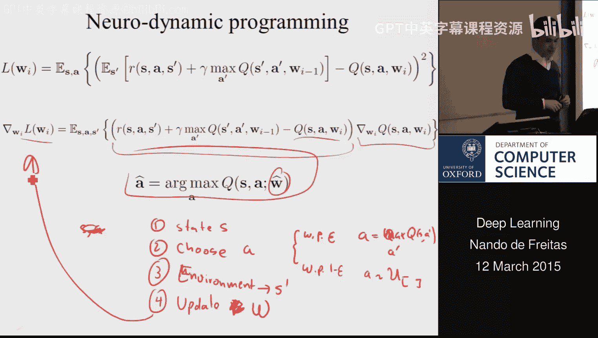
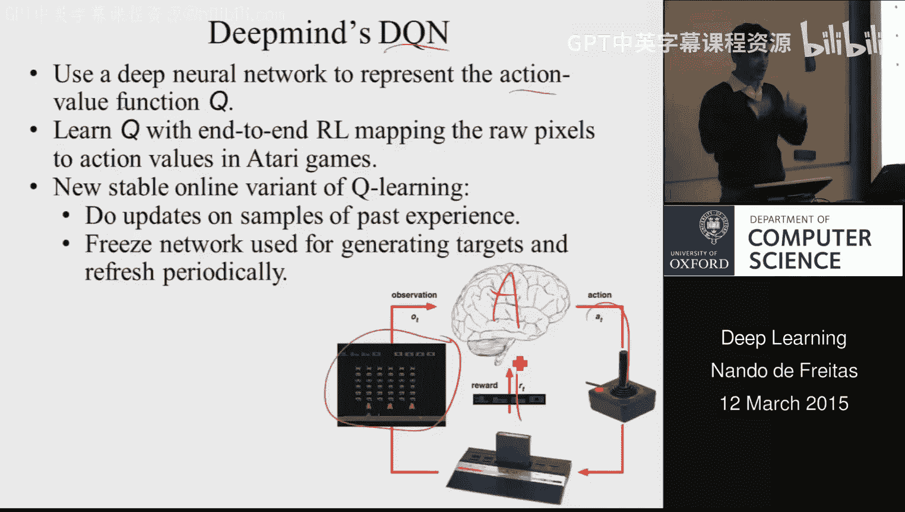
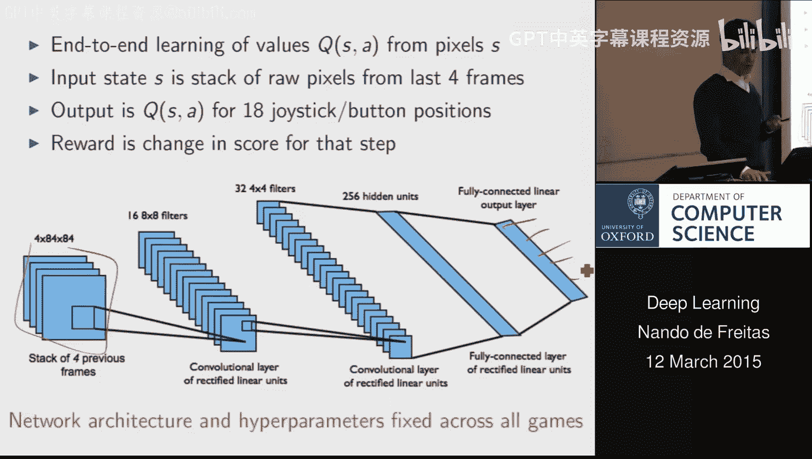
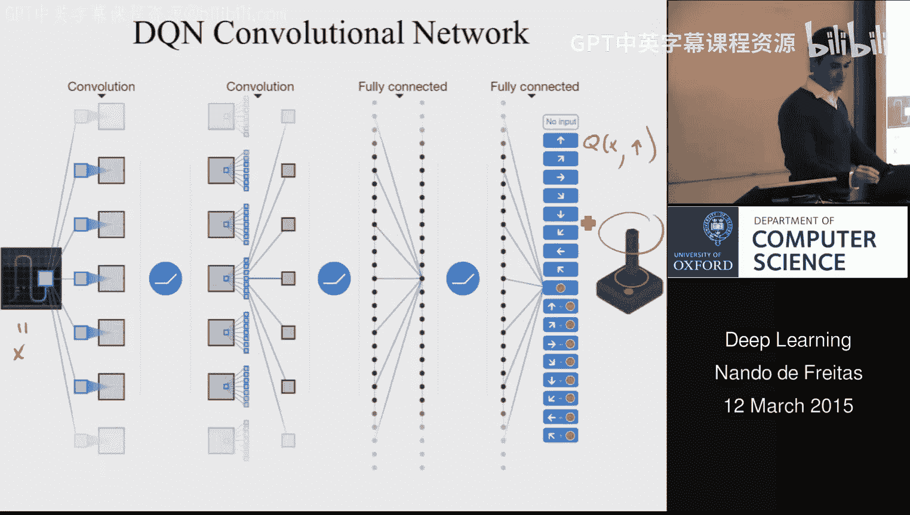
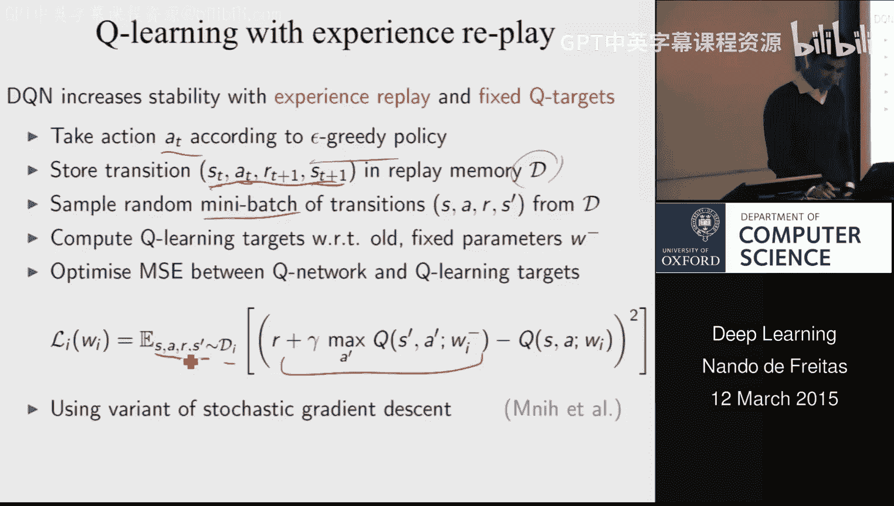
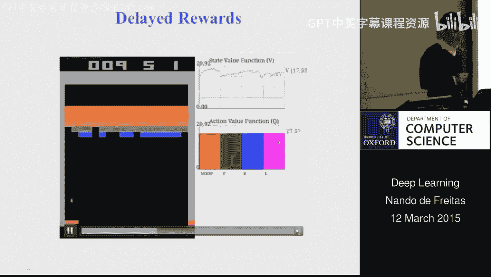
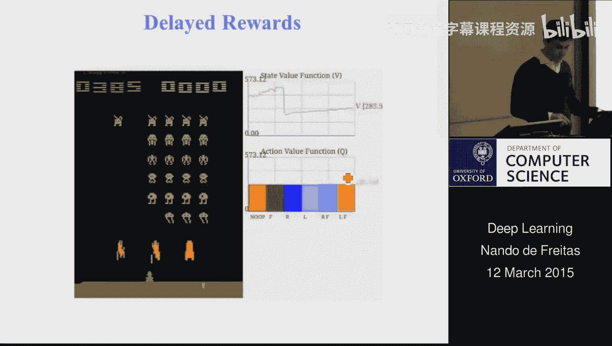
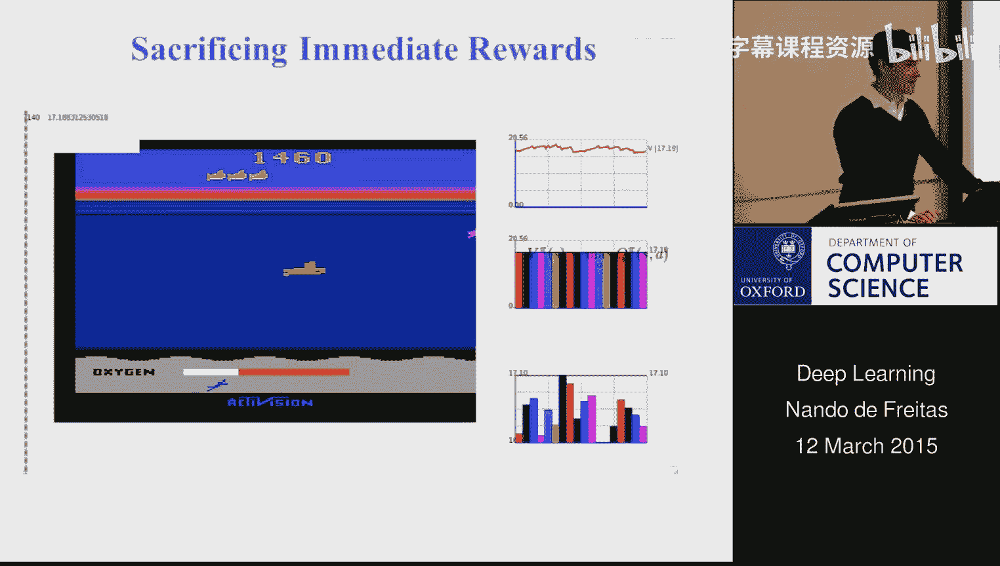
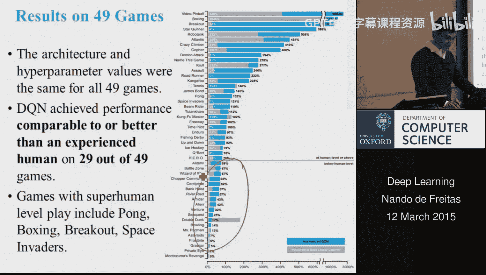
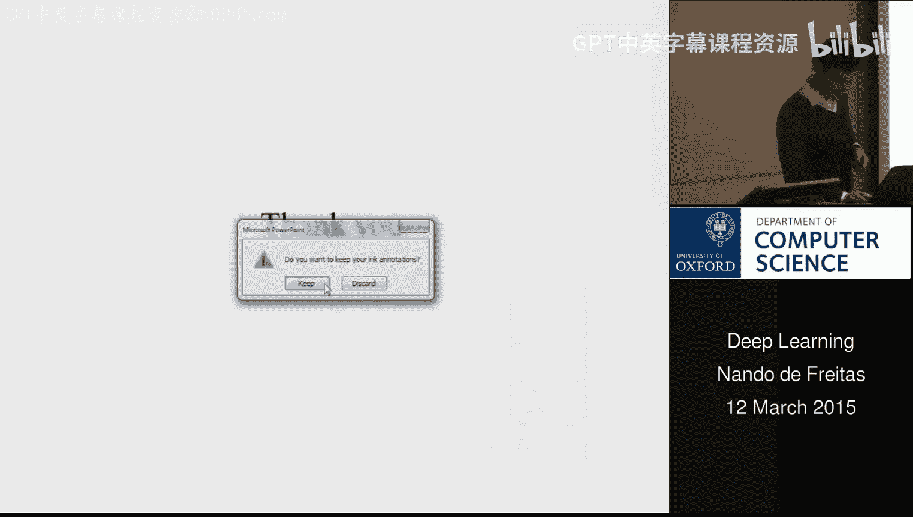

# 深度学习：15：强化学习与神经动态规划

在本节课中，我们将要学习强化学习的核心概念，特别是价值函数、贝尔曼方程以及如何利用动态规划和神经网络（即神经动态规划）来求解最优策略。我们将从策略搜索的局限性开始，逐步引入价值函数和Q函数，并最终学习如何用深度神经网络来近似这些函数，从而构建能够解决复杂任务（如玩Atari游戏）的智能体。

## 从策略搜索到价值函数

上一节我们介绍了直接策略搜索方法，其核心是直接优化一个将历史（或状态）映射到动作的策略。本节中我们来看看另一种更强大的方法：基于价值函数的方法。

策略是我们关注的对象，它是一个接收历史（或状态）并选择动作的策略。我们可以用另一个词来描述历史的摘要，即“状态”。从现在起，我们将策略视为接收某些状态并产生某些动作的映射。状态可以是完整的历史记录，也可以是其他表示（如对世界的理解、神经元的激活率等）。状态本质上是存储在记忆中的、决定我们将选择哪个动作的任何信息。

特别地，现在的策略不仅可以是随机的，也可以是确定性的。之前的课程中我们局限于随机策略，这简化了分析。但也可以对确定性策略进行策略梯度优化，不过本课程没有时间涵盖。如果你对此感兴趣，建议查阅“确定性策略梯度”的相关论文。

此外，也有方法将直接策略搜索转化为推断问题。如果你学习过涉及EM算法的机器学习课程，可以将该优化问题表述为推断问题，并使用标准的推断技术来解决。也可以将其置于贝叶斯框架中，然后使用马尔可夫链蒙特卡洛方法来解决。因此，从许多角度来看，策略搜索领域已有大量工作。

## 引入价值函数与折扣因子

动态规划是另一个有海量论文的领域。我们现在要引入一个略有不同的量，称为**价值函数**。顾名思义，价值函数本质上告诉你处于某个特定状态的价值。

**公式**：`V^π(s_0) = E[ Σ_{t=0}^{∞} γ^t R_t | s_0, π]`

其中，`s_0` 是在初始决策时刻所处的特定状态。`γ` 是折扣因子（0 ≤ γ < 1），`R_t` 是时刻 `t` 获得的奖励。价值函数评估了在遵循某个策略 `π` 的情况下，从状态 `s_0` 开始所能获得的预期累积折扣奖励。

折扣因子 `γ` 的引入是为了处理无限时间序列求和可能发散的问题，同时也使得远期奖励的重要性低于近期奖励。`γ` 的选择决定了智能体关注的时间范围。从概率角度理解，这相当于为获得奖励的时间步设置了一个几何分布 `(1-γ)γ^t`。最直观的理解方式是对未来奖励进行折现。

为了使问题简化，我们让奖励依赖于状态转移：当处于状态 `s_t`，根据策略采取动作 `a_t` 后，转移到状态 `s_{t+1}` 并获得奖励。这里的期望是对所有未来状态 `s_1, s_2, ...` 取的，而初始状态 `s_0` 是给定的输入。

计算这个方程非常困难，因为它涉及难以处理的期望和无限求和。动态规划将为我们提供解决这个方程的策略。

## 贝尔曼最优性方程与动态规划

在深入之前，需要明确价值函数依赖于所选择的策略。不同的策略会导致不同的状态价值。

理论表明，对于马尔可夫决策过程，总存在一个最优策略（可以是确定性的）能够实现最优价值函数 `V*`。我们的目标就是计算这个最优价值函数，并由此得到最优策略。

动态规划的核心思想类似于我们熟知的技巧：计算 `A*(B+C)` 时，先计算 `A*B + A*C`。我们将对最优价值函数应用同样的思路。

我们从最优价值函数的定义开始，通过分离第一项奖励、利用期望的线性性质、并进行代数变换，可以推导出**贝尔曼最优性方程**：

**公式**：`V*(s) = max_a E[ R(s, a, s') + γ V*(s') ]`

其中，`s'` 是采取动作 `a` 后转移到的下一个状态。这个方程是强化学习的基石。它表明，一个状态的最优价值等于：采取当前最优动作所获得的即时奖励，加上下一个状态的最优价值的折现值。

这体现了“最优子结构”思想：如果你在未来每一步都做最优决策，那么通过在当前步做最优决策，你整体上仍然是最优的。这类似于倒推法：从最终目标（如骑自行车时不摔倒的点）开始，反向推导出每一步的最优动作。

## 时序差分学习与价值迭代

贝尔曼方程为我们提供了一个迭代更新价值函数的方法。假设我们不再要求最优，而是针对一个给定的策略 `π`，其贝尔曼方程为：

**公式**：`V^π(s) = E[ R(s, a, s') + γ V^π(s') ]`，其中 `a ~ π(s)`

我们可以模仿随机梯度下降的思想，将其转化为一个在线学习算法。将期望项移到一边，并引入学习率 `η`，我们得到更新规则：

**公式**：`V_new(s) = V_old(s) + η * ( R(s, a, s') + γ V_old(s') - V_old(s) )`

在实践中，我们通过采样来近似期望：在状态 `s` 下根据策略选择动作 `a`，环境反馈下一个状态 `s'` 和奖励 `r`，然后使用该样本进行更新。这个算法被称为 **TD(0)**（时序差分学习）。通过多次采样更新，价值函数会收敛到该策略下的真实价值。

## 从价值函数到Q函数与Q学习

价值函数 `V(s)` 告诉我们处于状态 `s` 有多好。但为了做出决策，我们更需要知道在状态 `s` 下采取特定动作 `a` 有多好。这就引入了**动作价值函数**，或称 **Q函数**：

**公式**：`Q^π(s, a) = E[ R(s, a, s') + γ V^π(s') ]`

最优Q函数 `Q*` 与最优价值函数 `V*` 的关系为：`V*(s) = max_a Q*(s, a)`。将其代入贝尔曼方程，可以得到关于Q函数的贝尔曼最优性方程：

**公式**：`Q*(s, a) = E[ R(s, a, s') + γ max_{a'} Q*(s', a') ]`

同样地，我们可以推导出对应的在线学习算法——**Q学习**。其更新规则为：

**公式**：`Q_new(s, a) = Q_old(s, a) + η * ( r + γ max_{a'} Q_old(s', a') - Q_old(s, a) )`

注意，在计算目标值 `r + γ max_{a'} Q_old(s', a')` 时，我们使用的是旧的Q函数参数。学习完成后，最优策略很简单：在状态 `s` 下，选择使 `Q(s, a)` 最大的动作 `a`。

在探索与利用方面，一个常见策略是 **ε-贪心策略**：以概率 `ε` 随机选择动作（探索），以概率 `1-ε` 选择当前Q值最大的动作（利用）。

## 神经动态规划与深度Q网络

传统的强化学习在小的离散状态空间上工作良好。但对于像Atari游戏屏幕这样的高维连续状态空间，精确表示Q函数是不可能的。解决方案是使用函数近似器，而神经网络是强大的函数近似工具。用神经网络参数化Q函数，就进入了**神经动态规划**或**近似动态规划**的领域。

我们定义参数化的Q函数 `Q(s, a; θ)`，其中 `θ` 是神经网络的权重。目标是让这个Q函数满足贝尔曼方程。我们通过最小化以下损失函数来实现：

**公式**：`L(θ) = E_{(s,a,r,s')} [ ( Q(s, a; θ) - [r + γ max_{a'} Q(s', a'; θ^{-}) ] )^2 ]`

这里，`θ^{-}` 是目标网络的参数，它在一段时间内保持固定，然后周期性地从在线网络 `θ` 同步过来。使用独立的目标网络有助于稳定训练。这个想法是，我们有一个“演员”（当前策略）和一个“评论家”（目标网络），评论家用稍旧的知识来评估演员的表现。

以下是实现深度Q网络的关键步骤：

1.  **初始化**：初始化在线Q网络参数 `θ` 和目标网络参数 `θ^{-} = θ`。初始化经验回放缓冲区 `D`。
2.  **交互与存储**：对于每个时间步：
    *   根据ε-贪心策略选择动作 `a_t`。
    *   执行动作，观测奖励 `r_t` 和新状态 `s_{t+1}`。
    *   将转移样本 `(s_t, a_t, r_t, s_{t+1})` 存入缓冲区 `D`。
3.  **训练**：从缓冲区 `D` 中随机采样一个小批量的转移样本。
    *   计算目标值：`y_j = r_j + γ max_{a'} Q(s'_j, a'; θ^{-})`。
    *   对在线网络执行梯度下降，最小化 `(y_j - Q(s_j, a_j; θ))^2`。
4.  **定期更新**：每经过C步，将目标网络参数更新为在线网络参数：`θ^{-} = θ`。

**经验回放** 的使用打破了样本间的相关性，使训练更稳定，类似于在监督学习中使用小批量。

## 深度Q网络实例与应用

DeepMind的DQN使用卷积神经网络处理Atari游戏的视频帧（连续4帧作为输入）。网络输出对应于每个可能动作的Q值。这种设计使得前向传播非常高效：输入一个状态，即可得到所有动作的Q值。

DQN在多种Atari游戏上达到了超越人类水平的性能。这表明神经网络不仅学会了识别静态特征，还学会了理解物体的动态（如子弹的运动方向），从而能够进行有效的决策。

这项工作是迈向通用AI智能体的重要一步：能够感知世界、学习并采取行动以实现目标。它展示了端到端学习在复杂环境中的强大能力。

## 总结与责任思考

本节课中我们一起学习了强化学习的核心框架：
1.  从策略搜索过渡到基于价值函数的方法。
2.  引入了价值函数、折扣因子和贝尔曼最优性方程。
3.  推导了时序差分学习和Q学习这两种经典的在线学习算法。
4.  探讨了如何用神经网络近似Q函数，从而诞生了深度Q网络及其关键组件（目标网络、经验回放）。
5.  通过DQN实例，看到了强化学习在解决高维感知决策问题上的成功。

最后，我们必须认识到这项技术的双重性。强化学习可以用于造福社会（如优化医疗资源、开发自动驾驶以减少事故），也可能被滥用（如过度剥削用户、军事应用）。作为开发者和研究者，我们有责任思考其伦理影响，并努力引导技术向善。人工智能的进步可能改变就业结构，这需要全社会而不仅仅是技术层面的参与和思考。我们的目标是建造能够帮助人类解决复杂问题、改善世界的机器。