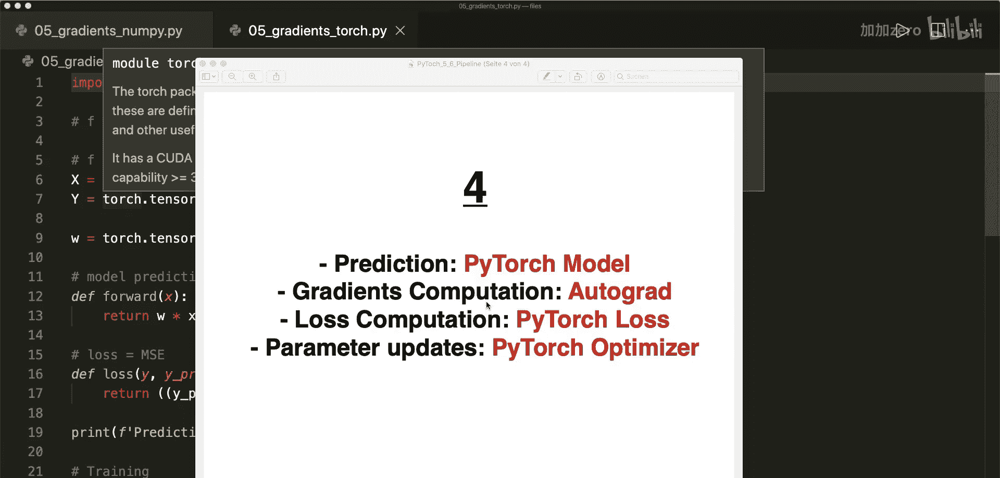
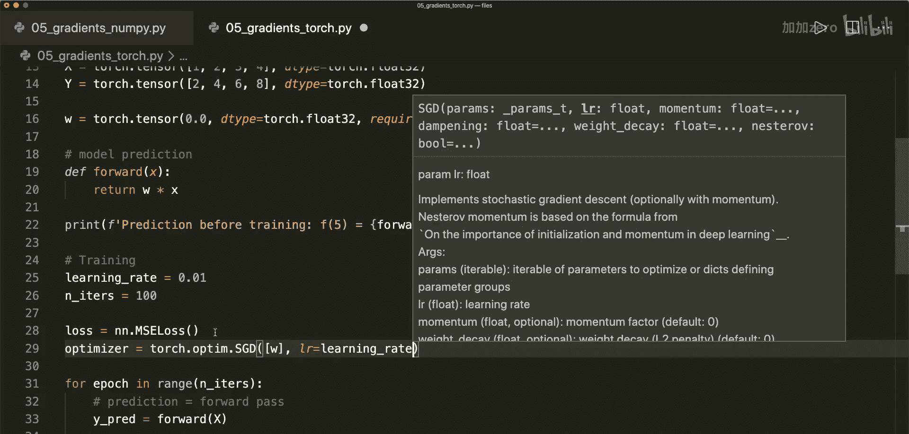
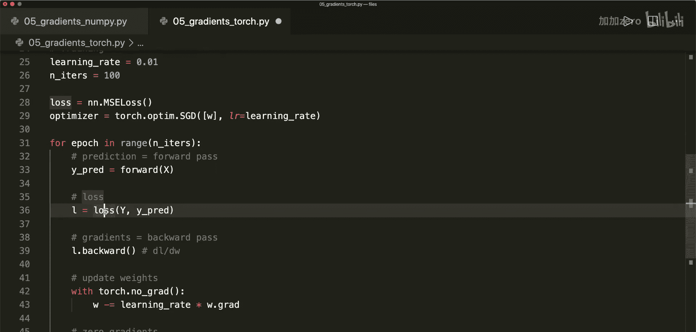
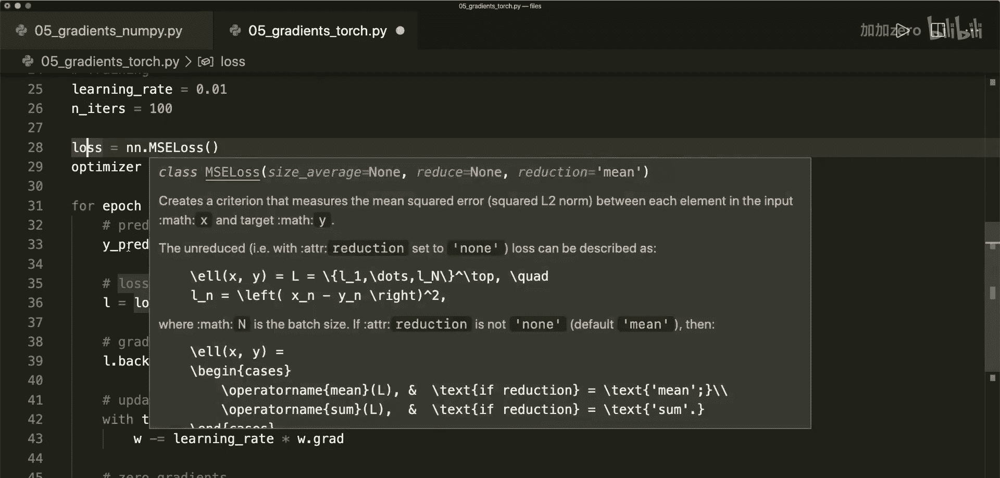
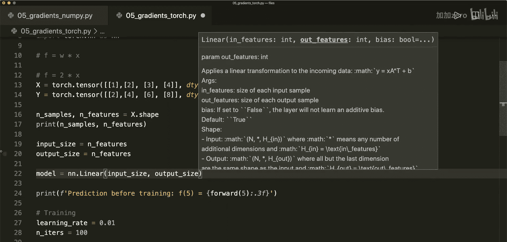
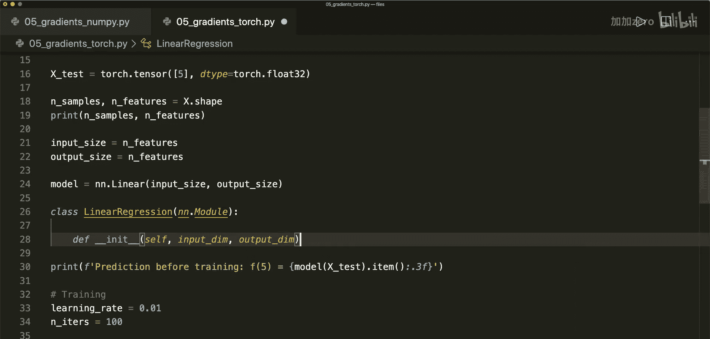
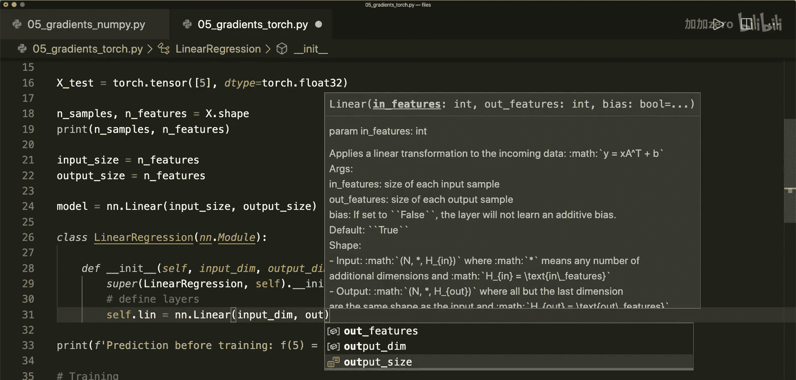
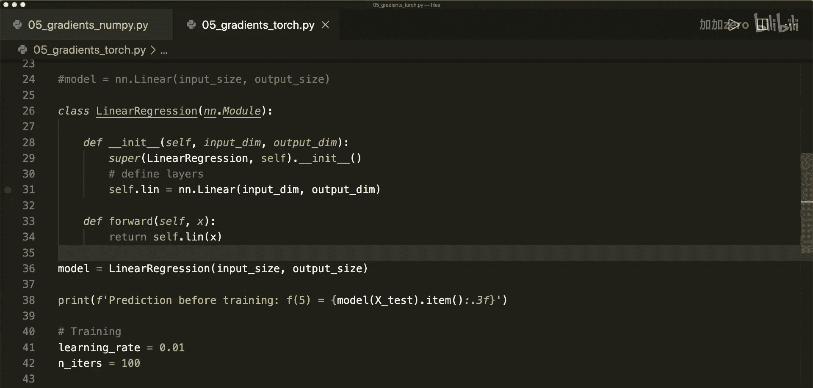

# PatrickLoeber【中英⚡PyTorch入门教程｜PyTorch Tutorials - Complete Beginner Course】 p06 p5 PyTorch Tutorial 06 - Training Pipeline： Model, Loss, and Optimizer -BV1B7fJYuE3A_p6-

Hi， everybody。 Welcome back to your new Pytorch tutorial。 In the last tutorial。

 we implemented logistic regression from scratch and then learned how we can use Pytorch to calculate the gradients for us with back propagation。

 Now， we will continue where we left off。 And now we are going to replace the manually computed loss and parameter updates by using the loss and optimizer classes in Pytorch。

😊，And then we also replace the manually computed model prediction by implementing a pytorch model。

 Then Pytorch can do the complete pipeline for us。 So this video covers steps 3 and 4。

And please watch the previous tutorial first to see the steps 1 and 2。 So now let's start。

And first， I want to talk about the general training pipeline in Pytorch。 So typically。

 we have three steps。 So the first step is to design our model。

So we design the number of inputs and outputs。 So input size and output size。And then also。

 we design the forward pass with all the different operations or all the different layers。

Then as a second step， we design or we come up with the so we construct the loss and the optimizer。

 and then as a last step， we do our training loop。So this is the training loop。

 So we start by doing our forward pass。 So here we compute。Or let's write this down。

 Comp the prediction。Then we do the backward pass， backward pass。 So we get the gradients。

 and Pytorch can do everything for us。 We only have to define or to design our model。 So。

 and after we have the gradients。 We can then update our weights。So now we update our weights。

 and then we iterate this a couple of time until we are done。 And that's the whole pipeline。

So now let's continue。 and now let's replace the loss and the optimization。So for this。

 we import the neural network module， so we import torch dot N N S and N。

 so we can use some functions from this。And now we don't want to define the loss manually anymore so we can simply delete this。

And now。Down here before our training， we still need to define our loss。 so we can say loss equals。

 and here we can use a loss which is provided from pytorch。 So we can say Nn dot M E loss。

 which is exactly what we implement it before。 So this is the mean squared error。

 And this is a callable function。 And then we also want a optr from p chargech。

 So we say optr equals torch dot optim from the optimization module。 And then here we use S GD。

 which stands for stochastic radiant descent， which will need some parameters。

 some parameters that it should optimize。 and it will need this as a list So we put our W here。

 And then it also needs the Lr。 So the learning rate， which is。Our previously defined learning rate。

And then in our training loop。 So the loss computation is now still the same because this is a callable function。

 which gets the actual y and the predicted y。

And then we don't need to manually update our weights anymore more so we can simply say optimizer dot step。

 which will do an optimization step。 And then we also still have to empty our gradients after the optimization step。

 so we can say optimizationr dot0 gra。And now we are done with step 3。

 So let's run this to see if this is working。And。So， yeah， still working。

 Our prediction is good after the training。And let's continue with step 4 and replace our manually implemented forward method with the。

 with a pytorch model。So。For this， let's we also don't need our weights anymore because then our pie touch model knows the parameters。

So here we say model equals N N dot linear。 So usually we had have to design this for ourselves。

But since this is very trivial for linear regression。 So this is only one layer。

 this is already provided in pytorch。 So this is N N dot linear。

 and this needs an input size and an output size of our features。And for this。

 we need to do some modification。 So now our。X and y need to have a different shape。

 So this must be a 2 D array Now， where the number of rows is the number of samples。

 And for each row， we have the number of or the the features。So this has a new shape。Sorry。

In new shape。That looks like this。And the same for our y。 So our y is the same shape now， So2。4，6。

And 8。 So now let's get the shape。 So this is y， I have to be careful now。

 so we can say number of samples and number of features。Equals x dot shape。And now let's print this。

 So print the number of samples。 and the number of features。 And now let's run this。

 So this will run into an error。 But I think we get until here。 So the shape is now 4 by one。

 So we have four samples and one feature for each sample。 And now we define our model。

 So this needs an input and an output size。 So the input。Input size equals the number of features。

 and the output size， output size is still the same。 So this is also the number of features。

 So this is one as an input size and one as an output size。 Now we need to give this to our model。

 So we say here input size。And output size。And then one more， then when we。

Want to get the prediction。 We can simply say we can call the model。

 but now this cannot have a float value。 So this must be a tenzoor。 So let's create a test tenzo。

 Let's say X。Test。Equals torch dot tenor， which gets only one sample with5。

 And then it gets a data type of， say， torch dot float 32。And then here we pass the test sample。

 And since this is only one has only one value， we can call the dot item to get the actual float value then。

 So now let's copy and paste this down here。嗯。And now we also have to modify our。Optimizer here。

 So we don't have our weights now。 So this list with the parameters here。

 we can simply say model dot parameters and call this function。And now here， for for the prediction。

 we also， we simply call the model。And now we are done。 So now we are using。

The pieytorch model to get this。 And also down here。 Now， if we want to print them again。

 we have to unpack them。 So let's say。W and an optional bias equals model parameters。

This will unpack them。 And then if we want to print the actual， this will be a list of lists。

 So let's get the first or the actual first weight with this。

 and we can also call the item because we don't want to see the tenzo。And now I think we are done。

 So let's run this to see if this is working。 And yeah， so。The final output is not perfect。

 So this might be because the initialization now is randomly。 And also。

 this optimizer technique might be a little different。 So you might want to play around。

 play around with the learning rate and the number of iterations。 but basically， it works。

 and it gets better and better。With every step。And yeah。

 so this is how we can construct the whole training pipeline。 And one more thing。 So in this case。

 we didn't have to up have to come up with the model for ourselves。 So here we only had one layer。

 And this was already provided in Pytorch。But let's say we need a custom model。

 So let's write a custom linear regression model。Then we have to derive this from N N dot module。

 and this will get a in it。Mt。Which has self， and which gets the。Input。Dimmensions。

And the output dimensions。

And then here we call super， the super class， So super of linear regression with self。 and then dot。

In it， this is how we call the superconor。 And here we would define our layers。So in this case。

 we say our self dot line or linear layer equals Nn dot linear。

 and this will get the input dimension and the output dimension and then we store them here and then we also have to implement the forward pass in our model class so self and x。

 and here we can simply return self dot linear of x。

And this is the whole thing。 And now we can say our model equals linear regression with the input size and the output size。

 And now this will do the same thing。 So now this is just a dummy example。

 because this is a simple wrapper that will do exactly the same。 But basically。

 this is how we design our pieyto model。 So now let's comment this out and use this class to see if this is working。

And。Yeah， so it's still working， so。That's all for now。 And now， Pyt can do most of the work for us。

 Of course， we still have to design our model and have to know which loss and optimizeimr we want to use。

 But we don't have to worry about the underlying algorithms anymore more， so。Yeah。

 you can find all the code on Giub。 And if you like this。

 please subscribe to the channel and see you next time， bye。

