# PatrickLoeber【中英⚡PyTorch入门教程｜PyTorch Tutorials - Complete Beginner Course】 p18 p17 Create & Deploy A Deep Learning App - PyTorch Model Deployment With Flask & -BV1B7fJYuE3A_p18-

Hey， guys， welcomee to a new Pytorch tutorial。 Today。

 I show you how we can deploy our Pytorch model with flask and Heroku。

 We create a simple flask app with a rest API that returns the result as chasing data。

 And then we will deploy to Heroku。 And as an example， our Pytorch app should do diit classification。

 So at the end， I show you how I draw my own ditits and then predict it with our life running app。

 So let's start。 So， first of all， let's create a new directory。 So let's call this Pytorch flask。😊。

Tuttorial。Then let's go into this directory。 and then we want to create a new virtual environment。

 So we say Python 3。😊，Minus M， V and V， N。 And this will create a new virtual environment。

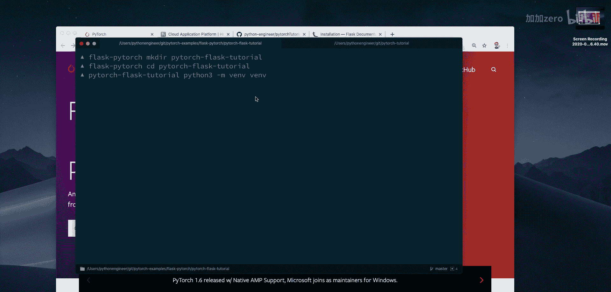

And by the way， this command might be slightly different on Windows。 So for this。

 you can have a look at this installation guide from the official fl side。

 I will put the link in the description Here。 you find all these instructions。

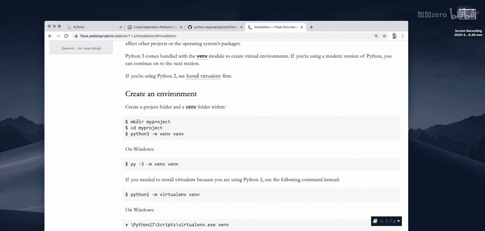

So now we have our virtual environment and now we want to activate it by saying dot v and bin slash activate and again this is different on Windows and now we install the things we need so we say Pip install flask。

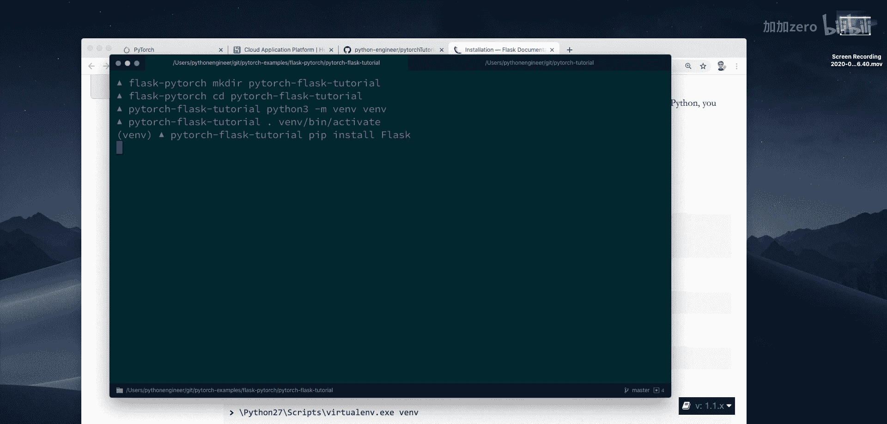

And then we install the packages for pieytorrch。 So we say Pip， install torch and torch vision。 Now。

 this will take a couple of seconds。Alright， so now we have this。

 and now I create another directory and call this app。 And then I open up my editor。

 So here I'm using visual studio code。And。Let me make this larger for you。

And now we see we have two directories。 So this is the one with our virtual environment。

 and this is the new empty app directory。 Now， inside the app directory。

 let's create a file main dot pi。 And here we will write our flask app。

 So we say from flask import flask。😊，Then we create a new or by the way。 Yes， I say， yes。

 I want to use the virtual end in here。嗯。So， this one。

And now I create an app by saying app equals flask and then double underscore name。

 This is just the convention。 how we do it。 And then we only want to create one function。

 So one API and point。 And we call this predict。 And here we do our prediction later。 And for now。

 we also have to decorate it by saying app dot route。 And then the path to the URL。

 So here we say slash predict。 And we want to say the methods。

 the allow methods is only a post methods。 So here we create a list and say post。😊，Now， this is the。

A P I route that we need。 And here what we want to do is we want to do four things。

 so we want to load an image。We want to or or get the image from our request。

Then we want to transform the image to a tensor。Then we want to make our prediction。

 and then we want to return cha data。 So the result as a cha data。 So for this。

 we also need to import request from flask， and we also import Chasonify。 So for now。

 let's do a simple return statement and return a dummy chasing data。 So here we put in a dictionary。

 So as a key， let's say result。 and then as a value， let's use one。

So now we have this and now let's open the terminal inside here and let's go into the app directory and now in order to start flask。

 we have to set two environment variables。So， I say， export。Fask app equals the file name。

 main dot pi and export flask and equals development。

 This will give us hot reloading during the development process。 And by the way， again， on Windows。

 This is not export。 So here you have to say set。 and then this part。And now we can say flask run。

 And this will start our flask app on local host port5000。

 So now we have a live running app with this end point。 So now let's test this。

 Let's create a new directory。 and let's call this test and inside here。

 let's create a file test dot pie。😊，And for this。We use the requests module。

 So we say import requests。 And I think I have to install this too。

 So let's quit the server for a second by using control C and then say Pip install requests。

So now we have this。 So now let's restart our flask app again。

And now here we want to send one post request to our to this URL。 So we say requests dot post。

 And then the URL path。 So we say H T T P colon slash slash。

 And then we can say local host port 5000。 So this is the same as we are seeing here。

 And then we also have to say slash predict like we specified here slash predict。And then。

 what we want to。Sent。 So for now， we don't want to send anything。So， let's say。

Print the response dots text。 This will print the actual cha data that we are returning here。

 So now if I go to the。Other terminal。 And let's go inside the test folder and run Python tester pi。

So I have a typo here， local host 5000。 Let's do it again。 Let me clear this。

 And now let's run Python test。 And then we see this is working。

 So we get the dictionary that we specified here。 So our app is already working。

 and now let's do these four steps。 And for this， we create another files and the same app directory。

 Let's create a file。 and let's call this torch u dot P。 And here we do our。😊。

Imports from the torch library。 So we say import torch。 We import torch dot N， N， S and， N。嗯。

Then we also say， import torch。Vision。Dot transforms as trans。Forms。

 and we say from pill import image。 So we will need this to convert our image to the Tenzoor。

 And now before we go on， let's have a look at the code that we are going to use。 So for this。

 I have this in my Pytorch repository from my Pytoch beginner course。

 and I will also put this link in the description。 So here we are going to use the tutorial number 13。

 our basic feed forward neural net to do diit classification。

 And So let me open up this in a second editor。

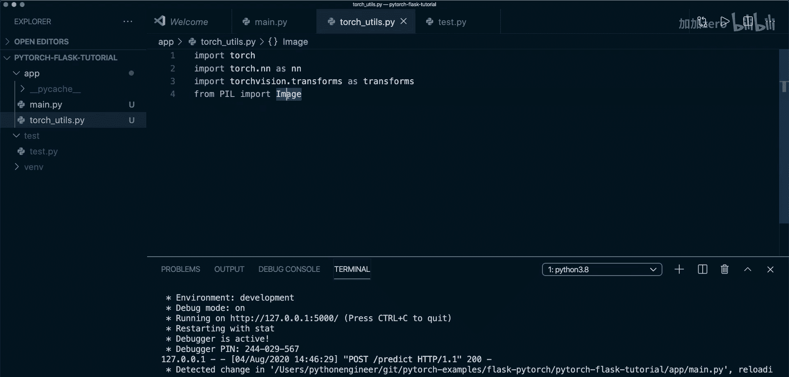

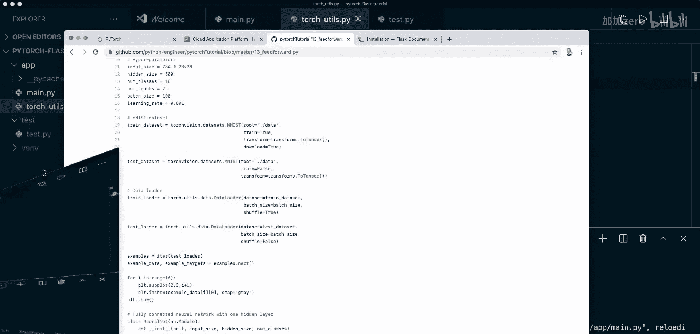

So here this is the exact same code that you can find and download on Github。 And so now basically。

 we want to run this file and then save the model。 So what we have to do down here at the very end。

 we want to say torch dot save。 And then we want to save the model dot state dit。

And then the file name。 So here we say， let's call this Mist underscore FFN dot P， T， H。

And then we want to do one more thing。 So here for our data set right now， I only have one transform。

 So transform dot to1zoa。 And now let's use another transform here。

 So let's say transform equals transform dot coose because we use more than one。 and here as a list。

 we first of all do our to1zoa transform。And then we also want to normalize it。 So I say transforms。

 dot normalize。And then here I put in the mean and the standard deviation。

 And this has to go in as a tuple。 So the mean is point。1，3，07。 and then a comma。

 because this should be a tuple。 And then as a standard deviation， let's copy and paste this。

 And here we use point 308，1。 So these are just the global means and the standard deviation from the Mnes data sets。

 that this is given here。 So just put in the same numbers here。And now we use this transform here。

 And so you don't have to do this。 but I just want to demonstrate that later in our inference。

 we want to apply the same two transforms。So now we use this and now we want to run the code and then save it at the end。

 So here I'm using a conda environment。 So the same as I used in the in the。

Tuttorial in the beginner course tutorial。 So I say Connda activate。3con， activate pie torch。

And then let's take Python。 And this file is number 13 feet forward to pi and then run it。

 And this will take a couple of seconds。Alright， so now it's done。

 And you could see that our during our training， the loss decreased。 And at the end。

 we have this accuracy。 So it's pretty good。 And also in the same folder appeared， this file here。

 So we want to copy this and then paste it into this directory here。 So now。We can close this。

 and now we can start。Implementing the pipeline here。 So here we want to do three things。

 So we want to load our model。 We want to have a function to transform an image to a tenzor with the same transformations that we've just seen。

 And then we want to have a function to predict， to do the prediction。 So。

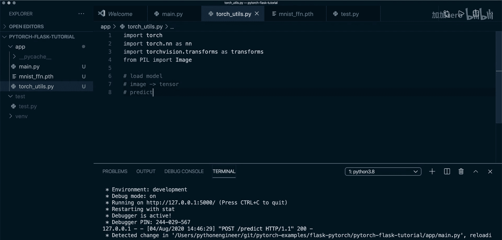

Now， let's go back to the。

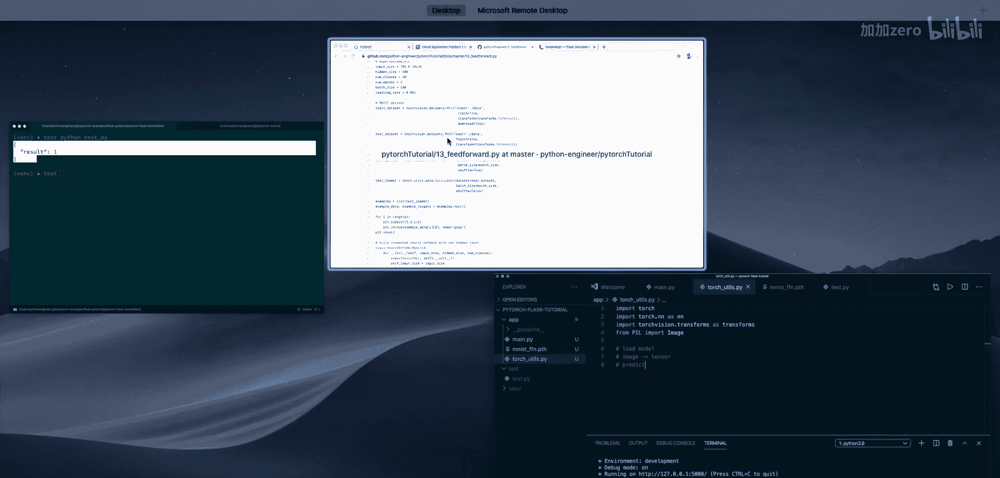

嗯。Original code。 And from there we copy a few things。 So we copy this part。

 We want to have the same model class。So let's paste it up here， and we need these parameters。

 and we remove the two device calls。 So for now， or in this tutorial， we are only using the CPU。

 So now we need the input size， the hidden size and the number of classes。

 and we also get this from here。 So we have。

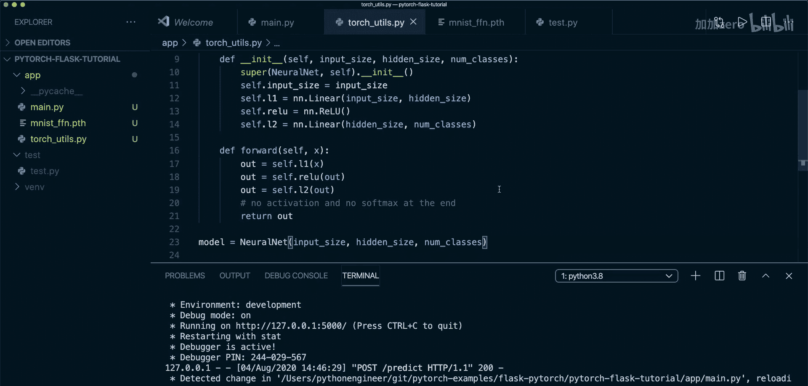

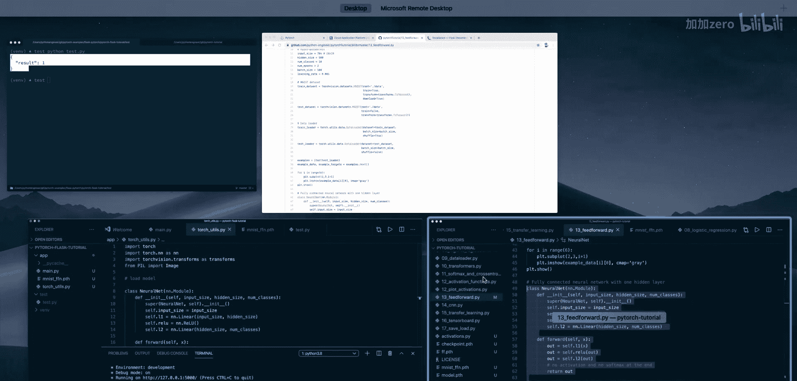

These hyperparameter。 So let's copy them over here。

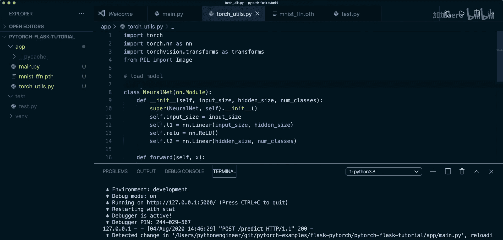

Then， we create our model。

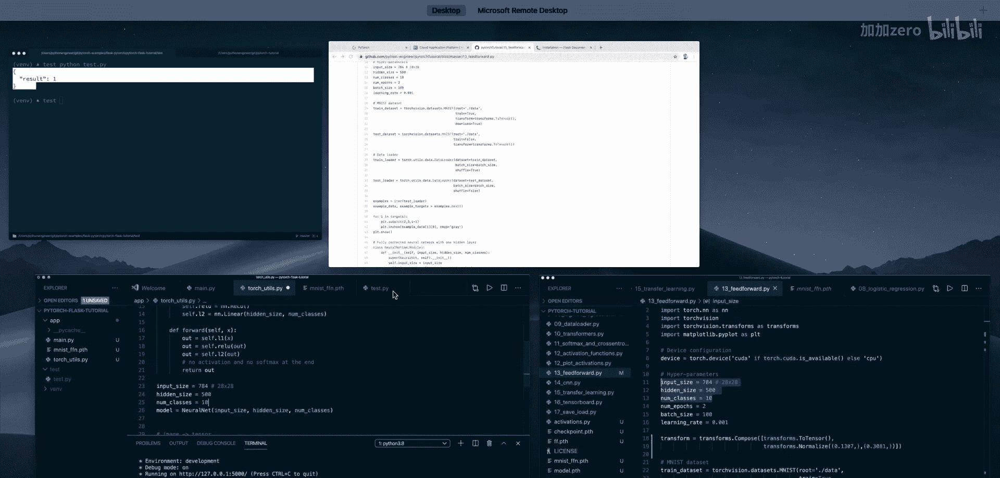

And then we want to load the state stick。 So by the way。

 you can also find this in my Github repo how we save and load a model。

 So this is tutorial number 17 and here we can grab this part。 So this is the recommended way。

 by the way， when we only save the state dit。 So then we create our model from the class。

 and we load the state dit。 and we also have to set it to evaluation mode。 So this is very important。

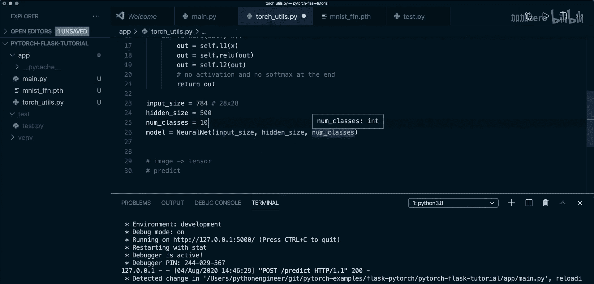

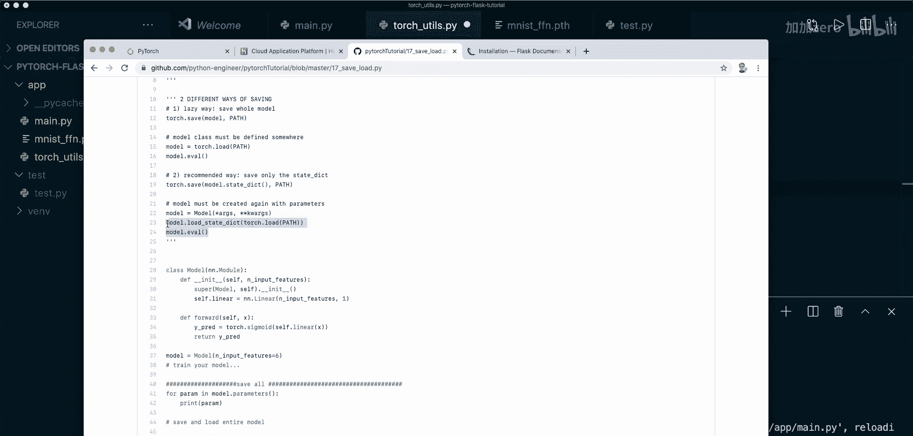

And we also need the path So the path equals。 And then this is the file name here。

 So it's in the same directory。 So we say Mest underscore FFN dot PH。 And by the way。

 if you trained on the GP， then you must be careful。

 So but you also find how you load it from a GP to the CPU then。

 So you have to specify the map location。 and this is our CPU device。

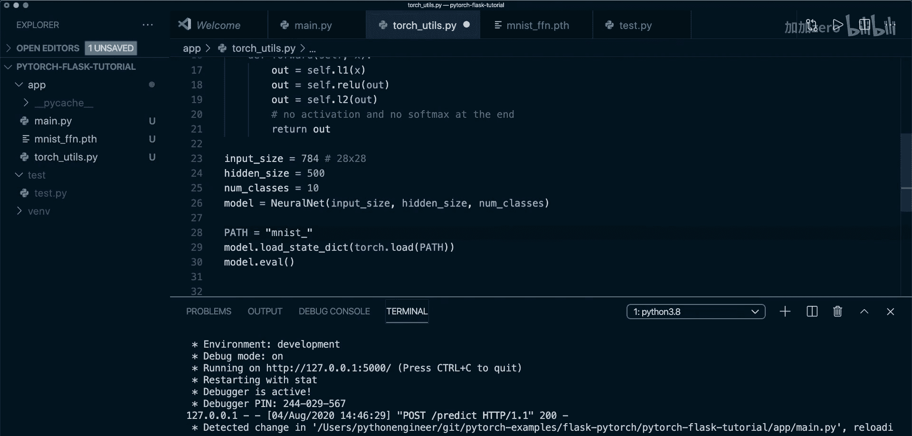

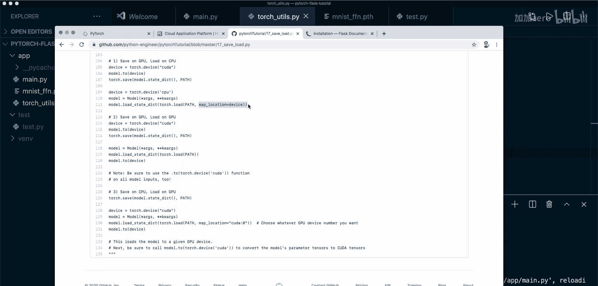

So now we have this。 So now we have our model。And the next thing we want to do is define a function to transform。

 transform the image， and this will get image as raw bytes as an input and then here we want to create a transform by saying transform equals and then we grab the same thing as we are having here。

 So we want to have the same transformation steps as in our training。

 but we also want to or need to have some more here。

 So for now this could also be a RGB image as an input。

 but we only want to have it as a grayscale like here when we are loading this Mnes data set。

 and this is in grayscale format and it's also in exactly this size。 So each image has。

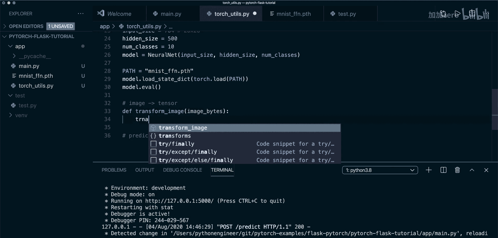

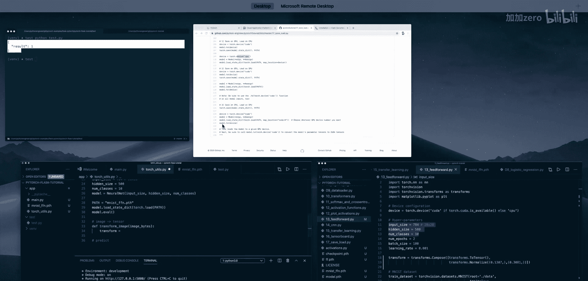

28 by 28 pixels。 So we have to use these same values too。 So we applied two more transforms。

 So we say transforms dot。 and then we can use gray scale gray scale。

 and then here we can say the nu of output channels equals one because we only have want to have one output channel。

 And we also want to resize it。 So we say transforms dot resize。

 And then as a tuple the size28 by 28。 So now we have this。 So let me format this a little bit nicer。

So now this is our transform， and then we want to apply it。 So first of all。

 we want to create an image， a pillow image from the image bytes。

 and we can say image dot open and then I O dot bytes I O。 And then our image bys。 And for this。

 we need to import， sorry。Import I O。 So to handle input out output streams。

And then we want to apply our transform and then can return it。 So we say return， transform。

 and then our image。 And we also say unque。Unsqueze 0。

 So this will return a new tenzor and inserts a dimension of one at this position。

 because during draining， we have the number of batches on one axis。

 and now we only right now we only have one image。 So we have to add this axis and only have one sample in our batch。

 So now we have this and now one more method is missing。

 So now we have to write a function to do the prediction。 So we say define get。Prediction。

 and this will get a image tensor as input。 And now for this， we also can have a look。At the。

Original code。 And down here we do the evaluation。 And here we use the same code。

 So let's copy and paste this。And here。 So we resize our。Image to be in this shape。

 Then we can remove this part because we don't use GP support。Then we perform the forward pass。

 and then we get the prediction by calling torch dot max。

 and then we can return the predicted class or predicted index。

 And now this is all we need in this file。 So now this is all the code for our inference。

And now we can go back to our main file and then import this。 So we say from torch u。

 we import let's it was called transform image and get prediction。 So now in our predict method。

 we want to implement this pipeline。 And here we want to be very careful because we don't want to have an error here。

 So then our server crashes。 So we do some error checking。 So first of all。

 we check if our request dot method equals equals post。 And only then we do the code。

Then we get the file。 So we later we pass a file to this post request。

 and then we get this file by saying file equals request dot file dot get。

 And then we use the key file later。 So now first we check if file。

Is not or we say if file is none or file dot file name equal equals an empty string。

 Then we return chason file。 and here we return a dictionary where we put in a arrow is key。

 And as a value， we say no file。 So this is the first thing we check。

Then we also check if this is an allowed extension。 So for example。

 we only support P and G and Jpeck files。 So we say if not allowed file。

 And then here we pass the file dot file name。 Then we also return a error。

 So let's say return Chasoniffi， and then let's say format not support。Ts。And for this。

 we create a little helper function。 So let's say define a allowed file。

 and this will get a file name。 And then our file name could be， for example。

 sum name and then dots P and G， our ending。 And now we want to define some allowed extensions。

 So let's say extensions equals。 And this is a set with only unique values。

 So we support P and G JpeEC and Jpeg with an E。 So。😊，And now， here， we return。Dot in file name。

 So our file name should be this format。And also， now we want to check the ending。

 So we want to split our file。 So we say file name dot R split。 So from the right side。

 and we want to split at the dot and only have maximum one split and then we take the second part。

 So this part。 So this is index one。 Then we convert it to lower。

 And then we check if this is in our allowed extensions。 So now。

This will return true if our file name looks， for example， like this。So now down here， we can go on。

 And so now what we want to do is we want to load the image bys。

 then do the transformation and our prediction and this part。 And for now。

 I wrap this in a try except block。 So this is not very good error handling。 But for now。

 this should be okay。 So if we have a exception in this part， then we say error。

 and let's say error during。嗯。Errra during prediction。

 And then here we say our image bys equals file dot read。

Then we say our tenor equals transform image and put in the image bytes。 Then we get the prediction。

 prediction equals get prediction with our tenor。 and then we want to return the result S A。

Chasten file。 So we do， let's say our data equals a dictionary with the prediction key。

 And you'll use prediction prediction dot item because we cannot put a tenor in this。

 But our tenor only has one element。 So we get this by saying prediction dot item。

And in case of the Mnes data sets of this。For example， this has index 0。

 and then this is equivalent to the number0 that we have drawn。 So basically。

 we also want to return the actual class name。 but in this case， this is the same。

 So here we just do for demonstration， we return the same thing as a string。

 So string prediction dot。Item。So here， for example， if we would use the Cypher 10 data set。

 then we would have to do a a mapping。 So for example， index 0 is a car or a ship or whatever。

 So this is what you want to put in here。 So now we have the data。

 And now we only have to return this as a cha object again。 And then we should be done。

So I think this is all we need。 So now let's see。 So our server should have reloaded automatically because we set the。

Environment to development。So now let's go to our test file。

 And here we want to put in the files to our post request。 So we say files equals。 And remember。

 this is a dictionary with the key file。 And now we need a file。 So for this， let's go to Google。

 and let's search for Mns。

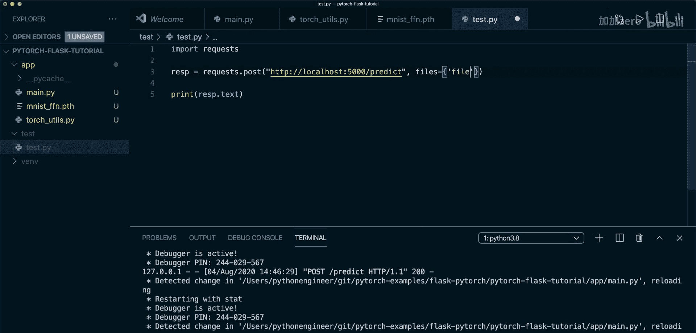

Image。

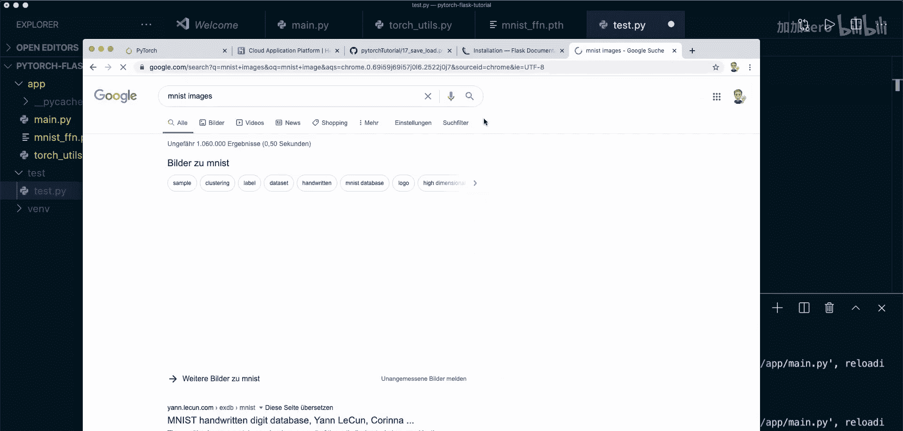

And let's go to images。 and， for example。Where is it。Let's grab this image。

 So let's click on save image as。And then I will save it as 7 and on my desktop。 and then I will。

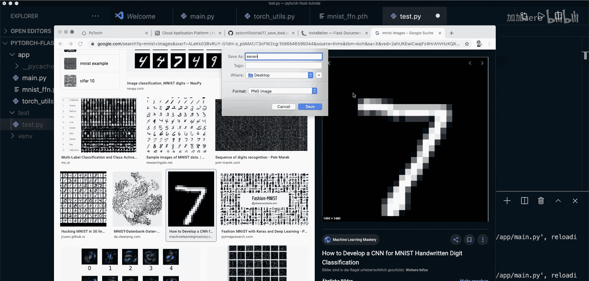

Let me quickly grab this and copy it into this folder。

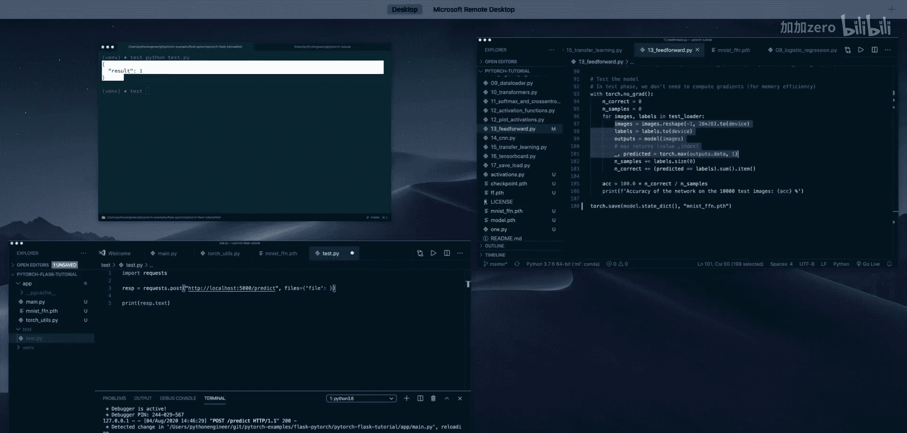

So now we see we have this image in the folder。 So now we want to open this here。

 So here we say open and then the file name 7 dot P and G。

 and we want to open it in read binary mode。So， now we have this。So now， again。

 let's go to our test file。 And now we should get a result with 7 if everything is working correctly。

 So now let's do P test up pi and cross fingers。 And， of course， it's not working。

 and if we go and have a look at this terminal and we get a syntax error invalid syntax。

 So let's go back。 And let's have a look。 So here I missed a comma， I guess， So let's save this。 And。

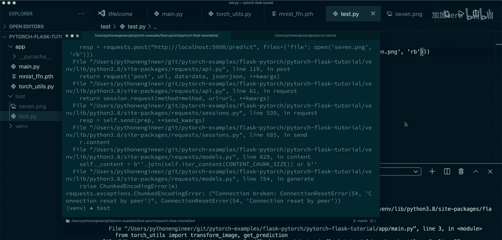

Now our server crashed。 So we have to say last run。Again。

 and that's exactly why we want to be very careful in this method and do some error handling here。

So now let's test this again。 So let's clear this。 And now let's say， oh， sorry。

 this was the wrong one。 So here I want to say。Python test dot pi。

 And then we get error during prediction。 So it's still not working。 So for now。Let's comment the。

Try block out and let's see whicharrow we are having。

So now you could see why this is not the best error handling because we don't see what went wrong。

 So again， our server started。 So let's say Python test of pi again。

 And then name transforms is not defined。 So again， I am having a。

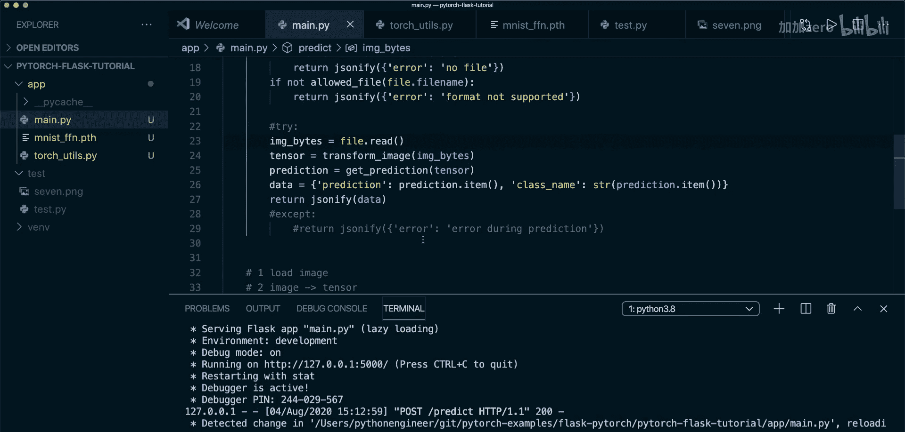

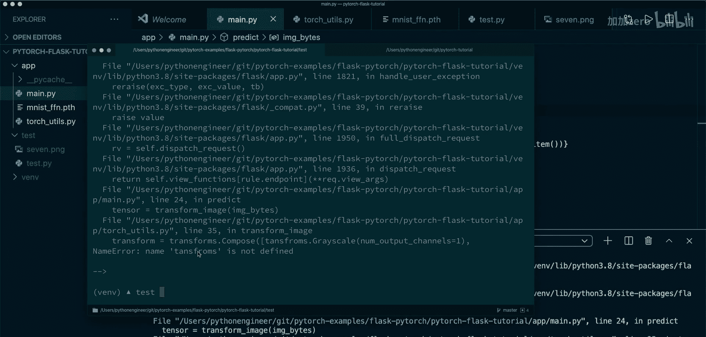

Typepo here， trans。Forms， sorry about that。 So now， So now let's save this and。

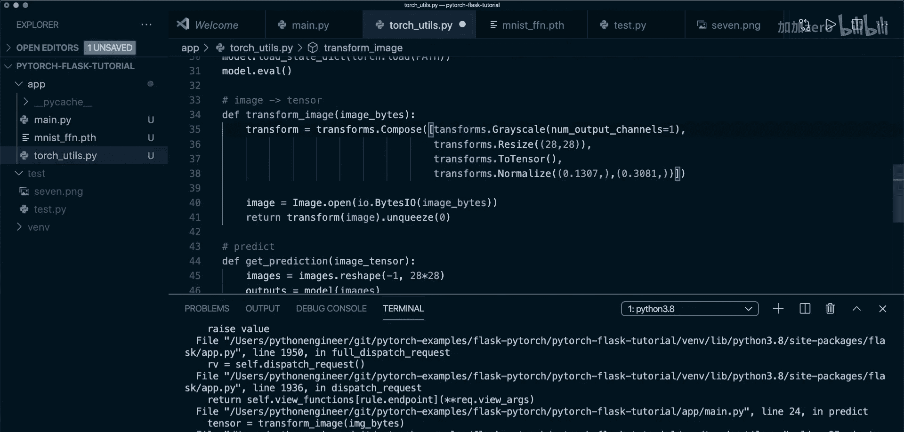

Let's run it again。Tanor has no op attribute on squeeze。 So again， a typo。

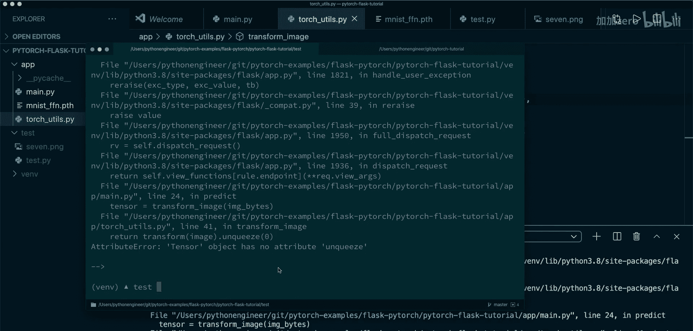

Un squeeze。

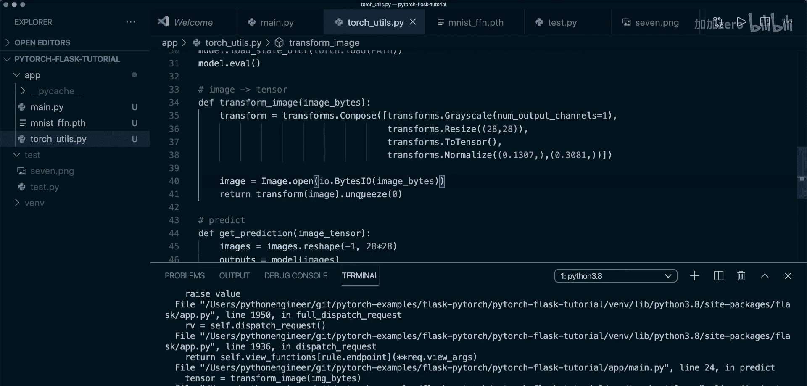

And again， Python tester pi images， image。

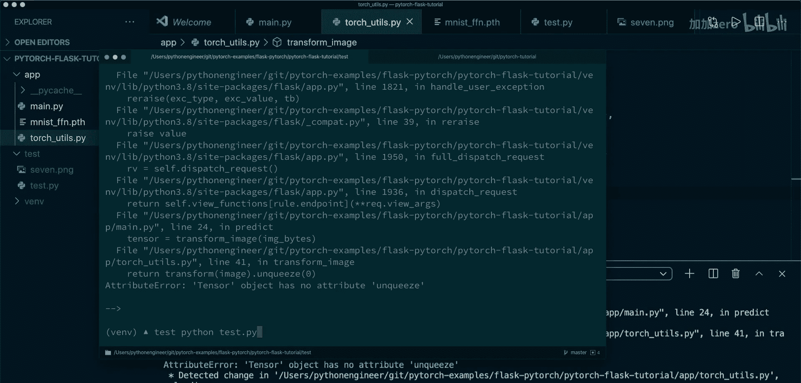

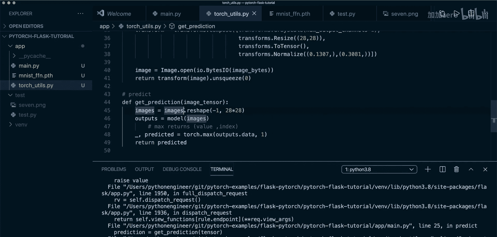

Cancel。And now。

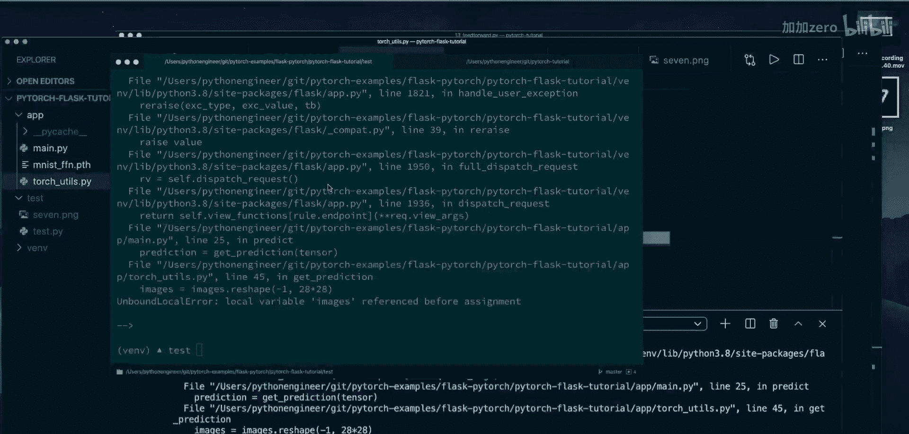

Python test pie。 and now it's finally working。 So now we see that our flask G is running and our Pytorch model is doing the correct thing。

 So now I can add our try except block again。 So let's in then this part and do our accept block again。

😊。

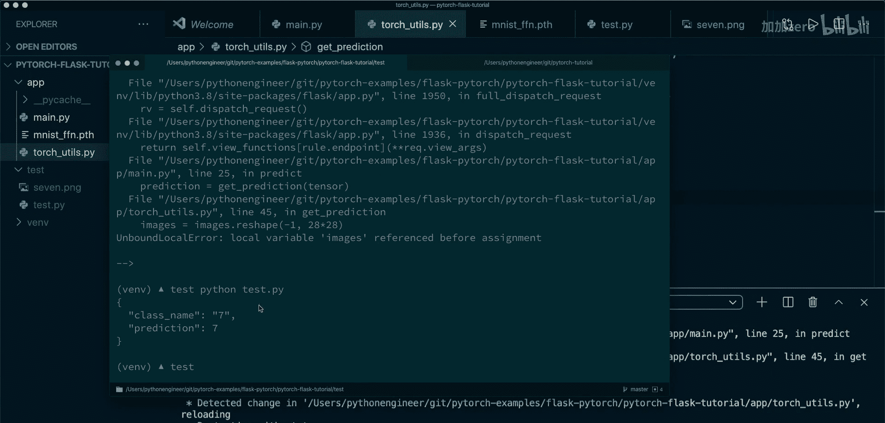

So now we can remove this。And now let's test this with our own images。 So I'm using paintbrush here。

And then I specify a new image with width and height is 100 pixels。 And now， for example。

 we want to be careful。 We want to have the background in black。So I fill a background with black。

 and now I'm using a white pencil。 And then， for example， let's do a three here。 and let's save this。

As3 do P and G。 And then let me copy this inside the。Folder here。And now let's use this one。

 So let's use3 dots P and G。 And let's go back and let's clear this。

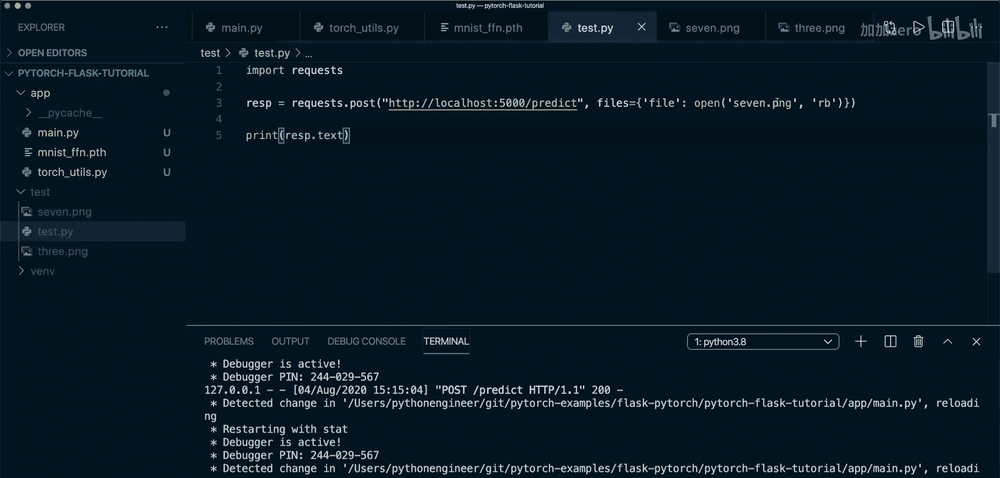

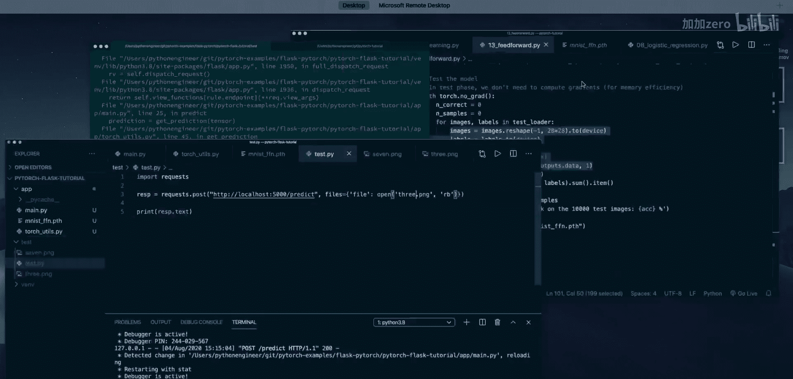

And run it again。 And we get the prediction is 3。 So， yeah， this is pretty nice。 So now we have this。

 and now the only thing left to do is deploy it。So for this， we have to do a couple more things。

 So the first one is to use an actual web server that is suitable for production。 And for this。

 we use Q unicorn。 So I say Pip install Q unicorn。Then， in our。Base folder， we create a new file。

 and let's call this W SG I dot pi and move this to the base folder。 And here we say from app。

Dot main import app。 And now we want to create a heroroku app from this。 So for this， of course。

 you need to have a heroroku account and the heroroku command line face installed。 So if you。

Haven't then go to the official website， Heroku dot com。 And there you find the instructions。

 I already did this。 So now I have to lock in。 So I say heroroku lock in minus I to do it in the terminal。

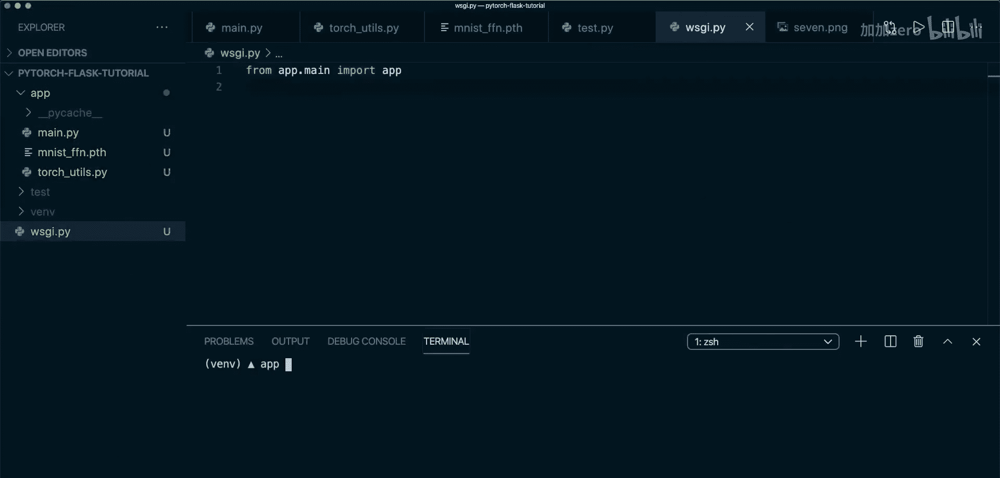

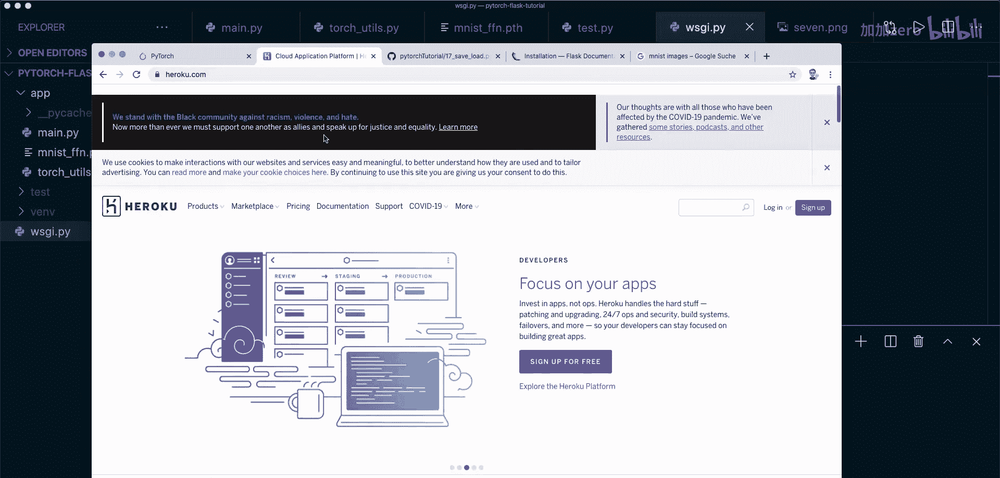

Then I have to put in my credentials and my password。

And now it says I'm locked in so I can clear this again。

 And now we want to create a new app by saying heroroku， create。 And then the name。

 So let's call this flask pie torch tutorial。This will create a new Heroku app。

And in order to test this， we can go to the。Base directory again。 And we need to do。

One more thing we need to update our path names the same way as we are doing it here。

 So now app is our base package。 So this folder here。 So in the main file。

 we have to say from app dot torch us。 and inside this， we have to modify our path。

 So this is now app dot Mnes F F N dot P， T， H。Sorry， here it's app。 slash this one。

And now we can test this by saying heroroku local。 So this will start。

 how we first need to have the profile。 So let's create a new。Proug file， sorry， sorry。

 I want this in there。Top directory again。 So let's say， let's call this proc file。

 This is what we need for heroroku。 And here we need to specify。 We want to have one Web app。

 and we want to use G unicorn with our new we W S G I file as starting point and our app。

 So this is the syntax。Now， again， we can test this by saying heroroku local。And now this is working。

 So this is starting our T unicorn server on the same port。 So now not our flask app is running。

 but our heroroku app is running locally。 and again。

 though the server didn't change so we can again test this by saying Python test do pi。

 So this is still working with our new correct path names。 And now we can stop this。And now。

I also want to create a。Runtime dot T， X， T。 And inside this， we specify our Python version。

 So now this is Python 3。8。3。Then， we also。Let's clear this。 We also need our requirements。

 And since we use Pip， we can say Pip freeze and then greater and then require U requires dot T X T。

This will write all of our requirements that we installed inside this package。Inside this T X T file。

 But we have to modify this because right now we are using the normal torch and torch vision。

 And this takes a lot of space。 And this is too large for Heroku。

 So we have to use the CPU only version here。 And for this。

 we can go to the official Pytorch website。 And then have a look at the installation guide。

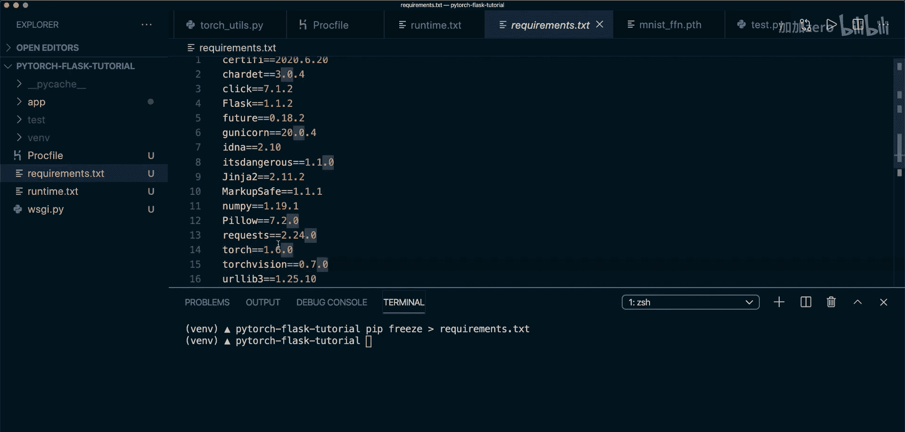

So here we use Pip as our package manager， and we don't want kuda support。 And so on Mac。

 I actually used this command。 But on Heroical。 we have Linux。 So we need this command。

 So we need to have plus CPU appended to our torch and torch vision。

 So we say plus CPU here and plus CPU here。 and we also need this command。

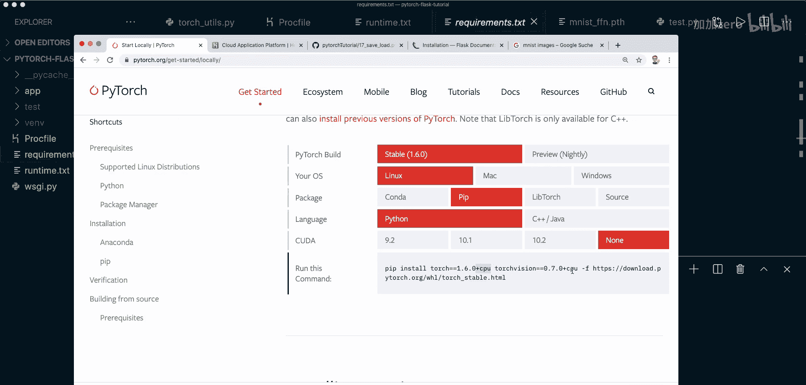

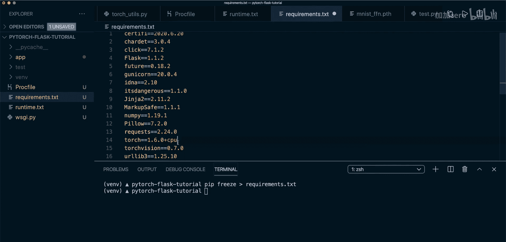

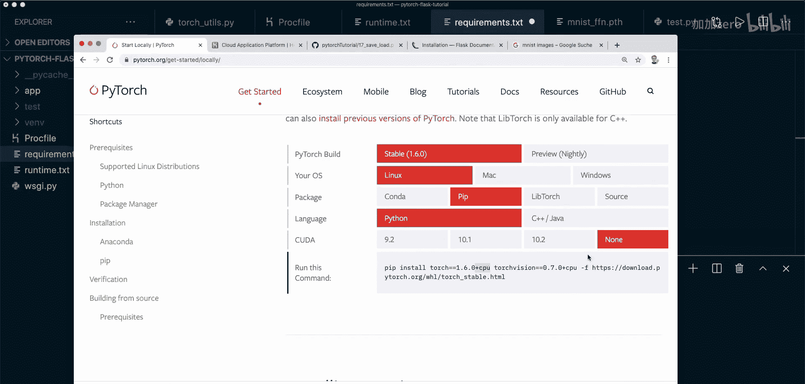

And we can write it at the top of our requirements file。 So here。

 So now this will install only the CPU version on Heroku。

 And now in order to push this directory to heroroku。 We need a git rappo。 So we say git in it。

 Then I want to add a git ignore。 So I create a new file， Git ignore。 And for this， let's go。

 or let's Google， let's say Python git ignore。 And I think this will lead us to git up。

 And then here we can copy all of this。

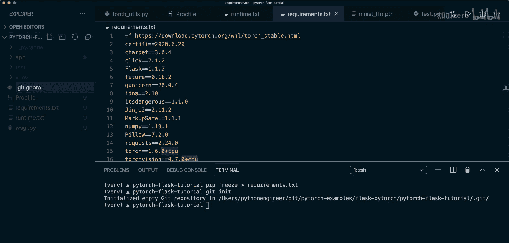

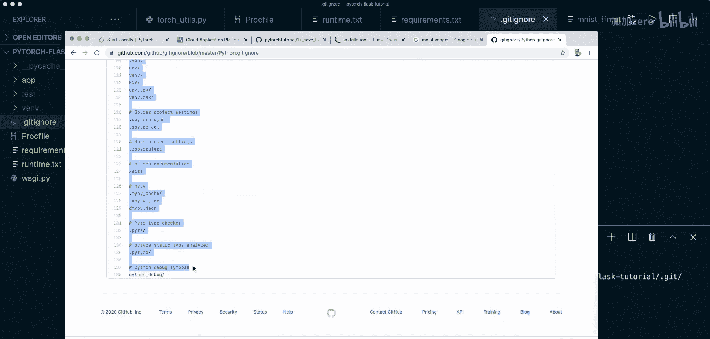

And put it in our git ignore。 And at the top， I also put in the test folder。

 So I want to ignore this folder tool。 So let me quickly check if I have everything that I want in the rapple now。

 So list looks good。 So now we have all of this。 So now we want to add this as a remote ripple for heroku。

 So we say heroku git colon remote minus a。 And then our app name。

 So I think we called it last minus pi。

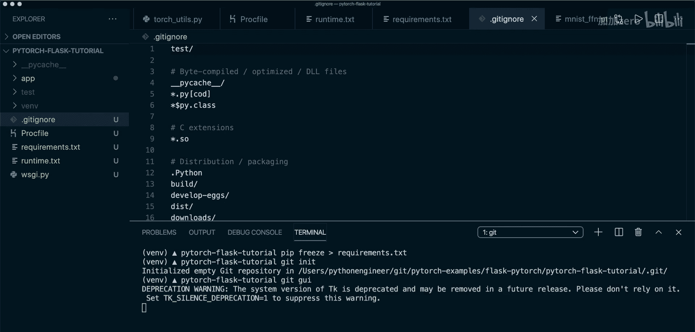

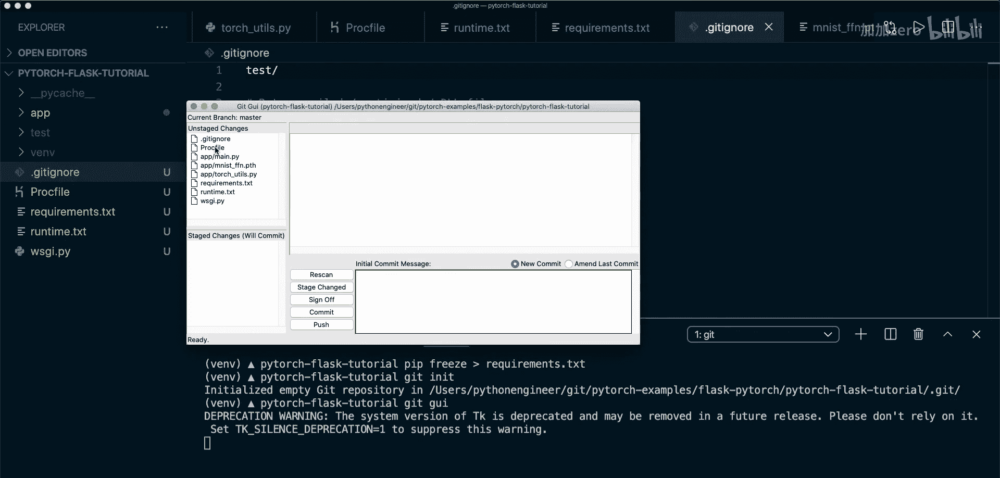

Torch minus tutorial。This will add this as a remote dpo， and now we add all of our files。

 So we say git at dots and then git commit minus M。

 And let's say initial commit and and now we can push it so we say git push Heroku master。

 This will push all to Heroku， and then start building and deploying the app。

 So now this takes a couple of seconds。Alright， so this was successful。

 And now it's set deployed it to this URL。 So here at this path， we now have our life running app。😊。

So now let's go back to the test dot pi。 And instead of the local host。

 we use this URL and then slash predict。

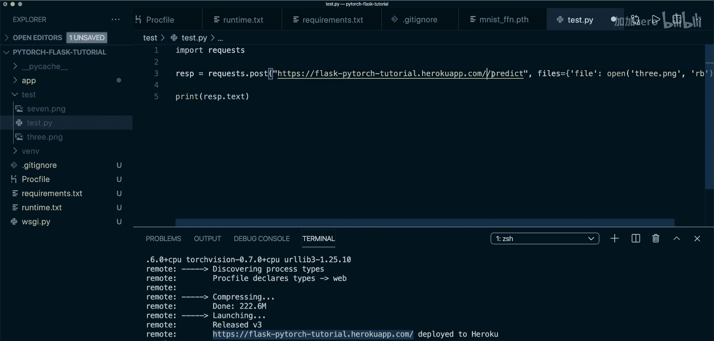

And then let's go back to our test file。 and let's run Python test again。 And now we get the results。

 So， yeah， so this is working。 So now let's do one more test。 So again， let's use my paint program。

 And as a background， we have black。 And now let's straw， for example， a 8 like this。

 And let's save it as。😊。

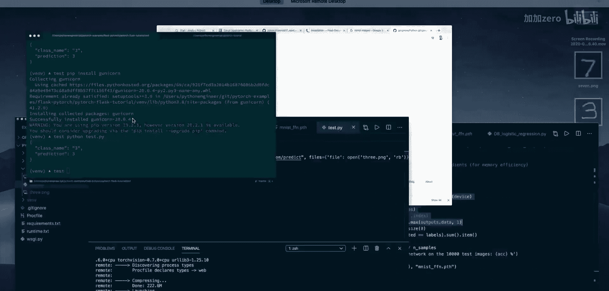

8 dot P， N G。 And then let's move it into this folder。 And here let's use this。8 dot P and G。

 And again， save it and clear this and run it again。And we see we get the prediction is 8。

 So this is working。 And we have a life running app deployed to heroroku。And yeah。

 I hope you enjoyed this tutorial。 If you like this。

 please subscribe to the channel and leave me a like and see you next time， bye。😊。

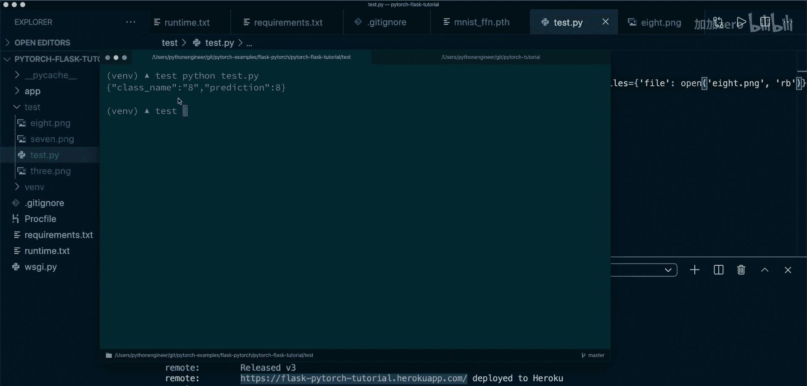