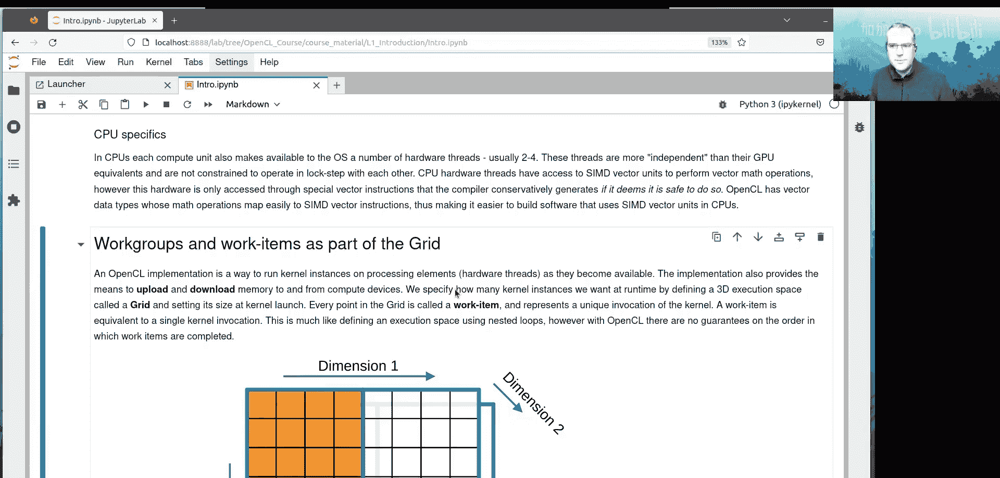

# 【OpenCL编程 Pawsey超算研究院】 p01 p0 OpenCL - day 1, part 1 - Introduction to OpenCL [BV1fMz5Y3EDV_p1]

Welcome everyone to our day one of Open SEL training before we begin I'd like to acknowledge the traditional custodians of the land that we are all dialing in from here in Perth with what are people of the Newgar Nation。

I'd like to pay respect to their elders past present and emerging and I'd like to extend that to all Aboriginal and Torres Str I this around the above all right so my name is Fatia I work as education and training specialist I'm assisting Toby today。

Toby welcome， thank you for。Doing this， we're all looking forward to the session just letting you know that Tobys happy to take questions so if you have any questions feel free to unmute and ask if you can't please put your question in the chat and we'll attend to that。

😊，And with that， I think Tovi， I'll pass it on to you。Okay。

 well welcome everyone it's really really great to see you really great to see some new faces。

 really great to see some faces from previous training sessions。😊。

So this training course has has been。Worked on for the past year or so so its it's been a year in the making to produce this so yeah really excited it's going to be quite a journey we're going to be teaching openC over four pretty much full days。

😊，And。There is a lot of material to cover so it is going to feel like drinking from a fire hydrant at times。

 but whatever you can catch is things that you can use later on so the training material that we've got will conserve as a reference material for you know for things that you might discover or want to use down track。

And so yeah my preferred training style is to have everything interactive and fun， so yeah。

 don't hesitate to interject or to ask questions at any time。

 don't hesitate to try things and to break things， at at least we then get get to learn together。

Okay so my background， I have a background in computational astrophysics。

 I did CFD simulations of a expanding supernovava remnant for my PhD and I was also one of one of the IVC inter that Posy interns back in 2007 2008 so yeah really benefited from being from being from the help that slash IVEC have given。

Yeah， credentials for satanonics。And what you can do is you can just pop your name yep next to the credentials and I see that pretty much everyone has got some credentials for satonics。

The next thing that we need to do is test those credentials by logging into sats。pasy。org。

au with the credentials that you have。So if you have access to a terminal application。

 so usually that's on the command line。You can then log into Sonics that way。And。

The next thing that is in the welcome letter is if you scroll down， so does share my screen。Okay。Yep。

 so can everyone？Everyone see this okay。All right， so we've got。Yes。

Yeah can clearly excellent excellent Okay， so we've got the link to the credentials here so if you just scroll down in the welcome letter。

There is some information on how to log into Conics， so we use SSH with our username。At satonic。hasy。

org。au。And once you are in satonics， you can get access to a GPU node。

Using an interactive job with the SalLEC command so you can see there's this SalEC command and so whenever you're doing an exercise on satonics we can use this SalLc command to get access to a reservation that we have on satonics right now so we have eight GPU nodes。

Reserved just for the next four days that we're going to be doing the Open sealL workshop and you can get access at any time using this SL command to access the reservation so that will drop you into a command prompt into which you can try things with openCL。

So just scrolling down， I have created an openCL environment。

 so there's lots of openCL applications that we're going to use in in the course and if you do a module use this directory here so if you run this command that will get you access to the modules for the OpenCL course and then you just have to do module load programming environment open CL。

And you can do this with the Gu。Environment as a base so don't have to worry about swapping out to the cr environment you just use the module use and then the module load programming environment open seal and that will get you access to。

Two open seal implementations I have an implementation that works on the CPU for satonics。

 but I also have access to the rockham。The Rockham framework in which there is an open CL implementation so that those module use and module load commands get you access to both openCL implementations。

If you just scroll down a bit further， there is some backup logins that we have。

And if you click on either of these two links， you'll be taken across to。

My server that I have here at home。And that is at hub2。poaggos。consulting。

com and that is a Intel machine with an AMD Radon 7 graphics card， so a gaming variety graphics card。

And you can run openCL applications on both the CPU and the GPU that is there。

I have had a bit of trouble with Hub2 just because of internet flakiness。So unfortunately。

 Hub2 might have some connection issues here or there。

🎼Another resource that we have is a cloud instance with an Intel CPU implementation and。

So that is running a T4 a tuuring based graphics card and that's on the cloud so that should be quite reliable but I won't have hub one running all the time because it's costing it does cost a fair bit of money for a machine of that size okay so we'll have hub one running during the course days but H two will have running all the time。

Okay， so the course material just scrolling down is located at the Gitthub link so you can click on that and you can download the course material to your machine and I'd highly encourage you to do that so if you download that and then unzip that。

You can then have the cross material available on your machine and you can just use a web browser to look at the HTML pages that are inside the course material。

Okay， so click on that link， the GitHub link， and you will start to download that course material to your machine。

The next thing that we need to do is actually have the course material available。From satanonics。

Because there's going to be some exercises that we'll be working through。

So while you are logged into Saonics preferably in an interactive job。

 you can use Wget to download the course material to your Sc folder。

So you go once you've logged into Zonicix and you have an interactive job using the SLL command above。

You can go CD to My scratch， so my scratchch is a variable containing the location to your scratch space on satonics and then you can use this WGt command to download the course material。

Unzip it with the unzip with the DD flag that is important because then you don't run afo of the 30 day deletion limit on scratch and then you can change directory to Open Se course dash main course material。

And if GitHub is too slow， I have a backup version of the course material in software projects。

 courses 01 satonics， so you can do either of those two methods to get the course material。Okay。

 so now on your computer after you've done that step。

And you've got the course material on your machine。

 you can go to Open seal course main course Ma L1 introduction。Intro。html。

And then then you can see the course material that we are going to start with。

Okay so here is the course material now if you click on the hub one and hub two links it will take you it will it will once you've logged in to the Jupyter hubs that I have so hub one and hub two if you click on those links you'll be taken directly to the course material so it will download the course material for you and drop you into the introduction so so this is the file structure of the course so if you go。

If you unpack the zip file， you'll see open C course or openC course main。

 and then you can go to the course material folder and here is the material for all of the lessons。

So we've got L1 introduction， so that's where we're going to start at so you can click on that。

And because we're using Jupiter， we can click on the notebook here。

 so that that's the introductory notebook for the course。All right。

So open CL is short for open computing language。And it's an open standard for running compute workloads on heterogeneous architectures。

 so that means that it can work on CPUUs， GPUs and specialized compute devices like FPGAs。

So that is immediately something very unique and special。

 the frameworks couda and hip do not have that ability that I'm aware of at the moment。

So you've got access to a wide variety of hardware through OpenSeL。

The OpenC trademark is held by Apple。And the standard is developed and released by a consortium of companies called the KronosOS Group and there's a link here that you can click on that will take you across to the website for the Kronos Group。

This is really good because its the standard is designed by committee。

 so you have the collective wisdom of about 150 companies driving openC。

 it can also be a pain for progress but on the whole it's a good idea。

That also means that there is great， fantastic even documentation because the Kronos group maintains the standard。

 but they also maintain the documentation for the standard。And so that is that is very good。

 so the open OpenC itself is just a document， it's a specification for what should happen。

With a set of APIs。It is then up to vendors such as Intel and VDA， AMD to implement that standard。

And they are free to implement that standard as they see fit to make the standard work on their hardware。

So the OpenCL specification is just a document and you can click on this link to download the specification from the Kronos website。

GPUs for scientific computing so for those of you who have done the H course a lot of this material is going to be cross pollinated from the hip course so I do apologize if。

The material is similar， but then you can see the ways in which open seal maps to the same problems or concepts that we're going to cover。

Okay， so graphics processing units were originally designed to perform the complex calculations needed for rendering 3D scenes。

So this process is readily parazable， you can assign a calculation to every pixel that you are then displaying to the screen。

 so initially these rendering calculations were offloaded to specialized hardware pipelines to be performed。

In parallel。Eventually this specialized hardware became generalized and programmable。

 and this meant that GPUs became capable of other tasks like scientific calculations。

Commercial pressure to achieve the best frame rates in gains led to GPU designs that incorporate high bandwidth memory and the ability to run lots of calculations in parallel。

C始。So these days GPUs have floating point performance and memory bandwidth that exceeds CPUUs by often an order of magnitude and so just in the table below is the estimated capacity of the compute devices on satics so on the CPU nose we have the AMD E 7763 processor and that has an estimated processing power of 1。

8 teroflops per second。So that's 1。8。Terra Fox or terror operations。

Of floating point operations per second。The radon instinct MI 250x GPU that is in satonics。

 so on each GPU processor there are actually two GPU dies and each of those GPU dies can do about 24 terof flops。

Of compute performance。And。On satonics， you have frameworks like H that can make use of those GPUs。

 but you also have open CL。And OpenCL is a framework that provides a way to harness the compute power of both the CPUUs and the GPUs。

And it also has the ability to use FPGAs as well， so if you are in radio astronomy， for example。

 they might be looking at devices such as FPGAs to do very specialized math operations as part of their data collection and so openCL is sometimes the only implementation that will work on FPGAs。

Okay。So。Open seal features from a distance， so open seal is a mature specification that has been around for a very long time。

 at least in computing speak， I think the first implementation was in 2000。And eight。

 but we'll check that。Okay。Okay， so yeah open seals mature specification。And we've said that it is。

Developed by the Chronos Group which is a member led Consortium of more than 150 companies。

 so every major computing vendor such as AMD NviDdia。

 Intel Xlinks and RM has some implementation of OpenCL that follows the specification。

 so some companies are very much in favor of OpenseL such as Intel。

 so Intel has probably one of the best implementations of OpenCL but NviDdia and AMD also have some first rate implementations of OpenCL as well。

Okay， so there have been a number of specifications for open seal that have come out over the years and it is up to the computing vendors how。

Much they want to implement of the specification or how many specifications they want to implement。

Okay。Okay， so this， what this means for you， the researcher。

 is that a code that is developed for one compute device has the potential to run on another compute device from another vendor without significant modification。

Although as we'll find out， with CPUUs and GPUs， there is two。

 there will be an algorithm that works well on a CPU。

 but you may have to modify or use a different algorithm to work on a GPU。

So there is potential though， there is potential for the one algorithm to run on all devices。

Without significant modification。So in supercomputing。

 there has been a welcome change in diversity among available hardware options。

And so what I mean by this is that a while ago， a few years ago。

 we only had one choice of GPU vendor。Now we've got three really good choices for GPU vendors。

 so Intel has got its HPC GPU offerings available now AMD has some really fantastic scientific grade GPU offerings and in video of course has theirs。

So there's now a welcome change now in diversity of hardware vendors and so Openseal enables users like yourself to navigate this diversity without incurring significant porting costs when moving platforms now I think that's something that you're encountering now ash is that you have this rendering code that works really well on KUudDa but your finding because。

Because Saonics is using H now， there is issues in trying to port that code across。So open steel。😊。

Helps you eliminate or reduce those costs when moving or hopping from one architecture to another。😔。

Okay， so the ability to switch hardware vendors out is of significant value to end users like yourself。

Unfortunately， though， it can be of lesser importance to some hardware vendors who by nature prefer to devote resources to ensuring the success of their proprietary frameworks。

So thus， progresss on open SE implementations tend to lag behind both in performance and capability when compared to frameworks like KUDa。

And hip。Now this is not true of all companies， some companies like Intel are very。

 very much for OpenCL， but with other companies you might not find as much enthusiasm。

That's because OpenC is a bit of a competitor to their own platform and therefore it is。

It is advantageous to further the success of their proprietary framework。Okay， so what we can expect。

Is that？With OpenCL on some platforms， one can expect to encounter poor or even nonexistent support from debugging and performance monitoring tools。

As well as performance that approaches but seldom exceeds what can be achieved with proprietary frameworks。

 so what this means is that if you're going to use open C you do have to be。

Aware that you'll have to accept that your performance will be in the same order of magnitude as the proprietary framework。

 but it will not in a lot of cases be as performant as the proprietary framework so that's the that's the price that you pay of being able to hop around between different platforms。

So on some platforms they are committed to getting the best performance for OpenCL。

 but on other platforms， you won't get as much performance as the native proprietary implementation。

Okay。So opense is a mature standard and it has first rate， I mean。

 fantastic support for consistent math across compute devices and that is because as part of the standard the compute devices must adhere to IE 754 arithmetic。

So that's the reason that's the reason why it has first rate support for consistent math so if you do one mathematics operation on one device you should get the same result on another device and for someone working in the scientist it's like yes thank you that's what I need。

OpenCL also has support for large vector types up to 16 elements long。

 and this is great because some C pipelines， for example， in CPUs。

They can work with vectors up to 16 elements long。Shared memory support in OpenCL is first rate and it is well placed to make use of system on chip architectures such as the upcoming AMD In MI 300。

So that is a combined CPU and GPU processor。And both the CPU and the GPU will have access to the same memory。

Okay， so the shared memory support in OpenCL is well placed to take advantage of those kinds of architectures。

So。😊，We're getting now to。You know。The question is Open seal right for your project？

So this is sometimes a difficult question to answer researchers often have diverse computing needs so in such cases OpenSL is a good fit and that it will provide a solid and flexible foundation for your research tools Having said that if you're looking for the best possible performance and you're not worried about vendor lockin。

Then it's probably better to look at using vendor specific tools and frameworks。However。

If you prefer open standards and you need consistent results across devices。

Sport for large vector types and great documentation that comes with a mature implementation。

 then openCL can be a great foundation for your project。

So here are some challenges and benefits in using open sealL and before you start to develop something in open C you have to be。

Aware of these things， so it's good to be aware of these things。Okay。

 some challenges with using Opense is that performance when sorry performance with a vendor's compute device often lags。

Their proprietary framework。It's just something that we have to accept now。

 typically I think from what I've seen the performance difference is something like you get 90% of the performance that can be achieved with the proprietary framework in the sciences though we're happy with the same order of magnitude so if we've got the same order of magnitude as the proprietary framework。

 then that's good enough。Okay， so open seal code is often the both though。

And there is tedious amounts of boilerplate code with increased potential for errors。🤢。

So one thing that OpenC codes have is that the programme is responsible for compiling the code。🤢。

And setting arguments。For setting arguments for kernels。

And that adds a lot of tedious amounts of boilerplate also in device setup。

The programme is also responsible for discovering compute devices and setting up contexts and things like that。

So that's where the boil platelate is coming from。But you can reduce this boilerplate by having some homegrown header libraries that encapsulate most of the boilerp and in fact this course I've developed a boiler plate sorry a header file that removes a lot of the complexity of the boilerplate。

So so that the boilerplate doesn't get in the way of the learning。Okay。

 so the developer has to manage kernels and compile kernels explicitly。

There is little or no support from the vendor for debugging and performance measurement。

Thankfully the vote there is open C， sorry， there are open source tools out there。

Some but not exhaustive that will help you to debug open seal kernels and to measure the performance and in fact within the standard itself there is ways where you can time the the running of kernels。

So you can time how long a kernel launch takes。So and that's within the standard itself。

There are challenges for hiding intellectual property that is contained in kernels。Now。

 the reason why this happens is actually related to this point here in that the developer has to bring in the source code。

For compiling the kernel。So when you run an openCL application。

 you may have the kernel code in a separate file， so the developer has to manage kernels and compile those kernels explicitly Now one thing that you could do is you could include the source code as a string inside your program。

But then there is a challenge for hiding that intellectual property because if you open the binary up in a text editor。

 you can actually see the kernel source。As ASI text within the binaries， so that's not a good way。

If you want to hide intellectual property contained in a kernel you can do things like encrypting the source code and then decrypting it as you so there's some challenges there there's some challenges therefore hiding intellectual property that is contained within kernels now if you are in research using research then it's not so much of an issue because everything is kind of open but if you are。

You know， if you're in an industry， then hiding intellectual property is a very， very。

 very important aspect。Okay。So performance differences between compute devices。

 a kernel that works well on the GPU may not work so well on scpU and vice versa so when you're developing open seal code you。

May not have a kernel that is a one size fits all， you may have to develop two kernels。

 one for CPUs and one4 GPs。There is sometimes undefined behavior。Across open seal implementation。

 so some vendors might do something some way and that might introduce some undefined behavior so that's a bug that needs to be。

Nes to be sorted out。But what I'm saying is that you might have a code that works really well on one vendor。

 but then that code。When you move across to another venue， you might get some undefined behavior。

So the vendors try to make their Open seal implementations conform to the standard。However。

 sometimes when you're hopping between implementations。

 if you haven't done things entirely according to standard。

 then you might get some undefined behavior when moving across to another vendor。

Okay so library support is rather sparse so inr and H for example。

 you have a whole bunch of you know machine learning functions and and things like that that support is quite is a lot more sparse with opense so the chances of you having to roll your own solution are a lot higher if you use Opense。

Okay。Also with OpenCL is that you don't have access to very specific or device specific hardware。

 such as Tensor or matrix course， so you have to call a vendors you have to do things the vendor's way if you want to get access to specializedised hardware like Tensor or matrix course。

And just from a technical point of view， buffer allocations。

 so are they are allocations of memory on the compute device。

 they are sometimes limited to one quarter of the available device memory。

So with the vendors implementation。That restriction is often not there。

 so you can use all the memory on the device in one allocation。

 but with openCO the buffer allocations are sometimes limited to one quarter of the available device memory and that could just be not a nefarious purpose。

 but that could just be the way that they have implemented things。U so。😔。

That's something to be aware of is that you may not be able to allocate in one go。

All the memory on the compute device。And the literature on using so while the standard is the documentation on the standard of the specification is fantastic the literature on using opencl is quite sparse and you'll see this if you try and have a look at。

You know， open seal examples。Maybe on the NVIDdia implementation， there are some examples there。

 but are they are from a long time ago， so they're just kept as maintenance。So。

The literature on using open seal is quite sparse。Okay。

 so that's the challenges now the benefits from using OpenCL is it's a straightforward well defined seat API with great documentation。

 it's a long lived and mature standard。Production quality。

 open seal implementations that've been around for quite some time。And because it's an open standard。

 the standard is not explicitly contingent on the wellbe of a single vendor。So for example。

 if you had signed up for Venor lockin and then that vendor went bust。嗯。😊，Then， you know。

 you've got a problem， but because you can hop around between vendors。

 it you're a bit more resilient to that risk。You've got the ability to use a wide variety of compute devices such as FPGAs and CPUs。

And standard data types， long vector data types such as Fte 16。With first rate swizzling operators。

 so a swizzling operator is something where you can say that elements 012 is elements 654 from another vector for example。

That's what a swizzling operator is。And then you've got consistent math between devices using the IE 754 standard。

Okay。So are there any questions surrounding？Surrounding that one。Okay， excellent， all right。

 let's continue on。So an open seal implementation。Then。Is a framework to support？

The running of lightweight pieces of code， called kernels。

In parallel over the available course of a computer device。So this is an open seal kernel right here。

And what that does is that tanks in allocations of memory on the compute device so that is source and D。

And this is the length of the number of elements in these allocations。

We get our position in the right。And then we just compute。The absolute value。

Of the source at position GI zero and we set that result to the destination at location GID zero so this is a very simple kernel and a kernel is can be thought of as a specialized piece of software to do a specific thing。

Okay， so that's a very light weight。嗯。They have very lightweight function to do a specific thing。

So that's what the kernel is。Now， an open SEL implementation is a way or a framework to support running of many thousands of these implementations。

Across sorry， many thousands of these kernels in parallel。

Over the available course of a compute device so a GPU might have。You know。

 thousands of hardware threads available。And you can run a kernel as a single instance over。

Each of those hardware threads。So that's what a kernel is a specialized piece of software。

So a software thread。Yeah， so in order to take the absolute value of every element。

We need to run this kernel。At every point in the array。

So this kernel just takes the absolute value at a single point。In your array。

But we need a way to run this kernel at every point in your way。

So a software thread can be thought of as the execution of。

A sequence of compute instructions independently from other threads。So in that sense。

 a kernel is run。Inside a software thread。A hardware thread is a pipeline of physical machinery on the processor。

That executes the instructions。In a software thread。

So compute devices have a number of cores to manage memory。And execute software threats。So my laptop。

 for example， has eight cores in it。In AMD and Open seal terminology。

 these cores are called compute units。Every compute unit makes available to the OS a number of hardware threads for running kernels。

Every core in my laptop makes available to hardware threads。🤢。

That can be used to run kernels independently of each other。So in open seal terminology。

 a processing element。Is the smallest or fundamental unit？Of running a。Yeah。

And it's synonymous of running a software thread， and it's synonymous with a hardware thread。

 So a processing element means hardware thread。Okay， so how do GPUs and CUs differ？

GPUs use a single instruction， multiple thread processing model。

So instructions are executed by a compute unit。Over teams of hardware threads。😔。

And these teams of hardware threads。Opererate in lockstep with each other so they're all holding hands。

 they're all executing the same instructions。Together with different data。

So they're operating in lockstep with each other and in parallel。So for AMD GPUs。

 the teams of hardware threads are 60。Four or 32 to 64 threads。W？😮，And that's called a wave front。

For NviIdia GPU use， a hardware thread team is usually 32 threads wide and is called a warp。

So each hardware thread。In a GPU has access to specialized floating point and integer units。

For running the individual instructions。Here。Okay， so。You may have heard of Kuda Cos。And shaders。

 so a kuda core is a floating point unit。And 32 of those。😔，Hardware threats。嗯。

Execute the same instructions in lockstep。On different data。Okay， so that's that's what。

That's how ST works。So on a GPU。The compute unit is like the conductor。Of an orchestra。

And you have a team of violinists。And the team of violinists are all working in unison。

But each of them has their own data that they're feeding or each violin has its own sound。Okay。

 so theyre they're all doing exactly the same instruction that's exactly the same time。

 the compute unit is the conductor and that's how they work。😊，Okay。

 so each violinist is known as a shader core in AMD or a couda core N video。

So there are many thousands of these hardware threats or violinists in a GP。And this feature。

 just by sheer number of violinists， along with greater memory bandwidth。

 is responsible for the performance advantage that GPUs have over CPUs。🤢，Okay， so with a sync view。😊。

Every violinist has its own conductor。And so you can imagine that every violinist has its own conductor。

 that means that every violinist is independent of the other violinist。And so。

That's the difference between CPUs and GPUs so with GPUs the there is one conductor there's working for or issuing instructions。

Yep， I'll just answer that it in a second Harry， yep。

 so with GPUs the one violinist so the one conductor is issuing a set of instructions to a team of violinists。

 but with CPUUs every violinist has its own conductor okay。

So Harry says how does that tie in with multi threading in CPUs so with CPUs those hardware threads are independent。

They can run their own software threads independently of。Another。Hardware thread。But with GPUs。

 you've got this concept of the one conductor with the team of violinists。

 so the violinists in that team， they're working with different data。

But they're doing the same instructions。From the conductor so the conductor is the compute unit。

And the team of hardware threads is the warp or the wavefront。Okay， does that answer your question。

 Harry？Great， excellent。Yeah， so that's that's the that's the difference now there is a thing called Sd which is single instruction multiple data all right now some CPUs。

😊，Have Cd pipelines。And that means。That means that you have one instruction。

And that one instruction works on a little bank。Of floating point units that operates on a vector。

At the same time， so you have the one instruction working on a vector。Of。Of floating point。

Values and that one instruction works on the whole vector in one go。

That is different from ST because with ST。Each of the each of the violinists in the team。

 they are working with slightly different we're working with slightly different data。But with STD。

 it's the one instruction that works over this vector。So CPUs have CMD units。In them。

And so with CPUs， each violinist has its own conductor issuing instructions。

And let's just say that the violinist has then a little team of many violinists that can。

Take the instruction issued to them by the conductor and then run their individual。

 so run that one operation over an individual element inside a vector。So。With MTT。

 the individual hardware threads are a bit smarter。

That's the difference so with Ct the violins are a little bit smarter。

 but with Cd it's just elements in a vector。Okay。So here is a graphical layout of an AMD MI 250X GPU processor。

So each processor has two GPU dies。So that's a GPU die here and that's a GPU die here。Okay。

So each die contains eight shader engines。And H， H。Shaer engine contains 14 compute units。

 so remember that the compute unit is the conductor。There is a total of 110 compute units per die。

So this is an MI250X processor。And it has two。GPU dies in it and each of those GPU dies is an individual GPU。

 or it appears as an individual GPU to the operating system。Yes。

So these two GPUs are connected via an in package in affinity fabric operating at 400 gigs a second。

And every GPU has access to its own memory。So its own memory is running at 1。6 terabytes per second。

So this GPU die here has access to this high bandwidth memory。

And this GPU has access to this high bandwidth memory。So that memory is on。The device。

 so it's on the GPU。So inside the。Inside a compute unit。Is a team of。64。Hardware threads。

And that compute unit issues instructions like the conductor to that team。Of 64 hardware threads。

Okay， and that team operates。On。On the data that is coming in through。From the high bandwidth memory。

Or global memory， as it's called in Open seal。Okay。Okay， so that's the。

That is the GPU hardware that is on a GPU node of satanonics。There are four。

On our GPU node of satonics， there are four of these processes and each processor has two GPUs so every every GPU node。

Onces has eight GPUs。Available to the operating system。That's what that means。And so。

There are in each process， there are 110。Compute units。So that means for 110 compute units。

 so that's 110 times 64 in the。Not independent， but 110 times 64 hardware threads available。

 so it's something like 7，000 hardware threads that are available per GPU。Okay。Okay。So CPU specifics。

In CPUUs， each compute unit also makes available to the OS a number of hardware threads。

 usually two to four。These threads are more independent than their GPU equivalentvals。

And are not constrained to operate in locks depth with each other。CPU hardware threads。

Have access to C vector units to perform vector math operations so that's what we were talking about just before。

However， this hardware， this C hardware is only accessed through special vector instructions that the compiler conservatively generates if it deems it is safe to do so。

So OpenCL has vector data types whose math operations map easily to SD vector instructions。

 so therefore it is easier to build software that uses these C vector units in CPU use。

So that is a good thing about a framework like Open seal is that you can make use of vector。

Vector instructions a lot more easily because the compiler。

The compiler is very conservative in the way it makes vector。

Instructions or builds vector instructions。So if it believes that。😊。

The integrity of those vectors is not going to be upheld。

Um then it won't generate vector instructions and so your code will not be as performant as it could be。

So with CPU code。You need to have vector instructions working in order to get good performance。

But you're at the mercy of the compiler to decide whether or not those instructions are vectorized if the compiler believes because it doesn't want to make a mistake。

 if the compiler believes that the integrity of those vector operations will not will be compromised。

 then it won't generate。A vector instruction。So with OpenCL。

 it makes it easier to write software that will use vector instructions。

Because of the vector types that are available in openzeal。

Okay。