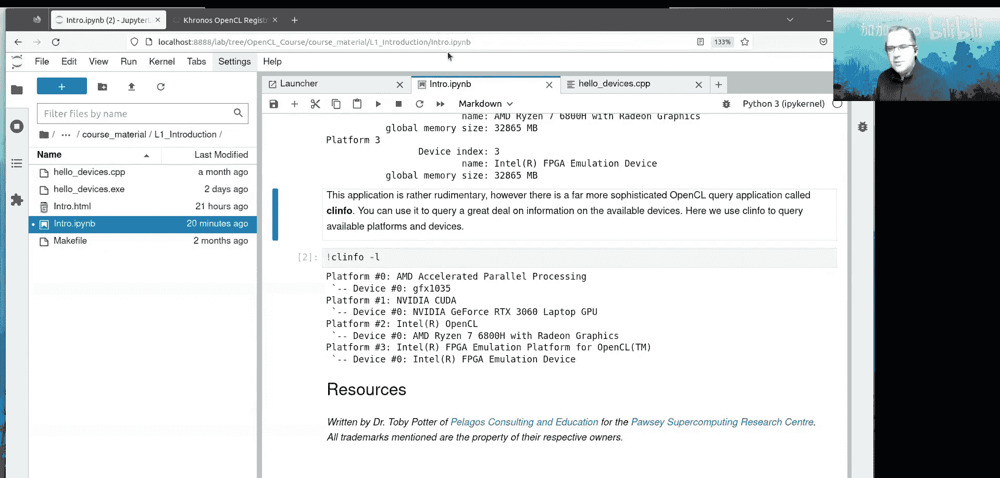

# 【OpenCL编程 Pawsey超算研究院】 p02 p1 OpenCL - day 1, part 2 - Introduction to Open CL plus exercise [BV1fMz5Y3EDV_p2]

不是。Okay， so now let's talk about work groups and work items。

So an openCL implementation is a way to run kernel instances on hardware threads or processing elements as they become available。

So your problem might map to all the available hardware threads。In。嗯。Yeah。

 all the available hardware threads in a GPU。Those do some work and then when they're finished。

 the open sealL implementation issues more work to them。Okay。

 so the implementation provides a way to run kernels on processing elements。

The implementation also provides the means to upload and download memory。

To and from the compute devices。 So we saw that the compute device has this high bandwidth memory。

Attached to it and the open sealL implementation provides a way to get memory from the host and upload it to this high bandwidth memory。

So that's what Open seal does is it provides a way to do that。

You specify how many kernel instances you want。At runtime by defining a 3D。Execution space。

Cold a grid。And setting the size of the grid at Colonel Watch。

So you can imagine the grid as being an iteration space or an execution space。So if you've got a 2D。

or even a 3D array or a cube so you've got a 3D cube and you want to run a kernel at every point in that cube that's what a grid is so you specify the size of that grid when you launch the kernel。

And then the implementation ensures that a kernel is run at every point。In that grid。So。

There is an analog of this in computing like nested loops。However， with nested loops。

 you are guaranteed that one dimension is going to be visited before another dimension you don't have that guarantee with open seal with open seal you just define the 3D space。

Define the grid。And。Open so you will make sure that it launches the kernel at every point in that grid。

 but you don't have any control over。Which point in that grid gets run first？🤢，Okay。

 so that's that's the point of difference between。Nested loops and open seal so this is a grid here it has three dimensions so dimension zero dimension one and dimension two。

嗯。A grit is divided into things called work groups。So a work。

Item is this is an individual square here and a work item is a instance of a kernel。

So when you launch your kernel， it will make sure that。And。😊。

An instance or a kernel is run at every point in this grid。

So work items are grouped into work groups。And this provides a way to map fairly naturally across the concept of。

Hardware thread teens。So in AMD and NviDdia GPUs， you have teams of size 32 or 64。

And you can have a multiple of thread teams as part of a work group。And。So a work group。

 work items in a work group can share resources between themselves。In something called local memory。

But every work item in a work group can have access to its own memory as well。So。

Work groups provide ways。For work items in a team to share resources with each other。

And you can have as many hardware threat teams in a work group as the implementation will commit。

So the implementation might permit， for example， up to 1024 work items in a work group。

And those work items will be then divided across available thread。Tams。So with openC。

 dimension zero is the dimension along which。Hardware threads are neighbors。

 so hardware threads in a team will be neighbors along dimension zero first， then dimension one。

 then dimension two。Okay， so with OpenCL along dimension zero is the dimension in which hardware threads are neighbors。

At least with a GPU implementation， it doesn't matter so much with a CPUU implementation。

So a grid is divided into work groups and in this case or in this instance there is five work items along dimension zero of the work group。

There is four。嗯。There is four work items along dimension one。And in this instance。

 it looks like there's only one work item along dimension two。

 so this is actually not an optimal grid because there are 20 work items per work group。

You would ideally like a multiple of the hardware thread size。

 so you would want a multiple of 32 or 64 work items in a work group。Okay。

 so in the example above the grid， that's the grid here。

 the globals the global size of the grid is 10。By8。By2。

And each workgroup is of size five by four by one。The number of work groups in each dimension is then two work groups along this dimension。

 two work groups along this dimension， and then two work groups along this dimension。Okay。Okay。

So every work item has access to device memory that it can use exclusively， so that's private memory。

Access to memory that the team can use。嗯。Yep， the team can use。

 which is local memory and access to memory that other teams can use and that's called global or a constant memory。

Every colon invocation。Or every work item can query its location within the grid and then use that location。

As a reference to access allocated memory on the compute device。At an offset。

So I've got a question from Rick， so dimension zero one is like height and width or in open C we prefer to call it dimension zero and one I prefer I prefer to use just the mathematical dimension indexing because diagrams like this。

Can get very confusing。You're sort of trying to think in your head now which is height。

 which is width， doesn't actually matter you just use dimension zero。

 dimension one and dimension two and then you're all good。Yeah。

 so the the concept of using dimension zero dimension one dimension two is just to avoid。

And confusion。对。Then you don't have to worry about what is x， what is y is x width is y height。

 that sort of thing， we just say dimension zero， dimension one dimension two。

 dimension zero is the dimension along which hardware threads are in neighbors。

And that's a very important point。At least for GP。Okay， cool。Yes， so every work item。

 as was're saying before， has access to memory that it can use exclusively。

 that's called private memory。Memory that the team can use， so the work item。

Got to be careful with that by team， I mean work items in the work group。So I should say。

 so access to memory that the work items in the work group can use， that's called local memory。

And access to memory that other teams can use， and that's called global or a constant memory。Okay。

 so I've got the orange squares here and that just means that the orange squares are completed work items。

And the white squares are incomplete work items。 And that is just to show。

That on some open seal implementations， particularly with CPUs。

 work items can be done before other work items in the work group。

And other work groups can be done before other work groups and there's no no assumption can be made and as to the order in which work groups or work items complete。

So that's that's an important important assumption。

 so when you've got kernels it's best to have inputs and outputs。You tank an input。

 you do something with it， and then you send the result to an output。嗯。

Then you don't have to worry about has this work item finished with this particular？嗯。

Finish with this particular element in global memory。Yeah， so it's best to do it。

 I'm grabbing my input， doing something with it and I'm putting the result into an output。Yeah。

So yeah， so don't make the assumption that one particular work item is going to be done before another work item。

So don't use the result from one。From one work item as the input to another work item。You've got to。

You've got to have an input array， do something， then go to an output array and then in another kernel invocation you can then use the result of that output。

So that's some， yeah。That's what we need to do with OpenC。

 we can't make any assumptions as to the order in which these work items complete。Okay， so。

Work items or kernels， I'm using work items and kernels interchangeably because a work item is an instance of a kernel。

So every kernel can query its location in the grid。😊，And then use that location to access。

Memory in a。Duffer。A allocation of memory that is on the compute device。

And that allocation of memory， for example， on the MI250X would live on this high bandwidth memory area here。

And on satonics， there is 64 gigs of high bandwidth memory available to every GPU compute die。Okay。

So the above concepts form the core ideas surrounding Open seal。

And everything that follows in this course is just supporting information on how to prepare compute devices。

 manage memory， invoke kernels， and how best to use these concepts together to get the best performance out of your compute devices。

So the elements of an accelerated application。So in every accelerated application。

 there's a concept of a host computer。On which there are one or more compute devices。

The host usually has the largest memory space available。

 so there's 230 gigs available on a GPU compute node that's on the host。

And the compute device usually has the most compute power and memory bandwidth。

So this is why we say that the application is accelerated by the compute device。😊，Yeah。At runtime。

 the host executes the application。And during execution。

 kernels in OpenC are compiled for the available compute devices。

The host program manages the memory allocations on the compute device。

 so it specifies how much memory should be allocated。And。

Then it executes the compiled kernels or launches the compiled kernels on the compute device。

So for instances， where the compute device is a CPU。

 the host CPU and the compute device are the same thing。Okay。

 so accelerated applications follow the same logical progression of steps。

Compute device resources are discovered。Clonnels are compiled for the discovered compute devices。

Memory is allocated on the compute devices。Memory is copied from the host to the compute devices。

Colonnels are run。Then the host waits for the kernels to finish on the compute devices。

Then memory is copied back from the compute devices to their host。

And steps three to eight are repeated as many times as necessary。When you're done。

 you clean up resources， release compute devices， release memory allocations that you've made on the compute devices。

 and then exit。So now we're going to discuss the open C components that make these steps possible。

So here's the taxonomy of an open C application。In this square here， we've got the host。En。

On the host is an open CL implementation。Yeah。In software。

 the open seal implementation takes the form of a platform。And inside the platform。

 there can be any number of compute devices that are supported by that platform。

So for an Intel open seal implementation， it might support CPUUs as well as GPUs。

So there are a number of compute devices that are。And supported by a platform。Surrounding a device。

 but on the platform is a context。So a context is like a resource manager。That manages the。

The kernels that are running on the compute device。

 but it also manages things like resource allocations。不谢。On the compute device。

Are things called buffers， so an open single buffer。

Is a bit of a nebulous thing because it can either exist on the host。Or on the compute device。

The implementation is free to specify where it lives， where the buffer lives。

The only thing that is guaranteed is when a kernel runs on a compute device。

 that buffer memory is then available on the compute device。

So the implementation is free to stream that memory in and out of the compute devices。

We have kernels here and a number of kernels。So some source code at runtime is brought in。

And then it is compiled into a program。Then a kernel is compiled from the program is built。

Then a kernel is built for every compute device within a context。

So a kernel is built for a compute device。And you can have any number of kernels within my program。

So you bring in your kernel source code that gets compiled into a program。

And then that program is further then built for every compute device。

That is available or that you want to build a kernel4。A command queue。

Hooks into a compute device within a context。And that command queue is then a destination。

To submit work to。😔，You can submit works such as a copy operation。

Of memory from the host to the compute device。Using a command queue so a command queue is the destination for work When you launch a kernel。

 you launch a kernel to a command queue。So if you have a kernel that is ready to go that is compiled for a compute device inside a context。

 you launch that kernel to the command queue。You can have any number no I won't say any number you can have a user defined limit sorry a system defined an open opense implementation defined limit as to the number of command cus that can exist for a compute device so usually that number is fairly low we're talking about。

On the order。Let's us say of about 10 or so。Command cues per compute device。

 so the number of command cues that you can have for a compute device is limited。

So I would keep that number of command queuees fairly low。

So you can have a number of command views for a compute device in a context。

And when you create a buffer。You use a command queue to create a buffer on a compute device。

So commmen queue is a place to submit work， it's kind of like a work pool。Or a。

A list of work that you're giving to the command queue。

So I can add things to the bottom of the list of work that the compute device needs to run。

And it will look at that command queue and then run the things。

Whether it's a copy operation or a kernel， it will run those things on the command queue。

Now I command you has a bubble。Or an event。That can pull。How things are going。In the。Command Q。

So you can attach an event to a piece of work。In a。Command you。

And that event will track how the progress of that work is going inside a command queue。

So you can submit things to the command and queue。And that is a list of work that the compute device has to do。

Now， there are options for。Saying that okay， the order of work that is submitted inside a command queue that can be in order or out of order。

 so that means the compute device is free to choose what。Bits of work that it will run first。

So you have some freedom there。😊，In specifying what kind。

Whether you want that work done in order or out of order。Okay。

If you don't care in the work is if you don't care in which the order of work is run。

 then you can have an out of order command queue。Okay。So yeah， so events。

 they hook on bits of work that you submit to a command queue。And then from the host。

 you can then synchronize on those events。So you can have the host wait for an event or a bit of work to finish before it does something else。

Okay， so that's。That's the taxonomy of an open SE application you have a host。And inside the host。

 there are compute devices， you have a platform。😊，And within a platform or supported by a platform。

 you can have any number of compute devices。A context is the resource manager for the compute devices。

Within a。Within a context， you compile a program。And then you build that program for a particular compute device。

 then that kernel becomes available。And then you can launch a kernel by submitting that kernel to a command queue。

And then you can build buffers using a command queue。

And you can copy memory between the host and a buffer using a command queue。A buffer can live。

Either on the host or on the compute device， and it's up to the open CL implementation。

And sometimes you can specify where the buffer lives。

All the open seal implementation needs to do is when you launch a kernel。

 it has to make sure that that bufferuffalo is on the compute device。Okay。

 so all this text here is just to explain what each of those terms mean。So in summary。

 a platform provides access to compute devices， a device represents a way to access a compute device and to query its abilities。

A context provides a way to create buffers and keep track of what is happening on the compute devices。

A buffer provides a way to allocate memory on devices。

A program provides a way to aggregate kernels and then build those kernels for each compute device in a context。

A command queue provides a place to send work such as memory copy commands and kernel launches。

A kernel provides a way to do work on a compute device。

An event provides a way to keep track of work that is submitted to a command queue。Okay。

 so do we have any questions surrounding？surrounding咩。Okay， excellent。

 when we go through we're going to do a matrix multiplication example。

And we're going to cover all of these things line by line。

When looking through an example open seal application so yeah。

 so these concepts are a little bit abstract right now。

 but they'll become fairly fairly front and center when we go through the line by line example。Okay。

So。Let's just talk briefly about the specification roadmap。So yes。

 the open seal specification was ratified in 2008。And so the first public release of the standard was in December 2008。

So open Se was originally developed by Apple。嗯。And they hold the trademark to the Open seal logo and the Open seal name。

But Apple have largely disowned OpenC to a great degree， Open seal is now kind of deprecated。

On Apple and in a future operating system， they will remove support for OpenCL entirely。So openseer。

 Apple now favour their metal implementation for running workloads on their processes。So yeah。

 just letting you know that。Apple doesn't care about open seal so much these days。

 it's just a deprecated。嗯。Software library that is there to support some software that uses OpenCL。

So thankfully， though， there are other implementations that work on Apple devices。

Such as portable open seal。Yeah， so。Yes， open C used to be used to be a first rate。

Implementation on Apple， but now Apple doesn't really care about open seal so much。

At least from what I can see。So。Yeah， version  one was brought out in 2008， version 1。

1 introduced thread safety so that most calls to open seal functions from different threads didn't introduce race conditions。

So the API calls for OpenZal are largely threads safefe with the exception of setting arguments to a kernel。

I think that is one of those calls that is not threads say。

If memory allocations in buffers are used to represent 2D and 3D arrays， then version 1。

1 introduced routines to copy rectangular regions。Of those buffers。Version 1。

2 is probably the most significant release of OpenCL。

 it has been the de facto OpenC standard for the last 10。You know， for at least 10 years。

It brought about the abilities such as being able to divide the processing elements of a compute device into some devices。

That share a common L3 cache， for example， and introduce things such as offline compilation of kernels so you can bring in a kernel that was compiled already。

嗯。😊，And use that。嗯。1。2。Introduced math operations that conform to the IEbil 754 standard。

So that means consistent results across different compute architectures。Version two。

 so just about everyone got on board in version 1。2。But versions 2 to 2。2 of OpenCL。

Started to get more and more difficult to implement。And so。

A versioners two introduce support for shared virtual memory。

Implementation of shared virtual memory means you no longer need to qualify which space memory allocation belong to。

And so memory could be transferred between the host and the device transparently to the user。

This one is difficult for some vendors to implement and a few vendor implementations remained at version 1。

2 for a number of years。Soron the Kronos group started to go into started to get quite ambitious with open seal versions 2。

1 and 2。2。They brought about Spv。Which is the standard portable intermediate representation language to open seal。

So during compilation， a compiler can take C or C++ kernel code and emit that code as Sp V。

And so at runtime this program is loaded by the application and then passed to the vendor's driver for further compilation to their particular binary code or machine code that runs on the compute device so this was a significant advancement。

 but not every vendor was on board with with this so sp of a was meant to be。

Was meant to be a perfect glue layer。That goes from。

An open source compiler to SpR V and then a hardware vendor was supposed to implement the compiler that took SpR V down to。

down to machine code， not every not every vendor was on board with this。

 so some vendors such as Nvidia， they did not implement version 2。1。Yeah， so version 2。

2 went into more and more things， so version 2。2 allowed kernels to be produced using a subsetet of C++。

It also updated SpV。And the combination of shared virtual memory。

 C++ kernels and Spear of V support meant that very few vendors actually succeeded in producing viable implementations at OpenCL 2。

2。So open seal stagnated for a period of five years。

 there wasn't very many vendors that actually implemented 2。2 so got into the stratosphere of。

Difficulty， I would say， because the Open Sea standard was coming up with things like， okay。

 in order to be conformant to version 2。2， you needed to have this shared memory support。U， you know。

 which made which made it difficult for a vendor to implement。And so。😊，Support at version 2。

2 stagnated for a number of years。It was a worry that。It was a worry that Open Se would die。

 it would die the death of a thousand qualifications。😊，So what they did is that they。

With version three。诶。Address the issue of stagnation by making version 1。2 canon。

And all the other version， all the other improvements in version two point something they were made then optional。

So that gave vendors freedom to implement whatever they wanted their customers to have。

And gave the standards and breathing room。So hopefully now。

 instead of coming up with a really complicated standard that vendors found difficult or didn't want to implement。

 now we're just going to make version 1。2 canon。And all the other improvements that versions to touchstone。

 they are now。Optional things that a vendor can implement if they want。

So version 3 also introduced a new C++ language for kernels。

And that uses a subset of the C++ 17 standard。So Sp of V is still there， but I think it is optional。

So anyway， here is just the bullet points of all the things that were introduced with each standard of Open SEL。

So openCL 3。0 is the latest standard， so it has all the things that 1。

2 has and then everything else is up to the implementation， whether or not they want to do that。

So okay， who's on board with version three， I believe AMD is working on version 3。0 support。

They got as far as 2。1。But then only some features from 2。2。Apple only went as far as 1。2。

 so if you're going to use OpenZal on Apple Hardware。Sorry， Emily， but youre stuck with 1。

2 unless you use something like portable open seal。And portable open seal is down here。

 so you can click on that and have a look at there。There。Yeah， their page。Okay， so arm arm is。

Way on board with OpenCO 3。0 support， they didn't get to 2。2 either。

Intel is very much on board for Open SEL which is fantastic。

 I think their sickle implementation runs on top of Open steel。In videodia。

 so I think they implemented some things from 2。0， so I should actually put a some there。嗯。

But they are definitely now on board with OpenC3 and they in fact were one of the first to implement OpenC3 support。

Portable OpenC is a community project。And that's to provide a CPU implementation。

 but also an implementation that can hook into some proprietary vendors like Kuds， for example。

 and provide another way of doing Open sealL。So they're on board with OpenCO 3。0 as well。

So since Apple has moved across the metal， they haven't really invested in open seal beyond 1。2。呃。

With Opense on NVdia， they actually call Kuda's toolkit， So they actually call from Opense。

 they call back to Kudar。嗯。But after initial flurry of support for OpenCL。

 their development stalled until version 3。Support for Open sealL with AMD is part of the Rockham Su。

And I think they have。They have 2。0 support available for the GPUs on Conics。

So Intel is strongly on board with open seal and。If you download the one API toolkit。

You can get an implementation that works on Linux， at least for all CPUs。

So if you're going to do development and you're going to use OpenCL and CPUs。

 then I can highly recommend the Intel one API toolkit。The CPU implementation in。

when A also works for AMD CPUs， which is really good， ArM has solid support for openCL on its GPUs。

But if all else fails， there is the portable open seal implementation。

 so that provides a CPU implementation as well as support for OpenCL on Couda and Open seal on MacOS。

So that might be a way forward for you to get Open seal on a Mac。Okay， so conformance， a conformant。

Open seal implementation is one that has passed Chronos's test week so you can click on that link and go across to Chronos。

And the number of vendors with a conformant implementation is an evolving list。

And you can click there to see the latest conformant implementations。Okay。

 so here we go documentation。So the best source of help for Openseal is the Kronos Open seal Registstry。

 so I'm just going to click on that link now。And that contains。The documentation for the standard。

So this is the open sealL API specification you can click on this link and in fact I'll get you to get you to do that click on that link。

And that will take you to the PDF for the。The OpenCL API， the CAP。

 and that's got all the documentation for oral all of the kernel sorry all of the openCL API calls that we're going to use in this course。

She。All right， so that's an exercise， but before we start doing anything with openCL。

 it's good to have that documentation onboard and ready to go。All right。

 so getting towards the end of this module。And so just to avoid confusion。

There are two compilation steps in open seal applications。One is compiling the application itself。

Before execution。And the other is compiling kernels from within an application during execution so there's two compilation steps。

So during program execution， kernels are compiled into programs and then these programs are compiled for each compute device using the vendors kernel compiler。

So thankfully， when doing step one， we don't need to link。Against every available implementation。😔。

You just need to link against a single library file called the ICD loader。And the ICD loader。

May be provided by any vendor。TheicD loader has the name opencl。dL on Windows and libopcl。

so on Linux。So accompanying the ICD loader are header files。Called Opencl dot H for the CAAP。And C。

And that should actually be cold。Opencl。hpp4 c+ plus。And those live in a directory called CL。

So this directory， the C directory， must be in your include path。Of an application at compilation。

So it's good practice to use。😔，嗯。An ICD loader。And open seal headers directly from the Chronos GitHub site。

Because then you always have the latest up to date Open sealL API。Alternatively。

 you can use an ICD loader provided by the vendor， but it may not be up to the latest open seal stamp。

Okay， so。You need to link against this file called Liboppencl。SO。

And in the header of your C+ plus or C application， you need to include。CL。Opencl。

h So there's just two things that you need to do。And what this what this libopcl。

s file or the installable client Drive loader， theicD loader。

 so what theicD loader does is it intercepts openCL API calls and then routes them to the vendors。

Cals。For that particular compute device。So if you're making your buffer。😊。

You just call CL create buffer and then it will route that。

Through to the vendors version of CL create buffer。So the ICD loader is kind of like。

A telephone dispatch operator。That dispatches the calls to the right vendor。

So you only need to link against the ICD loader in order to get support for your open seal application。

All right， so let's go and try and find the Iending loader。On the satonics。

So I'm logged into satonics at the moment。And I might be able to find the ICD loader in Ot Rockham because that's where Rockham。

Is installed。And we go to Lib。Let's just go to。😔，Actually， let's just go to open seal。

And let's go to live。Okay， so in the directory。In the directory， Opt Rockham open seal Lib。

Is a ICD loader that comes with the AMD。The AMD implementation。So that's what you could link against。

But if you have。If you have a look at so if I go module。So if I go module use。

I've already got the module use command in my BRC。So I've just got the module use。

So if you log into zonics。And then you go module use， software projects， courses 01， satonics。

 openC module files。And then you go module。Load。Programming environment open C。

And what that will do is I've downloaded Chronus's ICD loader。

And that ICD loader is then available in my library part。So if I go echo。Library path。

So I've loaded the Open C module。And。Here is the location。Of。

An ICD loader that I've installed from Chrons。So if I just go to that location。

We can see that there is the latest version of the ICD loader from Chrons。And that will be。

That will be in your library path when you load the open seal module。Okay。

 so so that's the that's what we need to do is we need to link against the ICD loader。

In our application we。Include the open seal header。And for this course。

 I'm going to use the CAAP because the documentation for the CAAP is much better than the C++ API。

So I'm just going to use the C API。And when you're compiling。

An open seal application it usually takes this form。

 so you need to include the path to the seal directory in your include flags。

You need to include the path to the ICD loader in your library flags。Then you have the source file。

 your destination program， and then this library， you include L OpenCL。Now， thankfully if you're。😊。

If your library pass。So。😔，If your library pass。If your library path contains the location of an ICD loader。

Then you don't have to specify。This L flag。You don't have to specify the location of the ICD loader using the L flag。

 it'll just be ready for you。Okay。嗯。If you specify the CL directory。

In the library environment sorry in the environment variable called Cpath。Then when you compile。It。

Will just then pick up。The open seal head of file。Inside seapath。So in this case I have。Got。

The header files。For opense。 H。They are located。In software projects， course is 01。诶。Itnics open C。

Heers install include， so if I just go there， there is a C directory。

And inside the C directoring is the opencl。h header file that you will then load from your program。

Okay， so now let's use this information to compile our first open CL application。So。The file。

 hellodevics。cppP， is a complete open seal application to obtain the size of on device memory and the maximum buffer size that is possible within that memory。

So from the。诶。Yeah， so I'll get you to start a terminal。

And let's follow the instructions in the welcome letter for getting an allocation of memory on a compute device。

So let's all do this together。Okay。All right， so I'm going to。Copy in the command。

Copy in the commands to get an interactive node。On the on the compute device。So I'll just go to。😔。

Our Open seal workshop。The welcome letterto。And let's get。Let's copy that command in。Okay。All right。

 so now we have an interactive allocation。On a G forU node。Of our。Oh synonics。Then。

We copy in these commands the module use followed by module load。Yeah。So let's do that。

So we're now using the Open CL module。So now we're right to go， we're ready to compile software。

I then changed directory to my scratch。So then change directories in my scratch。

And you're going to change directory to the openCL course material that you unpack。Earlilia。Okay。

 let's go and just pull the latest version down from GitHub。Excellent。

So'm just making sure that I've got the latest， I'm going to go to the course material directory。

Change directory to L1 In and then there's this file in here called Hodevics。cpp。

We're going to compile that。That open C application。And we're going to run it。

Within an interactive allocation on satans。All right， so getting back to the course material。Oops。喂。

All right。So what we do now。Is we can just use our C compiler or you can use G++ doesn't really matter with Open sealL。

 which compiler that you use。Because。You're using API calls to compile kernels so you don't have to use HCC or NVCC。

 you can just use an ordinary C++ compiler。So we're going to once we've loaded the Open sea on module。

We are in this course material L1 introduction。And I go G plus plus。And when you're using satonics。

 we have access to the compiler reppers， so let's just use CC instead。

So we can do option G just gives you debugging information。And then O2 is an optimization level。

And then we go hellello devices。cppP。We specify our output as hellodevics。exy。

And then we bring in the Open steel library like that。All right。

 so that's compiled now your very first open seal application。And what that application does。

 we'll have a look at in a minute， but what it does is it pulls all the available compute devices that are in your interactive allocation。

And it shows you what's there。Okay， so we've got two platforms。

Available at the moment now we've only asked for one GPU and that's all we've got is one GPU here。

So we've got two compute devices on two platforms。😔，We've got device zero， which is a CPU。The CPU。

 so you've got access to。E cores of the CPU in your allocation。And it says that there is。

256 gigs of global memory， but I think only about2 to30 is usable。On。Devicice one in platform one。

There is， that's the AMD Open CL implementation。And so you have 64 gigs of memory available。

For the open seal。Implementation on AMD。Okay， now with all of these exercises that we do。

 there's usually a make file。And you can just go make clean and then make to make all the software in that directory。

 just as a backup measure。So sometimes we're going to rely on the ME file because we don't want to have to go through this compilation。

Process all the time。Okay， so let's now have a look at。What Hello devices is doing。

 but before I do that， how did everyone go has everyone been able to compile and run Hello devices on satonics。

Harry， yes， Emily， yes， great。And who else。Yep， Ronald， yeah， excellent。Okay， so。Yep。

 any questions or comments surrounding that， it's fairly straightforward。

I really like the fact that you only have to link against one library and that you only have to include one header file and I also like that you don't have to use a special compiler like HCC or NVCC you can use any compiler that you want。

So I like those things。Now there is an application that now we've done it the hard way with compiling and running this program。

 but there is an application called CL Info。And let's just use that now and that will pull all the compute devices that are available。

For for your Open seal implementation， so I just go to C info。And then L。

And that shows me all the platforms and all the devices that are there。

Now if you go C info without the L option it。Digs out a huge variety of information。

Such as limits on the amount of local memory that you can have in a work group。And other things。

Such as the maximum sizes for a work group。So there are 110 compute units available on the AMD GPU implementation。

Maximum work item sizes， so you can have 1024 work items along any one of those dimensions of your grid。

嗯。And you can have a maximum of 256 work items in a work group。Oh sorry。

 1024 work items in a work group but a preferred work group size of 256 work items。

 so that is that is for hardware thread teams。So that's theme。

 so you can query all of these limits yourself。😔，Using OpenCL API calls。

So let's have a look at Ho devices， the application now。And so if you just open hallodevics。

cppP using a text editor， either on your machine or in satonics， doest matter。

But if we just do helldevics。cpp。We'll just do a quick rundown of what the code。Is doing。Okay。

 so we're including things for C+ plus we're defining。Some things。

And I'll cover these more when we go through the matrix multiplication walkthrough。

But we're bringing in the headers。And this is just error checking code。

 so this is just code to provide a way to check the results of every OpenC call so every call openC call needs away or it's good practice to check the return value of every open SE call because otherwise you could fail silently so it's always a good idea to do that。

And what we're doing here is we are。😔，Grabing。The number。

We're grabbing the number of platforms that are available on the system。

So that's through a call to C get platform IDs so we're getting the number of platforms now remember that diagram that we saw in the introduction。

 we're getting the platforms。And then we are getting the devices。Inside every platform。

And what we're doing is we're making that。Yeah what we're doing is we're then querying some information on every device that is found inside a platform so this is a very simple open seal code and you can see that there's quite a lot of boilerplate code to dig out that information that is in a compute device so that's what I mean when i'm talking about boilerplate is。

Is all this code here？So。We're grabbing the platforms。

 we're looking at the number of devices in every platform。

 and then we're just querying information on each device。

And then we're releasing the devices that we've found and we're releasing the platforms that we've found。

 so that's all this application is doing it's like a hello world version of OpenC。Okay。

 so the next step is to then。😊，Use Open seal on satanonics。

