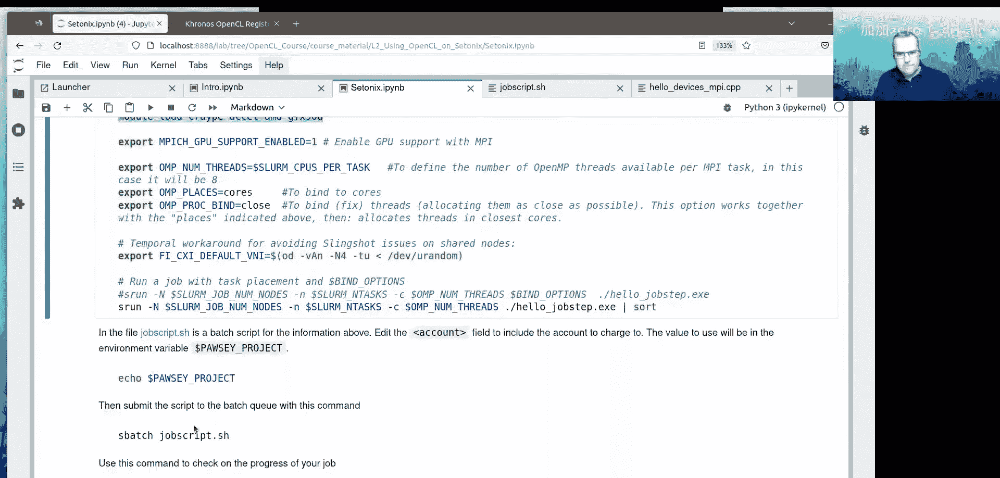

# 【OpenCL编程 Pawsey超算研究院】 p03 p2 OpenCL - day 1, part 3 - Using OpenCL on Setonix [BV1fMz5Y3EDV_p3]

All right， so the next step that we're going to。Do in this adventure is to talk about open conceal on satanonics。

I'm just going to share my screen。Okay， so this is in lesson2。😔。

So Cnics is a world class supercomputer delivering。

More than 27 petaflops of floating point performance using the AMD E CPU and the AMD In MI 250X GPUs。

So as of November 2022， Conics is in place 15 of the top 500 list。

 that's of the world's most powerful research supercomputers。

And number four in the green 500 at 57 gigablops per watt so yeah， it's certainly a。

Certainly a system that we can be proud of here in Australia。

So the pasy documentation portal should be your first point of call when looking for documentation on how to use GPUs。

On satonics and that source must take priority if there's any discrepancy between the official documentation and this material。

So on this page， if you click on this link， there's some specific documentation for using GPUs on Saonics。

So we've already logged into satonics so we don't need to cover this information。

But let's skip down to the hardware environment。So on satnics there are two main kinds of compute nodes。

 there's these CPU nodes with two sockets， 128 cores and 256 threads。

There is GPU nodes with one CPU socket per node and that CPU socket has 64 cores， 128 threads。

And four MI250 X GPU sockets。So each GPU socket has the two compute dies or the GPU dies。

So that provides a total of eight GPUs that are visible to openCO。If you request that many。

So let's talk about the CPU nodes now， the CPU nodes are based on the AMD E 7763 processor in a dual socket configuration。

So there's a near infrared photograph of a delided AMD E CPU。And you can see here that there are。

Eight of these chipts。And each of these chips has eight cores。

 and every core in there provides two hardware threads。So there are 64 cores available in total。😔。

And 128 threads。Because every call provides two threads。

So each chipt is called a core complex and it each core has its own L1 and L2 cache。

 and there is an L3 cache that is shared between the core in every Chit。Yes。Okay， so each core。

Or its hardware thread has access to SD units that can perform floating point vector math instructions on vectors up to eight floats wide in a single clock cycle。

So there's 16 hardware threads available per triplet。

So here there's some cache information and some frequency information on how fast the processor is running on a CPU node。

So there is 32 kilobytes of L1 cash， 512 kilobytes of L2 cash。

 and there is 32 meg of L3 cash available per chipt。And the pink teroflo processing rate is 1。

79 teroflops， so I think Ronald would identify with this image because he was helping to install the hardware in Intonics so it's great to have you with us Ronald so this is a this is a CPU blade。

So there are four CPU nodes visible in this image， so every node has two processes with the accompanying 256 gig of memory。

And that's the networking infrastructure， I believe here。

On the GPU so GPU nodes as we've seen on satonics， they have one AMD 7853 Trento CPU processor。

 which is an optimized version of the E so it's the same architecture as the CPU node but it's an optimized so it's a special silicon version。

And it's also got four GP for MI25x GPU sockets。So。Yep。

 and that's what we've seen before in the introduction so every compute unit。

Every compute unit is in control。Of。This now this is。Yeah， this is actually a compute unit itself。

 so you've got a schedulea so that's the conductor that's the conductor and here are all the violinists and there are 64 of them。

😊，There are 64 violinists and each of those violinists is responsible for running a hardware thread。

Okay， so every violins has access to its own portion of a cash here， the 16 kilobyte L1 cache。And。

What happens is the conductor schedules， 16 of these。To happen per clock cycle。

 1616 of these violinists to play the violin per clock cycle and。

And then there are four clock cycles that are performed to execute a wavefront。

 so wavefront is what all of these can accomplish。Yeah， all of these can accomplish。

So that's what a compute unit looks like up close， so each of these shader。Each of these shade units。

They are the individual violinist and there is a local data share。

 so that is for memory that can be shared。Between all。All the hardware threats in this team。

So that's the that's the orchestra right there。So an interesting to note with these compute units is that both 64 bit and 32 bit floating point instructions。

Are executed natively at the same rate。So only the increased bandwidth requirements for moving 64 numbers。

 64 bit numbers around is the performance consideration。

So here is some performance numbers for each of the four dual GPU processor in a GPU noted。

So there is for each GPU die， there is 7040 violinists。And over 110 orchestras or 110 compute units。

Each GPU die has access to 64 gigs of global memory。And together with the two GPUs。

 they can provide nearly 15 terofflps。Per processor。

 that's if you had code that made effective use of the two GPUs。Okay。

 so here is an installation image of a compute blade with two GPU nodes in it。

So there's the SU with its accompanying memory and there are the four GPU processes there。

So that's what a GPU blade looks like on satonics。And when you are using satonics。

 the following cues are available， so you've got the work queue。

which is using CPUU nodes and has a maximum time limit of 24 hours and 256 processing elements or 256 hardware threads available。

You have other cues such as long and debug which provide a longer time or provide better access to the queuees in order to debug software the high meM nodes provide access to large amounts of memory for your jobs。

But this is what is of interest to using OpenC and that is the GPU Q so there's GPU dev and GPU I think GPU dev is forward debugging and testing。

But the GPU queue is the production queue for using GP nodes。And that has there is an error in that。

That only has 128 processing elements on the CPU。And there are。And。Yeah。

So that only has 128 processing elements and then you've got all access to all eight。

All eight GPpUs on A GPpU mode。🤧嗯。Okay， so you've got 2130 g of host memory available。On a GPU node。

And just one socket with 64 CPU cores。Okay。So interactive jobs on CPU nodes。

When you are using we've got a special reservation for today's course。

 but when you are using satonics normally， you can get an get access to an interactive job on a CPU node using this SalLc command。

And on a GPU node you can get interactive access using this SL command so notice that we're targeting the GPU partition。

 but when you are using the GPU partition you also have a corresponding account name。

With a dash GPU on the end of it， so you'll have a pasy project ID。Which has a particular。

In a particular project ID， but when you're using the GPU queuees。

 you have to attend the dash GPU onto it because they have a special allocation for the GPU nodes。

So you use GPUs per task， so in this case we're doing one MPI task。

 so a task is an MPI task that is the amount of memory per node that we'd like to request。

Were requesting eight chipt， sorry， eight cores in a chipt。

And then we're requesting one GPU per MPI task and we're targeting the GPU part。So。

With today's course， we have an extra reservation parameter。

 and that's just the reservation that we're using。Okay， so as we've covered before。

 Open seal is different from Kudar and hip in that the compilation of kernels is done within the library of an open seal implementation。

So instead of using a vendor specific compiler like HPCC or NVCC。

 we are free to use whatever compiler we like， we like just as long as we link against an open seal ICP loader。

So let's have a look at software and modules。So there are three main programming environments available on satonics。

Each provides C andC++ compilers or CC++ and Forran compilers that build software with knowledge of the MPI libraries that are on satonics。

So the Gu environment is using the GU compilers and a lot of open source software is built using GU so you've got the best chance of good compatibility if you use the GU compilers。

The programming environment AOCC uses the AMD compiler to try and get the best performance on AMD CPUUs on satonics。

And the Ukraineane。The Cane environment uses an LLVM Kang compiler。嗯。

So that could also be a good open source alternative。嗯。To be going to compilely that。Okay。

 so once you load， now the Gu environment is the new default environment when you log into sattanonics。

So you can swap out。You can swap out to any of these different programming environments。

once you choose your programming environment， you can use CC to compile C code。

Capital CC to compile C++ code and then FTN to compile for Tram code。

So in order to use a GPU Aware MPI library from Cray。

 you also need to load this Craype Excel AMD GFX 90A module。

And that's available in all three programming environments。And then once you've loaded that module。

 then you can export this environment variable to get GPU support with MPI。On。On satnics。

 the Rockham Library from AMD provides。And open seal implementation。

 as well as AMD tools like debuggs and profilers。So you can load the Rockham Library with this command。

And we're currently， I think I believe satonics is currently in transition to a later version of Roco。

 one of the later versions is 5。4。3， but the stable version at the moment is 5。0。1。Okay， so。

That's not too much of an issue for openC code， you can use 5。0。1 for OpenCL just fine。嗯。

So open seal support comes with rockcker， however， the open seal header and ICD loader is quite old。

It only supports up to open seal 2。0 so it doesn't come with the header the header niceties or defiance for the open seal3 environment so I would recommend。

I would recommend using the KronOS ID loader and opencl header files and you can download those from the Github repository so I'd recommend those so that you can get access to the latest。

Definitions as part of the open seal3 standard， it doesn't matter if your vendors implementation doesn't matter if your vendors implementation doesn't implement all of open seal3 for example。

 you can。You can query to see what is the latest version that an open seal device supports。

And so yeah， so it's not an issue if you compile against the latest open seal ICD loader from Chles。

Okay， I've got an openCL environment we as we covered before that's been put together specifically for this course。

 it uses the portable OpenCL library to provide a CPU based implementation。Although。😊。

So that means that use you can use the portable OpenCL library on CPUU nodes and you don't need a GPU node in order to run OpenCL applications。

So yeah， so that can be potentially useful for development and maybe even production if。

If you're okay with the slower runtime for open seal kernels that you'll find。

Instead of using a GPU  node。So sometimes your code might be iterative and it might do a number of things in between iterations。

And then the difference so it doesn't really matter if if your open seal kernel takes 100 milliseconds instead you know。

 instead of five， it doesn't really matter if your code is doing a lot of things in between iterations。

So so in that case， the portable OpenCL library might be useful for you in order to be able to utilize a CPU as a compute device and I think the good thing with the OpenCL library is that on the CPU。

Is that you can make use of all those cores that are available。

 so if you used all the cores on a CPU node， then you can use all those cores in your kernel。

In your kernelel launch。So anyway， to get access to the custom open seal environment。

 you just do module use and then module load like we did in the exercise。Okay。

 I'm not going to talk about omni trace and omni curve， but suffice。

AndI'm not going to talk in depth about them， but suffice to say that they are tools for collecting traces and low level hardware events。

So these modules here are just experimental， they are not the final version of omnich and omni Perf。

A production version of these tools is dependent on having the newer version of Rockham available and I think Poy is in progress for trialing new drivers and things to get a later version of Rockham so watch this space omnitrace and omniPf are just to be treated as technology previews at this time until we can get the proper software support for them。

All right， so compiling software with openSeL and MPI support is just done using the compiler wrappers。

 so the compiler wrappers CC or capital CC is for C++ software and we're going to be using that for this training series。

The compiler wrappers automatically link through to the MPI libraries so you don't have to worry about or you don't have to be concerned about linking explicitly to MPI。

So these are the recommended compiler。Flas， you could use the G flag to include debugging symbols in your code and you can use the O2 or even O3 flags or production code。

嗯。You can use O0 and then G2 Dbug and then you can include F open and to。To include open pain。

Code as well。All right， so as an exercise， I think we should still。

We should still have our login into sattanonics， hopefully。😔，Yep。

 I've still got my log into photoonics and I can still access it。

So I still got my interactive job running。Okay， so in the file， Ho Dev MPI。

Is an MPI enabledd openCL application that reports on devices and just fills the buffer。

 so it doesn't really do much， but it just illustrates how MPI and OpenCL work together。

So let's have a look at this code。Okay， so here's our kernel source。And in this case。

 we're using C plus plus raw literal strings to just define the kernel source。In。

In our header area before we have the main function of our program。So this is called Ho Devices MPI。

And we are including the MP library here。😔，I also have a header library that that hides a lot of the boilerplate code that we saw in the Ho world example or the Ho devices example。

 so we can talk about that that header library in。In later in the next module。

But suffice to say we've got our kernel here， now we're defining the kernel。

Using a raw literal inside our source code now for an academic code this is fine。

 but for industry code this is an intellectual property leak。

So you would want to find more sophisticated ways of hiding your kernel source。Okay。

 so we've got our kernel here， so this is。We've got our kernel source code and now we're just going to walk through the main program。

So we're initializing MPI。We're getting the number of MPI tasks that we have for the number of ranks。

 we're getting the rank that we have we're just going to print out that rank。

We're getting the target device so we only want GPU devices。

 so we want to search for all GPU devices。AndThis function from the helper header。

What that does is just goes through the process of querying all platforms。

 querying all devices and making contexts for them and we're going to talk in depth。

About what that does in the next lesson。We then create a number of command queuees for all the found devices。

 and then we just choose a device based on the rank and the number of devices that are available。

So this is not very smart choosing。But yeah， that's that's just what we're doing。

Okay so we loop through every device found and then we just report some information on the device that was found so information queried from the device such as the maximum amount of global memory that's available how many work items can be in a workgroup and things like that so just just some very simple information so that's what that function H report on device does just reports on a device。

So then we are using an open seal function called C create buffer。And we。We。Specify a context。

 so we've already created a context for every device that we've found。And。😔。

We're using CL createreate buffer to create a buffer within a context。

So remember how we're talking about context as being resource managers。

 so once we create a buffer then that buffer is then managed by the context。

So we need to pass in a context as an input argument to C create offer。

So this seal C buffer that is a call， a library call。That is defined in the ICD loader。

 but at runtime that will then route through to the vendors implementation to create a buffer on。

You know， within the context that is specified。So。Then we just make some memory for a vector。

 so the whole point of this code is just to fill a vector。

With values and then download that vector of field values。So this is allocating a vector of。

Of flights。For vector a， so this has。Y， so that has。A number。

There's a number of bytes associated with that vector and the number of bytes is n0 a times the size of foot。

 so n0 a is defined。N0 a is defined here， so we're making a vector of 512 elements long。Okay。

 so we're making a vector， so we're creating a memory allocation or a buffer on in our context。

And it's going to be with。A big enough allocation to store every element in our 512 element vector。

We're also allocating memory on the host now this is going to be the destination for memory that is copied back from the compute device。

Yeah。Then we build the program。So we've got our kernel sourceaurus， a context and a device。

 and then we build the program for every device that we want。And from that。

From that program we then create a kernel and the kernel name is called Phil that's the name of the kernel here。

Okay， so we we've built a program for our。Our device。

 and we're now choosing that kernel from the program。 So we're choosing the kernel called fill。

Then we're setting arguments to that kernel， so that's the input arguments we're using C set kernel AG on our kernel and we need to bring in the size of our arguments。

So we're setting the Al buffer called AD that underscored D is just convention。

 it just says that that is going to live on the device。

A H is what lives on the host or underscore H means it lives on the host and underscore D is just convention we're saying that。

The name of the buffer has is living， so the name of the buffer has this underscore D。

 which means that it lives on the compute device。Okay， so our kernel。

 our kernel up here takes in three values so you can see those values there。

So we need to set those arguments here， so we use this function called C set kernel Ag。

And that sets the kernel。😔，Aguments。Okay down here we are setting or preparing the grid size for the kernel now we only need to make a one dimensional grid because we're just using a one dimensional vector。

Okay， so we're making a local size and we're putting 64 elements in our work group。

 so we're making our grid one very long spindle along dimension zero。

And we're having 64 elements per work group， and we're having a total of N elements。

So n is equal to n0 a， which is 512。So we're setting our global size of the grid and we're setting our local size now there is a requirement with open seal 1。

2 that our global size be big enough to contain an integer number of local size along each dimension。

So we use this H fit global size function to ensure that this is big enough to contain ante number of element。

 so integer number of work groups along each dimension。Then down here we inC the kernel。

 so we've made a command queue back here with this call to hate create command queuees and that makes a kernel sorry that makes a command queue for every device and context。

嗯。So we've got our just one command cube per device in context。And。We then。

Submit that kernel to the command queue with this call so CNQ and therange kernel and we give it the number of dimensions in the grid and the global size and the local size so that's that's how we specify this size of the grid on kernel launch we specify the global size and the local size。

So their local size is the size of the work group。The global size is the size of the grid。

In units of work items。So that's how we launch a kernel。And now we。Then。Yep。

 so then we free the open C bufferfire and I think we should have actually waited on the kernel at this point。

 but I think the C release mem object I think that then waits for AD to be finished with so I think that's probably why we can get away with not waiting explicitly on。

On on the buffet here。Okay， so we free the open seal buffer and then we。Oh， sorry。We should have。

Yeah， I just got ahead of myself， Okay， now after we launched the kernelel。😊。

After we launched the kernel， we copied the kernel back using this CONQ re buffer and what that does is that submits to the command queue。

 some work some work for copying that buffer back from the compute device to the host memory allocation so inside this is a blocking call and that says that we can choose whether or not we return immediately from that blocking call。

And because we have said yes， we do wish to block， then this actually waits for this kernel to finish before。

Sorry， because we've said。Yeah because we've said blocking is true。

 that means that this is going to block until this copy is complete。

 but what that actually does is that also waits for any previous work that was submitted to that queue to finish。

Okay， so that's why we can freely release that memory object。Because all the work is done。

 we have waited until this read buffer。Command has read the buffer back from the compute device to the host。

And now we can release that buffer that's on the compute device。As a checking step。

 we then fill this we then fill。We make sure that what has been copied back is what we intended to fill with the kernel launch back here。

 so the kernel， if we have a look at the kernel， all it does is it uses this gett global ID to query its location along dimension zero of the grid。

And then we say that if i0 or the index is less than n so n is the size of the vector。

 then we say that our memory allocation at。Position I0 has to have the fill value here。Okay。

 so that's the that's filling the that's what the kernel does is it fills a single element inside the vector。

Okay， so now that we've done that， we're just checking to make sure that everything's okay and then we free the host memory。

So I said I said。It might wait for that to finish and I'm not sure I'm not actually sure if it does wait for it。

But we can be sure that this command has waited for the work to finish before releasing。

Releasing the buffer。Okay， so once weve finished that， we can then。

Release the command queuees and then release the resources that we allocated when we acquired all those devices。

And then that's the end of the MPI application。So。Each of these， an instance of this program。

 will run for every task that is allocated within an MPI job。

And each of these MPI tasks will be its own process。And that process will run this program。

So if you had。In like four tasks， you would have four processes and each of those would be a unique run of this program。

And with a different rank。And each of those programs would access the GPU。Fill a vector。

 download that vector back， check it。And and then finish so we're going to now compile and run this MPI enabled application on satonics。

So we'll just go down to here。😔，Now， you would have already done this with the introduction and gone through the process of logging into satonics。

 grabbing the course material and then getting an allocation on a GPU node。

So what we can do is we can compile the program using the CC header I' say， the CC compiler wrappers。

So we can go。特处。L2。Using open seal on satutonics。All right。

 so we're going to compile this program now。Using the compiler rep。

I'm going to compile it two different ways。We're going to use first the first trial。

 the first attempt around， we're going to compile it with just the AMD。ICD loader。And the AMD。

Header files so they the header files live in optt rockham openze include。

And the ICD loader lives in optt rockham open seal live so this is just if you needed in a hurry to compile something on open seal。

Without any specific Chronos ICD loaders， so you could just do that。Okay。

 and you will encounter this warning message here。Saying that。

The openC target so we're targeting OpenC3， but it says that the OpenC target is not of values。

 that's because the rockcom implementation of OpenCL doesn't support anything higher than OpenCL 2。

2 so that's just an error message there and it's just saying that okay。

 I don't know what OpenCL3 is we're going to we're just going to limit the API to OpenCL 2。2。Okay。

 so we've already got one task allocated and we've just compiled using the AMD。Rockham。

Implementation。And then we can just run that so it's reported our rank zero of one now our device zero of one。

And。So we've done that using the AMD Open CL ICD loader。

But we can also use the ICD loader from our OpenCL programming environment。

So you would have done this module use。The open C module file and then loaded the programming environment from。

咁。So you would have loaded the open C programming environment。

And that's just software that has been created for this course。So when you do when you do this。

In fact， that's already been done because I still have my allocation from lesson one。

Then you can just use this command here。And then that compiles， that compiles our software。And。

epAnd that compiles our software。And then we can run the software。Okay。

 so that's compiled against the ChronOS ICD loader and we're getting same the same sort of result。

So we're compiled against the AMD ICD loader， and we've also compiled against the Kronos ICD loader。

Okay。So we have targeted。We have targeted。😔，The first。Sorry， we have targeted the GPU device。

Using using with this code， so if we have a look。If we have a look at Hodeicesmp。cppP。Okay。

 you can see here we've set a target device。Equals to C device type。GPU。

So that means we're restricted the number or the type of devices that we're searching for to just GPUs if we set this variable C device type target device。

 if we set that variable to C device type CP，Then when we acquire a。Our devices。

 we only look for CPU devices。So let's change that line of code。And compile it again。

And then run that code again。And you can see here that we have picked up the CPU。Impleplementation。

 because we've only searched for。We've only searched for。Yeah， we've only searched for CPU devices。

If you want to search for all devices。Let's look at that。Target device calls again。

And let's change that to C device type all。So that should then pick up all the open seal devices that are available。

We compile that again。Oh。And then we'll run it。And so now it has picked up both the CPU device as well as the GPU device。

So what I'm saying here is that。When you are looking for devices。You can specify。

What kind of devices you want to search for？In this instance， we have。Search for GPU devices。

 but then we changed it to CPU devices and then we changed it again to all devices so you can limit。

You can limit in the code what devices that you search for。And in the next lesson。

 we'll go through the code， how we do that。Okay。I say as a bonus task。

 you can try changing the number of GPUs in your request for resources for the interactive job。Okay。

 so let's do that now。So I'm just exiting my allocation。And I'm going to get。

 I'm going to ask for two GPUs now， so I'm going to ask for two GPUs。But one task still。

So I now have the two GPUs。So now I'm going to module use。😔，My open seal。Okay。

 and then I will module load。The openzeal program environment。All right。So that is now。雪边。😔。

We need to change directory to my scratch。And change directory to open seal course。

Change rey to coursearse material。L2 all right， so we're back here now。All right。

 now let's run that code again。呃。Excellent， so what we've done now is we've picked up。The two。

The two GPU devices that we have asked for。As well as the open C implementation on the CPU device。

 so on the CPU。So now we have。We have CPU implementation and then。And then the two GPU devices。

That we've asked for。Okay。🤧The。All right， so there's a bonus task and that's what we've done is try changing the number of GPUs in your request。

For resources， for the interactive job。So we do what we could do now is try changing the number of tasks that we've asked for。

😔，So let's ask for two tasks now using end tasks is equal to two。All right。

 so by asking for two tasks， we've actually gotten two nodes。

So we've actually gotten two nodes and each of those tasks spread across a node。

And then we have gotten two GPUs per task。So， let's now。

We do the module use command I've already put the module use command into my BARC so that's why I don't have to put the module use command again。

 so then we do module load programming environment open C。We changed directory to my scratch。

Change victory to open seal force。Change it to cross material。L2。And。Then we run。Hello Dev MPIexi。

Okay。And now this only reports。🤢，This only reports MPO rank0 one where we had。Where we had。2。Oh。

 I think we might have to use S run。So if we then have a look at S1。There we go。There we go。

All right。Within an interactive allocation， we were able to just run the Hello Devices MPI with one task。

But within the interactive allocation， we had to use SR with two nodes and two MPI tasks。

And when we did that， we had access to all of the MPI tasks that we asked for。Okay， and so。

When we did that。嗯。Yeah， when we do that， the output is a little bit muffled because we're getting standard out from both MPI tasks at once。

 but every one of those MPI tasks is reporting three openCL devices。Okay。

 so that's how we have compiled and run an openCL application with MPI support。Okay。

So now let's talk about batch jobs with OpenCL on GPU nodes。

So here are some information that's specific to making best use of the GPU nodes on satonics。

So on a GPU node， there's one CPU and eight compute devices。Each of these。E triplets in the CPU。

Is intended。To have optimal access in terms of latency。To one of the eight available compute devices。

So shown below is a hardware diagram of a compute node。Where H chipt。

Is connected optimally to one compute device。So the CPUU is divided into nuer regions。

And these nuer regions each contained two triplets。Okay。

These thread Is here are the hardware thread Is。嗯。For a particular core。😔。

So every hardware thread has a thread ID。And on tripleplet zero。

 you will have thread IDs  zero to seven and then 64 to 71， okay？嗯。😊。

That chipplet is designed to have optimal access to a GPU。Processor。And with a particular bus ID。

So in that way， each chipt in the CPU has access to or optimal access to a GPU。

So how do we gain access to this GPU so there's a few strategies that you can use。

And it's still in progress。So。Optimmal access to a GPU should be managed automatically by the scheduler。

However， this is work in progress。Some strategies that you can use in order to get optimal access to your GPUs。

Are to have eight MPI tasks per node。So one task per triplet slash compute device pair。

 then you set GPUs per task as equal to one to allocate one compute device per MPI task。

Then you use CPUs per task as equal to eight and threads per core is equal to one to allocate all the available threads in a chipt to a single MPI process。

 so that's just sort of gathering the gathering the hardware。

 the open MP threads around a single MPI task per chipt。

Then you can use GPU bind as equal to closest to bind each compute device to the closest MPI task。

 so closest meaning in terms of latency， and then you can use the exclusive option to have exclusive use of all the resources on a node that means exclusive use to all the GPUs in the node。

And this will make your job harder to get through the queuees though。

 and it will also be quite expensive in terms of your allocation。

 so use this exclusive option only if you absolutely need all the resources on a GPE node。Okay。

 so the suggested script below will allocate an MPI task for every compute device on a node of satonics。

Then it will allocate eight open MP threads to each MPI task。

There is some options here where you can bind your open MP。嗯。You can bind your open MP reds to cores。

So that will try and that will try and bind open MP rents to the available。

We'll get allocated one per chipplet。And then you use these openmp binding options。

To bind the open MP threads to the nearest。Y to the nearest chipplelet。Well the nearest MP task。

 which is on the chipt。So this is a way where you can get the best。Performance。Out of a GPU node。

On satnics so we can do this we've got access to our interactive job and it's okay to submit jobs from inside interactive jobs。

And so if we do this， so we've got this script here called job script。Dot SH。

So we'll just make the software， I just run make to make this application called Ho Jo step。

And what Ho Jostep does is it is some software that was written by Tom Pupppper Theodore。From O Nl。

And that just prints out the software， the sorry the hardware thread ID。

 it prints out the open MP thread ID， it prints out the MPI task the MPI rank。

 but it also prints out which GPU has been associated with that combination of task。Unth。Yeah。

 task and thread。So we need to edit just one thing with this application， so we just need。

To edit the account。And so the account that we need to use is。The account for this training project。

 which is course of01。And we just need to change that to courses 01 GPU。Okay。So。

Just a walkthrough of the JavaScript script。We are requesting。We are requesting on the。GPU partition。

Whereas requesting eight tasks， we're getting eight tasks per node。

We're requesting eight CPUs per task， we're requesting one thread per core， one GPU per task。

 and we're trying to bind the GPUs to their closest。All right。We then run this。

We then run this JavaScript。Okay。Now， I'm being a little bit。Yeah。

 I'm not using our reservation with this job script。

 so that might actually take a bit of time to get through。The cues。

 so we see that it's unstoed because of priority。😔。

So what we can do is we can try and use our reservation。So we've got our。Epatch command。

Preservation is equal to open C L。And I think it's openC workshop， is that right？

Anyone want to put in the chat what our reservation name is？I can see a workshop。Okay。All right。

 so now we're submitting this job。嗯。To our Open C workshop reservation。Okay， let's see how we go now。

😔，All right， now that is running。And if we have a look at the output。Oh， it says GPU support。

But the GTL library is not linked。Okay， I think we need to link to this GtL library。😔，Okay。

I think we needed to have an extra step in here。😔，Oh， we need to compile。

I think we needed to compile with that。Yeah， we needed to compile with that MPI。

 that C accelerated module。Loed。So let's try and do that Harry yeah so how do you delete jobs you use S cancel with the yeah you use S cancel with the job ID so when you are when you are having a look at a job you can use SQ EUE。

SQU E UA yeah， and then May with option me。And that will show you which jobs。

That are running and I can just cancel the job that I。Selected。So let's cancel this job I here。

So I'll just cancel the job that I've got。Running there。And then that gets rid of that job。Yeah。

 that's it excellent yeah so yeah it's a good thing to clean up yeah it's a good thing to clean up those interactive toolss。

Because yeah， because otherwise other folks won't be able to use them。Yes。

 if you could go ahead and clean up those those interactive jobs that'd be great， Harry， thank you。😊。

嗯。All right， so how do we get back to？Is there a way to reattach an interactive job。

 I don't know of the way off the top of my head， but if we have a look at the documentation we able there might be a way。

Yeah， so every time you exit using control D out of an interactive job， then it should cancel that。

Cancel that job。Yeah。😊，Okay， so let's try and fix this error that we had before。

So I'm just going to go in my job script。And it's saying that I didn't have。

I didn't have a particular library loaded。During compilation。So I might try make clean。😔。

And then in like now。All right。Let's give that a try。😔，Okay。I am s 2，5，2。Okay， excellent， yeah。

 so we needed to have the Cay so we needed to have。We needed to have this module loaded。

While we were compiling。The program。So we needed to have this module loaded why we were compiling the program。

And that's what has sorted out the issue。 And so if you have a look at the output from this。

It prints out the MPI task ID。The open MP thread ID， the hardware thread ID， the Nuummer region。

 the node as well as the ID of the GPU。So you can see。You can see here that this mapping。

Has been done correctly from MPI tasks to。GPpU。Our GPU devices。So。

So those are some suggested strategies in order to optimally get a particular GPU associated with an MPI task。

It doesn't matter too much if it's not optimal， but if you're trying to get the best performance out。

 that's yeah， these are some suggested strategies to。Do that。

