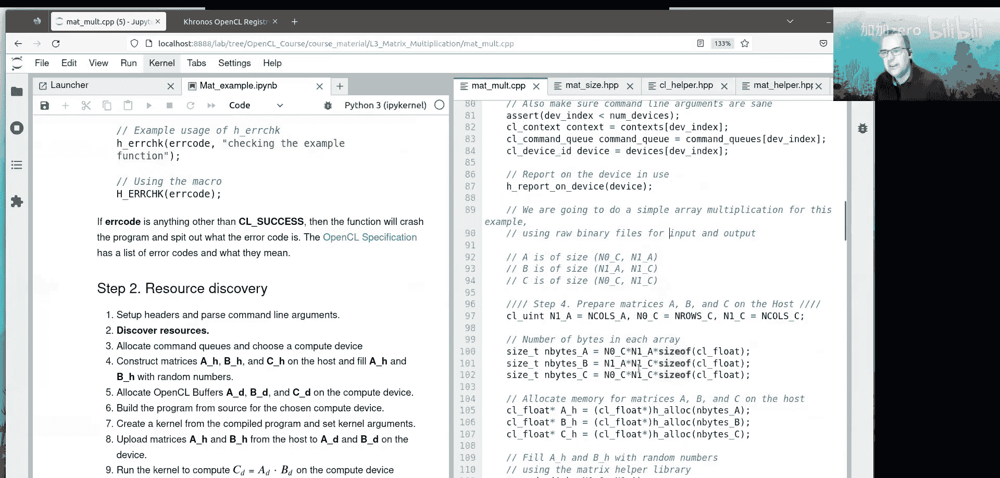

# 【OpenCL编程 Pawsey超算研究院】 p04 p3 Open CL - day 1, part 4 - Matrix multiplication [BV1fMz5Y3EDV_p4]

So now let's move on to OpenCL application walkthrough with Matri multiplication。All right。

 so let's now。😔，Share the screen。All right， yep， so we're doing fairly well for time if we can get through about three modules a day we're doing really well。

So let's see how far we can get through this module before the end of today。So。

Matrix multiplication so often it's helpful to see a complete example that is fully explained line by line in every detail。

😊，Matrix multiplications are commonly employed compute operation。

 and there are many MA problems in STEM。That can be reduced to a matrix multiplication。

So we're going to use it for a complete example with openCL。

The multiplication of matrices A and B proceeds by taking the dot product。

Of every row I0 in matrix A with every column I1 in matrix B。

So just to explain a dot product is that we have two vectors and we just lay them side by side。

And what we do is we walk through every element。Of the vectors together。So we start index zero。

And then what we do is we multiply。The vector sorry an element from vector 1 by an element at the same index from vector 2。

 and then we add the result to a cumulative sum。And so when we get to the end of the vector。😊。

We we then have the what is known as the dot product。

 so when we're taking a dot product between row I0 and column I1。

We walk along the elements along a row of matrix a。And then element by element wise。

 we multiply an element of matrix a with an element。From column I1 of matrix B。And as we do that。

 we collect the cumulative sum。And then that value at the end of the walk。

Is what we then place into matrix C at position I0 i1。So that is what matrix multiplication is。

And the strategy that we use here is to associate a kernel instance with every pixel i0 i1 in matrix C。

So that means that every pixel in matrix C has a kernel associated with it。嗯。

This means that our grid is going to be as large as matrix C。

And it must be large enough to cover the entire size of matrix C。

But it also must meet the constraint that。An integer number of work groups must lie along dimension zero。

 and an integer number of work groups must lie along dimension one。

So that means that your grid might be larger than the domain of matrix C。And that's okay。

But it can't be smaller then otherwise we're not going to be able to cover the problem adequately。

Every kernel will compute its own dot product。And it will have the coordinates I0 and I1。

And then it will use those coordinates to index into matrix a along row I0 and down column I1。

So the source code for this is in。If we have a look in。L3 matrix multiplication。And then metmt。cP。

So we can have that open while we are walking through the code。So let's open that up。😊。

In a different window like we have done here。Let's run the application first and see the results and then we can understand line by line how it works。

There is a make file in this folder and that is set to compile the example。Metmt。cP。

 so that's this file here。The program creates and fills matrices A and B with random numbers。

In the range zero to one。It then uses OpenCL to compute the solution that goes into matrix C the matrices are written in the following files in binary format。

So ordinarily， I wouldn't recommend using binary format to share with people because it's not self describing。

You might have your architecture might do little Andeion or big end and if the person you're sharing it with does not has a different architecture then sharing that data with them is going to result in a problem。

But we're just doing debugging and for teaching purposes。

 we're just using a simple binary dump of the matrices。Okay， so the program mix A and B。

Does the problem puts the result in C and then writes out these files？Okay， so in the terminal。

 we can change directory to L3 matrix multi and then compile and run。

The matrix multiplication problem。Now， if you're on the command line。

 just avoid the exclamation mark so you can just copy and paste this to your terminal on satutnics。

 for example。Okay。So this goes ahead， selects a compute device。

Does the matrix multiplication operation？And。And then checks the result。

 And the maximum error here is。Or the largest absolute value of the difference between the two matrices。

 and that's known as the infinity norm。And the largest error that we see is around 10 to the minus5。

And that's pretty good that is within the next floating point。

Well is close to the floating point error or the difference from one representation to the next。

So that is a pretty good result。We should now be able to see the output files。

 so that is array A RAb and arrayc。d。We can use Python to read in those matrices and just do a matrix multiplication and then compare with what we got from OpenCL。

Okay， so we read in the matrices using Python and we've done the matrix multiplication and this is the result for matrix C in NmHi and this is the result from Open seal。

And so you can see that the results are very similar and we have the absolute value of the residual here。

And。Average amplitude。Or the maximum amplitude is around6 by 10 to the minus5 now the output of the program is round about 65 values of 65 to 70 and from the open so from the C+ plus course。

We know that the。The machine precision or the value from one floating point representation to the next is around 10 to the minus5。

At a value of around 70 so an absolute residual of about 10 to the minus5 is quite acceptable it is in the regime or on the same order of magnitude as the floating point error。

Or the distance from one floating point representation to the next so we're pretty happy with this result。

We're pretty happy that the code is doing what we have asked it to do。

So it's within acceptable limits。Now let's go over the program line by line。

So as covered in the introduction， every accelerated application follows the same logical progression of stepss。

Compute resources are discovered， Cols are compiled， memorymory is allocated， memoryory is copied。

 kernels are run。 The host waits for the kernels to finish。

Memory is copied back and that is repeated as many times as necessary in this case just once。

So you don't need to repeat it at all actually。Then we clean up resources and exit。

So for the matrix multiplication problem with open SEL， we've chosen the following strategy。

We set up our headers and pass command light arguments， we discover resources。

We allocate command cues and choose a compute device。Then we construct matrices A and B on the host。

As well as see on the host。And then we fill A and B on the host with random numbers We allocate open C buffers。

 A D， BD and Cd on the compute device。Then we build the program from source for the chosen compute device。

😔，Then we allocate or create a kernel from the compiled program， the built program。

 and set kernel arguments。Then we upload matrices AH and BH from the host to AD and BD on the device。

Then we run the kernel to compute C is equal to A times Bd on the compute device。

So that's our matrix multiplication， then we copy the contents from CD on the device back to CH on the host。

And once it's back on the host， we can test CH against a known solution and write the contents of matrices back to disk。

Then we clean up arrays and release resources。So now we're going to walk through every step in this sequence。

😔，And explain how。😔，Everything is working in as much depth as is practical。

So open signal applications have a fair bit of tedious boilerplate code。

And just about every open seal application uses some form of homegrown header files to shield the programmer from that extra complexity。

 as well as a potential source of errors。The applications covered in this course are no different。

And I've constructed a number of helper functions that reduce this amount of tedious boilerplate code。

Yeah。Then we'll explain what each helper function does and how it fits into the rest of the program。

It is helpful to have both the source code。😔，So the source code here。And the helper header Cheler。

hppP open while we traverse the code， so I'm just going to make that open as well。Okay， so in Matmt。

cppP， we begin with some essential influence。So this is just so that we can assert。

Things are correct。This is so we can do some math operations and this is so we can use things like standard seek out to print things。

Then we bring in the size of the matrices， so I'm just using this header file here and if we load that it just defines the size of our matrix。

So that's the number of rows in C， the number of columns in C， and that is the length。

Or the number of columns along a row of a， but it also is the number of rows in B。

So that is where we are defining the size of our arrays。So in this。

Mattrix A will be of size n not C by N1 a。Mattrix B will be of size N1 a by N1 c。

 and matrix C will be of size n not c by N1 c。Okay。

So we've brought in our header file and that just defines the size of the matrix so when you you know when you go ahead and run this application you're welcome to try and change the size of this these matrices and see if the answer is still good。

And in fact， it should be if it is a correct code。So now we include the helper headers， soheler。hpp。

To bring in the set of user defined functions that reduce this tedious boilerplate code。

I'm also bringing in a library of functions called Me Helper。And in MAheler。

 I just have routines that can print a matrix that can do matrix multiplication on the CPU。

And get things like the infinity norm。So that's that's just what that is。

So we're bringing in in that helper library。And then we bring in our open seal helper header。咋呀。Okay。

 so if we have a look at the helper header。嗯。Now this was originally intended to be。

Something that could work on Apple systems as well as window systems。

 but I haven't extensively tested that yet。嗯。But what we're doing here is if we're using Windows。

 then we are including some Windows themes。So these are all these are all the C+ plus system。

Libraries that we need for this helper header。And。We've got a define here。

 which is the C target open C version。So you can define this in your code。When you include opencl。h。

Definition there helps。Helps the OpenC header determine what functionality it can make available to you。

Okay， so in this instance， we are targeting openC 3。0。Now， if that was OpenCL 120 instead of 300。

 that would be targeting OpenCL 1。2。Okay， so we're targeting OpenC 300 and that's why when we tried to run this with the AMD implementation。

 it didn't know about OpenC 3。0。And so it said， oh， I'm just going to limit you to open CO2。2。2。

Because that was the maximum of open seal that it knew about or the latest version of open C that it knew about。

So。On Apple operating systems and the open seal header files are actually in a different location。

 they are in the Open CL。in an unseial directory。So if you're an Apple。

 youll need to include this opencl， opencl。h。Elsewhere。

 so anywhere else we just include C then opencl。h and this means that the header directory C that needs to be in your include path when you compile。

So that is。That is that。Okay， the next thing that we need to do is we need to。

Pass our command line arguments。So we've got some code here。😔，Where。We're setting。

 we're declaring a variable of CL device type， and that's going to be the target device。

And so what this function H parse as does is it reads from the command line what kind of device that we want and what device index that we want。

So if we had three devices。And we did we wanted all those devices。

 then we could just select index two in order to get the last device so that's how we。

We choose our device index as well as the target device to use。Yeah。So there are。Or device type。

There can be six possible devices that you can search for。

Of six possible device types that you can look for。And this one is C device type all。

That looks for all devices。CL device type CU， C device type GPU， C device type accelerator。

And that would be for an FPGA， so an FpGA is for sorry C device type accelerator。

Is for FPGAs and C device type custom so that's this one here is for specialized accelerators that might not support。

All open seal functions。So in this program， we only concentrate by filtering by all。

By CPUs or by GPUs。And once we have a list of filtered devices。

 we would like to be able to select a device index from that filtered list。

So within the main program we create a variable called target device and then we use Hpar Rx to fill that。

Fill that variable with one of these， with one of these values here。Okay， so that's what we're doing。

Now。So the value of target device will eventually be used by a function called C get device IDs。

To create a compatible list of open seal devices that are on the platform。Device index is the index。

Used to select a device from that list。So the optional arguments that we're going to support in H Paris AGs are CPU。

 so that limits the devices to CPUs。GPU for limiting devices to available GPUs。

And then ID which is the a number for the index of the device。

 so if you select CPU there might only be one CPU device available。

And then that index would have to be zero because we are。There is only one。

 one index or one device available。And you've got a help message。So by default。

 we choose all devices， we select from all devices and then we just use device index zero。

So here's some command line usage on how to use。On how to use this matrix multiplication。

 So this one。This argument here， we're selecting CPUs and we're using。Dice index zero。

And if we had tried to use device In one， it fails because there isn't a device index one for CPUUs。

At least on my implementation， or least on my laptop anyway。So on my laptop。

 I have an eight core Rizon7， 6800 H。There is an integrated GPU。That is also an AMD integrated GPU。

 so that's the raon M680 m。But I also have a discrete graphics card as well， so that's an RTX 1360。

 so that's the discrete laptop GPU。Okay so I can select for CPUs using this one with this one I'm selecting GPUs and i'm grabbing device index one and that's going to be my Nvidia graphics card but if I use device index zero that would be my。

A M D integrated。Integrated graphics of the IgPU in there。

And if I just wanted the first available GPU， then I would not even bother putting an index in there。

 I can just grab。The first available GPU using this here。And if I want to grab all devices。

 but then select the first one that's available， I just don't have any arguments。So that's how。

That's how we can use this program and that's actually how we can use all the programs that we're going to cover。

In this teaching series。Okay。So every call。😔，I might just cover。😮。

I might just cover how we went about。mightight just cover HPPaOgs now and how we went about selecting that。

So I just go over to C Helper。And there's the function H pass as。So that returns an integer。

 which is the device index。And we're grabbing in a pointer to a device type。

This is our default device so by default， we select C device type all。

And we're just going through our command line arguments and sifting out。

If we selected a GPU or a CPUU。And then you can get the device index。

And then you just make sure that the device index that you've selected is greater than zero。

 for example， they're just some very basic。Argument passing and。Yeah。

 so what that would do is then that will give you a device type。That will give you a device to type。

嗯。That you have asked for。And you can then use that device type。In。Later on to。Select for。😔。

Devices that meet that criteria。In the platform。Okay， so that's what H pass as。Thuss。

Sanity checking with openC is extremely important。So every call to an open seal function has some way of signaling whether or not it worked properly。

😔，And usually this information is returned in a form of the openclL signed integer data type， C int。

And that has exactly 32 bits in it。So types of。So yeah， integers of type Cient。

Are defined by the standard。To have 32 bits， so it's not going to have any more than that。Okay。

 so for more information on open seal data types， you can click here。

Or consult the latest open Se C specification。The specific defines a number of error codes。

So C success is the universal。Open seal。😔，Code for a successful function call。😔。

And the E codes look up table。In seal helppa。Pvides a mapping from error code integers to names。So。

In the hip， you've got a way to query the error code associated with。

Its to query the name of an error code， but in Open C， I just have this very straightforward map。

That just maps。Eror codes to the string。So it's best practice to always check the return code of each open seal call。

And adequately handle what their return code is。Otherwise， open seal programs can fail silently。

And have undefined behaviour。And that's really bad。😊，With Kuda and with hip unless you check。

The return code on every。On every API call。You can also fail silently and have undefined behavior。

So there's a helper function H error check that takes in an error code and a message and prints out an error or prints out the error。

And if it encounters any error code other than C success， so every call to an open C function。

Should have a way。To return how well the。Function went so if it went well。

 then it will return seal success， but if it didn't go well， then it will not return seal success。

 it will return one of these。Erra codes。So it's always good。

 it's good practice to check the error codes。So this function just digs out the error code from this map and then does something to try and help you。

Yeah， had to print out the error code and the message。

So instead of supplying a custom error message to H ERche。

 you can also use the macro big or capital H Erche。

 which uses the file name and the line number as the message。So if you use this macro in your code。

you can so if you have an error code in your open sealL API call。

Fills that error code with some information， then you can use H check like this or you can just use the macro like this。

So。If error code is anything other than CL success， then the function。

 then this H erroric function will crash the program and spit out what the error message is。

So the Open seal specification has a list of error codes and what they mean。All right。

We've got those functions defined towards the beginning。😔，Of the C helper header file。

The next thing that we need to do within MA Mo。So going back to matmt。

cpp now is that we need to discover resources。So we need to query。😔，The platforms that are there。

And within each platform， we need to find out how many devices there are。😔，We need to。

Select from those available devices， the ones that we want。And then we need to create。

Contexts for each of those devices that are found。So we need to locate the platforms。

 select compatible devices in each platform， and then construct a context for every device。

Now you can construct。A context that contains multiple devices。

But that's not very flexible or portable。🤢，It is both flexible and portable if we associate a single context with every device that is discovered。

The host code defines some pointers that will point。😔，So we've got some。Pointers to platforms。

 devices and contexts。So。We're going to fill， we're going to。😔，Point those pointers。To。

An array of platforms we're going to point those。Point the devices pointer to an array of。

Open sealed device Is。And we're going to point the context pointer to an array of contexts。😔，So what？

What I'm going to do is I'm going to search all the platforms， get every device。

And then we're going to make just one flat array。With all the devices that we need or that we've found。

And。We're going to make an array of contexts that are the same size or the same length。

So we're just going to loop through all the platforms， grab all the devices and then put。

Everything into one big， long flat。Array。An array of devices and an array of contexts that go with those devices。

That's a flexible and portable strategy。🤢，So yes， it is possible。

 it is possible on a platform to have more than one device inside a context。But then that。

Then that code is kind of specific to that particular。Architecture。So that might be fine。

 it might be fine if you create a context that manages all the devices that you have on a GPU node of satonics。

 that's okay， but if you then try and use that code on another machine that might have a GPU from one vendor and then a GPU from another vendor。

 then it's not going to be so useful。So it's flexible and portable if you associate a single context with everything。

Deevvicice discovered。Okay。So what do you lose by doing this？There is a particular。

 there's a particular memory copy。That can copy between devices in a context。

 and it has to be devices that are in a context。And so that's the only thing that you would lose is the ability to do that within a context。

Yep， so。Yeah， so that's what you lose by。By not having。A single context with every device discovered。

 So it's not son a bigro。But you do gain， you do gain portability。Yeah。All right。

So from argument passing， the variable target device contains the type of device that we wish to use。

😔，And that is going to be。😔，That is going to be one of these。So one of these types， all CPU。

 GPU or accelerator。I I haven't selected for accelerated though， so but you can define in your code。

 you can say target device can be one of those values and then you can select four you can select for that particular device。

Okay， so we locate platforms， we select compatible devices and then we can construct a context for。

Every device。So a helper function called H acquire devices then。Goes through this process。

And of iterating through the platforms， finding out which devices meet target device。

 and then fills that flat array。With yeah fills that fight array with compatible devices and their context。

 so all that code thankfully is bundled up into this function called H acquire devices。

So let's now examine H acquired devices in depth。And the source code is in C Helper。

So every openC platform has a set of zero or more devices that fit the description of the target device。

So when you are defining all devices， of course， all the devices in the platform will meet that description。

So what Hqui devices does is to query all the platforms。

 discover all open SE devices of the same type as target device。

 and then all compatible devices are then placed into a flat array of type CL device ID that has been allocated to fit。

At the same time， an array of type C context is created with the same number of elements as the devices array。

Okay， so we begin by querying platforms， so let's go down to H acquire devices。Okay， so。

A lot of open seal callss。They have two ways to call them。The first way that you call it。

Gets the number of things。But then the second way that you call it actually fills an array with that number of things。

So。Here we use CL get platform IDs。So that gets the number of open seal platforms。

So we do that so we've got nu platforms。We've got non platforms here。

 which is a type CL UT and CL gett Plaform IDs gets the number of platforms that are available so that would be one of the first things that you call in your open C code after passing arguments。

Okay。嗯。😊，Then we allocate memory for those platform IDs so we've got a Calc call here and that initializes an array that is big enough to hold all the platforms。

😔，The second call to get platform IDs actually fills the allocated array。Then。

We fetch the total number of compatible devices that are in a platform。Okay。

 so we loop over the number of platforms now。And this is the temporary number of devices that are in a platform。

Inside a platform， we can use a function called C Get device IDs。Okay。

 so that features the number of devices that match our desired device type。

And then that fills in devs with the answer。If nothing is found， so if sorry。

 if the error code is not。CL device not found。That means that we have found some compatible devices。

And we can increment the total number of devices by end depth。Okay， so at the end of this。

 we we're just doing a poll or a query for the total number of devices that are actually there。🤢。

That meet Al。Desired device type。This is a。Just a bit of sanity checking just to make sure that the number of devices that we've found。

Is greater than zero。 So if that number of devices that we find is zero。

 then we're going to exit with a failure because we didn't find any devices that matched。Okay。

 so once we've done that。Then we make an array of device by Ds。

That is equal to the number of devices that were found。

We also make an array of contexts that is as big as that device。This is array。Yes。

Then we loop over the platforms and then call。Dvicice get C。

 get device IDs once to get the number of devices。And then call it again to fill a portion of that device IDs array。

With devices。But at the same time， we also create a context using that device。

So this is what we're doing is we've pulled all the devices that match。

 we've created a flat array of devices， we've created a flat array of context， and this code here。

 CL create context， takes a number of devices。In this case， it's one。嗯。Yeah and creates a context。

So we have only， yeah， we're creating a context for that device that was found。Okay。

 and then we fill our pointers again with platform IDs we fill。

The number of platforms found with full device。We set a pointer to this allocated array of device IDs。

And then we fill the numb devices information and we fill the context array， so we do that。

And that is that is how acquire。Devices。Works。Yeah so that's how H required devices works and so this is a suggested way it is it is a suggestion。

 but this is a suggested way of。Getting。The suggested way of getting the number of devices。

And contexts for。For a heterogeneous system。So that's what we're going to do in every future examples we're just going to call H quiet devices。

To fill out a races。Of platforms our array of context and our array of devices。

At the end of the program。So at the end of metmont。cpp。We have a function called。😔，Release devices。

And that rips up all those resources that we have allocated in the acquired devices。functionunction。

So of course， when you allocate something in C and C++。

Unless it is an object type that has a delocator。You have to manually free the memory。

 so this H release device just rips up that those allocations at the end of the program。Yep。

 so we haven't left those allocations stranded。Okay。

The next thing that we need to do is allocate command cues and choose a compute device。

So we saw from the introduction， this is our taxonomy of an open seal program。

And you need to create a command queue that is associated with a device inside a context。

So that's the next thing once we've discovered resources， so we've set up our headers。

 we've passed command light arguments。We' discovered resources and now we're allocating command queuees and choosing a compute device。

So that's what this code here is， we've just got an assert statement saying that the device index that we've chosen must be less than the number of devices that we've found。

that's just sanity checking。Then we choose a context from the context that we had created and we choose the command queue from the command queue that we had created at this step。

想。So。Once we have acquired devices。😔，We now need to create command keys。

And this is the code to create our command queuees。

We're setting we can create any reasonable number of command cues now the open seal implementation will set that limit。

 how many command cues that you can。Create。不是。But。We've got some options here。😔。

And remember from the introduction that we said that。

We can have out of order execution for command cues， so the command cues can execute work。In order。

Or out of order。Okay， so。That's some options that we can specify when we create a command queue。

Another thing that we have is the option to enable profiling。

So that that allows the use of events to get the start time and the end time that some work。

Started executing and finished executing。So we can have a command queue。

Here we can have a command queue。With the ability to use events for profiling。So in this code。

Hate create command cues。We take in our。Aray of devices， our array of context。

The number of devices and the number of command queuees that we want。And so we。If we go down to H。

 create command Qs。This is the function to。😔，Create a number of command cues。

So we accept in our array of device settingss， our array of contexts and our array of devices。

 and then all we're doing。Is we're going to create an array of command queues。

Using the devices found in round robin format， round Robin。Yeah， around Roman。W。

 now that's just the way i've chosen to do it， you can of course of you know。

 create a command queue in any way that you。You desire。So when you create a command queue。

You need to use。😔，Either the functions C create command Q。Or CL create command queue with properties。

Now this C create command queue with properties is from the Open C to API。And this is the old。

 this is from the old Open C 1。2。AI。So I've just got an if de here， so if we're using。

If we're using OpenCL2 plus。Then we can use this newer。

Then we can use this newer command if the device。If the device supports it。

So this function here gets the device version。😔，That it supports。

So this H git device ver that might return to 。0 because it only supports open seal up to open seal2。

0。So if we're saying if the device version is greater than 2。0。

 then we're using this function called C or create command Q with properties。

And every time we create a command queue， we just need a context and a device。

So every time we create a command here， we need a context that the device is in and we also need the device itself。

 so that would be a device ID。And this is how you feed in the properties to this function。

 C create command cube。With properties。We have a bit field here。And。

That is going to contain our queue properties。And then when we want to add options。

 we just use this binary or operator。To switch bits in this bit field。😔，嗯。So if we want profiling。

 we can switch those bits in that Q properties bit field。And if we want out of order execution。

 we can switch those bits。So。And then we pass that queue properties。Data type。

Into this C create command queue with properties。So you can see that。

It's this is this is that boilerplate code。That I was talking about。嗯。This is one of the reasons why。

Open C is not so favored。😔，In that it has this boilerplate code that you need to have in order to create things like command cubes。

🤢，But if you can hide that。Boiler plate code behind a function like H create command queuees。

 then it's not so much of an issue。Okay， so we've got our function called H create command queuees。

 which takes in the number of command cues that we want， takes in the number of devices and contexts。

And then just creates。And arrive command cues。Yeah。Then what we do is using our device index。

 we just grab a context， we grab a command queue and we grab a device。Yeah。So this function。

The H report on device is。A function within the helper header。To。Take in a device。

And then have a look at。Have a look at what kind of limits the device supports。

So we've got a function called H report on device that takes in their device ID。

And this is how we can fetch the name of the。Compute device。So we do C get device info。

That takes in a device ID。And we're searching for a property called C device name。

As with these open seal callss we can call it twice， one is to get the number of bytes in the name。

 we allocate some memory for the name and we don't forget to put in a null termination character。

And then we call C get device info again to fill the name。So that's how we've gotten the name。

 we can do the device version a small way。And we use。😔，嗯。Yeah。We can also dig into。😔。

What is returned for the sealL device version？嗯。We can dig into that because that's a standard string format it Scott。

What is supposed to be returned by CL device version is openCL a space and then the version number so you can you can dig into that string to get your open CL version。

Then we fetch the global memory size and print that out。

 we fetch the maximum number of dimensions supported and print that out。

And the maximum number of work items in a work group。

And that is the information that is returned here。😔，So when we。When we call this program。

 this is what H report on device is doing， it's just printing out。Yeah。

 printing out all this information that's discovered from a compute device。

And you can see interestingly that on the IGP， the amount of memory that you're allowed to allocate。

Is not very high。And the maximum buffer size。I quite small。Okay。So that's just H。

Report on device so all that boilerplate code has been reduced to a single line of code。

 which is which is really handy。

