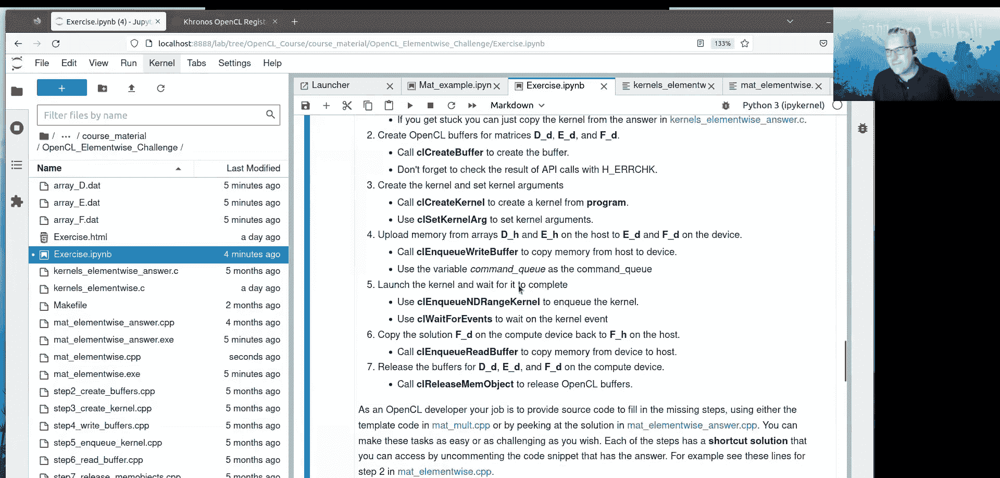

# 【OpenCL编程 Pawsey超算研究院】 p05 p4 Open CL - day 1, part 5 - Matrix multiplication continued and exercise [BV1fMz5Y3EDV_p5]

Okay。All right， next。In this。Sequence。Is that？We allocate our command queuees。

 and then we'll examined what H create command queuees does。

I've selected a compute device we've reported on device capabilities using the function H report on device。

And so now。Now we can construct our matrices， so that's step four。😔，So we're up to step four now。😔。

Preparing the matrices A， B and C on the host。Now these variables N cos A， N row C， and N Cols C。

They have been defined in matsize。hppP。So the array is of size 256。😔。

So there's 256 elements or 256 columns in matrix A。

There's 256 rows in matrix C and 256 columns in matrix C。

And that's all the information that you need to specify this problem。So we make these variables n1 a。

 n not C， N1 c。And just to be sure we have the right data type， we're using C UIMT。

And I'll show you why we need to have this data type when we call the kernel。Okay。

This code here is just to specify the number of bytes in each array。

So the number of bytes in a is n not C by n1 a。Times the size of our float。

 seal float because were using we're using floats for the number stories so we're using 32 bit floating point numbers to store our results。

And。The standard open signal data type C float。That stores 32 bit our floating point numbers。

So we're using C float。So standard standard data types are very useful with within Openseal so this is on the host as we have these standard data types available now those standard data types they correspond。

Precisely to the precision that is used in the kernel。😔，So C floats。Is。

Corresponds to the float type that is used inside us open sealed kernel。All right。

We allocate memory for matrices A， B， and C on the host using this function called pagealc。And。

If we have a look for H Aec inside our helper。Okay， there's our function called H Aec。

When you are working with OpenCL， it is important， in fact it is vital to use aligned memory and aligned memory is memory whose address starts at a multiple of a certain number of alignment bys。

And this page ac command allocates nbytes from memory。

 but uses the biggest data type that is available in open。Fment。

So when you're using host memory with OpenCL。And some。

When you are using host memory as a backing store for buffers， that memory needs to。

Needs to be aligned。So that's why we're using， we're creating an allocation of aligned memory。

And we use the size of a C long 16， so that's the biggest data type in OpenCL。

 so we're using that as our alignment。So that means the starting address。

The starting address of this memory allocation。Will be a multiple of the number of bytes in a C long 16 vector data type。

 so that's a vector of 1664 bit integers。So that would be aligned to。

that would be aligned line to the number of bytes in that。

Okay so that's what the HA does it just creates aligned memory so you need to have aligned memory when you're working with some openseL API calls。

 so it's just useful and a good idea to always use aligned memory when you are allocating memory for OpenCL。

So we allocate memory for the matrices A， B， and C on the host using Halc。And。Yeah。

 that uses a call to aligned Aec。In the background。嗯。

Then we use the functions M random to fill the matrices A and B with random numbers。

So you can have a look in that helper。嗯。We are just using。A Mercend twister。Random numbers generator。

And I'm using a defined seed so that we always get the same results。When we fill matrices。

So your course would not。You might not use a。😔，A seed to do deterministic random number generation for your matrices that that's okay。

 but I'm just using a seed this with this library so that I can have the same results every time。

So that you can tell if something's different。So I'm filling matrices A and B with random numbers。

Or pseudo random numbers。And here is the step。To create。Open sealed buffers。So we've got our context。

 we've chosen our context。And you need a context whenever you create an open C buffer。

So here we allocate open seal buffers for matrices A， B， and C。So when you see or create buffer？

And we specify the number of bytes we'd like to allocate。That's inbox a。UOkay。You。

And we have a read write flag， so that means that we are creating a buffer that has the ability to read and write。

So we can read from the buffer and write to the buffer。

So that is like an IO flag for the buffer creation。

So we create our buffer and then we have a pointer to error code and that will contain the results of whether or not。

The buffer allocation was successful。So we can check。😔，This error code。嗯。

Whether or not it was successful and crash out if it wasn't。So we always。

 whenever we're doing something in Open steel。We always。We always check the error code。

And you can go into the documentation and find out how the C create buffer。

Function is to be called so so the documentation is fantastic there's the specification there is a searchable PDF。

That you can look through to find the signature for the C create buffer function。

So I'm using that create buffer function three times to create matrices， A D， BD， and Cd。

On the compute device， well on the context really， but it is it is going to be on the compute device eventually。

Okay， so that's how we create buffers。On the。The compute device。

 so when we create a buffer we needed context。And。The implementation is responsible for shuffling that memory。

That is in the buffer between the host and the compute device。Okay。Okay。In a later lesson。

 we will see some extra flags that you can pass in when creating buffers。

You might be able to copy memory from a host allocation while you are creating the。

The buffer or you might be able to use host memory as a backing store for a buffer。And。

There are some extra flags， but for the moment we're just going to use C Mem Read write。Okay。

So that is readwrite buffers for matrices A， B， and C。That will eventually be on the compute device。

 so the implementation works out。How to get that memory across to the compute device。

So we see or create a buffer。The next step is to build the program from source for the chosen compute device。

 so we're down at step six now。So we've past command light arguments， we've discovered resources。

 we've allocated command queuees， chosen a compute device。We've made matrices， A， B and C on a host。

And we're filled A and B with random numbers。We've made AD， BD， and C on the compute device。

And now we're going to build the program from source。For the chosen compute device。😔，Okay。

So what we're doing here is that。We've got an extra file in。This directory。

This file is called Colsmettmt。c。All right， so this。This file contains the kernel。

That is going to do the matrix multiplication。So that is the source code for the file。

That is the source code of。You're current on can have now you can have multiple kernels defined in a source code file。

 that's fine。Every kernel。Has this kernelel qualifier in front of it？😔，Otherwise， it looks like a。

It looks like any other function。So you have the return type now the return type of kernel is always void。

So you always need to have a void there。When you are specifying a kernel。

This is the name of the kernel。In this case， the name of the colonel is called Me malt。

The colonel accepts， in this case， six arguments。And in the main program。

 we need to specify or set those arguments before we run the kernel。

Every allocation of memory that is brought into a kernel。Needs to have a qualifier。

That specifies where the allocation lives。😔，When we make buffers using C create。Beer。

That allocation of memory will。At kernel runtime it will live in the global memory space on the compute device。

 so remember that high bandwidth memory that we showed in the introduction。That memory will live。

On the compute device。And you have to say with this qualifier that that memory comes from the global memory space。

So we've got three matrices， A， B and C， and they have all been allocated from global memory。

And that's what this kernel accepts those three matrices as allocations of memory。

 and we have this qualifier here to say that they are from being global。Memory space。是。

This is unsigned integers。So the unsigned integer type。Corresponds to in C in the main program。

 it corresponds to a type of C UINT。And when you are passing in arguments。

 when youre setting kernel arguments， you need to make sure that the data type that you have set。

In the kernel argument is the same type as in the kernel。So if I had set。

The kernel argument with an integer， but it expected an unsigned integer here。

Then you could have all sorts of problems， these values would take on ridiculous entries。

So you need to be sure。😔，That the data type that you set upstream in the host。For the kernel。

 you have to make sure that that data type is the same as is used inside the kernel。

So here is where we're setting the arguments。😔，And we're setting the arguments。こは？Buffs， AD， B D。

 and C。And here we go， we're setting the kernel arguments for the incoming arguments N1A N0 c N1c。

And that's why we have made sure that here the N1A。N0 C and N1 c are of type C UINT。

 so that's the unsigned integer type。Because。That is the same。As。Unsigned int in the kernel。

 so that will guarantee that it's using the same precision。Yeah。So that's what。

The C UA and T is the equivalent in the host of the unsigned int type in the kernel。Okay。

 so we are setting kernel arguments。All right， so we've got this file now that lives outside。

 so it's in the same directory as the program。And at runtime。

 what I'm doing is I'm using this function called H binary and that will just bring in the source code。

火啊。From the file kernels matmt。c。And it will make that code available as a see string。Of。

With the name Colonel source。😔，So we've got our kernel source。

And then we use the function H build program that will then compile the kernel。

That will compile the kernel for every。For a chosen context and a chosen device。

So let's now have a look at that。That thing called H build program。Okay。

 so this is the source code for H build program within the header file C。Helper。hP。

We bring in our kernel source。We bring in a context， we bring in a device。

And then we use this function called CL createate program with source。So that creates a。

An open seal program。Or a program， yeah a program handle。

And from so that creates that that program from the source code that wereve brought in。

And then what we do is we compile。Using C build program。

We pass in our program and then we build that program for the chosen device。So the first call。

Create program with source requires a context。The next is CL build program。

So if you had a number of devices in a context。You would have to run this CL built program for every device。

In the context。But because we have made sure that we only have one device per context。

Then we can just create a program and then build it。

So the decision to have one device per context has helped us in this instance。

So you need to run C Bills program， you need to run C Bill program for every kernel。

So not for every for every program that you create。

In which you are going to run kernels on a specific compute device。

So for every compute device that you're going to use， you need to build your program for that device。

So that's what this does now if there's an error。If there's an error in the process of building the program。

If error code does not equal success， then this code here just digs out the build log and prints out what happened。

 why did it not compile？🤢，And that's been very useful as in。

 if your kernel source is not correct and the program doesn't build， then you can。

Go in and dig out the build log。🤢，And then print that build log to the screen and then exit。

So that's what H build program does is it makes sure that the program。

Is or make sure that a program is built from kernel source for a context and device pair。Sorry。

It's a very involved process doing all this， but we would have had。

 no matter how simple we made this open sealL program。

 you would still have to go through these boilerplate steps。Yeah。Okay。But thankfully。

 we have just hidden all that boiler plate behind one line of code， so the HB program function。

Now we get to step seven。So， we are now。Grebbing Al colonel。

We are grabbing our kernel from the built program。Okay， so this is step seven so we use the function。

C L create kernel now。So we've got our program， it's compiled， it's all ready to go。😊。

Now we extract the kernel from that program using C createate kernel。

So that uses sealL create kernel to extract the kernel called matnott from the program once we've extracted that kernel。

 then we can set these kernel arguments。So AD D， B D， and C Al buffers， we can grab their address。

And when you were doing C set kernel AG。For buffers。

 you just use CM as the size and you grab the address of the buffer。

 so you grab the address of the buffer。And then you Cl set kernel arg to set a kernel argument。跟谁？

Index zero is kernel index zero， so what we're doing here is we are matching up。

Alllocs of memory and kernel arguments， we are setting the kernel with those arguments。And so now。

 now the kernel is ready to run， which is。Which is fantastic。So after we set kernel arguments。

 the kernel is now ready to run。Now C set kernel AG is not threada as far as I'm aware so you can。

 if you're going to do this only do it from one if you're going to do this in a multithreaded program。

 only do this from one thread。CL set Colonel Arg。Yeah， should we do this from one thread？😔。

Or you could within that thread。You could share a program out between threads。

And then you could in each thread create your own kernel I think that's a better way better way to do it is in each thread you can then create a kernel from your shared program。

And then do it that way so I think I think。CL set kernelon Arg is not thread safe。Yep， so if you。

If you did this， if you did this from one thread and you set kernel arguments then you tried to do that from another thread you could have a very yeah you could have not very good results so yeah the all set kernel AG is not threads safefe。

嗯。All right， so we've set our kernel arguments。And now let's just have a look at the kernelnal source itself now。

So when the kernel runs， it's going to have these arguments set， so these values will be populated。

These memory allocations will be populated because we set those arguments。So。I0 and I1。

 they represent the coordinates in matrixtri C。And remember from the introduction that we had a grid。

The grid is of size is three dimensional。And。Get Global ID gets the work item index。

Along a particular dimension of the grid。So。In this instance。

 we have said that dimension zero of the grid。Corresponds to index i1 and we have said that dimension one of the grid corresponds to index i0。

So there's a bit of a flip。😊，There's a bit of a flip going on in the coordinate systems。😔。

And the reason is that remember a long dimension zero of the grid。嗯。Work items are neighbors。

So work items are neighbors on dimension zero of the grid。

Now we're using room major ordering for the matrices。

 so that means that I1 is the first dimension or dimension one is the one along which things should be neighbors。

So that's why we've done this mapping by one is get global I。

For dimension zero and I0 is get global I dimension one。

So that means that dimension zero of the grid corresponds to dimension one of the matrices。

 dimension one of the matrices。Corresponds to dimension zero with the grid。And。

Here dimension one of the Greek corresponds to dimension zero the matrices。

 so I hope that's not too confusing， but the thing is that by convention in C we use row major ordering for matrices。

In Forttd， we use color major ordering for matrices。

So column major ordering is when elements are neighbors along dimension zero。So。

That's why we have this map in here。We have a scratch variable called T。

 and it's set to a value of zero。And inside this， we just have the dot product， which is a loop。

And inside that dot product。And we did this as an exercise in the C++ course。

We did this as an exercise to find the offsets in matrices A and B。喂。Walk down the elements。

Also we walk along route I 0 of matrix a and down column I1 of matrix B， we accumulate the。

Dot product as a sum and then we set matrix C at position i0 and i1 equal to temp。

Now there's an if statement here。😔，This if statement ensures that we do not go off the end of the array。

If。If if the grid is larger than the size of matrix C。So it could be that the grid is larger than C。

 but this if statement is like a guard clause just to make sure that we do not go off the end of。😊。

End of matrix。Okay， so that's the kernel source code。Explained。

Are there any questions or comments surrounding the kernelel source？Okay。So we have then。

We have then set we have them grabbed our kernel using CL create kernel。

 and we have set the arguments for it。Okay， the next step。

 so step eight is to upload matrices A H and BH from the host to AD and BD on the device。

So we use the function， C NQ， right buffer。Okay， so。And that function。

 what that does is upload memory。From the host to a compute。Sorry to a。To a buffer。

That is destined to be on the compute device。So this uploads memory from the host。Duffer。

To the device buffer。So that's the CNQ right buffer command。And what that does when when you're。

When you're thinking about these commands， CLNQ write buffer and CLNQ read buffer， that's it twin。

It's always from the perspective of the buffer。So from the perspective of the buffer。

 we're going to write to that buffer。So we're going to write to that buffer memory from the host。

So that's what this。Is this is a call to copy memory from the host。Over to the buffer memory。

So we do this for matrices A and B， so we're copying the host matrices A H and BH。

 and we're copying that to BD and AD respectively。So we have。

We have now copied that memory or we have。We have in queueed the copy to the command queue。

 so we've got a command queue there， that's the command queue that we chose early on。

So we chose to use a command queue associated with a particular device and context。

And now we are copying memory， using that command queue。

 so this is sending work to the command queue to copy memory。

The next step is to run the kernel to compute C from A and B。

Now we've got the number of dimensions in the kernel。

This is an input argument to C N QND range kernel。So CLNQ ND range kernel is the machinery that we use to submit a kernel to a command queue。

In order to run。And that work will then run on the compute device。

We define the local size of our work group， so that's the size of our work group so that's the number of work items along dimension zero and dimension one。

That's our local size。And then we define our global size。

Now remember that in the kernel we have these coordinates flipped。

 so that means in the global size we also have to have those sizes。So instead of N Nt C N1 C。

 we have N1 C and NNP C。So we're making our global size n1C elements along dimension zero and N0aught C elements along dimension one。

 so that's the size， this this is where we define the size of our grid， our open seal grid。Okay。

This function here H fit global size enlarges global size just so that it can be。

It can have an inte number of local sizes。So if there is not an integer number of local sizes along each dimension。

 this function H fit global size will enlarge global size。

Such that this condition is true or the condition that there is an inteent number of local of work groups along any dimension of the grid。

Okay。Next， now that we have our large global size and our。Local size。

We create an event called Colnal event。Now that is that kernel event。

Can be used to track the work that has been submitted to a command queue。

So every command such as CNQ so every NQ command like CNq write buffer has the option of。

Passing in an event。Such as Col event that tracks the work。

Associated with that command submitted to the command queue。

So CNQ ND range kernel is the function to launch a kernel。We launch the kernel。

 we submit that work to command queue。The kernel is this kernel variable。

We have a number of number of dimensions in the grid。This is the global size and the local size。

And we are using the。This event object。To track。The event。

Or to track the work that we' have submitted to the kernelel。😔。

We can use the function C weight for events。And that is a number。

 so it can wait on any number of events， soecle wait for events can wait on any number of events。

No worries， Harry。Yep， no worries， I'll see you tomorrow。Okay。

 so C wait for events can wait for any number of events。And in this case。

 we're just waiting for one event， and so that waits for the kernel event。To finish。Yeah。

The next thing that we do is。Step 10。We are copying the contents of CD back to the host。Yep， no。

 no worries Emily， yeah， we're just about finished。Yeah， we're not not far to go。

 so hopefully we should get there before five o'clock。Okay。

And so the final things that we're going to do is copy memory back from the buffer to the host。

And so we use C inQ read buffer。To copy memory from C back to CH。And then in steps 11， we。

Alloccate memory for the answer。And then we get our maximum error between what we copied back and our solution on the CPUU。

 so the solution on the CPUU is in C andO H。Then we write out our arrays and finally at the end。

We can。Free。Our memory allocations， we free any arrays that we allocated。

And then we can call the functions H release command cues to release the command cues and then H release devices to release the devices。

So few。😊，That is an entire walkthrough of an openCL application。

Now I'll just have a look at C at H release command Qes。

So we'll just go down to H release command queuees。Okay。

 and H release command queuees just waits on a command queue using the function called C finish。

And then it calls C releasease command queuee and it does that for all command cues that have been allocated。

 so this is how we tear up resources at the end of the program。

You need to make sure that you finish a command queue and you can use the。

Call C finishish to finish up any work that is inside a command queue。

Then you release the command queue。And in H release devices。

 what we do is we just loop over the number of contexts， we release the context。

 and then we release the device。😔，Then we free our context， we free our devices。

 and then we free our platforms。And so that's。That my friends is a complete example of matrix multiplication in OpenCL。

Now tomorrow we're going to talk about we're going to talk about。😔，Debugging open C kernels。

 we're going to talk about profiling or measuring the performance of open C kernels。

And then we're going to talk about the different memory spaces that are available。

To an open C kernel。So hopefully those three topics we will get through。Tomor。

And I might just finish by saying that。There is an exercise。

There is an exercise for that relates to today's。Material。And if you go into the。Direectctory。

 open C element wise challenge。There is a directory。Yep， there is a file called exercise。

And what we're doing with the exercise is that we are doing Hadamard or element wise matrix multiplication。

 and so this is just a way， this is just a way to solidify your understanding。

Of the process of using OpenCL。Using a sister example of had to mind matrix multiplication。

So how toide matrix multiplication is really easy， it's just element wise matrix multiplication。

 so in matrices D， E and F。😊，You just multiply an element at position i0 i1。

With matrix E at position i0 i1， and then the result goes into matrix F at position i0 i1。

Now the source code。For this is in course material， Open CL element wise challenge。Okay。

 so you can click on this link and it will take you to met elementement wise。

And it's similar to the matrix multiplication example in almost every aspect。

The steps are device discovery and selection， command Q creation。

Alllocate EH so DH and EH on the host and fill them with random numbers。

Alloccate DD and ED on the compute device。Build your program， compile the kernel。

Set kernel arguments。Upload DN H D& E to DD and ED。Run the kernel， map element wise。

 and then copy things back。And check against the solution。Okay。So if we compile and run the kernel。

What if we compile and run the code as is？It produces。So this is the answer。

So if we compile and run the answer。What it does is。

It spits out the array FH as computed with OpenCL。It computes the CPU solution and then computes the residual matrix between the two。

Solutions so in this case the error is zero so that's what we expect to see so that's the answer。

What does the code do？At the moment。So if we make the element wise code。

 it actually spits out all zeros as the answer， so there's a problem。

What we need to do is fill in the necessary bits of code。

Such that the residual is non zero and that means that the output is so if the residual is zero。

 then the output is correct。So the challenge here is to edit the sources map elementementwise。

cppP and kernels element wise so that's the。That's the two files that you need to edit kernels elementwise。

c。And mat elementementwise。c。Okay， so there's a number of steps and it's really。

 I choose your own coding adventure。😊，So as it stands， this code。

 map Element wise is missing a number of steps， a number of crucial steps。

But each step is marked out clearly in the code using these quadruple comments。🤢。

So we've got a number of steps to fill in here。😔，It's not a completely bare code， so for example。

 I've taken care of a lot of the boilerplate steps that you need to acquire devices and release devices。

 that's the messy stuff。But what we are missing is， for example， code to create buffers。😔。

We're missing code to finish the kernel。😔，So we need to insert this missing kernel code that would be step one。

And。Step 2。So that's step one is to finish the kernel code step two is to create open seal buffers。

Step three is to create a kernel， step four is to upload memory， step five is to launch the kernel。

 step six is to copy the solution back and then step seven is to release the buffers。Now。

 the choose your own adventure comes in。Through being able to choose which of these steps you want to focus on。

🤢，You might want to focus on just one step and that's okay。

 or you might like to try and finish all the steps well in that case hats off to you。

But each of the steps are laid out。In the code， So for example。

 step one is we've got to finish this kernel in the file， kernels element wise do C。

If you get stuck with any of the steps。And just include the answer for that step。

You can choose to complete as many or as few steps as you want。And this can be done in your own time。

I will have。Hub 2。😔，Available throughout the duration of this workshop and you can always use your allocation on satonics with our reservation。

So each of the steps from steps to three。Five， six and seven， they all have the ability。To un。

A section where you can include the answer。If you get stuck at any point。

 there is a file called MA El wise answer and that's got the solution in it so you can check your progress against the answer。

Okay。So your job。Is or your task in order to solidify your learning of openCL code。

 your task is to fill in those steps。

All right。Thank you everyone for attending today and tomorrow we'll see you for debugging and we will see you for profiling。

And hopefully the learning curve will not be as steep as with this last module。🤢。

So once we've got over those steps， now we can。Relax now and enjoy open seal programming。

