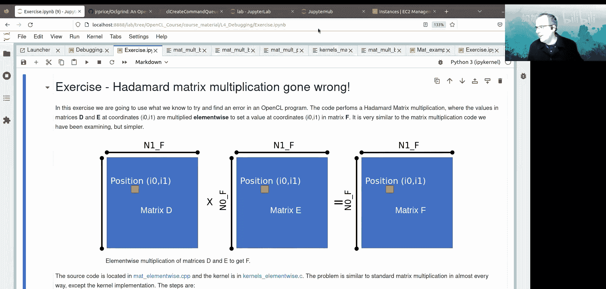

# 【OpenCL编程 Pawsey超算研究院】 p06 p5 OpenCL - day 2, part 1 - Debugging [BV1fMz5Y3EDV_p6]

All right， well welcome everyone to day two and today we're going to be talking about debugging open seal applications。

Measuring the performance of open seal applications and also if we have time。

 we might delve into the memory spaces that are available。To an open seal kernel。So。

Let's open up the course material。What we'll do is we will go to L4 debugging。😔。

So in the open seal course folder。So if you've downloaded the course material。

The download link is in the welcome letter， so it's a Gitthub repository。

That's it yeah and yeah if you download the course material that's in a link inside that welcome letter。

 we're going to a folder calls。Course material。😔，And then L for debugging。And then the debugging。

 either the debugging notebook or the HTML document。

So you can view the HTML document with any web browser。

 but you can also view the notebook as well if you are logged in hubub one or hubub2。

So the links for hubub one and hubub two are in the welcome letter so they're under backup logins。

Okay， so debugging open seal applications， here we go。

So debugging open seal kernels is often not easy due to a lack of specific vendor support。However。

 there are some tools and techniques to help。Such as checking the error codes from every Open seal function call。

Checking memory access from within kernels。A visual inspection of your inputs and outputs。

Using print F， so that's the C print F statement from within kernels。

And then there are an open source tool suite called OCL Gr。

And that provides a velgri like way to debug。Open seal kernels and I think this is a fantastic open seal tool just to focus on debugging kernels and that's precisely what we need we can use a normal debugger for everything else but when we are debugging kernels themselves we can use a tool like OCL grind so that's fantastic。

Okay， so we have our matrix multiplication。Operation and we learned that in exhaustive detail yesterday。

But what we're going to do for today is we're going to stick with matrix multiplication。

 but we're going to introduce a bug。Into the kernel and see what techniques we can use to recover the error。

So in this instance， we intentionally remove the guard check that prevents the kernel from setting values outside the domain of C。

😔，So the size of matrices A， B and C for our matrix multiplication are set to 72 by 72 and we use real major ordering as before。

In the kernel we specify that dimension zero of our open seal grid maps to dimension one in the matrices。

 that's because dimension one is the contiguous dimension in room major ordering and we want threads to be neighbors along the contiguous dimension of the matrices。

Similarly， in the kernel， we specified that dimension one of the grid maps to dimension zero of the matrices。

So we choose a block size of 16 by four by one， so that is the local size or the work group size。

And since an inteigent number of blocks must compose the grid in each dimension。

A global size of 80 by 72 by one is the smallest size that will adequately cover the matrices with five by 18 by one blocks in each dimension。

So using that transformation， dimension zero of the grid maps two dimension one of the matrices。

Then the global size of 80 by 72 by one will map across to 72 by 80。And the matrix size。😔。

So the matrix size is 72 by 72。And the local work group size of 16 by four by one will map across2 four by 16。

So that means that when we do the mapping from dimension zero in the grid to dimension one of the matrix。

 that means that our global size is going to be 72 by 80 and our local size is going to be 4 by 16 so there's going to be four。

Elements along so four elements or four work items。

That are going to be responsible for a row and 16 work items that are going to be responsible for the column so it's  four by 16 that's the local size of each block。

Now， because the global size is 72 by 80。And the matrix size is 72 by 72。

That means that there's going to be eight cells here where we run off the end of matrix C。

So remember that in matrix multiplication， we take a dot product。Of row I0 with column I1。

 and I'll just bring back yesterday's matrix multiplication example。

Just so that we can see matrix multiplication。Okay。

 so in matrix multiplication we are taking a dot product of row I0 with column I1。

 and then we're putting the results into matrix C at position I0 and I1。Now。

 if we remove the guard check in the kernel。😔，So let's going back here， if we remove the guard check。

 then we are going to go off the end。😔，Of。Araised of the arrays for matrixtri C。

So that means we're going to go into a region of i1 that is beyond the reach of matrix C so if we go back to our matrix multiplication example。

 that means that row access from matrix a is going to be okay because we stay within the bounds。

Of matrix C along dimension zero。But when we go beyond the realm of matrix C into this area here。

Forour column I1， we're actually going to read off the end of matrix B。

And when we read off the end of a memory allocation。

 that is a memory access violation and we access values that have not been initialized。

And that means that we have a good chance of ridiculous numbers entering into our calculation。

So when we write when we so we're going to read off the end of matrix B because we're going。

On a column， column I1。That goes off the end of matrix B and when we write to matrix B。

 we're going to go。Eight elements off the end here so when we go eight elements off the end here。

 we actually wrap around to the next line。And you can see that at the last row。

 when we try and write to matrix C off the end， then we're going to write into memory that's out here and that that would be a memory access violation。

So that's the bug that we're going to introduce into the matrix multiplication。So here is the kernel。

So the kernel is located in。E4 debugging and then Colonel's Matt Mot。

And so this is the ordinary kernel matte Mo， and it has the guard mechanism to make sure that we do not go outside the boundaries of matrix C。

But we're going to use this kernel here， so this kernel has had its guard check turned off through comments。

 so we've commented out the guard check。So that's the bug that we are going to introduce。

And if we have a look at the source code for Matmtbug。cppP。

 it's just the matrix multiplication as per normal。

 but we use the Matmt bug kernel instead of the Matmt kernel。Okay， so that's what。

That's how we're setting up our problem。So when I1 goes beyond the limit of matrix C。

 then it will read off the end of B to do the calculation， and then it will write off the end of C。

At the end of the calculation。So that's what we have and if we try running this code。

Then the maximum residual is often much larger than expected。

 so in this case we've read off the end of B and we have read memory that has not been initialized and some ridiculous values like 10 to the 38 have crept into our infinity norm so this is a disaster。

So， but note however， that this open seal implementation， the code has completed without a crash。😊。

Even though multiple memory access violations have taken place。

And the reason for this is that the code。Or the implementation that we're using is based on the GPU。

And GPU implementations。Do not have strict memory access violation checks。😔。

So let's try this again with my NviDdia OpenCL implementation。😔，Okay。

 we still get an infinity norm that is orders of magnitude higher than what we expect。

 but the application has run without any problems， well， without any obvious problems。

So memory access violations can result in undefined behavior， we saw that with GPU zero。

We saw that we got， first of all， a ridiculous value like 10 to the 38 crept into our infinity norm。

 but when we run the application again， we get an infinity norm that is around five。

What's going on here？😔，So。Sort of seemingly random results that happen every time you run the application。

 so seemingly random results that happen。That is a good indication that a memory access violation has occurred。

Okay， so due to OS security， CPUU implementations are often more sensitive to memory access violations than GPU implementations。

And that is because the OS has a security measure inside such that when you try to access memory that does not belong to you。

 the OS will detect that and then shut down the application。And so you may have seen this as a。

 a Se fault or a crash in your program。😊，So I don't know if the CPU is going to detect the memory access violation in this instance。

 but I've just tried to run the open seal， the buggy Open seal application with a CPU implementation。

And what it may have been doing this in this instance is running off the arrays into memory that belongs to the program。

 so that's okay but。But if it had run into or tried to access memory that does not belong to it。

 then it would result in a crash or a seg fall， so we're playing Russian Roulette。

We're playing Russian Roulette here。Okay， so。Let's do as a first past debugging step。

Let's load the output of。Our calculation， so we load the inputs array A and array B。

And array C into memory。 And let's just check what's。😡，Going on。

 So that's one of the things that you can do is。Dump the outputs or dump the inputs and outputs for your kernel。

 dump them into a file and then have a look at them。And this is what we're going to do here。

 so we're going to have a look at。The matrix multiplication from NumpI。

 the matrix multiplication from our program， and if we do the absolute residual。

We can see that there's this line of eight cells here that is wrong。

 so it's discre discrepant from the nuI implementation。So let's now zoom into this region here。

Now you'll notice that the region that is wrong is eight cells wide。

And that is because we ran off the end of C and when it writes off the end of C。

 it actually starts writing on the next line。So notice then that。😊，Rose zero。😔。

Is okay it doesn't have any problem and that's perfectly explainable because we don't when we write off the end of this array we actually start writing to the next line。

Okay， there's another thing to note is that some cells in here。Some cells in here are fine。

 but some cells have a wrong residual。And that is because remember how we said that we cannot rely on the ordering in which work items complete。

🤢，So what has happened here is that work items from when。

Values of A were being written off the end of the array。Those work items actually finished last。

 so they were the last ones to write to this memory location。🤢，Sorry。

The ones I had had that around the wrong way， so what that means is that with this correct line here。

The work items that were responsible for this area of matrix C， they wrote last。

But with this line here， the buggy line， so where there's a big residual。

That was when the work items that ran off the end of the array。

 that's when they wrote last to Matri C。So we can't。

We can't rely at all on the order in which work items complete。😔。

And this is particularly true with a CPU implementation。All right。

 let's try this again with a GPU implementation and I'll do it with the Nvidia。

I' do it within video open seal implementation。😔，Okay。

 so we can see now we can see now that it's more blocky。So if we have a look at this residual。

It seems that it seems that this。This buggy area。It seems that this buggy area。

Is either all correct or all wrong？So we can see that this this buggy area of eight cells is either't all correct or all wrong and that's because of the hardware thread。

That's because of the hardware thread teams and so。

What is happening is the whole team has written within very short has written to that part of matrix C off the end off the end of the array so it's gone on to the next line and that thread team has done this as a whole and that's why you either get。

嗯。You know，Re that are fine and that's because the work items that are responsible for this part of the matrix they wrote last。

But in this area， it was the buggy work items that wrote last and they did that as a team together so that's that's why it's more that's why it's less moffled。

In the way that it is。So。😊，The upshot is that have a look at your inputs。

 have a look at your outputs。And then you can。Then you can。

It's a very brutal test on how well your algorithm is going， so often a a visual inspection。

As one of the best tests that you can do for determining if things are going okay with your algorithm。

All right。We've done a visual inspection， that's one thing。Checking the return calls。

 open CL calls is best practice for programming with OpenCL and many API errors are caught this way。

But with this example， we have made sure that we have。

Already checked all of the open seal calls and nothing has gone wrong， so we need to dig deeper。

One thing that you can do， so let's say that you've done a visual inspection of your inputs and your outputs。

You've done a visual inspection and you know that there's a problem。

So another thing that you can do is make sure that your memory accesses are valid。

So in the kernels matte Mot， there is another kernel that I've got here called。Mat malt， MImchck。

And what you can do is another debugging tactic is to fill。Your values。With a known answer。

 so fill your outputs。In your kernel so C is the output and what you do is you fill your outputs with a known value in this instance we're just filling matrix C with a float converted by one which is our index。

So we fill see just with with I1 now we're not worried about getting any correct results at this point。

 we're trying to find out what the cause of the bug is。So。😊。

Let's go back and now let's have a look at what happens when we fill with a known answer。Okay。

 so there is the output of。Our program， so this is matrix C and we can see that。For some rows。

For some rows， we can see that it's filled with high values of i1。😔，And we have a look。

If we have a look at that， we can see that the value here is 78。

So that's much higher than the maximum index we would expect which is 71 so the highest index that we would expect is 71。

 but we're getting values of 78。So it becomes fairly obvious at this point。What's going on here。

 we've run off the end of matrix C。And we have inserted high values into the first eight rows。

I the first eight columns。On some lines of。Of matrix， matrix C。

Now it's fairly easy to understand this in Holsight。

 but if you're dealing with this in the you know without any prior knowledge of what's going on。

 it might be a little bit difficult to immediately understand。Okay。😔。

So the next thing that we can try is debugging with print F。

And most of the major open C implementations support the use of a print F statement within a kernel。

So output from print F in the kernel gets routed to standard output on the command line。

So in the file， MattMt print F。What we do is we switch out。The buggy kernelel。For matte malt print F。

 so that's a kernel that has print statements in it。

So here's the kernel with print statements and then we say that if I1 is misbehaving itself。

 then we'll just print the value of I1 so if I1 is greater than n1 c minus1。

And where on the first row or i0 is equal to zero， then we just print out what i1 is。Okay。

 so let's try。Let's try that。Okay， so we weren't expecting。

We weren't expecting I1 to go beyond the bounds， let's say that。Oh。

We didn't know what the cause of the error was。😔，And so we weren't expecting I1 to go beyond 71。

So here is another indication that something is wrong。Okay。So another tool that we can use。😔。

Is OclL grind so if you click on that link you'll be taken across to the OclL grind。

Web or GiHub page and you can download and install OL Gr to your machine。

And what OCL Grd does is it simulates an openCL device that self checks for data races。

 memory access violations， and erroneous API runtime calls。It currently provides an open CL 1。

2 interface as well as G like interactive kernel debugging。

So OCL grains precisely meets the need for interactive debugging of kernels， however。

 it is orders of magnitude slower than a native open C application。

So you can either make your problem sizes really small when using OCL grind。

Or you can have a setting minus Q just to compute the first and last work groups for every kernel invocation。

😔，All right， so let's run， so I have OCL Gr installed on my laptop。

 but if you load the openCL other programming environment openCL module on satonics from your allocation。

 then it is available there， so I've installed OCL grind on satanonics。Okay。Okay。

 so let's run O steel grind on my laptop。And here we go。

 it has picked up a whole bunch of read access violations。

So they are when we were reading off the end of B。And there should be a few right access。

 so there's a right access violation there and that's when it's trying to write to see off the end of the array。

Okay， so that's fantastic， so OCL Gr has found the problem。

 has found the invalid reads and the invalid rights。😊。

So OCL Gr is an open source tool and it definitely needs our support。Okay。All right。

 so I'm just going to get an allocation on satonics now and what we can do is we can interactively go through。

A。Colonel debugging session with Oceal grind。So let's get our allocation。And if you like。

 than you are more than welcome to follow along with me。

So get an allocation like I've done on satanonics。And then we do the module use and the module load。

Commands。So I've already done the module use command。

 but now I'm just going to do the module load command。Okay， excellent。

 so I have I should have OCL grind available on the command line now。

So I changed directory to my scratch。Excellent change directory to OpenC course。

Just make sure I have the latest。Yeah。Okay， excellent， all right。

 so I've got the latest course material。And now I go to my L for debugging directory。

And let's just do a make clean followed by a make just to make sure that we have all of the applications built。

All right。So now what we're going to do is we're going to do an interactive。Debugging session。

Of the buggy kernel。With OceL grind。So we're going to do OCL grind with option I that's for interactive debugging。

And then we go。😔，Met mold。Bug。exy。Okay。And it will stop。😡。

At the first open seal kernel that is encountered。So we have。

 we do the info command to see where the execution has stopped and we have stopped at the kernelel called Matt Mot bug。

All right。Using the help command， so if you do this with me。

You can see all the commands that are available for。Open sea or Oce grind。

If I type list that type that shows me the kernel code that I'm about to step through。

So if we then do the next command。That will then step through。The lines of code。😔，In the kernel。

And we are currently。We are currently at work item 000。Okay。

And we can do things from within the kernel like print and N C。So that is the input argument for the。

嗯。That is the input argument for the kernel， so if we have a look at met malt bug。All right。

 so there is the source code for MattM bug and N nor C is an input argument。

 so we can examine using the print statement， we can examine input arguments。And one thing。Oops。诶。

That's interesting。Is going next？😔，There we go， now I can print in1 scene。Right。

 so we can print values that have been passed into the kernel。

And that's because OCL Gr simulates an open C device with all the checks enabled。

So we can keep going。We can keep printing things and we can keep stepping through lines of the kernel。

We can even。We can even print。Values inside the memory allocation。

So we're printing B zero and that is the first element of our memory allocation B。

 so you can even print things inside memory allocations。Okay， now let's get help on the WI command。

So the WI command is to change to a different work item or a different global ID。So we've go help WI。

And that says we're switching to a different work item。All right， so if we go W 7200。

Then that will take us to work items 72。0，0。And then we type continue。Okay， so then when we。

When we have moved to work item， so that's the kernel responsible for。4our work item at index 720。

0 in the grid。So that is the work item that has gone off the end of the array for row zero in our matrix C。

So we're at， we're at。At the moment we are at the work item that is responsible for writing off the end of the array and because we've done continue。

 it continues until it encounters an error。😊，Okay， so there's an error here and it's reported that there's an invalid read of size4。

 so that's the size of a floatte。Thats global memory address yada yada。Okay， so it tells us what。

OurOur global address is what our address within the work group is。And which group that we have？

So I think that might be the work group In。Okay， so let's print now I0 I0 seems okay。

 but if we print i1， we get a value of 72 and we're not expecting to we're not expecting to do any math。

UThat。A value of 72 because that's off the end of matrix C。Okay。So that's how。😮。

That's how we could have used OCL Gr。And it will stop every time it encounters a memory access violation。

So then if we go quit， that will finish the execution and。Yeah。

 they finished the execution and finish。Oceal grind。

So that's useful if you want to step through the kernels as they are run。

Using OCL grind and we only have one kernel in this application， so it's a fairly simple example。

But sometimes you might want。You might have more than one kernelel。In fact， in a large program。

 you could have heaps of kernels running。If you only wish to debug a specific kernel without having to run the entire application。

There is a sister application that comes with OCL grind， it's called OCL grind kernelnal。

It takes in a file specifying the runtime parameters and kernel arguments and runs that kernel from wherever it is located in the source。

And it just runs that as an interactive debugging session just on the kernel。Okay。

 so we've got our kernel， which is。So this is the contents of this mat malt bug。sim file。

 so that is the input argument to OCL grind kernel。

And what that does if we have a look at that file is the first line is the source file where the kernel is located。

The second line here is the name of the kernel this 80 by 72 is the global size that we would like to use this 16 by4 by one is the local or work group size that we would like to do。

Okay， and what we do next is we can specify the size and type。

Of memory allocations that are then passed into the kernel， and we can also specify a fill value。

Okay， so the first argument is global float A， so we define that a is of size 20，736 bytes。嗯。😊，And。

20，736 bytes is the size of matrix 8 because it's 72 by 72 and then each float has four bytes。Y。

 I'll just grab that question just afterward Emily。The second argument is。A four matrix B。

And in this case， we will specify that it is in the range of 5000 from zero to 5，183。

So we can specify that the input memory has is initialized with。With either ones or random numbers。

 I think， in the range， in this range。Okay， the third argument we can specify it has a value of zero and then arguments four。

 five and six， they have a particular type and we can set what those values are so this is a way that we're instrumenting a debug of a particular kernel。

So you have this SIim file。Which is specifying all the input information you need to debug。

That particular kernel。And when we when we debug that kernel， we can then use。嗯。

We can then use OCOL grind。Both seal grinds。卡龙。And interactive debugging。

 and then we pass in our SIim file， so this will be map mal。Bug。sim。Okay。

And then we have interactive debugging of the kernel source。

 so this is really really handy just to debug a single kernel that you would like and so you can use all the commands that I did previously to debug that kernel。

Okay， we've got a question from Emily， the question is how well supported is using AMD's rock GB on satonics？

I can get it to run the code and do some basic stepping。

 but I don't know how much it knows about OCL specific stuff， yes。

Well we can certainly try debugging with rock GB， I haven't had such a fantastic experience using rock GB to try and debug kernels。

 even with H， I haven't been able to do things like printing kernel variables。

 not like I can do with OCL Gr。But I did。Check with using rock G with OclL。

 and I think it might have a trouble with finding the。

With finding the name of the kernel to debug because what's what's happening with the AMD implementation is that。

It's using a lower level thing called HSA， so the open seal calls go to this lower level thing called HSA。

And that has its own calls。Yeah， so H is more supported with rock G。

 but I don't think OpenCL is very well supported unless you are willing to dive into the HSA。Layer。

 but having said that， sure， why don't we try using rock GDP to try and do the same thing that we got with OceL grind？

Okay。So we've just。We' just finished covering now OCL grind kernel。So that is a way to debug。

Dvog kernels。Okay， so let's move on to vendor specific tools。嗯。I encountered the same。Yeah。

 I encountered the same issue with Kuda GDP。I didn't find a way to access the kernel。So。

Could a GDP didn't detect memory access violations either？

One tool that has been useful in the past for detecting memory access violations is KUuda Mem check。

But in this instance， Kuta memcch has not found。😔，The arrow。

Let's try the most updated tool from NviIDdia compute sanitizer。And no。

 because there was no specific couda calls in here。

 even though we use the NviDdia Open seal implementation。

Compute sanitizer wasn't able to help us if this was a couper application。

 then compute sanitizer would have been able to find the memory access violation。

So if you're using H which uses the coer backend， that would have worked。

 but because we're using OpenCL， we don't have any support from NVIDdia for debugging this。Yes。Okay。

 AMD has。Yeah， no worries。Yeah， it's interesting that you think that the rock GDP is a good debugger。

 Emily because。I found that the omission of being able to print kernel。😔，Variables itself。

 I thought the o of that was a pretty fundamental one。So I was just。

 yeah I was just curious to know yeah what's your opinion on rock GDP is what do you mean by omission of being able to print kernel variables like just with openCL or oh no with with applications like H as well I haven't been able to find a way to print variables from the kernel that's very strange I've been able to do that just fine with my codes。

Okay， which which architecture were you using maybe we can have this as an offline discussion yeah yeah let's let's not bo everyone else down with this yeah no worries all right yeah so with the architectures that I've had access to I've had I've had this problem but we can certainly discuss offline。

Okay。😊，So let's now try using rock G。嗯。To debug the buggy kernel。Okay， so if we go rock GDP。

Once we might need to load the Rockham module。So we'll just make sure that we have the Rockham module loaded and then we go rock GB。

Args， and then we choose the mat malts。Bg do exiting。That should be fine。Okay。

And then we set a break point at mat Mor。Buck。Yeah。And。

It said open CO call failed at fetching number of platforms。😔，And。Okay， let's try that again。

Let'll just try running the application。Oops， sorry， GPU is zero。No。

Does't look like we have access to any GPUs here。No platforms available， What's going on。😔。

All right so ask for a GPU。So what I'm trying to do is I'm trying to run this code with rock G。

But for some reason， I haven't found any GPU devices in my allocation。There it is， okay。

 so now we've got some GPUs。There we go， so we've got our GPUs。All right， so let's go now to。Stch。

Ipen seal across。Maybe Emily， you could try using rock GB at the same time and let's see what we find。

Okay， make。Yeah。So I'm just running。I'Just running our application now。Under a rock GDP。

And so when I'm running rockG UB with the hip， what you can do is you can set a break point so that it will then break at the kernel。

So I'm just going to set a break point now。And it should break at the matte malt bug kernel。

 So if I now run that。Okay， so we have we have hit the break point。Yes， so when we're using rock Gdb。

 we can set a break point to。And the name of the breakpoint that we have。

 so we go B and then Mat malt bug， so that's the name of the break point。And when we are in rock GDP。

 we can go info threads。All right so。Within rock GDPdb。How within that AMD platform。

 you have threads and threads that are responsible for thread teams。Within a thread team。

 there is the concept of a lane now every lane is one of those violinists in the wavefront。

So what we're going to do is we're going to。Navigate。Within rock GDP。

 we're going to navigate to the very last thread team。

That is going to cover this problem in the matrix multiplication and it's really good that with open C and rock GB that we're actually able to break point into a kernel。

Using rock TV。So if we continue， we can see that the very last thread is thread number 100。

 so we can use the thread command。Sorry， thread number 110。

 so we use the thread command to change to the very last thread。

And then we use the lane command to change to the very last lane。😔，嗯。And if we， yeah。

 if we do that sort of change to the very last thread， the very last lane。

 and then we disable our break points so that no other threads trip over that break point。

Then we type next。And we would have been able。In hip to step through the lines of the colon。

And what I've found with rock EDB on satonics。In the way it is at the moment。

Is it then just jumps to the end？Without， you know。

 without stepping through the kernel so at the moment rock Gb with opencl is not very useful。

 but I'm looking forward to having that discussion with Emily about about you know the experience that you've had。

嗯。So。Anyway。So rock TB doesn't work so well on satonics。

Doesn't work so well on satonicix with openCL code。W。All right。

Now let's move across to the Intel tool。So the one APII toolkit from Intel has an enhanced GDP debugger that has the ability to step through and debug openC kernels。

It works with the Intel openseal runtime from one API。So incidentally。

 the standard GDP debugger also works to debug kernels on the CPU runtime。

So let's do debugging with GDP。So in order to enable kernel debugging。

 we need to select the CPU device and use the Intel OpenCL implementation。

So if we have a look at the file called Matt Mots bugg GB。When we build the program。

 so see how I've got this call to H build program， we have got the arguments。嗯。Gene for debugging。

And then this S flag， that is one API specific。And that specifies the location of the kernel source code。

You've got an extra flag called COt Disable and that also works with implementations like AMD's Rockham。

But this flag here。😔，S kernelelmatmt。c。That is that is the source code。Of the the colonnels。Okay。

You right。So we can run。We can try and debug this code now using the Intel。Dobago。All right。

 so we just look for。Mat malt bug。GDB。Make。Excellent。Okay， so we have。

The application met multiple bug G。And we use the Intel one API。So we use the Intel one API debugger。

With these arguments here。Okay， excellent。So when you are debugging kernels with the Intel。

Debugger or on the Intel open C。CPU implementation。😊，Within the kernel。

 there are these three variables。That you can use to specify a break point。And they are OCL。

DVG GID zero。And G ID1， G ID2， and they are the indices within。Algri。So within G。

 you can set this break point and what we're doing is we're setting a break point if these GIDs start to misbehave。

So we do that。😔，Okay， and then we can run。All right， so within the Intel debugger。

 we can step through。The lines of code。And as with open OCL grinds， we can print I0。

Print I1 and we've got a similar sort of。Functionality that we did before with Oceal grind。Okay。

 so if we go continue， we can see that。The Intel debugger， though。

 did not detect the memory access violation。So， okay， so this is。

What we've done with this module is that we have。Introduced a bug into our matrix multiplication。

Algorithm。Then we have tried to recover the error first through a visual inspection of outputs。

 that's a very powerful debugging technique。Then we have used。😔，Things like print F。

To print things that are going on inside a kernel。Then we have tried setting values to a known value inside our kernel。

 so what we're doing is we're checking our memory accesses to make sure that they are right before we try and find any other errors within the kernel。

所。Once we did that。Then we tried using a tool like OCL Gr。

 and that was a fantastic tool that picked up the memory access violations and allowed us to see what the problem was。

Then we tried a couple of vendor specific tools like rock GB。

ACuda GDP doesn't seem to work very well with OpenCL and the Intel 1 API debugger got us some functionality to look inside openCL kernels。

As well。Okay， do we have any questions or comments？Surrounding that。Okay， excellent。All right。

So I might just talk now about the exercise that is associated with。This particular module。

 so let's have a look at the exercise。All right。So the exercise is had a mud matrix multiplication gone wrong。

In this exercise， we're going to try and use what we've just learned。

To try and find an error in an open sealL program。So the code。😮。

Performs a hadomamad matrix multiplication。And that is where the values from D and E at coordinates I0 i1 are multiplied element wise to set a value at coordinates I0 i1 in matrix F。

It is very similar to the matrix multiplication code that we have been using so far。

 but it's simpler。The source code is located in MA Element wise。

So that's mat elementement wise right there。And the kernel is located in kernel's elementement wise。

So that's right there。The problem is similar to standard matrix multiplication in almost every way。

Except for the internal implementation。The steps are device discovery and selection。

Marices DH and EH are allocated on the host and filled with random numbers。Marices。

 DD and ED are allocated on the compute device。Marices， DH and EH are uploaded to device allocations。

 DD and ED。The kernel map Element wise is run on the device to compute FD from DD and ED。

FD is copied to FH and is then compared against the solution F answer H from a sequential CPU code。

Then we have memory and device cleanup。But the code has some critical bugs in it that produces rubbish output。

And it's your task to find these bugs using whatever means necessary。🤢，Okay。

 so let's run the solution， so this is the code that is okay doesn't have an issue。

So if we run the solution， we have got。A matrix with。Four rows and eight columns。The output array。

As computed with open C is this and the CPU solution is this and there's no residual。

But if we run the bunky application。😊，If we run the buggy application。

 we can see that the residual is zero almost everywhere。Except for the last line。😔，Well。

 not all the last line。The first element of the last line is okay。

But the rest of the last line has a non zero residual。

So your task is to try and find the error using any of the techniques。Found in this lesson。

And you can of course， have a look at the differences between mat elementement wise answer and mat elementement wise if you get stuck。

But then try to understand why the bug messed up the solution。Okay。Okay， so the answer in the kernel。

 well， kernelel's elementement wise answer and MA element wise answer。

 they contain the code that is correct。But kernelel's element wise。And Matt Element wise。

As the code that contains the error。Okay， so how about we spend the next？15 minutes or so。

 working to try and find the bug that is going on with this。

And that will serve as a a bit of a break as well before we move on to profiling。

Okay。How does that sound？Excellent， all right。So and the error is not too difficult to find。

That it can be tricky。So yeah。😊，Go ahead and see if you can use any of the techniques that you've got。

To try and find the error。I'm just going to have a break and I'm going to check in with you guys。

Again， in 15 minutes time。