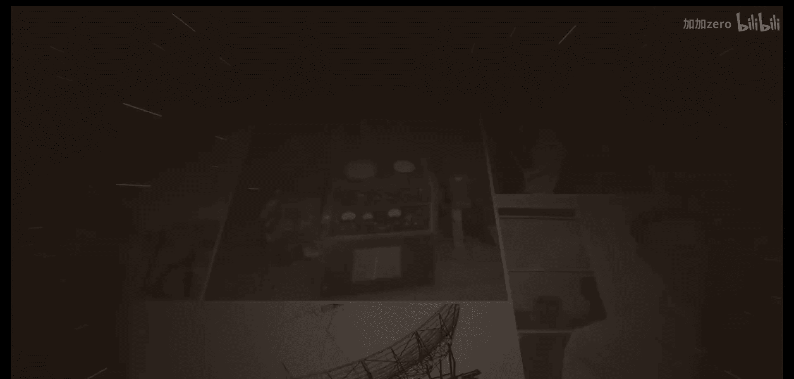
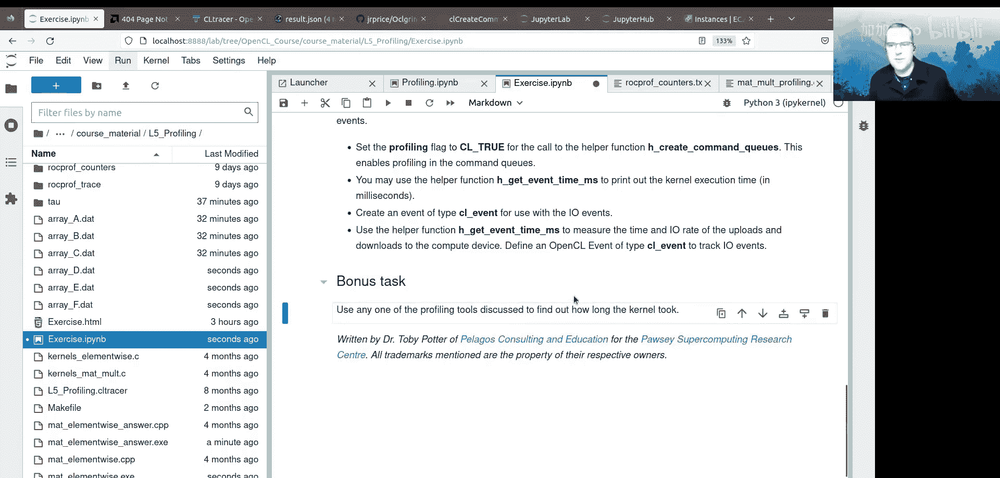

# 【OpenCL编程 Pawsey超算研究院】 p07 p6 OpenCL - day 2, part 2 - Debugging exercise and profiling [BV1fMz5Y3EDV_p7]

How did we go with the debugging folks？Did you find the bug Harry？Oh excellent， yeah， so good。

We found both thugs。That's great and how did you find how did you find the bugs？

Just looking through the code， okay， yep， that's that's one way to do it。😊，All right， anyone。

 anyone else had a go at trying to find。Try to find the bug。All the bugs。All right。

What I might do is in the interest of time， we'll have to keep going。😔。

But what I'll do is I'll show you where the bugs are。And then。In your own time。

 you can then use any of the techniques that we discussed。To try and find the bugs that way。

So I'll just share my screen。And I'll show you where the bugs were。Okay， so there's one bug。

There's one v in the program。And。Where it is is actually where I set the kernel arguments。

So this might be a this could be a common bug that you do is that you do not set the arguments in the right order。

So in this particular instance， I've actually。Sit in1 F。And0 F。

When they should have been switched around， Ca if we have a look at the colonel。

The kernel is expecting in zero f。And N1 F。So the grid allows i0 to be in the range zero to five。😔。

And I1 in the range zero to seven。So if the limits were swapped。

Then I zero is allowed to go too far and i1 does not go far enough。😔。

So that was the cause of that particular error。But if you had fixed that。

 if you had fixed the order in which they were specified。If you had fixed that。

 then there'd be another bug， which is inside the kernel itself。So if we have a look here。😔。

This should be less than so if i0 is less than in n f。😔。

And I1 is less than n1 f So if you had fixed the bug in the main code where these are swapped around。

Then you would have gotten a memory access violation。Because a memory access violation because this。

😔，God mechanism。Is allowing。Alling the reads and writes to tiptoe over the edge of the the matrix so yeah。

 there was two bugs in here， one was in the kernel。

And the other one was actually when you passed in the arguments。

So you have to be really careful when you're passing in arguments to make sure that they are correct。

And you also have to make sure that they are of the same data type。Yeah， the same the same data type。

Yeah。Yeah， so。Just a correction on that I 0 should be in the range 0 to 3。

An I1 should be in the range  zero to 7。Yep， so if you swap those around。

 then I0 is allowed to go too far and I1 is not going far enough。And that's what causes。😔。

That's what causes that error for the last line。😔，Yeah。

 that's what causes the error for the last line。Okay。thatYeah。

 that's what causes the error for this line here。And。I noticed that when I ran it through OCL grind。

It doesn't have the memory access violation until you fix。Until you fix that bug。

 so if we if we then try to fix。Yes bug here。But where we're setting the arguments to the kernelel。

All right， so let's then change that to n0 f。And in1 f。And then I will recompile。

And then I run that under OCL grind。There we go， it's picked up the memory access violations that have occurred once we've got the limits right。

Once we've got the limits right， but the kernel then。诶。Has not got the guard cause， correct？

So if we then fix that。We then fix that guard clause。And then run the application again。

We do not see the memory access violations anymore。And then the answer is correct。Okay。

 so I will reset those values。And we will continue on with profiling。Now。

 was there any questions or comments surrounding the？Exercise。Okay。All right。

 so we're going to move on to profiling now。And this is a way to measure the performance of kernels with openC。

So I'll just bring up。The profiling lesson。So that's in L5。Profiling。And I'm just going to。😔。

Bring up all five profiling。And then the profiling notebook。Okay。

So measuring performance in open seal applications。

Having an understanding of how well open sealL applications perform。

Is a vital part of the development process。The two main tools。

 profiling and tracing collect information about how well an application is performing。

So profiling is the statistical collection of the cumulative time that threads spend in each program component。

Tracing is the collection of when and for how long these threads spend in each application component。

So while it is true that many vendors have largely abandoned their open CL performance measurement tools。

The Open seal standard itself provides a profiling interface。

And there are still a few open source and commercial tools available。

So events in OpenCL are used with command cues that's an error from H events in openCL are used with command cues to check the progress of work that has been submitted。

And to establish dependencies between workflows。They can also be used to time the execution of work such as kernels and memory copies。

So here is how events fit into our taxonomy picture of an open seal application。Okay。

 so work is submitted to a command queue and then an event keeps track of the work inside a command queue。

So that is an open seal event。And of course you can from the host wait on an event。

To finish before the host code。😔，Proceeds， so that is a way whereby you can wait on a con。

Command queuees have the ability to capture timing information for work that is submitted to them。

But we do have to enable this ability explicitly when we create the command queue。

There is a profiling flag called CLQ Profiling enable。And you set this。You set this when you create。

The queue properties。So if we have a look at cl。hpp。

We'll see allll helper when we create the command queue。Yep， only create the command cues。

When we create the command cus， we have an object of type C command queue properties。

And that is a bitfield。So that is a bitfield and we can。嗯。

We can add options to that bit field using the binary or operator， so that's that single pipe there。

So we can add things like， do we want to enable the command queue so that work can be run out of order？

In that case， we would add。The option CQ out of order Exec mode enable。

If we would like to enable profiling for the command queue， then we add。

CLQ profiling enabled to the Q properties through this binary or operation。

And then when we make the command queue， if we are using the open C 2。 O API。

We use the command C create command queue with properties。And then we passed in a list。

That has the queue properties the C create queue the C create command queue with properties function has extra options in the properties。

But if we just use。Open steel 1。2 API， then we can use the command CL create command queue with the Q properties as a direct argument。

So that's how we can make a command queue。Using a context。And a device。嗯。

With the properties that we want， such as being able to execute out of order or being able to profile so that's how we bring those options in when we create the command queue。

So we need to have this support。😔，Built in。To the command queue when we create it。Once we enable。

Enableable profiling in the command queue。Then we can use the function C get event Profiling info。

To extract information such as the start and end war times。In  nanoseconds。

For the open seal event that is associated with a cud。Command so for example。

 when we launch a kernel that goes into a command queue， we can associate an event with that kernel。

And then we can use C get event profiling info。To extract the start and end times of the event once the event is finished。

So we use the helper function H get event time MS， which will extract the elapsed time for an event in milliseconds。

So this is the function and it is visible in Cheler。hppP and this is the function here。

So we pass in the pointer to an event。And a message that we want to do and if we would like to time。

 if we would like to get the transfer rate for a copy operation。

 we just pass in the number of bytes that were transferred during that event。So first of all。

 we make sure that the event is finished。So we use the function C wait for events。

 and then we pass in the pointer to the event。We have our start and end times。

 so they are integers in nanoseconds。So we use 64 bit integers of type CL U long to store the start and end times of the event in nanoseconds。

So then we use the function CL， get profiling info or get event profiling info。

On the event and we are searching for the command start and command end times and then we can convert the elapsse time in nanoseconds to milliseconds。

We print the timing message if necessary， and if we have specified the number of bytes。

 then we can print out an IO transfer rate in megabytes per second。So that way。

Is a way where we can extract the start and end times for some work that is submitted to a command queue。

So I'll go back to our profiling。Yeah。All right， so let's now use this method to instrument the buffer copy。

Yeah。We construct a CL event object and use that event to collect timing information。

So if we have a look at。😔，Mat lots profiling。😮，We've got the code here。

 which is very much the same as the matrix multiplication code that we have before。And in that code。

嗯。What we do is we create our buffer and then。We create an event of type CL event。

And we're going to call this our IO event。So we pass in when we incu our buffer or when we in cu the right to buffer AD。

We pass in IO event and then we use the function get event time MS to extract the time that that buffer。

that copy you took。And because we have passed in the number of bytes that were transferred。

 then the H of get event time MS would then print the。

That would actually print the transfer rate in megabytes per second。We do the same for。😔。

The upload of BH2 Bd。And。We time it in exactly the same way。Now it is okay to reuse an event。

Multiple times。It's just we are sure that that event has been finished because the H get event time MS that。

That made sure that the event had finished so once the event is finished。

 then we can use the event object again for another call to a。

For another call for work that is submitted to a command queue。So we time the uploads。😔，Of。

Buffs A and B to the compute device in this manner。We can also time the execution of a kernel。

 so we've got our another event object。Called Colnal event and then we pass in Col event as the last argument。

To our colonel。So that goes ahead that submits that kernel work to the command queue。

And we can also wait on the event。And then extract the event once the profiling information once it's done and because we didn't transfer any bytes in that operation。

 we just passed in null to。H get event time MS。So。That is。

That is the that is using an event to get the time taken for a kernel to complete。

Now when you are using。When you are using， for example。嗯。Events that are in different command cues。

You can establish dependency between events。By having these arguments here。

Populated so I think before in previous runs these arguments were zero and null。

 but if you say that you are going to wait on one event and you pass in the starting address for that event that you would like to wait on then this operation here would then wait on the kernel event to finish and then it would pass then it would store its event information in IO event。

So this is a way we can establish dependencies。On events。Now。

 this step is not technically necessary because we are using an in order command queue。

And were also using the same command2。So that means that naturally this read buffer would be submitted to the command queue after the kernelel had。

So it would be submitted to the command queue to be run after the kernel completes。

So we didn't technically need that step， but let's just say for instance。

 that this read buffer was in a different command queue。

 so if this read buffer was in a different command queue。

 then we could still establish the dependency on this kernel used bypassing in the kernel event here。

So that's just a way where we can have dependencies between work that is submitted to。

Either the same command queue or different command cubes。As before。😔。

We time the how long it takes for the download from CV to take using the HGP event time MS command。

So let's now run this， let's now compile and run this application。Okay， and thats that's how much。

That''s how fast the operations took on my system。And that is approximately how fast。

Yet how fast my RA speed is。So I've got DDR5。So yeah。

 so that's approximately yeah DDR5 running in dual channels。

So that's approximately how fast my RAM is running。If I haven't made any mistakes in in the。

Time with the transfer time。So yeah， so that's how we can get the time taken for memory copies and the time taken for panels to finish。

All right， any questions or comments surrounding？😔，That particular。That particular section。

It's fairly straightforward， you can use events to extract。Profiling information。

But you need to have your command queue set up to enable profiling。Yeah。

 so that's the upshot of that。All right。 Now， moving on。There is an open source utility called TaO。

So C spends for tracing and analysis utilities。And it's a commonly used open source profiling and tracing toolkit for HPC。

Applications。And thankfully for open seal。😊，Applications。

 it provides both a profiling and tracing functionality。So the TO application， TO exec。

 can be used to collect profiling information。This profiling information can then be visualized with the TAO applications Power Prof or P Prof。

Or we can use Perfeto to view the traces。Explicitly， all right， so let's go on to satanonics。

And you're welcome to do this together out。So that's SSH into Conics。And I am going to。

Once you load my programming environment。All right， now I'm going to get an allocation。

So we're just getting an allocation on our reservation。And we already have。

The open sealal environment loaded。So then we should have access to。Tao ex。There we go。

 so there's the application called TaO exec。And I might just make this a little bit。Figure if we can。

All right， now let's change directory to the L5 profiling。So I'm going to change directory to。

My scratch。Change directory overse course。😔，Then we go to course and material。

And then L5 group valueing。We'll make sure that we've made。😔，application。Okay。So。

There's a couple of environment variables that you can set， one of them is profile di。

So we're going to set that so that we export all TO profiling information to this TO directory。

Where we are at。So we'll just put that in so we go export profile du is equal to this directory in town。

And that directory tau is there。Then we use the following call to TO Ex to collect profiling information for open sealL calls。

 so what TO is going to do is it's going to keep track of all the open sealL calls that are going to happen when we run this MAMt profiling application。

The Open C flag instructs Tau exec to collect calls。For open CL API calls。

And this T serial just means we're just using the serial implementation， so not an MPI code。

So let's run Tao ex。On our application and that will collect a profile。So let's do that。Okay。

Excellent， so we have now collected profiling information。And that is now in this TaO directory。

So have a look at that。And we can use Pprof。呃。We just go back。

And use Pprof to go this directory with Tau。Prorefile text。Okay。So then we now have a profile。

We now have a profile。Of all the open seal calls that happened within the application。😔。

So if we just cut up。So there we've got all the open single calls。

That happened from within our host application。We have got。The timing information。

For our matrix and multiplication。Colonel。And we've also got timing information for our buffer reads and our buffer rightss。

We've also got a profile of every call that was run。

 so a statistical collection of how long each call took and how many calls there were for every open CL API call that was called when we ran the application。

Okay， and so there's some more statistics there。😔，So that is a profile that was collected with TO so we can use that information to determine what was the most expensive open seal coals。

And in fact， one of the most expensive open C calls we have going to work。😔，Was get。Platform IDs。😔。

So that of the most that was one of the most expensive calls in our application。

Creating a command queue with properties was。Also an expensive operation。So yeah。

 so in this particular instance， C gett platform IDs was our most expensive。Ipen CEO call。All right。

So now we can use TO to collect an application trace of our code。And。

We need to set some additional proof environment variables。So let's set tau traces equal to one。

Now you need these environment variables set in order to collect traces with tau。

So we export ta traces equal to one。And then we export trace de。Is equal to this direction tau。

Then we capture our open seal。Information as before。Using Tao exec。

Right and that would have collected a trace。That would have collected a trace now。

I've just noticed that with this application or with this run。

 we have collected a trace for the for the CPU implementation of openCL so I'm just going to set a flag。

To collect the GPU implementation。 So there we go。 So we've now collected trace information for the。

Yeah， we've now collected trace information。For。The AMD OpenCO implementation running on the GPU。

All right。So scrolling down。We can use the application。Called taw tree merge。

And that that will merge the events。To get them。Into one file， presumably。

So just run that town tree image。Okay， so that's merge these trace files。And。

You can convert the output from that into a。A format that you can use with perfito。So Perfeto is AMD。

Sorry， it is Google's trace profiling application and it works from a web browser。

So both AMD and TaO can。So both rock Prof and taO can produce trace files that work with Perfeto so that work with Google's tracing application。

So we're just going to now copy this information。Or copy this line of code and what this will do is that that will make the trace file。

Alright。And。系。Because we're in the town directory。Okay， so we've done Tau trace to Jason。

And that has converted the trace files into a JO file。

 so you can see the JO file there trace do Jason。Now， if you've got that trace。

jason file and then you can use SCP to copy。嗯。To copy that。Yeah。

 to copy that information to your computer。Then what we'll do is open this link here， u。pofeto。dev。

And then you can go here to open a trace file。Now， I will just open that trace file now。

I'm going to open a trace file that I had before， so I don't have to worry about copying。So I go to。

😔，买 c。Directory。我想知 you。😔，L5 profiling。Now in the course material。

 you should actually have the Tu directory with a trace do JON in it。So I've got the。

I've got the trace file ready to load， so I'm going to load that trace now。And now we can see。

All of the。Trace information or all of the open seal calls。That were run at certain points in time。

So we started off by calling C Get platform that was one of the first calls that we did。

Then we created context， so there's context there， so we created three contexts。

Then we created a single command queue。Now when you're using perfeto， you can use the WSD keys。

 so those game those game keys， you can use that to。You can use that to look around。

So I can use the WK to zoom in。And then I can use the A and D keys to go backwards and forwards along the timeline。

So this thread。诶。So thread zero is the host thread。And it looks like。

Thread one is responsible for the sorry thread two is responsible for the GPU。So。

These calls ran on the host。And。This is the matrix multiplication kernel right here。

So if you click on that little bar for the matrix multiplication。

 then you can get information on how long it ran for， so in this case it was 389 milliseconds。

So this was for a trace that I had collected earlier。Okay。And I might just。

 I think this was collected on the CPU， so I'm just going to be brave and I am going to collect I'm going to grab the trace that I just created on the。

On the GPU。So I'm just going to grab that truss。诶。不是。Then， I will。Copy this file。

It's a little bit of extra time， but I think it's going to be worth it。

Because I think that that trace that I have is collected on the CPU。Thecha。All right。

 so I've got it again。😔，呃。Yes。嗯。Its cost。Material L5。😔，Al right。There we go。All right。

 now this is from。This is from our collection on the GPU now。Yeah。So yeah。

 so it looks like it looks like I did collect on the GPU before， but I just wanted to be sure。So。

The matrix multiplication has taken about 367。I say 347 microseconds。So yeah， so not point three。

 four， seven really seconds。So that's how long that it took now if we run that on satonics。

If we run that application again on someonic。We get。That。Wil profilefild or X on the GPU。Okay。

 so we got that the time for running the kernel as timed from the OpenCL profiling method。

Using the events， open sealL profiling events， the kernel took 0。

367 milliseconds so that's 367 microseconds and the result that we got from TO for collecting profiling information on the kernel is 347 microseconds so it's very very similar answers。

Either through tau or through the open seal event interface。

So using TO is a powerful way to trace things and to also collect profiling information on the openCL calls。

So I definitely recommend TO as an option for getting the performance of open seal applications。Okay。

 so moving on。Do we have any questions or comments surrounding that one？How did everyone go。

 did they were they able to use Ta to get a trace？A trace file that then they could read with Perfeta。

Oh， great， Emily， that's fantastic。Yep， so towel is pretty powerful。All right。

 moving on to commercial profiling tools， I did find one product。

I did find a product called C Trar out there。And see old Trar。

So we just go to their website so C tracer is a cross platform。嗯。Cross vendor open C profiler。

And it's designed to be a commercial application， but it looks like development on it has stores。

But thankfully， the vendor is still making the application available for free。

Which is is just fantastic。Okay， so。Let's try using CL tracer。

So I've got the L tracer installeds on my laptop， it won't be installed on sattanonics。

But you can of course download and install CL tracer in your own time。

So I'm just going to go and dig up the application。And I've now started C Trar。So I've fed in。

Some information。On the project。So if I have a look at。😔，So when I do it， when I make a new project。

 I can feed in the project name the project directory。

 the executable and the arguments that I do and in this instance I have already fed in Matt Mot profiling。

And so I've done that。And I have collected a trace。And。So here is the collection of。

Here is the collection on my laptop。Of a trace so here we've got functions like。

CL create command Q with properties so that has taken up on my laptop that has taken the most amount of time。

And then there's applications like CBuild program。CL wait for events and here is my kernel right here so that's a that's a timeline that I can interactively explore so API calls look to be in turquoise。

嗯。Okay。Colonnels appear to be in blue and IO vents appear to be in green。So that is C Trar。

So you've got information on the kernels that run。The different cues。😔。

So I'm not sure what this is showing me。But it shows you what percentage of calls we're blocking。

And how what percentage of calls were spent in the Open seal API？

And you've got things like tables where you can。嗯。You can say that。Extra things like。

The start times of each call。You can get things like。

The global size of your kernel run the local size， how long the kernel took。

So lots of things are here to explore with this commercial application called C Trar。

And it will get you pretty much the same information that you can。Get with tau。So yeah。

 so I tried tried to get a commercial license for this。

 but the payment gateway for it doesn't appear to be set up and he just gives you。

The just extends your license。So you can get a free 30 day license for this。

 but it just keeps getting extended。Okay， so that is C tracer。

 so that is a commercial application for timing。Things。Yes。Okay， vendor profiling tools。

 so the AMD utility rock Prof。Has the ability to collect traces as well。

And you can view these traces。You can view these traces using pereto。So if we do。

If we do the HSA trace option for rockprof。So rock Prof has the ability to collect traces on MP sorry on hip。

And also HSA。So when？When an AMD Open seal implementation is running。

 it calls back to HSA as the underlying layer。To which it calls things。

So you can trace what's going on at the HSA layer， but you can't trace what's going on at the open CL layer。

So that makes it less useful for tracing open seal applications， but we can try it anyway。

 so let's go to our。Let's go to our。Allocation on satonics。

And we'll make sure that we have the rockham module loaded。

Then we can use the command called rock Prof with option HSA trace。And。That will collect。

That will collect。A trace into。Rock prof。Into the folder called rockprof Trace。So。Yep， so that is。

Now I a table， I have a table here that shows what each of these files inside the Rock Prof trace folder mean。

嗯。Okay， so it looks like I have failed。It looks like I failed again。😔，处。😔，Get to the platform。

So I'm not sure why that happened。Okay， so I've got that problem again whereby。If I。

I'm not sure why this has happened， but we have lost access to the GPU。So we'll just regain。

That access to the GPU。By doing another allocation。And then we I'll just do a C info。Yeah。

 so we've got our GPU back， it's possibly because I've spent too long。

Logged in as an interactive job without doing anything on the GPU so it may have taken my access away to that GPU I'm not sure what's going on here。

That's just a guess。So we've got access to the GPU again。So we'll go back to my scratch。

Change directory to L5 profiling。And then we'll run that HSA trace。run that HSA trace again。Okay。

 there we go。😊，So now that we've got access to the GPU。

 let's run the trace again and it has generated。A trace called result。

 JO that we can then view with Perfeto。All right。So。I'll just show you what the other files are。

 so we've got a rock prof trace， which is the output that we specified。

 the output folder that we specified。And。If we have a look at result。 this info。

That just contains some hardware information。If we have a look at result。copy stats。That is the。嗯。

So that is the total duration of all copies that happened now because only HSA is being traced not open seal calls。

 so we're tracing things at the HSA layer which is deeper down。嗯。And in。In the HSA。

 there's a thing called asynchronous copy。And we've collected statistics on that。

So it's not so useful using rock Prof to trace open seal applications because we're tracing things down at a deeper layer。

Of the implementation， not at the open seal call layer。嗯。Okay。

 so let's have a look at result do Hsa stats。Okay， so these are all the HSA calls and some statistics on。

On for example， how long they took， how many calls were done。So that's not too useful。😔，Okay。

 let's have a look at result stats。Okay， so this is the only thing that is useful is extracting the time taken for the kernel core。

So was there was one call for the colonel and it took 0。377 milliseconds。So that's about right。嗯。

So we have news rock Prof to。Extract information， Colonel call。So result。

db is an SQl lit3 database of profiling information， but the thing that we want。

We just have a look at result。csv。Yeah。And。That is from a different call that I'll talk about soon。

But the thing that we want is result Jason， so we can copy that result Jason back to our computer。

And I will then open。Open that result or Jason。So I've got。I've got in my。Open C course material。

There is。In the rock Prof trace folder。嗯。I thought I had made a backup copy of result do Jason。

 but anyway I've got a result Jason lying around in Rockprof Trace so you'll have to copy that trace file back to your computer I'm just going to open that trace file just for just to show you what it looks like。

And you can see that。It has captured。It has captured the kernel。And we can see that it took not 0。

357 milliseconds to do， but all these other calls here are for HSA layer operations。

So I don't think that that's so useful。货啊。Seeing explicitly what's going on in open Se。

It's what it's profiling is the underlying layer， but you can use rock Prof。

To get the kernel duration， so that would be that would be one use for using rockprof。Okay。

 there's another thing that you can do is collect information on hardware performance counters。

So hardware performance counters are functionality within a processor to measure events such as the number of wavefronts executed or the number of times a cache is missed。

Rockprof can collect performance counters。On kernelels。

And so the type of performance counter information that can be captured is obtained with this command。

 rock Prof。List derived。So， let's。Let's see what performance information we can。

Collect by typing rock Prof。List。Derived。Okay， so these are those types of performance counters that we can collect。

With rock prof。So we've got the F size， the right size are the percentage of time that we hit the L2 cache。

 for example。So we've got all these。😊，We've got all these metrics that we can collect。

And if you collect， if you put those metrics into a file， in this case， rockprof counterTxt。

You can see that I've got the keywords for those metrics in this file here called rockcro counters now every。

Every line here it says PMC is a unique experiment because you can't collect all these counters at once。

 you have to run different experiments and then collect different sets of counters。

So this file here Rockprof counters has one experiment。Of collection for each line。

So this is the way that you can collect really low level inflammation。On how the colonel ran。

On the GPU。So this is actually pretty powerful。😊，嗯。

You can use these performance counters and how you use rockprof with the performance counters is by specifying this i flag to pull in rockprofcounts。

txt。And then you can collect some statistics and then put the results into Rock Prof counters result。

So I'm just going to copy this code。To the command line。

So I'm going to copy this code to the command line。And then we're going to collect。Information。On。

On all those performance counters on the kernel。Okay。So we put the result into rockprof counters。

And we go change direct due to rockpro counters。Okay， we have our result dot Jason。

But if we have a look at results。csv。There is all the information。That we collected on the kernel。

So the number of wave fronts that needed to be run。The percentage of time that the GPU was busy。

 so that's a CSv file that you can then export and have a look at。As is that？And。So withve。

So each of those lines in that rockprof counters was a unique experiment。

 it ran the experiment that many times and each time when it ran an experiment it collected information on these counters and it has aggregated all of that into this file here。

So that is using rock Prof with hardware performance counters。Okay。

Was there any questions or comments about that？😔，You can click on where it says this page so you can click on this page and it has got information well it did have it did have information on。

On what the keys meant in the CSV file， so what the keys meant for the counters。

 but the file that I've got here has got this information for each counter so GPU busy is the percentage of time that the GPU is busy for example。

Total wavefronts executed。Is the total number of wave fronts that were executed to make that kernel happen。

Okay， so all this information is collected for every kernel that is run in the application。

So that's how it can collect some really low level information。Okay。Finally。

 Rock Prof can be run under a job manager for an MPI。Application。

 so Rockprof runs fine under a job manager like Slom。

You just need to make an output file for each process that is launched。So for example， on SLM。

 the SLm job ID and the SLm ProC ID environment variables can be useful for separating the output。

Okay， so I think Sm Proc ID is the rank。And I think Slom job ID is the ID of the job。

So when we're using rock Prof from each MPI instance or from each rank。

 we can send the result to a different output。So we've got an MPI enabled version of MA malt profiling in the L2 directory。

 so lesson two。Now the reason why it's in the L2 directory is because this is specific to satanonics。

So if you have a look on the command line。You can have a look on the command line。just go back to L2。

Change directory to L2 using Open seal on satonics。And then you change directory to Rockprof MPI。

Then you can mic。I'll just make clean。Mike。😊，I'll make sure that I still have。Access to my。

GPU but I won't need because I'm going to submit a job。But I still do， okay， that's good。Okay。

 if we have a look at jobscript。hell。Now we just need to replace。

The account name with the account that we are using for the course。In this case。

 we're using courses 01。And this is very similar to the job script that we had before。嗯。

But what we're doing is we're loading the opencrL modules。

 we're doing our openmp binding as we did before， we make the application。

And then we run a script called profilele do She， so that's from within our batch script。

So when we run that profile， each MPI task， so there'll be a number。

 there's two MPI tasks in this example and each MPI task。We'll run this profile dohell script。

And inside the profile dot shell。Scrriip。In the profile dothell script。

 we are running rock Pro with counters， but we're sending the results to a directory。

called Rockprof counters， but with the name result， Slom jobb ID slomprocid。csv。

And if we have a look at the application itself， so we just go。

We just have a look at MA not profilingmp。cppP。It is just an MPI enabled or an MPI version of the matrixtri multiplication code。

And it doesn't do anything special all it does is each MPI task runs its own matrix multiplication。

 so there's no sharing of data that goes on so it's very dumb。A very dumb MPI application。

 but it just shows you how you can run rock Prof with MPI。

So that's the whole point of this example here， so we go Spat。Jovascript dohell。

And if we have a look at the result that will happen。Afterwards。Okay。So。

Job 2479153 is currently running。Which is really good。Okay， have a look at Slom2479153。 out。

And we've got some。We've got some information collected。During the rock Prof collection。诶。

And if we have a look in the rock Pro counters。There is。Some information from every rank。

So there's information on every rank。Yeah， every rank that participates in the application。

 so that's how you can do rock Prof with MPI。And collect hardware performance counter information。

When you're doing that， every MPI task has to have its own destination directory so that's the whole reason why we did this。

Okay。Are there any questions or comments surrounding that？Okay。

 so historically there has been some limited information for profiling OpenCL events within V's visual profiler。

 but however， profiling support for OpenCL has largely disappeared。So that's unfortunate。

 but thank goodness， we have these open source and commercial tools to profile openCL applications。

All right， now was there any questions or comments surrounding this？Okay。

 so just to summarize in this module。We have。Used the open C。Event interface。

To extract the copy time。And the execution time。Of the kernel so we've done use the open seal event profile I interface interface face to extract the runtime of the kernel。

 but also the copy time。And。What we've also done。Is we have used open source tools like TaO。

To extract this information as well as traces that we could see。With tofeto。Next on satnics itself。

 there are tools like rock Prof， which allows you to。

Fettch the runtime for kernels for open seal applications。UHowever。

 because it is using or it is profiling the lower level HSA layer。

 it is not so useful to use rock Prof。To profile open CL applications。Next。

 we use Rockprof to collect hardware performance counters。And that is for every kernel that is run。

On that is for every kernel that is run in your application。And those results are。Yeah。

 those the hardware performance counters are specified using a text file that you bring into Rockprof。

And the information that comes out。Is available in result。

csv so in the output directory that you specify。If you need to use Rockprof hardware Per collection or even trace collection with MPI。

 you can do this and there is an example in lesson two where you are using RockProf with MPI。

 but you just need to specify unique output directory for every MPI rank that you are using。Okay。

 so that is profiling open CL。So I'm getting quite hungry right now， so let's。Let's pause。🤢。

Let's pause for。😔，How does an early lunch sound for those folks in Western Australia？Okay。

 so there is an exercise associated with the profiling section and we'll just open， we'll go to。

L5 profiling。So we' go to the L P profiling directory and then we'll open the exercise。Finile。Okay。

 excellent。So the exercise with this is quite a basic one。

 so it should be fairly simple to knock over。The exercise is about Haamard matrix multiplication。

 but this time we're going to time the copies and we're going to time the kernel。

So the code for the application is located in matalementwise。

cpp and the kernel is located in kernelselementwise。c。So as before we go through the following steps。

 we pass program arguments， we discover resources， choose a compute device。We construct Marices。

 DH and EH on the host， fill them with random numbers。Upload these matrices to the compute device。

 then we run the kernel and then copy things back。So your task is now to measure how long the kernel takes using the OpenC event profiling mechanism。

So if we run the answer。😊，The code MA element wise answer has the necessary open CL calls to extract timing information。

From the command queue。Or extract timing information from each run。

And you can see if I run the answer that I have results for how long each of the buffers took to upload and download and how long the kernel took to execute。

Now the code mat elementwise。cP works fine， there's no issues with it。

 however it does not have any it has not been instrumented for timing kernel and copy events。

 so if we run the application，You can see that the infinity norm between the two matrices。

 the CPU result and the openC result is fine， there's no issues there and there's no timing information printed。

So your task is to instrument this code using OpenCL events and the command Q functionality to profile the events。

So。And as a bonus task， you can of course use any of the profiling tools we discussed during the lesson to find out how long the kernel took。

