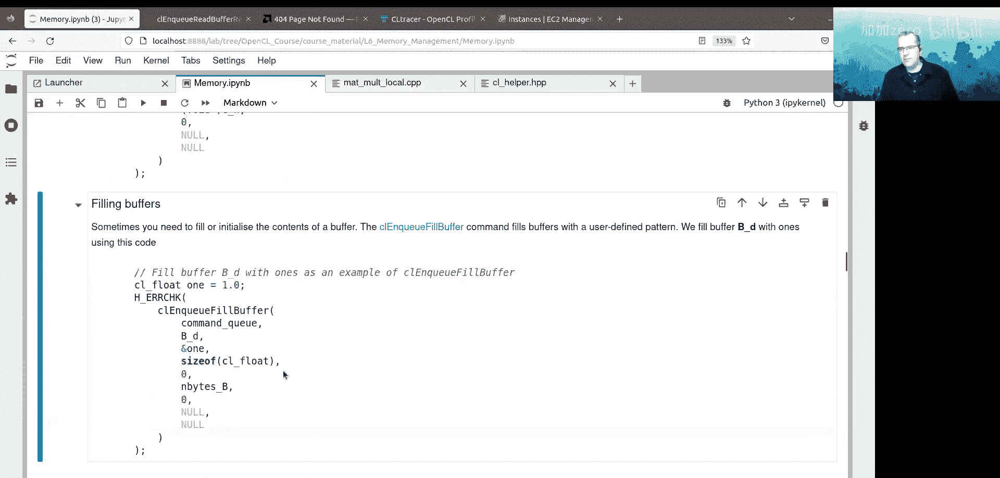

# 【OpenCL编程 Pawsey超算研究院】 p08 p7 OpenCL - day 2, part 3 - Memory management -BV1fMz5Y3EDV_p8-

Okay。The next step or the next module in this teaching series is going to be about memory management in Open Se。

So up to this point， we have been creating buffers。In open seal from the host。

And we have been accessing those memory buffers through a kernel。

It turns out there are a number of different memory spaces that you can access from a kernel。

 and we're going to talk about that as well as general memory management in Open sealL。So let's。Okay。

Let's open。Lesson6。😔，Course material， lesson six。And we are recording so that's good。All right。

 so if you go to course material lesson six， then you could open the memory。

The memory management in open seal module。Oh well done， Harry， you got to the exercise。

 that's fantastic。Okay。So in previous lessons， we looked at straightforward ways in which memory was allocated on the host and then copied to the device for use as global memory by the kernel。

In the introduction， we briefly covered the five different memory spaces that are available to an open Se program。

And if they can be accessed from the host or the colon。So those memory spaces are on the host。

 so the host memory。Next is global memory， so that is memory that is on the compute device。

Next is local memory， so in Cuder terminology， this is known as shared memory。

Local memory is available to every work item in a work group。

And local memory is often patched in the caches on a compute device， so for example。

 a GPU might have an L2 cache and I'm pretty sure that local memory is either on the L2 cache or a cache very similar。

Private memory is the memory that is stored in registers。

So that would be in that little 16 kilobyte area that you would see on a compute node。

On a GPU on satonics。So。That register that register memory is the fastest memory that is on the device and each kernel has its own access to memory in those private variable in that private variable area。

Yes。Constant memory is available to every work item。Every work item that is run。

And constant memory is to my knowledge and read only。So you allocate constant memory in a program。

And when you run it， then that memory is accessible from the con。Okay。

So host memory is usually the largest and slowest memory space on the host。

And global memory is the largest and slowest memory space that is available on the compute device。

Okay。As I was just saying， local and constant memory。

Is usually located in the small and fast caches on a compute dice。Private memory is in the registers。

Which are the smallest and fastest memory spaces available。

So a programmer has some degree of control。Over where this memory is stored in during the operation of an open CO program。

So here is a diagram showing the different memory spaces and who can access or what can access them。

So the host。The host that's encapsulated by this black square。And that can access host memory。

And then host threads。Can access global and constant memory。

 at least in the sense of being able to allocate and then copy memory to global and constant memory。

Within a kernel， so this is a kernel thread or a work item。A kernel has access to private memory。

And every work item or kernel has access to its own little。Store of private membrane area。

That store is finite in size。So there is a limit to the number of variables that you can allocate or that you can declare inside a kernel。

Local memory is here and that is accessible only to work items in a work group。

So here's a box with the work group。And。嗯。There should be another box around here to isolate the private memory to a work item。

Okay。And then， of course， kernels can access global and constant memory。So， this is the。

Memory access diagram and the host cannot access private memory or local memory。

Only kernels on the compute device have access to those things。Okay， that's just what I've said。😔。

Memory accessed from the host， so that's this portion here。

So from the introduction we know that buffer is allocated on the host and then they are migrated in and out of the compute device when they are needed。

 so when you allocate a buffer you allocate that buffer within a context and then that buffer is then moved backwards and forwards between the compute devices。

As they are needed。So a buffer belongs to a context。有。

So here are some ways that we can create buffers and transfer memory in and out of them。So in。

The matrix multiplication example， you would have seen that we have been creating buffers just with the C mem read write memory flag。

And so that creates a buffer that is available for reading and writing from a kernel。

So this code here creates a buffer of size n bytes C in the context that we choose and we have the flag of CL memory bytes。

 so that's what we've been doing so far。There are different flags。

 no additional flags that you can specify。For how the buffer is to be used。😔。

So we've got to C ElMm read write， but there are other flags such as write only， read only。

Host write only， host read only and host know access。

So if you were very specific in what you wanted a buffer to do。

Then that can enable some potential optimizations。So it is up to the openCL implementation to do those optimizations though。

 so let's just say theoretically that I specified CL MEM hosts no access。

 well that could be an optimization then that I'd leave the buffer on the device。

So that's just there。That's just a theoretical。A thought experiment。

So common sense rules apply in the use of these flags， though。

 CLMmrite only is of course incompatible with CLM rewrite。And the behavior is undefined。

If one tries to write to a buffer that has been set as CLM， read only。

So in addition to the permission flags on a buffer。

 here are some extra flags that determine how memory is allocated within the buffer。

If you passed in a flag called CMmU host pointer。Then you have the opportunity to use an allocation of host memory as the backing store for the buffer。

There is a very important gotcha though， when using this option。And we'll talk about that very soon。

This function here is CLM Al host pointer。So that allocates pinned memory。

 so pinned memory is memory that cannot be paged out to disk as part of a swap。Operation。

Pinned memory is useful because it allows for fast transfers between compute device and the buffer。

Because it allows for things like direct memory access， so that's access that can bypass the CPU。

So Mem Ac host pointer allocates。Memory for the buffer。From pinned memory。

And uses that as the backing store for the buffer。The flag C MIm copy host pointer allows the buffer to be created。

And then uses a copy from host memoryory to initialize the buffer。This one。

 this CL meM use persistent MEM AMD is an AMD specific flag and that creates a zero copy buffer that is synchronized with the device。

 so it's like a zero copy buffer。That allows for very fast transfers between host and device。

 but it also allows with minimal synchronization， it allows you to make that。

Buffer memory available to the host。The flag， so here's the gotcha form CLM use host pointer。

So CLM use hostst pointer allows the buffer to use host memory as the backing store。

One must make doubly sure that there is enough host memory allocated。

To cover the memory used by the buffer。And that the host memory is not delocated while the buffer is using it。

So those are the conditions。Oh those are some of the conditions on using this。

Open seal implementations are free to allocate caches on the compute device for temporary storage and synchronize as they see fit synchronization of the buffer with the host。

So whenever you want to make a buffer available from the host。

And you are not using a shared virtual memory implementation， we'll discuss that in the next lesson。

嗯。If you want to synchronize if you want to make a buffer available to the host。

 you have to map that buffer back to the host and during the mapping step。

 that's when the synchronization or a copy from the compute device back to the host happens。

So if you want to synchronize the buffer with the host， you would map it back。

There is a danger in using CLM host pointer for buffer allocations unless special care is taken with how the memory。

 the host memory allocation is aligned。When you use CLM hostst pointer。

 the memory has to be specifically aligned to the type of memory access that you're going to do。

So if you are accessing memory as float8 vectors， then the memory must be aligned to a 32 byte boundary。

 which happens to be the size of the float8 vector。H。

Open seal buffers that don't use CLMm host pointer are properly aligned by default。But I found out。

This， the hard way during the creation of this course。😔。

So I had a code that was designed to demonstrate the use of CMm post pointer。

But I did not explicitly align it。😡，And when I use that buffer as float8。

 sometimes it would work and sometimes it would result in a random seg fault。

The reason was that the backing memory allocation on the host。When it happened to be 32 by aligned。

 there was no issue。But when it was not aligned that's when I got a program crash。

 so it was a bug that was very， very hard to find because everything else was working just fine。🤢。

As soon as I used a memory， the bug went away。So that is a very。

 very big gotcha with the CMm Use host pointer option。

You have to use aligned memory of the data type that you are using the buffer for。So。

There is a function called Hch Alllan。And that creates memory that is aligned。

To the largest data type that is available and that is the C long 16。Or 168 byte integers。

Or 128 bytes。So you need to， if you're going to use host memory as a backing store for a buffer and you're going to use CLM host pointer。

 then you need to align that memory to a 128 byte boundary。So thankfully。

 the H ALEC routine in the Helper library。So we just have a look in course material include。

And we go。H， El。Okay， that makes sure that you create aligned aligned memory。

Using the aligned meck or aligned ac coals。With the size of the C long 16 data time。Or 128 bytes。

Okay。So that's the danger of using CLM hosts pointer。Similarly。

 the flag CLM copy host pointer creates an open seal buffer， but copies memory from a host pointer。

During buffer creation。After the copy finishes， the host pointer is then available for use。

And I don't think you have to worry。You don't have to worry about alignment when you are using CLMm copy hosts pointer。

So， it's okay。But both CLM use hostst pointer and CLM copy host pointer require a host pointer to be passed into to the call to C create buffer。

So see how I've got a null there that usually when when you specify the CLM copy host pointer。

 you have to put the host pointer there instead of null。So that's what the purpose of。😔，That is。

 that's for the purpose of that。Nll argument is actually to contain a pointer when you use the copy or post pointer options。

Now when you use C。When you use the aluminum Aec host pointer。Oops。

 when you use theLlum a host pointer。You do not pass in a。A pointer to host memory there。

 if you want to get access to that pinned memory from the host， you must then map the buffer。

So here we are， this is how to create buffers with pinned memory。

So pinned memory is host memory that cannot be paged out to SWAT。

 so we've just discussed that and it enables fast and efficient DMA transfers between hosted device or those transfers bypass the CPUU。

However， for host health reasons， the amount of pinned memory is usually limited to a fraction of the available memory。

That's because if you had too much pinned memory allocated。

 then if the host gets under stress because it has too many programs running。

 then it can't swap anything out the disk。So。😔，That's why the host limits the amount of pinned memory。

Okay， so the flag seal Mm El host pointer is passed in during buffer creation so you can combine some flags。

You can combine， for example， CL memory right with CLM Echost pointer。

So that will allocate a buffer within the context。For use as read write。

 but also please use pinned memory as the backing store for your buffer。

And this buffer may be made available to the host using CLNQ mapp buffer。

And we're going to talk about that in just a moment。

So both CLMM copy hostst pointer and CLMM AEC hosts pointer may be used together。

 you just have to pass in a pointer to copy from at this point here。Only CM use host pointer。And CM。

Alec host pointer are mutually exclusive。On AmD platforms， the three CL star host pointer flags。

Alloccate buffers that reside on the host。But if you specify CLM youth persistent MEM AMD during buffer creation。

 then it creates an on device zero copy buffer whose contents may be efficiently mapped back to the host。

So this is a performance suggestion for satonics。So here's the summary of memory allocation flags。

CLM use host pointer we use host memory as the backing store for the buffer CLMm Al host pointer allocates pinned memory CLM copy host pointer copies from host memory during the creation of a buffer。

CL meM use persistent meM AMD is AMD specific and that creates a zero copy buffer。Okay。

 so how can we explicitly move for copying memory， so that's more copy memory？

But how can we explicitly copy memory between the host and a buffer between the host and an open seal buffer？

So you have the option of copying either contiguous or rectangular regions。Of allocated memory。Yeah。

 and the option of using either blocking or non blocking transfers。So by rectangular。

 I mean that if the memory allocation is interpreted as folded into a multidimensional array。

Then a rectangular copy is to copy a rectangular section of that array。

 so that means a portion of this multidimensional array if it was 3D。

So we have the option of either continuoustiguous memory copies。

 so that is a single strip of your single strip of your memory。

 but if you wanted to do a rectangular copy， then it would be a portion。

Or bite taken out of your 3D cube。So if you only need to copy continuousiguous chunks of memory and that can even mean the whole buffer。

Then CNQ write buffer。Writes to the Open C buffer from host memoryory。

And CLNQ read buffer reads from a buffer to host memory。And so to avoid confusion。

 these commands are always from the perspective of the buffer。

So write buffer means I'm writing to the buffer， read buffer means I'm reading from the buffer。

So that's a helpful mnemonic。The function CLNQ copy buffer performs a copy of contiguous memory between two open seal buffers that are within the same open seal context。

So if you had。Allocated or if you had made one context。With all eight。GP use。

Then you could use CLMQ copying buffer to copy from one buffer to the next within that context。

But because we have chosen to create a context for every unique device。

 the function CLNQ copy buffer is not so useful。All three options have the ability to specify a starting offset in guides within the Open seal buffer。

And CLNQ copypy buffer has the additional ability set to specify the offset for the destination buffer。

不。Okay。So sometimes a contiguous copy is not sufficient。

Such as when you need to copy the boundary areas of a grid。Now what I mean by a grid is sorry。

 a matrix。So let's say you've got a matrix and you want to copy the boundary areas in order to send over an MPI connection to another MP task。

So this is where the CNQ right buffer wrecked and CNQ red buffer rec routines come into play。

They write and read a 3D rectangular region。U。From between the buffer and host memory。Okay。

 so the host， the host allocation， it can copy so like a postage stamp。

 it can copy just a posted stamp sized area of memory from one buffer in OpenC to the host。

So when you are looking up the documentation for a write buffer rec and read buffer rec。

 you have to specify a number of things。And so when you do this， row。

 the word row means that which is along the contiguous dimension。So if you had row major ordering。

Then a row would be a long dimension one， so you'd have row I zero。

And the contiguous dimension would be a long dimension one。Okay。

But if you were doing color major ordering， then dimension zero be the contiguous dimension。

So row is defined as being that which is along the contiguous dimension。Row pitch。

Now row pitch is the number of bites along a row。Of the memory allocation。So you've got an open seal。

😔，You've got an open seal buffer， you've got a host buffer。That is of the same size。

 That is of the same size。嗯。😊，Actually， I'm not sure if you can have a different size。

 let's just look up the documentation。Yes， you can。 You can have。

You can have your host of a different size than your buffer。

But when you are copying a rectangular region， that rectangular region has to be the same。

 obviously from one one space to another。So row means。

The row means say row means that which is along the continuoustiguous dimension。

So row pitch is the number of bytes along a row in inverter comm of the memory allocation。

So when you look up the documentation， you'll be asked for。

Buffffer row pitch and host row pitch so that is the number of bys along a row of the memory allocation。

Okay， slice pitch is the row pitch。Multiped by the number of rows in the memory allocation。

 so that's the。Yeah so that's the the row pitches all the way along here so even though the area that we want to copy is this big our row pitch is actually eight times the size of our element in this example so this is the row pitch and the slice pitch is how many bytes we need to jump from one slice to the next。

The next thing that you'll be asked for is the region。So that's the region there。Okay， the region。

 so that's a array of three values。And the region is the number of bytes that you want to copy along a row。

So that's the number of bytes is the dimensions of the first element。

The second element is not in units of bites， but it's the number of rows in your region。Then finally。

 the last one is the number of slices in your region。😔，So it is number of bites along a row。

 number of rows along your region， number of slices along the region。Okay， you can also。

 you'll also be asked for buffer origin and host origin。

So this is in terms of the index along the rows， the byte index along a row。

And then wrote ID in slice ID。So the origin you hear is zero。

 but if I wanted to move it this way the origin would be four。

 so that's at byte number four because every float has four bytes in it。

So that's the when you're defining the region， it's the number of the bytes of your region along a row。

Number of rows of the region， number of slices of the region now the reason why this is in bys instead of in elements is that this needs to be agnostic to the data type that is being copied。

So that is why row pitch is specified as bitetes instead elements。And s pitch is。😔。

Row pitch times the number of rows。In your memory allocation。

 so that's the reason that's the reason why it is that。

And I found the documentation on these functions to be awfully confusing。😊。

So particularly when you're translating from one indexing system， IU colon major across to row major。

So it's important to remember， as we've just explained that in the documentation。

 the word row is the dimension along which memory is contiguous。So for column major。

 that's dimension zero， but for row major， that's the last dimension。🤧Okay。

So you've got within the memory allocation region is selected for the copy。And that is of size。

 N bys along the row， N rows and slices。And if you're only doing a 2D copy。

 then you only need one slice， so just use a value of one。

 use a value for one when you don't need to worry about that dimension。When you' have got the origin。

 so that is a zero index based origin。And that is the index along the row times the size of the element。

 root I and slice ID。Or the slice index。So in mat malt。In Matmot's local。cppP。

We use a rectangular copy now we could use a contiguous copy like we've been doing before。

But for teaching purposes， we're going to use a rectangular copy to copy memory from BH to BD。

 so let's go and have a look at that now。So we're going down to map Mot or local。In。

Ma not local in lesson six memory management。And we are scrolling down to where we copy。Memory。

To BD from B H。So we've got to specify all this information。

Now we're using an index of zero so we're starting at the start so that our choice of offset is quite easy for our buffer and host origin it's just zero。

Our row pitch is n1c times the size of the float。So that's n1c times4。That's our buffer row pitch。

 but because the host allocation is the same size， the host row pitch is going to have the same value。

 so we just set the host row pitch equal to the buffer row pitch。Okay， so the slice pitch。

So that is the。That is the number of values from one slice。

 so that's a number of bites from one slice to the next of the buffer and the host。

That is going to be N1A。N1A times buffer a row pitch。Because。Our is matrix B is of size N1a by N1c。

So that means the row pitch is going to be n1 c times the size of our float and the slice pitch is going to be n1a times n1c times size of。

Out float。So that's the number of bytes from one slice to the next。

Now we are only going to copy one slice of course， because our region is only 2D in size so we're setting n slices as equal to one。

So the region that we need to copy is of size buffer row pitch。By N rows。

 so the number of rows that we need that we need to copy is N1 a and then n slices is equal to one。

So there is all the information that we need to specify。😊，In order to。

In order to do a rectangular copy with CLNQ right buffer rec。And these flags down here。

 so that would be if we're trying to synchronize with events。

So we've got zero events that we're trying to wait on。

 so we just pass in null and then we could have had an event here in order to time how long that takes。

So that is using cell NQ right buffer rec and Kuda， for example。

 has similar functions to copy rectangular spaces between the host and the device。

But this is how OpenCL does it。All right， are there any questions or comments about that one？嗯。Okay。

Very good。All right， so let's now talk about buffer mapping。

With the contuous and rectangular copies that we've done above。There are two memory spaces。

One is for the buffer。And the other is for the host。

It is possible to map or make available an open seal buffer to the host。Thus。

 avoiding this explicit memory transfer step。That you can see here。

This approach can be particularly beneficial when a CPU or integrated GPU is in use。

As the memory for the buffer is already on the host and no actual transfer from the device is needed。

Buffffer mapping can be useful for buffers。That reside or can reside on the host， say on the device。

So with buffer mapping， the Open seal implementation has the opportunity to optimize transfers and therefore synchronization between the open seal buffer that could be on the device and the host。

So the command CL NQ map buffer maps an open C buffer into host memory。

So it uses the following mapping flags。You can use C map read C mapp right or C map right in validateate region。

So that means that the buffer is going to be written by the host。

 we don't care what's in the buffer and so an open sealL implementation might then be able to optimize。

Or not do any transfers from the device to the host。Okay， so when a buffer is mapped to the host。

 access to the buffer from an open seal kernel is considered to be undefined。So please， please don't。

Try and use a open seal buffer while is mapped。That would be my suggestion because memory behavior while this is occurring is considered to be undefined。

So that means it's at your own risk and so it's outside the specific。

So when a buffer is mapped to the host， access to the buffer from the kernel。

 from an open seal kernel is considered to be undefined。

The CLNQ Unmap Mem object function unmaps the memory from the hoster then makes it available to kernels again。

So in this case， in MAmotlocal。cppP。At the end， what we do is we map。The buffer CDd。Back to the host。

Using this CLNQ map buffer call。And that puts into the command queue。Some work。

To copy the memory or move the memory， copy， probably copy off the buffer。

 off the device and make that available again to the host。Once that is complete。

 see we have a blocking flag of C truth， so that means we're going to wait until that buffer is done。

And we're also using a map read flag， so that means。

We're saying to the host that all we want to do is read for what we don't want to write。Okay。

 so we want to read that bufferar。Read from that buffer we're mapping it back to the host so now we use the call H right binary to write that buffer that has been mapped back。

To write that buffer to disk。When。When we。When we have finished with CH， we don't explicitly free it。

So we don't free CH， that would be a bit disastrous。😔。

When we're done with mapping the buffer on so we've。We have mapped the bufferuff back to the host。

 but when we're done with it， we use CL NQ Unmap mem object。And that。Unmaps C， H。

And we've got our ordinary open seal buffer again。And then you can release。

The buffer using C C release mem object。So。We have copied。We have copied。

We have mapped this back and I have just discovered a bug。Okay。

 can anyone see the bug that I've got here in the code？Okay， any takers on the bug？Okay。

 if I have a look at this。All right， I've just found a bug。All right。

 so what we have done here is we have。We have made。Allright， we have。Copiied。

 so we have mapped this buffer back to the host and then we have written this host memory。

This memoryator disk。Then we have unmapped the buffer。

But the mistake that I've made is I have actually used。😔，C H， again afterwards。So that is an error。

All right， and so。The behavior is undefined at this point， so I got away with it。

But it's actually a bug。So let's let's move this unmapping step。

Until after we have finished using C H。😔，There we go。We can unmap。CH。And then release the buffer。

Okay， you just a discovered a bug in the code。😊，All right， so that is how we're supposed to use it。

 So when we're finished when we're finished using。A mapped buffer。

And only when we're finished using it。Then we can unmap it。Okay。That's。Good。

Sometimes you need to fill or initialize the contents of a buffer。

And there is a command that you can use to do this。

 the CNQ fill buffer command fills buffers with a user defined pattern。

And if you have a look at Matt Mot local， we fill buffer BD with ones using this code。

 so hopefully we've got call。To C L andQ fill buffer， here we go， so just for teaching purposes。

I have created buffer BD， but then I'm using CLNQ fill buffer to fill that buffer so that。

That submits to the command queue。That submits to the command queue。

That we are going to fill buffer Bd。And we're passing in the pointer。诶。

We're passing in the pointer to some memory we're saying how big the pattern is in that case its size of C float and this end by being is how many bytes are in。

The thing that we want to fill。So we have to make sure， of course， that size of B D is N bytes B big。

And what that will do is that will take。That will take this value one and that will stamp it so it will fill the entire memory allocation with that stamp so everything is going to be filled with 1。

0 in the buffer。So that is what CNQ Fi buffer does。

