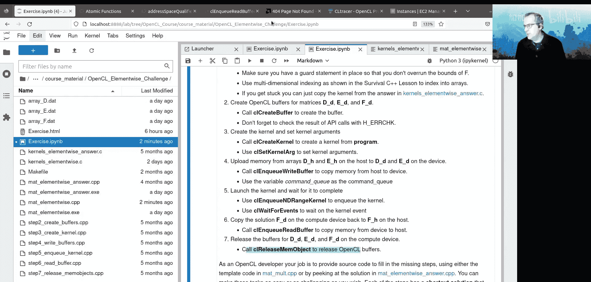

# 【OpenCL编程 Pawsey超算研究院】 p09 p8 OpenCL - day 2, part 4 - Memory management and exercise -BV1fMz5Y3EDV_p9-

Yeah。Okay。Now we'll talk about memory control and access from panel。Yes。

Colonnels have access to the following memory spaces。😔。

So we've just finished our section on transferring and using memory from the host。

Now we're going to talk about using memory from the kernel。

So kernels have access to the following memory spaces， global memory， shared memory or local memory。

Private memory and constant memory。So if you click on this link。

 it provides more information on the different memory spaces that are there。Okay。

 variables defined internal kernel sources can be and sometimes must be qualified as to which memory space they belong to。

There is a myriad of rules to navigate， though， as we will see below。😔，Okay。

 allocations of memory in the global address space must have a global specifier。

When they are declared or when they are passed in。So if you're going to have a pointer to global memory and you're going to use that pointer in the code。

 it must have。A global specifier or global qualifier in front of it。Now you can use underscore。

 underscore global or just global。I'm just using underscore Global because Jupiter is picking up that as valid C syntax。

Okay。So both are valid and you don't necessarily need to put the underscore underscore。

In front of global。Pointters to buffer allocations passed into kernels always need to have the global qualifier。

And we see this in the kernel definition format mat malt local。

So you have the global specifier here outside your memory allocations。😔，Okay。

But it's interesting to note that memory allocations brought into the kernel。

Memory allocations are brought into the kernel and we can use any number of pointer types to interpret that memory。

So we could easily change the pointer type for a。To be float8 star A。

And it would quite happily interpret that memory。As pointers to float8。

That is fine to do that you just need to ensure that you don't run off the end of the array。

 so you need to ensure that a is a multiple of eight floats so a is big enough to be a multiple of eight floats。

And you also have to be careful with your access to that。嗯。

Because if you're going to use it as a float8， then the number of elements will be eight times smaller than you had before。

对。Yep， so you can pass in memory。And use that memory。As any data type that you want。

 you can use it as double or float8 it's just that you need to have enough of it and you need to be aware。

How you're going to index。Into it。Okay。Variables in the global address space can also be declared outside kernel functions。

If this macro is defined。So let's have a look at Colonel's matmot。And then right at the top。

Right at the top I've got this if Daf Open CLLC program scope global variables。

 so if this is defined， then I can have these variables that live in global memory outside the kernel。

Okay。So we can use if AG and BG for example are defined， we can use them。

 they are available to every kernel that runs in the program in which this code was compiled so let let's say you had a number of kernels in here in this case we do every kernel would have access to this if this macro was defined at compile time。

Okay。So now let's talk about the constant address space。

So the constant address space is usually located in a fast cache of your compute device。

And it has the underscore， underscore constant or just constant qualifier outside the front。

 so that's an address qualifier。And that makes it ideal for storing small allocations of memory that must be accessible to all kernels and this is a good spot to put。

 for example， filter coefficients。Things that won't change during the execution of a program。

Now I'm aware that in Kuda， you are able to change constant memory at runtime。

You can change that using a call from the host。I don't believe you can do that with openCL so once you define a constant in as being part of the constant memory space。

 once you define that in your source code， then that cannot change。All right。So we've got that。😔。

And of course， we can use that constant memory within the kernel。😔，And I think we have just a dummy。

😔，I used to have a dumy usage of that variable， but suffice to say you can reference that variable from within a kernel。

Oh。Okay， now memory in the local address space is local to or available to every work item in the work group。

 so that means that every work item in the work group can access the memory but work items in another work group cannot。

Local memory is specified with the underscore underscore local or local qualifier in front of the variable type at Dec。

So that happens to be either in a kernel function or in the kernel function arguments that are passed in。

So local memory is often provided by fast caches on the compute device and might。

And a stress might provide a speed boost by virtue of being in close proximity in terms of latency and bandwidth to the processing elements。

So having said that， though， the devices in open seal implementations are adept at caing global memory to fast cash anyway。

So you might or might not see a performance boost by using local memory。On satutonics。

 I have seen a significant boost by using local memory。So yes。

 local memory is a good thing on satnics， but on other architectures， I'm not so convinced。

There are two ways to allocate local memory， static and dynamically。

So a static allocation of local memory happens within the body of a kernel function。😊，So for example。

😔，And I still hope I have this example in here， yes， I do。I have。

An allocation of 10 floats and they are part of the local memory space so i'm not actually using this array。

 but this is how you would define statically an allocation of memory in the local memory space so every kernel in the work group。

Or every work item in the work group encounters this statement and then that scratch memory is available to every work item in the work group that's available for read and for write。

Okay， so static allocations of local memory must happen in the outermost scope of the function。

So this means that you can't have this allocation within a statement， for example。

 that only some kernels would run。So every kernel has to see。

 every kernel has to see that allocation。😊，As to execute that allocation。

So some implementations will not let you hide the allocation in a code block。

And you cannot allocate local memory within functions that are called from kernels。Okay。Okay。

There is another way to allocate local memory， thank goodness。

Local memory for a work group may be also dynamically reserved when the kernel is lodged or ened。

Allocs to local memory are brought into the kernel as an argument with the local or local address qualifier。

So in this case， format mal local。We are bringing in a dynamically allocated amount of shared memory。

And we're making that accessible through the point as shared B。When you。

When you set kernel arguments using C set kernel AG。

That's when you specify how much memory should be made available for that variable or for that allocation。

So let's have a look at Mattalt Local again。And let's scroll down to where we sets the kernel argument。

So kernel arguments at index3。When we do size of the thing that's being brought in。

We actually specify how many bytes that we need， we specify how many bytes that we need。

 but then we pass in a null pointer and that lets。Open seal youll know that。Please make a。

Local memory allocation of this size。Available to every work group。So that's what that does Okay。

 so let's see we've seen bits and pieces of Matt malt local now。Let's see it in its entirety。

So with Matt Mal localal， what we're doing is we're trying a different strategy。

We're going to talk about the different strategies in the performance optimization section。

 so that's lesson eight。But what we're doing with this is we are trying to cash。

The columns of matrix B。😔，Into a temporary storage area。The idea。

 the idea is and I'm not saying that this is right， but the idea is that。

When we are trying to access things from matrix B the。

Idea is that it's slower than fetching from matrix A， and that is because we have to stride。

A value of N1c from one item to the next。So。Let's say we have a work group that is working on a patch of matrixtri C。

So it needs to have access to these two rows of matrix A and these columns of matrix B。Okay， well。

 let's store or let's cache these columns of B into local memory。

And then we can fetch from there instead， we can fetch from shared B instead of from matrix B。

Now because the local memory is available to every work item in the work group。

 then this might have a performance advantage。Because otherwise。😔，Otherwise， every work item。

In this column， so this this work item has to fetch this column here。

And this work item also has to fetch this column here。

So that is why that is why we thinking that using local memory is a good idea so we can save on these multiple fetches that occur。

So that's the idea behind our local memory implementation。

 so we're trying to cache the columns of B into this。Into this local memory allocation called Sha B。

And we divide up， we divide up the columns into blocks such that that if a memory allocation is of size。

 if a work group is of size L zero by L1， we would have L1 rows and then。

And then L zero blocks to copy， so we would divide up this area into L zero regions。

 so that means that a work item in a work group。Would be responsible for its own little portion of。😔。

This copy from matrixtri bit。So that's the idea。And so let's have a look at that。We specify。

We specify the size of local memory， so we want to store。

We want to store L1 now because of the flipping， local spy zero is actually going to become L1。

So we want L1 times N1 a times size of C float， so that's how much memory we want to store。

In this strip here in shared B， so we allocate that much memory。

We allocate that much memory and then in the kernel we pass in the local memory。

 so that's in shared B。And then what we do。Is we get our indiceings so we say that I0 is get global ID of dimension1 and I1 is get global ID of dimension zero。

 so that's that flipping， but we also have to do the flipping when we load when we get the indices in local memory。

So we do S0 and S1 are the coordinates within the work group。And L0 and L1 are the local sizes。

This function here called Get Start。And what that does is that determines the start and end of each of these little blocks that work items are going to be responsible for copying into this shared area here。

So we get our start and end。And then we proceed to fill shared B。

So this is filling now shared piece so we're walking so every work item is walking along its little patch of。

Matrix B。And filling this shared be space。So that's what we're doing here。Now。

 now this' is thing called a barrier。We need， before we can proceed in using this memory in shared B。

 we need to ensure that all work items have finished copying into shared B。

Because remember that every work item has access。To that shared memory in shared B。

 but not every work item is guaranteed to finish at the same time。

So that is why we have need of a barrier and that makes sure that all work items finish。

What they're doing and they all reach the finish line so that's like a finish line in a race so that's a barrier that makes sure that no one can proceed until we get past this checkpoint。

😊，So that is what that is oh that's just a temporary variable and we're using the constant memory that we did before。

 so yeah I found it。嗯。Okay， so once we've done this barrier， now we can we can walk along。

The row I0 of a。So we walk along row I zero， but instead of then grabbing things from B， we instead。

Grab things from Shadby。So we instead grant things from Shape。And in lesson eight。

 we will see if this made any performance difference。I'll leave the results till then。😊，At the end。

 we don't need to worry if they're in sync or not。But at the end。

 we just store the results of temp into matrix C at position I0 and I1。

So that is the shared or local memory。Attempt at optimization of the matrix multiplication problem。

So that is that。Yep， so just make sure that when you're doing the barrier。

 you have this CLK local mem fence option there。I think there are quite a few other options for synchronization。

But this is the only one that you need to use in order to synchronize all work items within a work group。

Okay， now if you did not have that barrier there。And the absence of a barrier is often a source of bugs。

 so hey this will be fun， let's try。Let's try， let's get out of our allocation。Let's try。

And run this， actually， I'll just do it from here。So let's run this application。Okay。

 so we have got if we just check the data， we have got a very small。A very small residual oh。

 actually it's not very small， that's interesting。And。'll try running it again。😔。

So the maximum error is 1。1 times 10 to the minus5 so that's what we'd expect。Now， why have we got？😔。

An issue with the plotting。I'm not sure why we have maybe， maybe because the errors are too small。

And it's just given up on trying to。😔，Extract a valid error region。嗯。😊。

I don't know why I don't know exactly why we have not got the scale we had before on the absolute residual。

 but nevertheless， in the program we saw that the maximum error， the infinity norm was pretty small。

Okay， so the program is working it's working well。😊，But now let's remove that barrier， that barrier。

Let's remove that barrier that is synchronizing that shared copy。

So we're removing the barrier and lets try let's try running that again。😔。

OhSo we've got a big problem here， we've introduced a bug into our program because we did not synchronize。

😊，So what we did is we copied from。We copied from sorry， copied two local memory from B。

 but we didn't put a barrier in there。And because we didn't put a barrier， some work items said。

 okay， I'm just going to keep going。And they did。And the memory to be used in shared B was not ready。

 it was not initialized。So that is why or it was not set to set from elements in B。

 so there were still some work items that were still copying while others had gone ahead and done。

WeDone the calculation。So that is why， that is critically why。We need to have that barrier in place。

And there we go。There it is as before。Okay。So private memory is the default storage space for variables created inside a running kernel。

This memory is only available to the work item that allocates it。

One does not need to use the private or private qualifier as variables created in kernels are private by default。

And what I mean by that is see how we've just got a variable that we define in our kernel。

That is in the private memory space by default。 So we don't have to put a private qualifier here。

 We can， if we want， but we don't need to， because everyone understands that。In a kernel。

 the private memory space is the one that's used by default。可是。Okay。

 so that's private memory generic address spaces is an open seal 2。

0 or 2+ feature that enables functions called from kernels to accept pointer arguments from any address space without having to qualify which address space that they come from。

So if you have a function defined。If you have a function defined out here and you call that function from a kernel。

 you can do that， by the way。When you。And not using Open CL2。

 you then have to qualify what address space every input argument came from。

And I think that would be for local and global。But with open C2 and you can only get。

You can only get open C2 if you pass in the compiler option C standard equals C 2。0 so when you。

When you use。I'm going use H compile。😔，呃。Wch compile。Anyway， when you when you build the kernel。

H release devices。😔，Topimize local Chinese crs。😔，device when you build the kernel so let's have a look。

😔，HB program， that's right。When you use HB program。Okay， when you use TB program， you've got。

An argument here of compiler options。And you can pass in instead of null。 you can pass in。

The C standard is equal to 2。0。And that will pass in the。Compilr options here to C Bill program。

So that's how we can use。 That's how we can use。Generic addresses。

 so that's what generic addresses means。It enables functions call from kernels to accept pointer arguments from private。

 local and global address spaces without having to qualify the address space that they come from。And。

This macro。Should be defined。And you can check for that。This macro should be defined。Okay。

Are there any questions or comments surrounding that？😔，Excellent。Okay。

Now we're going to talk about vectors， so this is really。This is really cool。All right。

 so this is where open seals shines。In addition to the standard types。

The Open seal standard also defines the number of vector types。With n is equal to2， three， four。

 eight and 16 elements。Vectctorors can unlock performance within an opense application because the memory is loaded。

 so whenever you do a memory transfer it is loaded into cash using these fundamental transaction units called Ca lines。

So when you fetch memory from RA， it's brought in on a cash line。

 so it's brought in as part of a payload of other memory。So when you fetch a single bite from。

Randomly from Ram。It brings in the whole cash line， it doesn't just bring in that particular value。

So those cash lines are。Our。I guess you could。Yeah。

 I guess you could think of the cache line as like you need to access a certain portion of a log。

 but the cache line is the entire log and when you transport when you transport memory it's like transporting logs。

 those cache lines are then loaded into all those logs are loaded into your temporary storage。

 which is your cache。And then it is accessed， then the value is extracted from from that cache line。

So。Cash lines are the fundamental transactional unit of memory in a computer system。Okay。

 so the key to getting good performance is actually to use the neighbors。In a cash line。

 so then you are not wasting the memory access， so then you are not wasting the。

The effort that was gone to to fetch that whole cash line from Ram。

So thats that's a key to getting good performance and that's why they recommend that you iterate along the contiguous dimension of an array。

😊，Because then you can have the opportunity to reuse has lines。对。Okay。So that's one thing。

 that's one thing why vector is good because they are data types that can encapsulate a number of。

A good portion of that cash line。Furthermore， CPUs have CD units that work on not whole cash lines。

 but work on vectors up to 16 floats wide or yeah， 16 floats wide， I think is the AVX 512。U。

So that's 16 floats wide。And further， CPUs yet have these cinder units then they can process in one instruction vectors of floats。

 so CPUs have cinder units that can do vectors of  eight to 16 floats。Or four to eight doubles。

At a time。And so OpenseL has these data types that go up to 16 elements long。And they have。

 so you have a character type a vector character type， so cha n， which is2， three， four，8 and 16。

You have U N， you have int int end long end float n and double N。

 so there is a double 16 there is a double 16 data type so that means 1664 bit floating point numbers。

And I think that's really good because Kuda， I believe， doesn't go any higher than four。

Doesn't go any higher than four elements in a vector。Someone corrects me if that's wrong。

 but I think that's right。嗯。Okay， complex numbers in open seal。Okay。

 complex numbers are not implemented in openCO so unfortunately you've got to use a float two or a double two to store complex numbers and then you must manually perform the complex number math operations on the individual components。

So that's a bit of a pain with open CL in that you don't have support for complex numbers。

You have to roll your own arithmetic or complex numbers using the float to or double to vector data types。

Okay， so there is。So all these types are here， so C Float N or C Fat 16， for example。

 that's what the data type looks like from the host， but from a kernelnal it's just Fat 16。

So if you're using a float type from the host， it would be C something N。

 but if you are using it from the kernel， it's just going to be。Something N instead of C something n。

So here's how you work with vector types or vectors from the host so you can declare a float for vector type using CL float4 F and then you can initialize each of the elements in the vector like so。

And we do an implicit cast to the C float for。😔，Beectctor type but we could we could also have done this。

 we could have done C float 4 F is equal to C float4 and then that would initialize each element to zero。

Okay， when we want to access things from the host now， this is not from the kernel。So from the host。

😊，We can use this S this dot S notation， so dot S3 would。Access the float at index 3。

 which is the last element of a float for vector。And we can also store things into that vector。Okay。

 so that's from the host， so that's if you need to manipulate vectors from the host。

 let's try accessing vectors from within a kernel。So allocations of memory that are passed in as global or local can be interpreted as a vector data type。

So we've got in the kernelel Matt Malt。Local vector。

 we are interpreting the memory in a is as of type Fte 8。

And we're also interpreting the memory in shared B as of type float8。Now that's fine。

You just have to make sure that the size of a along that contiguous dimension is big enough to store a multiple of eight floats。

Okay。So you need to make sure that the memory is by aligned so that the starting address of the allocation is a multiple of the vector length Now when you when you allocate memory as open C buffers so like CL create buffer。

And you are not using host memory as a backing store， then CL create buffer will align the memory。

According to the biggest data type that is available， in this case， float 16 or sorry， double 16。

So you don't have to worry about alignment if you are using C C buffer and you're not using host memory as a backing store。

If you are using host memoryory as a backing store。

 use aligned AlLc or just use H Aec from the helper functions。JustYeah， just do that。嗯。

That should be okay now there is something to note with this with the float3 type。

The floatte3 and the double three。They actually use four elements as memory storage so they just switch off one of them。

 so that means that your storage for float3 or double three is actually the same size as float4 or double4。

嗯。😊，And they do that because of alignment。They do that because yeah。

 they do that because your alignment has to be on a。

UOn a bitete boundary when you use host memory a backing stool。

 so if you had this Maverick three element。嗯。Memory， then you'd have to。

Align your memory to multiples of three floats or three doubles and that's not very that's not very good so that's why the float 3。

 the three element vector actually uses enough memory for four elements。Okay。

Oh another thing is if an open sealL function is performing the memory allocation such as CL SBM ALEC。

 we're going to talk about that in the next lesson。

 then it will usually allocate memory according to the largest open seal data type so long 16。

So we've just done that。😊，Access to a vector type from within the kernel is done using this dot notation as well。

But you can use a few different ways， you can use dotx dot Y and dotz and dot W for the first four elements。

 or you can use dot S0。 S1 right through to dot S9。And then you go dots dosb， dosC， S D， E and F。

To access values up to the 16th element。So a neat thing about open seal vectors is that you can swizzle。

 so that's a bit of a fancy word swizzle so you can swizzle or commmute the indices。😊。

So here we've got an example of swizzling。So we say that vector F is a flute4 and vector V is a flute4。

And。We can use。We can use dotx or dot s0 to access the first element。

 but here's an example of swizzling， we can say that V dox yzw is equal to F。wzyx。

So that's a really quick way of doing all the associated swapping around that needs to happen。😊。

So swizzling is fantastic。😊，Yeah， so that's I really appreciate really appreciate that feature in Open Zeal。

Okay， you can use load you can also load and store vectors from a memory allocation using V load and V store。

And that will say float for F is equal to V load。嗯。An offset relative to a pointer pointed by our。

And so。😔，That will be。That offset into R will be offset times the size of a flute 4。

So that's what that would be。So the offset is not relative to elements in R， it's actually relative。

To elements。Of our。As if。You are interpreting R as a float flow vector。Yeah。

 so it's a little bit confusing and the same is true with V。😊，V store。Yeah。

 so that offset in R is actually offset time size or foot4。No what size of float4， sorry。

 and the reason why I put that is number four。Is。Okay。This offset， I'll start again， this offset。Is。

When you access into R， it is actually offset times 4。So。So if you have。If you have Vload4。

And you are doing an offset。Of one。Then in R， it will actually load from R at index4。

So that's what I mean。So in order to avoid undefined behavior。

 the address R for the allocation needs to be bright aligned to the data type that you're being used as well。

So as long as you use the allocated and aligned address as the address of VO N and Vload N functions。

 you will be fine。Okay， so you just need to make sure that that。Is a by aligned address。

So if you bite a line。The memory allocation。And then if you make any。

If you grab any pointers that are in R in array R， those pointers need also to be bite aligned as well。

So they need to be aligned。Okay。So in the program MatMt local vector and in the kernel MatMt Local vector in kernels MatMtC。

 we're going to extend the memory solution。To work with A and shared Bs as allocations of vectors of type float8。

So I'll just correct the typo。😔，嗯。This means that loads and stores will happen eight floats at a time。

 which might be advantageous to for memory copies but also using vector hardware and compute devices。

 so see use might be able to take advantage of this because they have CD units that can work with up to eight floats at a time。

So we've got our memory solution， our matrix copy as before。

 but instead we're going to interpret the memory in a as of type flute8 and we're going to interpret the memory in shared B as of type flute8。

So here is the kernel。Format Mo， local vector。And here we interpret the local memory as type flute 8。

 and we interpret the memory from A as being type flute8。Now we've already changed。

 we've already made the sizes such that。嗯。Such debt。There is a multiple of eight floats along。

A long dimension in one eye。So the number of columns in a is a multiple of eight flips。

 so we don't have to worry about that。Weve already made sure that that is the case。And。

So then we do our matrix multiplication。As before。With shared memory。

But here is the step for the copy。😔，Now， because shared B is going to be of type float8。Okay。

What we have to do。😔，Is we have to。Be very careful。嗯。In。

So we've got our memory here for shared B and we're interpreting that memory as vectors of type flute。

eight。So that means that we need to carefully extract this element， this element， this element。

 and slowly fill。Those vectors。Or not so but fill those vectors and so that's what this code here。

Is doing is we are filling the individual components。So we've got our temporary variable。

 which is of type flute8 and then we fill。Those components。So we loop。

 we get our start and end values。And then we try and fill shared B。

 so that's the whole idea behind this loop here is we're filling shared beat。V。

Get our start and our end value。And then we extract。The starting pointer in B， so that would be。😔。

That would be somewhere in here。We extract our starting point out。But when we're filling this vector。

 we then have to very carefully。Loop over eight values。To fill a vector that's in here。

So that's why that's why this code is the way so vectorized code can get quite complicated。

 but we have to very carefully。Fill those。Vectctor elements and then at the end we just insert into shared B at this index。

 we insert the value of temp。Then we have Albaria。And then when we do the。TheWhen we do the vector。

 so when we do the dot product。We can do the dot product eight elements at a time。

So that is fantastic and in CD hardware this would be done using one instruction。

One instruction to multiply two float8s together。So this is really cool we're doing this dot product eight elements at a time。

And then at the end we stack up， at the end， we stack up the vector。And insert the results。Into。电。

Into the value at state。So let's run this。Let's run this and we get a reasonable infinity norm。

And there we go， so there's our absolute， there's our absolute residual。So this is working。

This is working using local memory， but also vectorize local memory。So。

 and it would be interesting to see how this compares in terms of performance。

 but we'll leave that into a lesson eight。Okay。Atomics。

 so atomic operations are something that is done from a kernel。And。An atomic corporation。

In a kernel is done so that only one work item has access to。That update at a time。

So that's what an atomic operation is now in Open C1 you had very basic support for atomic operations。

The documentation is available here for atomic functions for Open CL1。And in this case。

 we've just done a very simple test called Atomics test one， and I think the code for this。

The code for this is in。Colonel's Atomics。So this is just an open CO 1。 x atomic。Usage。

So we're passing in a。A pointer to global memory of type unsigned int。

And then we're using a function called atomic add to increment that atomically。

So only one work item would be able to update he at a time， what that's what an atomic operation is。

So that might be useful to have atomics， but using atomics is not very good for performance。

So there might be a use for it。But it's not very not very good for performers。

 so there is there's only very， very basic functionality for atomics in openZal1。X。In open seal2。

 we have more more relaxed sorry in open seal2 we have more atomic functions that we can use。

So OpenC 1。X has a relaxed memory model， it means that consistency between items in a workgroup is only guaranteed at a workgroup barrier and consistency between host and device memory is only guaranteed at synchronization points like see all finish or C all wait for events。

Or after memory copies。So we saw in the matrix multiplication example that CL finishish is used to wait on a command queuee just to make sure that a command queuee has finished all its work。

Okay。Okay， so there are basic atomic functions within open Se 1。X， such as atomic add。But however。

 with the introduction of Open seal too， there need to be more sophisticated synchronization between host and device。

So OpenC2 has two types of synchronization constructs， fences and atomic operations。And。To be honest。

 the reading for that was very， very dense。In the specification。

So I'm not going to delve too deeply into that if you'd like to get into that you can have a look in the specification。

But yes， I found it quite complex。But。Having said that。We're just going to use a simple atomic。

Operation in Open seal 2。0。So in the code atomics2。So in atomics2。😔，嗯。We。Create。We create a variable。

 so we use the seal。😔，Buffer， steal create buffer， we create a variable。

We create a buffer that's got a single。Element in it of type standard atomic UAT。And。

So we have that variable available in global memory。And then we've put our kernel。

Which implements the Open CL2 function called atomic F add。So that fites and adds a value。

To this atomic UIT。嗯。Yeah， variable。And that does the same thing as the OpenCL 1。X code。

So let's launch that and run that。And I may have to compile that specifically， okay。

 so let's launch that。AndRun that。Okay， something make。Oh， yes， I've already made atomics。

So if I run atomic stop Xie。It prints out the total number of work items that were executed。

 so if we have a look at atomics。That's CPP。What we do。Is。We。Grab our platforms。

 we grab our compute devices。Then we make a buffer。Of type CL U INT。We create our kernel。

We then run the kernel。And the kernel is going to have。

A desired local size of 16 by 16 so there's 256 work items in that。In that size。

 And then we're going to use N row C by N columns C。 So if we。So we've got 256 work items。

 so we've got 256 work items in total， so two on each dimension， so 256 by 256 is 65536。

And so that means that were， that means that there should be six5，5，3 six kernel invocations。And。

In the kernel， so in atomics。In。Colonels atomics， we've got this atomic aid operation， so this。

Value here should have the value of 65536 at the end if these atomic operations happened from global memory correctly。

So we do that。So we run， run the kernel。And then we extract。We extract that single inte of back。

And then we printed out and I think we saw。We saw that a total of 65536 work items were executed。

So that is the open C one way of doing atomics。But we'll do the open seal way， the open seal2 way。

 and that produces the same answer。Yep， so that is very basic atomics。For。

Open seal1 and open Z2 so with atomics with open Z1。

 you've got a very basic functionality to work with integers。But with open CO2。

 you've got atomics that work on other things like floats， for example。So you can， you can do。

Do that。Okay。All right， so that finishes the lesson on memory management with Open CL。

And we'll now talk about the exercise that goes along with this module。And the exercise is。

Using rectangular copies for a hadamama matrix multiplication。

So we've got our hadamard or element wise matrix multiplication again。And。As it stands。

 the code is producing the right answer， so it's a bit like our prooffil task as before。We have。

This time。We have in that element wise。😔，We have a matrix of size eight by four。

So we've got a size of eight by four。Okay。And the answer is correct。

 but it's using a contiguous memory copy。To copy Fd back to FH。So what you can do。😔。

What you can do is you can also use a rectangular copy。And in order to give you some。

In order to give you some experience with working with a rectangular copy， what you can try and do。

Is apply a rectangular copy。To copy the memory back。😔，From FD to FH。

 so you're going to replace this code here where we're replacing the NQ read buffer with NQ read buffer recs。

 but then we need to。Then we need to。Put together the appropriate input values to this function in order to make this work。

So that's the point of this exercise is to give you experience。With using rectangular copies。

And you can look out the documentation on CLNQ Read B Re。And。And then have a go at the exercise。Now。

 of course， if you get stuck。If you get stuck， there is always the answer in mat elementementwiseanswer。

cppP so you can have a look at that if you get stuck at。Any point。Okay， well。

I'm going to now leave the rest of today。As time to work on any of the exercises。

So if you had a chance to stay towards the end of yesterday， we had。Also。

 an exercise which is kind of like a choose your own adventure。

And this can be done this exercise is just to help you get。嗯。Get familiar with all of。😔。

With a lot of the API function calls with OpenC。So you may have seen this yesterday。

 but I'll just go over it again。嗯。One of the grand challenge exercises。For the course。

Is called Open C Element wise challenge。And in that challenge， what you need to do。

Is decide what you need to do is decide what you would like to implement。Okay， so。

It is hadam mindd element wise matrix and multiplication again。But this time。

 a number of things are missing。So a number of things are missing to make the code work。

So for example， you've got to。😔，You've got to finish the kernel。You've got to finish the tunnel。

Or you can finish the kernel if you want， or else you can just copy the kernel from the answer。

 which is kernel's element wise answer。So in the folder。

 openC element wise challenge a number of files。The exercise is called matelementwise。cppP。

 the answer is matelementwisean。cppP。And the。The code for the kernel is in kernel's element wise。

And the code for the answer， oh， I shouldn't show that is in Colonel's element wise answer。😊，Okay。

 so step one is to finish the kernel。To do hadamide or element wise matrix multiplication。

So that's step one。Step two is code to create open seal buffers using Steel C buffer。

If you get stuck with any of these steps， you can， of course。嗯。Include the answer。So let's just say。

😔，That you wanted to skip over。😔，嗯。This is Me Element wise。😔，Oops， function。😔，Okay。

 let's just say that you wanted to skip over step two。お。So if I scroll down there it is。

 so there's the code where we insert code to create buffers for D D ED and FD if you wanted to skip over that step you could just unment this line here。

And then that would include the code to。😔，Create the buffers。But if you want to do it yourself。

If you want to。Call you want to look up seal， create buffy yourself and you're more than welcome to put the code in there。

To create the buffers。Okay， so that's task number two。Task number three is to create the kernel。

And set kernel arguments task number four is to upload memory from DH and EH to ED and。嗯。

So upload memory from DH and EH to。ED and。Sorry。DD and ED， that should be DD and ED。I'll fix that。

Yeah。On the device。So use CLQ write buffer to copy memory from host to device。And then you can use。

In step five， you can use CLNQ ND range kernel to inc the kernel。

Step six use CL andQ re bufferer to read memory back and in step seven you can call CL releasease object to release the memory objects。

Yeah， so this is an exercise that you can do in your own time over the next week。

 you're welcome to have a go at maybe one step， maybe two steps or even all the steps if you like it's just a matter of you getting experience with the OpenCL API。

So that's the point of this exercise。And next week。Next week。

 we are going to be talking about shared virtual memory。

or SVM with openCL and then that will lead on to a performance session to where we're going to try all sorts of different tricks and techniques to get performance out of an open C kernel so it's going to be fun。

But in the meantime， during this week， hubub2 will be open and available for use and you can also use your allocation on satanonics as well。

Just make sure though， that whenever you're finished with satonics that you log out of your allocation。

 your interactive session， so that you don't clog up our reservation for other students。Okay， well。

 I think that is the conclusion for today。So we've got those exercises， we've got an exercise using。

Is in。Read Berect and then we've got the general challenge exercise which uses element wise matrix notplication。

