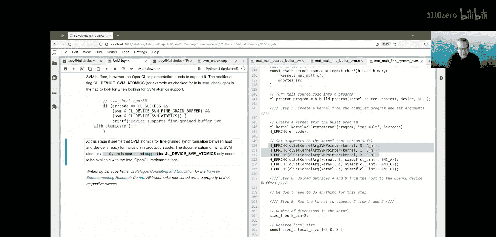
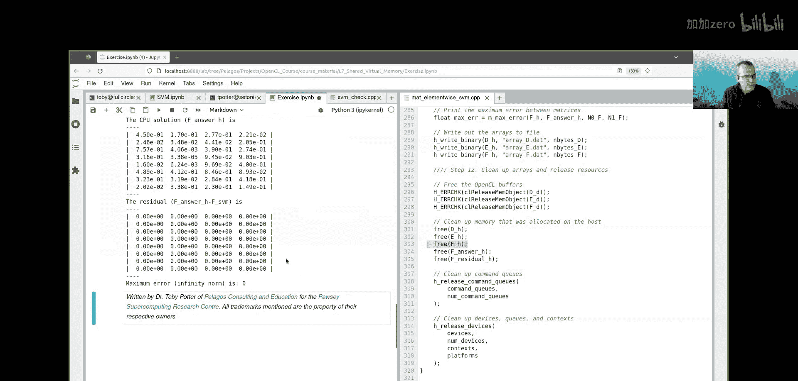

# 【OpenCL编程 Pawsey超算研究院】 p10 p9 Open CL - day 3 part 1- Shared Virtual Memory (SVM) -BV1fMz5Y3EDV_p10-

Well， today。We have quite a few things to cover and if we do well。

 we might even finish all the course material by the end of today。So we'll see how we go。😊。

We'll see how we go and there's not there's not much of a hurry now so we can we can take our time and we can really cover the material in depth。

😊，So， we're going to cover。3 more modules。And the first one on the lineup。

For today is going to be shared virtual memory。 And so this is going to cover。

How we can blur the boundary between host memory and global memory on the compute device。So that is。

 there are a few strategies within OpenCL to do this and we're going to explore those strategies。

The next module that we're going to cover is going to be how to get the best performance out of open seal kernels。

And that's going to be probably one of the more useful modules for this course。

 so you're going to learn about techniques。🤢，To optimize your kernels， things to be aware about。

 such as occupancy， for example。So we're going to apply those techniques and strategies to the matrix multiplication algorithm。

 So the matrix multiplication algorithm that we have used all throughout this course。

 we're going to now。Find ways of optimizing that。So optimizing our kernels is lesson eight。

 lesson seven is shared virtual memory， and then lesson9 is going to be how do we optimize our IO transfers？

Through asynchronous or non blocking IO calls using different command cues。

So that is going to be a teaching module that we do after the kernel optimization。Okay。

So let's get into module 7 shared virtual memory， So I'll just share my screen。Select a window。

This one here。Now is that fitting into the window okay for Timma yes。

 that's fine into the recording okay and all the text looks like of a good size Yeah。

 all good toby excellent thank you。嗯。😊，Let's now go to the course material。

 and we are opening lesson 7， shared virtual memory。And for those of you who have joined。

 you will probably need to download the latest copy of the course material because I have made a few minor changes here and there。

 particularly to the exercises coming up， so if you can grab the in your own time the latest copy of the course material。

 then that would be fantastic。Okay。So in L 7 shared virtual memory， we're going to open the file SVM。

Okay， so now we have that open。And let's go ahead。So shared virtual memory or SVM in Open seal is a way to blur。

Or even erase the boundary between host memory and global device memory。So we have a host here。

And we have host memory and we have a host thread。 so that's that's a software thread that is part of your main program。

And in here in this space is the memory spaces that the compute device has access to。

So it has access to global and constant memory。Every work item within a compute device。

 every work item or every hardware thread has access to global and constant memory， but it has。Sorry。

 additionally， it has access to private memory and local memory as well。

 So every work item in a work group has access to local memory and every work item has access to its own private memory。

Okay， so that's the memory space。 Now， shared virtual memory is a way。😊。

To reduce or to eliminate this barrier here， this barrier between host memory and global memory。So。

 we've got host memory。And global memory can be the same thing。

 and it's just a matter of synchronizing accesses from the host thread and work items on the compute device。

So that's the whole idea of shared virtual memory is to blur or even erase the boundary between host memory and global memory。

This is really good， because。It will then avoid or even eliminate the need to shuffle memory between the compute device and the host。

So that's the whole idea about this。So sometimes algorithms can benefit when both host and device share the same access to the same memory。

So it may give the compute device access to a larger memory space than on just the compute device。

But also。It can give access from the host and from the compute device access to the same memory at the same time。

 potentially。So architectures such as the AMD Intinc MI 300 can benefit greatly from this approach because on that architecture you have both GPUs and CPUUs on the same package。

 so if they both have access to the same memory， then you can avoid the steps where you are explicitly copying memory from compute device to host or host to compute device。

So shared virtual memory is available on Open CL 2。0 plus。And it's optionally available on OpenC 3。

0 plus。And there are three main types of shared virtual memory that is coarse grained buffer SVM。

There is fine grained buffer SVM。And then there is fine grainined system， SVN。

So course grained buffer SVN is the most basic level of shared virtual memory support。

And it's the only one that's technically required by the Open C， L20 standard。And indeed。

 most implementations of OpenCL， even for example， in VAs， they implement coarse grained buffer SVM。

Okay， so in Coarsegrained buffer SVM， it doesn't appear to be too much different from standard open C buffers。

 but it could might make use of memory transfer synchronization between host and device。

 So with Coargraed SVM， you still need to allocatecate buffers and delocate buffers。

 but you use these special functions， SVM ac and SVM free to allocatecate and deallocate your memory。

You also gain the ability to use that allocated memory directly in a kernel invocation instead of a handle to an open seal buffer。

When you want to do synchronization between the host and the device。

This allocation of memory must still be explicitly mapped。Using a C N Q map buffer command。

 So it must be explicitly mapped back to the host before the host can access it。

And when you explicitly map this shared virtual memory buffer。

 then it does the necessary synchronizations to make this memory available from the host。

So there stands to be a little bit you can gain by using Coar grained buffer SVM。

 you can allocate and delocate memory and then you can use those pointers directly in your kernel invocation。

However， though， you still need to map and unmap memory。So there can。

 there can be a bit of a benefit depending on the open seal implementation。

But you still need explicit mapping and unmapping。Iin grainined， buffer S VM。

Does the things that are above， but it removes the requirement to map and unmap memory。

You still need to allocate memory using the special functions。SVM。

 Ac and SVM free to allocate and Dallocate shared memory。At runtime。

 as with course grained SVM and as with all the SVM implementations。The code。

 when you are setting arguments， you must notify the kernel that an SVM allocation is being used and will' cover the command that you need to do when you are setting kernel arguments。

 You will cover the command that you need to do in order to specify to the kernel that you are using SVM memory。

Okay， so unlike with coar grained SVM， both host and device can access a fine grained buffer at the same time。

Consistency between the host and the device is guaranteed if the host and device are writing to different bytes in the allocation。

If there is a need for the host and device to read what the other has written。

 then memory can be explicitly synchronized by waiting for the compute device to finish。

So that's how synchronization works with fine grained buffer eVM all you have to do is wait for your kernel。

To finish， you don't need to map and unmap。Memory， explicitly。Now。

 if your host and device must read and update the same bytes in the allocation。

 then atomic data types if they're supported and special synchronization functions can be used to maintain coherency。

But that sounds like a bit of a complexity。Generating exercise so if you wanted to read and update the same bys in the allocation it sounds like a greater amount of complexity and the potential for issues to go wrong so my suggestion would be if you're going to use fine grain buffer SVN that you just wait for a kernel to finish until you access that memory from the host。

Okay。Now， fine grained SVM。Further removes the requirement to use SVM。

 Ac and SVM free to allocate and delocate shared memory。This is fantastic。😊。

You can just use ordinary system functions such as Mal to allocate memory on the host。

 and then you can use that pointer within kernels。That's the way it should be。However。

 only some implementations of shared virtual memory actually implement fine grain system SVM。😊。

And the only implementation that I'm aware of is the Intel implementation。

 so that's the only one that I'm aware of that actually does fine grain system SVM。

Hopefully that will change though in the future。😔，Let's hope that AMD implements F grain system SVM for use on the MI 300 architecture。

Okay。So with fine grain system SVM， you can just use ordinary functions to allocate and delocate memory。

And then you can pass those pointers into the kernel directly。

 but you still have to let the kernel know。That you are using， that you are using that， that memory。

 Now， I'll just， we'll just check that。 But I think that's， that's the case。Okay。So， only。

Only pointers directly used by the kernel may be passed in as kernel。Arguments。Pointters used。Oh。

 pointers you， sorry， indirectly can be accessed without having to notify the kernel of their existence。

 Okay， so what I was saying about having to notify the kernel that you're using SVM。

 that's not true with fine grained system SVM。Okay。As with fine grain buffer SVM。

 if the host and device must read and update the same bytes in the allocation。

 then atomic data types and special synchronization functions can be used。But again。

 that is extra complexity that you'll have to navigate as a programmer。Okay。So， let's now check。

Let's now see how we can check to see what kind of shared virtual memory is available on your system。

So the OpenCL function CL get device infofo can query the SVM capabilities on the compute device。

 but only if you have an openCL 2。0 plus implementation。😊。

So you can search for when you're using C Get device info。

 you can use the parameter C device SVM capabilities to get an object of type C device SVM capabilities。

Okay， and now that is what is going to be returned is a bitfield。When you do this operation。

And then you can have the following code。To determine what SVM implementations are available。

 So if youre using S open C 2。0 plus， then this will be defined。And then you can do this query， and。

Then you can check to make sure that you can check to make sure that it actually does implement shared virtual memory。

 So if your error comes up with C， L invalid。Value。

 so if your error code comes up with C invalid value， then it does not support shared virtual memory。

And so you can then exit。But if you get a success error code and then your SVM， so your SVM C device。

 SVM capabilities， your object。And if this。If this binary end operation。AreA yields true。So。

 then your。Device supports course grained buffer S VM。 Okay， so that's how we check if。

That's how we can check if a device has capability for a certain kind of SVM。

 So with this with this code here， we're checking to see if the device supports coursear grained SVM。

And so， we're looking for。We're checking to see if this condition is true。

 and this is a binary and operator。 So this checks the bitfield。

Checks the bit field to see if this is present and it will return true if that is the case。Okay。

 the next thing we can do is check for C， L device， S VM fine grain buffer。

So that checks to see if our device supports fine green buffer SVM。

You can do an additional additional check。To see if it also supports C L device， SVM atomics。

So that's fine grained buffer SVM with atomics。 Now， atomics are。Data types。That you can only。

Manipulate with one。Hardware thread at a time or one kernel at a time。

So that is or one one thing at a time， one software thread at a time。

 so that whether that's from a work item on a compute device or from the host。

So that's what an atomic type is。 it only allows for one thing to update it at a time。

So that's checking to see if your device supports SVM atomics。

We use a similar call to check to see if it supports fine grain system SVM and if it supports fine grain system SVM with atomics。

So if we compile and run。If we then compile and run。嗯。

I'm just going to change directory to the Open seal course。Change director to the course material。

 Now， if we go to L 7 shared virtual memory。And then we make the software。 So just make clean。

 just to make sure it's clean。 and then we make it。I am going to run the code called SVM Check。

So let's have a look at svmcheck。cppP。Now in SVM check。

 we are just including our helper header as before， we're passing arguments we're acquiring devices。

 we're choosing a compute device。We're reporting on that device。

And then we are going through this code to see what kind。

Of what kind of SVM that that device supports。And once we've done with that。

 we will then release the devices so if we go ahead and do that and this is something that you can do on satonics as well。

So I'm just going to do this on my machine。 So I'm going to go SVM check dot Xy。

 and I am going to find the。I'm going to use GPU0。Al right， so GPU 0 is my integrated GPU。

And that is from AMD， so that is a radon 680 M。So that's an integrated GPU。

That is part of my CPU that is on my CPU process the die。So this has support for Open seal 2 to O。

 and it supports both coarse grained SVM and fine grained buffer SVM。

So that's what that would be similar to what you would expect on satonics as well。

 so satonics supports both coarse grained and fine grained buffer SVM。

 but notice that there is no support for SVM atomics。Okay。So now we'll check GPU 1。

 So that is on my system。 GPU 1 is the。Invidia， R T X 3060。

So that is NviIDIA's implementation and it only supports Coarse grained SVM。

Now let's check the CPU implementation， so this CPU implementation is Intels。

Open C implementation that runs on the CPU。Okay， so we've got all the things。

 we've got all the things implemented。😊，So it supports openC 3。0， it supports coarse grained SVM。

 fine grained buffer SVM， fine grained buffer SVM with atomics and fine grained system SVM。

With atomics， so it's got all the things。😊，So that's that's really cool And you can use that SVM check application to check the capabilities of a particular compute device。

😊，And it would be interesting。 It would be interesting to know if the。

The CPU implementation on satonics that we have， whether that supports fine grained SVM。

 and we can go ahead。Let's， let's just go and do that。 So let's SS H into satonics。

 So we'll do that as an exercise。 You can follow along with me。And with SSH into Satanonics。

 we will module， load our programming environment with OpenCL。

 so we're loading our open seal programming environment。We are changing directory to my scratch。As。

Changing directory to My scratcht and then in the open seal course material folder。

I'll just make sure that I have the latest。😔，Oh， good。Let's go to course material。 Let's go to L 7。

Shared virtual memory。And then we will grab an allocation on the GPU。Okay。

So I am just going through my history， and I am finding。An allocation。Command。

 and I'm going to copy paste or just use that allocation。

 So were we're grabbing an allocation of a GPU on satutnics using our reservation。

So I'm just going ahead and doing that now。We've got one GPU， so that's all good。

And if we go CL info with option L， we can see that there is a CPU implementation and a GPU implementation。

So' we've got。We've got an MI 250X GPU。And it's got the architecture G F X 9，0， a。 Alright。

 so now we're going to make our software。 So we're go make clean and make。

And let's try and use the application SVM check to see what is available for the CPU。

 So we'll try the CPU first。SVM check and then we select the CPU。

And we see that the CPU implementation has support for coarse grained SVM。

Fine grained buffer S VM and fine grained buffer S VM with atomics。

So this is an open source implementation， this is portable open seal。

 and we saw that it's not quite as capable as the Intel implementation。😊。

But it still does fine grained buffer， SVM。So that's good now let's check to see what the GPU can support。

Okay， so on the GPU at the moment， we can support coarse grained SVM and fine grained buffer SVM。

So that is what satonics supports。At the moment， with the GP。Implementation from AM D。Okay。

 that's pretty cool。Now， you can also use the C L info。And look for a particular property called SVM。

 So you can use C L info to extract this same information。 So we go C L info with Pro SVM。

 And that will then get the device capabilities or the SVM device capabilities that we have so。

P O C stands for portable Open C。And we've got C device SVM capabilities。

And it supports coarse grain buffer， fine grain buffer， as well as atomics。So。

The AMD implementation supports coar grain buffer and fine grain buffer。

Now I realize I've just resized my window， so I will get that size back so that we have a nice HD size。

So I'm just going to resize our window。😔，Apologies for that。

 because it'll make the editing of this video a little bit harder。Okay， great。Yep。

 so our screen is back to H size。Now， moving on。We're going to move on to coar grained SVM。Okay。

 so we've done our SVM check。 we've checked to see what kind of abilities or SVM abilities that the compute device has。

Now we're going to use Coarse grained SVM。So for Co grained SVM。

 we still have the restriction of having to map a memory space back to the host when we want to access that from the host。

So in the matrix multiplication。😊，Application。We're going to use Coarse buffer Ephian as a backing store for A D。

And we're going to use SVM memory directly for CD。So you can use an SVM allocation as the backing store for an open seal buffer。

You allocate the memory using C L SVM Ac， and then you can use the flag C L Mem use host pointer。

To then use that SVM memory as a backing store for an open seal buffer。

So let's have a look at the code， Me malt Co buffer SVM。

So I'm going to have that running side by side。Okay。

So let's we're opening the matrix multiplication code， Metmt Co buffer SVM。And if we scroll down。

We scroll down。😔，2 lines，135。Here we are allocating a allocation of SVM memory。

And that will serve as the backing store for AD on the compute device。

 So we allocate the memory using C SVM AEC。Yeah， using FCVM Ac。

 and we can allocate memory in SVM with memory flags such as read， write or read write。Okay。

We just checked us to ensure that our memory allocation is not null， because if it was null。

 then we would know that the memory allocation has failed。

 So that's how you can check to see if your SVM Ac command worked successfully。

Then what we're doing and this is just for teaching purposes。

 we are going to wrap an open seal buffer around our SVM allocation so we can do this we're going to now create。

😊，A buffer using C， L， create buffer。And we're going to use the flag C L Me Read right and C L mem host pointer。

Now it wouldn't make sense， or it might even introduce undefined behavior if， for example。

 we had a flag of CLM read for the SVM memory allocation。

 but then we used a flag of CLMm read right for the buffer that we are overlaying on top of it。Yep。

 so。It would be good to。 It is good to be consistent with these two flags right here。

The additional flag that we are using is CLM use host pointer。

So CLM use host pointer that's a binary or operation。

And that introduces the additional flag that we're going to use host pointer as our backing store for the buffer。

 So we pass in ASVM as the pointer。So that's creating an open seal buffer AD around our SVM allocation。

We just create a normal open seal buffer for BD， so that's fine we can do that。Now with C。

 we actually allocate coarse grained SVM memory。😊，For C for matrix C。

So we create this array called CSVM。And that is that is going to be of type CL float。

 So we have this we have this cast， the static cast here and that cast the void pointer so what comes out of SV and Al is a void pointer and then we cast that void pointer to a pointer to C float。

Okay， so we don't need to read。嗯。That's interesting。 We do need。 We do need to read from that。

So I might just have that as being C， L me read。Right。Okay， so I found a bug in my own code。

And that's great so what we're going to do is going to correct that bug by making it of type CLM read write because we need to read from that allocation at the end we don't just need to write。

😊，All right。Now， I was saying that when you use these flags。

 when you use the memory allocation in a way that is different to the flags。

 the memory it is undefined so。Anything goes and it just so happens that I was able to get away with being able to use CLM right only。

So that's a bug in the code， and that's fine。😊，So we have now corrected it to use the flag CL memory readrite when we are allocating SVM memory。

Okay。So we're just making sure that our memory allocation is not denial。Using the assert statement。

Okay， so the rest of the matrix multiplication algorithm is as before。

But when we use when we use SVM memory。When we use SVM memory in a course grained implementation。

So when we use SVM memory for a coar grain implementation。

 we have to use this command called C set kernel Arg SVM pointer。

So we have to use that function instead of C， L set kernel Arg。Okay。

 so you're going to potentially get an error if you just use C L set kernel Arg instead of C set kernel Arg SVM pointer。

And that is to let the kernel know that you are using SVM memory for one of the allocations。Now。

 notice that we didn't have to use that special flag。For。This memory allocation， A D。

 and that is because we have wrapped an open seal buffer around it。

 and then we just pass in the open seal buffer。All right， so when you're setting kernel arguments。

 if you're going to use SVM pointers， particularly with coarse grained and fine grained buffer SVM。

 then you need to let the kernel know that you are using SVM memory so that's so we do that。

All right， so we then we then write to the buffers from A H and B H that's exactly the same as before with our matrix multiplication algorithm。

 we in the kernel， we wait for the kernel to finish。Okay。So， when。Because we are using coar grained。

SVM。We need to map it back to the host when we would like to use that memory。From the host。

So we use this function， CLNQ SVM map。To then map that map that pointer back to the host and there are some flags here that you can pass into ClinkQ SVM map So that is。

 is this a blocking call， Do we wait， Do we wait until that map is complete before returning to the host。

And we want to say yes， please， we're going to wait until we're going to wait until that。

And that finishes。We're going we have the additional option to specify how we're going to use that pointer。

 So in this case， we're just going to read。So we're going to read， we're going to map that pointer。

 we're going to map that SVM allocation back to the host in a way that we just want to read from the buffer。

Okay， so we go ahead as before and test。Our SVM， so we test。Our matrix multiplication results。

 so the result from the CPU implementation is going to be in C answer H。

And then we just do our matrix multiplication。 We get our results， using CPU code。And then， we test。

The difference between the matrix and our。Mattrix， that has been。Operated on using the open C device。

Okay， so we get our difference between the two matrices。 So C SVM is our mapped memory。

So that memory has been mapped back to the host。So we do that mapping。

 and then we can even write that memory out。 So we're manipulating that memory from the host。

And then we unmap that memory。 So this command C L N Q， S VM Unmap。

Is the command to unmap that memory。 So that makes it available back to opense again。

And then we can free that memory using C， L， N， Q， S VM3。Now， when we。

When we are done with the open C L buffer， we can release the memory object for a D。And。When we。

 when we release buffers that have a SVM pointer as their backing store。

 we just undo the process that we use to wrap an open C L buffer around it。 So， first of all。

 we release the open C， L buffer。 We release the open C L buffer。

 And then we can use another command called C L SVM 3。

To free the underlying S V and allocated memory。So these commands CLNQ SVM free and C SVM free。

 they both can be used interchangeably to free memory that is allocated for an SVM。Allocation， so。

Either of those can be used， the difference between this one and this one is that this one Nqs the free command to a command queue。

So that is useful if you need to establish a dependency。

 so let's say that command co was being used for a kernel run and you needed to make sure that that kernel run had finished。

Before you N queue the free command。 So that's why the C NQ SVM free is there is to establish a dependency Now。

 of course， with the command queue， that would have to be an in order command queue So you would have to make sure that that is an in order command queue instead of an out of order command queue。

Because then this could， this free could occur before the kernel。So。Yep。

 you need to have it in order command Q if you're going to use CLNQ SVM free。And。And you need that。

 you， you need that kernel to finish。Okay， so we're using C。 We're just using just。

Bg standard C L SVM free to free the memory for ASVM， which was the backing store。4 a D。

And then we just release our command queuees and release our devices as before。All right。So， that is。

All of that， which we just covered。You can when you are using SVM memory from within the kernel。

 it is no different to if we had used any other memory allocation。So that's okay。

And the important thing to remember is with coarse grained SVM。

 you need to map and unmap that memory。When。You then use that memory from the host。Okay。

So let's now run that example using the coarse grained buffer SVM。

And we will run that on the NviDdia GPU。So we've done that and that will work on the NviIDdia GPU because the device supports corear screened buffer SVM。

And I know that NviIDdia has capabilities for using unified and managed memory。

 so NviIDdia has the capability to implement fine grainined buffer SVM and possibly even fine grained system SVM。

 so I'm looking forward to when NviDdia implements those things for its open seal implementation。

Okay， so let's now test this memory。And we get a nice residual there。 So everything is looking good。

 So we have successfully done， we have successfully done Coar grained buffer SVM。

Now let's move over to find grained buffer SVM。So fine grained buffer SVM dispenses with the need for explicit mapping and unmapping steps that are necessary in coarse grained buffer SVM。

Synchronization for a buffer is guaranteed when we know the kernel is finished with the memory。

And you can guarantee this by having a call to S， sorry。

 C finish and C finish will wait on a command queue。

You can also guarantee by waiting for the event that is associated with the work that is running in the command queue so you can use CL Wait for events to wait for any event that uses that fine grainined buffer allocation。

Okay， so let's open the file， Matt Malt Fine buffer SVM。So I'll do that。

 and let's have that running side by side。Now it is matrix multiplication as before。😊。

And let's now see how it is different from standard matrix。

 sorry how the different little pieces are different。Okay。So first of all。

 we need to check for C L device SVM fine grain buffer。

 So we need to make sure that fine grain buffer SVM is available on the compute device。

 and this code is just to。Make just to do that。Then if we scroll down。

 we will be using SVM memory for。So we're using fine grain buffer SVM for matrix C。

So we do not use we do not use SVM memory as a backing store anymore for a。

 and we do not use SVM memory as a backing store for B。We're going to use SVM memory。A directlyirly。

 this time。As we did before。 So with course green buffer SVM， we used。We used SVM directly。

And we are going to。Use C， L SVM Ac to allocate that memory。 Now， I have made the same error。

So we're going to make that of type read， write。😔，Okay， so we're going to make that of type read。

 right， and we are going to make。We're going to allocate SVM memory using this fine grain。Buffffer。

 sorry， C LM S VM fine grain buffer。 So we're going to use that additional flag when we allocate。

SVM memory。 So this now makes an allocation of SVM memory that is using fine grained。

Buffer is the end。Again， we。Use the assertion to make sure that our allocation has been successful。

As with coarse grained buffer SVM， we still need to use C L set kernel Arg SVM pointer。

 So we still need to use that command to tell the kernel that we are going to use SVM memory。Yeah。

 that we're going to use see that we are going to use SVM memory in the kernel。Okay。

We then upload memory to A and B， D as before。😔，We run the kernel as before we wait for the kernel to finish。

 Now at this point。At this point， when we have waited for the kernel to finish， at that point。

 we know that the memory now is synchronized between host and device。

And we can use that memory from the host。 So with fine grained buffer Svn。

 we do not need to have an explicit。嗯。Mapping step to make that memory available from the host。

Because we have waited on the kernel that is done with that memory， that is now consistent。

From the host。So you need to make sure that your kernel is done with that memory。

 but once it is done， we can just then use CSVM straight。Okay， so that's very handy。

 We don't need to do any explicit mapping and unmapp steps。We can now write we can now write that。

That memory allocation to disk。And we just release。A D and Bd。We then。

 because we know that we are done with C SVM， We just use C L SVM free。

 So we don't need to in queue a free because we know that that memory。

We know that we are done with that memory now so we just use CSVM free and then we release resources as before。

So let's do that on the GPU now I know that GPU0 on my system is using the AMD implementation and I know that it supports fine grained buffer SVM。

So we will run that。And we will load， and。Show that and we are getting the same result as before。

Okay， so that's fine grained buffer SVM。And with fine grainined buffer SVM。

 we can use C SVM aEC to allocate the memory， we have to let the kernel know that we're using an SVM allocation。

 but the difference between coarse grainined buffer SVM is that we do not need to map that memory back。

And once we're done with that memory， we just use CLSVM free。Okay。So that is fine grained buffer SVM。

All right， so with fine grain system SVM， the level of awesomeness increases significantly。

 we do not need a call to SVM Ac to allocate shared memory we do not need to create and destroy open C buffers in order to use in order to use memory allocations from the kernel we do not need to map and unmap memory and we do not need to explicitly copy memory between host and device。

😊，What a beautiful thing。😊，Unfortunately， support for fine grain system SVN is rare and。

At the time of writing only the CPU implementations from portable C and Intel appear to support it。

 Now， I'm not sure we could go to hub to。Because hubub2 has an integrated GPU from Intel。

And we could go ahead and check to see if that integrated GPU implementation from Intel。Has。

Has support for fine grained system SVM。So we could go ahead and do that。

And I think during the break， I'm going to just check to make sure that it does or it doesn't。

All right。So hopefully， hopefully other implementations will support fine grained system SVM in the future。

 because this is pretty cool。Alright， so we check。For fine grain system S VM in a similar way to fine grain buffer S VM。

 So let's open the code， Matt Malt F system， S VM。Okay， so that's our matrix multiplication。

And we are going to acquire devices as before， create command queues and。

We check for fine grain system SVM using this code here。 So we're。

 we're looking for C L device SVM fine grain system。 Okay， so that supports。So if this works。

 then it supports fine grain system SVM。Now， with fine grain system SVM。

 any function such as Malc or Calc。Can be used to allocate memory for A， H， B， H， and C， H。

But we're going to use H aLEC。To allocate memory。 So remember how we had a problem when we were not using aligned memory from within an open seal kernel。

 we need to check to make sure， well， because weve had issues in the past。

 it is a safe thing to make sure that our memory is aligned when we're going to use memory from an open seal kernel。

Okay， so we use H AEC to allocate memory A， H， B， H and C， H on the host。

 So those are our host allocations and what we're going to do is we're going to pass those allocations。

😊，Directly as arguments to the kernel and thats that's a beautiful thing。😊，Okay。So， we still need。

And in fact， I was right。 So I've got a bit of a discrepancy between my。

 between my notes just before。 We still need。To use the C。

 L set kernel Rrg S VM pointer function to let the kernel know that the allocation is shared memory。

So I will fix that in my notes， but we definitely still need。When we're sitting arguments。

We still need to use the the function C， L set kernel Arg S VM pointer。Okay。So， we have allocated。

We have allocated just ordinary memory。And we are using the function CL set kernel Rrg SVM pointer to set these memory allocations。

In as arguments to the colonel。So that's all we have to do。

 We don't have to use any special phrase other than the normal phrase。

And we don't have to do any special unmapping or mapping we just use these functions to set kernel arguments we don't we don't have to do anything else。

 so that is fantastic so we then now run this C mat so we run this code mat multifin system SVM on the CPU。

And then we load data and check data as before and everything's working。So， that is。

That is using fine grained system， SVM。Okay。Now， there are atomic operations to synchronize memory between host and fine grained SVM buffers。

However， the open seal implementation is to support it and we saw that， for example。

 the AMD implementation supported fine grained buffer SVM。

 but it didn't support atomics so it didn't support C device SVM。Atomics。Okay。

 now when I was looking through the documentation， the synchronization primitives and memory models。

😊，4。Synchronizing between host and device got really complicated， so。I am hesitant to use this。

 I'm hesitant to use CL device SVM atomics because it has very little support。Only the Intel。😊。

Implementation。Has great support for it at the moment。Okay。

 so the documentation and what SVM atomics actually are is sparse and support for seal device SVM atomics only seems to be available with the Intel open seal implementation。

Okay， so yeah， I would recommend against using Se device S via atomics until there is wide spread support for that。

 And the Se device S via atomics are。A very fine grain synchronization between the host and。电。Sorry。

 very fine grain synchronization from the host or compute device and this is for instances when you are when host and device are both writing to the memory at the same time。

So things get awfully complicated when you want to write from the host and the compute device at the same time。

 and my suggestion is don't do that， just wait until your compute device is done with it before accessing memory from the host。

😊。

Have a look at the。In the course material folder for L 7 shared virtual memory。

 So you go into course material and then L 7 shared virtual memory。

 you'll see that there is an exercise。 So I'm just going to cover the exercise。

 and then we'll go for a break and， and。And then sort some things out。Okay。

 so I'm just going to share my screen。

All right。So the exercise that surrounds SVM is to use fine grained buffer SVM。 Now。

 that is available on satonics。 We're going to use fine grained buffer SVM。In order to， you know。

 in order to represent。The allocation for FD。Okay， so we've got headamard matrix multiplication。

 and we're going to tool up。This code。To use fine grained buffer， S VM。Okay， so in this exercise。

 we're going to enable the element wise matrix multiplication code to use fine grained buffer shared virtual memory。

 So the source code to edit is in the file mat element wise S VM。😊，So I'm just going to click on。

That， and。That link does not work， but the code is down here。 So we go Matt element wise， S VM。

 So just click on that。And then we can have that code open at the same time。

 So it's called mat element wise S VM。 So that's the code that we're going to modify。

In order to make it use。Fine grained buffer S V M。4 F day。Okay。

So we're going to edit that code now the kernel is in kernel's element wise。c。

 but we don't have to worry about that because nothing is wrong inside that file。Now matrices。

 D and E are read in。As before。 So they're read in。So they're actually created on the host。

And then they are filled with random numbers。So your task is to tool up this code so that the memory allocation for matrixtri F is using fine grain Doer StheM。

So we edit this file here， map Element wise SVM， so it runs fine。

 so we're just going to run that now。And it produces the right result。

And what you need to do is you need to make the necessary changes。So that。

The storage for matrix F is using fine grain buffer SVM。

 and these are the tasks that will help you do that。

 So the solution will eliminate the need for separate handling of F D and F H so。At the moment。

 the code has an allocation for F， H。But it also creates a buffer here using an open seal buffer for FD。

And what you can do is you can use a single SVM allocation instead of FH and FD。So we， first of all。

 allocate memory for a variable called F S VM。 So we use S VM Malik instead。

 And that means that you can eliminate。All the code that works with FD and FH。

 so you can eliminate the code that allocates FH and just use a single SVM ac instead。

So you remove the code that creates a buffer for FD so you can get rid of that。

You can remove all code that allocates and freeze memory for FH， so we're going to use FSVM instead。

We're going to use FSVM everywhere。And instead of F， H。

We also need to remove the call to tear up memory for FD， so we need to remove that。😔。

And we can also remove the code to tear up the memory for F H。

 And that is because we are going to use FSVM instead。Now when you when you're going to use。

S VM memory。 when you're going to use S VM memory， you still need to have the call to C。

 L set kernelonel Arg， S VM pointer。So you still need to have that。

And when you're finished with the SVM memory， you see L SVM free to free memory for FSVM。

Now you can of course always look at the answer in MA element wise SVM。

 but then try to understand how the solution is working so this is the answer and it produces zero residual as before。

