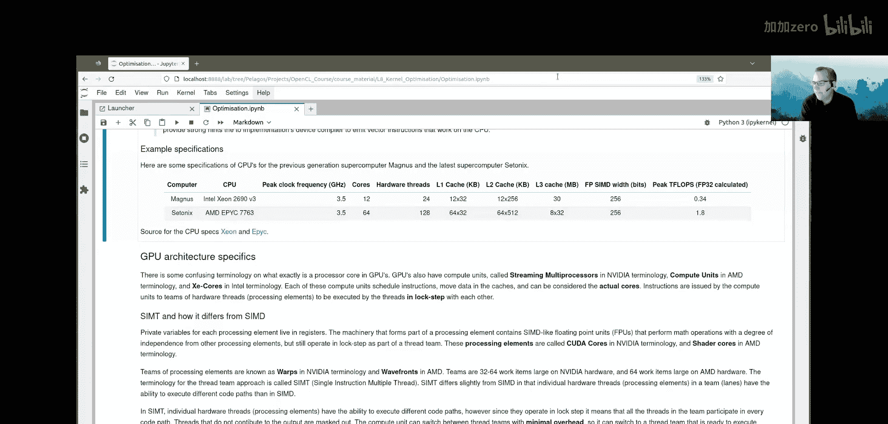
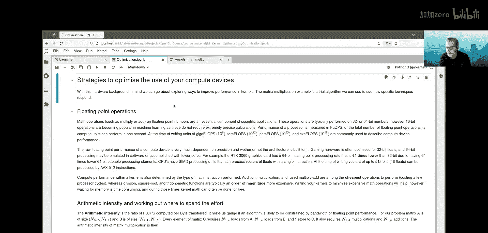

# 【OpenCL编程 Pawsey超算研究院】 p11 p10 OpenCL - day 3, part 2 - Optimising OpenCL kernels 1 -BV1fMz5Y3EDV_p11-

Okay， everyone。 Wee back。😊，Now what we're going to do is talk about optimizing open CL kernels。😔。

So we go to the course material。I'll just share my screen。This one here share the screen。😔。

Okay。So we're going to course material lesson8 kernel optimization。😔。

And then have a look at optimization dot I pi N B。All right。

So the performance of open seal kernels is a complex multidial optimization problem。

It depends not only on the efficient utilization of compute units。But also。

 the timeliness and speed that memory is passed in and out of compute units。

It's a general rule that vendor specific libraries are the best way to achieve optimal compute performance。

 So that's a given。However， with OpenCL CA solutions are not always available for your chosen algorithm。

At the same time， open seal implementations and their underlying hardware often have smart technologies built in to optimize processing for commonly used computing operations。

So that means that sometimes the simplest approach works best。😔，At other times。

 better compute performance comes at a significant increase in the complexity of a program。

So when developer time is critical， though， a piece of code that is performant but complex to understand may not be ideal。

嗯。Furthermore， different architectures， such as CPUs and GPs。

 are optimized in different ways for computing。This means that a kernel that might perform well on a CPU might perform poorly on a GPU and vice versa。

😔，Experimentation is definitely the key。In the following sections。

 we're going to explore ways in which kernel performance can be impacted and try a few things to optimize a performance using the matrix multiplication algorithm as our example。

So we're going to compile the software within lesson 8。And。Now， we're going to cover just some。

Preamble material about the fundamentals of CPU and GP architectures。

So it's helpful to cover these things before we delve into。😔，Performance optimization。

So from the introduction， we have seen that a processor is partitioned into compute units。

And each of those compute units provides a number of hardware threads that。Run the software。

For processing elements。In。An open seal。 So for an open seal kernel。

So an open seal kernel will run on a hardware thread。That hardware thread has。

The hardware in that hardware thread then does the instructions。

That performs the instructions for an open seal kernel。So here we have a processor die。

And that has that's an older generation Intel CPU core and that has cores in it。

 so an older generations Intel CPU processor。 So there's a number of cores。

 I think there's four cores here and there are a number of cores in a GPU。

 So that's a GP on the left and that is a CPU。CPU cores on the right。So， compute units have。

A clock cycle， and。It can perform a limited number of instructions per cycle。

And those instructions are run on the hardware threads。So， for a。Yeah， so for a CPU。

You would have a core and that would have a certain number of hardware threads associated with it。

 those hardware threads and the core run according to a clock cycle and each of those hardware threads can perform a limited number of instructions per clock cycle。

So the compute unit。Is that which issues instructions。And the compute unit has a clock cycle。

So that that is it has a clock so it does， it can issue a certain number of instructions per clock cycle。

So during a computation， instructions such as math commands are executed。

By the machinery that is in a hardware thread。Now， this machinery works on memory that is passed in and out of the core from a hierarchy of caches。

If this memory does not arrive on time or is not disposed of in time。

Then the hardware threads will stall and performance may be impacted。😔。

So you've got these hardware threads， they are running the instructions issued by ICre。

And if they don't receive memory at the right time。Then performance can stall。😔。

If those hardware threads are running。😔，嗯。Heaps and heaps of instructions。

When a simpler set of instructions could be run， then performance can be impacted as well。

And what I mean by that is if your hardware instructions are doing things like division。

 which or math division， which is a computationally expensive thing。Instead of， you know。

 multiplications and additions。Then， that。Could be a way in which performance is impacted。

So there's a number of things that can impact the performance of a hardware thread。

Let's now talk about caches。So。The fastest memory storage in a processor。

 so that's either a CPU or a GPU is the registers。They operate at nearly the same clock speed as the core。

 and they're located on the processor die close to the hardware that computes the that does the instructions。

This memory is not cheap， however， and memory for a computation is shuffled to and from the processor through a hierarchy of caches with the following sizes and locations so we've got register memory that is the fastest memory that is on the compute device and that is located very close to the machinery which is executing the instructions。

And that memory is available on a clock cycle basis。🤢，So that is available during a clock cycle。

So things or memory can be read or written to registers。During a clock cycle。

So that's the fastest memory on the machine。いい。Slightly。Further away。

In terms of latency is the L1 cache。Now we saw in the lesson two that compute units。In satonics。

 have an L1 cache。 So 16 kB L1 cache。And that is。That is located。That is located on the compute。

On the compute unit。And that memory is available to each of the hardware threads in the compute unit。

Outside of the L1 cache is you have an L2 cache。 So that is still on the chip。

And that is fast on th memory。😔，If you have a CPU， you can have things like L3 in cash。

So that is fast memory that is either near the device or on the compute diet。 So with。

 with the tonics and the epic。Chipps， the L 3 cache is on each chipt。 So each chipt has an L3 cache。

Moving outwards。You have global or device memory。And so that is RA either high bandwidth memory in the case of the MI 250 GPUs。

 that's high bandwidth memory。And on the host， that is normal memory。So that would be DDR。DDR memory。

 so whatever the latest DDR technology is DDR 5 in the future it would be DDR6 for example。Okay。

 so global or device memoryine is the slowest。Memory。That is available。On a on a device。

 So host memory。Host memory is the slowest memory， so that's that's the RA L3 cache is fast memory that's near the device or onDdi L2 cache is onI memory L1 cache is really close。

Really close to the hardware threads and registers is the fastest memory that is。

That is near the hardware threads。 So this is your cache hierarchy。So things， memory。

 when you fetch memory。When you fetch memory from Ram or a global device memory。

You fetch it in and then it is brought into these L1 cache and if you need that memory again。

 you can just read from the cache instead of going out to global or device memory。

So memory that is not used frequently。For example， in the L1 cache is evicted to the L2 and L3 cache and if it is not used further and the L3 cache needs to free up。

 then that memory will be evicted out to main memory。

So that's main memory on the host or global memory on the compute device。

So that's memory that is rarely used is flushed out to the slowest memory on the device。

So that's how we can speed up performance。Is that we don't have enough resources to have all our memory available in registers。

So we need to have this cache hierarchy so that we can still have the benefits of fast memory。But。

We don't have the expense of。Having everything available in faster， faster memory。

 so that's the reason behind the cash hierarchy。So we're trying to have all the things。

 We're trying to have fast access to memory。But we're also trying to minimize the cost of having fast memory everywhere。

 So we can't do that。We can't have fast memory everywhere。

 and that's why we have this cash hierarchy。Let's now talk about cash lines。

 So a cash line is the fundamental unit of a memory transaction。

So memory that is passed in from a cache doesn't arrive at a processor core。

In units of individual bytes。And instead， it arrives in transactional units called Ca lines。

And a cache line is usually around 64 or 128 bytes。So you can think of a cash line as a log of wood。

And when you want to access something in that log， the whole log is transported。Into， into your。

 into your caches， so。So you can think of main memory as a really large collection of logs。

And when you need to access a particular bit of memory， a log is brought in to your cache。

So that would be the L3， L2 or L1 cache depending on when it's needed。Okay。

 so that means that if a processor needs to fetch from or store a single value in memory。

 then the cash hierarchy must transport this entire cash line。So 64 bytes is equivalent to 16 floats。

And the key to getting good or great performance in HPC。😊。

Is to make sure that you are accessing neighboring elements when you do。

 when you try and access things from memory。So it's a good idea。😔，To， to reuse the memory access。

 So if you accessed this element here， the first element in a cache line。嗯。

It wouldn't be any speed detriment to then access the second element in the cache line。

 and that's because the cache line has already been brought in。So， performance is。

Critically dependent on your ability to reuse elements in a cache line。

And that is the fundamental idea behind getting great performance from your cash hierarchy。🤢。

Is to reuse these， reuse memory in these cache lines as much as possible。Okay， so。

Try and use as many neighbouring elements in a cache line as possible by subsequently fetching and storing memory that is in the immediate neighbourhood of a memory access。

So if you fetch memory， if you can then fetch its neighbors。

In a subsequent iteration or a subsequent。You know， subsequent access。

 then that is going to be very performant for you。However， random access of your memory。

 So if I then got。You know， this element here and then I went off somewhere else and grabbed another element from somewhere else if that memory access was random。

 then I'm not going to have very good performance coming from my cache hierarchy because it has to retrieve these logs from from main memory all the time and throughout logs when you're only just getting a single element。

So in the context of Open CL， it is advantageous if a work items or work items in a work group access neighboring memory locations。

Then memory transfers can be shared among work items in what is known as coalesced memory access。

So let's just say that this work item， so one work item needs this element in memory and then its neighboring work item needs this element well that's an ideal scenario because then you only need to do one memory fetch and that satisfies the memory request for 16 work items。

So that is coalesced memory access is a good thing to strive for when you are trying to optimize open seal and indeed hip or co kernels。

So let's talk about latency now。And their latency is the number of cycles that a processing element or hardware thread has to wait for memory to arrive from a cache。

So here are some indicative， not exact， but indicative numbers for how long a CPU has to wait for memory。

And a GPU has to wait full memory。So with a register， a CPU memory， sorry。

 a CPU hardware thread can have that memory available from the register on the order of a clock cycle。

 so that's really fast。😊，But on a GPU， that memory might take 20 clock cycles。To arrive。

From an L1 cache， you might wait on the order of four cock cycles for a CPU。But on a GPU。

 it can be 30 to 100 clock cycles。From the L2 cache。

You could be waiting on the order of 10 clock cycles。😔，But from a GPU， it could be on the order of。

 you know，170 to 300 clock cycles。When you are fetching from device memory， you could be waiting。

 so when you're fetching from either host memory or device memory。

 you could be waiting on the order of 100 clock cycles or more for a CPU。

And up to 800 clock cycles for a GPU。Now， these numbers are continually changing with new architectures that come out。

But suffice to say that GPus。GPUs will be waiting。four。More clock cycles than CPUs。For that memory。

 it's just the way that GPUus are built。So， they have。They have lots of bandwidth。

 so lots of memory can arrive once it arrives。But you'll be waiting longer on a GP for memory than you will be on a CPU。

So we can say we can conclude from this that CPUs are more nimble。😔。

Than GPUs because they wait for less time。Full memory from this cash hierarchy。

So GPU vendors get around this latency issue by having deep execution pipelines。And in a GPU。

 the hardware threads participate in teams， so there's teams of hardware threads。

And it can have many hardware threads active at any one time。

 so I can have many teams of hardware threads active at any one time。

And that is good for performance because if any hardware thread team stalls while it is waiting for memory。

 then the GPU processor can just switch to or the GPU compute unit can just switch to another。🤢。

Thread team。So。That's how GPU manufacturers get over the design decision that latency is larger on a GPU。

So it is therefore desirable to have as many teams。

 so this is for a GPU and it is therefore desirable to have as many teams ready to take over as a compute unit will support。

The ratio of active teams to the maximum number of active teams possible on a compute unit。

Is called occupancy。So for a GPU， it is desirable to achieve a high degree of occupancy for a kernel。

😔，All right， we're going to talk about occupancy a little bit later on。

Throughhput is a measure of how fast memory can be transported from a cache to the processing element once it arrives。

So latency is the time that you wait until it arrives。

But throughput is a measure of how fast memory can be transported from a cache to a processing element once that memory starts arriving。

So here's just a rough guide as to what you can expect。😔，C from a CPU and GPU。And these numbers。

 of course， will， will change over time。But at the time of this course。

 we can expect from the L1 cache， for example， we can expect terabytes per second。From， you know。

 the L1 and the registers so we can expect terabytes per second on a CPU。And also， on a GP。

That memory transfer rate is similar from the L2 cache for both CPUus and GPus。

GPUs don't often have an L3 cache， so the transfer rate doesn't apply。

 but from a CPU the L3 cache might have something。bitit less than a terabyte per second。

When we go out to device memory， So that's on the。How you know， host memory。We can expect for a CPU。

 depending on， you know。How many channels you have running。

 You can expect something on the order of 100 gigabytes。A second， at least for a HP PCC。Architecture。

 now， I think on my laptop， for example。You know， it's， it can be less than 100 gigabytes a second。

For a GPU， the transfer rate from device memory can be。

From anywhere from hundreds of gigabytes to over terabytes per second。 Now。

 I think the high bandwidth memory on an Mi 250 GPU， the device memory has a throughput of 1。

6 tery per second per GPU device。So suffice to say what we can learn from this is that the throughput。

😔，On a GPU from device memory is a lot faster than the throughput for host memory。On the CPU。

So that helps with performance if you can get a lot of memory。Quickly。

 so you might take more clock cycles to get that memory。

 but then if you can then transfer a lot of memory quickly to your compute device。

 then that results in better performance。And GPUs achieve this really high speed of memory by having lots of discrete memory chips。

😔，So， you know， my laptop， for example， has six discrete memory chips and accesses occur in parallel from those banks of memory chips。

And so that's how you achieve these really high speeds， yeah。These really high speeds for GPU memory。

With the host with the host memory， you're running over a bus and that is from your banks of DDR RA and you can have those banks of DDR RA running in different channels。

But the overall throughput is slower than if you're using a GPU because often GPUs use next generation memory technologies such as DDR 6。

 DDR 6 x or high bandwidth memory。And that's。Whereas the GP。

 whereas the host might be using older technology， such as DDR 5 so。

That's why GPUus have a lot faster memory transfer rates because they're using newer technologies。

 but they're also using lower amounts of memory。So you can afford to splurge on newer technologies。😔。

Yeah， so that's one that's some of the reasons why GPU memory has a higher throughput than CPUs。Okay。

 so thoughts on latency and throughput with open seal kernels in mind。

With either CPU or GPU compute units， we must make sure to make best use of cash lines。

So this means creating work groups whose neighboring work items also work on neighboring elements of a memory allocation。

It seems that throughput from global memory is significantly faster on a GPU device， however。

 that memory will take more cycles to arrive。So let's have a look at some CPU architecture specifics now。

So CPUUs typically have fewer than 100 compute units or cores。😔。

And each compute unit has sophisticated instruction handling and nice things like preemptive memory fetching and branch prediction。

😔，So preemptive memory fetching is that it will predict what memory is required next and start to fill the caches with that memory。

😔，Branch prediction is predicting what code path that it will take and it will start loading the memory and instructions for that code path。

We can think of CPU compute units as smart workers。So。

The analogy would be PhD students PhD students have come a long way through the education system。

 they're quite smart workers， they know a lot of things。嗯。😊。

The cache latency timings indicate that CPUus are more nimble than GPus。Now GPUs。

 the hardware threads can be likened to perhaps high school students who you know know some things。

 but they don't know as much。But with the GPU there are more of them。

 so a lot of high school students can accomplish the same work。

More quickly than a small collection of PhD students。

 so that is the that's how we can think of CPU hardware threads as being smart workers， but the。

The hardware threads in a GPU have some smarts in them。But there are far more of them。

And so that that overwhelming majority can get the work done a lot quicker。Then。

A smaller set of nimble， nimble workers， nimble and smart workers。Okay。So。

So yeah I guess we we can think of let's I mean we've all been in an exam room at some point to do you know a high school exam or a university exam so there's there's these big holes of。

That in which you do these exams。And。You can think of。The work done。

For a math problem as being the exam papers。So let's just imagine let's just imagine a huge exam hall and there are exam papers lying on the desks。

😔，And so we'll use that analogy for both CPUs and GPUs。

 so the CPUUs are PhD students and they're able to complete the exam papers a lot more quickly than the high school students。

But there's a huge number of high school students so they can complete more exam papers more quickly。

😊，Yeah， so that's how the analogy is working。Okay， so compute units in a CPU each provide a number of hardware threads that can execute instructions independently of each other so hardware threads in a CPU they。

They execute independently so they can execute different software threads。

At an independent rate of each other。Each hardware thread， as we've seen。

 is known as a processing element in OpenC technology。So with a CPU。

 so we're talking about CPU architecture specifics， CPUs have registers and OnDdi L1。

 L2 and L3 caches。And we've also talked about the L3 cache being available on a triplet， for example。

 on the AMD Zen3+ architecture。Okay， so with Open C L。

 we might be able to use CL create subd to partition a CPU into sub deviceses。

 So each of those chipts on a AMD epic CPU could be used as its own sub deviceice。

And you can have those sub devices working on different parts of your problem。Okay。

 so this is a diagram of a CPU core。And。Within a CPU core。

 we have registers and you have an L1 and L2 cache so that's available from a CPU compute unit。

And each of these。So within the CPU core， you can have hardware threads。And inside a hardware thread。

 so a hardware thread would be this little box here。

Those hardware threads have inside what is known as CD units。So， these CD units can operate。

On a vector of floating point elements with one instruction。 So that is SD。

 So SD stands for single instruction， multiple data。And these floating point units。

Are are part of the the hardware that executes a software thread as part of a hardware thread。

So within a CPU processing element or hardware thread， you can also have machinery to do integers。

Integer operations as well。So you have lots of CPU cores。

 the AMD E CPUs have 64 cores and each core provides two hardware threads。

And those hardware threads can execute software independently of other hardware threads。

You might have access to a shared L3 cache that， for example， all CPUs and a chipt have access to。

Okay， now CPU with the Sdi units in CPUs， they can access。

Or they can process about 8 to 16 floats at a time。So those are those CD units。Now， the SIMD units。

 as I've explained。They can run one instruction。Over a vector of units at one time。So that's SD。

 so one one compute instruction can do math operations on a vector。With one instructions。

 So that's a Cd unit inside。A hardware thread in a CPU。Okay。

 so getting good performance on a CPU is critically dependent on whether or not one can effectively use the Sing units of the CPU。

Using vectors in an open seal kernel is a way to provide strong hints to the implementations device compiler to use vector instructions that work on these CD units。

So CPU hardware threads have these CIMD units that can work on vectors。So that' yeah。

 that's what that is about。And。If we were to use these CMD units on a CPU。

The CPU on satonics can process up to 8 floats at a time using the SD units in the。A D E CPU cores。

 So here are some stats on how fast the cores work and how big the caches are on satutonics。

 So with satutonics， you have a pink clock frequency of 3。5 gigHz using 64 cores。

 your L 1 cache is 32。Killowbytes in size， your L2 cache is 512 kilobytes in size and your L3 cache is shared between triplets of eight cores and each L3 cache is 32 megabytes in size。

The C width， so that's the number of bits that can be processed with one instruction is 256 bits wide。

 so that is eight floats。That is 8 floats wide。If you are using the S units。

 you can achieve a peak peak。Processing speed of 1。8 teroflops。So that's 1。

8 times 10 to the 12 floating point operations per second。

And so that's just a simple multiplication of the peak clock frequency by the number of cores by the number of elements that you can process in a vector。

😔，Now that's the pink floating point rate that is generally almost never achieved。

because that would assume that memory is being brought in and doesn't stall。😔。

So memory is being brought into these floating point units and every time a co cycle is run。

 then an instruction works on a vector so that that floating point。

Performance will never be realized。You always have the CPU stalling or working on other instructions other than floating point instructions。

But， but in a perfect scenario， that's how much you could achieve with with the MD epicex CPU。 Now。

 just as a comparison， these are the stats for the older CPU architecture on on Magnus。And。Yeah。

 so that had quite a lot， a lot less floating point capacity。

Now there are 64 cores available on satonics and that is pretty good。

 that is pretty good to map over the work， for example， in an open COL grid。

So when you are using things like open MP， your scalability。

So that means the the bang for buck that you get as you increase the number of hardware threads that work on a problem。

 the bang for your buck。You know， it doesn't give you much extra。

 doesn't give you much The scalability of open MP is not that fantastic。

So having all these cores might map well to an open C algorithm。

Because each of those cores then would then mapped to a part of an open seal grid。

So what I'm saying is that。On satonics， the CPUs could function quite well as a compute device。

For open seal code， Open seal code using a seat。 Can I ask you something。 Yeah， go ahead， yeah。Yeah。

 it is it's got like 64 course per CPU youth， but if you like run something like。

I CPU or like a Htop or something it sort of like twice that know。

 which is hyper threading and of course， in satellite the。

Harper thread is。Turn off in slum。 So you cannot really。

A submit job more than that。 So does hyper trading really help or why why are they disipling it。Yeah。

 so the whole point behind hyperthing is that you will have， you know。

 you'll have logic to do integer operations and floating point。Operations， so the idea。

 the idea behind hyper threadreading is， okay， let's have two hardware threads and the idea is that。

 okay， if one thread wants to do integer operations。

 then we can use that bit of the CPU independently of another thread that may want to use floating point operations。

So for scientific computing。Everyone。Might want like every thread might want to use。

Might want to use floating point operations， So the benefit of hyperthing is not a benefit。

And so in that case， we just choose to use one of the two threads that are available Okay for every core Okay that explains it you I wonder why you know it's yeah okay。

 correct so so I mean I've got two threads on my laptop。

I've got two threads。 And if I tried to run a。And multi threaded code using 16 threads。 Okay。

 because I've got8 cores and each core provides two hardware threads。

 So if I try to run code that makes use of all 16 logical cores。

 So logical core is a hardware thread。If I tried to run a code that makes use of all 16 and then I try and run a code that makes use of8 and I'm not going to get a not going to get a difference because that code wants to use the yeah the floating point units I see yeah yeah that explains it thank you No worries and of course and of course in setton it's not cut。

😊。

2。CPU， so it add up to 128。 So yeah， yeah， yeah， that's right。 So with， yeah， as as you， as you say。

 Ronald， with the CPU nodes， you have two processes and each of those processes provide 64 a course。

So you have 128 cores。

But 256 threads and I think we disable dis hybrid trading disabledable hybrid。

Okay you great， great question， so let's now go back。😊。

The two。Now sharing。All right。So now we're going to talk about GPU architecture specifics。

So we just covered CPUs and how the CPUs of satonics could be a good option。For as a compute device。

So now let's talk about GPU architecture specifics。

 So there's some confusing terminology on what exactly is a processor core in GPUus。😊。

GPUs also have compute units。But these are called streaming multipro in Nvidia terminology。

They're called compute units in AmD。Terminology。And they're called X， E cores in Intel terminology。

Each of these compute units schedule instructions， move data in the caches。

 and they can be considered as the actual cause。Instructions are issued by the compute units to teams of hardware threads。

So with a CPU， it makes available hardware threads。

 like each CPU core makes available hardware threads that connect。

That can execute independently of each other。With a GPU， the compute units schedule instructions。

To teams of hardware threads。And each of these teams executes those instructions in lockstep。😊。

With each other。Members of that team。 Go ahead， Ash， Got a question。Yes。

 before you move on to the GP architecture specifics。

 I just wanted to touch on the CPU side because of the the difference between the AMD and Intel CPUs should during the compiling process to reset。

The flags to AVx2 and AVx 25，6。Yes， yeah， because then you will make or a better thing to do would just be there's a native。

 I think there's an there' a native， right， Okay， so that that would include the correct flags。

 That's right。 That would include all the flags that are necessary or useful for that architecture。

Right， okay， yeah， okay， because I remember that when we did the migration。

 a lot of the compiling was also using AVx 512 and that actually made。

The CPU processing a lot slower。Because the CPU can't handle 512 vectors that bandwidth weight it doesn't have that。

Yes， yeah， yeah。 it's interesting because when you are processing A V X 5，12 instructions。

 it uses a lot of power Yeah and。They've had to actually reduce the clock speed to do those instructions。

😊，So， yeah， so I think A V X 2， which is eight floats at a time。

 I think that is supported on on Epic。 I'm not sure about 5，12。

 I know that AMD is going to support A V X 5，12 soon， if not already。😊，Right， well， I've。

 I've been advised to not use 512。 and so just generally a default thing on Intel CPUs。 So yeah。

 I have to use M tune equal to native。 So that it doesn't use the 512。 Yeah， that's right。 Yep。

 so as a general rule， if you compile on the device that you're going to run on。

 if you compile on the device， then you can use M tune is equal to native。 That option。

 or M equals native。 sorry， and then that will enable all the things that that architecture supports。

 right， Okay， yeah， okay， cool， thank you。 Good question， Ash。Now， when you're using open CL。

 when you're using Open CL with a CPU。I'm pretty sure that it will。

Because it compiles things on the fly， so I'm pretty sure that it will look up the architecture and compile software that works for that architecture。

So what I mean by that is that。You can have a reasonable degree of confidence。

 and we will see this in the performance numbers。You can have a reasonable degree of confidence that your open seal CPU code is。

Actually， using this MD vector units in a CPU。And that is， of course。

 if you're using vectors within an open seal。😊，Okay。So back back to GPU architecture specifics。

So in a GPU instructions are issued by the compute units to teams of hardware threads or processing elements。

 and those instructions are executed by the threads in lockstep， so that means that。嗯。😊。

That means that with a GPU， the compute unit is the drum or the conductor of the orchestra。 Okay。

 so the compute unit is the conductor of the orchestra and then each of those hardware threads。

Each of those hardware threads are like instruments in the orchestra。

All of those hardware threads run。Run the instruction that is issued by the conductor。

But each of those hardware threads has freedom。To， to。Do the instruction。In a slightly different way。

 So， so， for example， the hardware。So using the analogy of an orchestra。

 the conductor is the compute unit that's issuing the instructions。

 but a hardware thread is is a member of the orchestra that is free to。To perform that instruction。

 but at a different octave， for example。So with CMD units in a CPU。The conductor is the the the core。

 So the the conductor is the hardware thread。 and there is， there's only one。

There's only one hardware thread， you know， there's only one player。

 there's only one player so every every。😊，Every member。So with a CPU。

 there's only one person who does the instrument， so one conductor and one instrument， that's it。

That's with a CPU。😊，But with Sdi instructions， that is one instruction that。

Applies to every element of a vector。 and that has to be。 that has to be the。

Has to be the same instruction applied to every element of the vector。Now with ST。

 so ST is single instruction， multiple threads。So that's what that is Now。

 there's the fundamental difference between Cdi and Cti。😊，Is that members of the orchestra？

So there's a conductor， which is the compute unit that issues instructions。

 every element or every member of the orchestra is。😊，Runs that instruction， but it is free。

To be slight it is free to have a degree of independence from other members。 So those， yeah。

 from other members of the orchestra。So that's what that's whatT。

 that's what the fundamental difference is， is that a little bit of freedom。

 little bit of freedom there to， for example， play a different octave or to work on your own。

You know， to work on your own notes。So that's the difference between CT and Cd is that little bit of extra freedom。

😊，So with， with Sti。With ST， members of the orchestra have the freedom to follow different code paths。

The only。Drawback is that if one of the members follow a different code path， then because the。

Because they're all operating in lockstep， that means that everyone in the team has to follow the different code path as well。

So that's the difference between Sd and S D， say St and S D。Okay。

So teams of processing elements or members of a thread team。

Teams of processing elements are called warps in NviDdia terminology and wavefronts in AMD terminology。

Teams are 32 to 64 work items wide on NviIDdia hardware。And 64 work items wide on AMD hardware。

The terminology for this thread team approach is called CT， a single instruction， multiple thread。

SIMT differs slightly from CD in that individual hardware threads in a team。So in other words。

dia and AMD terminology， those individual hardware threads are called lanes。

So individual hardware threads in a team have the ability to execute different code paths。That。

 in Sdy。So with Cd， one instruction works over every element of。A vi。With ST。

The conductor is issuing instructions to be executed by every。Every hardware thread。However。

 the hardware threads have the ability or the freedom to execute different code paths。😊。

But if they do execute different code paths， then a whole team has to come along for the ride。

That's the difference between CT and Cd。 Okay， cool。So this is just what I was saying。

 so in CT individual hardware threads have the ability to execute different code paths， however。

 since the team operates in lockstep， it means that all the threads in the team participate in every code path。

😊，So if some， if some hardware threads do some。Let's say there's an if statement in a kernelel and that if statement pertains to certain。

To certain work items。What that means is that every work item has to participate in every codepath。

Because they're in lockstep with each other。So it can be very bad for performance if you have individual work items working on different code paths。

Now how do we get over the issue of results like messing up results？

Members of a thread team that come along for the ride。

When one of those work items goes down a code path。The members that come along for the ride。

 their results are masked out。So that is how that is how we don't have the issue。😔，🎼嗯。So。

 so thread teams that come along for the ride， but are not meant to do anything。

Their results are masked out。Okay。Now， the the compute unit。With ST。

 the compute unit can switch between thread teams with minimal overhead。

So a compute unit can have a number of thread teams active at one time。

And if a thread team is stuck waiting for memory， then it can switch to another thread team with minimal overhead。

Okay。All right。So in C， a single vector instruction must apply to all elements of a vector and no path divergence is possible。

SIMT allows for a limited amount of divergence with the associated performance penalty。Okay。

 so here is， here are some diagrams just showing。The concept of a compute unit and thread teams。

So this is a NviIDdia hardware。It has a stream processor， a streaming multiprocessor。And each。

8 string。Prosor。Yeah， each stream processor has。The res or the is the conductor for a thread team of 32。

32。嗯。Sim， sorry， Sd， like floating point units that。That each run a hardware thread。So in this case。

 we've got。We got 16。So， weve got 16。Yeah， we've got 16 elements here。 So banks of。32。

Is what the is what the the compute unit has control over。 So run。

 So a compute unit issues instructions to teams of 32。嗯。32 work items or hardware threads at a time。

So this is a subsection of an AMD。A CNA to compute unit。

And it so the one compute unit issues instructions to a team of 64。A 64 shade of cores。

So in NviDdia terminology， a hardware thread is known as a couda core。

And the streaming processor issues instructions to teams of 32 co courses at a time。

So that would so there's one lot。There's one lot of 16， one lot of 16， so that that grouping of 32。

 that's one warp。But on AMD architecture。😔，This collection of 64 shader cores is。Is a thread team。

Okay， so on on the X E architecture， so thetel Intels the HPC or HPC GPU offering。

You have this concept of a vector engine。 Now， each vector engine。

Each vector engine is responsible for a bank of CMD units。😔，So there's in a vector engine。

 there are 16。There are 16。Of these banks。So they're 16 in total。

 and I'm just showing eight of them here， but each of these。Each of these。

Banks in a vector engine is responsible for a CD unit。

And that SD unit can operate over eight elements。So。In an Intel GPU， you do actually have SIMD units。

That you would find in a CPU so using vectors is going to be important。f。

Getting good performance with Open CL。On on an Intel， on an Intel GPU。Now。

 vectors are not so important for NviDdia。😔，In video architectures， because they don't have CD units。

 they have CT。And。Those instructions are issued over thread teamss of size 32。

With the with the MD architecture you have I think you might have Cd going on as well。

 so each of these。Each of these banks of 16， I think they are Cdy like。Yeah， so。

That's what the different architectures look like and each architecture has access。

 each compute unit has access to its own L1 cache and registers。

The L2 cache is shared between compute units。And that's typically what happens on a GPU。😔，Okay。

 so since。So， since instructions are executed in lockstep over teams of hardware threads。

Then for GPUs， an efficient number of work items in a work group is naturally a multiple of the team size。

So。Yep， it's naturally a multiple。 So that's the most efficient。

That's the most efficient work group size that you could have is a work group size in which the number of items in the workgroup is a multiple of the team size。

And you can get the preferred work group size using CL info or querying for the kernel preferred work group size multiple attribute。

So if you query for that attribute using C get kernel work group info。

 then you can extract what the preferred。Preferred multiple of work groups is Now。

 you can have more than one thread team inside a work group。And in fact。

 it's good to have a work group that is large because you can have multiple thread teams in that work group and having multiple thread teams is good for occupancy。

So。Yeah， so what we're getting out of this is that because they're operating in thread teams。

 you need to have your work group size as a multiple of those thread teams。

 multiple of that thread team size， and if you have as large a work group size as you can。

 then that enables lots of thread teams to be in a work group， and that is good for occupancy。Okay。

Cool， so here are some example specifications for supercomputing GPus。

And with the AMD instinctnc MI250 X， we've got a boost clock of 1。7 gigahHz。

 We have 220 compute units， So that's across the two processor die that's across the two GPU dies in a processor。

You have 7040 shader cores per GPU die， so 7040 shader corerus per GPU die。😔。

Every compute unit has 16 kilobytes of L1 cash。And you have access to 64 gig of device memory。

The total terralops， the total number of terraopps for both GPU dies in an MI250 processor is about 47。

9 teraflops。 and it's interesting because with。With with NviDdia GPUus， you might have coa core。😔。

That are specialized for 64 bit operations and you'll have coa cores that are specialized for 32 bit operations and sometimes you'll have vastly more 32 bit cores than you have 64 bit corerus。

And so， that。That is one thing。Also。If your couda course are not。

If you don't have any 64 bit capable coa course， then these 64 bit operations have to be emulated using 32 bit operations and then that results in a vast reduction in floating point performance。

So with the AMD GPU on satonics， the shader cores can。Work on 32 B and 64 B at the same rate。

So that's some that's something to note and that's why we have。32 and 64 B。

 The peak teraflops is the same number。Okay， so now we're going to talk about occupancy。

Are there any questions or comments surrounding that previous bit？Okay。No， all good， all right。

 so we'll keep going with occupancy。😔。

All right。So GPU vendors overcome memory latency shortcomings。By having deep execution pipelines。

So that means that multiple thread teams， warps or wavefronts can be active and what I mean by active is in the process of executing instructions on a compute unit at any one time。

So a workgroup can have more than one thread team in it。

 and the compute unit can switch focus between thread teams in work groups with minimal overhead。

And that is to hide latencies while memory is being fetched。So naturally。

 you would want as many thread teams active as possible。

And occupancy is the term that is used to describe the ratio of how many thread teams are active versus how many thread teams could be active。

😔，All occupancy， so that means as many thread teams active as possible is generally good for performance。

 but there are a number of limits that can impact occupancy。Such as the following。There can be。

Limits on the number of work groups per compute unit。

There can be limits on the number of thread teams per compute unit。

There can be limits on the number of work items per work group。

Limits on the number of work items per compute unit。

Limits on the number of registers per compute unit。Limits on the number of registers per work group。

Limits on shared memory。Her compute unit。 So shared memory。Is local。

Local memory in OpenC terminology。And local memory is shared between all work items in a work group。

And if you schedule， if you allocate too much。Shared memory。For a work group。Then。

You can use up all the shared memory that is available on the computer and that limits occupancy。

There can also be limits on shared memory per work group。 So all these。

 all these envelope of limits here。Is what can limit occupancy。So if you。

 if you use too many registers or private variables。Her。Invocation of a kernel。

 if you use too many registers， then you deplete all the registers that are available for the compute unit。

And that limits occupancy， so that limits the number of active thread teams that that can be active。

Yeah。😊，So if the number of work items in your work group is too low。

Then occupancy is reduced by the limit of work groups per compute unit。

 so if your work group size is too small。Then there will be a limit on the number of work groups that a compute unit can have。

If it's too large， then youll run if the number of work items in your work group is too large。

Then you'll run into this other limit， which is the limit on the number of work items per work group。

 so wont the schedule the kernel won't run。If there's too many work items and you can query these limits。

😊，You can query these limits using the C get info on device that function。And in fact。

 when we do H report on device， we query some of these limits。

So if a work item uses too many registers or the workgroup uses too much shared memory。

 then that can reduce performance by limiting the number of active workgroups that are possible on the compute device。

When you use too much memory， you can also spill over into global memory。

 so if you use too much shared memory or too much local memory。

 you can spill over into global memory。At the cost， at the cost of greater latency。

 So that's not not ideal。But sometimes occupancy is just simply limited by not having enough parallel work scheduled。

To keep a sufficient number of work items busy。So this might be unavoidable。

 You might have an algorithm that can only。Work on one row。Of like an entire row of a matrix。

At a time。So you might have an algorithm that。That can do that and because because you don't have too many rows in your matrix。

 that limits occupancy just by virtue of not having enough work scheduled。

So sometimes occupancy is just simply limited by your algorithm。

So not having enough parallel work schedule to keep a sufficient number of work。😔。

Or thread teams busy。So some tips for maximizing occupancy are then schedule work groups whose number of work items are a multiple of the thread team size。

Keep the number of private variables low， so keep your register usage as low as possible。😔。

Keep your shared memory usage low。😔，Keep the work load consistent across。Across work groups。😔。

If possible， schedule。Enough will work so that every compute unit in the GPU。

Can achieve full occupancy。😔，So just for example。For the matrixtri multiplication algorithm。

 we're using a pretty small number of private variables。

And we have one work item for every elemented matrix C。😔，So for a matrix size of 1024。

 that can be just over。Just over a million work items。Or a million elements in our open seal grid。

Now you can go to some vendor specific tools like the occupancy table in NviIDdia Ins Comp。

And if I look up that table， an RTX 3060， for example。

 can have 48 warps active per compute unit or per streaming multi processor。嗯。Sorry。

 I think a streaming processor is a compute unit。 So streaming multi processor can have。

Have many streaming。Processses is going。So 48 warps can be active per streaming multiproor。

Since there are 28 streaming multipro， then a total of 43。

000 work items may be active at any one time。So because we've got over a million work items。

 we know that there's more than enough work to go around。😊。

So more than enough work scheduled to keep the streaming multipros busy。

In our default or naive matrix multiplication algorithm。

 there's no local memory usage and very little register usage。

 so we anticipate that the GPU can sustain full occupancy。Okay。

Let's now talk about instruction branching， so instruction branching in GPU kernels。

So work items in thread teams execute instructions in lockstep with each other。

One then needs to be careful to avoid building kernels where individual work items execute different code paths。

🤢，Because the whole team has to visit each codepath。😔，So let's have a look at this example。

 so this is kernelnal code。And let's say that you have。

One bit of work that is scheduled for all the worker Is。😔，That are even。And this other。

Bit of code is for kernelels whose Is are odd。So you've got one。

You've got half your work items executing work package one and then half your work items executing work package two。

What actually happens because of the way ST is working is that the whole team must go through。

This code path。 And then the whole team must go through this code path。

 It's just that the results for。嗯。For example， the even work items will not participate in the result for this and the odd work items will not participate in the result for this codepath。

So that's why instruction branching in GPUs is not a good idea。Now。You do see。

 you do see in the kernels where've I've got a guard statement， like an if statement。And that's okay。

 because。In the branch that is there there's no work in the other branch so you're just doing if if this is true then execute this branch so if this is true then execute this code path the alternative is almost a null result so that's why we can have that Gods statement as an if statement in our in our kernel so let's do by way of example。

So we'll just pick on the。😔，We'll just do a bo standard kernel in kernel's matte malt。

 and we're just looking at the Mat malt float kernel。So we have a guard statement here。

 and that is an if statement。But there is nothing。 There is no。Branching well。

The alternative code path is a null null result。 so that's okay。

But if this if statement had a significant amount of work either side of that if statement。

 then that would be detrimental to performance。Because every item in the thread team has to participate in every code branch。

所。😔，Y， so so path divergence or thread divergence is not good for performance on GPUs。On CPUs。

 it's fine because every hardware thread is independent of every other hardware thread。

 they're not working in lockstep。And so divergence is not an issue on the CPU architecture。Alright。

 so how about。I'll just say this up to this point， I've completely skipped over， you know。

 the extra matrix core functionality that is present in modern GPUus。

 So this special matrix processing machinery has applications in machine learning， for example。

 but unfortunately， you cannot access this in open C。

And you can only access that through vendor implementation such as H， Kuda and one API。Okay。So。

 now we have。Gotten to the point where we can try some strategies to optimize the use of our compute devices。

 And this is in relation to the matrix multiplication example。

