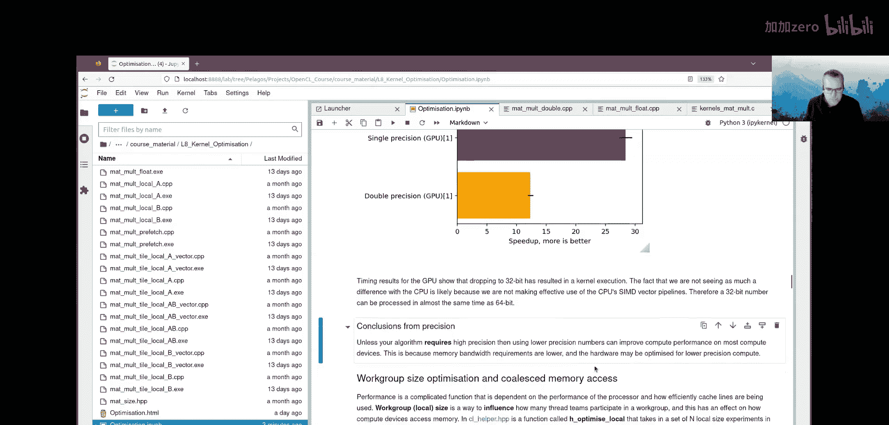
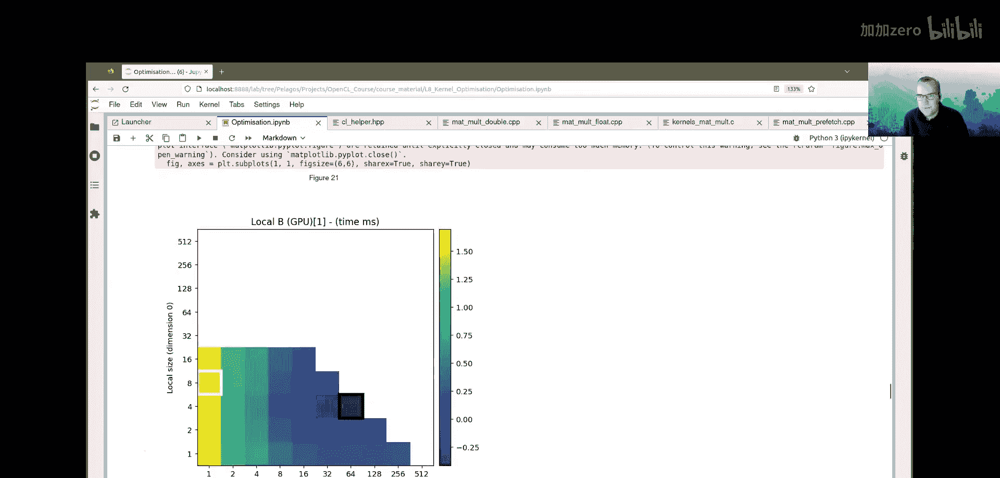
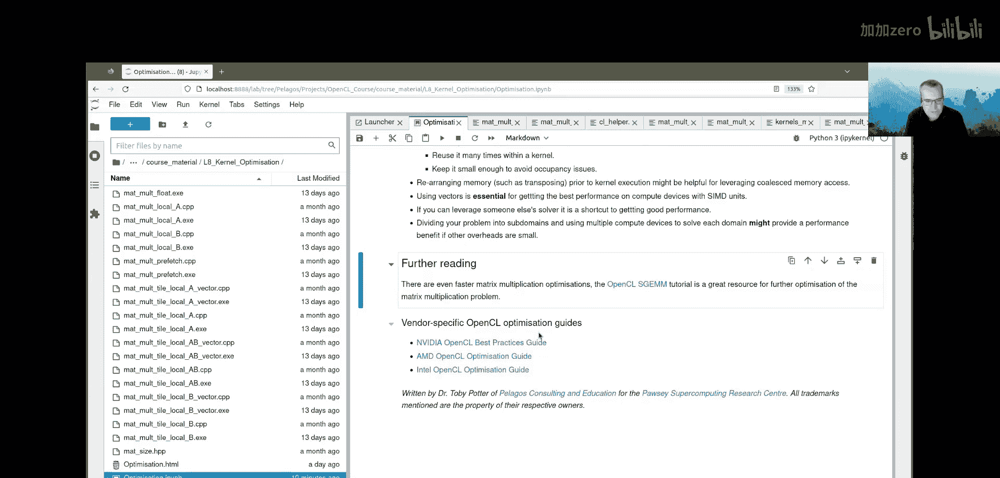

# 【OpenCL编程 Pawsey超算研究院】 p12 p11 OpenCL - day 3, part 3 - Optimising OpenCL kernels 2 -BV1fMz5Y3EDV_p12-

Now that we've just come back from lunch。We're going to explore some strategies to optimize the use of your compute devices in Opense。

So we've just covered the background of using CPUus and GPus and how their hardware is slightly different and how we can make。

Good use of things like cache lines。To get good performance out of our cash hierarchies。Okay。

So let's talk about floating point operations now。So math operations such as multiply or add on floating point numbers are an essential component of scientific applications。

These operations are typically performed on 32 or 64 bit numbers。

And I will just make sure I'm sharing my screen。

There we go。Y，So these operations are typically performed on 32 or 64 bit floating point numbers。

However， 16 bit operations or 16 bit floats are becoming popular in machine learning。

As these do not require extremely precise calculations for a start。But also， that。

They can be done very quickly on hardware， so the performance of 16 bit floating point floats。

Is a lot faster than 32 B floats， for example。Okay。

So performance of a processor is measured in flops。Or the total number of floating point operations。

 its compute units can perform in one second。 Well， the hardware threads。

So at the time of writing units of gigaplops， that's 10 to the nine flops per second，teroflops。

 that's 10 to the 12 petta flops， that's 10 to the 15 and exaflops。

Are commonly used to describe compute or supercomputer performance， but I'm sure in the future。

I'm sure in the future that we'll be able to have performance for compute devices in the realm of petaflops。

 so it's going to be an exciting time。😊，So the raw floating point performance of a compute device is very much dependent on precision。

And whether or not the architecture was built for it。So gaming hardware。

Such as my RTX 3060 is optimized for 32 bit floats。And 64 bit processing is possible。

 but it is emulated in software and it might be even accomplished with fewer cores。So。

My graphics cards processing rate is 64 times lower than 32 bit。

Because there are 64 times fewer 64 bit capable processing elements。

CPUs have CD units that can process vectors of numbers with a single instruction。

And at the time of writing vectors of up to 512 bits。Can be processed by A Vx 5，12。

But I think I'm aware that even larger exercises have been achieved by specific supercomputer architectures。

But AVX 512 is up to AVx 512 is what is available for most commercial。😔。

Sorry for Intel commercial CPUs。At least the higher performance ones。

And I think AMD is going to implement ABx 512。As soon， if not already。😔，Okay。

 so compute performance within a kernel is also determined by the type of math instructions that are performed。

 so addition multiplication andfuse multiply ad are among the cheapest operations to perform。

So that's if you're working with floats。So addition multiplication andfused multiplier are the cheapest。

Then it cost a few processor cycles， whereas division， square root and trigoometric functions。

 such as the sign of something， are typically an order of magnitude more expensive。

So writing your kernels to minimize expensive math operations will help。However。

 waiting for memory is the most time consuming thing。

So during those times in which you're waiting for memory， often kernel math can be done for free。

Let's now talk about arithmetic intensity and working out where to spend the effort。so。

Arithmetic intensity is the ratio of flops computed per byte transferred。

And it's a metric that helps us to gauge if an algorithm is likely to be constrained by bandwidth。😔。

Or by floating point performance。😔，So for our problem， matrix a is of size n not C by N1a。

And B matrix B is of size N1 A by N1 C。So every element of matrix C， when you're going along that。

Dot product。Along the row I0 of matrix A and column I1 of matrix B。

 So when you compute that dot product。Every element of matrix C requires N1 A loads from matrix A。

N1a loads from matrixtri B。And then， one store to see。When it's doing that。

 it requires N1A multis and N1A additions。So the arithmetic intensity of matrix multiplication is then。

Two times N1 a。Divided by2 times N18 plus1， and that's multiplied by B。

 which is the number of bytes per element。So you can see that when N1a is large。

 the arithmetic intensity approximates to1 over B。Or not 025。

So if a processor has a peak floating point performance of FP。Flops per second。

And a particular cache can feed that processor at a peak bandwidth of BP bytes per second。

 then we can calculate a floating point limit that is dependent on memory bandwidth。

So FB is the floating point limit that is dependent on memory bandwidth。So for our algorithm。

 we have a， which is the arithmetic intensity in terms of flops。Per byte。

 So flops computed per byte transferred。BP is the bandwidth of a particular cache in our processor。

 and that has units of bytes per second。So if we multiply the two together。

 then our units cancel out and then the floating point limit that is dependent on memory bandwidth is a times BPp。

 so that's a times BPp flops per second。So that is a limit。

And the actual attainable floating point performance will either be FP。

 which is the peak floating point。🤢，The peak floating point performance or FB。

 which is the bandwidth limited floating point performance， so whatever is lower。

If we set FP equal to FB， then we can solve for that crossover point in arithmetic intensity and that crossover point occurs at FP divided by BPP。

So the roofline limit on performance is then。ABP， if a。

 the arithmetic intensity is less than Fp on BP。Or it is FP otherwise。So let's do an example now。

The AMD MI 250X GPU processor。Has less to say that we're effectively using two GPU dies。

Has a pink 32 bit floating point processing rate of FP is 47。9 terraphops。

And a peak memory bandwidth of FB is equal to 3。2 terabytes per second from memory bandwidth。

And we can just do a straight ratio of the two because we're usingterra flops。And terabytes， so。

That that is okay。 We can do that。 And therefore， the。

Problems that we run on the MI 250X GPU processor will be constrained by memory bandwidth up to an arithmetic intensity of approximately 15。

So。We know from this， pretty much for sure that our matrix multiplication algorithm is going to be limited by memory bandwidth。

And whenever you are doing operations on arrays， it's a pretty sure bet that you're going to be limited by memory bandwidth。

This ratio also works for。A single GPU compute die because the processing rate is halved and the memory bandwidth is halved as well。

Okay。So usually the arithmetic intensity for processor is much larger than1 over B or not 0。25。So。

 boosting the flops。Herbyte ratio4 matrix multiplication by reducing B is a way forward for getting better performance。

So。Some thoughts about this are is that we're not going to get anywhere near the rated pink performance of the compute device。

 and that's usually a pretty safe assumption。Optimizing memory transfers。

Is where we should concentrate our efforts。For the matrix multiplication problem。Because if we can。

Reuse memory。Then we can change this flops to byte ratio。

 We can change the arithmetic intensity by doing more flops。For the for the same memory transferred。

So if we can reuse memory somehow， that's going to be a good strategy for getting good performance with our matrix multiplication algorithm。

Okay， so optimizing memory transfers is where we should concentrate our。Efforts， how can we do this？

 So if we had double precision floats。The floating point。

 sorry the arithmetic intensity because it's 1 over B。

 if we were using eight bytes per float instead of four bytes。

 then the arithmetic intensity would be halved。And that wouldn't be very good。

 So if we reduce B from8 to4。Then we can get better performance。Okay。

 so lowering the precision of data will increase our Fop to bitete ratio。

We can find optimal block sizes that balance occupancy and work group size and the size of memory requests。

😔，We can try to reuse information in the L1， L2 and L3 caches。

We could even try rearranging our memory access patterns to access memory in a more contiguous way。

So that means trying to reuse those elements inside cash lines。

We can most likely get the compute operations done during memory transfers。

We need good occupancy so the GPU can switch to another work group while waiting for memory。

And speedups over a CPUU implementation are more likely to be limited by the difference in memory bandwidth speeds now that's just a conclusion that arises from the simple factor that matrix multiplication is memory bandwidth limited。

So because it's memory bandwidth that's limited， it's not the。

Speed of the processor that actually matters。 It's the speed of the memory。

So that's the important difference to。😔，To look at。Okay。So let's look at precision now。

 so in scientific computing， the precision of range and range of 64 bit numbers can be imported。

For example， in the solution of sensitive differential equations。

So that's when the outcome is extremely sensitive related to your input。😔。

Compute hardware is often optimized for 32 B arithmetic though， and if your algorithm supports it。

 you might gain a speed up by switching to lower precision。So in the example below。

 we're going to run a matrix multiplication at 64 bit and 32 bit precision to see how much of a difference it makes to kernel execution。

Yeah。And what I've done is， I have gone ahead， and。Prior to this。

 I have done a benchmark where I have got a whole lot of different kernels and a whole lot of different matrix multiplication algorithms。

 and I have tested。I've collected the performance of every algorithm， as it does。

 a statistical run of about 10 times。So I've gotten the I've collected the performance。

Of every algorithm。Or every matrix multiplication algorithm。

 I've collected the kernel performance as a function of an input grid of possible choices for the work group size。

So I've done that， so every experiment has been all collected and the results are in。

The results for that are in the benchmarkmarks directory。In the form of those JSON files。

So if you look in the benchmarks directory of L8 kernel optimization。

 there is a directory called benchmarkchmarks and inside you will see the benchmarks that are there。

 one for hubub2， which is workstation。Ja， the other one which is for Conics and the other one is for my laptop。

Okay。So we've got this benchmark that has already been collected。

And I am going to load that benchmark。So those are all the experiments that have been done。

 and we're going to look through each of those benchmark results。Okay。So。

We're going to be trying matrix multiplication with 64 B precision。 So this is just on our laptop。

 we're just going to run a matrix multiplication algorithm on the CPU。

And if we have a look at the residual using double precision。

 we see that the residual is within the realm of floating point error， so that's good。

 so that's working nice and incidentally we're getting the same answer as numpy。Which is。

 which is really good。So let's do the calculation on the GPU and we get the same result。

So at full precision， we are getting the same results as Numpy because NumpI natively does matrix operations in 64 bit。

Now， let's drop to lower precision。Okay， so this is matrix multiplication with 32 B floats。

 So I have an algorithm。I have an algorithm called， or I have a program called Matt Mot double。

And that just does the matrix multiplication， it's got everything set up to use double precision floats。

Now let's use the program mat malt floatat， and that does single precision arithmetic。

In the file kernels matmt。 C， you can see a number of kernels here and the two kernels that we're focusing on at the moment are matmt double。

And mat malt float。Okay， so Matmt double uses the Matmt double kernel。

And it does operations on 64 bit floats。The file mat nott float。😮，Uses the Mat malt float kernel。

 and it operates on 32 B。Numbers。Okay， so let's do the matrix and multiplication with 32 bit。Floats。

 and then we've got an absolute residual on the order of 10，10 to the minus 5。

 upper 10 to the minus4。So， that's okay。Let's do the results for the GPU。

 and we've got the same result， whether or not we use the CPU or the GPU。 So consistent results。

And if we have a look at our maximum error。It is the same whether or not we're using a CPU or a GP。

 And that's really a testament to the consistent。Results between open C devices because it's using the IpoliE 754 standard。

 So that's why we can rely on the results being the same between CPU and GP。 So that's fantastic。

 So that's a really good feature of open C is standardized arithmetic。😊，Okay。

So we've seen that the 32 bit floats are good and they're within machine precision。All right。

 so now let's load up some timing results from our benchmark。 Now。

 the benchmark was collected on satonics。 So these numbers that you see here are from a GPU node on satonics。

Let's have a look。All right。So， we can see。On the CPU， we can see on the CPU。

That going down to single precision， so single precision is the result in purple。

That is compared to double precision。 So double precision I am setting as the benchmark。

 and that has a value of one。For the CPU result on double precision on satonics。

So we can see that on the CPU dropping to 32 bit floats has resulted in an increase or a speed up of about 1。

3 so something somewhere in the realm of 1。2 to 1。3 times the speed up on the CPU implementation。

 now the CPU implementation is using portable openCL。

 but the Intel CPU implementation would be more performant。

Because it uses some really high quality threading libraries。

Like thread building blocks in order to do its parallel operations。

And it also would have a high quality compiler as well。Anyway。

 so this is the portable openC implementation and this is what we're getting for the speed up on the CPU。

😊，Now on the GPU we're getting speed up so that's route 12 and over here we're getting about 28。

 so we're just getting just over twice the speed the speed up when we are using the GPU。

So this is an MI 250 GPU and it's speed up just for single precision， the naive single precision。

Matrix multiplication is around a factor of 28 times faster than the double precision CPU result。

So these speed ups here， all the speed ups are relative to the double precision result on the CPU。

Okay， so that's our speed up。So dropping to 32 bit has resulted in an increase in kernel performance。

And the fact that we're not seeing。As much of a difference with the CPU。

Is likely because we're not making effective use of the CPU's Cd vector pipelines。So therefore。

 32 bit number can be processed in almost the same time as a 64 bit number。

 you're just got to benefit from the reduced size when loading from cash。

So that's why we're not really getting much of a performance and the reason why we're not getting much of a performance increase on the CPU is because we're not using vector data types。

😊，So vector data types would allow the use of SD。Of Cindy operations。Okay。

 so conclusions that we can get from just a simple change of precision。Is that。

Using lower precision numbers can improve compute performance on most compute devices。

That's because your memory bandwidth limits。😊，Memory bandwidth requirements are lower。

 you have to transfer half as much information when you're going from 64 bit to 32 bit。😊。

And additional thing is the hardware may be optimized for lower precision compute。

Okay， any questions or comments surrounding that。Okay， excellent。That's good。 Good， good， good。

Now we can talk about work group size， optimization and coalesced memory access。

So just take that out。Performance is a complicated， multidimensional function。

That is dependent on both the performance of the compute device。

And how efficiently cash lines are being used and reused。The work group。Or the local size。Is a way。

To influence how many thread teams participate in a work group。

And this has an effect on how compute devices access the memory。So in the C helper file。

Is a function called H optimize local。 So if I have a look and C L helper。

 there's a function called H optimize。Loal。And this just takes in a kernel。And it takes in a file。

 consisting of a。A number of n two pools of the local size that we need to use。 So using Python。

 I have written out a file that has a set of N twoples。Of。The local size in each dimension。

And so what this H optimized local size is it goes through。Every experiment。Every。

 every experiment in this input file。And it runs the kernel， if it can。

 it runs the kernel if it can for that local size specification。

So it runs that n times for n experiments。And for every experiment， it runs that experiment。10 times。

 So it runs that experiment 10，10 or so times。 So N stats。 So it runs that kernel。

 runs that kernel 10 times。Okay。And then what we do is we， we collect the statistics for every run。

So we collect the statistics for every run。And we we put that into an array。

 Then we do some statistical averaging， get the mean and standard deviation。

And that gets recorded to an output file。So the purpose of this function。

H optimized local is to take a kernel， Take a list of experiments of the local size。

 and it's designed to find which local size performs best。That's the idea of H optimize local。Okay。

 so that's what and every， every function or every。

Program that we are testing is instrumented to use H optimize local to find out the best performing local size。

So， we've collected the。The size information。 So we've collected the size information。TheSorry。

 the runtime， the average runtime information for every experiment， for every algorithm。

And what we can do is we can print the landscape， we can print the landscape of runtime as a function of local size。

So what we're going to do is we're going to load the single precision。

We're going to load the single precision result and we're going to have a look at its landscape。

Of runtime as a function of local size。Alright， so here we go。So， if we just scroll down。Okay。

 now this is for the naive matrix multiplication algorithm with single precision。Okay。

 so we can see here that the worst performing。The worst performing local size is one by one。😔。

So that means we're just having one work item， one work item per work group。

 and that's terrible for performance so a size of one by one is never going to be good。😊。

But if we have a look at the landscape of local sizes， so this is local sizes along dimension zero。

 this is local sizes along dimension one。And this square box here。

 this represents the best performing or the smallest kernel runtime。🤢。

And we can see that the best performing algorithm is at a size of 32 by8。So that's 32 by 8。

 That's our best performing local size。 Now，32 by 8 is 256。Yeah， that's 256。

 which is a multiple of the。Wayfront size。 So that's。Four wavefronts would be in a work group。

So that's the best performing。😊，The best performing work group size and the difference。

 the difference between the best performing work group size and the worst performing work group size is 41。

6 times。So getting the work group size right is critical for getting good performance with your algorithm。

So with every algorithm that you generate， with every algorithm that or every kernel that you launch。

Unless the kernel specifically sets the work group size and there are some kernels that can only work with one work group size。

 unless you specify the local， sorry， unless you have the local size fixed。

 there will be a landscape of。Best performing local sizes。That work for your algorithm。

So and this landscape will change depending on the compute device。So， let's load。

Let's see if we can load the CPU device landscape。😔。

So I will just change that to CPU zero and here is the landscape for the CPU algorithm。😔。

So it's completely different， it's kind of scattered。

 there is no there is no sort of global minimum as to which is you know the there's no sort of dip in the bowl put it that way there's quite a few dips here。

 but they all seem kind of randomized。😔，嗯。😊，And the best performing local size on the CPU happens to be 32 by4。

So， but you also have a good performing local size。Here， when it's 4 by 32。So， a。

4 by 32 and 32 by 4 are multiples of the。Core count。For the CPU。

So that stands to reason why we have optimal sizes。At multiples of 64。

 so 64 happens to be the core cap of the CPU。😊，Alright， now this， this randomness here。

 this randomness in the landscape。 that is also indicative that CPUs CPU cores are not。

They're not bound to each other。 So there's。The execution of a kernel within a work item that is independent of other work items。

 And you can see this independence in the。嗯。In the randomness in this landscape。

But if we go back to the GPU。So we go GPU ID。😔，We go back to the GPU。

 there is a well defined minimum。the well defined minimum。

 and that is because of the lockstep nature of the thread teams。Okay， so from the graph。

 let's go back to the GPU result。 It appears that the best performing local size is one where there is an elongated number of work items along dimension zero。

Of the grid。Which translates to dimension one of the matrices。

 So here's our matrix multiplication algorithm。And we have seen that performance is best when there is an elongated number of work items along dimension zero。

 which translates to a along dimension one of。Of the matrices。Okay。So reasonably efficient now。

 if we look at this in terms of cash lines， how can we understand what is going on here？

So if we overlay， so this is our memory allocation of matrices A and B。

Now let's just for cartoon's sake， we overlay a cartoon representation of our cash lines。

 so those are those orange bars there， those logs。That is what the cache lines look like for overlaid on top of the memory allocation。

 so they would be logs of size 16 floats。So those logs there are cache lines and the GPU is reading in those logs into the cache。

😊，So if we have， if we have。Y， if we have an elongated number。

 so if our best performing algorithm is an elongated number of work items along dimension one。

We can see that， okay， it looks like if our work items are neighbors along dimension one。

 then it looks like， yes， we are reusing a cache line because this work item will use this bit of the cache line。

As it traverses along matrix A。 So every， every。Every work item in this work group， if it is a long。

 if it is a long row。I zero。 so every work item along there will be able to read in the memory。😊。

That is along this cache line because it needs to， it needs to iterate over row I 0 and then column I1。

So every work item along here can reuse the cache line going in here。

And it may seem counterintuitive， but， but。Memory is being used efficiently also。

For the trip down the columns of matrix B。Because when when we go down the columns of matrix B。

 even though there is a significant stride from one element to the next。

 what happens is that neighboring elements so neighboring elements in dimension one。

 so that's a neighboring element would be along this dimension。Andlong dimension。

 one of the work group。We will' access neighboring columns。And what this means is that。This。

The work group that is associated that is responsible for going down column by1。

So that would be these work groups here， so these two work groups will be going down this column。

If it's neighbor。In this work group。Its neighbor will be going down this column。

And that means that these， all these work groups here can reuse this cache line that is loaded。Yeah。

So what this means is that。It doesn't seem intuitive。

 but even more efficient cash usage is taking place for the memory down the columns of B。

And that is because the neighbors。Along this dimension are reading are reading down this column。

 but its neighbor will read down this column。So therefore， we can reuse the cache line effectively。

Or do coalesced memory access。When we are reading from matrixtri B。Okay， so。😊，Yeah。

 fairly efficient cash line usage is happening for along the row of matrix A。

 And what I mean by that is that these logs as it goes。As it goes along。As it goes along。Yep。

For for a row I 0 of matrix C， this work group， this work group。

 this work group and this work group will require access to。This。Row of matrix A。

 and they will require access to these columns of matrix B。

And so efficient cache line usage happens for matrix B because neighboring work items access neighboring elements as they all go down the column together。

So that's why matrix B is efficient， even though it seems counterintuitive because you are jumping a large number of elements from one element to the next along dimension zero of matrix B。

Okay。So that explains because there is an elongated， sorry， because。Cash line usage is efficient。

Down the columns of matrix B。 that explains why the local size prefers an elongated number of elements along this dimension。

So that is what is going on with that landscape with the GPU result。Okay。

 another trick you could try is prefeing。So within open seal kernels。

 there is a command called prefetch， which can prefetch global memory that is going to be used by。

A work item。So in the kernel mat malt prefetch， so we just scroll down。😔，And there should be。😔。

Met malt prefich。 And I think it's actually part of the。It's actually part of the code now。

 So go to that malt prefit。And we are looking at kernelelsmmt。c， okay？So I'll just search for it。Met。

 not。Prefetch， there we go， There is our kernel matte malt prefetch。Okay， so the file。

 the program mat malt prefitch uses this kernel Mat malt prefit。

And what we're doing is in the dot product， where we are walking over。Or walking along a row。

 I0 of a。We do this prefetch instruction before we walk。😔，Along the row。

 So we do this prefe instruction and that prefes N1 a。N1 A elements。N1 a elements。

 I think that should be N1a times size of our float， I'll just look that up。Anyway。

 we can go ahead and look up what that prefetch instruction means。

 I think I may have made an error here I should be doing N1a times size of float。And。We'll check。

 I think yeah， yeah， if it， if it is， we're not fetching bys， we're just fetching elements。

 then that's correct。 So the prefe instruction is correct。 but if we're fetching bys。

 then I've made a mistake。But anyway， we've got this prefetch instruction here。

 we've got this prefetch instruction， which prefetches memory。😊，For that line。

 so prefetes memory for that row I0 and it prefetches that from matrix a because we have made a pointer here called a I0。

 which gets the address of a at row I0。 Okay， so we' we're prefeing。

Prefetching that memory from a before we iterate over it。Okay。

 so let's see how that let's see how that instruction edition has benefited performance。

So we've got our kernel code here。 so let's see that how that works with the landscape。

 So this is for the CPU。And this is for the GPU。And when we plot the results of that prefetching。

 we can see that on the CPU， it has made a bit of a difference， but on the GPU。

 it hasn't made so much of a difference， and that can be explained because memory accesses are better from matrix B than from matrix。

ASo that's how I venture an explanation why the prefeting has not made a helpful difference with not made a helpful difference on the GPU。

Okay。Okay， so that's prefeing。And we just need to check the number of bytes or the number of things that we need to fetch when we're prefeting。

Okay， constant memory。 Now， constant memory。 we saw the use of constant memory in the memory management module。

 Now， constant memory is stored in the fast cache of a compute device。

 So we know that that memory storage is fast。😊，And it's also small。

So it's on the order of a few tens to a few hundred kilobytes in size constant memory is a good place to store things like filter coefficients things that are not going to change during an algorithm。

So you can store those coefficients in constant memory。Okay， moving on to the next performance。

 the next performance。Idea。That is rearranging memory for better access。

So sometimes there can be a performance benefit if we rearrange memory prior to Colonel Lo。

 So let's say that we have another kernel。That rearranges the memory。So that when we run the kernel。

 it can leverage more optimal memory access patterns。

So we saw in the local size optimization section that coalesced memory is happening with accesses to matrix B。

We'd like to test that now。We'd like to know which is more optimal。Should we。

 should we transpose a so that we go down the columns of a instead of across a road。

 So should we flip this matrix A on its side should we flip matrix B on its side so that instead of going down the columns of B。

 we are going across。We are going across the。Across the rows of B。 So if we。

If we transpose matrix B now transposing is just swapping the rows and columns。

 that's what transposing is。 So when we transpose a matrix， a row becomes a column。

So instead of going down the columns of B now， we go across the rows of matrix B transposed。

We can still have our work groups。And our work groups will grab two rows from matrix A and four rows from matrix B transposed。

So let's try。 let's try seeing what the landscape looks like for。Then instance。

 where we transpose matrix B。Now we already saw before。

 we already saw before that transposing matrix， so we already saw before that coalescce memory is happening with matrix B and we suspect that it's more optimal than。

😊，Then access for matrix tricks。A along those rows。Okay， so let's try flipping matrix B。Beforehand。

 and the code。There's a number of codes that I have that do the transpose。

So there is matte malt A or mat malt A， that means we are transposing A before we use it。

Matmot Bt transposes B before we use it。🤢，And it wouldn't make sense to transpose A and B because then we just have the same memory access as as before。

 so instead we'll have non optimal access to B and then optimal access to A so it doesn't make any sense to transpose both of those matrices。

So in MatMt AT and MatTMt BT， those are those programs which pre transpose using another kernel。

 they pre transpose these matrices。So let's see if transposing makes a difference。

 So we've got the landscape for a CPU。And we see that an optimal result is when the local size is 16 elements down matrix0。

And four elements across matrix， sorry， across dimension one。😔。

So 16 elements down dimension zero because we're dimension one in the grid， so this is the grid。So。

 this is the landscape of local sizes in the grids。

 so dimension one means dimension zero of the matrix。

So we're 16 elements down dimension zero and four elements。Across dimension one。

 So if we transpose B， then it prefers to have a large number of。It has， it prefers the matrix has。

 so the。Open C L prefers to have a large number of elements。For the CPU， a long dimension zero。O。

 along dimension 0 of the matrix。Now， if we go to the GPU result， again。

 we have a well defined minimum。A well defined minimum around 256 work items per work group。

And because we have transposed B now， we do not have that coalesced memory access because we were going down the columns。

So since we don't do that anymore， then it prefers like the CPU。Like the CPU result。

It prefers to have a work group size that is elongated a long dimension。

Denssion zero in the coordinate frame of matrix C。So it prefers to have a large number of work items。

A long， a long row。Along， yeah， along dimension0。That means that means a large number of work items along dimension zero means fewer work items or fewer rows to fetch from matrix。

Mattrix B transposed。Okay， let's have a look at the timing results now。

And we can see that transposing B beforehand on the CPU has made a huge difference。

 So you can see the performance numbers。 we're getting speed ups of if I can just get the。

We we're getting speed ups of around two。Oh。can't quite see it。😔，Yeah。

 we're getting speed ups of around 2。3 over the double precision result。😔。

We're getting huge speed up。 So that's the difference that transposing B beforehand has made on the CPU。

 so the CPU didn't。The CPU didn't dig， didn't dig。Didn't didn't dig the access down the columns of B at all。

 so the CPU much prefers to access things in a contiguous way along these along these rows and that really does speak to the independent nature of the threads in a CPU。

So the work items in a CPU are independent。And it it really shows there because it's more chaotic in terms of memory access。

 but because GPU items。Yeah， because GPUs are working in lockstep and those thread teams。

 that's why you have a lot less chaos in the speed up landscape or the memory time landscape。Okay。

 yep， so that is the。That is the smallest， the smallest time。 Now， the GPU。

 if we have a look at the timings。The transposing B has resulted in an absolute failure in getting better performance on the GPU。

 So if we go down to the GPU result， we can see that there's a failure there。

 It is much slower than our naive algorithm。And that's because transposing B and that's so what we suspected about memory coalescing。

 what we suspected is correct。😊，The memory access from B。

Is much more optimal because it can make use of these coalesced memory transfers。

So what I mean by coalescce is that neighboring work items are reusing the cash line。So that yeah。

 that's really good。I so on。So transposing B has had a disastrous effect on the GPU。

 but it's had a positive effect on the CPU。Alright， so let's try transposing a instead。

So in this case， by transposing a。We're going we're turning matrix A around so that we go down the columns of a and we go down the columns of B when we're doing our matrix multiplication algorithm。

 so let's try， let's do that。Okay， again， we've got a scattered landscape for transposing a on the CPU and because we're going down each column we're going down the column of a。

 we're going down the column of B。Then the preferred local size is to have the preferred local size is to have two。

Two work items。Wide along dimension，0。And 32 work items wide along dimension one。😔。

So that preferred that is the preferred work group size for the CPU。😔，On the GPU。

 we can see that pretty much any， because we're doing fairly optimum access down the columns of A and down the columns of B。

 it doesn't really matter。The GPU results。Ha't really got a preference now as to how as to how big the work group size should be。

Only the only preference here is that the work group size be large。

 so the work group size is as large as possible。in this case。

 I believe it's 256 work items per work group。So that that is as big as we're able to get。

 I think might also be as big as we're specified， but anyway， 256 work items is the limit here。😊，嗯。😊。

So that is how big yep。So that is， that is the preferred。Yeah， any。

 any work group size provided it's big will be okay with transposing a。But is transposing a。

Is transposing a going to provide a better result than just our naive algorithm。

So let's have a look at that。And the answer is no。Okay， so you can have too much of a good thing。

 You can try and have too much coalesced memory access going on。

And that has actually resulted in in less performance than the single precision result。

So if we go over to the CPU， transposing A has predictably had a disastrous result compared to transposing B。

So we've got a bit of a bifurcation in preference now between the CPU and the GPU。😊。

So the GPU prefers just the single precision。 So the GPU prefers just the naive memory。

The naive algorithm and the CPU is so far preferring transpose B。All right。

Are there any questions or comments？Surrounding that。Okay， no worries。 Let's keep going。

Now we're going to talk about local memory。So on GPUs。

 local memory uses a local cache with much lower latency than fetches from global memory。

And the bandwidth from local memory seems to be particularly good with AMD architectures。

So from the memory management lesson， we implemented a matrix multiplication algorithm that naively copies all the needed columns of B for a work group into local memory。

 so here's our little local memory store。So in the memory management module。

 we covered about how we can use local memory to store memory that is available to every work item in the work group。

😔，And so with this algorithm here， we use this little allocation of local memory to cache the columns of B that are going to be used by the matrix multiplication algorithm so we store these columns in a little cache and then when we compute the dot product we source we use shared B instead of getting directly from matrix B So what kind of what kind of speed up can we expect by storing。

😊，By storing a local copy in sorry by some by storing the columns of matrix B in this little local or shared memory space。

Okay， so we try two different scenarios where we use shared memory to store either entire columns of B or entire rows of a。

 so we can do the same with matrix A in a different algorithm we can try to store the rows of in local memory before we use them。

 so if you have a look at the code here， the function or the applications called local A and local B。

Local A cachees the rows of a in a local memory store before using it， but it doesn't cache B。

When when you do local B or for the file called Local B。

 that cachees the columns of matrix B in this local memory store before using them in the dot product。

So we try two different scenarios here where we're using local memory。

So here's the kernel for the scenario where we cache the columns of B into local memory。

So we've got our shared memory allocation called Sha B， so this is our MA malt Local B algorithm。

 so you should be able to see mat malt。Local B。There it is。 Okay， so there's the。

In the file kernels matmt dot C is a kernel called Matmt Local B。 And what that does is that。

That fills shared B， so it fills shared B here。So during the kernel operation， it fills shared B。

And then it ens a barrier to make sure that all the work items are at that point。

 so they've all made it to the point of putting their values into Sha B and then when we do the dot product。

 we grab from Sha B instead of from B itself。So then we put the solution back into matrix C。Okay。

 so we've got two scenarios here。And let's see how they play out Now it's interesting that for some reason。

 the CPU implementation did not accept this much shared memory。

So there is a limitation for open seal implementations。

 each open seal implementation imposes a limit of how much shared memory can be allocated。

So in this case， the portable openCL implementation refused to run this algorithm because presumably because it ran over the limit of how much shared memory could be run。

Let's just have a look at the GPU landscape。 Now you can see the landscape of results for the GPU is very curtailed。

And that is because。When you try and have when you try and have a large amount of shared memory that is allocated。

 it will run over the limits， so that's why these results are not visible is because it wasn't able to run the code with that local that work group size。

Okay， so this is for local A so this is when we trans sorry not transpose this is when we try and store we try and store rows of a into shared memory so this one here is local A on the GPU so we're trying to cache rows of a into the shared memory space。

So the preferred size， the preferred size is two rows and yeah is two rows and 128 columns。 So again。

 that is a work group size of 256。 So that number 2，56 has come into play again and。Yeah， and。

It prefers， it prefers to have as little rows as possible， as as little。

 as few rows as possible cached。In order to get the best performance。

So that's what we've seen and if we try with local B so that is nowing that is now storing columns of B in shared memory。

 the preferred size is to have 64 elements along dimension zero and four elements along dimension one。

 so it prefers to cache as few columns as possible well not as possible。

 but it prefers to cache few columns。And if we plot the results for local A and local B on the GPU。

 we can see that we can get a quite a significant performance increase。😊。

By using local memory on the GPU。So the AMD GPU has， you know。

 the AMD GPU has a local memory data store that is quite fast。

 so using local memory on an AMD GPU is a good idea。

Now you might get a different result for a different architecture。Like on the NviDdia GPU。

 for example， you might get a different result。 So that that will be worth experimenting。Okay。

 so we have seen that caching， caching a row of a。Has resulted in the best performance。

 and that is because access from B is more performant。So。Because access from B is performant。

If we are then caching a row of A instead in local memory。

 then it has a performance advantage over caching B into local memory。Okay。

So that is why we can see that performance discrepancy there。

And with these little performance improvements， we've now got an optimal speed up of about 51 times over a double precision implementation on the CPU。

Now， this is good， this is good， but。This algorithm has a fatal flaw to it and that fatal flaw renders this algorithm completely useless for general purpose matrix multiplication。

🤢，Examples and what do you think that fatal flaw is， Can I get any， any hints from from you guys。

 What's the what's the fatal flaw in this implementation。

Does anyone want to hazard a guess？Okay， so the fatal flaw in this implementation。

 and we'll just go back。

Is that。It's not going to work for large matrices。Because。You're going to try and cram a whole row。

Or many whole rows and many whole columns of matrices A or B into this shared memory space。so。Yeah。

 trying to cram this into this shared memory space is。Yeah， is a bad idea。

 so trying to cram all that into that shared memory space is a bad idea。

 and therefore this algorithm cannot be used for large matrix sizes。啱嘛。😊，Okay。

 so we can't we can't use this algorithm so even though it provides a good a good speed out we can only use this algorithm with small matrix sizes Al right。

 so let's continue our search for a good a good implementation。😊，Okay。

 so the next thing that we can do is actually tiled memory access。So we've got to reduce。😊。

Local memory is good。Like。Casching one of the columns or， you know one of the rows is good。

 but we need to reduce that local memory usage。And so what we can do is instead of doing the Hol Kong。

 let's just do those dot products a little bit at a time。So。

If we do the dot products a little bit at a time， then when we're doing the dot product。

 we can walk a little bit along。Along this and walk a little bit along down this column so we can walk a little bit along row I0 and down a little bit along column I1。

And when we do that。When we do that， we can cash just that chunk。

We can cache just that chunk of column I1 and just that chunk of row I0。

 so we can cache that little bit into our local memory our local memory stores。Then。

 then what we can do is we can reuse that local memory allocation for the next chunk。So， we go。

We go down this down these columns across these rows and we do a chunk at a time。

 so that's sort of like a tiled memory access We can either cache memory from B cache memory from a or both or both A and B as we do this tiled memory access。

And so。As we go， as we go down the tiles， we can accumulate the result into into。Our， you know。

 our temporary variable and put it into C as before。

So this is a tiled sort of memory approach where we grab。

 we don't grab the whole row or the whole column。 we just grab a little chunk of it。

And then we store that， and then we work on that little chunk， and then we grab another chunk。

 store that and so forth。 So that's the， that's the。That's the。

That's the approach that we're using with is tiled memory access。Okay。

 so here's the source code for the tiled kernel in Mattmt tile local Habe。

 so we've got some kernels here。Called Matt malt tile， Local A。Mat Mottail。

 Local B and Matt Motttail， Local A B。So that's storing with local， with Mattmalt tile。Local A。

 we're storing a little chunk of row A into into shared memory with local B。

 we're storing a little chunk of column I1 from B into shared memory and with A B。

 we're storing chunks of both into local memory。So this is the kernel that uses local memory to store chunks for A and B。

So we've got our local memory allocations for Sha A and shared B。And。Here we go。 So。

 so we get our positions within shared memory。We we those we fill those shared memory spaces for each chunk。

And then when we do the dot product， we have to。😔，We grab from those shared memory。

 those shared memory chunks instead of from A and B。Now。

 you'll notice here that we've got two barriers here， so we need one barrier。

We need one barrier to ensure that shared memory is filled for each chunk。

 but we also need another barrier to make sure that everyone's finished with that chunk before we move on to the next chunk or the next tile。

So that is a tiled approach。So let's see how we go with this chunk or this tiled approach if we're caching chunks into。

Into a， So for a for B or for A And B。 So let's do that。

 So let's load the benchmark results and let's look to see how the tiled approach has gone。Okay。

 so on the sink you。Ting bits of B into local memory has resulted in the best performance。

 and that's because on matrixtri on the CPU reading from matrixtri B is not as performant as reading from matrixtri A。

Now on。On the GPU。Reading little bits of reading tiles of matrix A is the best performer because access for matrix A is not as optimal as access for matrix B。

However， it doesn't work as well as our local memory implementations where we read the entire。

Entire chunk in。And that is because， well， I would hazard a guess to say that the reason why this is not as performant as this is because of these barriers here。

 so these barriers here， they force everyone to wait。

While we synchronize and those barriers introduce a performance issue。

 So we're getting slightly better performance than naive。Then， naive。

Single precision matrix and multiplication。But we're not getting as good as performance with these local memory。

Implementations where we read the entire row or the entire column into local memory， however。

 these two algorithms are not valid。So these two algorithms are not applicable to large matrix sizes。

 but this algorithm for local a tile Local A is applicable because it only reads in little chunks and you can you can specify when you're doing this chunk approach or this tiled approach you can specify how big a chunk is and what I've done is I've endeavored to make the chunks or the chunk sizes or the tile sizes a multiple of the cache line size。

So it reads in these chunk lines or these cache lines of memory into local memory。So anyway。

 the search continues。😊，So we have now a best performer for for reading sorry for doing matrix multiplication on the CPU and we have a best performer on the GPU so this is our best performer here our best valid performer and that is where we're caching little bits of A。

 but this is where we're caching little bits of B。😊，Okay。

 so the CPU has got an entirely different preference for what is an optimal algorithm than the GPU。😊。

So when you're writing code， when you're writing code。😊，When you're writing code。

 you may have to take into account that your algorithm that you'll have to do things differently for the CPU than the GPU。

Alright。Now， we can cover vectors。We can see that we can increase performance。🤢，Further， well。

 let's see， let's see if we can increase performance further by accessing the memory。😊。

As vectors of type float 8。So they are vectors of single precision， but they are eight elements long。

So for GPU vendors such as Intel and AMD whose compute units can utilize vector instructions。

 this can provide a boost in performance。Other implementations such as NVIDIAs can still benefit from cash performance increases because vector loads can be grouped together and therefore optimized。

😊，So here we show the kernelnal code from Matt Mot tile Local A vector。

You can see that the names of the functions， the names of the programs are becoming longer。Okay。

 so the。The algorithms that implement vectors are MA multitile local A vector。

 mat multiile local B vector and MA multiile local A B vector。Okay， so all that does is。

All that does is when you are， so all these algorithms do。

Is we are loading from matrices A and B as before， but we're loading from those matrices into shared memory that is accessed as vectors of float8 of size float8。

And when we are loading memory like that， we can use， for example。

 commands like V load8 and that will load eight elements from matrix a along that along that row and that will so that is for we're still using the tiled approach。

So we're loading those chunks in units of8 into shared memory， which is。As vectors of type float 8。

When we load from matrix B， we have to be。We have to be careful。We have to be careful， because。😔。

Yeah， because you're going down， you're going down the columns of B。

 you've got this stride of units N1 C elements every time you go down。Down column I1 of matrix B。

So we have to be careful just to get our accessors right to fill those shared memory。

 to fill those shared memory。Spaces in the right way。So you can have a look at those。

 you can have a look at those kernels。 So we've got mat malt tile， a local a。

And with Matt Mot tile A mat Mot tile Local B vector， mat Mo tile local AB vector。

 I've actually put the kernel source into the same file as the program。

So I don't have those kernels in this kernel's matte malt。

So just put those kernels into the one file so that it's one portable source file that you can take with you。

Okay， so let's see how well vectors， the addition of using vectors for our math operations。

 Now we're expecting， we're expecting a performance increase on the CPU because it will then light up or start to use those S units on the CPU。

 So we're expecting great things from this algorithm。 We're doing a tiled approach。

 We're doing vectors。 So we're， we're storing into vectors。😊，For the shared memory allocations。

 we're storing into vectors of type float8 in shared memory。

And on the AMD architecture and on any architecture where we can use SD。

 then we are expecting to get a performance boost so let's have a look and oh my goodness look at the CPU results。

So tile local B vector。This is the effect。This is the effect purely of switching on the CMD units in the CPU。

So the Sinnder units only get switched on if the code conservatively thinks that it's okay to do so。

And look at that speed up so we've got a speed up of a factor of 12 to 13 times over our double precision results on the CPU and that's because we've used vector types and those vector types speak the native CD language of the CPU。

So using vectors， particularly for storing B in shared memory using vectors has resulted in a remarkable。

 remarkable speed increase， so it's just fantastic。🤢。

Now on the GPU we have had the best results by st a by storing A and still using those vector data types。

 and you can see now we're at speedups of about 71 times。

 so 71 times over these double precision CPU result。So the use of vectors has had a significant。

Performance impact。Both on the CPU and on the GP。So okay。

 we have a couple of algorithms that we really like now we've got a tile local B vector on the CPU and tile local A vector on the GPU。

So the use of local memory to cache tiles and then vectors and then using vectors has had a significant impact on the performance of these algorithms。

Okay， so it's interesting to note， as we've seen before that our caching preferences have put completely diverged。

So the CPU prefers if B was cached， but the GPU prefers if A was cached。

And so what that means is that the GPU prefers its optimal memory access is down a column and that's because its neighbors also go down the column and then you can share that memory load or store。

And so with the CPU result， because those work items are independent。

 you're getting better access if you walk along a cash line。

Not if your neighbors also access the cash line。That term performance benefit is not noticeable on the CPU。

Okay。Now we've talked。 So that's as far as we could get。 That is as far as we could get so far with。

Playing around with vectors， playing around with local memory， activating those SD units in the CPU。

 so that's as far as we could get。Okay。What about using a pre existing implementation？

So if your problem can be transformed to a linear algebra operation。

 then there are a few solvevers that work with open CL。🤢，So C blast。

 and that is installed on Conics just in this software that we have available for today's course。😊。

CL blast is a tuable linear algebra library from Cedric Nuuterin I think that's I don't know how that's pronounced。

 but Cedric Nuuterin it has a routine called SGM for the generalized matrix operation on single precision data so SGM and that would be DJM for double precision generalized matrix multiplication so that's what the SGM stands for single precision generalized matrix multiplication。

And that computes the answer to this result here。And you can set alpha equals to。

 so that's this little constants here， you can set a is equal to one and B is equal to zero。

 and then you have the equivalent matrix multiplication that we are using here。So let's have a blast。

 let's go in order to use CL blast， we include the header for CL blast。😊，In the program。

And then you can call the C blast routine called C blast SG。

And we've got a number of options here for the size of the matrix and our buffers。

And then if we have a look at the performance that comes out of C blast。

 we can see on the CPU that it's not doing so well not doing so well as our tile local B vector implementation Now the reason for this is that I have not tuned C blast for the CPU。

So it's just using its defaults， but if I tuned it。

 then I could stand to get better performance out of the CPU implementation。On the GPU， however。

 I have tuned it， so this implementation or this result here is from just a C blast generalized matrix multiplication algorithm and you can see we're doing。

Within the same envelope of performance as T Local A vector。So those error bars。

 those are error bars on the result， and we're within the same envelope of error bars。

So Can solveverrs， a Can solver has gotten you all this performance without you having to go through a lengthy performance optimization process。

 so using a Can solver is a shortcut， a shortcut to get in good performance。🤢。

But what you might need to do is tune the library for that specific compute device。Okay。

So if you can use a can solver， I would go for that。

Because you don't have to worry about debugging it and a canned solver has been worked over by experts。

 and you usually get the best or close to the best out of your compute hardware with it。

So can solvers are definitely the way to go。 Now， one thing that we haven't discussed as yet is the ability to use multiple compute devices。

So if your problem is parallelzable， then you can divide work amongst the available compute devices。

So in matrix multiplication， the work is parazable in the domain of C。

 we might be to divide our matrix up， we might be able to divide our up and run some bits of the matrix on one device and some bits of bits of this matrix operation on another compute device。

😊，So that's the approach that we've taken with this code。Called mat malt C， L blast M。

 So with Mat malt C L blast M， we divide our matrix into， into four regions along each domain。

 So there's 16 domains in total。 And then we use an open MP。 We use an open MP dynamic schedule to。

 to run this code to run this code over every domain。

In our problem now this this is getting into the realm of a truly huge matrix。

 So if we had a truly huge matrix we could use this approach otherwise。

 if we don't have a truly huge matrix， then our overheads of doing the open MP will will not make this approach worthwhile。

 which is better off using one device instead。So for multiple compute devices。

 if you have multiple compute devices as well， you can set a compute device to task to work on a domain of matrix or a little area of matrix C。

So this is the result we get from C blast MD and we can see that it's not quite as good or it's actually quite noisy too the results are quite noisy。

 so the results from C B MD even though it's using eight GPUus。

 it's not getting any better performance then the CL blast results on a single on a single compute device。

😊，So if my guess is though， if this matrix was truly huge。

 we would start to get a performance increase because the performance benefits of using multiple devices would start to outweigh the overheads。

😊，For example， that you incur with using Open MP scheduling。Okay。

 so that's my anticipation if we increased our matrix size even larger that this seal blast MD would start to shine so the best performing results that we got so far are a speed up of around about 73 times over the double precision CPU results and yeah that's that's pretty good we can go ahead now and and start enabling our science with that。

All right。嗯。So let's plot， so in summary， let's plot the timing results again this time in order by ascending speed up。

😔，So here are our results， so transposing A was the worst thing that we could do for the CPU。

 but using the tile local B vector was the best approach for the CPU and tile local A vector was the best approach for well。

 was the best homegrown approach for the GPU。On another computer， though。

 that these performance figures may be different。 So let's load the results from my laptop and use。

Use satonics as double precision result as our benchmark。

So we've got our results and so these numbers here are all relative are all relative to satonics double precision using portable openCL the portable openCL implementation。

And so on my laptop， which is not 64 cores it's just eight cores。

 but I'm using the Intel openCL implementation， so just on my laptop I am getting performance increases of about 2。

72。8 over satonics。😊，Even with even with double precision here。

 so my laptop is you know a newer architecture and it can run at a much higher clock frequency。

 so you don't necessarily need satanonics grade CPU in order to get good results with open seal。😊。

So anyway， this is what C B did on my NviDdia GPU so on the NviDdia GPU I'm getting speed ups of around 33 to 34 times now that is not as good as as the sort of 70 to 80 times speed up。

So these numbers are relative to the same benchmark too。

 so I'm getting about I'm getting about half or just under half as performant as satonics just with a gaming variety。

 RTX 3060。So yeah， so gaming variety GPUs can provide good good performance and I was using the C blast implementation here on the NviDdia GPU and that has by far and away gotten the best performance over the tile local a vector approach。

If I load the results for my workstation， so this is using an AMD， an AMD GPU。

We can see that single precision on the CPU。 so that's using that's using Intel。

 the Intel open seal implementation on an Intel chip。

 So it's an Intel CPU with an Intel open seal implementation。

And it turns out that the naive single precision。Our algorithm works best。

On a on an Intel CPU with an Intel open seal implementation。

 So the vectored approach that worked so well， the vectored approach。

Tile or local bee is the best performing vectored approach that we have。

What we can learn from this is that algorithms are optimal on different architectures。

 so this is a CPU architecture that is different from satonics entirely and on this architecture we've found that the naive algorithm performs best on the CPU。

But if we go to the GPU so that GPU is a redayon7 GPU， so that's a gaming variety， AMD GPU。

We are getting speed ups of around 26， which is not as good as my NviDdia RTX 3060。

 but it's supposed to have similar floating point performance。😊。

So the numbers are the numbers are fairly close， so 25， 26， 27， that's around about here。

 So my radeon7 GPU。Has gotten about a quarter or just less than a quarter of the performance of satonics。

😔，Okay， so。Now， we can。Now that we've done all these experiments and all the things。

 we can try and distill these。Experiments into some learnings that will help you get the best performance out of your open seal kernels。

All right， so what we've learned is that the cash line is the fundamental unit of memory transactions in a processor。

😊，Making the best use of cashline contents is the key to good performance in HPC applications。

GPUs have much greater memory bandwidth than CPUs， but also greater latency。Okay。

 GPU schedule work in lock step over teams of hardware threads。

And they mitigate the latency issue by using deep pipelines with multiple teams active at the same time。

And it is good。 It is good when you are。When you are building。

Colons to have the so when you're running kernels to have the work group size。

As a multiple of the team size。When you are when you are using GPUs。

 but a general rule is to try and make your work groups as large as possible that will fit within the limits。

 but also being a multiple of the team sites so that's the general the general sort of rule we're getting out of this。

Occupancy is the ratio of active threads on a compute unit versus the potential number of active threads。

 so that's the possible number of active threads。😊，So to maximize occupancy。

 keep the number of variables that you use in your kernel， keep that low， keep your memory size。

 your local memory size low， otherwise your algorithm may not even run。

 so your kernel may not even run if your shared memory allocation request is too high。

You need to schedule enough work groups， enough thread teams to keep the pipeline full。

 large workgroup work well and use the recommended work group size multiple to make large work groups with the multiple thread teams。

 but still under the work group limit so that's the number of work items that can fit into a work group。

Matrix and Ten core computations to my knowledge are not available in Open seal。

Make sure that your code paths do not diverge for work items in a thread team。

The arithmetic intensity for an algorithm is the ratio of flops computed per byte transferred。

 and a low flops to byte ratio means that a computation is limited by memory bandwidth。

And there is a limit， there is a natural limit that is from your compute device。

 so that is the peak flops divided by peak memory bandwidth。That is your。

That is your crossover point for arithmetic intensity so if your algorithm is lower than that crossover point then it's memory bandwidth limited。

 but it fit's higher than that crossover point then you're limited just by the floating point capability of the machine。

So if you lower precision， the lower your precision， the faster a computation can occur。

 so consider using 16 bit or 32 bit floats if you can， particularly on gaming hardware。

Performance is a nonlinear function of local size， so consider tuning the local size to find the best one for your problem and usually large work groups within limits work well。

Refetching memory may be able to help you fetch memory before it is needed。

 use constant memory to store coefficients and other small memory allocations。

 use local memory if you can fill it in parallel using all the work items。

 I forgot to mention that whenever I am filling local memory。

So let's have a look at our memory allocation here。😔，Whenever I'm filling local memory。

I'll just go back a bit further， sorry， whenever I'm feeling local memory。

 I always ensured that every element or every work item in the work group。

Fillled its own little patch or its own little portion in the shared memory space。So， that's some。

That was important for performance as well。😔，Okay。So use local memory if you can fill it in parallel using all the work items。

 use local memory if you can reuse it many times within a kernel。

 use local memory if you can keep it small enough to avoid occupancy issues so if your memory allocation is too large either the kernel won't run or it will spill over into global memory and then that will result in a drastic reduction in performance because you can't have as many active thread teams as as you would like。

Other things we tried is rearranging memory such as transposing prior to kernel execution might be helpful。

 so it might be helpful for leveraging coalesced memory access Now if we just had a look at the results from my laptop。

Transposing。😔，Yeah， transposing a。On the Nvidia。😔，Implementation。

Hasn't gotten me as much performance。😔，Yeah， as other implementations。Okay。

 using vectors is essential for getting the best performance on compute units with Cd。

Sorry on compute devices with CinD units。So using vectors is a good idea for getting good performance。

If you can leverage someone else's solver， it's a shortcuts to getting good performance。

 So in this case， we used Cedric Me'。Sva from Se blast。

Dividing your problem into subdomains and multiple using multiple compute devices might provide a performance benefit if other overheads are small。

So I didn't get a chance to test with truly huge matrix sizes， but if I did， perhaps。

Perhaps I could have gotten better performance with a multiple device algorithm。

And for further reading， there are even faster matrix multiplication optimizations than I was able to explore here。

😊，AndThe Open CLS gem tutorial， I think that's by the author of CL BL。

 that's a great resource for further optimization of the matrix multiplication problem。

And here are some vendor specific open seal optimization guides。

The NviIDdia Open Seal Best Praes Guide， that's pretty old， that resource。

 the AMD Open Se optimizationim guide and the Intel Open Se optimizationim guide。

