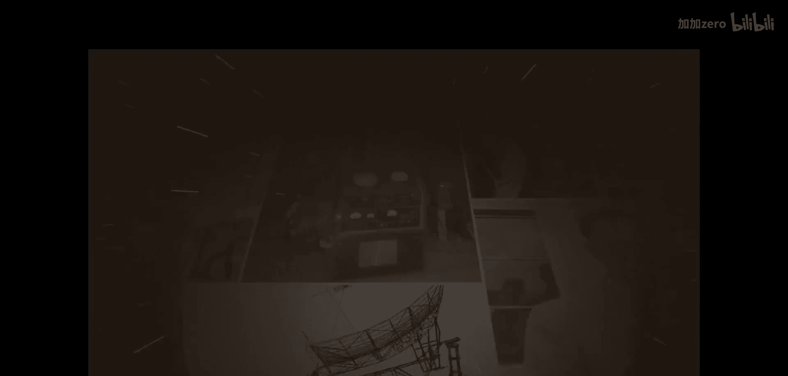
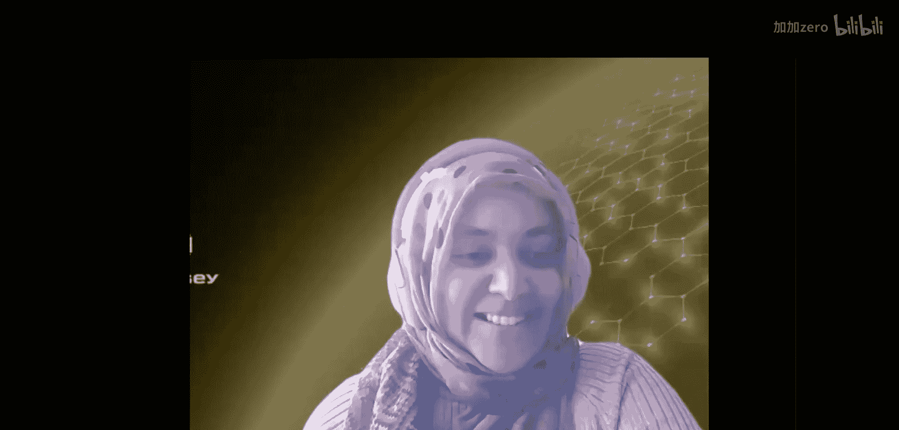
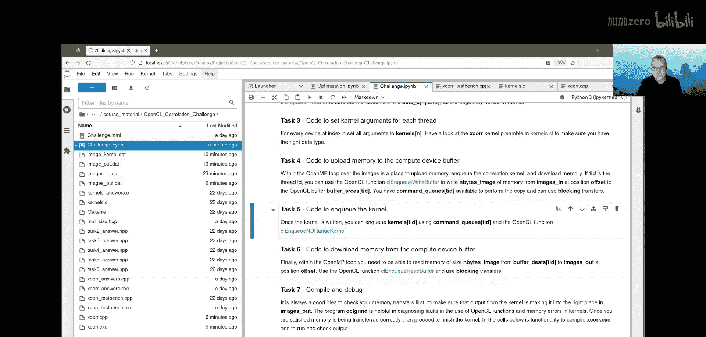

# 【OpenCL编程 Pawsey超算研究院】 p13 p12 OpenCL - day 3, part 4 - Optimising OpenCL kernels exercise -BV1fMz5Y3EDV_p13-

So what we'll do now is we will cover the final exercise。

So let's go to the open C correlation challenge， so I'll just just share my screen again。

Al right， so if we go to do coursear material。We can go to the folder called Open CL correlationlation challenge。

And if you look up challenge。All right， so the the grand challenge exercise for this course is to do edge detection with image correlation。

Now， for those of you folks who have done the H course， this is exactly the same。

But it is using Open CL instead of hip。Okay。So， let's talk about。

Image correlation with so edge detection with image correlation。Okay。

 so the development of convolutional neural networks has brought about a significant advance in machine learning capabilities in computer vision。

😊，Training and inference in convolutional neural networks rely on the application of many filters to an image via 2D discrete convolution。

So。If I is an image and K is a filter。Then the convolution proceeds as you are going to work。

 you're going to loop over every element of the kernel。

And in a way that is flipped to the access of the kernel。

 you are going to then walk over the elements of an array。And you're going to sum up over that walk。

And you're going that result then goes back into your image at position I and J。In practice， though。

 convolutional neural networks are not affected if the filter is flipped。

 so a conceptually simpler cross correlation is used instead。😊，So if we have a filter here。

 which is a matrix and for our purposes， the matrix。

 our filter or our filter kernel is only going to be three by three。

 so that's our filter kernel there。And when we apply this filter。

 it's sort of like a window that we slide over the image。

 so we overlay this window onto the image and then what we do is we do。😊。

Something like a dot product。 we do an element wise multiplication of every element of the filter with the corresponding element of the image。

 So we slide this filter over the image， and then we multiply-1 times 1。

 and then we add-1 times 5 and -1 times 8，-1 times 8。8 by one minus1 times2。

 and then we add1 times 9， we add minus1 times 7。 we add minus1 times 10。

So we add all those multiplications together and that results in our answer。

 which goes into the filtered image。 Now， when we're sliding this filter over the grid。😊。

So when we're sliding this filter over the image， we realize that we can't go any further than。

This here， we can't go any further than this area here。

And that would be the result that we put into the filtered image。In here。

 So that is what the filtering filtering operation is。

 And it turns out that this filter here is good at image edge detection。

 So this does an edge detection filter。Okay， so in this hypothetical exercise。

 the filter above is an edge detection filter。😊，And your colleagues are keen on applying this filter to a stack of images as the first stage in a machine vision experiment。

Unfortunately， their Python solution isn't fast enough for the onboard electronics for their device that they're using。

So since you're the Opense expert in the group， your colleagues are looking to you for a faster way to compute this cross correlation over a stack of images。

So task zero is to calculate the arithmetic intensity or the arithmetic density of this calculation。

 so for every pixel that is computed there are 18 fetches。

 so there are nine fetches from the filter and nine fetches from the image， there is one store。😊。

So there are 18 fetchers and one store， There are nine multiplies and nine ads for a total of 18 flops per pixel。

So if every pixel uses four bytes to store its value。

 then what is the arithmetic intensity or flops per byte ratio for this algorithm is the algorithm likely to be memory bandwidth or compute limited？

Okay so that's a question that you have to go through and answer。😊，嗯。😊。

So on a recent hike to the Peronggaops National Park and for those of you who are listening online。

 the Peronggaops National Park is about five to six hours drive southeast of Perth。

So there's a Perongga Ups National Park， so on a recent hike to the Perongga Ups National Park。

 you took this image and can use it to generate a trial stack of images。😊，So in the code below。

 we just load the image and plot both it and the filter that we want to apply。

 So this this code here is just Python code to load the image and plot it。

 So there's the image there and there is our image kernel。 So our image on the left and the kernel。

And our filter that we are going to apply is on the right。

Now we're interested in generating a stack of images to be used as a test block。

 so a pile of images that we want to use， so in this case we just use a sliding window across the images and generate a stack that way。

😊，So it doesn't actually matter where you get these images from。😊，There can be anything you want。

But what I have done is I have got this image I read it in。

 and now I've just created a stack of images by sliding a window across that larger image。

So here's my， here's my stack of images。 And if we run， if we run the。Yeah。

 if we run that that cell and then we can have a look。Over our stack of images。

 So we've got a stack of 100 images。Got a stack of 100 images there。😔，And。

And because we're sliding along the bigger image， it just appears as a bit of an animation。

 so we're sliding backwards and forwards along the bigger image。

 so it doesn't matter where your stack of images comes from we've read it an image we've turned it into grayscale and that is our stack of images。

Now I've just written out that stack of images as a binary dump。To file。

So that is going to be in images in dotDt and I inadvertently deleted that data file。

 but you can regenerate this file by running this notebook。

but what I will do is I will copy after after today。

 I will copy this file back up to Conics and I will put the location of that file into the welcome letter。

So you can find the file that way。Now I think Ash you might already have a copy of this file from the H course。

Okay， so this images in dot dot that has to be in the same directory as this example。

 so you need to have the images in directory so the images in dotDt file in the same directory as the exercise。

Okay。Down here is an existing Python cross correlation solution。

 and that's the best algorithm that your colleagues could come up with。

They generate a stack of images called proof images that you can use to check your solution。

So I have got two cross correlation algorithms here， one of them uses scipi。

 the other one uses just straightforward nuy manipulation。

So we generate our proof images and then we apply。We apply。The filter to each one of those images。

 And this is the resulting stack that is。Redduced。😔，So if we zoom in。

 we can zoom in and we can see the effect of the edge detection filter。

 so it has detected these edges， these rock edges here。

 so the edge detection filter is working with the Python solution。All right。

 so you were thinking about this problem and you came across a brilliant idea。

The correlation process over the stack of images can be farmed out to multiple compute devices as shown below。

 So if you have a set of open seal compute devices。

 you could farm out the correlation process or the application of this filter。

 you could farm out that to every device， so you could farm out this device。

 this correlation application to every compute device that you have access to。

So a fellow colleague has already， thankfully created a program to load the images and iterate over them using a dynamic pool of open MP threats。

😊，I think the original intent was to use Openmp and a single openmp thread to work over the stack of images。

 so it would be a dynamic work schedule， so that would mean that there's a pool of so many openmp threads and each and openmp thread would be responsible for doing an image correlation。

so the application of that filter。However， you have taken this open MP code and you are now going to farm out that。

You're going to farm out that。Image correlation to an available open C compute device。The thread。

 the openmp pool assigns the next image to a thread or assigns the next image to a compute device as it finishes work。

 So that's already been done for you。 That scheduling thing has already been done for you。

 Your tasks are to add in the necessary bits of open seal code to implement the kernel。

But also to upload and download memory to the compute devices。Okay， so if we have a look。

 I'll just close all these other programs。If we have a look at the Open seal correlation challenge folder。

 there is a number of files in here。Now， the program that you're going to want to edit is called Xcore dot CPP。

 So that's the cross correlation。Master program。And if we have a look at this master program， XCore。

 and I do apologize， we we've just hit three o'clock。

But we're almost finished with the exercise or explaining the exercise。

 So this is how the program X core dot CPP runs。We get our devices， we acquire all the devices。

 we report on the devices， we create command cues。We set up our image， so we create our images out。

 we read in our images in， and they are large input arrays and output arrays to store the stack of images coming in and to store the stack of images coming out。

The image size for images in and images out is the same。As。It should be the same。Size。Yes。

 it should be the same size， So the stack of images coming in is the same size as the stack of images going out so you can you can assume。

You can assume safely that the the input stack of images has been padded or whatever needs to be done。

 and you only need to put into the output。The result， that is。

Valid so you can put you can put for example， a zero into this into these outlying regions so that's that's fine you don't need to worry about putting an answer into these outlying regions only where the image is valid so you just y don't need to worry about about you don't need to worry about padding that's what i'm saying。

Like you don't need to worry about。Filling the padded the outer regions with any particular value。嗯。

Okay， so what the code is doing at the moment is creating command cues reading in the image。

 it takes care of all the code to。It takes care of all the code。To create command cues。

 And it takes care of all the code to read in and compile the kernel。Now。

You're going to have a number of devices， you're going to have a number of devices that you get in when you discover resources。

 and that is in the thing numb that is in the data nu devices。Okay， so that's none devices。

And what you do is you need to create a set or an input buffer for every device。

 an output buffer for every device， then they will serve as your source and destination。Images。

So that's what we're doing here， so task。1。Task one will be。

 so we just go back to the challenge here。Task1 will be。2。

Build the kernel or to finish the kernel that will complete the cross correlation for every pixel。

And that task is probably the most challenging。And that task is to complete the kernel that performs a cross correlation。

If you need to go Fatima， that's fine， I'll definitely I'll definitely。

Definitely close the recording for you。 Al right， That's all good。 Thank。

 I'll probably hang around for a while。 no worries。 Thank you。 Yep， Okay。

 so the task one is to complete the cross correlation for each pixel。😊，Okay。

 so have a look at the kernel source in kernels。 C。So。The kernel source should be in kernels。t C。

 sorry， not kernels。cl。Alright， so if you have a look at kernels dot C。

 there is a kernel in here called X core。So in kernels。c。

 there is a kernel called X core Now it it only has the coordinates I0 and I1 read in from your open seal grid。

Other arguments that have been passed in are L0 source， L1 source。

 So they are the sizes of your source and destination image。And they are the paddings。

 So pad 0 left and pad 0， right， pad 1 left and pad 1 right。 So pad 0 left。

Pad0 left is you've got a central pixel here， Pad0 left is the number of elements before Pad0 R is the number of elements after。

😊，And for this particular correlation。For this particular cross correlation。

The number of elements before your output is zero and the number of elements after your output is2 so there's going to be two elements paded in this direction and two elements paded in this direction。

 So that's what I mean by the padding So padd0 L is the number of elements in this direction Pa0 R is sorry Pad0 L is the number of elements in this direction Pa0 R is the elements in this direction Pa0。

Pd 1 L is the number of elements in this direction which is0 Pad1 R is the number of elements in this direction。

 which is2。Okay。And so that's relative to my output。 So my output is going to be in this square here。

So that's the output from the calculation。And there's going to be two elements padded in the right direction that way。

 two elements in that direction。 So that's what I mean by the padding Pa 0 L and pad 0 R。

 But if you have this information， then you can write a general kernel that will compute a cross correlation。

But you have to make sure that you don't go outside the bounds of your memory。

So that's really that's really important。😊，Okay。So task one is to complete the cross correlation。Now。

 the great thing is that you've got a code here called Xco text test benchch。😊，So X core test bench。

😔，Reads in the same kernel source。But what it does is， it helps you。

It helps you with your cross correlation。Design， it helps you by testing the output of your kernel from the output of a CPU cross correlation。

So what I mean by that is， okay， let let's just run the X core test bench。

So the X core test bench does， so here's my image kernel here。Here's my image input。

And here's the image that I got from the CPU。Implementation。

This is the output from my open seal kernel， at the moment。And if the kernel is running correctly。

 then the image from openCL to the output image will be the same as the image from the CPU。

 so that's my image input that is after the filtering and that should contain the right answer once the kernel is right。

And you can use things like open sealL grind or OCL grind。2。Test。

 make sure your memory accesses in the kernel are right。

And you'll also get an easy visual comparison here if your kernel is running correctly。

Now there's nothing in X core test bench that you need to change。

 all you need to do is just compile it and run it。All that you need to change is the kernel here for task one。

So that's changing the kernel。 So complete the kernel is one of the tasks。 Now。

 if that gets difficult， the answer kernel is in kernel answers dot C so you can copy paste that kernel code into this file in kernels dot C if you get stuck。

 but then try and understand why or how this this cross correlation is working。Okay。

 so that is task one is to finish the kernel code to do a cross correlation and this is a fairly difficult task and this could be this could be your exercise。

 you can do just this task if you want。It's up to your ability how many tasks you'd like to take on。

If you'd like to take on another task， you can。Insert some code to create the open seal buffers for each thread。

So， down here。We've got an array called sourcess D， D D and currents D。

They are going to take memory allocations。Of open seal buffers。

And those memory allocations are relevant for each compute device。Okay。

 so you're going to call C create buffer， but you need to use the right device。

And you need to use the right reference to sources D。

You need to use the right reference with inity and currentsty Now。

 if you get stuck with any of these tasks， you can do a shortcut solution by uncommenting the include line and that includes the shortcut answer to that particular task So task two is code to create the open seal buffers for each compute device slash each openmp thread。

Task3， and you can see that in the code， every task is clearly outlined。

 and with every task you can always remove this comment here to include the answer。Okay。

 so in that way or in that manner， task2 is to create the open seal buffers for each thread。

And you can read some helpful information about how to do that。In task three。

 you need to have code to set the kernel arguments for each thread。In task4。

 you will insert code to upload memory to a compute device buffer。In task five。

 you'll have code to incu the kernel， taskask six， you'll place your right code to download memory from the compute device buffer。

Task seven you can use or task seven is to compile and debug。Now。

 if you get stuck with any of these things， the answer。All those tasks is in Xcore An。 CPP。

So if you then compile and run the solution。Over a stack of images。So， if we。

If we compile and run the code as it is。It produces an image rate that is extremely fast。

 And that is because it's not actually doing any correlations。When you， when you。

Are just about ready or just about finished with modifications to Xco you can make and run the code using make and then Xco do Xy。

ThisThis code here is to read and check the results。

And I would recommend actually trying this exercise on Hub2 because this has all the things available。

 including the ability to write to imagesout。d。😊，So， try this on hubub 2。

And you can run this little cell here。 You can run this cell to check the output。 Now， at the moment。

 X core doesn't have a completed kernel。 So if we have a look inside here。

Images doesn't contain anything， but proof image does。

 And that's because that we haven't finished the code。 It's。

 we're just writing out an array of zeros to images out。So when everything's working correctly。

 though， we will have images the same as proof images， okay？😊。

So if you are able to see edges in both images and proof images and they look the same。

 then congratulations you have successfully completed the task and your project can progress otherwise by all means take a peek at the answers。

😊，Okay， so here is X core answers。On the CPU so that just uses the CPU to run the correlation over a stack of images and on the CPU on my laptop I'm getting 957。

94 images per second。If I use just the GPU。I can get 1，326 images on my NviIDdia GPU。

But I can get 1365 images on my sorry， I can get 1365 images if I use both GPUs。

If I use CPUs and GPUs， then I can get a processing rate of 827 images per second。

 so there is a bit of a slow down， there's a bit of a slow down here。嗯。

I then check my solution because I have done the answer。 So on the CPU and the GP。

 here's my stack of images。And you can see that they are the same。 So that's what success looks like。

 successcc looks like the images stack and the proof images stack looking the same。Okay。

 so that is the exercise。Now in Xcore do cP is all the openmp codes you don't need to worry about that。

 You just need to worry about you just need to worry about filling in the open C code as well as completing the kernel in kernels do C and it really is a choose your own adventure you can choose to work on as few things or as many things as you want It really is up to you and your abilities and what you would like to explore。

Okay， so you can use any of the things that we talked about in this course。

 you can use any of the optimization techniques， you can use any of the debugging techniques。

 You can even use shared virtual memory if you'd like， you can use SVM allocations for your memory。

 the sky is the limit， you can do as much or as little as you'd like with this exercise。

So happy coding and I will have time tomorrow to go through this example and I will I will also copy the data to。

😊，I will copy the input image stack to satonics and put the location of that into the welcome letter。

Al right， well， thank you so much。 And that concludes today's training material。😊。

