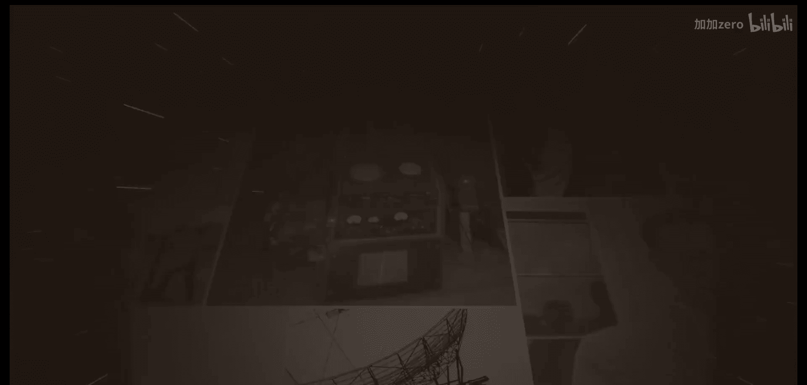
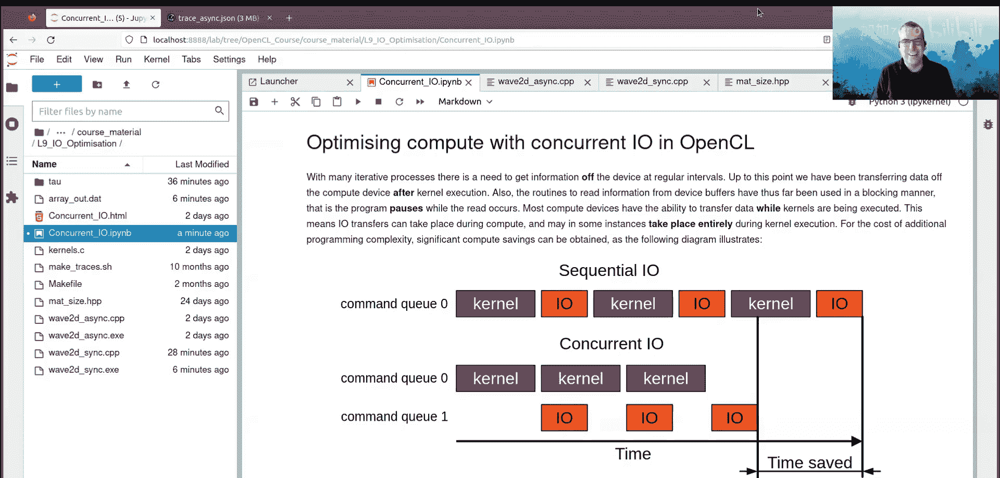

# 【OpenCL编程 Pawsey超算研究院】 p14 p13 OpenCL - day 4 - Optimising compute with OpenCL -BV1fMz5Y3EDV_p14-

Okay， hi， everyone and welcome to the final module。😊，Of working with Opense。

 where we cover optimizing compute with concurrent I O。

So open seal calls like kernel launches are asynchronous by default。

 so that means that they that means that they return immediately and then the work happens in the background。

With copies so with copies and memory maps， you have the option of making them synchronous or asynchronous as well。

 so that would mean that they return immediately after you run them so you have the option of setting a flag。

😊，Whereby you can have that that copy that copy call returnturn immediately。

 and then the work happens in the background in the command queue。

We're going to talk about strategies to leverage multiple command cubes。😊。

So that we can do I O at the same time as compute。So this is an optimization technique whereby we do IO at the same time as compute。

 and this is useful for many iterative processes where you have a simulation for example。

 and you would like to read off the solution at regular intervals from your compute devices。

And you can use， you can use these techniques to achieve a speedup because you can do Io while compute is happening。

So this is an optimization technique。 So I'm just going to share my screen and。😊，There we go。Okay。

 so with many iterative processes， there is a need to get information out of your simulation or off the compute devices at regular intervals。

Up until this point， we have been transferring the data off the compute device after we know that the kernel is finished。

🤧Furthermore， the routines to read information from device buffers have thus far been used in a blocking manner。

 so that means that the host program pauses while this read occurs。

So most compute devices have the ability to transfer data while kernels are being executed。

This means that Io transfers can take place during compute。And in some instances。

 may take place entirely during the kernel execution。

So for the cost of additional programming complexity， significant compute savings can be obtained。

 so we've got a diagram here of sequential IO so this is an iterative process time is on this axis and you might run a kernel followed by some IO to extract information out of your simulation。

😊，Then you'd run another kernel for the next iteration， followed by an I O step。Now。

 if we were able to leverage concurrent IO， such that IO can occur at the same time as a kernel inside a different command queue。

Then you can see that you could run a kernel。Run the kernel for the next time step and then do the I O for the previous time step。

In this way， you can achieve a time saving， so this difference here between the end of this run and the end of this run is your time saved。

So this is an optimization technique and the things that we need in order to make concurrent IO work is multiple command cues and a way to synchronize work。

Such that。This kernel here has to make sure that this I O is finished before launching the next kernel。

 So things like that synchronization between the command queuees。

 So you need some way of synchronizing between the command cues to make sure that that the I O is finished。

So the key to leveraging concurrent IO is to have one command queue for the kernels， perhaps。

 and one or more command cues for moving data。The general idea is you can do Io on one command queue and you can do compute。

On another。Now， if you have multiple command queuees。Then you can have one command queue doing IO。

Or you can you can have a bunch of command cues doing IO。

You can set off a copy and then you can do some iterations and then get back to the get back to the get back。

Yeah， get back to your process。 I've just got to plug my battery in for the laptop sorry。嗯。

I just realized， I just realized I hadn't plugged it in and we just about run out of battery。So。

 anyway。So getting back to concurrent IO。Alright。So let's do an example of concurrent IO。

With the 2D wave equation。😔，And。😊，Before we do that。

 I think I'll just read this the key to leveraging concurrent IO， so we've done that。😊。

Io operations can then take place largely independently of the compute operations。

 So that's the whole idea behind having multiple command queuees。

Now how you establish dependencies between command cues。

 you can either use things like open seal events。Or the C。

 L finish command to wait for all work to be done。In a command queue。So in this example。

 we're going to do synchronous IO and asynchronous IO。And we're going to use multiple command cues。

For the asynchronous IO situation and we can use we're going to use both events and explicit weight on command queuees using the CL finish command。

So， and we're also going to use non blocking IO calls as well to help with concurrency。

So let's do an example。We're going to use the 2D wave equation。

 so this is the 2D scalar wave equation。And this is just going to be our iterative process。

 we're going to set off a firework inside a box， and then we're just going to examine the output。

So this is going to be an iterative process。So if you or the wave field， so U is the way field。

 that represents the amplitude of the wave at every location in my computational domain。

 so U is a 2D grid storing the amplitude of a sound wave at every location。

V is a 2D grid storing the velocity of sound at every location in the grid。And T is time。

So for 2D waves， they propagate according to this formula here。

So the double partial derivative with respect to time of the amplitude of the wayfield is related to the velocity and the Laplian so that is the sum of double double partial derivatives in space。

This is a forcing term， so if we had a firework going off in the middle of box。

 that forcing term would be the energy that we inject at a particular time。

So if Delta T is a discrete time step， then a second order finite difference approximation to this time derivative。

 this time double derivative。Is given in terms of the amplitude at time steps，0， So U 0， U 1 and U 2。

So this is an approximation to the double derivative in time。

So what we can do is we can put this approximation into and substitute that into this equation。

 and we can solve for you too， which is the next time step。

So that is the way field at the next time step is two times the way field at the current time step minus the way field at the old time step plus this term here。

Now this is an iterative formula now to generate the amplitude at the next time step U2。

If we know the present amplitude U1 and the past amplitude， U not。

So we can use also finite difference approximations for the spatial derivatives here。

And we can express those spatial derivatives as a matrix multiplied by u1。

 so we can do this as a matrix multiplication。But this complexity is unnecessary to show here。

All we need to know for the purpose of this demonstration is that the wayfield。

At the next time step is some function of the current time step， the past time step， the velocity。

The time spacing Delta T， as well as the forcing term。At the now time step。

So we can do the future as a function of the present and the past so in geophysics we typically use a rior wavelelet for the forcing term now the rior wavelet is a wavelelet that has energy spread over a fairly wide spectrum so that is it is good to have energy at a number of different wavelengths so the rior wavelelet is is a choice whereby a choice in geophysics typically that we inject into one cell of the grid as time progresses。

So if we have a look in。😊，The folder L9 IO optimization。There is a file called kernels。 C。

Now this kernel is already made for you， so there's no issue here nothing is there to implement。

So with this kernel， we bring in the way fields U0， U1， U2。 we bring in the velocity。

And then we bring in things to help with the calculation of the time and space derivatives。

 and then we have the position that we inject our wavelet into。

So we go ahead and define some finite difference coefficients Now we could have had those in constant memory。

 but I've just got them defined in the kernel as in register memory because they're quite small。

Then we compute the Laplian and update the solution。

 So that's that step there is we use that calculation to update the way field at the next time step。

And then we inject the forcing term at coordinates。P0 and P1。So that is。That is our kernel。

 and that kernel implements this function， F。So all we need to do now is at every time step we need to make available what U2 is U1 is and what U0 is。

And as the iteration proceeds， we can use an array。We can use an array of way fields。😔。

And that array of way fields can be cycled。And we can cycle those around。

 we can reuse old weed fields that we don't need anymore。

And we can do it that way so we can pass in what we know as U0 U1 and U2 at each time step。

So for this problem， we create a 2D grid as a square box of size n0 n1 is 256 in each dimension。

And the velocity， we're just going to set it to be uniform at 343 meters a second。

So it's a pretty fairly boring physics problem。😊，But it is equivalent to setting off a firework in the 2D room。

So we're setting off a firework in the middle of the box。

 and then we run a number of time steps to see how the sound wave propagates in the box。Okay。

So at each time step， we use our kernel to update the solution to the next time step。

At every iteration， we read off the way field at each time step and copy it into the host for viewing。

Old wave fields that are no longer needed are recycled for efficiency。

So any way fields that no longer participate in the next time step。re then recycled。

So the code below just reads in the definitions and array sizes from matsize。hppP。

 so mat size is defining the size of the domain。The spatial step in each direction， the velocity。

As well as a current number for stability。 So that is making that is a relationship that determines how small the time step should be。

For finite difference。 Yeah， for finite difference。codes。Okay， so we read that information in。Now。

 in wayfield 2D sink。We use an array of three open seal buffers to represent the wayfield at time steps0。

1 and 2。A single command queue is used for both kernel execution and reading off the wayfield at each time step。

As an IO operation， so we've got our kernel， we do IO， we do our kernel， we do IO。😔，And so forth。

 until。Until the simulation is done。So let's now make and run that application on our GPU。

And then we can do the script called make traces。😔，Now， that script goes ahead and uses Tau。

To make traces of both the synchronous and the asynchronous case。

 So before we have a look at the traces from this。Let's have a look at the code for the synchronous solution。

Alright， so we read in our arguments。We then acquire devices。And。Then， we set。Our profiling to true。

 We don't necessarily have to。 In this instance， we just have one command Q。

We grab our device and context， and then we just make a single command queue。To do all the things。😔。

Alright。So when we construct our velocity array， that's this code here。We make up our time step。

 using the current condition。Or the current number。

And then we have something to work out the maximum number of time steps in T。

And that's just enough time to allow the wayfield to get to the edge of the grid and back because。😔。

Because we're using fixed boundary conditions。The wayfield will bounce off the edge of the walls。

Then we make up our output array， so our output array is going to be of size nt by n0 by N1。Okay。Now。

 the application of the Laplian is very similar to the filter application that we did before。Instead。

 though， it is a stencil， so it's like a it's across shape， the access pattern is a stencil。

Going in dimension zero and dimension one。😔，So， instead of a square。

ASquare filter that we that we move around over the image in order to calculate the lapplaceche and the filter looks like a cross that we move over the。

That we move over the image。😔，Or move over the wayfield。

So here we are creating a read only buffer for velocity， the velocity in V。Okay。

And we can copy from host memory to create that buffer。 So array V already has the， Yeah。

 array V already is the allocation of memory。That has the velocity in it。

 And then we're just uploading that to an open C buffer。Yeah。And here is our。And。

Here is our buffer creation。 So we need to have one buffer。For every time step， now。

 I think we've set in scratch。Up here， I don't know if it's， yes， it is。 yet。

 we set N scratch is equal to3。So that is our set of three way fields。

 so N scratch is equal to three。And for every for every wayfield in that array of three way fields。

 we create a grid to store。To store you。 So that's buffers you。

So buffers U at position N is equal to C create buffer。With that context。

And that context is associated with our chosen compute device。Now we need to zero out that buffer。

So we need to zero out that buffer。Otherwise we'll be using uninitialized values。

 so we use C NQ fill buffer to initialize those way fields to zero。 and that's an important step。No。

 we。Got our kernel source。 So that is our kernel source code。

 So we read that kernel source code in and we build a program that contains the wave2D for order。

 So that's the that's the fourth order in space。 So we're doing a fourth order finite difference in space to approximate the Laplian。

Which is the sum of those spatial double derivatives。So then we set arguments for the kernel。

 so we brought some arguments in to help us do the math。Some of these are pre computed。

And so we do that。 So we bring in those arguments， and then we set arguments to the kernel here。 Now。

 these are the arguments that will not change during kernel execution。

 So the way fields will change at each time step。The way fields will change。

 but the other arguments such as these will not change。Okay， we set our desired local size。

And I'm just using 256 work items as a default。And we start the clock。

And so we start the clock by using standard Chrono， the high resolution clock in C plus plus。And。

At each time step， we select the Wa fieldss from our buffers array， so we select our way fieldss。

And that is the wayfield U U1 and U2。Okay， so we're just shifting our time step。

We're shifting our rior wavelet a little bit in time。So that's what that is。And at each time step。

 we set these kernel arguments， so these are the ones that do change every time step。

This step here is to incu the wave solve kernel。And then at each time step。

 we read out the solution into its own slice of array out。

So it's a stack of array out is a stack of images pretty much like the way sorry。

 pretty much like the images in stack that you used for the exercise。

So we're just reading out the way field into array out， which is a stack of output images。

Then at the end， we make sure that all the work is done in the command queue。And。Then。

 we stop the clock。Now， because we're using。嗯。It's not an asynchronous manner because we're using a synchronous code。

 This I O step， we've chosen for it to be blocking。 Okay， so we've got the blocking flag set to true。

 So this will wait This will wait for that kernel to finish。

Before it does its own copy and then when that copy is done。

 then it will read up the buffer and then when that read buffer is done。

 then it will return to the host for the next time step。So just as a。

 we don't actually need to do this step because of our。Because of our blocking read buffer。

 but we do it anyway just for teaching purposes that we wait on the command you to finish。

Then we grab our time step to stop the clock。And then we calculate the time。😔。

We calculate the time that it took from start to finish。 so that is for the entire iteration。

Then we write the array out dot to an output。Now with a real with a real。Seismic simulation code。

What you would be doing is you would be writing that array out to disk。

 so you'd be writing these temporary way fieldss here。You'd be not inserting them into memory。

 You'd be writing those way fields。Out to disk。 And you could cache those way fields in a temporary array。

Like array out， but at regular intervals， you would be wanting to write those way fields out to disk。

So this is only a small problem and it's only 2D。So we can get away with writing the array out at the end。

So we right now result out to file and then we free up all the open seal buffers that we've made。

 we free up our velocity array， and then we free up。Our output array。 So that's our。

 that's our result。 That's the result way field。And then we clean up devices， cues， and context。

Before finishing。Yeah。Okay， so that is the synchronous solution。

And if we go in our web browser to UI。peretto。evev。And then we can load the trace file， trace sync。

Alright， so this is the trace that we that we've collected。From that make traces script。 And that is。

 this is the trace for the synchronous solution。So we've got some， we've got some code here， whereby。

So I've got some open seal callss here and we can see that creating the command queue was really long。

😊，But if we move into this area here。This is actually where our iterations are being done。

So we can see that there is a wayfield execution。Followed by a read so。😔。

You can see that there is a wayfield followed by a read， a awayfield followed by a read。

 a wayfield followed by a read。And these host calls like NQ Read buffer。

 they're actually taking much longer than the combined time that the Wafield executes as well as the read so there's a bit of API overhead the kernel is actually the kernel and the IO are running faster than the API is。

😊，So that's that's interesting。 There's a lot of wasted time in here， a lot of wasted time。

So you can see that there are a number of iterations that are occurring。😔，Okay。

 now let's talk about the concurrent or asynchronous IO solution。So in wave 2D。

 async is the solution for concurrent IO。And the goal here is to use multiple command cues so that while one command queue is executing。

A kernelel， the other is working on I O。And we also use non blocking calls to C and Q read buffer so that it returns。

Immediately。Now， there is a。Before I say that， so this is a diagram showing time and this is our strategy。

 so we have one command queue working on the kernel。

And we can have more than one command queue working on IO so in the diagram I've just got command Q1。

 but in practice for this example I'm going to actually use a number of command cues。

So the placeholder for command Q1 is actually a number of command queuees。Okay， so in open C。

It is undefined behavior to read from a buffer。From another command Q。At the same time， a colonel。

Is using that buffer from another command queuee。 So it is undefined behavior to use one command queue to read from a buffer at the same time as another command queue is using that buffer。

这是。So work in that command queue is using that buffer， so。

It is undefined behavior to do IO on a buffer while a kernel is running on that buffer in another command queue。

During construction of this module， I found out this the hard way。

So I found out that reading from an open seal buffer。

 while it is being used by a kernel resulted in instability of the solution or even a program crash。

So therefore， we can safely read from buffers when no kernel is using them。

Our kernel needs to access way fields at time steps， U 0， U 1 and U 2。Therefore。

 they are not safe to copy from。But if we extend our array of way fields to u minus2 U minus-1。

In this direction， in the past。 So if we extend our array of way fields， then we can have U 2， U1。

 U 0。They are are free to participate in the calculation of the solution。

 but these way fields here in the past， they do not participate in the kernel and it is okay to copy from them。

😊，Okay。So what we do with the asynchronous solution and itll bring up wave 2 the async。

So bring up wave2 the async is we make the number of wayfield or scratch buffers。

 we make them equal to five， so we create five buffers to store the wave field。

Now we could have used four， but I'm using five to give the copies a bit of extra time to complete。

So we're using five wave fields。😔，So the solution to enable concurrent IO is to have an array of at least four open seal buffers to store the wayfield。

 but I'm going to use five because we can， because we also have the resources available to store five wayfields instead。

Instead of four。So we've engineered a bit of leeway into our。Into our code by having five way fields。

So associated with these buffers is an array of five command cues for IO。

And there is one command Q for compute。 So if we have a look at wave 2 D ay。

When we create when we create the number of command cues。We make one more command queue than we need。

 And we set up the compute queue as。As one of the the array。

 so we create six command cues in this array here， we create six command cues and then we set one aside for use as the compute queuee。

So we've got we've got six command queues in total。We've got five for IO and then one for compute。

Okay， so we go through our calculation as before， and we set up our buffers as before。Now。😔。

We set up our arguments as before。And this。Now is the main loop in the program。Okay。

So we've got an array of five command queuees for Io and one command queue for compute。Every queued。

 sorry， Every cud operation in open seal can depend on a list of。Open seal events。

And then it can produce one or output to one open seal event。

 So every queue operation in open seal can wait on an event or a list of events。

And then it produces all outputs to one event as its output。So therefore。

 we also create an array of five events。So， we've got。We've got our array of events。😔。

So just look for C event。😔，Okay， so there is our array of five events， our array of N scratch events。

And those will be used to establish a dependency。From。

They will be used to establish a dependency for the IO to occur。Okay。😊，All right。Yep。

So we create an array of five events to make sure that Io waits for the kernel execution to finish。

 and we have one separate command queue just for the kernel。Now， for teaching purposes。

 we could have used either command cues or events purely for synchronization。

But for teaching purposes， we use a mixture of both waiting on command cues and open CL events。

 just so that you can see how it could work in either scenario。Okay。

 so during each iteration of the loop， we begin by waiting on the I O command queue that is at this position here。

 So we cycle the way fields。We cycle the wave fields using this modulular arithmetic。

So if we have a look at the。If we have a look inside the main loop。

If we have a look in the main loop， we've got our iterations going from n is equal to zero and less than nt。

N plus， plus。And N plus 2 modo N scratch is always going to be the future way field。 So the modular。

 the modular command is the remainder after we divide。In by N， scratch。So that。

That number is always going to cycle from 0，1，2，3，4，0，1，2，3，4，0，1，2，3，4。 So that's what。

 that's what that result of that calculation will be。So that is going to select from command queuees。

The cycled， yeah， that is going to select from command cues。

The right command queue that is relevant to the calculation of the。Buffffer at the future time step。

Or the calculation of the way field at a future time step。So。This command queue。

 So we wait on that command queue to finish before we do the calculation。Then we in cu the kernel。

 so we've got a step here where we in cu the kernel。And。Then we place an event at。

Time step in percent in scratch。So at time step N modular in Sc。

 that is the place where we place an event。And that is for the kernelnal execution。

So the event for the kernel will go into this slot here。

 so we've got an array of events and if we have a look at how we're doing that。

 so when we in cu the kernel we place the output event from the kernel into events at N modulo and scratch。

So that is that is， in essence， placing the event here。Now， when we do IO， so in the next bit here。

 we do。We do IO。😔，So this CNQ read buffer is not blocking。

 so we would have set if we go up to where we specify blocking so blocking is C false so we don't have blocking IO running that means that the call to C read buffer will finish immediately will return immediately。

And so we use， we use copy index， which is n minus-1 so we。

Are then going to copy the way fields at n-1。So in our copy step， we wait on。We wait on。Our。Sorry。

 we wait on our event。We wait on the event that was placed here。 So in we what we wait on。Sorry。

 we wait on this event。And then we incu a command to copy this way field out to the output array。Now。

 we placed an event into this wave field。For the kernels。 sorry。

 we placed an event into this element of the events array when we ran the kernel。

 So at the next time step， at the next time step。When we go to do the。嗯。The copy， the read buffer。

For this， for this time step， where， where we are in effect。Making sure that the kernelel is done。

From this time step。So。When we get to the next， when we get to the next iteration。

This event should be done， but we're still going to wait on it。

 So we're going to wait on the event at n-1% in scratch。 So we're going to wait on that。

 And then we use an I O command Q at n-1。In scratch， which is our copy index。

 we're going to use that command queue to copy the way field here。So iteration will then proceed。

Each iteration， these way fields are cycled， so this iteration at the next iteration。

 this command Q will be in this position。And then at the iteration afterwards。

 this command queue will be at this position， and then we explicitly wait on that command queue。

At this step here。So we use seat all finished to wait on that command cube。

So this is how we are doing the asynchronous IO。So we do a kernel。

 we do a kernel to compute UN2 using these way fields using these way fieldss here。

 we place an event。Into the events array at this position。

 And then we initiate a copy using the I O command queue for the way field at this position。

 And this copy waits for an event。And that event is in this position。

And it corresponds to the colonel execution at the previous time step。

So that's how we're establishing dependencies， we're using both events。

As well as an explicit weight on a command queuee now we could have used events for all the synchronization or we could have used command cues for all the synchronization。

 but for teaching purposes where using both just to show you how it can be done。Okay。

 so that is the iteration and it proceeds as before now there is an extra if statement here saying that if n is greater than zero。

😊，So we don't when n is equal to zero， this wayfield doesn't have any any meaning。

 So it's just it's just zeros。And with our copy index。With our value of N。

 our copy index is equal to n -1。 So if we used。If we used。If we used n 1， if n was equal to 0。

 then our copy index would be -1， and then that would result in a memory access violation when we copied to array out。

 So that's just why I have that if。If statement there。Okay， so we're copying asynchronously。

We're copying asynchronously our IO out at every step。And yeah， that's that's asynchronous I O。Okay。

So。Let's now run that。Let's now run that and we see that the asynchronous calculation took 32 milliseconds。

Let's have a look at the results of the synchronous calculation。 It took 49。Miseconds。

 So there is a speed up there by using asynchronous I O。Now let's have a look at the trace for that。

So let's have a look at the trace。goinging back to。Trace a sink。All right。So in this view with tau。

 in this view with Tau now， you can see that there are a number of threads that are associated with the command cubes。

So we've got five extra threads so this this is the command queuee that is associated with the kernel and these are the command cues that are associated with the IO and you can see that only reads are done inside so only reads are done。

Inside this Io command， In these Io command cues。And if you have a look， you can see that the read。😊。

Overlas。With。😔，With the execution of the kernel。 So Io is being done。At the same time。

IO is being done at the same time as the colonnal executions。

And because we have those synchronization safeguards in place。

 it is all okay because we are explicitly waiting for the IO command queue to finish before we do any kernel executions。

So those safeguards， these safeguards here using events and explicit weights， they are necessary。😊。

Otherwise， if this IO is slow， then the kernel could start using that array before it is finished using doing a copy。

So that is the reason why we have these synchronization safeguards in place。Okay。

 so we've had a look with Pereto， and we can see that I O is occurring at the same time as the kernel execution。

 And if we plot our wayfield。So this is our wayfield here。And if we do that。

 we can see that the firework。Starts off and it runs into the edges of the box and then reflects off。

 So we've done a roughly 600630 times。I' done 640 time steps。And。That's what that is。 So if you。

 if you run this in Jupiter， you can then do these animations。

 where you can have a look at that wayfield， reflecting off the sides of the box。So in this module。

 we learned how concurrent IO。Or can take place at the same time as a kernel using different command cues。

 so using multiple command cues。The concurrent IO solutions save time over the sequential IO solution。

 but it was a bit more complex to code。One does need to be careful that buffers are not being read or written at the same time as they being as they are being used by another command queue This is important and it leads to undefined behavior such as crashes。

Open seal events and the use of the CL finish function can establish and enforce dependencies between activity that occurs across multiple command cues Okay and that module is done and there is no exercise associated with this particular module however you could you could use these techniques in the main exercise if you wanted and that main exercise is on correlation of a stack of images so you could do that for teaching purposes however yeah actually you could do that for teaching purposes you could use those techniques in the correlation exercise。

So okay， with that we have now finished the teaching component of the OpenCL course。

 it was great to have you along for the journey have fun with the exercises and we'll see you in a future course Okay。

 thank you。😊。

