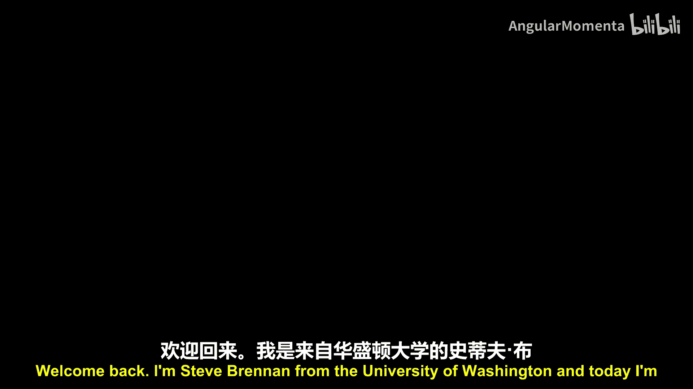
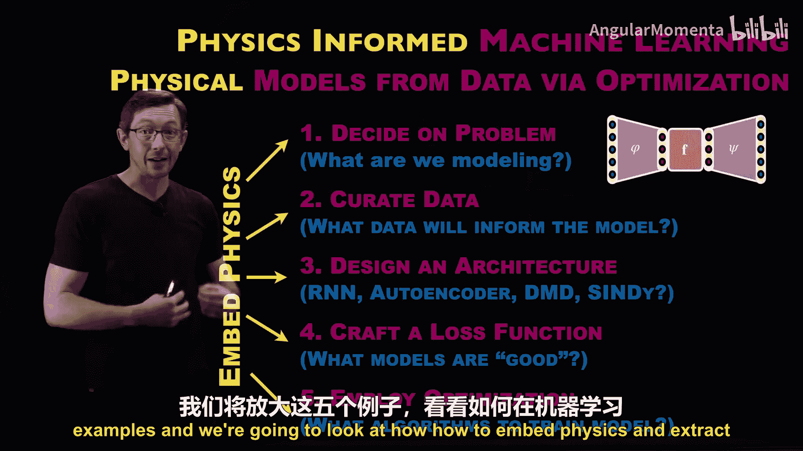
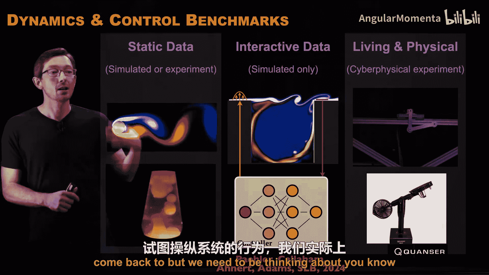
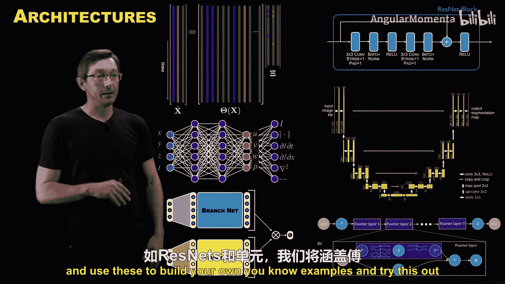
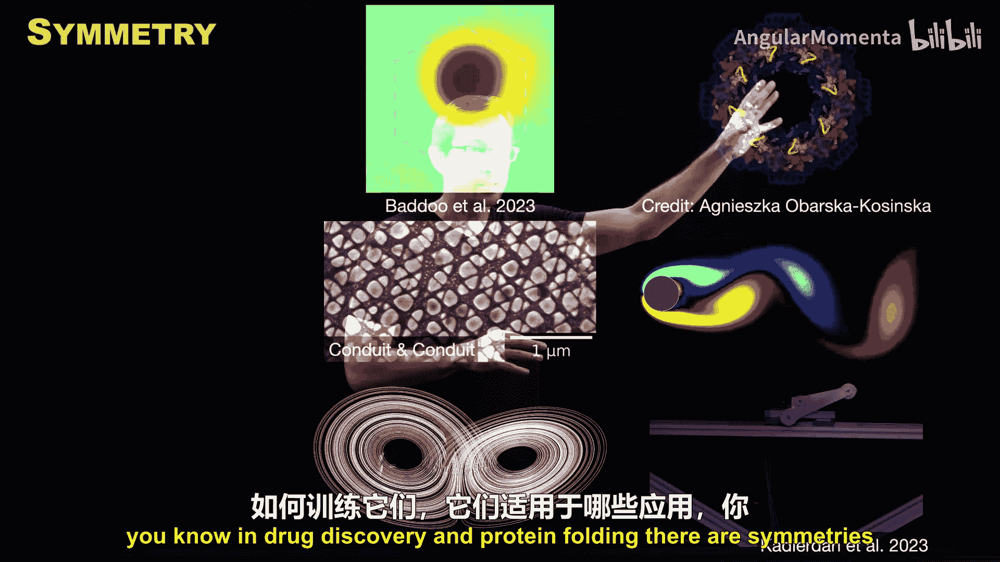
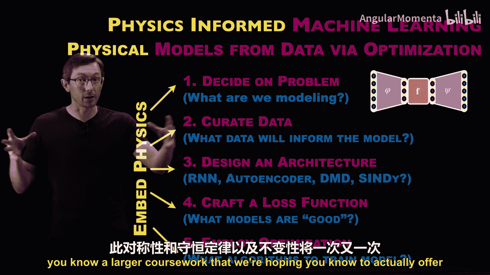

# 【精译】物理信息机器学习-p01-01-物理信息机器学习：科学与工程中人工智能与机器学习的高级概述--BV1c9uDzQEj8_p1-

Welcome back I'm Steve Brennton from the University of Washington and today I'm really excited to start a new lecture series which is a part of a larger set of boot camps and short courses on the topic of physics informed machine learning so this is one of the most important topics in all of machine learning because it's really at the intersection of how do you leverage existing physical knowledge to improve machine learning systems。

And how do you use machine learning to learn new physics that humans have never written down before？

You know the idea of machine learning， we talk about this all the time。

 we see the success stories in the news in our daily lives and the pace of progress is really you know astounding in machine learning things that were once only you know science fiction are now science fact so this is you know the Mona Lisa coming to life from a single still image with machine learning we also have you know rapidly advancing generative AI so this is an example of Dolly too where you can put in a prompt like guitar monster and it just generates this beautiful image of a monster playing a guitar notice that the guitar is also a monster which I think is kind of cool。

And although these are absolutely useful for things like creating new art and graphics and generating text and translating languages。

 all kinds of classic machine learning tasks， there is this growing world of how do we use physics and machine learning for things like designing an entirely new aircraft？

or a new supermateri that's going to be used in the engine or in the wing or the fuselage of this aircraft or any of the other engineering and physics tasks that we as humans have。

 things like predicting and modeling and understanding fluid flows and turbulence。

 which are again important for designing aircraft race cars， transport ships。

 as well as wind turbines and understanding climate change and weather and things like that。

 things like robotics and digital twins for autonomy。

 and this is just a tiny tiny glimpse of the many， many applications of machine learning and physics informed machine learning in particular in engineering and natural sciences。

If you want to be a part of this revolution， if you want to change the world。

 if you want to design new supermaterials that are going to allow us to build better aircraft and better wind turbines and better algorithms for robots and understanding things like climate change。

Physics informed machine learning is going to become an essential tool in your arsenal in the future。

 so that's what this lecture series is about and this is the overview lecture in that series。Okay。

 so zooming out， we've talked about this a lot before that machine learning is essentially the process of building models from data using optimization and regression techniques Now we've been building models from data with optimization and regression for decades。

 if not centuries， if not millennia as humans， so some of our earliest models of the planets were essentially models from observational data that we did some kind of accrued regression or optimization to kind of understand those models。

But today we have much more data， it's much more we have much more advanced optimization algorithms。

 and so that's one of the reasons machine learning has been advancing so rapidly。

Now that's classic machine learning， what we're interested in talking about today and in this series is physics informed machine learning。

 which is how do we build physical models from data using those same optimization and regression techniques。

 or at least building on those existing optimization and regression frameworks。

And so this entire series is focused on this intersection of artificial intelligence and machine learning with physics I think too often researchers in the machine learning field kind of forget that we actually have centuries of knowledge of physics。

 we have tons and tons of knowledge of how physical systems actually work。

 and oftentimes we throw that out when we build these machine learning models。

 but in the last five or10 years it started to become more clear that we actually need to incorporate physics into the machine learning process to get the advanced performance we need on really complicated systems like in engineering or in natural sciences and biology。

 things like that。And so there's kind of two big aspects that are going to come up over and over again。

 two big themes in this series， one is we can enforce physics into machine learning models。

 we essentially can take known physics or partially known physics， things like symmetries。

 conservation laws， invari things like that， and we can bake those in to our machine learning models to make them much more performant so we can learn better models that generalize better with less training data if we enforce physics into the models。

And the flip side of that is we can often and increasingly are able to use machine learning techniques to discover entirely new physics with our measurement data。

 so if I have measurement data from you know galactic motion or a plasma or you some biological system I might be able to use these machine learning methods that are being developed in other fields of computer science and I might be able to use those methods to discover new physical models that we've never been able to write down before that humans haven't been able to discover because of either their complexity or some other aspect you know some complexity of the data and so that's a really exciting aspect too we can start getting things like ordinary and partial differential equations that describe really。

 really complex systems that humans haven't been able to describe using classical methods so those are the two big themes we're going to enforce or bake in physics into the machine learning。

😊，Process and simultaneously， oftentimes we're going to use machine learning to discover new physics。

 and we're going to find that these are kind of dual problems。

And here's a really really simple example I like to show just to get us warmed up what do we mean by physics informed machine learning。

 this is a pendulum mounted on the wall in my lab and so it's just moving back and forth。

 there's a little accelerometer on the tip and a little LED so you can take a video of this and kind of traditional machine learning might take a video of this pendulum and try to use an autoencoder neural network to reduce the dimension of this video into a minimal latent state given by this red vector here。

 such that you can use that minimal state and then recreate the video from those very few variables we know that this is a low dimensionmenal system we think that this is probably described by you a variable theta。

 the angle maybe its angular velocity。Kind of naive machine learning would just you know try to find some coordinates that you can compress this data down to so that you could also then expand it back into the full video。

Whereas physics informed machine learning is trying to do something a little bit more sophisticated。

 we're not just trying to learn the coordinates to compress this video。

 we're also trying to learn maybe a differential equation for how those coordinates evolve in time。

 something like this equation we know。From the damped pendulum equation and again。

 you can think of this in one of two ways I could either if I knew that this was the equation。

 I could try to bake that into this latent state in these red coordinates here to try to learn the right coordinates with my machine learning model if I baked in this known physics。

 I might be able to do a better job or alternatively I could try to learn this differential equation purely from this measurement data。

Now， again， zooming into this example， we know that there's kind of two key ingredients if we were going to do this using textbook methods。

 the first would be I need to learn a good coordinate system theta in which I can represent this pendulum motion。

 theta is a lot better than the X and Y position of the tip， for example。

And then once I learn that coordinate， I want to learn some equations of motion。

 some differential equation that describes how the system evolves in time。

So that's kind of what we mean by physics and machine learning。

 oftentimes that means learning the right coordinates and learning some governing equations or some physical laws。

 which oftentimes are things like differential equations that describe the motion in time and again we can either learn that from our data or we can bake some of these elements in to our machine learning models good。

Okay， so we're going to zoom out and we're going to be talking about specifically the stages that go into building a classic machine learning model。

 so I'm going to break this down into five key stages that we typically use to build any machine learning model。

 and then I'm going to show you how we can bake physics into each of those five stages。

Now this is not 100% accurate， I say you this is 80， 90% accurate tops。

 but this is a good kind of guideline for how the process of machine learning works that we can use to kind of organize this lecture series。

So the first of five stages in machine learning is essentially deciding on a problem。

 what are we going to model with our machine learning model okay so that means deciding on what are the inputs and the outputs。

 what relationship am I trying to model。So it could be， you know。

 I have pictures of dogs and cats and I want to build a classifier to label them as dogs or cats。

 we decided on a problem of what we're going to model， okay。Stage2， once I've done that。

 I need to gather and curate data training data that I'm going to use to train that model。 Okay。

 so what data will inform that model and how do I gather that data。 So again。

 in that dogs and cats example， I need a bunch of pictures of dogs and cats， And I have to decide。

 do I actually have the labels， Do I know which images are dogs and which ones are cats。

 You know that's my， my data curation。 Often one of the most expensive processes in this pipeline。

 Sometimes this can be you know， millions or tens of millions of dollars to get that data set。

Stage3 and this is where a lot of people get excited myself included is stage3 you get to design some kind of an architecture so we know what problem we're trying to model。

 we know the inputs in the outputs that we want to be kind of learning the relationship between Stage3 is where we choose an architecture like a you know special type of neural network or a Cindy model or an autoencoder。

 whatever type of architecture you choose that because you think that it's going to do a good job of representing that functional relationship between the inputs and outputs and so a lot of work goes into designing custom architectures that are good for specific types of problems we know that if we want to do image classification we use convolutional neural networks if we want to model time series we use recurrent neural networks and things like that so there's a lot of kind of know how and choosing the architecture In fact this is an architecture of an autoencoder that is used for compressing the dimension of an input down before。

😊，Expanding it back out， okay？Stage4， so now we know the problem we have our data and we have a candidate architecture we think we might be able to train to model that input output relationship。

 Stage4 is crafting a loss function， some kind of an objective function that tells you if your models did a good job so usually this includes terms like the actual error of the input output prediction of your neural network or whatever your machine learning architecture is with the actual data you use to train it and there's all kinds of other loss functions you can add。

 you can add regularization terms to make your model more sparse or more smooth or things like that。

 So again， steps 3 and4 are where a lot of the modern research in machine learning and in physics machine informed machine learning exists today a lot a lot of research in stages 3 and4。

And step five， once we have our architecture and our loss function。

 we essentially pick some optimization algorithm to train the model， and by training the model。

 what we mean is we use optimization to tweak the parameters of our architecture to tune and learn the parameters of this architecture to minimize our loss function averaged over our data。

😊，This is such an important point I'm going to say this again okay so our architecture is some class of functions that you can use to represent the input output relationships you want to model okay so there are essentially parameters of this architecture you can tune in the case of a neural network it's literally the weights of all of the connections in that neural network。

 you get to tune those weights to learn some kind of input output function。😊。

And so we use optimization like the atom optimizer and many other types of stochastic gradient descent optimization。

To。To tune those parameters of your architecture to minimize your loss function averaged over your training data。

And that's really the entire process of machine learning， Okay， we decide on a problem。

 we collect our data， We pick a class of functions we think can represent that input output relationship。

 We call that an architecture， like a specific kind of neural network。

We design or craft a loss function that tells us if we did a good job。

 and then we use optimization to tweak the parameters of our architecture to learn those parameters that minimize the loss function averaged over our training data。

And the reason I lay it out like this in these five stages is because each of these five stages gives unique opportunities for embedding physics into the process and in some cases for discovering physics。

So if we have partial knowledge of the physics， if I know that I am trying to model you know the lift over an airfoil or some material property or some robotic arm with you know joints and linkages。

 then at each of these stages， each of these five stages I can embed knowledge of the physics and improve this machine learning process I can constrain the architecture I can add custom loss functions。

 there are certain types of optimizations I can use that will respect this physics more than others。

 and so all of these stages give us unique and powerful ways of adding physics into the process。

So we're going to use this diagram to organize almost this entire kind of short you module or boot camp in this larger lecture series。

 so we're going to zoom into each of these five examples and we're going to look at how to embed physics and extract physics in each of these stages of machine learning。

So if you want to learn more about this， some of this is in a textbook written by Nathan Cuzson and myself。

 datadriven science and engineeringering， you can download a free PDF of it here。

 and I'm hoping that around the time that this video is released， there will be other resources。

 you notes on this and things like that， so check the video description for more links to resources that you can use。

Now again， we think a lot about architectures， that's one of the kind of exciting things that gets people。

 you know， a lot of people get excited by all of the cool architectures you can try on a new machine learning task。

 especially in physics informed machine learning。And there is a zoo of possible architectures just for neural networks。

 and I want to make an important point， not all machine learning is just neural networks。

 there's a lot of other architectures that are not neural networks that we can use to learn models from data。

 but even within the realm of just looking at neural networks， there is this kind of menagerie。

 this zoo of neural networks。And a lot of times。What we do is kind of akin to alchemy so kind of modernday alchemy where you have a problem and through some combination of intuition maybe reading Redddit posts or seeing what your friend did we have some idea of what types of neural network architectures might or might not work for our problem and then we often end up just trying a bunch of them and sometimes they work and sometimes they don't sometimes you can turn lead into gold metaphorically speaking and sometimes you can't and so one of the big pushes of applying machine learning to physical systems where we actually do have some prior knowledge。

 we know a lot about these systems is that maybe we can start also learning principles of how and when different neural network architectures actually are appropriate for a given problem So this is a really really important point you know obviously we want to be doing better engineering and better science and we want to use the best tools at our disposal which。

Nowadays， machine learning is in that tool set。But there is another perspective which is by applying machine learning to physical problems where we sometimes know the answer。

 we can learn a lot more about these machine learning algorithms and models than we would if we just apply it to a system where we don't know the answer。

 things like you trying to cure cancer so if you apply this to systems where you know the answer we might be able to go from this alchemy stage of machine learning to something that more closely resembles chemistry where there's actual principles and organization to when and how to use these building blocks for a particular problem that's something we are very。

 very you know interested in doing as a community， there's a ton of effort kind of trying to learn these basic principles of machine learning by applying them to physics systems systems where we know the answer and engineering systems。

And this is actually one of the main thrusts of this NSF funded AI Institutet in D systems。

 you can kind of go to the website and Google it and check it out。

 but there is this NSF funded AI Institutesit and dynamic systems which is really focused on trying to understand how can you embed physics into machine learning systems how can you use machine learning systems to learn new physics to solve engineering tasks in these various application domains and to go from that kind of alchemy model of just guess and check and trial and error to something much more principle and so this is a collaboration with many。

 many people and it's actually bigger than just this NSF Institutetit trying to learn these principles of machine learning so really exciting field and topic and area and it's a really great time to be a researcher stepping into this field because there's a ton of open problems unsolve challenges and。

You know， many， many， many billion dollar industries can be transformed with these techniques in the coming years。

Good， okay， so I'm just going to zoom into these five kind of areas of machine learning and talk about examples of how we bake physics in this is just going to be a very。

 very fast high level overview I'm going have entire videos going into each of these sub problemsblems so we're gonna have a whole video talking about how you can bake physics into this stage one and stage two and so on and so forth but let's just kind of zoom in at a very high level so the first stage of machine learning is deciding on the problem sometimes this doesn't even go it goes unstated you know people take this for granted。

 but this is an important part of the machine learning process is picking what you actually think you can model with your data what you want to model what would be a useful model why do you want a model those are all important questions。

😊，And fundamentally， at the end of the day， if you're modeling a physical system like you know a lava lamp or a pendulum or a fluid flow。

 if you're modeling you know a materials process or something that is actually physical。

 then you're kind of already doing this you know physics based machine learning。

 physics is already in the process when you decide that you're trying to model some physical process。

 so for example。If I'm going to you know in my machine learning model。

 try to learn the forces on this pendulum， you know so we know f equals MA。

 if I try to learn those forces with a machine learning model。

 I'm already baking physics into the process through the problem statement。

 Similarlyly I could try to learn you know a Hamiltonian or a Larangian。

 I could try to learn a free energy potential or you know lots and lots of different ways you can bake in physics just by setting up the problem in a clever way。

Okay， stage two curating the data， so what data am I going to use again。

 if the data comes from a physical system， inherently you are kind of embedding physics through that data collection。

And sometimes I joke that stage two is kind of the Google way of baking physics into the model。

 because if the idea is if you collect enough data of the natural world。

It kind of has to learn physics like F equals MA and maybe even eventually things like e equals MC squared just to reconcile all of that data that it's collecting but the reason I say that that's like the Google approach is because it's very。

 very expensive that relies on having you nearly infinite amounts of data which often as scientists and engineers。

 we don't have that luxury so we much more often have targeted。

 limited kind of narrow data sets that we have to use to learn the physics that extrapolates more broadly and this is kind of subtle again。

 we're gonna to have a whole video going into this， but I want to briefly mention it。So you know。

 for example am I going to take fluid flow fields as my training data and am I going to have them at different flow velocities。

 you know that's a very different model if it only has one fluid flow  velocity or it has a range of velocities that will change kind of what physics I'm capturing in my model。

Similarly， you know， if I'd have fluid flow， geophysical fluid flow。

 this is actually cloud formation past Guadalupe Island， if I have this kind of data。

 one of the things I can do in my data curation process to add physics is。

If I think that the physics doesn't actually depend on you the angle of rotation or translation。

 if I think that my physics is invariant to some kind of symmetry， like translation or rotation。

 I can augment my data with additional copies that are transformed according to that in this case。

 you know rotations in other cases， translations， that's again a very。

 very common thing people do is that if you know that your system has some symmetry or invariance。

 which is another form of physics， you can augment that data to kind of have to transform your data to have those symmetrymetries and invariance。

So for example， if I'm building a classifier that can tell a Prius from a Ford pickup truck and maybe know other cars and trucks。

 I'm going to take my images of cars and trucks and I might rotate them and translate them and scale them because none of that should matter for the classification so I can take my data and augment it to include those symmetries and invariances that we think our model should be invariant to。

Good。And again， one of the things I'm going to talk about a lot and I've talked about this in previous videos and we're going to zoom into it here is the coordinates typically matter a lot when we're doing machine learning on physical systems so this is a cartoon from Mar and Christsteren that I really like I use this one a lot this shows these kind of two different coordinate systems for the planets and the sun and the Earth。

 the one on the right this is the geocentric view that is kind of what things look like from our earthcented perspective。

And it's really hard to learn physics and models in this coordinate system。

Whereas if we fix the coordinate system and put the sun at the center， it's a lot easier。

 the data makes more sense and it's easier to build a model from data。

So often curating the data means finding the right coordinate systems， so sometimes we learn that。

 sometimes we kind of enforce that through prior knowledge of the physics， and it makes a huge。

 huge difference in the learning process。Good。Okay， stage three designing an architecture。

 we're going to spend a ton of time here， probably you know five or10 hours are going to be dedicated just to all of the different architectures on the market。

 different loss functions for those architectures again at a mile high we might have things like Larangi and neural networks so if you know that your system has this kind of Ouler laggrange equation framing if it's a mechanical system like a double pendulum。

 you might use a specific architecture like a laggange and neural network so that your system consserves energy。

Important point， almost all of these architectures also have a corresponding set of custom loss functions that are needed to train them。

 so stages three and four really do sometimes kind of get a little bit mixed。

Okay so this is just one example of a particular structure for a physical system。

 we also have one notion of kind of what is physical is parsimony we like our models to be as simple as possible to describe the data but no simpler that's the approach here in our Cindy autoencoder where you use an autoencoder to learn a good coordinate system and then you have the sparsest model in some class of models that describe the data okay so we're going to use that principle of lowdial and sparse to promote models that are as simple as possible to describe the data and no simpler this principle of parsimony that's been with us for 2000 years from you know Aristotle to Einstein that's been one of the ways we've kind of measured if a system is physical is in its simplicity and its ability to describe measurement data okay so this is another type of architecture。

😊，And then you know this is actually one of my favorite architectures。

 it's one of the earlier ones in the modern physics and form machine learning era。😊。

By Julia Ling and collaborators。They were using neural networks predict to try to build closure models for turbulent fluid flows and their architecture is different than a standard deep neural network architecture they have this additional auxiliary kind of tens or input layer that allows their network to be invariant to Galilean transformations。

 again， we know that these fluid flows should be the same you know under certain kinds of rotations and translations。

 and so through a choice of architecture they made it so that their models have to have that kind of invariance and they perform way way better than if you don't include that into the machine learning process。

These are just three of like literally hundreds of different types of custom architectures that you can use to imbue certain types of physics into your system。

Now I was actually talking to my wife Bing about this。Earlier， and she pointed out。

 when you choose an architecture。to make your system more physical。

 to make your machine learning model more physical， that's something called an inductive bias。

 it's kind of a bias that goes unspoken， but it highly steers or influences the downstream machine learning process。

 so we're going to talk about inductive biases and choices of architectures a bit more later in this section。

Okay， good， moving on， so you know item4， this is another really。

 really rich area of research is how do you build loss functions that promote models that are more physical in certain ways？

We already talked about those sparse models， parsimonious models that are as simple as possible to describe the data that is quantified by a term in the loss function。

 the L1 norm or the L0 norm quantifies sparsity and parsimony。

 so oftentimes you know physics is promoted through additional regularizing terms or loss functions in your training process。

Probably the most famous example of this is the physics informed neural network or P illustrated here。

 so this is just a standard kind of deep feed forward neural network used to map some inputs like space and time to some outputs like a fluid flow field。

And normally what I would do is I would just have some loss function that averages you know how accurate is this model over some training data that's kind of the naive way of doing it What the Ps does is that from this output data。

 you can actually compute terms in your partial differential equation and you can add your actual physics。

 the partial differential equation that the system should be satisfying as another loss term in your loss function so if you know the physics if you know that your system is divergence free or satisfies the navy or Stokes equations or the elastic beam equation whatever the equation is if you know it you can add in a regularizing loss term to your machine learning process and this should dramatically improve the learning performance you can get away with way less data and get much better model performance if you include the physics as a loss function so again we're gonna have a whole lecture just on this one topic because it's so important codes and examples and case studies and everything。

😊，Okay， the last step， and this one I think is super important。

 it's not quite as common as stages three and four for embedding physics， but it's very。

 very important and we do a lot of work this in my lab and in my collaborators groups。

Is using optimization to enforce physics so if I add physics as a term in the loss function。

 that is essentially adding the suggestion that we want physics to be satisfied。

 but it's always fighting you know we want low model error and we want the physics to be satisfied and they sometimes are dueling objectives。

 so just adding physics as a loss function only kind of promotes physics。

 but it doesn't enforce that physics is satisfied， but often with optimization you can constrain and enforce that your physics is satisfied at a much higher precision you at a a much more stringent type of enforcing of physics。

So for example， we've done some work in fluid flow modeling with machine learning。

 and we know that there are certain symmetries and properties like energy is conserved in these incompressible flows。

And so what I could do is I could build a loss function that has my model error and some constraints that are necessary for this to conserve energy。

Or instead of just having this as a loss function， I could do a constrained least squares so that these constraints are satisfied always to numerical precision by construction。

So again， if this doesn't make perfect sense right now， it's okay。

 we're going to go into depth in each of these topics and have， you know， at least one video。

 but probably a couple of hours of material on each of these topics。

But the idea is you can promote if I know some constraints that should be satisfied for my system to be physical。

 things like energy conservation， or a certain type of symmetry。

 I can either add that in as a term in my loss function。

 but it's not going to go to zero through the optimization process if it's just in my loss function。

Or I can do things like use Lage multipliers or constrained least squares so that I can change my optimization problem so that these constraints are exactly satisfied every you know every time I optimize this function so that's something we do a lot and there are really powerful methods for enforcing physics this way it's a little more involved it gives you better physics imposition。

 but it's also more human effort to actually build this into the optimization function。

Another example， so we're going to find kind of a theme in this lecture series is。😊。

We're going to talk a lot about what is physics in the first place。

 what is this physics we're talking about。And oftentimes physics manifests itself through symmetries okay I am bilaterally symmetric。

 meaning I have mirror symmetry so if I flip myself in the mirror。

 essentially nothing changes and lots of physical systems have other types of symmetries。

 we've talked about translational symmetry， rotational symmetry this is you know a quantum potential well with a hexagonal potential。

 so it has kind of this interesting symmetry group of rotations and reflections。

And I'll talk about this later， but there are methods like physics informedform DMD where you actually constrained your solution to live on a certain manifold of solutions that satisfy that symmetry。

 so this is again going to be a whole probably many short course all about symmetries and how to bake symmetries into machine learning and how to extract symmetries from your data with machine learning。

 huge， huge topic very， very important and this is going to change how we do machine learning。

 it is currently changing how we do machine learning and it's only going to continue to improve our capabilities in the next five。

10 years。Okay， so those are the five stages， those are at least you know five clear opportunities of how to bake physics into your machine learning process now I'm just going to give you a super fast sneak peek of the rest of what you're going to see at least in the next few hours。

So you know， I guess first what I'm going to do is I'm just going to show you kind of a pictorial example of those five stages just so you can see it in a different way and then I'm going to give you a sneak peek of some of the things we're going to do you know coming up next。

So again， stage one is setting up the problem so I'm to give I'm going to walk through a specific example now where the problem I want to solve is model reduction of a fluid flow so problem is I want to take a complicated model of a fluid and I want a simpler model of that fluid something that runs faster on a smaller computer。

😊，So I need some data， I need to curate some measurement data in this case。

 maybe I have a simulation， an expensive simulation of a full complexity you know numerical simulation of a fluid flow。

 so my problem is trying to get a simpler description。 I start with the high dimensional data。

Stage three is choosing an architecture。So in this case。

 the architecture I'm going to choose is this kind of autoenr architecture because it has the properties I want。

 it goes from high dimension to low dimension， and these low dimensional states Z are chosen so that they are most likely to be able to reconstruct the high dimensional state again。

And I'm also going to say that I want to be able to learn a dynamical system。

 some differential equation on that lowdial latent state that's what I mean by model reduction I want to take my highdial system compress it down to a lowdial state and learn some dynamics。

 some differential equation in that lowdial state it'll be much much faster then to run this simulation maybe in real time and I'll get most of the physics that's happening in this system okay so those are the first three stages。

 stage four is crafting a loss function so we need to build some kind of a function that tells me if my model did a good job now remember。

😊，Our architecture is some function that maps inputs to outputs to do， you know。

 the problem to solve the problem we want to solve。 and it has parameters。

 theta these parameters are。Tuning parameters that I can tweak to make this function fit the data。

 Okay， in this case， I have， you know， my three neural networks。

 each of them has a set of parameters， Theta 1 theta 2 and theta 3。

 and I can tweak those parameters to make this function fit this data better。

 and that's quantified by this loss function。 What I mean by by a better fit。And finally。

 the fifth stage is to optimize over all of those thetas。

 literally to tweak the thetas to minimize the loss function averaged over the training data。

This is just a restatement of what we've already said， but in a slightly different pictorial fashion。

Okay。Okay， good， so again， now we're going to zoom out。

 do a sneak preview of what we're going to see next in this series。So applications and engineering。

 I think this is a huge one， we're going to have lots of case studies and applications looking into how this has actually been used in various use cases and what I'm going to show here is just a small window of the many。

 many applications that there are and that we're going to explore in this series so things like again modeling fluid flows and turbulence。

Things like shape optimization how do you actually design a wing that has the right lift over drag characteristics and that has the right structural characteristics this is a big multi objectivejective optimization problem and remember training a machine learning model is also a multi- objectivejective optimization problem so these kind of make sense that they would go together so things like modeling fluid flows。

 maybe designing you know the shape of an aircraft or a car or a wind turbine designing a material a composite or an alloy that you're going to use in these engineering downstream applications again multi objectivejective optimization。

 very highdimensional design space for for materials。😊，Digital twins。

 so I might have some physical aspect like a robot arm or like an aircraft or a factory floor and I might want some digital representation。

 some digital model that I can design and optimize over like this digital twin here。

And then kind of just robotics in general， robotics and autonomy is an area that is rapidly advancing with new machine learning technology。

And again， this is just a pretty small you know subset of the applications that there are and that we're going to talk about。

 other examples include drug discovery， protein design。

 you know and those are systems that are governed by physics。

 there's physics and how proteins fold and how you know chemistry works。

 so you know those are also big， big applications， other areas things like climate science。

 understanding weather phenomena and patterns and climate trends， again， related to turbulence。

 but a very， very different context， tons of applications of this。

Digital twin is really an important concept here when we think about building a machine learning model that is trained from data and has this kind of hybrid physics and data driven flavor。

 that's very much what a digital twin is going for。

 it's kind of a living model of some complex system like an aircraft or a factory floor or you know a materials baking process like a composite baking process。

Where you want this digital twin of your physical asset to be as accurate as possible。

 you want your model to update as you collect new data。

 so your machine learning models need to be able to update。

 you need to have uncertainty estimates of how good that model is or where it's the most uncertain so you can either know if you can trust your model and in the best case scenario you know how to go collect more data to improve your model。

All of those are working towards this notion of a digital twin。

 which in principle should allow us to design to do better engineering design cheaper and faster and safer。

So we're going to have again a whole short course on digital twin engineering where you know we talk about how do you build these digital twin models and how do you use them for better design testing evaluation。

 things like that okay I really like this diagram here from this paper by Cap time at all in nature computational science and it kind of is a nice representation of this kind of dualality between the physical and the digital twin of that physical asset。

Okay， so again， physics and machine learning， if you're going to use a digital twin for something like an aircraft。

 it better be， you know， physical， it better have that physics baked into that process。Okay。

 we're also going to talk about the importance of benchmark systems。

 so most of the progress in classic machine learning， image sciences， natural language processing。

 things like that。A lot of that progress is because we had very good benchmark problems and data sets that you could use that the community could use to test their methods on。

 so a researcher didn't have to create a benchmark problem and the machine learning algorithm they could focus their work on the machine learning algorithms and so increasingly we're finding that we need those kinds of benchmark problems for dynamics and control for physics and engineering problems。

 so I might need you know these static data sets of our systems。

 they're not static in the sense the system is evolving in time。

 but once I collect that data the data doesn't change it's a static data set of a dynamical system。

 it could be simulated or experimental。Um， but really， I want to be， you know。

 developing these benchmark systems for。Engineering purposes where we're actually trying to manipulate the behavior of the system we actually want to control the fluid with our machine learning model。

 so I need to be able to interact with that simulation and actually close the loop with my machine learning model。

 so we're developing benchmark problems in that kind of interactive control framework as well。

And then。Ideally we would go you know to actual living cyber physical systems like an actual piece of laboratory equipment that you can train your machine learning model on in real time that's much closer to the kind of digital twin notion that we're going to be getting towards again this is going to be an entire short course on all of the benchmarks that are out there。

 what are the characteristics that you need for a physics informed machine learning benchmark and so on so this is an important topic we're going to come back to but we need to be thinking about you know how are we going to test our models and what is the ground truth do we have ground truth in some of these cases。

Architectures， we already talked about the importance of that stage three and really it architectures and the loss functions we use to train these architectures but we're going to cover a lot of the really really important ones。

 things like Resnets and units we're going cover Fourier neural operators and general kind of operator methods we'll talk about Cindy and know kind of library regression and parsimonious symbolic regression modeling we'll talk about physics informed neural networks。

 deep operator networks and a bunch more this is just kind of a quick smattering of some of the architectures we're going to look at but we're going to spend a lot of our time doing whole videos or even whole video series diving into these really really important topics how do you build these loss functions how do you train these what applications do they work on know how do we actually code this up and try it ourselves okay so we're going to really dig into a lot of these applications and you can actually take these then and use these to build。

Your own examples and try this out yourself。

And again， we're going to throughout this entire series revisit this notion of like what is physics in the first place。

 why do we want to bake physics into our systems， why do we need to bake physics into our systems when we try to learn physics from data what does that even mean what are we learning and time and time again we're going to find that things like conservation laws。

 invaris and symmetries are some of the ways that we end up encapsulating physics so we're going to again see symmetries a lot you know in drug discovery and protein folding there are symmetries。

 fluid flows and mechanical systems， material systems。

 quantum systems symmetries are fundamental to physics and so symmetries and conservation laws and invaris are going to keep coming up over and over again。

 also this notion of parsimony or simplicity of the model。

And in the process of doing this we're also going to not lose track of the history of science and the history of physics because that's going to give us a lot of important parallels that we can learn from in this modern machine learning era。

 so the difference between astrology and astronomy， what changed。

 the difference between alchemy and chemistry， okay and it really there is a lot of that parallel happening today in machine learning and so we can learn a lot from the history of science when we're doing this kind of new physics and form machine learning。

Okay so that's the topic that's the course physics informed machine learning。

 we're going to have tons of short focused modules on each of these topics I see this fitting into you know a larger coursework that we're hoping you know to actually offer for credit at University of Washington at some point in the future so you know I hope you enjoy this it's a passion of mine it's one of the most important fields of machine learning and this is going to increasingly become you know very powerful tool in your arsenal to solve real worldor problems all right thank you。

